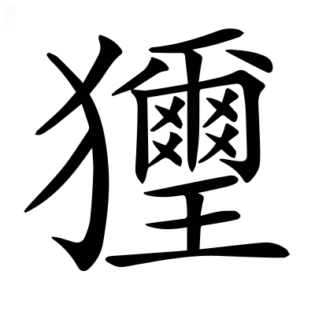

**春秋經傳集解** *〈春秋經傳集解·佳買反舊夫子之經與丘明之傳各卷杜氏合而釋之故曰經傳集解〉*

# 隱公第一

*〈隱公·名息姑惠公之子母聲子諡法不尸其位曰隱◎第一·此不題左氏傳公羊榖梁二傳旣顯姓別之此不言自見〉*

## 隱元年

**惠公元妃孟子** *〈惠公·名不皇諡法愛人好與曰惠其子隱公讓國之君◎元妃·芳非反傳曰嘉耦曰妃〉言元妃明始適夫人也子宋姓〈始適·本又作嫡同丁歷反〉* **孟子卒** *不稱薨不成喪也無謚先夫死不得從夫謚〈無諡·實至反〉* **繼室以聲子生隱公** *聲謚也蓋孟子之姪娣也諸侯始娶則同姓之國以姪娣媵元妃死則次妃攝治內事猶不得稱夫人故謂之繼室〈之姪·直結反字林丈一反兄女也◎娣也·大計反女弟也◎始娶·七住反◎娣媵·以證反又繩證反〉* **宋武公生仲子仲子生而有文在其手曰為魯夫人故仲子歸于我** *婦人謂嫁曰歸以手理自然成字有若天命故嫁之於魯〈婦人謂嫁曰歸·本或無曰字此依公羊傳〉* **生桓公而惠公薨** *言歸魯而生男惠公不以桓生之年薨* **是以隱公立而奉之** *隱公繼室之子當嗣世以禎祥之故追成父志為桓尚少是以立為大子帥國人奉之為經元年春不書即位傳〈以禎·音貞◎為桓·于偽反◎尚少·詩照反◎大子·音泰舊太字皆作大後大子皆放此◎為經元年·于偽反後凡為經為傳張本起本之例皆放此更不音〉*

> **元年春王正月** *隱公之始年周王之正月也凡人君即位欲其體元以居正故不言一年一月也隱雖不即位然攝行君事故亦朝廟告朔也告朔朝正例在襄二十九年即位例在隱莊閔僖元年〈朝廟·直遥反下同〉*
> 
> **三月公及邾儀父盟于蔑** *〈儀父·音甫儀父邾子之字凡人名字皆放此◎于蔑·亡結反地名〉附庸之君未王命例稱名能自通於大國繼好息民故書字貴之名例在莊五年邾今魯國鄒縣也蔑姑蔑魯地魯國卞縣南有姑城〈繼好·呼報反◎鄒縣·側留反◎卞縣·皮彦反本或作弁〉*
> 
> **夏五月鄭伯克段于鄢** *〈克段·徒亂反鄭伯弟名◎于鄢·於晚反又於建反又於然反〉不稱國討而言鄭伯譏失教也段不弟故不言弟明鄭伯雖失教而段亦凶逆以君討臣而用二君之例者言段強大雋傑據大都以耦國所謂得雋曰克也國討例在莊二十二年得雋例在莊十一年母弟例在宣十七年鄭在熒陽宛陵縣西南鄢今潁川鄢陵縣〈不弟·音悌又如字◎儁傑·音俊下音桀◎熒陽·戶扄反本或作滎非◎宛陵·於阮反又於元反〉*
> 
> **秋七月天王使宰咺來歸惠公仲子之賵** *〈宰咺·吁阮反◎之賵·芳鳳反〉宰官咺名也咺贈死不及尸弔生不及哀豫凶事故貶而名之此天子大夫稱字之例仲子者桓公之母婦人無謚故以字配姓來者自外之文歸者不反之辭*
> 
> **九月及宋人盟于宿** *客主無名皆微者也宿小國東平無鹽縣也凡盟以國地者國主亦與盟例在僖十九年宋今梁國睢陽縣〈亦與·音預下同◎睢陽·音雖〉*
> 
> **冬十有二月祭伯來** *〈祭伯·側界反國名傳祭仲同〉祭伯諸侯為王卿士者祭國伯爵也傳曰非王命也釋其不稱使〈稱使·如字又所吏反〉*
> 
> **公子益師卒** *傳例曰公不與小斂故不書日所以示薄厚也春秋不以日月為例唯卿佐之喪獨託日以見義者事之得失既未足以褒貶人君然亦非死者之罪無辭可以寄文而人臣輕賤死日可略故特假日以見義〈小斂·力驗反◎以見·賢遍反〉*

**元年春王周正月** *言周以別夏殷〈以別·彼列反◎夏殷·戶雅反三代之號可以意求〉* **不書即位攝也** *假攝君政不脩即位之禮故史不書於策傳所以見異於常〈見異·賢遍反〉*

**三月公及邾儀父盟于蔑邾子克也** *克儀父名* **未王命故不書爵 *〈故不書爵·一本無故字〉* 曰儀父貴之也** *王未賜命以為諸侯其後儀父服事齊桓以獎王室王命以為邾子故莊十六年經書邾子克卒〈以獎·將丈反〉* **公攝位而欲求好於邾 *〈求好·呼報反〉* 故為蔑之盟** *解所以與盟也〈與盟·如字又音預〉*

**夏四月費伯帥師城郎 *〈費伯·音祕〉* 不書非公命也** *費伯魯大夫郎魯邑高平方與縣東南有郁郎亭傳曰君舉必書然則史之策書皆君命也今不書於經亦因史之舊法故傳釋之諸魯事傳釋不書他皆放此〈有郁·於六反◎皆放·甫往反後此例皆同〉*

**初鄭武公娶于申曰武姜** *〈娶于·取住反〉申國今南陽宛縣〈宛縣·於元反〉* **生莊公及共叔段** *〈共叔·音恭共地名凡國名地名人名字氏族皆不重音疑者復出後放此〉段出奔共故曰共叔猶晉侯在鄂謂之鄂侯〈在鄂·五各反〉* **莊公寤生 *〈寤生·五故反〉* 驚姜氏故名曰寤生遂惡之** *〈惡之·烏路反注同〉寐寤而莊公已生故驚而惡之* **愛共叔段欲立之** *欲立以為大子* **亟請於武公 *〈亟請·欺兾反數也〉* 公弗許及莊公即位為之請制 *〈為之·于偽反〉* 公曰制巖邑也 *〈嚴邑·五銜反本又作巖〉* 虢叔死焉 *〈虢叔·瓜百反國名〉* 他邑唯命** *虢叔東虢君也恃制巖險而不脩德鄭滅之恐段復然故開以他邑虢國今熒陽縣〈復然·扶又反〉* **請京使居之謂之京城大叔** *〈大叔·音泰注及下皆同〉公順姜請使段居京謂之京城大叔言寵異於衆臣京鄭邑今熒陽京縣* **祭仲曰都城過百雉 *〈過百·古臥反後不音者皆同〉* 國之害也** *祭仲鄭大夫方丈曰堵三堵曰雉一雉之牆長三丈高一丈侯伯之城方五里徑三百雉故其大都不得過百雉〈曰堵·丁古反◎長三·直亮反又如字◎髙·古報反又如字◎徑三·古定反〉* **先王之制大都不過參國之一** *〈參國·七南反又音三〉三分國城之一* **中五之一小九之一今京不度非制也** *不合法度非先王制* **君將不堪公曰姜氏欲之焉辟害 *〈焉辟·於虔反〉* 對曰姜氏何厭之有 *〈何厭·於鹽反〉* 不如早為之所** *使得其所宜* **無使滋蔓 *〈滋蔓·音萬〉* 蔓難圖也蔓草猶不可除況君之寵弟乎公曰多行不義必自斃 *〈自斃·婢世反本又作弊舊扶設反踣也〉* 子姑待之** *斃踣也姑且也〈斃踣·蒲北反〉* **既而大叔命西鄙北鄙貳於己** *鄙鄭邊邑貳兩屬* **公子呂曰國不堪貳君將若之何** *公子呂鄭大夫* **欲與大叔臣請事之若弗與則請除之無生民心** *叔久不除則舉國之民當生他心* **公曰無庸將自及** *言無用除之禍將自及* **大叔又收貳以為己邑** *前兩屬者今皆取以為己邑* **至于廩延** *〈廩延·力錦反〉言轉侵多也廩延鄭邑陳留酸棗縣北有延津* **子封曰可矣厚將得衆** *子封公子呂也厚謂土地廣大* **公曰不義不暱 *〈不暱·女乙反親也〉* 厚將崩** *不義於君不親於兄非衆所附雖厚必崩* **大叔完聚** *〈完·音桓〉完城郭聚人民* **繕甲兵 *〈繕甲·市戰反〉* 具卒乘** *〈具卒·尊忽反步兵也注及下同◎乘·繩證反注及下同〉步曰卒車曰乘* **將襲鄭夫人將啟之** *啟開也* **公聞其期曰可矣命子封帥車二百乘以伐京** *古者兵車一乘甲士三人步卒七十二人* **京叛大叔段段入于鄢公伐諸鄢五月辛丑大叔出奔共** *〈奔共·音恭〉共國今汲郡共縣〈汲郡·居及反〉* **書曰鄭伯克段于鄢段不弟 *〈不弟·大計反又如字〉* 故不言弟如二君故曰克稱鄭伯譏失教也謂之鄭志不言出奔難之也** *〈難之·乃旦反注同〉傳言夫子作春秋改舊史以明義不早為之所而養成其惡故曰失教段實出奔而以克為文明鄭伯志在於殺難言其奔* **遂寘姜氏于城潁** *〈遂寘·之豉反置也〉城潁鄭地* **而誓之曰不及黃泉無相見也** *地中之泉故曰黃泉* **既而悔之潁考叔為潁谷封人** *封人典封疆者〈封疆·居良反〉* **聞之有獻於公公賜之食食舍肉 *〈舍肉·音捨〉* 公問之對曰小人有母皆嘗小人之食矣未嘗君之羹請以遺之** *〈以遺·唯季反下同〉食至不啜羹欲以發問也宋華元殺羊為羹饗士蓋古賜賤官之常〈不啜·川恱反◎華元·戶化反〉* **公曰爾有母遺繄我獨無** *〈繄·烏兮反又烏帝反語助〉繄語助* **潁考叔曰敢問何謂也** *據武姜在設疑也* **公語之故 *〈公語·魚據反〉* 且告之悔對曰君何患焉若闕地及泉 *〈闕地·其月反〉* 隧而相見 *〈隧而·音遂〉* 其誰曰不然** *隧若今延道* **公從之公入而賦大隧之中其樂也融融** *〈其樂·音洛注及下同◎融融·羊弓反和樂也〉賦賦詩也融融和樂也* **姜出而賦大隧之外其樂也洩洩** *〈洩洩·羊世反舒散也〉洩洩舒散也* **遂為母子如初君子曰潁考叔純孝也** *純猶篤也* **愛其母施及莊公 *〈施及·以豉反又式智反〉* 詩曰孝子不匱 *〈不匱·其位反〉* 永錫爾類其是之謂乎** *不匱純孝也莊公雖失之於初孝心不忘考叔感而通之所謂永錫爾類詩人之作各以情言君子論之不以文害意故春秋傳引詩不皆與今說詩者同他皆放此*

**秋七月天王使宰咺來歸惠公仲子之賵緩且子氏未薨故名** *惠公葬在春秋前故曰緩也子氏仲子也薨在二年賵助喪之物* **天子七月而葬同軌畢至** *言同軌以別四夷之國〈以別·彼列反〉* **諸侯五月同盟至** *同在方嶽之盟* **大夫三月同位至** *古者行役不踰時* **士踰月外姻至** *踰月度月也姻猶親也此言赴弔各以遠近為差因為葬節* **贈死不及尸** *尸未葬之通稱〈通稱·尺證反〉* **弔生不及哀** *諸侯已上既葬則縗麻除無哭位諒闇終喪〈已上·時掌反◎則衰·七雷反◎諒闇·音亮又音良下如字〉* **豫凶事非禮也** *仲子在而來贈故曰豫凶事*

**八月紀人伐夷夷不告故不書** *夷國在城陽莊武縣紀國在東莞劇縣隱十一年傳例曰凡諸侯有命告則書不然則否史不書於策故夫子亦不書于經傳見其事以明春秋例也他皆放此〈東莞·音官◎傳見·賢遍反下三見同〉*

**有蜚 *〈有蜚·扶味反負蠜也〉* 不為災亦不書** *蜚負蠜也莊二十九年傳例曰凡物不為災不書又於此發之者明傳之所據非唯史策兼采簡牘之記他皆放此〈負蠜·音煩又音盤〉*

**惠公之季年敗宋師于黃** *〈敗宋·必邁反敗佗也後放此〉黃宋邑陳留外黃縣東有黃城* **公立而求成焉九月及宋人盟于宿始通也** *經無義例故傳直言其歸趣而已他皆放此*

**冬十月庚申改葬惠公公弗臨故不書** *以桓為大子故隱公讓而不敢為喪主隱攝君政故據隱而言* **惠公之薨也有宋師大子少 *〈子少·詩照反〉* 葬故有闕是以改葬**

**衞侯來會葬不見公亦不書** *諸侯會葬非禮也不得接公成禮故不書於策他皆放此衞國在汲郡朝歌縣〈朝歌·如字〉*

**鄭共叔之亂公孫滑出奔衞** *〈孫滑·于八反又乎八反〉公孫滑共叔段之子* **衞人為之伐鄭 *〈為之·于偽反〉* 取廩延鄭人以王師虢師伐衞南鄙** *虢西虢國也弘農陜縣東南有虢城〈陜縣·失冉反依字作陜〉* **請師於邾邾子使私於公子豫** *〈豫·音預〉公子豫魯大夫私請師* **豫請往公弗許遂行及邾人鄭人盟于翼** *翼邾地* **不書非公命也**

**新作南門不書亦非公命也** *非公命不書三見者皆興作大事各舉以備文*

**十二月祭伯來非王命也**

**衆父卒** *〈衆父·音終〉衆父公子益師字* **公不與小斂 *〈不與·音預◎小斂·力驗反注同〉* 故不書日** *禮卿佐之喪小斂大斂君皆親臨之崇恩厚也始死情之所篤禮之所崇故以小斂為文至於但臨大斂及不臨其喪亦同不書日*

## 隱二年

> **二年春公會戎于潛** *戎狄夷蠻皆氐羌之別種也戎而書會者順其俗以為禮皆謂居中國若戎子駒支者陳留濟陽縣東南有戎城潛魯地〈氐羌·都兮反下卻良反◎別種·章勇反◎駒支·音拘◎濟陽·子禮反濟水名凡地名皆同〉*
> 
> **夏五月莒人入向** *〈入向·舒亮反國名〉向小國也譙國龍亢縣東南有向城莒國今城陽莒縣也將卑師少稱人弗地曰入例在襄十三年〈譙國·在遥反◎龍亢·音剛又苦浪反◎將卑·子匠反〉*
> 
> **無駭帥師入極** *〈無駭·戶楷反〉無駭魯卿極附庸小國無駭不書氏未賜族賜族例在八年*
> 
> **秋八月庚辰公及戎盟于唐** *高平方與縣北有武唐亭八月無庚辰庚辰七月九日也日月必有誤〈方與·上音房下音預〉*
> 
> **九月紀裂繻來逆女** *〈紀裂·音列◎繻·音須〉裂繻紀大夫傳曰卿為君逆也以別卿自逆也逆女或稱使或不稱使昏禮不稱主人史各隨其實而書非例也他皆放此〈卿為·于偽反下為魯同◎以別·彼列反〉*
> 
> **冬十月伯姬歸于紀** *無傳伯姬魯女裂繻所逆者*
> 
> **紀子帛莒子盟于密** *〈子帛·音白〉子帛裂繻字也莒魯有怨紀侯既昏于魯使大夫盟莒以和解之子帛為魯結好息民故傳曰魯故也比之內大夫而在莒子上稱字以嘉之也字例在閔元年密莒邑城陽淳于縣東北有密鄉〈和解·如字又戶買反◎結好·呼報反〉*
> 
> **十有二月乙卯夫人子氏薨** *無傳桓未為君仲子不應稱夫人隱讓桓以為大子成其母喪以赴諸侯故經於此稱夫人也不反哭故不書葬例在三年*
> 
> **鄭人伐衞** *凡師有鐘鼓曰伐例在莊二十九年*

**二年春公會戎于潛脩惠公之好也 *〈之好·呼報反注及下同〉* 戎請盟公辭** *許其脩好而不許其盟禦夷狄者不壹而足*

**莒子娶于向向姜不安莒而歸夏莒人入向以姜氏還** *〈氏還·音旋後皆同〉傳言失昏姻之義凡得失小故經無異文而傳備其事案文則是非足以為戒他皆放此*

**司空無駭入極費庈父勝之** *〈庈父·音琴〉魯司徒司馬司空皆卿也庈父費伯也前年城郎今因得以勝極故傳於前年發之*

**戎請盟秋盟于唐復脩戎好也** *〈復脩·扶又反〉*

**九月紀裂繻來逆女卿為君逆也** *〈卿為·于偽反〉*

**冬紀子帛莒子盟于密魯故也**

**鄭人伐衞討公孫滑之亂也** *治元年取廩延之亂*

## 隱三年

> **三年春王二月己巳日有食之** *〈己巳·音紀下音祀後放此◎食之·如字本或作蝕音同〉無傳日行遲一歲一周天月行疾一月一周天一歲凡十二交會然日月動物雖行度有大量不能不小有盈縮故有雖交會而不食者或有頻交而食者唯正陽之月君子忌之故有伐鼓用幣之事今釋例以長歷推經傳明此食是二月朔也不書朔史失之書朔日例在桓十七年〈大量·音亮◎盈縮·所六反〉*
> 
> **三月庚戌天王崩** *周平王也實以壬戌崩欲諸侯之速至故遠日以赴春秋不書實崩日而書遠日者即傳其偽以懲創臣子之過也襄二十九年傳曰鄭上卿有事使印段如周會葬今不書葬魯不會〈即傳·直專反◎印段·因刃反〉*
> 
> **夏四月辛卯君氏卒** *隱不敢從正君之禮故亦不敢備禮於其母*
> 
> **秋武氏子來求賻** *〈求賻·音附〉武氏子天子大夫之嗣也平王喪在殯新王未得行其爵命聽於冢宰故傳曰王未葬釋其所以稱父族又不稱使也魯不共奉王喪致令有求經直文以示不敬故傳不復具釋也〈在殯·必刃反◎不共·音恭本又作供音同◎致令·力呈反◎不復·扶又反〉*
> 
> **八月庚辰宋公和卒** *稱卒者略外以別內也元年大夫盟於宿故來赴以名例在七年〈別內·彼列反〉*
> 
> **冬十有二月齊侯鄭伯盟于石門** *來告故書石門齊地或曰濟北盧縣故城西南濟水之門*
> 
> **癸未葬宋穆公** *無傳魯使大夫會葬故書始死書卒史在國承赴為君故惡其薨名改赴書也書葬則舉謚稱公者會葬者在外據彼國之辭也書葬例在昭六年〈為君·于偽反◎惡其·烏路反〉*

**三年春王三月壬戌平王崩赴以庚戌故書之**

**夏君氏卒聲子也不赴于諸侯不反哭于寢不祔于姑 *〈不祔·音附〉* 故不曰薨不稱夫人故不言葬** *夫人喪禮有三薨則赴於同盟之國一也既葬日中自墓反虞於正寢所謂反哭于寢二也卒哭而祔於祖姑三也若此則書曰夫人某氏薨葬我小君某氏此備禮之文也其或不赴不祔則為不成喪故死不稱夫人薨葬不言葬我小君某氏反哭則書葬不反哭則不書葬今聲子三禮皆闕釋例論之詳矣* **不書姓為公故 *〈為公·于偽反〉* 曰君氏** *不書姓辟正夫人也隱見為君故特書於經稱曰君氏以別凡妾媵〈隱見·賢遍反◎以別·彼列反〉*

**鄭武公莊公為平王卿士** *卿士王卿之執政者言父子秉周之政* **王貳于虢** *虢西虢公亦仕王朝王欲分政於虢不復專任鄭伯〈王朝·直遥反◎不復·扶又反◎專任·而鴆反後不音者皆同〉* **鄭伯怨王王曰無之故周鄭交質 *〈交質·音致下同〉* 王子狐為質於鄭 *〈子狐·音胡〉* 鄭公子忽為質於周** *王子狐平王子* **王崩周人將畀虢公政** *〈將畀·必二反與也〉周人遂成平王本意* **四月鄭祭足帥師取溫之麥 *〈祭足·側界反〉* 秋又取成周之禾** *四月今二月也秋今之夏也麥禾皆未熟言取者蓋芟踐之溫今河內溫縣成周洛陽縣也〈蓋芟·所銜反〉* **周鄭交惡** *兩相疾惡* **君子曰信不由中質無益也明恕而行要之以禮 *〈要之·於遥反〉* 雖無有質誰能間之 *〈閒之·閒廁之閒〉* 苟有明信澗谿沼沚之毛** *〈㵎谿·苦兮反爾雅云山夾水曰澗山瀆無所通曰谿◎沼·之紹反池也◎畤·音止本又作沚亦音市小渚也◎之毛·毛草也〉谿亦澗也沼池也沚小渚也毛草也* **蘋蘩蕰藻之菜** *〈蘋·音頻大蓱也◎蘩·音煩皤蒿也◎蕰·紆粉反聚也◎藻·音早〉蘋大蓱也蘩皤蒿蕰藻聚藻也〈大蓱·蒲丁反◎皤蒿·蒲多反白蒿也〉* **筐筥錡釜之器** *〈筐·丘方反◎筥·九吕反筐筥皆器也方曰筐圎曰筥◎錡·其綺反有足釡〉方曰筐圓曰筥無足曰釜有足曰錡* **潢汙行潦之水** *〈潢·音黃◎汙·音烏潢汙停水也◎行潦·音老行潦流潦也〉潢汙停水行潦流潦* **可薦於鬼神可羞於王公** *羞進也* **而況君子結二國之信行之以禮又焉用質** *〈又焉·於虔反〉通言盟約彼此之情故云二國〈盟約·如字又於妙反〉* **風有采蘩采蘋** *采蘩采蘋詩國風義取於不嫌薄物* **雅有行葦泂酌** *〈行葦·于鬼反◎泂酌·音迥〉詩大雅也行葦篇義取忠厚也泂酌篇義取雖行潦可以共祭祀也〈以共·音恭〉* **昭忠信也** *明有忠信之行雖薄物皆可為用〈之行·下孟反〉*

**武氏子來求賻王未葬也**

**宋穆公疾召大司馬孔父而屬殤公焉 *〈而屬·章欲反注同◎殤公·舒羊反〉* 曰先君舍與夷而立寡人** *〈先君舍·音捨◎與夷·如字一音餘〉先君穆公兄宣公也與夷宣公子即所屬殤公* **寡人弗敢忘若以大夫之靈得保首領以沒 *〈以殁·音没〉* 先君若問與夷其將何辭以對請子奉之以主社稷寡人雖死亦無悔焉對曰羣臣願奉馮也** *〈奉馮·皮冰反本亦作憑〉馮穆公子莊公也* **公曰不可先君以寡人為賢使主社稷若弃德不讓是廢先君之舉也豈曰能賢** *言不讓則不足稱賢* **光昭先君之令德可不務乎吾子其無廢先君之功** *先君以舉賢為功我若不賢是廢之* **使公子馮出居于鄭** *辟殤公也* **八月庚辰宋穆公卒殤公即位君子曰宋宣公可謂知人矣立穆公其子饗之命以義夫** *〈義夫·音符注同〉命出於義也夫語助* **商頌曰 *〈商頌·似用反〉* 殷受命咸宜百祿是荷 *〈是何·本又作荷河可反又音河注同任也〉* 其是之謂乎** *詩頌言殷湯武丁受命皆以義故任荷天之百祿也帥義而行則殤公宜受此命宜荷此祿公子馮不帥父義忿而出奔因鄭以求入終傷咸宜之福故知人之稱唯在宣公也殷禮有兄弟相及不必傳子孫宋其後也故指稱商頌〈任何·音壬◎忿而·芳粉反◎之稱·尺證反◎必傳·直專反〉*

**冬齊鄭盟于石門尋盧之盟也** *盧盟在春秋前盧齊地今濟北盧縣故城* **庚戌鄭伯之車僨于濟** *〈僨于·弗問反仆也〉既盟而遇大風傳記異也十二月無庚戌日誤*

**衞莊公娶于齊東宮得臣之妹曰莊姜** *得臣齊大子也大子不敢居上位故常處東宮* **美而無子衞人所為賦碩人也** *〈所為·于偽反〉碩人詩義取莊姜美于色賢于德而不見答終以無子國人憂之* **又娶于陳曰厲媯 *〈厲嬀·九危反〉* 生孝伯早死** *陳今陳國陳縣* **其娣戴媯生桓公莊姜以為己子** *媯陳姓也厲戴皆謚雖為莊姜子然大子之位未定* **公子州吁 *〈州吁·況于反〉* 嬖人之子也** *〈嬖人·必計反親幸也賤而得幸曰嬖〉嬖親幸也* **有寵而好兵 *〈而好·呼報反〉* 公弗禁 *〈弗禁·居鴆反一音金〉* 莊姜惡之 *〈惡之·烏路反〉* 石碏諫曰臣聞愛子教之以義方** *〈石碏·七畧反〉石碏衞大夫* **弗納於邪驕奢淫泆所自邪也四者之來寵祿過也將立州吁乃定之矣若猶未也階之為禍** *言將立為大子則宜早定若不早定州吁必緣寵而為禍〈於邪·似嗟反下同◎淫泆·音逸〉* **夫寵而不驕 *〈夫寵·音扶發句之端後放此〉* 驕而能降降而不憾 *〈不憾·本又作感同胡暗反恨也五年同〉* 憾而能眕者鮮矣** *〈能眕·之忍反重也◎鮮矣·息淺反少也〉如此者少也降其身則必恨恨則思亂不能自安自重* **且夫賤妨貴 *〈妨貴·音芳〉* 少陵長 *〈少·詩照反◎陵長·丁丈反〉* 遠間親 *〈閒親·閒厠之閒下同〉* 新間舊小加大** *小國而加兵於大國如息侯伐鄭之比〈之比·必二反〉* **淫破義所謂六逆也君義臣行父慈子孝兄愛弟敬所謂六順也** *臣行君之義* **去順效逆 *〈去順·起吕反下同〉* 所以速禍也君人者將禍是務去而速之無乃不可乎弗聽其子厚與州吁游禁之不可桓公立乃老** *老致仕也四年經書州吁弒其君故傳先經以始事〈弑其·音試◎先經·悉薦反〉*

## 隱四年

> **四年春王二月莒人伐杞取牟婁** *〈伐杞·音起◎取牟·亡侯反〉無傳書取言易也例在襄十三年杞國本都陳留雍丘縣推尋事跡桓六年淳于公亡國杞似并之遷都淳于僖十四年又遷緣陵襄二十九年晉人城杞之淳于杞又遷都淳于牟婁杞邑城陽諸縣東北有婁鄉〈言易·以豉反◎雍丘·於用反〉*
> 
> **戊申衞州吁弒其君完** *〈弑其·本又作殺同音試凡弑君之例皆放此可以意求不重音◎君完·音丸〉稱臣弒君臣之罪也例在宣四年戊申在三月十七日有日而無月*
> 
> **夏公及宋公遇于清** *遇者草次之期二國各簡其禮若道路相逢遇也清衞邑濟北東阿縣有清亭*
> 
> **宋公陳侯蔡人衞人伐鄭**
> 
> **秋翬帥師會宋公陳侯蔡人衞人伐鄭** *〈翬·許歸反〉公子翬魯大夫不稱公子疾其固請強君以不義也諸外大夫貶皆稱人至於內大夫貶則皆去族稱名於記事之體他國可言某人而己國之卿佐不得言魯人此所以為異也翬溺去族傳曰疾之叔孫豹則曰言違命此其例也〈強君·其丈反◎去族·起吕反下同◎翬溺·乃歷反〉*
> 
> **九月衞人殺州吁于濮** *〈于濮·音卜〉州吁弒君而立未列於會故不稱君例在成十六年濮陳地水名*
> 
> **冬十有二月衞人立晉** *衞人逆公子晉而立之善其得衆故不書入於衞變文以示義例在成十八年*

**四年春衞州吁弒桓公而立**

**公與宋公為會將尋宿之盟未及期衞人來告亂夏公及宋公遇于清** *宿盟在元年*

**宋殤公之即位也公子馮出奔鄭鄭人欲納之及衞州吁立將脩先君之怨於鄭** *謂二年鄭人伐衞之怨* **而求寵於諸侯以和其民** *諸篡立者諸侯既與之會則不復討故欲求此寵〈諸篡·初患反◎不復·扶又反下文復伐同〉* **使告於宋曰君若伐鄭以除君害** *害謂宋公子馮* **君為主敝邑以賦與陳蔡從 *〈蔡從·才用反〉* 則衞國之願也** *言舉國之賦調〈賦調·徒弔反〉* **宋人許之於是陳蔡方睦於衞** *蔡今汝南上蔡縣* **故宋公陳侯蔡人衞人伐鄭圍其東門五日而還**

**公問於衆仲曰衞州吁其成乎** *衆仲魯大夫* **對曰臣聞以德和民不聞以亂** *亂謂阻兵而安忍* **以亂猶治絲而棼之也** *〈而棼·扶云反亂也〉絲見棼縕益所以亂〈棼緼·於云反〉* **夫州吁阻兵而安忍阻兵無衆安忍無親衆叛親離難以濟矣** *恃兵則民殘民殘則衆叛安忍則刑過刑過則親離* **夫兵猶火也弗戢 *〈弗戢·莊立反〉* 將自焚也夫州吁弒其君而虐用其民於是乎不務令德而欲以亂成必不免矣**

**秋諸侯復伐鄭宋公使來乞師** *乞師不書非卿* **公辭之** *從衆仲之言* **羽父請以師會之** *羽父公子翬* **公弗許固請而行故書曰翬帥師疾之也諸侯之師敗鄭徒兵取其禾而還** *時鄭不車戰*

**州吁未能和其民厚問定君於石子** *石子石碏也以州吁不安諮其父* **石子曰王覲為可 *〈王覲·其靳反見也〉* 曰何以得覲曰陳桓公方有寵於王陳衞方睦若朝陳使請 *〈朝陳·直遥反後不出者皆放此〉* 必可得也厚從州吁如陳石碏使告于陳曰衞國褊小 *〈褊小·必淺反一音必殄反〉* 老夫耄矣 *〈耄矣·至報反八十曰耄〉* 無能為也此二人者實弒寡君敢即圖之** *八十曰耄稱國小己老自謙以委陳使因其往就圖之* **陳人執之而請涖於衞** *〈請涖·音利又音類臨也〉請衞人自臨討之* **九月衞人使右宰醜涖殺州吁于濮石碏使其宰獳羊肩涖殺石厚于陳 *〈獳羊·奴侯反〉* 君子曰石碏純臣也惡州吁而厚與焉 *〈惡州吁·烏路反◎與焉·音預〉* 大義滅親其是之謂乎** *子從弒君之賊國之大逆不可不除故曰大義滅親明小義則當兼子愛之* **衞人逆公子晉于邢 *〈于邢·音刑國名〉* 冬十二月宣公即位** *公子晉也* **書曰衞人立晉衆也**

## 隱五年

> **五年春公矢魚于棠** *書陳魚以示非禮也書棠譏遠地也今高平方與縣北有武唐亭魯侯觀魚臺*
> 
> **夏四月葬衞桓公**
> 
> **秋衞師入郕** *〈入郕·音成國名〉將卑師衆但稱師此史之常也〈將卑·子匠反〉*
> 
> **九月考仲子之宮初獻六羽** *成仲子宮安其主而祭之惠公以仲子手文娶之欲以為夫人諸侯無二嫡蓋隱公成父之志為別立宮也公問羽數故書羽婦人無謚因姓以名宮〈二嫡·丁歷反◎為別·于偽反〉*
> 
> **邾人鄭人伐宋** *邾主兵故序鄭上*
> 
> **螟** *〈螟·亡丁反蟲食苗心者〉無傳蟲食苗心者為災故書*
> 
> **冬十有二月辛巳公子彄卒** *〈公子彄·苦侯反〉大夫書卒不書葬葬者臣子之事非公家所及*
> 
> **宋人伐鄭圍長葛** *潁川長社縣北有長葛城*

**五年春公將如棠觀魚者 *〈觀魚者·本亦作漁者〉* 臧僖伯諫曰凡物不足以講大事** *臧僖伯公子彄也僖謚也大事祀與戎* **其材不足以備器用則君不舉焉** *材謂皮革齒牙骨角毛羽也器用軍國之器* **君將納民於軌物者也故講事以度軌量 *〈以度·待洛反一音如字〉* 謂之軌取材以章物采謂之物不軌不物謂之亂政亂政亟行 *〈亟行·欺兾反數也〉* 所以敗也** *言器用衆物不入法度則為不軌不物亂敗之所起* **故春蒐夏苗秋獮冬狩** *〈春蒐·所求反索也◎秋獮·息淺反說文作殺也榖梁傳云春曰田秋曰蒐◎冬狩·手又反圍守也〉蒐索擇取不孕者苗為苗除害也獮殺也以殺為名順秋氣也狩圍守也冬物畢成獲則取之無所擇也〈蒐索·所百反◎不孕·以證反◎為苗·于偽反〉* **皆於農隙以講事也** *〈農隙·去逆反〉各隨時事之間* **三年而治兵入而振旅** *〈振旅·之愼反整也旅衆也〉雖四時講武猶復三年而大習出曰治兵始治其事入曰振旅治兵禮畢整衆而還振整也旅衆也〈猶復·扶又反下同〉* **歸而飲至以數軍實** *〈以數·所主反注同〉飲於廟以數車徒器械及所獲也〈器械·戶戒反〉* **昭文章** *車服旌旗* **明貴賤辨等列** *〈辨等·如字又方免反別也〉等列行伍〈行伍·戶郎反〉* **順少長** *〈順少·詩照反注皆同◎長·丁丈反下注同〉出則少者在前還則在後所謂順也* **習威儀也鳥獸之肉不登於俎** *〈鳥獸之肉·一本作其肉◎於俎·莊吕反〉俎祭宗廟器* **皮革齒牙骨角毛羽不登於器** *謂以飾法度之器* **則公不射 *〈不射·食亦反〉* 古之制也若夫山林川澤之實器用之資皁隸之事 *〈皁隸·才早反〉* 官司之守非君所及也** *士臣皁皁臣輿輿臣隸言取此雜猥之物以資器備是小臣有司之職非諸侯之所親也〈臣輿·音餘◎雜猥·烏罪反〉* **公曰吾將略地焉** *孫辭以略地略揔攝巡行之名傳曰東略之不知西則否矣〈巡行·下孟反〉* **遂往陳魚而觀之** *陳設張也公大設捕魚之備而觀之〈捕魚·音步一音摶〉* **僖伯稱疾不從 *〈不從·才用反〉* 書曰公矢魚于棠非禮也且言遠地也** *矢亦陳也棠實他竟故曰遠地〈他竟·音境〉*

**曲沃莊伯以鄭人邢人伐翼** *〈曲沃·烏毒反〉曲沃晉別封成師之邑在河東聞喜縣莊伯成師子也翼晉舊都在平陽絳邑縣東邢國在廣平襄國縣* **王使尹氏武氏助之翼侯奔隨** *尹氏武氏皆周世族大夫也晉內相攻伐不告亂故不書傳具其事為後晉事張本曲沃及翼本末見桓二年隨晉地〈傳見·賢遍反一本作具〉*

**夏葬衞桓公衞亂是以緩** *有州吁之亂十四月乃葬傳明其非慢也*

**四月鄭人侵衞牧** *〈衞牧·州牧之牧徐音目〉牧衞邑經書夏四月葬衞桓公今傳直言夏而更以四月附鄭人侵衞牧者於下事宜得月以明事之先後故不復備舉經文三年君氏卒其義亦同他皆放此* **以報東門之役** *東門役在四年* **衞人以燕師伐鄭** *〈以燕·於賢反國名〉南燕國今東郡燕縣* **鄭祭足原繁洩駕以三軍軍其前 *〈洩駕·息列反〉* 使曼伯與子元潛軍軍其後 *〈曼伯·音萬〉* 燕人畏鄭三軍而不虞制人** *北制鄭邑今河南城皐縣也一名虎牢* **六月鄭二公子以制人敗燕師于北制** *二公子曼伯子元也* **君子曰不備不虞不可以師**

**曲沃叛王秋王命虢公伐曲沃而立哀侯于翼** *春翼侯奔隨故立其子光*

**衞之亂也郕人侵衞故衞師入郕** *郕國也東平剛父縣西南有郕鄉〈剛父·音甫〉*

**九月考仲子之宮將萬焉** *萬舞也* **公問羽數於衆仲** *問執羽人數* **對曰天子用八** *八八六十四人* **諸侯用六** *六六三十六人* **大夫四** *四四十六人* **士二** *二二四人士有功賜用樂* **夫舞所以節八音而行八風** *〈八音·金鍾石磬絲琴瑟竹簫管土塤木柷敔匏笙革鼓也◎八風·八方之風謂東方谷風東南清明風南方凱風西南涼風西方閶闔風西北不周風北方廣莫風東北融風〉八音金石絲竹匏土革木也八風八方之風也以八音之器播八方之風手之舞之足之蹈之節其制而敘其情〈匏·白交反◎蹈之·徒報反〉* **故自八以下** *唯天子得盡物數故以八為列諸侯則不敢用八* **公從之於是初獻六羽始用六佾也** *〈六佾·音逸〉魯唯文王周公廟得用八而他公遂因仍僭而用之今隱公特立此婦人之廟詳問衆仲衆仲因明大典故傳亦因言始用六佾其後季氏舞八佾於庭知唯在仲子廟用六〈而僭·子念反〉*

**宋人取邾田邾人告於鄭曰請君釋憾於宋敝邑為道** *〈為道·音導本亦作導〉釋四年再見伐之恨* **鄭人以王師會之** *王師不書不以告也* **伐宋入其郛 *〈其郛·芳夫反郭也下同〉* 以報東門之役** *郛郭也東門役在四年* **宋人使來告命** *告命策書* **公聞其入郛也將救之問於使者 *〈於使·色吏反下同〉* 曰師何及對曰未及國** *忿公知而故問責窮辭* **公怒乃止辭使者曰君命寡人同恤社稷之難 *〈之難·乃旦反〉* 今問諸使者曰師未及國非寡人之所敢知也** *為七年公伐邾傳*

**冬十二月辛巳臧僖伯卒公曰叔父有憾於寡人** *諸侯稱同姓大夫長曰伯父少曰叔父有恨恨諫觀魚不聽* **寡人弗敢忘葬之加一等** *加命服之等*

**宋人伐鄭圍長葛以報入郛之役也**

## 隱六年

> **六年春鄭人來渝平** *〈渝平·羊朱反變也〉和而不盟曰平*
> 
> **夏五月辛酉公會齊侯盟于艾** *〈于艾·五蓋反〉泰山牟縣東南有艾山*
> 
> **秋七月** *雖無事而書首月具四時以成歲他皆放此*
> 
> **冬宋人取長葛** *秋取冬乃告也上有伐鄭圍長葛長葛鄭邑可知故不言鄭也前年冬圍不克而還今冬乘長葛無備而取之言易也〈言易·以豉反傳同〉*

**六年春鄭人來渝平更成也** *渝變也公之為公子戰於狐壤為鄭所執逃歸怨鄭鄭伐宋公欲救宋宋使者失辭公怒而止忿宋則欲厚鄭鄭因此而來故經書渝平傳曰更成〈狐壤·如掌反◎使者·所吏反〉*

**翼九宗五正頃父之子嘉父 *〈頃父·音傾〉* 逆晉侯于隨** *翼晉舊都也唐叔始封受懷姓九宗職官五正遂世為晉強家五正五官之長九宗一姓為九族也頃父之子嘉父晉大夫〈之長·丁丈反下文及注同〉* **納諸鄂 *〈諸鄂·五各反〉* 晉人謂之鄂侯** *鄂晉別邑諸地名疑者皆言有以示不審闕者不復記其闕他皆放此前年桓王立此侯之子於翼故不得復入翼別居鄂〈不復·扶又反下同〉*

**夏盟于艾始平于齊也** *春秋前魯與齊不平今乃弃惡結好故言始平于齊〈結好·呼報反〉*

**五月庚申鄭伯侵陳大獲往歲鄭伯請成于陳** *成猶平也* **陳侯不許五父諫曰親仁善鄰國之寶也君其許鄭** *五父陳公子佗〈子佗·徒河反人名皆同〉* **陳侯曰宋衞實難** *〈實難·乃旦反注同〉可畏難也* **鄭何能為遂不許君子曰善不可失惡不可長其陳桓公之謂乎長惡不悛從自及也** *〈不悛·七全反止也〉悛止也從隨也* **雖欲救之其將能乎商書曰惡之易也如火之燎于原 *〈之燎·力召反又力弔反〉* 不可鄉邇** *〈鄉邇·本又作嚮同許亮反〉商書盤庚言惡易長如火焚原野不可鄉近〈鄉近·附近之近〉* **其猶可撲滅** *〈可撲·普卜反〉言不可撲滅* **周任有言** *〈周任·音壬〉周任周大夫* **曰為國家者見惡如農夫之務去草焉 *〈去草·起吕反〉* 芟夷薀崇之 *〈芟·所銜反刈也說文作癹匹未反云以足蹋夷草◎蕰·紆粉反積也〉* 絕其本根勿使能殖則善者信矣** *〈信矣·如字一音申〉芟刈也夷殺也薀積也崇聚也*

**秋宋人取長葛**

**冬京師來告饑公為之請糴於宋衞齊鄭禮也** *〈公為·于偽反◎請糴·直歷反〉告饑不以王命故傳言京師而不書於經也雖非王命而公共以稱命己國不足旁請鄰國故曰禮也傳見隱之賢〈傳見·賢遍反〉*

**鄭伯如周始朝桓王也** *桓王即位周鄭交惡至是乃朝故曰始* **王不禮焉周桓公言於王曰我周之東遷晉鄭焉依** *〈焉依·如字或於虔反非〉周桓公周公黑肩也周采地扶風雍縣東北有周城幽王為犬戎所殺平王東徙晉文侯鄭武公左右王室故曰晉鄭焉依〈雍縣·於用反◎左右·音佐下音祐又並如字〉* **善鄭以勸來者猶懼不蔇** *〈不蔇·其器反至也〉蔇至也* **況不禮焉鄭不來矣** *為桓五年諸侯從王伐鄭傳*

## 隱七年

> **七年春王三月叔姬歸于紀** *無傳叔姬伯姬之娣也至是歸者待年於父母國不與嫡俱行故書〈與嫡·本又作適同丁歷反〉*
> 
> **滕侯卒** *傳例曰不書名未同盟也滕國在沛國公丘縣東南〈沛國·音貝〉*
> 
> **夏城中丘** *城例在莊二十九年中丘在琅邪臨沂縣東北〈琅邪·音郎◎臨沂·魚依反〉*
> 
> **齊侯使其弟年來聘** *諸聘皆使卿執玉帛以相存問例在襄元年*
> 
> **秋公伐邾**
> 
> **冬天王使凡伯來聘** *凡伯周卿士凡國伯爵也汲郡共縣東南有凡城〈共縣·音恭◎汎城·音凡〉* **戎伐凡伯于楚丘以歸** *戎鳴鐘鼓以伐天子之使見夷狄強虣不書凡伯敗者單使無衆非戰陳也但言以歸非執也楚丘衞地在濟陰成武縣西南〈之使·所吏反下同◎見夷·賢遍反◎強虣·蒲報反◎戰陳·直覲反〉*

**七年春滕侯卒不書名未同盟也凡諸侯同盟於是稱名故薨則赴以名** *盟以名告神故薨亦以名告同盟* **告終稱嗣也以繼好息民** *〈繼好·呼報反注同〉告亡者之終稱嗣位之主嗣位之主當奉而不忘故曰繼好好同則和親故曰息民* **謂之禮經** *此言凡例乃周公所制禮經也十一年不告之例又曰不書於策明禮經皆當書於策仲尼脩春秋皆承策為經丘明之傳博采衆記故始開凡例特顯此二句他皆放此*

**夏城中丘書不時也齊侯使夷仲年來聘結艾之盟也** *艾盟在六年*

**秋宋及鄭平七月庚申盟于宿公伐邾為宋討也** *〈為宋·于偽反注為宋同〉公拒宋而更與鄭平欲以鄭為援今鄭復與宋盟故懼而伐邾欲以求宋故曰為宋討〈為援·于眷反◎鄭復·扶又反〉*

**初戎朝于周發幣于公卿凡伯弗賓** *朝而發幣於公卿如今計獻詣公府卿寺* **冬王使凡伯來聘還戎伐之于楚丘以歸** *傳言凡伯所以見伐*

**陳及鄭平** *六年鄭侵陳大獲今乃平* **十二月陳五父如鄭涖盟** *涖臨也* **壬申及鄭伯盟歃如忘** *〈歃·色洽反歃血也◎如忘·亡亮反服虔云如而也〉志不在於歃血* **洩伯曰五父必不免不賴盟矣** *〈洩伯·息列反〉洩伯鄭洩駕* **鄭良佐如陳涖盟** *良佐鄭大夫* **辛巳及陳侯盟亦知陳之將亂也** *入其國觀其政治故揔言之也皆為桓五年六年陳亂蔡人殺陳佗傳〈政治·直吏反〉* **鄭公子忽在王所故陳侯請妻之** *〈請妻·七計反〉以忽有王寵故* **鄭伯許之乃成昏** *為鄭忽失齊昏援以至出奔傳〈為鄭·于偽反〉*

## 隱八年

> **八年春宋公衞侯遇于垂** *垂衞地濟陰句陽縣東北有垂亭〈句陽·古侯反〉*
> 
> **三月鄭伯使宛來歸祊** *〈使宛·於阮反〉宛鄭大夫不書氏未賜族祊鄭祀泰山之邑在琅邪費縣東南〈歸祊·必彭反◎費縣·音祕〉* **庚寅我入祊** *桓元年乃卒易祊田知此入祊未肯受而有之*
> 
> **夏六月己亥蔡侯考父卒** *無傳襄六年傳曰杞桓公卒始赴以名同盟故也諸侯同盟稱名者非唯見在位二君也嘗與其父同盟則亦以名赴其子亦所以繼好也蔡未與隱盟蓋春秋前與惠公盟故赴以名〈見在·賢遍反◎繼好·呼報反〉*
> 
> **辛亥宿男卒** *無傳元年宋魯大夫盟于宿宿與盟也晉荀偃禱河稱齊晉君名然後自稱名知雖大夫出盟亦當先稱己君之名以啟神明故薨皆從身盟之例當告以名也傳例曰赴以名則亦書之不然則否辟不敏也今宿赴不以名故亦不書名諸例或發於始事或發於後者因宜有所異同亦或丘明所得記注本末不能皆備故〈宿與盟·音預下不與同◎禱河·丁老反或丁報反〉*
> 
> **秋七月庚午宋公齊侯衞侯盟于瓦屋** *齊侯尊宋使主會故宋公序齊上瓦屋周地*
> 
> **八月葬蔡宣公** *無傳三月而葬速*
> 
> **九月辛卯公及莒人盟于浮來** *莒人微者不嫌敵公侯故直稱公例在僖二十九年浮來紀邑東莞縣北有邳鄉邳鄉西有公來山號曰邳來間〈有邳·蒲悲反◎邳來閒·如字〉*
> 
> **螟** *無傳為災*
> 
> **冬十有二月無駭卒** *公不與小斂故不書日卒而後賜族故不書氏〈小斂·力驗反〉*

**八年春齊侯將平宋衞** *平宋衞於鄭* **有會期宋公以幣請於衞請先相見** *宋敬齊命* **衞侯許之故遇于犬丘** *犬丘垂也地有兩名*

**鄭伯請釋泰山之祀 *〈泰山·如字東岳〉* 而祀周公以泰山之祊易許田三月鄭伯使宛來歸祊不祀泰山也** *成王營王城有遷都之志故賜周公許田以為魯國朝宿之邑後世因而立周公別廟焉鄭桓公周宣王之母弟封鄭有助祭泰山湯沐之邑在祊鄭以天子不能復巡狩故欲以祊易許田各從本國所近之宜恐魯以周公別廟為疑故云已廢泰山之祀而欲為魯祀周公孫辭以有求也許田近許之田〈能復·扶又反◎巡守·手又反◎所近·附近之近下同又如字◎欲為·于偽反下為魯同〉*

**夏虢公忌父始作卿士于周** *周人於此遂畀之政〈遂畀·必二反〉*

**四月甲辰鄭公子忽如陳逆婦媯辛亥以媯氏歸甲寅入于鄭陳鍼子送女 *〈鍼子·其廉反〉* 先配而後祖鍼子曰是不為夫婦誣其祖矣 *〈誣其·亡符反〉* 非禮也何以能育** *鍼子陳大夫禮逆婦必先告祖廟而後行故楚公子圍稱告莊共之廟鄭忽先逆婦而後告廟故曰先配而後祖〈莊共·音恭本亦作恭〉*

**齊人卒平宋衞于鄭秋會于溫盟于瓦屋以釋東門之役禮也** *會溫不書不以告也定國息民故曰禮也平宋衞二國忿鄭之謀鄭不與盟故不書〈不與·音預〉*

**八月丙戌鄭伯以齊人朝王禮也** *言鄭伯不以虢公得政而背王故禮之齊稱人略從國辭上有七月庚午下有九月辛卯則八月不得有丙戌〈而背·音佩〉*

**公及莒人盟于浮來以成紀好也** *〈紀好·呼報反注同〉二年紀莒盟于密為魯故今公尋之故曰以成紀好*

**冬齊侯使來告成三國** *齊侯冬來告稱秋和三國* **公使衆仲對曰君釋三國之圖以鳩其民君之惠也寡君聞命矣敢不承受君之明德** *鳩集也*

**無駭卒羽父請謚與族公問族於衆仲衆仲對曰天子建德** *立有德以為諸侯* **因生以賜姓** *因其所由生以賜姓謂若舜由媯汭故陳為媯姓〈媯汭·如銳反〉* **胙之土而命之氏** *〈胙之·才故反報也〉報之以土而命氏曰陳* **諸侯以字** *諸侯位卑不得賜姓故其臣因氏其王父字* **為謚因以為族** *或便即先人之謚稱以為族* **官有世功則有官族邑亦如之** *謂取其舊官舊邑之稱以為族皆禀之時君〈舊邑之稱·尺證反〉* **公命以字為展氏** *諸侯之子稱公子公子之子稱公孫公孫之子以王父字為氏無駭公子展之孫故為展氏*

## 隱九年

> **九年春天王使南季來聘** *無傳南季天子大夫也南氏季字也*
> 
> **三月癸酉大雨震電庚辰大雨雪** *〈震電·徒練反◎雨雪·于付反傳同〉三月今正月*
> 
> **挾卒** *〈挾卒·音協〉無傳挾魯大夫未賜族*
> 
> **夏城郎**
> 
> **秋七月**
> 
> **冬公會齊侯于防** *防魯地在琅邪華縣東南〈華縣·户化反〉*

**九年春王三月癸酉大雨霖以震書始也** *〈雨霖·音林爾雅云久雨謂之淫淫雨謂之霖〉書癸酉始雨日* **庚辰大雨雪亦如之書時失也** *夏之正月微陽始出未可震電既震電又不當大雨雪故皆為時失* **凡雨自三日以往為霖** *此解經書霖也而經無霖字經誤* **平地尺為大雪**

**夏城郎書不時也**

**宋公不王** *不共王職〈不共·音恭本亦作供〉* **鄭伯為王左卿士以王命討之伐宋宋以入郛之役怨公不告命** *入郛在五年公以七年伐邾欲以說宋而宋猶不和也〈說宋·音悅〉* **公怒絕宋使 *〈宋使·所吏反注同〉* 秋鄭人以王命來告伐宋** *遣使致王命也伐宋未得志故復更告之〈故復·扶又反〉* **冬公會齊侯于防謀伐宋也**

**北戎侵鄭鄭伯禦之患戎師曰彼徒我車懼其侵軼我也** *〈侵軼·直結反又音逸突也〉徒步兵也軼突也* **公子突曰使勇而無剛者嘗寇而速去之** *公子突鄭厲公也嘗試也勇則能往無剛不恥退* **君為三覆以待之** *〈覆·扶又反注及下同伏兵也〉覆伏兵也* **戎輕而不整 *〈戎輕·遣政反〉* 貪而無親勝不相讓敗不相救先者見獲必務進進而遇覆必速奔後者不救則無繼矣乃可以逞** *〈以逞·勑領反〉逞解也〈解也·音蟹或佳買反〉* **從之戎人之前遇覆者奔祝聃逐之** *〈祝聃·乃甘反一音土甘反〉祝聃鄭大夫* **衷戎師 *〈衷戎·丁仲反又音忠〉* 前後擊之盡殪** *〈盡殪·於計反死也〉為三部伏兵祝聃帥勇而無剛者先犯戎而速奔以遇二伏兵至後伏兵起戎還走祝聃反逐之戎前後及中三處受敵故曰衷戎師殪死也〈三處·昌慮反〉* **戎師大奔** *後駐軍不復繼也〈後駐·丁住反〉* **十一月甲寅鄭人大敗戎師** *此皆春秋時事雖經無正文所謂必廣記而備言之將令學者原始要終尋其枝葉究其所窮他皆放此〈將令·力呈反◎要終·於遥反〉*

## 隱十年

> **十年春王二月公會齊侯鄭伯于中丘** *傳言正月會癸丑盟釋例推經傳日月癸丑是正月二十六日知經二月誤*
> 
> **夏翬帥師會齊人鄭人伐宋** *公子翬不待公命而貪會二國之君疾其專進故去氏齊鄭以公不至故亦更使微者從之伐宋不言及明翬專行非鄧之謀也及例在宣七年〈去氏·起吕反傳同〉*
> 
> **六月壬戌公敗宋師于菅** *〈于菅·古顔反〉齊鄭後期故公獨敗宋師書敗宋未陳也敗例在莊十一年菅宋地〈未陳·直覲反〉* **辛未取郜辛巳取防** *〈取郜·古報反字林又工竺反〉鄭後至得郜防二邑歸功于魯故書取明不用師徒也濟陰成武縣東南有郜城高平昌邑縣西南有西防城*
> 
> **秋宋人衞人入鄭宋人蔡人衞人伐戴鄭伯伐取之** *〈伐載·音再字林作戴云故國在陳留〉三國伐戴鄭伯因其不和伐而取之書伐用師徒也書取克之易也戴國今陳留外黃縣東南有戴城〈易也·以豉反傳注同〉*
> 
> **冬十月壬午齊人鄭人入郕**

**十年春王正月公會齊侯鄭伯于中丘癸丑盟于鄧為師期** *尋九年會于防謀伐宋也公既會而盟盟不書非後也蓋公還告會而不告盟鄧魯地*

**夏五月羽父先會齊侯鄭伯伐宋** *言先會明非公本期釋翬之去族*

**六月戊申公會齊侯鄭伯于老桃** *會不書不告於廟也老桃宋地六月無戊申戊申五月二十三日日誤* **壬戌公敗宋師于菅庚午鄭師入郜辛未歸于我庚辰鄭師入防辛巳歸于我** *壬戌六月七日庚午十五日庚辰二十五日鄭伯後期而公獨敗宋師故鄭頻獨進兵以入郜防入而不有命魯取之推功上爵讓以自替不有其實故經但書魯取以成鄭志善之也* **君子謂鄭莊公於是乎可謂正矣以王命討不庭** *下之事上皆成禮於庭中* **不貪其土以勞王爵 *〈以勞·力報反注同〉* 正之體也** *勞者敘其勤以答之諸侯相朝逆之以饔餼謂之郊勞魯侯爵尊鄭伯爵卑故言以勞王爵〈饔餼·許氣反〉*

**蔡人衞人郕人不會王命** *不伐宋也* **秋七月庚寅鄭師入郊猶在郊** *鄭師還駐兵於遠郊* **宋人衞人入鄭** *宋衞奇兵承虛入鄭* **蔡人從之伐戴** *從宋衞伐戴也* **八月壬戌鄭伯圍戴癸亥克之取三師焉** *三國之軍在戴故鄭伯合圍之師者軍旅之通稱〈通稱·尺證反〉* **宋衞既入鄭而以伐戴召蔡人** *伐戴乃召之* **蔡人怒故不和而敗** *言鄭取之易也*

**九月戊寅鄭伯入宋** *報入鄭也九月無戊寅戊寅八月二十四日*

**冬齊人鄭人入郕討違王命也**

## 隱十一年

> **十有一年春滕侯薛侯來朝** *〈薛侯·息列反〉諸侯相朝例在文十五年*
> 
> **夏公會鄭伯于時來** *時來郲也熒陽縣東有釐城鄭地也〈郲·音來◎釐城·音來王元規力之反〉*
> 
> **秋七月壬午公及齊侯鄭伯入許** *與謀曰及還使許叔居之故不言滅也許潁川許昌縣〈與謀·音預◎還使·音環〉*
> 
> **冬十有一月壬辰公薨** *實弒書薨又不地者史策所諱也*

**十一年春滕侯薛侯來朝爭長** *〈爭長·丁丈反下注及文同〉薛魯國薛縣* **薛侯曰我先封** *薛祖奚仲夏所封在周之前〈夏所·戶雅反〉* **滕侯曰我周之卜正也** *卜正卜官之長* **薛庶姓也我不可以後之** *庶姓非周之同姓* **公使羽父請於薛侯曰君與滕君辱在寡人周諺有之 *〈周諺·音彦俗言也〉* 曰山有木工則度之 *〈則度·大洛反〉* 賓有禮主則擇之** *擇所宜而行之* **周之宗盟異姓為後** *盟載書皆先同姓例在定四年* **寡人若朝于薛不敢與諸任齒** *〈諸任·音壬注同〉薛任姓齒列也* **君若辱貺寡人則願以滕君為請薛侯許之乃長滕侯**

**夏公會鄭伯于郲謀伐許也**

**鄭伯將伐許五月甲辰授兵於大宮** *〈大宫·音泰大宫鄭祖廟〉大宮鄭祖廟* **公孫閼與潁考叔爭車** *〈公孫閼·安葛反〉公孫閼鄭大夫* **潁考叔挾輈以走** *〈挾·音協◎輈·張留反車轅〉輈車轅也* **子都拔棘以逐之** *子都公孫閼棘戟也* **及大逵 *〈大逵·求龜反爾雅云九達謂之逵杜云道方九軌此依考工記〉* 弗及子都怒** *逵道方九軌也*

**秋七月公會齊侯鄭伯伐許庚辰傅于許** *〈傅于·音附注同〉傅於許城下* **潁考叔取鄭伯之旗蝥弧以先登** *〈蝥·莫侯反◎弧·音胡〉蝥弧旗名* **子都自下射之 *〈射之·食亦反下及注同〉* 顛** *顛隊而死〈隊而·直類反〉* **瑕叔盈又以蝥弧登** *瑕叔盈鄭大夫* **周麾而呼 *〈周麾·許危反又許偽反招也◎而呼·火故反〉* 曰君登矣** *周徧也麾招也〈周徧·音遍〉* **鄭師畢登壬午遂入許許莊公奔衞** *奔不書兵亂遁逃未知所在〈遁逃·徒頓反〉* **齊侯以許讓公公曰君謂許不共** *〈不共·音恭本亦作供音同注及下同〉不共職貢* **故從君討之許既伏其罪矣雖君有命寡人弗敢與聞 *〈與聞·音預〉* 乃與鄭人鄭伯使許大夫百里奉許叔以居許東偏** *許叔許莊公之弟東偏東鄙也* **曰天禍許國鬼神實不逞于許君而假手于我寡人** *借手于我寡德之人以討許* **寡人唯是一二父兄不能共億** *〈共億·於力反安也〉父兄同姓羣臣共給億安也* **其敢以許自為功乎寡人有弟不能和協而使餬其口於四方** *〈餬其口·音胡粥也說文云寄食〉弟共叔段也餬鬻也段出奔在元年〈鬻·本又作粥之育反又與六反〉* **其況能久有許乎吾子其奉許叔以撫柔此民也吾將使獲也佐吾子** *獲鄭大夫公孫獲* **若寡人得沒于地** *以壽終〈以壽·如字又音授〉* **天其以禮悔禍于許** *言天加禮於許而悔禍之* **無寧茲許公復奉其社稷** *〈復奉·扶又反又音服〉無寧寧也茲此也* **唯我鄭國之有請謁焉如舊昏媾** *〈昬媾·古豆反〉謁告也婦之父曰昏重昏曰媾〈重昬·直龍反〉* **其能降以相從也** *降降心也* **無滋他族實偪處此以與我鄭國爭此土也吾子孫其覆亡之不暇 *〈覆亡·芳服反◎不暇·行嫁反〉* 而況能禋祀許乎** *〈禋祀·音因〉絜齊以享謂之禋祀謂許山川之祀〈絜齊·側皆反本亦作齋〉* **寡人之使吾子處此不唯許國之為 *〈之為·于偽反〉* 亦聊以固吾圉也** *〈吾圉·魚吕反〉圉邊垂也* **乃使公孫獲處許西偏曰凡而器用財賄 *〈財賄·呼罪反字林音悔〉* 無寘於許 *〈無寘·之豉反置也〉* 我死乃亟去之 *〈乃亟·紀力反急也下注同〉* 吾先君新邑於此** *此今河南新鄭舊鄭在京兆* **王室而既卑矣周之子孫日失其序** *鄭亦周之子孫* **夫許大岳之胤也** *〈大岳·音泰〉大岳神農之後堯四岳也胤繼也* **天而既厭周德矣 *〈既厭·於豔反〉* 吾其能與許爭乎君子謂鄭莊公於是乎有禮禮經國家定社稷序民人利後嗣者也許無刑而伐之服而舍之** *刑法也* **度德而處之 *〈度德·待洛反〉* 量力而行之 *〈量力·音良下同〉* 相時而動 *〈相時·息亮反〉* 無累後人** *〈無累·劣偽反注同〉我死乃亟去之無累後人* **可謂知禮矣鄭伯使卒出豭 *〈使卒·尊忽反注同◎出豭·音加豬別名〉* 行出犬雞 *〈行出·戶剛反注同〉* 以詛射潁考叔者** *〈以詛·側慮反〉百人為卒二十五人為行行亦卒之行列疾射潁考叔者故令卒及行間皆詛之〈故令·力呈反〉* **君子謂鄭莊公失政刑矣政以治民刑以正邪 *〈正邪·似嗟反下及注同〉* 既無德政又無威刑是以及邪** *大臣不睦又不能用刑於邪人* **邪而詛之將何益矣**

**王取鄔劉** *〈鄔劉·烏戶反〉二邑在河南緱氏縣西南有鄔聚西北有劉亭〈緱氏·古侯反一音苦候反◎鄔聚·才遇反〉* **蒍邘之田于鄭** *〈蒍·尤委反◎邘·音于〉蒍邘鄭二邑* **而與鄭人蘇忿生之田** *〈忿生·芳粉反〉蘇忿生周武王司寇蘇公也* **溫** *今溫縣* **原** *在沁水縣西〈在沁·七浸反字林先衽反郭璞三蒼解詁音狗沁之沁沈文何䟽鴆反韋昭思金反水名〉* **絺** *〈絺·勑之反〉在野王縣西南* **樊** *〈樊·扶袁反〉一名陽樊野王縣西南有陽城* **隰郕** *〈隰·詳立反◎郕·尚征反〉在懷縣西南* **欑茅** *〈櫕茅·才官反〉在脩武縣北* **向** *〈向·舒亮反注同〉軹縣西有地名向上〈軹縣·音紙〉* **盟** *〈盟·音孟〉今盟津* **州** *今州縣* **陘** *〈陘·音刑〉闕* **隤** *〈隤·徒回反〉在脩武縣北* **懷** *今懷縣凡十二邑皆蘇忿生之田欑茅隤屬汲郡餘皆屬河內* **君子是以知桓王之失鄭也恕而行之德之則也禮之經也己弗能有而以與人人之不至不亦宜乎** *蘇氏叛王十二邑王所不能有為桓五年從王伐鄭張本*

**鄭息有違言** *以言語相違恨* **息侯伐鄭鄭伯與戰于竟 *〈于竟·音境〉* 息師大敗而還** *〈鄎·音息一本作息〉息國汝南新息縣* **君子是以知息之將亡也不度德** *〈不度·待洛反〉鄭莊賢* **不量力** *息國弱* **不親親** *鄭息同姓之國* **不徵辭不察有罪** *言語相恨當明徵其辭以審曲直不宜輕鬭* **犯五不韙 *〈不韙·韋鬼反是也蒼頡篇同〉* 而以伐人其喪師也 *〈其喪·息浪反〉* 不亦宜乎** *韙是也*

**冬十月鄭伯以虢師伐宋壬戌大敗宋師以報其入鄭也** *入鄭在十年* **宋不告命故不書凡諸侯有命告則書不然則否** *命者國之大事政令也承其告辭史乃書之于策若所傳聞行言非將君命則記在簡牘而已不得記於典策此蓋周禮之舊制〈傳聞·直專反〉* **師出臧否亦如之** *〈臧否·音鄙又方九反注同〉臧否謂善惡得失也滅而告敗勝而告克此皆互言不須兩告乃書* **雖及滅國滅不告敗勝不告克不書于策**

**羽父請殺桓公將以求大宰** *〈大宰·音泰注同〉大宰官名* **公曰為其少故也 *〈為其·于偽反◎少故·詩照反〉* 吾將授之矣** *授桓位* **使營菟裘 *〈菟裘·兔都反下音求〉* 吾將老焉** *菟裘魯邑在泰山梁父縣南不欲復居魯朝故別營外邑〈梁父·音甫◎復居·扶又反下同〉* **羽父懼反譖公于桓公 *〈反譖·側鴆反〉* 而請弒之 *〈請殺·音試下同一音如字〉* 公之為公子也與鄭人戰于狐壤止焉** *內諱獲故言止狐壤鄭地* **鄭人囚諸尹氏** *尹氏鄭大夫* **賂尹氏 *〈賂尹氏·音路〉* 而禱於其主鍾巫** *〈而禱·丁老反或多報反◎鍾巫·亡夫反〉主尹氏所主祭* **遂與尹氏歸而立其主** *立鍾巫於魯* **十一月公祭鍾巫齊于社圃** *〈齊于·側皆反◎社圃·布古反〉社圃園名* **館于寪氏** *〈寪氏·于委反〉館舍也寪氏魯大夫* **壬辰羽父使賊弒公于寪氏立桓公而討寪氏有死者** *欲以弒君之罪加寪氏而復不能正法誅之傳言進退無據* **不書葬不成喪也** *桓弒隱篡立故喪禮不成*
