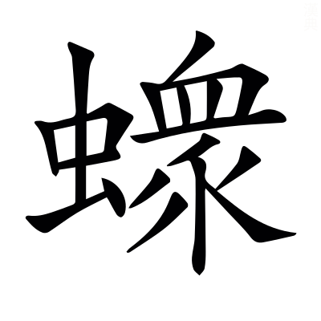

# 僖公第五

*〈僖公·名申莊公之子閔公之兄母成風諡法小心畏忌曰僖〉*

## 僖元年

> **元年春王正月齊師宋師曹師次于聶北救邢** *〈聶北·女輒反〉齊師諸侯之師救邢次于聶北者案兵觀釁以待事也次例在莊三年聶北邢地〈觀釁·許覲反〉*
> 
> **夏六月邢遷于夷儀** *邢遷如歸故以自遷為辭夷儀邢地*
> 
> **齊師宋師曹師城邢** *傳例曰救患分災禮也一事而再列三國於文不可言諸侯師故*
> 
> **秋七月戊辰夫人姜氏薨于夷齊人以歸** *傳在閔二年不言齊人殺諱之書地者明在外薨*
> 
> **楚人伐鄭** *荊始改號曰楚*
> 
> **八月公會齊侯宋公鄭伯曹伯邾人于檉** *〈于檉·勑呈反〉檉宋地陳國陳縣西北有檉城公及其會而不書盟還不以盟告*
> 
> **九月公敗邾師于偃** *偃邾地*
> 
> **冬十月壬午公子友帥師敗莒師于酈獲莒挐** *〈于酈·力知反◎莒挐·女居反又女加反〉酈魯地挐莒子之弟不書弟者非卿非卿則不應書嘉季友之功故特書其所獲大夫生死皆曰獲獲例在昭二十三年*
> 
> **十有二月丁巳夫人氏之喪至自齊** *僖公請而葬之故告於廟而書喪至也齊侯既殺哀姜以其尸歸絕之於魯僖公請其喪而還不稱姜闕文*

**元年春不稱即位公出故也** *國亂身出復入故即位之禮有闕〈復入·扶又反下文同〉* **公出復入不書諱之也諱國惡禮也** *掩惡揚善義存君親故通有諱例皆當時臣子率意而隱故無深淺常準聖賢從之以通人理有時而聽之可也〈常準·之尹反〉*

**諸侯救邢** *實大夫而曰諸侯揔衆國之辭* **邢人潰出奔師** *〈人潰·戶內反〉奔聶北之師也邢潰不書不告也* **師遂逐狄人具邢器用而遷之師無私焉** *皆撰具還之無所私取〈撰具·仕眷反又仕轉反〉* **夏邢遷于夷儀諸侯城之救患也凡侯伯救患分災討罪禮也** *〈分災·甫問反又如字〉侯伯州長也分穀帛〈州長·丁丈反〉*

**秋楚人伐鄭鄭即齊故也盟于犖 *〈于犖·音洛又力角反〉* 謀救鄭也** *犖即檉也地有二名*

**九月公敗邾師于偃虛丘之戍將歸者也** *〈虚丘·起居反〉虛丘邾地邾人既送哀姜還齊人殺之因戍虛丘欲以侵魯公以義求齊齊送姜氏之喪邾人懼乃歸故公要而敗之〈要而·於遥反〉*

**冬莒人來求賂** *求還慶父之賂* **公子友敗諸酈獲莒子之弟挐非卿也嘉獲之也** *莒既不能為魯討慶父受魯之賂而又重來其求無厭故嘉季友之獲而書之〈為魯·于偽反◎重來·直用反◎無厭·於鹽反〉* **公賜季友汶陽之田及費** *〈汶陽·音問◎及費·音祕〉汶陽田汶水北地汶水出泰山萊蕪縣西入濟〈萊蕪·音來〉*

**夫人氏之喪至自齊君子以齊人之殺哀姜也為已甚矣女子從人者也** *言女子有三從之義在夫家有罪非父母家所宜討也*

## 僖二年

> **二年春王正月城楚丘** *楚丘衞邑不言城衞衞未遷*
> 
> **夏五月辛巳葬我小君哀姜** *無傳反哭成喪故稱小君例在定十五年*
> 
> **虞師晉師滅下陽** *下陽虢邑在河東大陽縣晉於此始赴見經滅例在襄十三年〈大陽·音泰一音如字◎見經·賢遍反〉*
> 
> **秋九月齊侯宋公江人黃人盟于貫** *〈于貫·古亂反〉貫宋地梁國蒙縣西北有貰城貰與貫字相似江國在汝南安陽縣〈貰城·市夜反又音世〉*
> 
> **冬十月不雨** *傳在三年*
> 
> **楚人侵鄭**

**二年春諸侯城楚丘而封衞焉** *君死國滅故傳言封* **不書所會後也** *諸侯既罷而魯後至諱不及期故以獨城為文*

**晉荀息請以屈產之乘 *〈屈産·求勿反又居勿反注同◎之乘·繩證反注同〉* 與垂棘之璧假道於虞以伐虢** *荀息荀叔也屈地生良馬垂棘出美玉故以為名四馬曰乘自晉適虢途出於虞故借道* **公曰是吾寶也對曰若得道於虞猶外府也公曰宮之奇存焉** *〈宫之奇·其冝反〉宮之奇虞忠臣* **對曰宮之奇之為人也懦而不能彊諫** *〈懦·本又作燸乃亂反又乃貨反弱也字林愞音乃亂反偄音讓丈反云弱也◎強諫·其良反又其丈反〉懦弱也* **且少長於君君暱之 *〈且少·詩照反◎長於·丁丈反◎暱之·女乙反〉* 雖諫將不聽** *親而狎之必輕其言* **乃使荀息假道於虞曰冀為不道入自顛軨 *〈顚軨·音零〉* 伐鄍三門** *〈伐鄍·亡丁反〉前是冀伐虞至鄍鄍虞邑河東大陽縣東北有顛軨坂〈坂·音反〉* **冀之既病則亦唯君故** *言虞報伐冀使病將欲假道故稱虞彊以說其心冀國名平陽皮氏縣東北有冀亭* **今虢為不道保於逆旅** *逆旅客舍也虢稍遣人分依客舍以聚衆抄晉邊邑〈以說·音悅◎聚抄·初敎反又楚稍反強取物〉* **以侵敝邑之南鄙敢請假道以請罪于虢** *問虢伐己以何罪* **虞公許之且請先伐虢** *喜於厚賂而欲求媚* **宮之奇諫不聽遂起師夏晉里克荀息帥師會虞師伐虢滅下陽** *晉猶主兵不信虞* **先書虞賄故也** *〈賄故·呼罪反〉虞非倡兵之首而先書之惡貪賄也〈惡貪·烏路反〉*

**秋盟于貫服江黃也** *江黃楚與國也始來服齊故為合諸侯〈故為·于偽反下同〉* **齊寺人貂始漏師于多魚** *〈寺人·如字又音侍寺人奄官名◎貂·音彫〉寺人內奄官豎貂也多魚地名闕齊桓多嬖寵內則如夫人者六人外則幸豎貂易牙之等終以此亂國傳言貂於此始擅貴寵漏洩桓公軍事為齊亂張本〈豎貂·上主反◎擅貴·時戰反◎漏洩·息列反又以制反〉*

**虢公敗戎于桑田** *桑田虢地在弘農陝縣東北* **晉卜偃曰虢必亡矣亡下陽不懼而又有功是天奪之鑒** *鑒所以自照* **而益其疾也** *驕則生疾* **必易晉 *〈必易·以豉反〉* 而不撫其民矣不可以五稔** *〈五稔·入甚反熟也〉稔熟也為下五年晉滅虢張本*

**冬楚人伐鄭鬭章囚鄭聃伯** *〈聃伯·乃甘反〉經書侵傳言伐本以伐興權行侵掠為後年楚伐鄭鄭伯欲成張本〈侵掠·音亮〉*

## 僖三年

> **三年春王正月不雨夏四月不雨** *一時不雨則書首月傳例曰不曰旱不為災*
> 
> **徐人取舒** *無傳徐國在下邳僮縣東南舒國今廬江舒縣勝國而不用大師亦曰取例在襄十三年〈下邳·皮悲反◎僮縣·音童◎廬江·力居反〉*
> 
> **六月雨** *示旱不竟夏*
> 
> **秋齊侯宋公江人黃人會于陽穀** *陽穀齊地在東平須昌縣北*
> 
> **冬公子友如齊涖盟** *〈涖盟·音利又音類臨也〉涖臨也*
> 
> **楚人伐鄭**

**三年春不雨夏六月雨 *〈夏六·戶雅反〉* 自十月不雨至于五月不曰旱不為災也** *周六月夏四月於播種五稼無損*

**秋會于陽穀謀伐楚也** *二年楚侵鄭故*

**齊侯為陽穀之會來尋盟 *〈為陽榖·于偽反〉* 冬公子友如齊涖盟** *公時不會陽穀故齊侯自陽穀遣人詣魯求尋盟魯使上卿詣齊受盟謙也*

**楚人伐鄭鄭伯欲成孔叔不可曰齊方勤我** *孔叔鄭大夫勤恤鄭難〈鄭難·乃旦反〉* **弃德不祥** *祥善也* **齊侯與蔡姬乘舟于囿 *〈于囿·音又苑也〉* 蕩公** *蔡姬齊侯夫人蕩搖也囿苑也蓋魚池在苑中* **公懼變色禁之不可公怒歸之未之絕也蔡人嫁之** *為明年齊侵蔡傳*

## 僖四年

> **四年春王正月公會齊侯宋公陳侯衞侯鄭伯許男曹伯侵蔡蔡潰** *民逃其上曰潰例在文三年* **遂伐楚次于陘** *〈于陘·音刑〉遂兩事之辭楚彊齊欲綏之以德故不速進而次陘陘楚地潁川召陵縣南有陘亭*
> 
> **夏許男新臣卒** *未同盟而赴以名*
> 
> **楚屈完來盟于師盟于召陵** *〈召陵·上照反傳皆同〉屈完楚大夫也楚子遣完如師以觀齊屈完覩齊之盛因而求盟故不稱使以完來盟為文齊桓退舍以禮楚故盟召陵召陵潁川縣也*
> 
> **齊人執陳轅濤塗** *〈陳袁·袁陳大夫氏也本多作轅◎濤塗·音桃〉轅濤塗陳大夫*
> 
> **秋及江人黃人伐陳** *受齊命討陳之罪而以與謀為文者時齊不行使魯為主與謀例在宣七年〈與謀·音預下同〉*
> 
> **八月公至自伐楚** *無傳告于廟*
> 
> **葬許穆公**
> 
> **冬十有二月公孫茲帥師會齊人宋人衞人鄭人許人曹人侵陳** *公孫茲叔牙子叔孫戴伯*

**四年春齊侯以諸侯之師侵蔡蔡潰遂伐楚楚子使與師言曰君處北海寡人處南海唯是風馬牛不相及也** *楚界猶未至南海因齊處北海遂稱所近牛馬風逸蓋末界之微事故以取喻〈所近·附近之近〉* **不虞君之涉吾地也何故管仲對曰昔召康公命我先君大公** *〈大公·音泰注同〉召康公周大保召公奭也〈公奭·音釋〉* **曰五侯九伯女實征之 *〈女實·音汝〉* 以夾輔周室** *〈夾輔·古洽反舊古協反〉五等諸侯九州之伯皆得征討其罪齊桓因此命以夸楚〈以夸·苦瓜反〉* **賜我先君履東至于海西至于河南至于穆陵北至于無棣** *〈無棣·大計反〉穆陵無棣皆齊竟也履所踐履之界齊桓又因以自言其盛〈齊竟·音境下皆同〉* **爾貢包茅不入王祭不共 *〈不共·音恭本亦作供下及注同〉* 無以縮酒 *〈以縮·所六反〉* 寡人是徵** *包裹束也茅菁茅也束茅而灌之以酒為縮酒尚書包匭菁茅茅之為異未審〈裹束也·音果◎菁茅·子丁反◎苞匭·音軌本或作軌苞或作包〉* **昭王南征而不復寡人是問** *昭王成王之孫南巡守涉漢船壞而溺周人諱而不赴諸侯不知其故故問之〈巡守·手又反◎而溺·乃歷反〉* **對曰貢之不入寡君之罪也敢不共給昭王之不復君其問諸水濱** *〈水濱·音賔〉昭王時漢非楚竟故不受罪* **師進次于陘** *楚不服罪故復進師〈故復·扶又反〉* **夏楚子使屈完如師** *如陘之師觀彊弱* **師退次于召陵** *完請盟故* **齊侯陳諸侯之師與屈完乘而觀之** *〈完乘·繩證反注同〉乘共載* **齊侯曰豈不穀是為 *〈是為·于偽反注同〉* 先君之好是繼 *〈之好·呼報反下及注同〉* 與不穀同好如何** *言諸侯之附從非為己乃尋先君之好謙而自廣因求與楚同好孤寡不穀諸侯謙稱〈謙稱·尺證反〉* **對曰君惠儌福於敝邑之社稷 *〈徼福·古堯反要也〉* 辱收寡君寡君之願也齊侯曰以此衆戰誰能禦之以此攻城何城不克對曰君若以德綏諸侯誰敢不服君若以力楚國方城以為城漢水以為池** *〈漢以為池·本或作漢水以為池水衍字〉方城山在南陽葉縣南以言竟土之遠漢水出武都至江夏南入江言其險固以當城池〈葉縣·始涉反◎以當·丁浪反〉* **雖衆無所用之屈完及諸侯盟**

**陳轅濤塗謂鄭申侯曰師出於陳鄭之間國必甚病** *申侯鄭大夫當有共給之費故〈之費·芳味反〉* **若出於東方觀兵於東夷循海而歸其可也** *東夷郯莒徐夷也觀兵示威〈郯莒·音談〉* **申侯曰善濤塗以告齊侯許之** *許出東方* **申侯見 *〈申侯見·賢遍反〉* 曰師老矣若出於東方而遇敵懼不可用也若出於陳鄭之間共其資糧屝屨 *〈資糧·音良◎屝屨·符費反草屨也〉* 其可也** *屝草屨* **齊侯說 *〈齊侯說·音悅〉* 與之虎牢** *還以鄭邑賜之* **執轅濤塗秋伐陳討不忠也** *以濤塗為誤軍道*

**許穆公卒于師葬之以侯禮也** *男而以侯禮加一等* **凡諸侯薨于朝會加一等** *諸侯命有三等公為上等侯伯為中等子男為下等* **死王事加二等** *謂以死勤王事* **於是有以衮斂** *〈以衮·古本反衮冕上公服◎斂·力驗反〉衮衣公服也謂加二等*

**冬叔孫戴伯帥師會諸侯之師侵陳陳成歸轅濤塗** *陳服罪故歸其大夫戴謚也*

**初晉獻公欲以驪姬為夫人卜之不吉筮之吉公曰從筮卜人曰筮短龜長不如從長** *〈不如·依字讀或一音而據反〉物生而後有象象而後有滋滋而後有數龜象筮數故象長數短* **且其繇曰 *〈其繇·直救反兆辭也〉* 專之渝攘公之羭** *〈渝·羊朱反變也◎攘公·如羊反除也◎之羭·羊朱反美也〉繇卜兆辭渝變也攘除也羭美也言變乃除公之美* **一薰一蕕 *〈一薫·許云反香草也◎一蕕·音由臭草也〉* 十年尚猶有臭** *薰香草蕕臭草十年有臭言善易消惡難除〈易消·以豉反〉* **必不可弗聽立之生奚齊其娣生卓子 *〈卓·吐濁反〉* 及將立奚齊既與中大夫成謀姬謂大子曰君夢齊姜必速祭之** *齊姜大子母言求食* **大子祭于曲沃歸胙于公** *〈歸胙·才故反祭之酒肉也〉胙祭之酒肉* **公田姬寘諸宮六日 *〈姬寘·之豉反〉* 公至毒而獻之** *毒酒經宿輒敗而經六日明公之惑* **公祭之地地墳 *〈地墳·扶粉反〉* 與犬犬斃 *〈犬斃·婢世反〉* 與小臣小臣亦斃姬泣曰賊由大子大子奔新城** *新城曲沃* **公殺其傅杜原款 *〈原款·苦管反〉* 或謂大子子辭君必辯焉** *〈必辯·兵免反〉以六日之狀自理* **大子曰君非姬氏居不安食不飽我辭姬必有罪君老矣吾又不樂** *〈不樂·音洛注同〉吾自理則姬死姬死則君必不樂不樂為由吾也* **曰子其行乎大子曰君實不察其罪被此名也以出 *〈被此·皮寄反又皮綺反〉* 人誰納我十二月戊申縊于新城 *〈縊于·一賜反〉* 姬遂譖二公子 *〈遂譖·側鴆反〉* 曰皆知之重耳奔蒲夷吾奔屈** *二子時在朝為明年晉殺申生傳*

## 僖五年

> **五年春晉侯殺其世子申生** *稱晉侯惡用讒書春從告〈惡用·烏路反〉*
> 
> **杞伯姬來朝其子** *〈杞伯姬來·絶句來歸寧◎朝其子·猶言其子朝〉無傳伯姬來寧寧成風也朝其子者時子年在十歲左右因有諸侯子得行朝義而卒不成朝禮故繫於母而曰朝其子*
> 
> **夏公孫茲如牟** *叔孫戴伯娶於牟卿非君命不越竟故奉公命聘於牟因自為逆〈越竟·音境◎自為·于偽反〉*
> 
> **公及齊侯宋公陳侯衞侯鄭伯許男曹伯會王世子于首止** *惠王大子鄭也不名而殊會尊之也首止衞地陳留襄邑縣東南有首鄉*
> 
> **秋八月諸侯盟于首止** *間無異事復稱諸侯者王世子不盟故也王之世子尊與王同齊桓行霸翼戴天子尊崇王室故殊貴世子〈復稱·扶又反〉* **鄭伯逃歸不盟** *逃其師而歸也逃例在文三年*
> 
> **楚人滅弦弦子奔黃** *弦國在弋陽軑縣東南〈軑縣·音犬〉*
> 
> **九月戊申朔日有食之** *無傳*
> 
> **冬晉人執虞公** *虞公貪璧馬之寶距絕忠諫稱人以執同於無道於其民之例例在成十五年所以罪虞且言易也晉侯脩虞之祀而歸其職貢於王故不以滅同姓為譏〈言易·以豉反〉*

**五年春王正月辛亥朔日南至** *周正月今十一月冬至之日日南極* **公既視朔遂登觀臺以望而書禮也** *〈遂登觀·古亂反注同◎臺以望·絶句◎而書·本或作而書雲物非也〉視朔親告朔也觀臺臺上構屋可以遠觀者也朔旦冬至歷數之所始治歷者因此則可以明其術數審別陰陽敘事訓民魯君不能常脩此禮故善公之得禮〈審別·彼列反〉* **凡分至啟閉必書雲物** *分春秋分也至冬夏至也啟立春立夏閉立秋立冬雲物氣色災變也傳重申周典不言公者日官掌其職〈重申·直用反〉* **為備故也** *素察妖祥逆為之備*

**晉侯使以殺大子申生之故來告** *釋經必須告乃書* **初晉侯使士蒍為二公子築蒲與屈 *〈為二公子·于偽反下乃為之請同〉* 不愼寘薪焉** *〈寘薪·之豉反〉不謹愼* **夷吾訴之公使讓之** *譴讓之〈譴讓·弃戰反〉* **士蒍稽首而對曰臣聞之無喪而慼憂必讎焉** *讎猶對也* **無戎而城讎必保焉** *保而守之* **寇讎之保又何愼焉守官廢命不敬固讎之保不忠失忠與敬何以事君詩云懷德惟寧宗子惟城** *詩大雅懷德以安則宗子之固若城* **君其脩德而固宗子何城如之** *言城不如固宗子* **三年將尋師焉焉用愼** *〈焉用愼·於虔反〉尋用也* **退而賦曰狐裘尨茸 *〈尨·莫江反又音蒙◎茸·如容反又音戎尨茸亂貌〉* 一國三公吾誰適從** *〈適從·丁歷反〉士蒍自作詩也尨茸亂貌公與二公子為三言城不堅則為公子所訴為公所讓堅之則為固讎不忠無以事君故不知所從* **及難 *〈及難·乃旦反〉* 公使寺人披伐蒲 *〈寺人披·普皮反〉* 重耳曰君父之命不校 *〈不校·音敎〉* 乃徇曰 *〈乃徇·似俊反〉* 校者吾讎也踰垣而走 *〈踰垣·音袁〉* 披斬其袪 *〈其袪·起魚反袂也〉* 遂出奔翟** *〈奔翟·音狄〉袪袂也〈袂·面世反〉*

**夏公孫茲如牟娶焉** *〈取焉·七喻反本又作娶〉因聘而娶故傳實其事*

**會于首止會王大子鄭謀寧周也** *惠王以惠后故將廢大子鄭而立王子帶故齊桓帥諸侯會王大子以定其位* **陳轅宣仲怨鄭申侯之反己於召陵** *宣仲轅濤塗* **故勸之城其賜邑** *齊桓所賜虎牢* **曰美城之 *〈美城之·絶句〉* 大名也子孫不忘吾助子請乃為之請於諸侯而城之美** *樓櫓之備美設〈樓櫓·音魯〉* **遂譖諸鄭伯曰美城其賜邑將以叛也申侯由是得罪** *為七年鄭殺申侯傳*

**秋諸侯盟 *〈秋諸侯盟·本或此下更有于首止三字非〉* 王使周公召鄭伯曰吾撫女以從楚 *〈撫女·音汝〉* 輔之以晉可以少安** *周公宰孔也王恨齊桓定大子之位故召鄭伯使叛齊也晉楚不服於齊故以鎮安鄭* **鄭伯喜於王命而懼其不朝於齊也故逃歸不盟孔叔止之曰國君不可以輕 *〈以輕·遣政反下同〉* 輕則失親** *孔叔鄭大夫親黨援也* **失親患必至病而乞盟所喪多矣 *〈所喪·息浪反〉* 君必悔之弗聽逃其師而歸**

**楚鬭穀於菟滅弦弦子奔黃於是江黃道柏方睦於齊皆弦姻也** *姻外親也道國在汝南安陽縣南柏國名汝南西平縣有柏亭* **弦子恃之而不事楚又不設備故亡**

**晉侯復假道於虞以伐虢 *〈侯復·扶又反六年經注同〉* 宮之奇諫曰虢虞之表也虢亡虞必從之晉不可啟寇不可翫** *翫習也* **一之謂甚其可再乎** *為二年假晉道滅下陽* **諺所謂輔車相依 *〈輔車·尺奢反牙車也〉* 脣亡齒寒者其虞虢之謂也** *輔頰輔車牙車* **公曰晉吾宗也豈害我哉對曰大伯虞仲 *〈大伯·音泰下及注同〉* 大王之昭也 *〈之昭·上饒反注同後昭穆放此〉* 大伯不從是以不嗣** *大伯虞仲皆大王之子不從父命俱讓適吳仲雍支子別封西吳虞公其後也穆生昭昭生穆以世次計故大伯虞仲於周為昭* **虢仲虢叔王季之穆也** *王季者大伯虞仲之母弟也虢仲虢叔王季之子文王之母弟也仲叔皆虢君字* **為文王卿士勳在王室藏於盟府** *盟府司盟之官* **將虢是滅何愛於虞且虞能親於桓莊乎其愛之也桓莊之族何罪而以為戮不唯偪乎** *〈唯偪·彼力反〉桓叔莊伯之族晉獻公之從祖昆弟獻公患其偪盡殺之事在莊二十五年* **親以寵偪猶尚害之況以國乎公曰吾享祀豐絜 *〈吾享·興兩反〉* 神必據我** *據猶安也* **對曰臣聞之鬼神非人實親惟德是依故周書曰皇天無親惟德是輔** *周書逸書* **又曰黍稷非馨明德惟馨** *馨香之遠聞〈遠聞·音問又如字〉* **又曰民不易物惟德繄物** *〈繄物·烏兮反是也〉黍稷牲玉無德則不見饗有德則見饗言物一而異用* **如是則非德民不和神不享矣神所馮依 *〈所馮·皮冰反下注同〉* 將在德矣若晉取虞而明德以薦馨香神其吐之乎弗聽許晉使 *〈晉使·所吏反〉* 宮之奇以其族行** *行去也* **曰虞不臘矣** *〈不臘·力盍反〉臘歲終祭衆神之名* **在此行也晉不更舉矣** *不更舉兵* **八月甲午晉侯圍上陽** *上陽虢國都在弘農陝縣東南* **問於卜偃曰吾其濟乎對曰克之公曰何時對曰童謠云 *〈童謡·音遥〉* 丙之晨龍尾伏辰** *龍尾尾星也日月之會曰辰日在尾故尾星伏不見〈不見·賢遍反〉* **均服振振 *〈均服·如字同也字書作袀音同◎振振·音眞注同〉* 取虢之旂** *戎事上下同服振振盛貌旂軍之旌旗* **鶉之賁賁 *〈鶉之·述春反又常倫反◎賁賁·音奔〉* 天策焞焞 *〈焞焞·他門反〉* 火中成軍虢公其奔** *鶉鶉火星也賁賁鳥星之體也天策傅說星時近日星微焞焞無光耀也言丙子平旦鶉火中軍事有成功也此已上皆童謠言也童齓之子未有念慮之感而會成嬉戲之言似若有馮者其言或中或否博覽之士能懼思之人兼而志之以為鑒戒以為將來之驗有益於世教〈傅說·音悅◎近日·附近之近◎巳上·時掌反◎童齔·初問反又恥問反毁齒也◎嬉戲·許冝反◎或中·丁仲反〉* **其九月十月之交乎** *以星驗推之知九月十月之交謂夏之九月十月也交晦朔交會〈夏之·戶雅反下同〉* **丙子旦日在尾月在策** *是夜日月合朔於尾月行疾故至旦而過在策* **鶉火中必是時也冬十二月丙子朔晉滅虢虢公醜奔京師** *不書不告也周十二月夏之十月* **師還館于虞遂襲虞滅之執虞公及其大夫井伯以媵秦穆姬** *秦穆姬晉獻公女送女曰媵以屈辱之* **而脩虞祀且歸其職貢於王** *虞所命祀* **故書曰晉人執虞公罪虞且言易也** *〈言易·以豉反〉*

## 僖六年

> **六年春王正月**
> 
> **夏公會齊侯宋公陳侯衞侯曹伯伐鄭圍新城** *新城鄭新密今熒陽密縣*
> 
> **秋楚人圍許** *楚子不親圍以圍者告* **諸侯遂救許** *皆伐鄭之諸侯故不復更敘*
> 
> **冬公至自伐鄭** *無傳*

**六年春晉侯使賈華伐屈夷吾不能守盟而行** *賈華晉大夫非不欲校力不能守言不如重耳之賢* **將奔狄郤芮曰 *〈郤·去逆反◎芮·如銳反〉* 後出同走罪也** *嫌與重耳同謀而相隨* **不如之梁梁近秦而幸焉 *〈近秦·附近之近〉* 乃之梁** *以梁為秦所親幸秦既大國且穆姬在焉故欲因以求入*

**夏諸侯伐鄭以其逃首止之盟故也** *首止盟在五年* **圍新密鄭所以不時城也** *實新密而經言新城者鄭以非時興土功齊桓聲其罪以告諸侯* **秋楚子圍許以救鄭諸侯救許乃還冬蔡穆侯將許僖公以見楚子於武城** *〈以見·賢遍反〉楚子退舍武城猶有忿志而諸侯各罷兵故蔡侯將許君歸楚武城楚地在南陽宛縣北〈各罷·扶罵反又扶買反◎宛縣·於元反〉* **許男面縛銜璧大夫衰絰 *〈衰絰·七雷反下直結反注同〉* 士輿櫬** *〈輿櫬·於覲反棺也〉縛手於後唯見其面以璧為贄手縛故銜之櫬棺也將受死故衰絰〈為質·如字一音置本又作贄音至〉* **楚子問諸逢伯** *逢伯楚大夫* **對曰昔武王克殷微子啟如是** *微子啟紂庶兄宋之祖也* **武王親釋其縛 *〈其縛·如字舊扶臥反〉* 受其璧而祓之** *〈而祓·芳弗反徐音廢說文云除惡之祭也〉祓除凶之禮* **焚其櫬禮而命之使復其所楚子從之**

## 僖七年

> **七年春齊人伐鄭**
> 
> **夏小邾子來朝** *無傳郳犂來始得王命而來朝也邾之別封故曰小邾*
> 
> **鄭殺其大夫申侯** *申侯鄭卿專利而不厭故稱名以殺罪之也例在文六年〈不厭·於鹽反傳同〉*
> 
> **秋七月公會齊侯宋公陳世子款鄭世子華盟于甯母** *〈甯母·如字又音無注同〉高平方與縣東有泥母亭音如甯〈方與·音房下音預◎泥母·乃麗反又音甯王奴兮反〉*
> 
> **曹伯班卒** *無傳五年同盟于首止*
> 
> **公子友如齊** *無傳罷盟而聘謝不敏也*
> 
> **冬葬曹昭公** *無傳*

**七年春齊人伐鄭孔叔言於鄭伯曰諺有之曰心則不競何憚於病** *〈何憚·徒旦反難也〉競彊也憚難也〈難也·乃旦反此年及八年經傳並同〉* **既不能彊又不能弱所以斃也國危矣請下齊以救國 *〈請下·戶嫁反〉* 公曰吾知其所由來矣姑少待我** *欲以申侯說* **對曰朝不及夕 *〈朝不·如字〉* 何以待君夏鄭殺申侯以說于齊且用陳轅濤塗之譖也** *濤塗譖在五年* **初申侯申出也** *姊妹之子為出* **有寵於楚文王文王將死與之璧使行曰唯我知女 *〈知女·音汝下皆同〉* 女專利而不厭予取予求不女疵瑕也** *〈疵瑕·似斯反又疾移反〉從我取從我求我不以女為罪釁〈罪釁·許靳反下文同〉* **後之人將求多於女** *謂嗣君也求多以禮義大望責之* **女必不免我死女必速行無適小國將不女容焉** *政狹法峻〈政狹·音洽〉* **既葬出奔鄭又有寵於厲公子文聞其死也曰古人有言曰知臣莫若君弗可改也已**

**秋盟于甯母謀鄭故也管仲言於齊侯曰臣聞之招攜以禮懷遠以德** *攜離也* **德禮不易無人不懷齊侯脩禮於諸侯諸侯官受方物** *諸侯官司各於齊受其方所當貢天子之物* **鄭伯使大子華聽命於會言於齊侯曰洩氏孔氏子人氏三族 *〈洩氏·息列反〉* 實違君命** *三族鄭大夫* **君若去之以為成 *〈去之·起吕反〉* 我以鄭為內臣君亦無所不利焉** *以鄭事齊如封內臣* **齊侯將許之管仲曰君以禮與信屬諸侯而以姦終之無乃不可乎子父不奸之謂禮 *〈不奸·音干〉* 守命共時之謂信** *〈共時·音恭注同〉守君命共時事* **違此二者姦莫大焉公曰諸侯有討於鄭未捷今苟有釁從之不亦可乎** *子華犯父命是其釁隙〈釁隙·去逆反〉* **對曰君若綏之以德加之以訓辭而帥諸侯以討鄭鄭將覆亡之不暇 *〈覆亡·芳服反〉* 豈敢不懼若揔其罪人以臨之** *揔將領也子華奸父之命即罪人* **鄭有辭矣何懼** *以大義為辭* **且夫合諸侯以崇德也會而列姦何以示後嗣** *列姦用子華* **夫諸侯之會其德刑禮義無國不記記姦之位** *位會位也子華為姦人而列在會位將為諸侯所記* **君盟替矣** *〈替矣·他計反〉替廢也* **作而不記非盛德也** *君舉必書雖復齊史隱諱亦損盛德〈雖復·扶又反〉* **君其勿許鄭必受盟夫子華既為大子而求介於大國 *〈介於·音界〉* 以弱其國亦必不免** *介因也* **鄭有叔詹堵叔師叔三良為政 *〈堵叔·丁古反又音者〉* 未可間也 *〈可閒·閒廁之閒〉* 齊侯辭焉子華由是得罪於鄭冬鄭伯使請盟于齊** *以齊侯不聽子華故*

**閏月惠王崩襄王惡大叔帶之難** *〈惡大叔·烏路反大音泰叔又作州〉襄王惠王大子鄭也大叔帶襄王弟惠后之子也有寵於惠后惠后欲立之未及而卒* **懼不立不發喪而告難于齊** *為八年盟洮傳*

## 僖八年

> **八年春王正月公會王人齊侯宋公衞侯許男曹伯陳世子款盟于洮** *〈于洮·他刀反〉王人與諸侯盟不譏者王室有難故洮曹地* **鄭伯乞盟** *新服未與會故不序列別言乞盟〈未與·音預下同〉*
> 
> **夏狄伐晉**
> 
> **秋七月禘于大廟用致夫人** *〈大廟·音太〉禘三年大祭之名大廟周公廟致者致新死之主於廟而列之昭穆夫人淫而與殺不薨於寢於禮不應致故僖公疑其禮歷三禘今果行之嫌異常故書之〈與殺·音試〉*
> 
> **冬十有二月丁未天王崩** *實以前年閏月崩以今年十二月丁未告*

**八年春盟于洮謀王室也鄭伯乞盟請服也襄王定位而後發喪** *王人會洮還而後王位定*

**晉里克帥師梁由靡御虢射為右 *〈虢射·食亦反〉* 以敗狄于采桑** *傳言前年事也平陽北屈縣西南有采桑津* **梁由靡曰狄無恥從之必大克** *不恥走故可逐* **里克曰懼之而已無速衆狄** *恐怨深而羣黨來報* **虢射曰期年狄必至 *〈期年·音基本或作朞注同〉* 示之弱矣夏狄伐晉報采桑之役也復期月** *明期年之言驗*

**秋禘而致哀姜焉非禮也凡夫人不薨于寢不殯于廟不赴于同不祔于姑 *〈不祔·音附〉* 則弗致也** *寢小寢同同盟將葬又不以殯過廟據經哀姜薨葬之文則為殯廟赴同祔姑今當以不薨于寢不得致也*

**冬王人來告喪難故也是以緩** *有大叔帶之難*

**宋公疾大子茲父固請 *〈玆父·音甫〉* 曰目夷長且仁 *〈目夷長·丁丈反〉* 君其立之** *茲父襄公也目夷茲父庶兄子魚也* **公命子魚子魚辭曰能以國讓仁孰大焉臣不及也且又不順** *立庶不順禮* **遂走而退**

## 僖九年

> **九年春王三月丁丑宋公御說卒** *〈御說·魚吕反下音悅〉四同盟*
> 
> **夏公會宰周公齊侯宋子衞侯鄭伯許男曹伯于葵丘** *周公宰孔也宰官周采地天子三公不字宋子襄公也傳例曰在喪公侯曰子陳留外黃縣東有葵丘*
> 
> **秋七月乙酉伯姬卒** *無傳公羊穀梁曰未適人故不稱國已許嫁則以成人之禮書不復殤也婦人許嫁而笄猶丈夫之冠〈不復·扶又反◎殤·式羊反◎而笄·古兮反◎之冠·古喚反〉*
> 
> **九月戊辰諸侯盟于葵丘** *夏會葵丘次伯姬卒文不相比故重言諸侯宰孔先歸不與盟〈相比·毗志反◎故重·直用反◎不與·音預〉*
> 
> **甲子晉侯佹諸卒** *〈佹諸·九委反〉未同盟而赴以名甲子九月十一日戊辰十五日也書在盟後從赴*
> 
> **冬晉里克殺其君之子奚齊** *〈殺其君之子·上如字又音弑傳同公羊音試〉獻公未葬奚齊未成君故稱君之子奚齊受命繼位無罪故里克稱名*

**九年春宋桓公卒未葬而襄公會諸侯故曰子凡在喪王曰小童公侯曰子** *在喪未葬也小童者童蒙幼末之稱子者繼父之辭公侯位尊上連王者下絕伯子男周康王在喪稱予一人釗禮稱亦不言小童或所稱之辭各有所施此謂王自稱之辭非諸下所得書故經無其事傳通取舊典之文以事相接〈之稱·尺證反◎一人釗·古堯反又音昭〉* **夏會于葵丘尋盟且脩好 *〈脩好·呼報反下于好并注同〉* 禮也王使宰孔賜齊侯胙** *〈賜齊侯胙·才素反〉胙祭肉尊之比二王後* **曰天子有事于文武** *有祭事也* **使孔賜伯舅胙** *天子謂異姓諸侯曰伯舅* **齊侯將下拜孔曰且有後命天子使孔曰以伯舅耊老加勞賜一級無下拜** *〈耊老·田節反一音他結反◎加勞·力報反◎一級·音急等也〉七十曰耊級等也* **對曰天威不違顏咫尺** *〈咫尺·之氏反八寸曰咫〉言天鑒察不遠威嚴常在顏面之前八寸曰咫* **小白余敢貪天子之命無下拜** *小白齊侯名余身也* **恐隕越于下** *隕越顛隊也據天王居上故言恐顛隊于下〈顚隊·直類反下同〉* **以遺天子羞 *〈以遺·于季反〉* 敢不下拜下拜登受** *拜堂下受胙於堂上* **秋齊侯盟諸侯于葵丘曰凡我同盟之人既盟之後言歸于好** *義取脩好故傳顯其盟辭*

**宰孔先歸** *既會先諸侯去〈先諸侯·悉薦反〉* **遇晉侯曰可無會也** *晉侯欲來會葵丘* **齊侯不務德而勤遠略故北伐山戎** *在莊三十一年* **南伐楚** *在四年* **西為此會也東略之不知西則否矣** *言或向東必不能復西略〈復西·扶又反下不復會同〉* **其在亂乎君務靖亂無勤於行** *在存也微戒獻公言晉將有亂* **晉侯乃還** *不復會齊*

**九月晉獻公卒里克丕鄭欲納文公 *〈㔻鄭·普悲反〉* 故以三公子之徒作亂** *丕鄭晉大夫三公子申生重耳夷吾* **初獻公使荀息傅奚齊公疾召之曰以是藐諸孤** *〈藐諸·妙小反又亡角反〉言其幼賤與諸子縣藐〈縣藐·音玄〉* **辱在大夫其若之何** *欲屈辱荀息使保護之* **稽首而對曰臣竭其股肱之力加之以忠貞其濟君之靈也不濟則以死繼之公曰何謂忠貞對曰公家之利知無不為忠也送往事居耦俱無猜貞也** *〈無猜·七才反疑也〉往死者居生者耦兩也送死事生兩無疑恨所謂正也* **及里克將殺奚齊先告荀息曰三怨將作** *三公子之徒* **秦晉輔之子將何如荀息曰將死之里克曰無益也荀叔曰吾與先君言矣不可以貳能欲復言而愛身乎** *荀叔荀息也復言言可復也* **雖無益也將焉辟之 *〈焉辟之·於虔反下文焉能克同〉* 且人之欲善誰不如我我欲無貳而能謂人已乎** *言不能止里克使不忠於申生等* **冬十月里克殺奚齊于次** *次喪寢* **書曰殺其君之子未葬也荀息將死之人曰不如立卓子而輔之荀息立公子卓以葬十一月里克殺公子卓于朝荀息死之君子曰詩所謂白圭之玷 *〈之玷·丁簟反又丁念反缺也〉* 尚可磨也斯言之玷不可為也** *詩大雅言此言之闕難治甚於白圭* **荀息有焉** *有此詩人重言之義*

**齊侯以諸侯之師伐晉及高梁而還討晉亂也** *高梁晉地在平陽楊氏縣西南* **令不及魯故不書** *〈令不及魯·力政反本又作命〉前已發不書例今復重發嫌霸者異於凡諸侯〈今復·扶又反◎重發·直用反〉*

**晉郤芮使夷吾重賂秦以求入** *郤芮郤克祖父從夷吾者〈從夷吾·才用反〉* **曰人實有國我何愛焉** *言國非己之有何愛而不以賂秦* **入而能民土於何有從之** *能得民不患無土* **齊隰朋帥師 *〈隰·音習〉* 會秦師納晉惠公** *隰朋齊大夫惠公夷吾* **秦伯謂郤芮曰公子誰恃對曰臣聞亡人無黨有黨必有讎** *言夷吾無黨無黨則無讎易出易入以微勸秦〈易出易入·並以豉反〉* **夷吾弱不好弄** *〈不好·呼報反〉弄戲也* **能鬭不過** *有節制* **長亦不改 *〈長亦·丁丈反〉* 不識其他公謂公孫枝曰夷吾其定乎** *公孫枝秦大夫子桑也* **對曰臣聞之唯則定國詩曰不識不知順帝之則文王之謂也** *詩大雅帝天也則法也言文王闇行自然合天之法* **又曰不僭不賊鮮不為則** *〈不僭·子念反下注同◎鮮不·息淺反〉僭過差也賊傷害也皆忌克也能不然則可為人法則* **無好無惡 *〈無好·呼報反又如字◎無惡·烏路反〉* 不忌不克之謂也今其言多忌克** *既僭而賊* **難哉** *言能自定難* **公曰忌則多怨又焉能克是吾利也** *其言雖多忌適足以自害不能勝人也秦伯慮其還害己故曰是吾利*

**宋襄公即位以公子目夷為仁使為左師以聽政於是宋治 *〈宋治·直吏反〉* 故魚氏世為左師**

## 僖十年

> **十年春王正月公如齊** *無傳*
> 
> **狄滅溫溫子奔衞** *蓋中國之狄滅而居其土地*
> 
> **晉里克弒其君卓及其大夫荀息** *弒卓在前年而以今春書者從赴也獻公既葬卓已免喪故稱君也荀息稱名者雖欲復言本無遠謀從君於昏*
> 
> **夏齊侯許男伐北戎** *無傳北戎山戎*
> 
> **晉殺其大夫里克** *奚齊者先君所命卓子又以在國嗣位罪未為無道而里克親為三怨之主累弒二君故稱名以罪之*
> 
> **秋七月**
> 
> **冬大雨雪** *〈雨雪·于付反〉無傳平地尺為大雪*

**十年春狄滅溫蘇子無信也蘇子叛王即狄又不能於狄狄人伐之王不救故滅蘇子奔衞** *蘇子周司寇蘇公之後也國於溫故曰溫子叛王事在莊十九年*

**夏四月周公忌父王子黨會齊隰朋立晉侯** *周公忌父周卿士王子黨周大夫* **晉侯殺里克以說** *自解說不篡〈不篡·初患反〉* **將殺里克公使謂之曰微子則不及此雖然子殺二君與一大夫為子君者不亦難乎對曰不有廢也君何以興欲加之罪其無辭乎** *言欲加己罪不患無辭* **臣聞命矣伏劒而死於是丕鄭聘于秦且謝緩賂故不及** *丕鄭里克黨以在秦故不及里克俱死* **晉侯改葬共大子** *〈共大子·音恭本亦作恭大音泰〉共大子申生也* **秋狐突適下國** *下國曲沃新城* **遇大子大子使登僕** *忽如夢而相見狐突本為申生御故復使登車為僕〈故復·扶又反下文及注同〉* **而告之曰夷吾無禮余得請於帝矣** *請罰夷吾* **將以晉畀秦 *〈畀秦·必利反下注同〉* 秦將祀余對曰臣聞之神不歆非類 *〈不歆·許金反饗也〉* 民不祀非族君祀無乃殄乎** *歆饗也殄絕也* **且民何罪失刑乏祀君其圖之君曰諾吾將復請七日新城西偏 *〈西偏·匹緜反〉* 將有巫者而見我焉** *新城曲沃也將因巫而見* **許之遂不見** *〈遂不見·賢遍反又如字〉狐突許其言申生之象亦沒* **及期而往告之曰帝許我罰有罪矣敝於韓** *敝敗也韓晉地獨敝惠公故言罰有罪明不復以晉畀秦夷吾忌克多怨終於失國雖改葬加謚申生猶忿傳言鬼神所馮有時而信〈所馮·皮冰反〉* **丕鄭之如秦也言於秦伯曰呂甥郤稱冀芮實為不從 *〈郤稱·尺證反一音如字〉* 若重問以召之** *三子晉大夫不從不與秦賂問聘問之幣* **臣出晉君君納重耳蔑不濟矣** *蔑無也* **冬秦伯使泠至報問 *〈泠至·力丁反〉* 且召三子** *泠至秦大夫* **郤芮曰幣重而言甘誘我也遂殺丕鄭祁舉** *祁舉晉大夫* **及七輿大夫** *侯伯七命副車七乘〈七乘·繩證反〉* **左行共華 *〈左行·戶郎反下同◎共華·音恭〉* 右行賈華叔堅騅歂纍虎特宮山祁 *〈騅歂·音佳下市專反◎纍虎·力追反◎山祁·巨之反字林上尸反〉* 皆里丕之黨也** *七子七輿大夫* **丕豹奔秦** *丕豹丕鄭之子* **言於秦伯曰晉侯背大主而忌小怨 *〈背大·音佩〉* 民弗與也伐之必出** *大主秦也小怨里丕* **公曰失衆焉能殺** *〈焉能·於虔反〉謂殺里丕之黨* **違禍誰能出君** *謂豹辟禍也為明年晉殺丕鄭傳*

## 僖十一年

> **十有一年春晉殺其大夫丕鄭父** *以私怨謀亂國書名罪之書春從告*
> 
> **夏公及夫人姜氏會齊侯于陽穀** *無傳婦人送迎不出門見兄弟不踰閾與公俱會齊侯非禮〈踰閾·音域門限也一音況域反〉*
> 
> **秋八月大雩** *無傳過時故書*
> 
> **冬楚人伐黃**

**十一年春晉侯使以丕鄭之亂來告** *釋經書在今年*

**天王使召武公內史過賜晉侯命** *〈內史過·古禾反〉天王周襄王召武公周卿士內史過周大夫諸侯即位天子賜之命圭為瑞* **受玉惰 *〈受玉惰·徒臥反〉* 過歸告王曰晉侯其無後乎王賜之命而惰於受瑞先自弃也已其何繼之有禮國之幹也敬禮之輿也不敬則禮不行禮不行則上下昏何以長世** *〈長世·直良反又丁丈反〉為惠公不終張本*

**夏揚拒泉皐伊雒之戎 *〈揚拒·俱宇反◎泉皐·古刀反〉* 同伐京師入王城焚東門** *揚拒泉皐皆戎邑及諸雜戎居伊水雒水之間者今伊闕北有泉亭* **王子帶召之也** *王子帶甘昭公也召戎欲因以篡位* **秦晉伐戎以救周秋晉侯平戎于王** *為二十四年天王出居鄭傳*

**黃人不歸楚貢冬楚人伐黃** *黃人恃齊故*

## 僖十二年

> **十有二年春王三月庚午日有食之** *無傳不書朔官失之*
> 
> **夏楚人滅黃**
> 
> **秋七月**
> 
> **冬十有二月丁丑陳侯杵臼卒** *〈陳侯杵臼·昌吕反下其九反〉無傳遣世子與僖公同盟甯母及洮*

**十二年春諸侯城衞楚丘之郛 *〈之郛·芳夫反〉* 懼狄難也** *〈狄難·乃旦反下同〉楚丘衞國都郛郭也為明年春狄侵衞傳*

**黃人恃諸侯之睦于齊也不共楚職 *〈不共·音恭〉* 曰自郢及我九百里焉能害我 *〈焉能·於虔反〉* 夏楚滅黃** *郢楚都*

**王以戎難故討王子帶** *子帶前年召戎伐周* **秋王子帶奔齊冬齊侯使管夷吾平戎于王使隰朋平戎于晉** *平和也前年晉救周伐戎故戎與周晉不和* **王以上卿之禮饗管仲管仲辭曰臣賤有司也有天子之二守國高在** *〈二守·手又反注同〉國子高子天子所命為齊守臣皆上卿也莊二十二年高傒始見經僖二十八年國歸父乃見傳歸父之父曰懿仲高傒之子曰莊子不知今當誰世〈始見·賢遍反下同〉* **若節春秋來承王命何以禮焉** *節時也* **陪臣敢辭** *〈陪臣·步回反〉諸侯之臣曰陪臣* **王曰舅氏** *伯舅之使故曰舅氏〈之使·所吏反〉* **余嘉乃勳應乃懿德謂督不忘 *〈謂督·音篤〉* 往踐乃職無逆朕命** *功勳美德可謂正而不可忘者不言位而言職者管仲位卑而執齊政故欲以職尊之* **管仲受下卿之禮而還** *管仲不敢以職自高卒受本位之禮* **君子曰管氏之世祀也宜哉讓不忘其上詩曰愷悌君子神所勞矣** *〈凱·開在反本亦作愷◎悌·音弟本亦作弟◎所勞·力報反注同〉詩大雅愷樂也悌易也言樂易君子為神所勞來故世祀也管仲之後於齊沒不復見傳亦舉其無驗〈凱樂·音洛下同◎悌易·以豉反下同◎勞·力報反◎來·力代反◎不復·扶又反〉*

## 僖十三年

> **十有三年春狄侵衞** *傳在前年春*
> 
> **夏四月葬陳宣公** *無傳*
> 
> **公會齊侯宋公陳侯衞侯鄭伯許男曹伯于鹹** *鹹衞地東郡濮陽縣東南有鹹城〈濮陽·音卜〉*
> 
> **秋九月大雩** *無傳書過*
> 
> **冬公子友如齊** *無傳*

**十三年春齊侯使仲孫湫聘于周且言王子帶** *前年王子帶奔齊言欲復之* **事畢不與王言** *不言子帶事* **歸復命曰未可王怒未怠其十年乎不十年王弗召也**

**夏會于鹹淮夷病杞故且謀王室也**

**秋為戎難故 *〈為戎·于偽反下注欲為同◎難故·乃旦反〉* 諸侯戍周齊仲孫湫致之** *戍守也致諸侯戍卒于周〈戍卒·子忽反〉*

**冬晉荐饑** *〈荐·在薦反重也◎饑·音飢又音機〉麥禾皆不熟* **使乞糴于秦 *〈乞糴·直歷反〉* 秦伯謂子桑與諸乎對曰重施而報 *〈重施·式豉反下同〉* 君將何求** *言不損秦* **重施而不報其民必攜攜而討焉無衆必敗** *不義故民離* **謂百里與諸乎** *百里秦大夫* **對曰天災流行國家代有救災恤鄰道也行道有福丕鄭之子豹在秦請伐晉** *欲為父報怨* **秦伯曰其君是惡其民何罪秦於是乎輸粟于晉自雍及絳相繼** *〈自雍·於用反秦國都◎及絳·古巷反晉國都〉雍秦國都絳晉國都* **命之曰汎舟之役** *〈汎舟·芳劒反〉從渭水運入河汾〈河汾·扶云反〉*

## 僖十四年

> **十有四年春諸侯城緣陵** *緣陵杞邑辟淮夷遷都於緣陵*
> 
> **夏六月季姬及鄫子遇于防使鄫子來朝** *〈鄫子·似綾反本或作繒〉季姬魯女鄫夫人也鄫子本無朝志為季姬所召而來故言使鄫子來朝鄫國今琅邪鄫縣*
> 
> **秋八月辛卯沙鹿崩** *沙鹿山名陽平元城縣東有沙鹿土山在晉地災害繫於所災所害故不繫國*
> 
> **狄侵鄭** *無傳*
> 
> **冬蔡侯肸卒** *〈侯肸·許乙反〉無傳未同盟而赴以名*

**十四年春諸侯城緣陵而遷杞焉不書其人有闕也** *闕謂器用不具城池未固而去為惠不終也澶淵之會既而無歸大夫不書而國別稱人今此揔曰諸侯君臣之辭不言城杞杞未遷也〈澶淵·市然反〉*

**鄫季姬來寧公怒止之以鄫子之不朝也** *來寧不書而後年書歸鄫更嫁之文也明公絕鄫昏既來朝而還〈而還·戶關反〉* **夏遇于防而使來朝**

**秋八月辛卯沙鹿崩晉卜偃曰期年將有大咎 *〈期年·音基◎大咎·其九反〉* 幾亡國** *〈幾亡·音祈又音機〉國主山川山崩川竭亡國之徵*

**冬秦饑使乞糴于晉晉人弗與慶鄭曰背施無親** *〈背·音佩後皆同◎施·式豉反注及下而施毛十五年皆同〉慶鄭晉大夫* **幸災不仁貪愛不祥怒鄰不義四德皆失何以守國虢射曰皮之不存毛將安傅** *〈安傅·音附〉虢射惠公舅也皮以喻所許秦城毛以喻糴言既背秦施為怨以深雖與之糴猶無皮而施毛也* **慶鄭曰弃信背鄰患孰恤之無信患作失援必斃是則然矣虢射曰無損於怨而厚於寇不如勿與** *言與秦粟不足解怨適足使秦彊* **慶鄭曰背施幸災民所弃也近猶讎之況怨敵乎弗聽退曰君其悔是哉**

## 僖十五年

> **十有五年春王正月公如齊** *無傳諸侯五年再相朝禮也例在文十五年*
> 
> **楚人伐徐**
> 
> **三月公會齊侯宋公陳侯衞侯鄭伯許男曹伯盟于牡丘** *〈牡丘·茂后反〉牡丘地名闕* **遂次于匡** *匡衞地在陳留長垣縣西南* **公孫敖帥師及諸侯之大夫救徐** *公孫敖慶父之子諸侯既盟次匡皆遣大夫將兵救徐故不復具列國別也〈不復·扶又反〉*
> 
> **夏五月日有食之**
> 
> **秋七月齊師曹師伐厲** *厲楚與國義陽隨縣北有厲鄉*
> 
> **八月螽** *〈螽·音終本亦作〉無傳為災*
> 
> **九月公至自會** *無傳*
> 
> **季姬歸于鄫** *無傳來寧不書此書者以明中絕〈中絶·丁仲反又如字〉*
> 
> **己卯晦震夷伯之廟** *〈己卯晦·音悔〉夷伯魯大夫展氏之祖父夷謚伯字震者雷電擊之大夫既卒書字*
> 
> **冬宋人伐曹**
> 
> **楚人敗徐于婁林** *〈于婁·力侯反〉婁林徐地下邳僮縣東南有婁亭〈下邳·蒲悲反〉*
> 
> **十有一月壬戌晉侯及秦伯戰于韓獲晉侯** *例得大夫曰獲晉侯背施無親愎諫違卜故貶絕下從衆臣之例而不言以歸不書敗績晉師不大崩〈愎諫·皮逼反〉*

**十五年春楚人伐徐徐即諸夏故也** *〈諸夏·戶雅反下注同〉*

**三月盟于牡丘尋葵丘之盟且救徐也** *葵丘盟在九年* **孟穆伯帥師及諸侯之師救徐諸侯次于匡以待之**

**夏五月日有食之不書朔與日官失之也**

**秋伐厲以救徐也**

**晉侯之入也秦穆姬屬賈君焉** *〈屬賈君·音燭〉晉侯入在九年穆姬申生姊秦穆夫人賈君晉獻公次妃賈女也* **且曰盡納羣公子** *羣公子晉武獻之族宣二年傳曰驪姬之亂詛無畜羣公子〈詛無·莊據反〉* **晉侯烝於賈君 *〈烝於·之承反〉* 又不納羣公子是以穆姬怨之晉侯許賂中大夫** *中大夫國內執政里丕等* **既而皆背之賂秦伯以河外列城五東盡虢略南及華山內及解梁城既而不與** *河外河南也東盡虢略從河南而東盡虢界也解梁城今河東解縣也華山在弘農華陰縣西南〈解梁·音蟹注及下注同〉* **晉饑秦輸之粟** *在十三年* **秦饑晉閉之糴** *在十四年* **故秦伯伐晉卜徒父筮之吉** *徒父秦之掌龜卜者卜人而用筮不能通三易之占故據其所見雜占而言之* **涉河侯車敗詰之** *〈詰之·起吉反〉秦伯之軍涉河則晉侯車敗也秦伯不解謂敗在己故詰之* **對曰乃大吉也三敗必獲晉君其卦遇蠱** *〈遇蠱·音古〉巽下艮上蠱* **曰千乘三去 *〈千乘·繩證反◎三去·起居反又起據反一音起吕反下同〉* 三去之餘獲其雄狐夫狐蠱必其君也** *於周易利涉大川往有事也亦秦勝晉之卦也今此所言蓋卜筮書雜辭以狐蠱為君其義欲以喻晉惠公其象未聞* **蠱之貞風也其悔山也** *內卦為貞外卦為悔巽為風秦象艮為山晉象* **歲云秋矣我落其實而取其材所以克也** *周九月夏之七月孟秋也艮為山山有木今歲已秋風吹落山木之實則材為人所取* **實落材亡不敗何待三敗及韓** *晉侯車三壞* **晉侯謂慶鄭曰寇深矣若之何對曰君實深之可若何公曰不孫 *〈不孫·音遜注同〉* 卜右慶鄭吉弗使** *惡其不孫不以為車右此夷吾之多忌〈惡其·烏路反〉* **步揚御戎家僕徒為右** *步揚郤犫之父* **乘小駟鄭入也** *〈小駟·音四〉鄭所獻馬名小駟* **慶鄭曰古者大事必乘其產生其水土而知其人心安其教訓而服習其道唯所納之無不如志今乘異產以從戎事及懼而變將與人易** *變易人意* **亂氣狡憤 *〈狡·古卯反◎憤·扶粉反〉* 陰血周作張脉僨興 *〈張脉·中亮反注同下音麥◎僨興·方問反動也〉* 外彊中乾** *狡戾也僨動也氣狡憤於外則血脉必周身而作隨氣張動外雖有彊形而內實乾竭* **進退不可周旋不能君必悔之弗聽九月晉侯逆秦師使韓簡視師** *韓簡晉大夫韓萬之孫* **復曰師少於我鬭士倍我公曰何故對曰出因其資** *謂奔梁求秦* **入用其寵** *為秦所納* **饑食其栗三施而無報 *〈三施·式氏反年末注同〉* 是以來也今又擊之我怠秦奮倍猶未也公曰一夫不可狃 *〈可狃·女九反〉* 況國乎** *狃忕也言辟秦則使忕來〈忕也·時世反又時設反〉* **遂使請戰曰寡人不佞能合其衆而不能離也君若不還無所逃命秦伯使公孫枝對曰君之未入寡人懼之入而未定列猶吾憂也** *列位也* **苟列定矣敢不承命韓簡退曰吾幸而得囚** *得囚為幸言必敗* **壬戌戰于韓原** *九月十三日* **晉戎馬還濘而止** *〈還濘·乃定反泥也〉濘泥也還便旋也小駟不調故隋泥中〈故隋·大果反〉* **公號慶鄭 *〈公號·戶刀反王戶報反〉* 慶鄭曰愎諫違卜** *愎戾也* **固敗是求又何逃焉遂去之梁由靡御韓簡虢射為右輅秦伯 *〈輅秦·五嫁反迎也〉* 將止之** *輅迎也止獲也* **鄭以救公誤之遂失秦伯秦獲晉侯以歸** *經書十一月壬戌十四日經從赴* **晉大夫反首拔舍從之** *〈拔舍·蒲末反注皆同〉反首亂頭髮反下垂也拔草舍止壞形毀服* **秦伯使辭焉曰二三子何其慼也寡人之從君而西也亦晉之妖夢是踐豈敢以至** *狐突不寐而與神言故謂之妖夢申生言帝許罰有罪今將晉君而西以厭息此語踐厭也〈厭息·於冉反一音於甲反又於輒反下同〉* **晉大夫三拜稽首曰君履后土而戴皇天皇天后土實聞君之言羣臣敢在下風穆姬聞晉侯將至以大子罃 *〈子罃·於寅反〉* 弘與女簡璧登臺而履薪焉** *〈履薪·如字徐本作屨九具反〉罃康公名弘其母弟也簡璧罃弘姊妹古之宮閉者皆居之臺以抗絕之穆姬欲自罪故登臺而荐之以薪左右上下者皆履柴乃得通〈抗絶·苦浪反◎荐之·在薦反◎上下·時掌反〉* **使以免服衰絰逆且告** *〈絻服·音問又作免音同◎衰絰·七雷反下大結反〉免衰絰遭喪之服令行人服此服迎秦伯且告將以恥辱自殺〈令行人·力呈反下同〉* **曰上天降災使我兩君匪以玉帛相見而以興戎若晉君朝以入則婢子夕以死夕以入則朝以死唯君裁之乃舍諸靈臺** *〈曰上天降災·此凡四十七字檢古本皆無尋杜注亦不得有有是後人加也〉在京兆鄠縣周之故臺亦所以抗絕令不得通外內〈鄠縣·音戶〉* **大夫請以入公曰獲晉侯以厚歸也既而喪歸焉用之** *〈焉用·於虔反〉若將晉侯入則夫人或自殺* **大夫其何有焉** *何有猶何得* **且晉人慼憂以重我** *謂反首拔舍* **天地以要我 *〈以要·於遥反〉* 不圖晉憂重其怒也 *〈重其·直用反下皆同〉* 我食吾言背天地也** *食消也* **重怒難任 *〈難任·音壬注及下同〉* 背天不祥必歸晉君** *任當也* **公子縶 *〈子縶·張執反又丁立反〉* 曰不如殺之無聚慝焉** *〈聚慝·他得反後同〉公子縶秦大夫恐夷吾歸復相聚為惡〈復相·扶又反〉* **子桑曰歸之而質其大子 *〈質其·音置下注質秦同〉* 必得大成晉未可滅而殺其君祗以成惡** *〈祗以·音支〉祗適也* **且史佚有言 *〈史佚·音逸〉* 曰無始禍** *史佚周武王時大史名佚〈大史·音泰〉* **無怙亂** *〈無怙·音戶〉恃人亂為己利* **無重怒重怒難任陵人不祥乃許晉平晉侯使郤乞告瑕呂飴甥且召之** *〈飴甥·音怡〉郤乞晉大夫也瑕呂飴甥即呂甥也蓋姓瑕呂名飴甥字子金晉侯聞秦將許之平故告呂甥召使迎己* **子金教之言曰朝國人而以君命賞** *恐國人不從故先賞之於朝* **且告之曰孤雖歸辱社稷矣其卜貳圉也** *貳代也圉惠公大子懷公* **衆皆哭** *哀君不還國* **晉於是乎作爰田** *〈爰田·于元反〉分公田之稅應入公者爰之於所賞之衆* **呂甥曰君亡之不恤而羣臣是憂惠之至也將若君何衆曰何為而可對曰征繕以輔孺子** *〈孺子·如喻反〉征賦也繕治也孺子大子圉* **諸侯聞之喪君有君 *〈喪君·息浪反後注同〉* 羣臣輯睦 *〈輯睦·音集又七入反〉* 甲兵益多好我者勸 *〈好我·呼報反〉* 惡我者懼 *〈惡我·烏路反〉* 庶有益乎衆說 *〈衆說·音悅〉* 晉於是乎作州兵** *五黨為州州二千五百家也因此又使州長各繕甲兵〈州長·丁丈反下長男同〉* **初晉獻公筮嫁伯姬於秦遇歸妹** *兌下震上歸妹* **之睽** *〈之睽·苦圭反又音圭〉兌下離上睽歸妹上六變而為睽* **史蘇占之曰不吉** *史蘇晉卜筮之史* **其繇曰 *〈其繇·直又反〉* 士刲羊亦無衁也 *〈士刲·苦圭反刺割也◎無衁·音荒血也〉* 女承筐亦無貺也** *〈承筐·曲方反◎無貺·音況本亦作況〉周易歸妹上六爻辭也衁血也貺賜也刲羊士之功承筐女之職上六無應所求不獲故下刲無血上承無實不吉之象也離為中女震為長男故稱士女〈無應·應對之應下無應同◎中女·丁仲反〉* **西鄰責言 *〈鄰責·側介反又如字〉* 不可償也** *〈可償·市亮反又音常〉將嫁女於西而遇不吉之卦故知有責讓之言不可報償* **歸妹之睽猶無相也** *〈相·息亮反注同助也〉歸妹女嫁之卦睽乖離之象故曰無相相助也* **震之離亦離之震** *二卦變而氣相通* **為雷為火為嬴敗姬** *〈為嬴·音盈〉嬴秦姓姬晉姓震為雷離為火火動熾而害其母女嫁反害其家之象故曰為嬴敗姬* **車說其輹 *〈車說·吐活反注同◎其輹·音福又音服案車旁著畐音福老子所云三十輻共一轂是也車旁著复音服是車下伏菟〉* 火焚其旗不利行師敗于宗丘** *輹車下縛也丘猶邑也震為車離為火上六爻在震則無應故車說輹在離則失位故火焚旗言皆失車火之用也車敗旗焚故不利行師火還害母故敗不出國近在宗邑〈下縛·如字又扶臥反〉* **歸妹睽孤寇張之弧** *此睽上九爻辭也處睽之極故曰睽孤失位孤絕故遇寇難而有弓矢之警皆不吉之象〈寇難·乃旦反◎之警·音景〉* **姪其從姑** *〈姪其·待結反字林丈一反〉震為木離為火火從木生離為震妹於火為姑謂我姪者我謂之姑謂子圉質秦* **六年其逋 *〈其逋·補吴反〉* 逃歸其國而弃其家** *逋亡也家謂子圉婦懷嬴* **明年其死於高梁之虛** *〈之虚·去魚反〉惠公死之明年文公入殺懷公于高梁高梁晉地在平陽楊氏縣西南凡筮者用周易則其象可推非此而往則臨時占者或取於象或取於氣或取於時日王相以成其占若盡附會以爻象則構虛而不經故略言其歸趣他皆放此〈王相·于況反下息亮反◎講虚·本又作構各依字讀〉* **及惠公在秦曰先君若從史蘇之占吾不及此夫 *〈此夫·音扶〉* 韓簡侍曰龜象也筮數也物生而後有象象而後有滋滋而後有數先君之敗德及可數乎 *〈先君之敗德及·絶句◎可數乎·一讀及可數乎數音色主反〉* 史蘇是占勿從何益** *言龜以象示筮以數告象數相因而生然後有占占所以知吉凶不能變吉凶故先君敗德非筮數所生雖復不從史蘇不能益禍〈雖復·扶又反下同〉* **詩曰下民之孽 *〈之孽·魚列反〉* 匪降自天僔沓背憎 *〈僔·尊本反◎沓·徒合反〉* 職競由人** *詩小雅言民之有邪惡非天所降僔沓面語背相憎疾皆人競所主作因以諷諫惠公有以召此禍也〈有邪·似嗟反◎以風·方鳳反〉*

**震夷伯之廟罪之也於是展氏有隱慝焉** *隱惡非法所得尊貴罪所不加是以聖人因天地之變自然之妖以感動之知達之主則識先聖之情以自厲中下之主亦信妖祥以不妄神道助教唯此為深〈知達·音智〉*

**冬宋人伐曹討舊怨也** *莊十四年曹與諸侯伐宋*

**楚敗徐于婁林徐恃救也** *恃齊救*

**十月晉陰飴甥會秦伯盟于王城** *陰飴甥即呂甥也食采於陰故曰陰飴甥王城秦地馮翊臨晉縣東有王城今名武鄉* **秦伯曰晉國和乎對曰不和小人恥失其君而悼喪其親** *痛其親為秦所殺* **不憚征繕 *〈不憚·徒旦反〉* 以立圉也曰必報讎寧事戎狄君子愛其君而知其罪不憚征繕以待秦命曰必報德有死無二以此不和秦伯曰國謂君何對曰小人慼謂之不免君子恕以為必歸小人曰我毒秦秦豈歸君** *毒謂三施不報* **君子曰我知罪矣秦必歸君貳而執之服而舍之 *〈而舍·如字又音捨〉* 德莫厚焉刑莫威焉服者懷德貳者畏刑此一役也** *言還惠公使諸侯威服復可當一事之功〈言還·音環〉* **秦可以霸納而不定廢而不立以德為怨秦不其然秦伯曰是吾心也改館晉侯饋七牢焉** *〈饋七·其位反〉牛羊豕各一為一牢* **蛾析謂慶鄭曰盍行乎** *〈蛾·魚綺反本或作蟻一音五何反◎晳·本或作析又星歷反◎盍行·戶臘反〉蛾析晉大夫也* **對曰陷君於敗** *謂呼不往誤晉師失秦伯* **敗而不死又使失刑非人臣也臣而不臣行將焉入 *〈焉入·於虔反〉* 十一月晉侯歸丁丑殺慶鄭而後入** *丁丑月二十九日* **是歲晉又饑秦伯又餼之粟 *〈又餼·許氣反〉* 曰吾怨其君而矜其民且吾聞唐叔之封也箕子曰其後必大晉其庸可冀乎** *唐叔晉始封之君武王之子箕子殷王帝乙之子紂之庶兄* **姑樹德焉以待能者於是秦始征晉河東置官司焉** *征賦也*

## 僖十六年

> **十有六年春王正月戊申朔隕石于宋五** *〈隕石·于敏反落也〉隕落也聞其隕視之石數之五各隨其聞見先後而記之莊七年星隕如雨見星之隕而隊於四遠若山若水不見在地之驗此則見在地之驗而不見始隕之星史各據事而書〈數之·色主反◎而隊·直類反〉* **是月六鷁退飛過宋都** *〈是月·本或作是日◎六鷁·五歷反本或作鶂音同鷁水鳥六其數也◎過·古禾反〉是月隕石之月重言是月嫌同日鷁水鳥高飛遇風而退宋人以為災告於諸侯故書〈重言·直用反傳注同〉*
> 
> **三月壬申公子季友卒** *無傳稱字者貴之公與小斂故書日〈公與·音預◎斂·力驗反本亦作公與小斂〉*
> 
> **夏四月丙申鄫季姬卒** *〈鄫季·似陵反〉無傳*
> 
> **秋七月甲子公孫茲卒** *無傳*
> 
> **冬十有二月公會齊侯宋公陳侯衞侯鄭伯許男邢侯曹伯于淮** *〈邢侯·音刑◎于淮·音懷〉臨淮郡左右*

**十六年春隕石于宋五隕星也** *但言星則嫌星使石隕故重言隕星* **六鷁退飛過宋都風也** *六鷁遇迅風而退飛風高不為物害故不記風之異〈迅風·音信又音峻疾也〉* **周內史叔興聘于宋宋襄公問焉曰是何祥也吉凶焉在** *〈焉在·於虔反〉祥吉凶之先見者襄公以為石隕鷁退能為禍福之始故問其所在〈先見·賢遍反又如字〉* **對曰今茲魯多大喪** *今茲此歲* **明年齊有亂君將得諸侯而不終** *魯喪齊亂宋襄不終別以政刑吉凶他占知之* **退而告人曰君失問是陰陽之事非吉凶所生也** *言石隕鷁退陰陽錯逆所為非人所生襄公不知陰陽而問人事故曰君失問叔興自以對非其實恐為有識所譏故退而告人〈錯逆·七各反〉* **吉凶由人吾不敢逆君故也** *積善餘慶積惡餘殃故曰吉凶由人君問吉凶不敢逆之故假他占以對〈餘殃·於良反〉*

**夏齊伐厲不克救徐而還** *十五年齊伐厲以救徐*

**秋狄侵晉取狐廚受鐸涉汾 *〈取狐·音胡◎廚·直誅反◎受鐸·徒各反◎涉汾·扶云反水名〉* 及昆都因晉敗也** *狐廚受鐸昆都晉三邑平陽臨汾縣西北有狐谷亭汾水出大原南入河〈大原·音泰〉*

**王以戎難告于齊 *〈戎難·乃旦反注同〉* 齊徵諸侯而戍周** *十一年戎伐京師以來遂為王室難*

**冬十一月乙卯鄭殺子華** *終管仲之言事在七年*

**十二月會于淮謀鄫且東略也** *鄫為淮夷所病故〈鄫為·于偽反〉* **城鄫役人病有夜登丘而呼 *〈而呼·火故反〉* 曰齊有亂不果城而還** *〈而還·音旋〉役人遇厲氣不堪久駐故作妖言*

## 僖十七年

> **十有七年春齊人徐人伐英氏** *〈英氏·於京反〉*
> 
> **夏滅項** *〈滅項·胡講反國名魯滅之也二傳以為齊滅〉項國今汝陰項縣公在會別遣師滅項不言師諱之*
> 
> **秋夫人姜氏會齊侯于卞** *〈于卞·皮彦反〉卞今魯國卞縣*
> 
> **九月公至自會** *公既見執于齊猶以會致者諱之*
> 
> **冬十有二月乙亥齊侯小白卒** *與僖公八同盟赴以名*

**十七年春齊人為徐伐英氏 *〈為徐·于偽反〉* 以報婁林之役也** *英氏楚與國婁林役在十五年*

**夏晉大子圉為質於秦 *〈子圉·魚吕反◎為質·音致下同〉* 秦歸河東而妻之** *〈而妻·七計反下同〉秦征河東置官司在十五年* **惠公之在梁也梁伯妻之梁嬴孕 *〈梁嬴·音盈下同◎孕·以證反懷子曰孕〉* 過期** *〈過·古禾反〉過十月不產懷子曰孕* **卜招父與其子卜之** *〈卜招·之遥反〉卜招父梁大卜〈大卜·音泰〉* **其子曰將生一男一女招曰然男為人臣女為人妾故名男曰圉女曰妾** *圉養馬者不聘曰妾* **及子圉西質妾為宦女焉** *〈宦女·音患〉宦事秦為妾*

**師滅項** *師魯師* **淮之會公有諸侯之事未歸而取項** *淮會在前年冬諸侯之事會同講禮之事* **齊人以為討而止公** *內諱執皆言止* **秋聲姜以公故會齊侯于卞** *聲姜僖公夫人齊女* **九月公至書曰至自會猶有諸侯之事焉且諱之也** *恥見執故託會以告廟*

**齊侯之夫人三王姬徐嬴蔡姬皆無子齊侯好內 *〈好內·呼報反〉* 多內寵內嬖如夫人者六人 *〈內嬖·必計反〉* 長衞姬生武孟** *〈長衞·丁丈反下注同〉武孟公子無虧* **少衞姬生惠公** *〈少衞·詩照反〉公子元* **鄭姬生孝公** *公子昭* **葛嬴生昭公** *公子潘〈公子潘·判丹反〉* **密姬生懿公** *公子商人* **宋華子生公子雍** *〈華子·戶化反〉華氏之女子姓* **公與管仲屬孝公於宋襄公 *〈屬孝公·音燭〉* 以為大子雍巫有寵於衞共姬 *〈共姬·音恭本亦作恭〉* 因寺人貂 *〈寺人貂·音彫〉* 以薦羞於公** *雍巫雍人名巫即易牙〈易牙·音亦〉* **亦有寵公許之立武孟** *易牙既有寵於公為長衞姬請立武孟〈為長·丁丈反〉* **管仲卒五公子皆求立冬十月乙亥齊桓公卒** *乙亥月八日* **易牙入與寺人貂因內寵以殺羣吏** *內寵內官之有權寵者* **而立公子無虧孝公奔宋十二月乙亥赴辛巳夜殯** *〈夜殯·必刃反〉六十七日乃殯*

## 僖十八年

> **十有八年春王正月宋公曹伯衞人邾人伐齊** *納孝公*
> 
> **夏師救齊** *無傳*
> 
> **五月戊寅宋師及齊師戰于甗齊師敗績** *〈于甗·魚免反又魚偃反又音言一音彦〉無虧既死曹衞邾先去魯亦罷歸故宋師獨與齊戰不稱宋公不親戰也大崩曰敗績甗齊地*
> 
> **狄救齊** *無傳救四公子之徒*
> 
> **秋八月丁亥葬齊桓公** *十一月而葬亂故八月無丁亥日誤*
> 
> **冬邢人狄人伐衞** *狄稱人者史異辭傳無義例*

**十八年春宋襄公以諸侯伐齊三月齊人殺無虧** *以說宋〈以說·音悅又如字〉*

**鄭伯始朝于楚** *中國無霸故* **楚子賜之金既而悔之與之盟曰無以鑄兵** *〈鑄兵·之樹反〉楚金利故* **故以鑄三鐘** *古者以銅為兵傳言楚無霸者遠略*

**齊人將立孝公不勝四公子之徒 *〈不勝·音升又升證反〉* 遂與宋人戰** *無虧已死故曰四公子* **夏五月宋敗齊師于甗立孝公而還秋八月葬齊桓公** *孝公立而後得葬*

**冬邢人狄人伐衞圍菟圃 *〈圍菟·音徒◎圃·布古反又音布〉* 衞侯以國讓父兄子弟及朝衆曰苟能治之燬請從焉** *〈燬·吁委反衞侯之名〉燬衞文公名* **衆不可** *不聽衞侯讓* **而後師于訾婁** *〈訾婁·子斯反下郎句反又郎鉤反〉陳師訾婁訾婁衞邑* **狄師還** *獨言狄還則邢留距衞言邢所以終為衞所滅*

**梁伯益其國而不能實也** *多築城邑而無民以實之* **命曰新里秦取之**

## 僖十九年

> **十有九年春王三月宋人執滕子嬰齊** *〈嬰齊·於盈反〉稱人以執宋以罪及民告例在成十五年傳例不以名為義書名及不書名皆從赴*
> 
> **夏六月宋公曹人邾人盟于曹南** *無傳曹雖與盟而猶不服不肯致餼無地主之禮故不以國地而曰曹南所以及秋而見圍〈雖與·音預下亦與同◎致餼·許氣反〉* **鄫子會盟于邾** *不及曹南之盟諸侯既罷鄫乃會之於邾故不言如會* **己酉邾人執鄫子用之** *稱人以執宋以罪及民告也鄫雖失大國會盟之信然宋用之為罰已虐故直書用之言若用畜產也不書社赴不及也不書宋使邾而以邾自用為文南面之君善惡自專不得託之於他命〈畜産·許又反〉*
> 
> **秋宋人圍曹衞人伐邢** *伐邢在圍曹前經書在後從赴*
> 
> **冬會陳人蔡人楚人鄭人盟于齊** *地於齊齊亦與盟*
> 
> **梁亡** *以自亡為文非取者之罪所以惡梁〈以惡·烏路反〉*

**十九年春遂城而居之** *承前年傳取新里故不復言秦也為此冬梁亡傳〈不復·扶又反〉*

**宋人執滕宣公夏宋公使邾文公用鄫子于次睢之社 *〈次睢·音雖〉* 欲以屬東夷** *〈以屬·朱欲反〉睢水受汴東經陳留梁譙沛彭城縣入泗此水次有妖神東夷皆社祠之蓋殺人而用祭〈東徑·音經◎譙·在消反◎沛·音貝◎入泗·音四◎社祠·音辭或音祀〉* **司馬子魚曰古者六畜不相為用** *〈六畜·許又反注同◎為用·于偽反下為人同又如字注放此〉司馬子魚公子目夷也六畜不相為用謂若祭馬先不用馬* **小事不用大牲而況敢用人乎祭祀以為人也民神之主也用人其誰饗之齊桓公存三亡國以屬諸侯** *三亡國魯衞邢* **義士猶曰薄德** *謂欲因亂取魯緩救邢衞* **今一會而虐二國之君** *宋公三月以會召諸侯執滕子六月而會盟其月二十二日執鄫子故云一會而虐二國之君* **又用諸淫昏之鬼** *非周社故* **將以求霸不亦難乎得死為幸** *恐其亡國*

**秋衞人伐邢以報菟圃之役** *邢不速退所以獨見伐* **於是衞大旱卜有事於山川不吉** *有事祭也* **甯莊子曰昔周饑克殷而年豐今邢方無道諸侯無伯** *伯長也〈伯長·丁丈反〉* **天其或者欲使衞討邢乎從之師興而雨**

**宋人圍曹討不服也** *曹南盟不脩地主之禮故* **子魚言於宋公曰文王聞崇德亂而伐之軍三旬而不降** *〈不降·戶江反下同〉崇崇侯虎* **退脩教而復伐之 *〈而復之·扶又反注同一本作而復伐之伐衍字也〉* 因壘而降** *〈因壘·力軌反軍壘〉復往攻之備不改前而崇自服* **詩曰刑于寡妻至于兄弟以御于家邦** *〈以御·如字治也詩音五嫁反迎也〉詩大雅言文王之教自近及遠寡妻嫡妻謂大姒也刑法也〈適妻·丁歷反本或作嫡◎大姒·音泰下音似〉* **今君德無乃猶有所闕而以伐人若之何盍姑內省德乎 *〈盍姑·胡臘反〉* 無闕而後動**

**陳穆公請脩好於諸侯 *〈脩好·呼報反下同〉* 以無忘齊桓之德冬盟于齊脩桓公之好也** *宋襄暴虐故思齊桓*

**梁亡不書其主自取之也** *不書取梁者主名* **初梁伯好土功亟城而弗處 *〈亟城·欺兾反〉* 民罷而弗堪 *〈民罷·音皮〉* 則曰某寇將至乃溝公宮** *溝塹〈溝塹·七豔反〉* **曰秦將襲我民懼而潰 *〈而潰·戶內反〉* 秦遂取梁**

## 僖二十年

> **二十年春新作南門** *魯城南門也本名稷門僖公更高大之今猶不與諸門同改名高門也言新以易舊言作以興事皆更造之文也*
> 
> **夏郜子來朝** *〈郜子·古報反姬姓國字林工竺反〉無傳郜姬姓國*
> 
> **五月乙巳西宮災** *無傳西宮公別宮也天火曰災例在宣十六年*
> 
> **鄭人入滑** *〈入滑·于八反〉入例在襄十三年*
> 
> **秋齊人狄人盟于邢**
> 
> **冬楚人伐隨**

**二十年春新作南門書不時也** *失土功之時* **凡啟塞從時** *〈啓塞·素則反〉門戶道橋謂之啟城郭牆塹謂之塞皆官民之開閉不可一日而闕故特隨壞時而治之今僖公脩飾城門非開閉之急故以土功之制譏之傳嫌啟塞皆從土功之時故別起從時之例*

**滑人叛鄭而服於衞夏鄭公子士洩堵寇帥師入滑** *〈洩·息列反◎堵寇·丁古反王又音者〉公子士鄭文公子洩堵寇鄭大夫*

**秋齊狄盟于邢為邢謀衞難也 *〈為邢·于偽反◎衞難·乃旦反〉* 於是衞方病邢**

**隨以漢東諸侯叛楚冬楚鬭穀於菟帥師伐隨 *〈鬭榖·奴口反◎於·音烏◎菟·音徒〉* 取成而還君子曰隨之見伐不量力也量力而動其過鮮矣 *〈鮮矣·息淺反下同〉* 善敗由己而由人乎哉詩曰豈不夙夜謂行多露** *詩召南言豈不欲早暮而行懼多露之濡己以喻違禮而行必有汙辱是亦量宜相時而動之義〈召南·上照反◎早莫·音暮本亦作暮◎汙辱·汙穢之汙一音烏路反◎相時·息亮反〉*

**宋襄公欲合諸侯臧文仲聞之曰以欲從人則可** *屈己之欲從衆之善* **以人從欲鮮濟** *為明年鹿上盟傳*

## 僖二十一年

> **二十有一年春狄侵衞** *無傳為邢故〈為邢·于偽反下為邾同〉*
> 
> **宋人齊人楚人盟于鹿上** *鹿上宋地汝陰有原鹿縣宋為盟主故在齊人上*
> 
> **夏大旱** *雩不獲雨故書旱自夏及秋五稼皆不收*
> 
> **秋宋公楚子陳侯蔡侯鄭伯許男曹伯會于盂** *〈于盂·音于〉盂宋地楚始與中國行會禮故稱爵* **執宋公以伐宋** *不言楚執宋公者宋無德而爭盟為諸侯所疾故揔見衆國共執之文〈緫見·賢遍反〉*
> 
> **冬公伐邾** *無傳為邾滅須句故〈須句·其俱反傳同〉*
> 
> **楚人使宜申來獻捷** *〈獻·軒建反◎捷·在接反〉無傳獻宋捷也不言宋者秋伐宋冬來獻捷事不異年從可知不稱楚子使來不稱君命行禮*
> 
> **十有二月癸丑公會諸侯盟于薄釋宋公** *〈于薄·如字〉諸侯既與楚共伐宋宋服故為薄盟以釋之公本無會期聞盟而往故書公會諸侯*

**二十一年春宋人為鹿上之盟以求諸侯於楚楚人許之公子目夷曰小國爭盟禍也宋其亡乎幸而後敗** *謂軍敗*

**夏大旱公欲焚巫尪** *〈巫尫·烏黃反〉巫尪女巫也主祈禱請雨者或以為尪非巫也瘠病之人其面上向俗謂天哀其病恐雨入其鼻故為之旱是以公欲焚之〈祈禱·丁老反或丁報反◎瘠病·在亦反◎上嚮·許亮反本亦作向◎故為·于偽反〉* **臧文仲曰非旱備也脩城郭貶食省用 *〈貶食·彼檢反◎省用·所景反〉* 務穡勸分** *穡儉也勸分有無相濟* **此其務也巫尪何為天欲殺之則如勿生若能為旱焚之滋甚公從之是歲也饑而不害** *不傷害民*

**秋諸侯會宋公于盂子魚曰禍其在此乎君欲已甚其何以堪之於是楚執宋公以伐宋冬會于薄以釋之子魚曰禍猶未也未足以懲君** *〈以懲·直升反〉為二十二年戰泓傳〈戰泓·烏宏反〉*

**任宿須句顓臾風姓也 *〈任宿·音壬注同◎顓·音專◎㬰·羊朱反◎風姓也·本或作皆風姓〉* 實司大曍與有濟之祀** *〈大皡·音泰下胡老反◎有濟·子禮反注及下注同〉司主也大曍伏羲四國伏羲之後故主其祀任今任城縣也顓臾在泰山南武陽縣東北須句在東平須昌縣西北四國封近於濟故世祀之〈伏戲·許冝反本或作犠又作羲◎封近·附近之近〉* **以服事諸夏** *〈諸夏·戶雅反注及下同〉與諸夏同服王事* **邾人滅須句須句子來奔因成風也** *須句成風家* **成風為之言於公 *〈為之·于偽反〉* 曰崇明祀保小寡周禮也** *明祀大曍有濟之祀保安也* **蠻夷猾夏 *〈猾夏·于八反亂也〉* 周禍也** *此邾滅須句而曰蠻夷昭二十三年叔孫婼曰邾又夷也然則邾雖曹姓之國迫近諸戎雜用夷禮故極言之猾夏亂諸夏〈叔孫豹·百敎反案杜注所引是叔孫婼語今傳本多作豹恐是傳冩誤也冝為婼音勑若反〉* **若封須句是崇曍濟而脩祀紓禍也** *〈紓禍·音舒解也〉紓解也為明年伐邾傳*

## 僖二十二年

> **二十有二年春公伐邾取須句** *須句雖別國而削弱不能自通為魯私屬若顓臾之比魯謂之社稷之臣故滅奔及反其君皆略不備書唯書伐邾取須句〈之比·必二反〉*
> 
> **夏宋公衞侯許男滕子伐鄭**
> 
> **秋八月丁未及邾人戰于升陘** *〈升陘·音刑〉升陘魯地邾人縣公冑于魚門故深恥之不言公又不言師敗績〈邾人縣·音玄◎公胄·直救反〉*
> 
> **冬十有一月己巳朔宋公及楚人戰于泓宋師敗績** *泓水名宋伐鄭楚救之故戰也楚告命不以主帥人數故略稱人〈主帥·所類反〉*

**二十二年春伐邾取須句反其君焉禮也** *得恤寡小之禮*

**三月鄭伯如楚夏宋公伐鄭子魚曰所謂禍在此矣** *怒鄭至楚故伐之為下泓戰起*

**初平王之東遷也** *周幽王為犬戎所滅平王嗣立故東遷洛邑* **辛有適伊川見被髮而祭於野者** *〈被髮·皮寄反下注同〉辛有周大夫伊川周地伊水也* **曰不及百年此其戎乎其禮先亡矣** *被髮而祭有象夷狄* **秋秦晉遷陸渾之戎于伊川** *〈陸渾·戶門反一音胡困反〉允姓之戎居陸渾在秦晉西北二國誘而徙之伊川遂從戎號至今為陸渾縣也計此去辛有過百年而云不及百年傳舉其事驗不必其年信*

**晉大子圉為質於秦 *〈為質·音致〉* 將逃歸謂嬴氏曰與子歸乎** *嬴氏秦所妻子圉懷嬴也〈所妻·七計反〉* **對曰子晉大子而辱於秦子之欲歸不亦宜乎寡君之使婢子侍執巾櫛** *〈巾櫛·側乙反〉婢子婦人之卑稱〈卑稱·尺證反下之稱同〉* **以固子也從子而歸弃君命也不敢從亦不敢言遂逃歸** *傳終史蘇之占*

**富辰言於王曰請召大叔** *〈大叔·音泰注同〉富辰周大夫大叔王子帶十二年奔齊* **詩曰協比其鄰 *〈協比·毗志反〉* 昏姻孔云** *詩小雅言王者為政先和協近親則昏姻甚相歸附也鄰猶近也孔甚也云旋也* **吾兄弟之不協焉能怨諸侯之不睦 *〈焉能·於虔反〉* 王說 *〈王說·音悅〉* 王子帶自齊復歸于京師王召之也** *傳終仲孫湫之言也為二十四年天王出居于鄭起〈仲孫湫·子小反〉*

**邾人以須句故出師公卑邾不設備而禦之** *〈而御·魚吕反本亦作禦〉卑小也* **臧文仲曰國無小不可易也 *〈可易·以豉反下同〉* 無備雖衆不可恃也詩曰戰戰矜矜 *〈兢兢·居陵反本或作矜〉* 如臨深淵如履薄冰** *詩小雅言常戒懼* **又曰敬之敬之天惟顯思** *顯明也思猶辭也* **命不易哉** *周頌言有國宜敬戒天明臨下奉承其命甚難* **先王之明德猶無不難也無不懼也況我小國乎君其無謂邾小蠭蠆有毒 *〈蠭·芳容反本又作𧒒俗作蜂皆同◎蠆·勑邁反一音勑戒反字林作䘍丑介反又音他割反〉* 而況國乎弗聽八月丁未公及邾師戰于升陘 *〈登陘·本亦作升陘〉* 我師敗績邾人獲公冑縣諸魚門** *〈縣諸·音玄〉冑兜鍪魚門邾城門〈兜·丁侯反◎鍪·莫侯反〉*

**楚人伐宋以救鄭宋公將戰大司馬固諫曰天之弃商久矣君將興之弗可赦也已** *大司馬固莊公之孫公孫固也言君興天所弃必不可不如赦楚勿與戰* **弗聽冬十一月己巳朔宋公及楚人戰于泓宋人既成列楚人未既濟** *未盡渡泓水* **司馬曰** *子魚也* **彼衆我寡及其未既濟也請擊之公曰不可既濟而未成列又以告公曰未可既陳 *〈旣陳·直覲反〉* 而後擊之宋師敗績公傷股門官殲焉** *〈殱焉·將廉反盡也〉門官守門者師行則在君左右殲盡也* **國人皆咎公 *〈皆咎·其九反〉* 公曰君子不重傷 *〈不重·直用反下同〉* 不禽二毛** *二毛頭白有二色* **古之為軍也不以阻隘也** *〈阻隘·於賣反〉不因阻隘以求勝* **寡人雖亡國之餘** *宋商紂之後* **不鼓不成列** *恥以詐勝* **子魚曰君未知戰勍敵之人 *〈勍敵·其京反強也〉* 隘而不列天贊我也** *勍強也言楚在險隘不得陳列天所以佐宋* **阻而鼓之不亦可乎猶有懼焉** *雖因阻擊之猶恐不勝* **且今之勍者皆吾敵也雖及胡耇 *〈胡耇·音苟〉* 獲則取之何有於二毛** *今之勍者謂與吾競者胡耇元老之稱* **明恥教戰求殺敵也** *明設刑戮以恥不果* **傷未及死如何勿重** *言尚能害己* **若愛重傷則如勿傷愛其二毛則如服焉** *言苟不欲傷殺敵人則本可不須鬭* **三軍以利用也** *為利興〈為利·于偽反〉* **金鼓以聲氣也** *鼓以佐士衆之聲氣* **利而用之阻隘可也聲盛致志鼓儳可也** *〈鼓儳·仕銜反又仕減反儳巖也〉儳巖未整陳〈整陳·直覲反一音如字〉* **丙子晨鄭文夫人芈氏 *〈芈·彌爾反楚姓也〉* 姜氏勞楚子於柯澤** *〈勞楚子·力報反◎柯澤·音哥〉楚子還過鄭鄭文公夫人芈氏楚女姜氏齊女也柯澤鄭地* **楚子使師縉 *〈師縉·音晉〉* 示之俘馘** *〈俘·芳扶反囚也◎馘·古獲反戰所獲〉師縉楚樂師也俘所得囚馘所截耳* **君子曰非禮也婦人送迎不出門見兄弟不踰閾** *〈踰閾·音域一音況域反門限〉閾門限* **戎事不邇女器** *邇近也器物也言俘馘非近婦人之物〈爾近·如字又附近之近下同〉* **丁丑楚子入享于鄭** *為鄭所饗〈為鄭·于偽反〉* **九獻** *用上公之禮九獻酒而禮畢* **庭實旅百** *庭中所陳品數百也* **加籩豆六品** *食物六品加於籩豆籩豆禮食器* **享畢夜出文芈送于軍取鄭二姬以歸** *二姬文芈女也* **叔詹曰 *〈叔詹·章廉反〉* 楚王其不沒乎** *〈不殁·門忽反〉不以壽終* **為禮卒於無別 *〈卒於·子恤反◎無別·彼列反下同〉* 無別不可謂禮將何以沒諸侯是以知其不遂霸也** *言楚子所以師敗城濮終為商臣所弒〈城濮·音卜◎所殺·音試〉*

## 僖二十三年

> **二十有三年春齊侯伐宋圍緡** *〈圍緡·亡巾反〉緡宋邑高平昌邑縣東南有東緡城*
> 
> **夏五月庚寅宋公茲父卒** *三同盟*
> 
> **秋楚人伐陳**
> 
> **冬十有一月杞子卒** *傳例曰不書名未同盟也杞入春秋稱侯莊二十七年絀稱伯至此用夷禮貶稱子〈絀稱·本又作黜勑律反〉*

**二十三年春齊侯伐宋圍緡以討其不與盟于齊也** *〈不與·音預〉十九年盟于齊以無忘桓公之德而宋獨不會復召齊人共盟鹿上故今討之〈復召·扶又反下不復成嫁同〉*

**夏五月宋襄公卒傷於泓故也** *終子魚之言得死為幸*

**秋楚成得臣帥師伐陳討其貳於宋也** *成得臣子玉也* **遂取焦夷 *〈焦夷·子消反〉* 城頓而還** *焦今譙縣也夷一名城父今譙郡城父縣二地皆陳邑頓國今汝陰南頓縣* **子文以為之功使為令尹叔伯曰子若國何** *叔伯楚大夫薳呂臣也以為子玉不任令尹〈薳吕臣·為彼反◎不任·音壬〉* **對曰吾以靖國也 *〈以靖·音靜〉* 夫有大功而無貴仕** *貴仕貴位* **其人能靖者與有幾** *〈其人能靖者與·音餘絶句◎有幾·居豈反〉言必矜功為亂不可不賞*

**九月晉惠公卒** *經在明年從赴* **懷公命無從亡人** *懷公子圉亡人重耳〈重耳·直龍反〉* **期期而不至 *〈期期·上如字下音基下亦作朞下注未期亦音基〉* 無赦狐突之子毛及偃從重耳在秦 *〈從重耳·才用反後皆同〉* 弗召** *偃子犯也* **冬懷公執狐突曰子來則免** *未期而執突以不召子故* **對曰子之能仕父教之忠古之制也策名委質 *〈委質·如字〉* 貳乃辟也** *〈乃辟·婢亦反注同罪也〉名書於所臣之策屈膝而君事之則不可以貳辟罪也〈屈膝·辛七反〉* **今臣之子名在重耳有年數矣若又召之教之貳也父教子貳何以事君刑之不濫 *〈不濫·力暫反〉* 君之明也臣之願也淫刑以逞 *〈以呈·勑景反本或作逞〉* 誰則無罪臣聞命矣乃殺之卜偃稱疾不出曰周書有之乃大明服** *周書康誥言君能大明則民服* **己則不明而殺人以逞不亦難乎民不見德而唯戮是聞其何後之有** *言懷公必無後於晉為二十四年殺懷公張本*

**十一月杞成公卒書曰子杞夷也** *成公始行夷禮以終其身故於卒貶之杞實稱伯仲尼以文貶稱子故傳言書曰子以明之* **不書名未同盟也凡諸侯同盟死則赴以名禮也** *隱七年已見今重發不書名者疑降爵故也此凡又為國史承告而書例〈巳見·賢遍反◎重發·直用反下重詳同◎又為·于偽反又如字〉* **赴以名則亦書之** *謂未同盟* **不然則否** *謂同盟而不以名告* **辟不敏也** *敏猶審也同盟然後告名赴者之禮也承赴然後書策史官之制也內外之宜不同故傳重詳其義*

**晉公子重耳之及於難也 *〈於難·乃旦反〉* 晉人伐諸蒲城** *事在五年* **蒲城人欲戰重耳不可曰保君父之命而享其生祿** *享受也保猶恃也* **於是乎得人** *以祿致衆* **有人而校 *〈而校·音敎報也〉* 罪莫大焉** *校報也* **吾其奔也遂奔狄從者狐偃趙衰** *〈趙衰·初危反〉衰趙夙弟* **顛頡魏武子** *〈顚頡·戶結反〉武子魏犫〈魏犫·尺油反〉* **司空季子** *胥臣臼季也時狐毛賈佗皆從而獨舉此五人賢而有大功〈臼季·其久反◎賈佗·徒何反〉* **狄人伐廧咎如** *〈廧·在良反◎咎·古刀反〉廧咎如赤狄之別種也隗姓* **獲其二女叔隗 *〈叔隗·五罪反〉* 季隗納諸公子公子取季隗生伯鯈 *〈伯儵·直由反本又作鯈音同〉* 叔劉以叔隗妻趙衰 *〈妻趙·七計反下同〉* 生盾** *〈生盾·徒本反〉盾趙宣子* **將適齊謂季隗曰待我二十五年不來而後嫁對曰我二十五年矣又如是而嫁則就木焉** *言將死入木不復成嫁* **請待子 *〈請待子·絶句〉* 處狄十二年而行** *以五年奔狄至十六年而去* **過衞衞文公不禮焉出於五鹿** *五鹿衞地今衞縣西北有地名五鹿陽平元城縣東亦有五鹿* **乞食於野人野人與之塊 *〈之塊·苦對反又苦怪反〉* 公子怒欲鞭之子犯曰天賜也** *得土有國之祥故以為天賜* **稽首受而載之及齊齊桓公妻之有馬二十乘** *〈二十乘·繩證反注及下皆同〉四馬為乘八十匹也* **公子安之從者以為不可將行謀於桑下** *齊桓既卒知孝公不可恃故* **蠶妾在其上以告姜氏姜氏殺之** *姜氏重耳妻恐孝公怒其去故殺妾以滅口* **而謂公子曰子有四方之志其聞之者吾殺之矣公子曰無之姜曰行也懷與安實敗名 *〈實敗·必邁反〉* 公子不可姜與子犯謀醉而遣之醒 *〈醒·星頂反〉* 以戈逐子犯** *無去志故怒* **及曹曹共公 *〈曹共公·音恭〉* 聞其駢脅 *〈聞其駢·薄賢反◎脅·絶句許業反駢脅合幹也說文云駢脅并也廣雅云脅幹謂之肋通俗云腋下謂之脅〉* 欲觀其裸 *〈欲觀·如字絶句一讀至裸字絶句◎裸·力果反又戶化反〉* 浴 *〈浴·音欲〉* 薄而觀之** *〈薄而·如字迫也國語云薄簾也〉薄迫也駢脅合幹〈合幹·古旦反〉* **僖負羈之妻 *〈負羈·紀冝反〉* 曰吾觀晉公子之從者皆足以相國 *〈相國·息亮反下及注同〉* 若以相** *若遂以為傅相* **夫子必反其國反其國必得志於諸侯得志於諸侯而誅無禮曹其首也子盍蚤自貳焉** *〈子盍·戶臘反◎蚤自·音早〉自貳自別異於曹〈自別·彼列反〉* **乃饋盤飧寘璧焉** *〈乃饋·其貴反遺也◎盤飱·音孫說文云餔也字林云水澆飯也◎寘璧·之豉反〉臣無竟外之交故用盤藏璧飧中不欲令人見〈竟外·音境◎令人·力呈反〉* **公子受飧反璧及宋宋襄公贈之以馬二十乘** *贈送也* **及鄭鄭文公亦不禮焉叔詹諫曰臣聞天之所啟人弗及也** *啟開也* **晉公子有三焉天其或者將建諸君其禮焉男女同姓其生不蕃** *〈不蕃·音煩注同息也〉蕃息也* **晉公子姬出也而至于今一也** *大戎狐姬之子故曰姬出* **離外之患** *出奔在外* **而天不靖晉國殆將啟之二也有三士足以上人而從之三也** *〈而從之·如字一音才用反〉國語狐偃趙衰賈佗三人皆卿才* **晉鄭同儕** *〈同儕·仕皆反等也〉儕等也* **其過子弟 *〈其過·王古禾反〉* 固將禮焉況天之所啟乎弗聽及楚楚子饗之曰公子若反晉國則何以報不穀對曰子女玉帛則君有之羽毛齒革則君地生焉其波及晉國者君之餘也其何以報君曰雖然何以報我對曰若以君之靈得反晉國晉楚治兵遇於中原其辟君三舍若不獲命** *三退不得楚止命也* **其左執鞭弭 *〈鞭弭·莫爾反弓末也爾雅云弓有縁者謂之弓無縁者謂之弭〉* 右屬櫜鞬 *〈右屬·音燭注同◎櫜·古刀反受箭器◎鞬·九言反弓衣〉* 以與君周旋** *弭弓末無緣者櫜以受箭鞬以受弓屬著也周旋相追逐也〈無緣·悅絹反〉* **子玉請殺之** *畏其志大* **楚子曰晉公子廣而儉** *志廣而體儉* **文而有禮其從者肅而寬** *肅敬也* **忠而能力晉侯無親外內惡之** *〈惡之·烏路反〉晉侯惠公也* **吾聞姬姓唐叔之後其後衰者也其將由晉公子乎天將興之誰能廢之違天必有大咎 *〈大咎·其九反〉* 乃送諸秦秦伯納女五人懷嬴與焉** *〈與焉·音預〉懷嬴子圉妻子圉謚懷公故號為懷嬴* **奉匜沃盥 *〈奉·芳勇反◎匜·以支反一音以紙反器名也說文云似羹魁柄中有道可注水◎沃盥·古緩反〉* 既而揮之** *〈揮之·許韋反湔也〉匜沃盥器也揮湔也〈湔也·音薦王音賛一音箭又音牋〉* **怒曰秦晉匹也何以卑我** *匹敵也* **公子懼降服而囚** *去上服自拘囚以謝之〈去上服·起吕反◎自拘·音俱〉* **他日公享之子犯曰吾不如衰之文也** *〈如衰·初危反下同〉有文辭也* **請使衰從公子賦河水** *河水逸詩義取河水朝宗于海海喻秦* **公賦六月** *六月詩小雅道尹吉甫佐宣王征伐喻公子還晉必能匡王國古者禮會因古詩以見意故言賦詩斷章也其全稱詩篇者多取首章之義他皆放此〈見意·賢遍反◎斷章·丁緩反〉* **趙衰曰重耳拜賜公子降拜稽首公降一級而辭焉** *〈一級·音急〉下階一級辭公子稽首* **衰曰君稱所以佐天子者命重耳重耳敢不拜** *詩首章言匡王國次章言佐天子故趙衰因通言之為明年秦伯納之張本*

## 僖二十四年

> **二十有四年春王正月**
> 
> **夏狄伐鄭**
> 
> **秋七月**
> 
> **冬天王出居于鄭** *襄王也天子以天下為家故所在稱居天子無外而書出者譏王蔽於匹夫之孝不顧天下之重因其辟母弟之難書出言其自絕於周〈蔽於·必世反◎之難·乃旦反〉*
> 
> **晉侯夷吾卒** *文公定位而後告未同盟而赴以名*

**二十四年春王正月秦伯納之不書不告入也** *納重耳也* **及河子犯以璧授公子曰臣負羈絏 *〈羈·紀冝反說文云馬絡頭也◎絏·息列反馬繮也說文云繫也〉* 從君巡於天下** *〈從君·才用反又如字〉羈馬羈絏馬繮〈馬繮·居良反〉* **臣之罪甚多矣臣猶知之而況君乎請由此亡公子曰所不與舅氏同心者有如白水** *子犯重耳舅也言與舅氏同心之明如此白水猶詩言謂予不信有如曒日〈皦日·古了反〉* **投其璧于河** *質信於河〈質信·音致〉* **濟河圍令狐 *〈令狐·力丁反〉* 入桑泉取臼衰** *〈臼衰·初危反〉桑泉在河東解縣西解縣東南有臼城〈解縣·戶買反〉* **二月甲午晉師軍于廬柳** *〈廬柳·力居反下力九反〉懷公遣軍距重耳* **秦伯使公子縶如晉師 *〈公子縶·張立反〉* 師退軍于郇** *〈于郇·音荀〉解縣西北有郇城* **辛丑狐偃及秦晉之大夫盟于郇壬寅公子入于晉師丙午入于曲沃丁未朝于武宮** *文公之祖武公廟* **戊申使殺懷公于高梁不書亦不告也** *懷公奔高梁高梁在平陽楊氏縣西南再發不告者言外諸侯入及見殺亦皆須告乃書于策* **呂郤畏偪** *〈畏偪·彼力反〉呂甥郤芮惠公舊臣故畏為文公所偪害〈為文·于偽反〉* **將焚公宮而弒晉侯 *〈而殺·音試又如字〉* 寺人披請見 *〈寺人披·普皮反本又作侍人披◎請見·賢遍反〉* 公使讓之且辭焉** *辭不見* **曰蒲城之役** *在五年* **君命一宿女即至** *〈女即至·音汝下皆同〉即日至* **其後余從狄君以田渭濱** *〈田渭·音謂水名◎濵·音賔〉田獵* **女為惠公來求殺余 *〈女為·于偽反〉* 命女三宿女中宿至 *〈女中宿·丁仲反下注中鉤同一本作女中宿至〉* 雖有君命何其速也夫袪猶在** *〈夫袪·起魚反〉披所斬文公衣袂也〈衣袂·滅制反〉* **女其行乎對曰臣謂君之入也其知之矣** *知君人之道* **若猶未也又將及難 *〈及難·乃旦反下及注同〉* 君命無二古之制也除君之惡唯力是視蒲人狄人余何有焉** *當二君世君為蒲狄之人於我有何義* **今君即位其無蒲狄乎齊桓公置射鉤 *〈置射·食亦反注同〉* 而使管仲相** *〈仲相·息亮反〉乾時之役管仲射桓公中帶鉤* **君若易之何辱命焉** *言若反齊桓己將自去不須辱君命* **行者其衆 *〈行者甚衆·一本甚作其〉* 豈唯刑臣** *披奄人故稱刑臣* **公見之以難告** *告呂郤欲焚公宮* **三月晉侯潛會秦伯于王城己丑晦公宮火瑕甥郤芮不獲公乃如河上秦伯誘而殺之晉侯逆夫人嬴氏以歸** *秦穆公女文嬴也* **秦伯送衞於晉三千人實紀綱之僕** *新有呂郤之難國未輯睦故以兵衞文公諸門戶僕隸之事皆秦卒共之為之紀綱〈未輯·音集又七入反本亦作集◎秦卒·子忽反◎共之·音恭本亦作供〉* **初晉侯之豎頭須 *〈之豎·上注反左右小使也〉* 守藏者也** *〈守藏·才浪反下同〉頭須一曰里鳧須豎左右小吏〈里鳧須·房孚反韓詩外傳云晉文公亡過曹里鳬須從因盜重耳資而亡重耳無糧餒不能行介子推割股以食重耳然後能行〉* **其出也竊藏以逃** *文公出時* **盡用以求納之** *〈盡用·津忍反〉求納文公* **及入求見 *〈求見·賢遍反下得見同〉* 公辭焉以沐謂僕人曰沐則心覆 *〈心覆·芳服反下同〉* 心覆則圖反宜吾不得見也居者為社稷之守 *〈之守·手又反又如字〉* 行者為羈絏之僕其亦可也何必罪居者國君而讎匹夫懼者其衆矣 *〈懼者其衆矣·本或作甚衆矣〉* 僕人以告公遽見之** *〈公遽·其據反〉言弃小怨所以能安衆* **狄人歸季隗于晉而請其二子** *二子伯鯈叔劉* **文公妻趙衰 *〈妻趙·七計反〉* 生原同屏括樓嬰** *〈屏括·步丁反下古活反〉原屏樓三子之邑* **趙姬請逆盾與其母** *趙姬文公女也盾狄女叔隗之子* **子餘辭** *子餘趙衰字* **姬曰得寵而忘舊何以使人必逆之固請許之來以盾為才固請于公以為嫡子 *〈為嫡·本亦作適丁歷反注同〉* 而使其三子下之 *〈下之·遐嫁反下同〉* 以叔隗為內子而己下之** *卿之嫡妻為內子皆非此年事蓋因狄人歸季隗遂終言叔隗* **晉侯賞從亡者 *〈從亡·才用反〉* 介之推不言祿 *〈介·音界◎之推·昌誰反〉* 祿亦弗及** *介推文公微臣之語助* **推曰獻公之子九人唯君在矣惠懷無親外內弃之天未絕晉必將有主主晉祀者非君而誰天實置之而二三子以為己力不亦誣乎竊人之財猶謂之盜況貪天之功以為己力乎下義其罪上賞其姦上下相蒙** *蒙欺也* **難與處矣其母曰盍亦求之 *〈盍亦·戶臘反〉* 以死誰懟 *〈誰懟·直類反怨也〉* 對曰尤而效之罪又甚焉且出怨言不食其食** *怨言謂上下相蒙難與處* **其母曰亦使知之若何** *既不求之且欲令推達言於文公〈欲令·力呈反〉* **對曰言身之文也身將隱焉用文之 *〈焉用·於虔反〉* 是求顯也其母曰能如是乎與女偕隱** *〈與女·音汝〉偕俱也* **遂隱而死晉侯求之不獲以緜上為之田曰以志吾過且旌善人** *旌表也西河界休縣南有地名緜上*

**鄭之入滑也滑人聽命** *入滑在二十年* **師還又即衞鄭公子士洩堵俞彌帥師伐滑** *〈俞彌·羊朱反下亡皮反〉堵俞彌鄭大夫* **王使伯服游孫伯如鄭請滑** *二子周大夫* **鄭伯怨惠王之入而不與厲公爵也** *事在莊二十一年* **又怨襄王之與衞滑也** *怨王助衞為滑請〈為滑·于偽反〉* **故不聽王命 *〈不聽·吐定反〉* 而執二子 *〈而執二子·本或作而執其二子其衍字也〉* 王怒將以狄伐鄭富辰諫曰不可臣聞之大上以德撫民** *〈大上·音泰〉無親疏也* **其次親親以相及也** *先親以及疏推恩以成義* **昔周公弔二叔之不咸故封建親戚以蕃屏周** *〈以蕃·方元反〉弔傷也咸同也周公傷夏殷之叔世疏其親戚以至滅亡故廣封其兄弟* **管蔡郕霍 *〈郕霍·音成〉* 魯衞毛聃 *〈毛聃·乃甘反〉* 郜雍曹滕 *〈郜雍·於用反注同〉* 畢原酆郇 *〈酆·音風◎郇·音荀〉* 文之昭也** *十六國皆文王子也管國在熒陽京縣東北雍國在河內山陽縣西畢國在長安縣西北酆國在始平鄠縣東* **邘晉應韓 *〈邘·音于〉* 武之穆也** *四國皆武王子應國在襄陽城父縣西南韓國在河東郡界河內野王縣西北有邘城* **凡蔣邢茅胙祭 *〈凡蔣·將丈反◎邢茅·亡交反◎胙·才故反下注祭胙同◎祭·側界反〉* 周公之胤也** *胤嗣也蔣在弋陽期思縣高平昌邑縣西有茅鄉東郡燕縣西南有胙亭* **召穆公思周德之不類 *〈召穆·上照反注同〉* 故糾合宗族于成周 *〈糾合·居黝反收也〉* 而作詩** *類善也糾收也召穆公周卿士名虎召采地扶風雍縣東南有召亭周厲王之時周德衰微兄弟道缺召穆公于東都收會宗族特作此周公之樂歌常棣詩屬小雅* **曰常棣之華 *〈常棣·大計反字林大內反〉* 鄂不韡韡** *〈鄂·五各反◎不·方九反◎韡韡·韋鬼反〉常棣棣也鄂鄂然華外發不韡韡言韡韡以喻兄弟和睦則強盛而有光輝韡韡然* **凡今之人莫如兄弟** *言致韡韡之盛莫如親兄弟* **其四章曰兄弟鬩于牆 *〈䦧于·呼歷反訟爭貌毛詩傳云很也〉* 外禦其侮** *〈外禦·魚吕反下同◎其侮·亡甫反詩作務〉鬩訟爭貌言內雖不和猶宜外扞異族之侵侮〈訟爭·爭鬭之爭本又作諍◎外扞·戶旦反〉* **如是則兄弟雖有小忿不廢懿親** *懿美也* **今天子不忍小忿以弃鄭親其若之何庸勳親親暱近尊賢 *〈暱近·女乙反親也〉* 德之大者也** *庸用也暱親也* **即聾從昧 *〈即聾·鹿工反◎從昧·音妹〉* 與頑用嚚 *〈用嚚·魚巾反〉* 姦之大者也弃德崇姦禍之大者也** *崇聚也* **鄭有平惠之勳** *平王東遷晉鄭是依惠王出奔虢鄭納之是其勳也* **又有厲宣之親** *鄭始封之祖桓公友周厲王之子宣王之母弟* **弃嬖寵而用三良** *七年殺嬖臣申侯十六年殺寵子子華也三良叔詹堵叔師叔所謂尊賢〈堵叔·丁古反又音者〉* **於諸姬為近** *道近當暱之* **四德具矣耳不聽五聲之和為聾目不別五色之章為昧 *〈不別·彼列反〉* 心不則德義之經為頑口不道忠信之言為嚚狄皆則之四姦具矣周之有懿德也猶曰莫如兄弟故封建之** *當周公時故言周之有懿德* **其懷柔天下也猶懼有外侮扞禦侮者莫如親親故以親屏周召穆公亦云** *周公作詩召公歌之故言亦云* **今周德既衰於是乎又渝周召 *〈又渝·羊朱反變也〉* 以從諸姦無乃不可乎** *變周召親兄弟之道* **民未忘禍王又興之** *前有子穨之亂中有叔帶召狄故曰民未忘禍* **其若文武何** *言將廢文武之功業* **王弗聽使頹叔桃子出狄師** *〈頽叔·徒回反◎桃子·如字本或作姚亦冝音桃〉二子周大夫* **夏狄伐鄭取櫟 *〈取櫟·力狄反〉* 王德狄人將以其女為后富辰諫曰不可臣聞之曰報者倦矣施者未厭** *〈施者·如字注同◎未厭·於豔反又於鹽反〉施功勞也有勞則望報過甚* **狄固貪惏 *〈貪惏·力南反方言云殺人而取其財曰惏〉* 王又啟之女德無極婦怨無終** *婦女之志近之則不知止足遠之則忿怨無已終猶已也〈近之·附近之近◎遠之·于万反〉* **狄必為患王又弗聽**

**初甘昭公有寵於惠后** *甘昭公王子帶也食邑於甘河南縣西南有甘水* **惠后將立之未及而卒昭公奔齊** *奔齊在十二年* **王復之** *在二十二年* **又通於隗氏** *隗氏王所立狄后* **王替隗氏** *〈王替·他計反〉替廢也* **頹叔桃子曰我實使狄狄其怨我遂奉大叔以狄師攻王王御士將禦之** *周禮王之御士十二人* **王曰先后其謂我何** *先后惠后也誅大叔恐違先后志* **寧使諸侯圖之王遂出及坎欿 *〈坎欿·苦感反下大感反〉* 國人納之** *坎欿周地在河南鞏縣東〈鞏縣·九勇反〉* **秋頹叔桃子奉大叔以狄師伐周大敗周師獲周公忌父原伯毛伯富辰** *原毛皆采邑* **王出適鄭處于氾** *〈于氾·音凡後皆同〉鄭南氾也在襄城縣南* **大叔以隗氏居于溫**

**鄭子華之弟子臧出奔宋** *十六年殺子華故* **好聚鷸冠** *〈好聚·呼報反◎鷸冠·尹橘反翠鳥也〉鷸鳥名聚鷸羽以為冠非法之服* **鄭伯聞而惡之** *〈惡之·烏路反注同〉惡其服非法* **使盜誘之八月盜殺之于陳宋之間君子曰服之不衷 *〈不衷·音忠適也一音丁仲反注同〉* 身之災也** *衷猶適也* **詩曰彼己之子 *〈彼己·音記〉* 不稱其服** *〈不稱·尺證反注及下同〉詩曹風刺小人在位言彼人之德不稱其服〈刺小人·七賜反〉* **子臧之服 *〈子臧之及·一本作之服〉* 不稱也夫 *〈也夫·音扶〉* 詩曰自詒伊慼 *〈自詒·以支反遺也〉* 其子臧之謂矣** *詩小雅詒遺也慼憂也取其自遺憂〈詒遺·唯季反下同〉* **夏書曰 *〈夏書·戶雅反後夏書皆放此〉* 地平天成稱也** *夏書逸書地平其化天成其施上下相稱為宜〈其施·始豉反〉*

**宋及楚平宋成公如楚還入於鄭鄭伯將享之問禮於皇武子** *皇武子鄭卿* **對曰宋先代之後也於周為客天子有事膰焉** *〈膰焉·符袁反祭肉也周禮又作㸋字音義皆同〉有事祭宗廟也膰祭肉尊之故賜以祭胙* **有喪拜焉** *宋弔周喪王特拜謝之* **豐厚可也鄭伯從之享宋公有加 *〈享宋公有加·絶句〉* 禮也** *〈禮也·一本無也字讀則揔為一句〉禮物事事加厚善鄭能尊先代*

**冬王使來告難 *〈告難·乃旦反下同〉* 曰不穀不德得罪于母之寵子帶鄙在鄭地氾** *鄙野也* **敢告叔父** *天子謂同姓諸侯曰叔父* **臧文仲對曰天子蒙塵于外敢不奔問官守** *〈官守·手又反注及下同〉官守王之羣臣* **王使簡師父告于晉使左鄢父告于秦** *〈左鄢父·於晚反〉二子周大夫* **天子無出書曰天王出居于鄭辟母弟之難也** *叔帶襄王同母弟* **天子凶服降名禮也** *凶服素服降名稱不穀*

**鄭伯與孔將鉏 *〈將鉏·仕居反〉* 石甲父侯宣多省視官具于氾** *三子鄭大夫省官司具器用* **而後聽其私政 *〈後聽·吐定反〉* 禮也** *得先君後己之禮*

**衞人將伐邢禮至曰不得其守國不可得也** *禮至衞大夫守謂邢正卿國子* **我請昆弟仕焉乃往得仕** *為明年滅邢傳*

## 僖二十五年

> **二十有五年春王正月丙午衞侯燬滅邢** *〈侯燬·況委反〉衞邢同姬姓惡其親親相滅故稱名罪之〈惡其·烏路反〉*
> 
> **夏四月癸酉衞侯燬卒** *無傳五同盟*
> 
> **宋蕩伯姬來逆婦** *無傳伯姬魯女為宋大夫蕩氏妻也自為其子來逆稱婦姑存之辭婦人越竟迎婦非禮故書〈自為·于偽反◎越竟·音境〉*
> 
> **宋殺其大夫** *無傳其事則未聞於例為大夫無罪故不稱名*
> 
> **秋楚人圍陳納頓子于頓** *頓迫於陳而出奔楚故楚圍陳以納頓子不言遂明一事也子玉稱人從告頓子不言歸興師見納故*
> 
> **葬衞文公** *無傳*
> 
> **冬十有二月癸亥公會衞子莒慶盟于洮** *〈于洮·吐刀反〉洮魯地衞文公既葬成公不稱爵者述父之志降名從未成君故書子以善之莒慶不稱氏未賜族*

**二十五年春衞人伐邢二禮從國子巡城掖以赴外 *〈掖以·音亦說文云以手持人臂曰掖〉* 殺之正月丙午衞侯燬滅邢同姓也故名禮至為銘曰余掖殺國子莫余敢止** *惡其不知恥詐以滅同姓而反銘功於器〈惡其·烏路反〉*

**秦伯師于河上將納王狐偃言於晉侯曰求諸侯莫如勤王** *勤納王也* **諸侯信之且大義也繼文之業而信宣於諸侯今為可矣** *晉文侯仇為平王侯伯匡輔周室〈文侯仇·音求〉* **使卜偃卜之曰吉遇黃帝戰于阪泉之兆** *黃帝與神農之後姜氏戰于阪泉之野勝之今得其兆故以為吉* **公曰吾不堪也** *文公自以為己當此兆故曰不堪* **對曰周禮未改今之王古之帝也** *言周德雖衰其命未改今之周王自當帝兆不謂晉* **公曰筮之筮之遇大有** *乾下離上大有* **之睽** *兌下離上睽大有九三變而為睽* **曰吉遇公用享于天子之卦** *大有九三爻辭也三為三公而得位變而為兌兌為說得位而說故能為王所宴饗* **戰克而王饗吉孰大焉** *言卜筮協吉* **且是卦也** *方更揔言二卦之義不繫於一爻* **天為澤以當日天子降心以逆公不亦可乎** *乾為天兌為澤乾變為兌而上當離離為日日之在天垂曜在澤天子在上說心在下是降心逆公之象* **大有去睽而復亦其所也** *言去睽卦還論大有亦有天子降心之象乾尊離卑降尊下卑亦其義也〈下卑·遐嫁反〉* **晉侯辭秦師而下** *辭讓秦師使還順流故曰下* **三月甲辰次于陽樊右師圍溫** *大叔在溫故* **左師逆王夏四月丁巳王入于王城取大叔于溫殺之于隰城 *〈隰城·音習〉* 戊午晉侯朝王王享醴 *〈享醴·音禮〉* 命之宥** *〈之宥·音又助也〉既行享禮而設醴酒又加之以幣帛以助歡也宥助也* **請隧 *〈請隧·音遂闕地通路曰隧今之延道〉* 弗許** *闕地通路曰隧王之葬禮也諸侯皆縣柩而下〈闕地·其月反◎皆縣·音玄◎柩·其久反〉* **曰王章也** *章顯王者與諸侯異* **未有代德而有二王亦叔父之所惡也 *〈所惡·烏路反〉* 與之陽樊溫原欑茅之田 *〈攅茅·才官反〉* 晉於是始啟南陽** *在晉山南河北故曰南陽* **陽樊不服圍之倉葛呼曰** *〈呼曰·火故反〉倉葛陽樊人* **德以柔中國刑以威四夷宜吾不敢服也此誰非王之親姻其俘之也 *〈其俘·芳夫反〉* 乃出其民** *取其土而已*

**秋秦晉伐鄀** *〈伐鄀·音若國名字林云楚邑楮斫反〉鄀本在商密秦楚界上小國其後遷於南郡鄀縣* **楚鬭克屈禦寇 *〈禦寇·魚吕反〉* 以申息之師戍商密** *鬭克申公子儀屈禦寇息公子邊商密鄀別邑今南鄉丹水縣戍守也二子屯兵於析以為商密援〈屯兵·徒門反◎援·于眷反〉* **秦人過析 *〈秦人過·古臥反王音戈◎析·星歷反俗作㭊〉* 隈入 *〈隈·烏回反〉* 而係輿人 *〈而係·音計◎輿人·音餘〉* 以圍商密昏而傅焉** *〈而傅·音附注同〉析楚邑一名白羽今南鄉析縣隈隱蔽之處係縛輿人詐為克析得其囚俘者昏而傅城不欲令商密知囚非析人〈之處·昌慮反◎欲令·力呈反〉* **宵坎血加書偽與子儀子邊盟者** *掘地為坎以埋盟之餘血加盟書其上〈掘地·其勿反又其月反本又作闕其月反〉* **商密人懼曰秦取析矣戍人反矣乃降秦師 *〈乃降·戶江反後除注降名皆同〉* 秦師囚申公子儀息公子邊以歸** *商密既降析戍亦敗故得囚二子* **楚令尹子玉追秦師弗及** *不復言晉者秦為兵主〈不復·扶又反〉* **遂圍陳納頓子于頓** *為頓圍陳〈為頓·于偽反〉*

**冬晉侯圍原命三日之糧原不降命去之諜出** *〈諜出·音牒〉諜間也〈諜閒·閒厠之閒〉* **曰原將降矣軍吏曰請待之公曰信國之寶也民之所庇也 *〈所庇·必利反又音祕〉* 得原失信何以庇之所亡滋多退一舍而原降遷原伯貫于冀** *〈伯貫·古亂反〉伯貫周守原大夫也* **趙衰為原大夫狐溱為溫大夫** *〈狐溱·側巾反〉狐溱狐毛之子*

**衞人平莒于我十二月盟于洮脩衞文公之好 *〈之好·呼報反注同〉* 且及莒平也** *莒以元年酈之役怨魯衞文公將平之未及而卒成公追成父志降名以行事故曰脩文公之好〈酈之·力知反〉*

**晉侯問原守於寺人勃鞮** *〈原守·手又反◎勃鞮·步忽反下丁兮反〉勃鞮披也* **對曰昔趙衰以壺飧從 *〈壺飱·音孫◎從·才用反舊如字〉* 徑 *〈徑·古定反行也一讀以壺飱從絶句讀徑為經連下句乖於杜意〉* 餒而弗食** *〈餒而·奴罪反餓也〉言其廉且仁不忘君也徑猶行也* **故使處原** *從披言也衰雖有大功猶簡小善以進之示不遺勞〈披·普皮反〉*

## 僖二十六年

> **二十有六年春王正月己未公會莒子衞甯速盟于向** *〈于向·舒亮反〉向莒地甯速衞大夫莊子也*
> 
> **齊人侵我西鄙公追齊師至酅弗及** *〈至巂·本又作酅戶圭反注同一音似轉反〉公逐齊師遠至齊地故書之濟北穀城縣西有地名酅下*
> 
> **夏齊人伐我北鄙** *孝公未入魯竟先使微者伐之〈魯竟·音境傳同〉*
> 
> **衞人伐齊**
> 
> **公子遂如楚乞師** *公子遂魯卿也乞不保得之辭*
> 
> **秋楚人滅夔以夔子歸** *〈滅夔·求龜反〉夔楚同姓國今建平秭歸縣夔有不祀之罪故不譏楚滅同姓〈秭歸·音姊〉* **冬楚人伐宋圍緡 *〈圍緡·亡巾反〉* **
> 
> **公以楚師伐齊取穀** *傳例曰師能左右之曰以*
> 
> **公至自伐齊** *無傳*

**二十六年春王正月公會莒茲丕公** *〈玆㔻·普悲反〉茲丕時君之號莒夷無謚以號為稱* **甯莊子盟于向尋洮之盟也** *洮盟在前年*

**齊師侵我西鄙討是二盟也**

**夏齊孝公伐我北鄙衞人伐齊洮之盟故也公使展喜犒師** *〈犒師·苦報反勞也〉勞齊師〈勞齊·力報反下文同〉* **使受命于展禽** *柳下惠* **齊侯未入竟展喜從之曰寡君聞君親舉玉趾 *〈玉趾·音止足也〉* 將辱於敝邑使下臣犒執事** *言執事不敢斥尊* **齊侯曰魯人恐乎 *〈恐乎·丘勇反下及注皆同〉* 對曰小人恐矣君子則否齊侯曰室如縣罊 *〈縣罄·音玄注同罄亦作磬盡也〉* 野無青草何恃而不恐** *如而也時夏四月今之二月野物未成故言居室而資糧縣盡在野則無蔬食之物所以當恐* **對曰恃先王之命昔周公大公 *〈大公·音泰下及注同〉* 股肱周室夾輔成王 *〈夾輔·古洽反舊古協反〉* 成王勞之而賜之盟曰世世子孫無相害也載在盟府** *載載書也* **大師職之** *職主也大公為大師兼主司盟之官* **桓公是以糾合諸侯而謀其不協彌縫其闕 *〈彌縫·扶容反〉* 而匡救其災昭舊職也及君即位諸侯之望曰其率桓之功** *率循也* **我敝邑用不敢保聚** *用此舊盟故不聚衆保守* **曰豈其嗣世九年而弃命廢職其若先君何君必不然恃此以不恐齊侯乃還**

**東門襄仲臧文仲如楚乞師** *襄仲居東門故以為氏臧文仲為襄仲副使故不書〈副使·所吏反〉* **臧孫見子玉而道之伐齊宋 *〈而道·音導〉* 以其不臣也** *言其不臣事周室可以此罪責而伐之*

**夔子不祀祝融與鬻熊** *〈祝融·余忠反◎鬻熊·音育〉祝融高辛氏之火正楚之遠祖也鬻熊祝融之十二世孫夔楚之別封故亦世紹其祀* **楚人讓之對曰我先王熊摯有疾 *〈熊摯·音至〉* 鬼神弗赦而自竄于夔** *〈自竄·七亂反字林又于外反〉熊摯楚嫡子有疾不得嗣位故別封為夔子〈適子·丁歷反〉* **吾是以失楚又何祀焉** *廢其常祀而飾辭文過* **秋楚成得臣鬭宜申帥師滅夔以夔子歸** *成得臣令尹子玉也鬭宜申司馬子西也*

**宋以其善於晉侯也** *重耳之出也宋襄公贈馬二十乘〈二十乘·繩證反〉* **叛楚即晉冬楚令尹子玉司馬子西帥師伐宋圍緡**

**公以楚師伐齊取穀凡師能左右之曰以** *〈左右·並如字〉左右謂進退在己* **寘桓公子雍於穀 *〈寘桓·之豉反〉* 易牙奉之以為魯援** *〈魯援·于眷反〉雍本與孝公爭立故使居穀以偪齊* **楚申公叔侯戍之** *為二十八年楚子使申叔去穀張本* **桓公之子七人為七大夫於楚** *言孝公不能撫公族*

## 僖二十七年

> **二十有七年春杞子來朝**
> 
> **夏六月庚寅齊侯昭卒** *十九年與魯大夫盟于齊*
> 
> **秋八月乙未葬齊孝公** *無傳三月而葬速*
> 
> **乙巳公子遂帥師入杞** *弗地曰入八月無乙巳乙巳九月六日*
> 
> **冬楚人陳侯蔡侯鄭伯許男圍宋** *傳言楚子使子玉去宋經書人者恥不得志以微者告猶序諸侯之上楚主兵故*
> 
> **十有二月甲戌公會諸侯盟于宋** *無傳諸侯伐宋公與楚有好而往會之非後期宋方見圍無嫌於與盟故直以宋地〈有好·呼報反◎與盟·音預〉*

**二十七年春杞桓公來朝用夷禮故曰子** *杞先代之後而迫於東夷風俗雜壞言語衣服有時而夷故杞子卒傳言其夷也今稱朝者始於朝禮終而不全異於介葛盧故唯貶其爵* **公卑杞杞不共也** *〈不共·音恭本亦作恭下注同〉杞用夷禮故賤之*

**夏齊孝公卒有齊怨** *前年齊再伐魯* **不廢喪紀禮也** *弔贈之數不有廢*

**秋入杞責無禮也** *〈責禮也·本或作責無禮者非〉責不共也*

**楚子將圍宋使子文治兵於睽** *〈於睽·苦圭反又音圭〉子文時不為令尹故云使治兵習號令也睽楚邑* **終朝而畢 *〈終朝·如字注同〉* 不戮一人** *〈不戮·音六〉終朝自旦及食時也子文欲委重於子玉故略其事* **子玉復治兵於蒍** *〈復治·扶又反◎於蔿·于委反〉子玉為令尹故蒍楚邑* **終日而畢鞭七人貫三人耳 *〈貫三人·音官又古亂反〉* 國老皆賀子文子文飲之酒** *〈飲之·於鴆反〉賀子玉堪其事* **蒍賈尚幼後至不賀** *蒍賈伯嬴孫叔敖之父幼少也〈伯嬴·音盈◎幼少·詩照反下同〉* **子文問之對曰不知所賀子之傳政於子玉 *〈傳政·直專反〉* 曰以靖國也靖諸內而敗諸外所獲幾何 *〈幾何·居豈反〉* 子玉之敗子之舉也舉以敗國將何賀焉子玉剛而無禮不可以治民過三百乘 *〈三百乘·繩證反下同〉* 其不能以入矣苟入而賀何後之有** *三百乘二萬二千五百人* **冬楚子及諸侯圍宋宋公孫固如晉告急** *公孫固宋莊公孫* **先軫曰 *〈先軫·之忍反〉* 報施救患 *〈報施·式豉反注同〉* 取威定霸於是乎在矣** *先軫晉下軍之佐原軫也報宋贈馬之施* **狐偃曰楚始得曹而新昏於衞若伐曹衞楚必救之則齊宋免矣** *前年楚使申叔侯戍穀以偪齊* **於是乎蒐于被廬** *〈蒐于·所求反◎被廬·皮義反下力居反〉晉常以春蒐禮改政令敬其始也被廬晉地* **作三軍** *閔元年晉獻公作二軍今復大國之禮* **謀元帥** *〈元帥·所類反注同〉中軍帥* **趙衰曰郤縠可 *〈郤榖·本又作縠同胡木反〉* 臣亟聞其言矣 *〈臣亟·欺兾反數也〉* 說禮樂 *〈說禮·音悅〉* 而敦詩書詩書義之府也禮樂德之則也德義利之本也夏書曰賦納以言明試以功車服以庸** *尚書虞夏書也賦納以言觀其志也明試以功考其事也車服以庸報其勞也賦猶取也庸功也* **君其試之乃使郤縠將中軍 *〈將中·子匠反下將上將下皆同〉* 郤溱佐之 *〈郤溱·側巾反〉* 使狐偃將上軍讓於狐毛而佐之** *狐毛偃之兄* **命趙衰為卿讓於欒枝先軫** *欒枝貞子也欒賓之孫* **使欒枝將下軍 *〈欒枝·魯官反〉* 先軫佐之荀林父御戎魏犫為右** *荀林父中行桓子〈中行·戶剛反〉* **晉侯始入而教其民二年欲用之** *二十四年入* **子犯曰民未知義未安其居** *無義則苟生* **於是乎出定襄王** *二十五年定襄王以示事君之義* **入務利民民懷生矣將用之子犯曰民未知信未宣其用** *宣明也未明於見用之信* **於是乎伐原以示之信** *伐原在二十五年* **民易資者不求豐焉** *不詐以求多* **明徵其辭** *重言信* **公曰可矣乎子犯曰民未知禮未生其共於是乎大蒐以示之禮** *蒐順少長明貴賤〈少長·丁丈反〉* **作執秩 *〈執秩·直乙反〉* 以正其官** *執秩主爵秩之官* **民聽不惑而後用之出穀戍釋宋圍** *楚子使申叔去穀子玉去宋* **一戰而霸文之教也** *謂明年戰城濮*

## 僖二十八年

> **二十有八年春晉侯侵曹晉侯伐衞** *再舉晉侯者曹衞兩來告* 
> 
> **公子買戍衞不卒戍刺之** *〈刺之·七賜反殺也〉公子買魯大夫子叢也內殺大夫皆書刺言用周禮三刺之法示不枉濫也公實畏晉殺子叢而誣叢以廢戍之罪恐不為遠近所信故顯書其罪〈子叢·似東反◎不枉·紆往反〉* 
> 
> **楚人救衞**
> 
> **三月丙午晉侯入曹執曹伯畀宋人** *〈畀宋·必利反與也注同〉畀與也執諸侯當以歸京師晉欲怒楚使戰故以與宋所謂譎而不正〈譎而·古穴反〉*
> 
> **夏四月己巳晉侯齊師宋師秦師及楚人戰于城濮楚師敗績** *〈城濮·音卜〉宋公齊國歸父秦小子憖既次城濮以師屬晉不與戰也子玉及陳蔡之師不書楚人恥敗告文略也大崩曰敗績〈小子憖·魚覲反◎不與·音預〉*
> 
> **楚殺其大夫得臣** *子玉違其君命以取敗稱名以殺罪之*
> 
> **衞侯出奔楚**
> 
> **五月癸丑公會晉侯齊侯宋公蔡侯鄭伯衞子莒子盟于踐土** *〈踐土·似淺反土如字或一音杜〉踐土鄭地王子虎臨盟不同歃故不書衞侯出奔其弟叔武攝位受盟非王命所加從未成君之禮故稱子而序鄭伯之下經書癸丑月十八日也傳書癸亥月二十八日經傳必有誤〈同歃·所洽反本又作喢〉*
> 
> **陳侯如會** *無傳陳本與楚楚敗懼而屬晉來不及盟故曰如會*
> 
> **公朝于王所** *無傳王在踐土非京師故曰王所*
> 
> **六月衞侯鄭自楚復歸于衞** *復其位曰復歸晉人感叔武之賢而復衞侯衞侯之入由于叔武故以國逆為文例在成十八年* **衞元咺出奔晉** *〈元咺·況晚反〉元咺衞大夫雖為叔武訟訴失君臣之節故無賢文奔例在宣十年〈雖為·于偽反下為其同◎訟訴·本又作愬蘇路反〉*
> 
> **陳侯款卒** *無傳凡四同盟*
> 
> **秋杞伯姬來** *無傳莊公女歸寧曰來*
> 
> **公子遂如齊** *無傳聘也*
> 
> **冬公會晉侯齊侯宋公蔡侯鄭伯陳子莒子邾子秦人于溫** *陳共公稱子先君未葬例在九年宋襄公稱子自在本班陳共公稱子降在鄭下陳懷公稱子而在鄭上傳無義例蓋主會所次非褒貶也〈陳共·音恭下共公同〉*
> 
> **天王狩于河陽** *〈狩于·本又作守音同〉晉地今河內有河陽縣晉實召王為其辭逆而意順故經以王狩為辭* **壬申公朝于王所** *壬申十月十日有日而無月史闕文*
> 
> **晉人執衞侯歸之于京師** *稱人以執罪及民也例在成十五年諸侯不得相治故歸之京師* **衞元咺自晉復歸于衞** *元咺與衞侯訟得勝而歸從國逆例者明衞侯無道於民國人與元咺*
> 
> **諸侯遂圍許** *會溫諸侯也許比再會不至故因會共伐之〈比再·如字王俾利反〉* **曹伯襄復歸于曹** *晉感侯獳之言而復曹伯故從國逆之例〈侯獳·乃侯反〉* **遂會諸侯圍許** *言遂得復而行不歸國也*

**二十八年春晉侯將伐曹假道于衞** *曹在衞東故* **衞人弗許還自南河濟** *從汲郡南渡出衞南而東〈汲郡·音急〉* **侵曹伐衞正月戊申取五鹿** *五鹿衞地* **二月晉郤縠卒原軫將中軍 *〈將中·子匠反注同〉* 胥臣佐下軍 *〈胥臣·思徐反〉* 上德也** *先軫以下軍佐超將中軍故曰上德胥臣司空季子* **晉侯齊侯盟于斂盂** *〈斂盂·徐音廉又力檢反盂音于〉斂盂衞地* **衞侯請盟晉人弗許衞侯欲與楚國人不欲故出其君以說于晉 *〈以說于晉·音悅或如字〉* 衞侯出居于襄牛** *襄牛衞地* **公子買戍衞** *晉伐衞衞楚之昏姻魯欲與楚故戍衞* **楚人救衞不克公懼於晉殺子叢以說焉** *〈以說焉·如字王音悅〉召子叢而殺之以謝晉* **謂楚人不卒戍也** *詐告楚人言子叢不終戍事而歸故殺之殺子叢在楚救衞下經在上者救衞赴晚至*

**晉侯圍曹門焉多死** *攻曹城門* **曹人尸諸城上** *磔晉死人於城上〈磔·張宅反〉* **晉侯患之聽輿人之謀 *〈輿人·音餘衆也〉* 曰稱舍於墓** *輿衆也舍墓為將發冢〈為將·如字又于偽反〉* **師遷焉曹人兇懼** *〈兇懼·凶勇反〉遷至曹人墓兇兇恐懼聲〈恐懼·丘勇反〉* **為其所得者棺而出之 *〈棺而·古患反一音官〉* 因其兇也而攻之三月丙午入曹數之以其不用僖負羈而乘軒者三百人也 *〈乘軒·許言反大夫車〉* 且曰獻狀** *軒大夫車言其無德居位者多故責其功狀* **令無入僖負羈之宮而免其族報施也** *〈報施·始豉反注同〉報飧璧之施〈報飱·音孫〉* **魏犫顛頡怒 *〈顚頡·戶結反〉* 曰勞之不圖報於何有** *二子各有從亡之勞〈從亡·才用反〉* **爇僖負羈氏** *〈爇·如悅反燒也〉爇燒也* **魏犫傷於胷公欲殺之而愛其材** *材力* **使問且視之病將殺之魏犫束胷見使者 *〈見·賢遍反◎使者·所吏反〉* 曰以君之靈不有寧也** *言不以病故自安寧* **距躍三百 *〈距·音巨◎躍·羊畧反◎三百·上如字又息暫反百音陌勱也下放此〉* 曲踊三百** *距躍超越也曲踊跳踊也百猶勱也〈跳踊·徒彫反◎猶勱·音邁〉* **乃舍之 *〈乃舍·如字又音捨下同〉* 殺顛頡以徇于師 *〈以徇·似俊反〉* 立舟之僑以為戎右** *舟之僑故虢臣閔二年奔晉以代魏犫為先歸張本* **宋人使門尹般 *〈門尹般·音班〉* 如晉師告急** *門尹般宋大夫* **公曰宋人告急舍之則絕** *與晉絕* **告楚不許我欲戰矣齊秦未可若之何** *未肯戰* **先軫曰使宋舍我 *〈舍我·音捨〉* 而賂齊秦** *求救於齊秦* **藉之告楚** *〈藉之·在亦反借也〉假借齊秦使為宋請〈使為·于偽反〉* **我執曹君而分曹衞之田以賜宋人楚愛曹衞必不許也** *不許齊秦之請* **喜賂怒頑能無戰乎** *言齊秦喜得宋賂而怒楚之頑必自戰也不可告請故曰頑* **公說 *〈公說·音悅〉* 執曹伯分曹衞之田以畀宋人 *〈以畀·必利反〉* 楚子入居于申** *申在方城內故曰入* **使申叔去穀** *二十六年申叔戍穀* **使子玉去宋曰無從晉師晉侯在外十九年矣而果得晉國** *晉侯生十七年而亡亡十九年而反凡三十六年至此四十矣* **險阻艱難備嘗之矣民之情偽盡知之矣天假之年** *獻公之子九人唯文公在故曰天假之年* **而除其害** *除惠懷呂郤* **天之所置其可廢乎軍志曰允當則歸** *〈允當·丁浪反〉無求過分軍志兵書〈過分·扶問反〉* **又曰知難而退又曰有德不可敵此三志者晉之謂矣** *謂今與晉遇當用此三志* **子玉使伯棼請戰** *〈伯棼·扶云反王扶粉反〉伯棼子越椒也鬭伯比之孫* **曰非敢必有功也願以間執讒慝之口** *〈以閒·閒厠之閒注同◎讒慝·吐得反〉間執猶塞也讒慝若蒍賈之言謂子玉不能以三百乘入〈乘入·繩證反〉* **王怒少與之師唯西廣東宮 *〈西廣·古曠反注同〉* 與若敖之六卒實從之** *〈六卒·子忽反注同〉楚子還申遣此兵以就前圍宋之衆楚有左右廣又大子有宮甲分取以給之若敖楚武王之祖父葬若敖者子玉之祖也六卒子玉宗人之兵六百人言不悉師以益之* **子玉使宛春告於晉師 *〈宛春·於元反又於阮反〉* 曰請復衞侯而封曹臣亦釋宋之圍** *衞侯未出竟曹伯見執在宋已失位故言復衞封曹〈出竟·音境〉* **子犯曰子玉無禮哉君取一臣取二** *君取一以釋宋圍惠晉侯臣取二復曹衞為己功* **不可失矣** *言可伐* **先軫曰子與之定人之謂禮楚一言而定三國我一言而亡之我則無禮何以戰乎不許楚言是弃宋也救而弃之謂諸侯何** *言將為諸侯所怪* **楚有三施 *〈三施·始豉反〉* 我有三怨怨讎已多將何以戰不如私許復曹衞以攜之** *私許二國使告絕于楚而後復之攜離也* **執宛春以怒楚既戰而後圖之** *須勝負決乃定計* **公說 *〈公說·音悅〉* 乃拘宛春於衞 *〈乃拘·音俱〉* 且私許復曹衞曹衞告絕於楚子玉怒從晉師晉師退軍吏曰以君辟臣辱也且楚師老矣何故退子犯曰師直為壯曲為老豈在久乎微楚之惠不及此** *重耳過楚楚成王有贈送之惠〈過楚·古禾反〉* **退三舍辟之所以報也** *一舍三十里初楚子云若反國何以報我故以退三舍為報* **背惠食言 *〈背惠·音佩下及注同〉* 以亢其讎** *〈以亢·苦浪反當也〉亢猶當也讎謂楚也* **我曲楚直其衆素飽不可謂老** *直氣盈飽* **我退而楚還我將何求若其不還君退臣犯曲在彼矣退三舍楚衆欲止子玉不可夏四月戊辰晉侯宋公齊國歸父崔夭 *〈崔夭·於表反〉* 秦小子憖次于城濮** *國歸父崔夭齊大夫也小子憖秦穆公子也城濮衞地* **楚師背酅而舍** *〈背酅·戶圭反丘陵險阻名也〉酅丘陵險阻名* **晉侯患之聽輿人之誦** *恐衆畏險故聽其歌誦* **曰原田每每 *〈每每·亡回反又梅對反〉* 舍其舊 *〈舍其·音捨〉* 而新是謀** *高平曰原喻晉軍美盛若原田之草每每然可以謀立新功不足念舊惠* **公疑焉** *疑衆謂己背舊謀新* **子犯曰戰也戰而捷必得諸侯若其不捷表裏山河必無害也** *晉國外河而內山* **公曰若楚惠何欒貞子曰漢陽諸姬楚實盡之** *貞子欒枝也水北曰陽姬姓之國在漢北者楚盡滅之* **思小惠而忘大恥不如戰也晉侯夢與楚子搏** *〈子搏·音博手搏也〉搏手搏* **楚子伏己而盬其腦** *〈而盬·音古啑也◎其腦·乃老反〉盬啑也〈啑也·子荅反又所荅反又子甲反〉* **是以懼子犯曰吉我得天楚伏其罪吾且柔之矣** *晉侯上向故得天楚子下向地故伏其罪腦所以柔物子犯審見事宜故權言以答夢〈上嚮·許亮反下同或作向〉* **子玉使鬭勃請戰** *鬭勃楚大夫* **曰請與君之士戲君馮軾而觀之 *〈君馮·皮冰反◎軾·音式〉* 得臣與寓目焉** *〈得臣與·音預◎寓目·音遇寄也〉寓寄也* **晉侯使欒枝對曰寡君聞命矣楚君之惠未之敢忘是以在此為大夫退 *〈為大夫·于偽反〉* 其敢當君乎既不獲命矣** *不獲止命* **敢煩大夫謂二三子** *煩鬭勃令戒勑子玉子西之屬〈令戒·力呈反〉* **戒爾車乘 *〈車乘·繩證反下及注同〉* 敬爾君事詰朝將見** *〈詰·起吉反◎朝·如字注同詰朝平旦◎將見·如字又賢遍反〉詰朝平旦* **晉車七百乘韅靷鞅靽** *〈韅·許見反王又去見反在背曰韅說文作云著掖皮◎靷·以刃反在胷曰靷說文云軸也◎鞅·於杖反在腹曰鞅說文云頸皮也◎靽·音半在後曰靽一云縶也〉五萬二千五百人在背曰韅在胷曰靷在腹曰鞅在後曰靽言駕乘脩備〈在背·如字〉* **晉侯登有莘之虛 *〈有莘·所巾反◎之虚·丘魚反〉* 以觀師曰少長有禮 *〈少·詩照反注同◎長·丁丈反注同〉* 其可用也** *有莘故國名少長猶言大小* **遂伐其木以益其兵** *伐木以益攻戰之具輿曳柴亦是也〈攻·如字又音貢〉* **己巳晉師陳于莘北 *〈陳于·直勒反〉* 胥臣以下軍之佐當陳蔡子玉以若敖之六卒將中軍 *〈六卒·子忽反下同◎將中軍·子匠反下及注同〉* 曰今日必無晉矣子西將左子上將右** *子西鬭宜申子上鬭勃* **胥臣蒙馬以虎皮先犯陳蔡陳蔡奔楚右師潰** *〈師潰·戶內反〉陳蔡屬楚右師* **狐毛設二旆而退之** *〈二旆·薄貝反〉旆大旗也又建二旆而退使若大將稍却* **欒枝使輿曳柴而偽遁** *〈偽遁·徒困反〉曳柴起塵詐為衆走* **楚師馳之原軫郤溱以中軍公族橫擊之** *公族公所率之軍* **狐毛狐偃以上軍夾攻子西 *〈夾攻·古洽反又音頰〉* 楚左師潰楚師敗績子玉收其卒而止故不敗** *三軍唯中軍完是大崩* **晉師三日館穀** *館舍也食楚軍穀三日* **及癸酉而還甲午至于衡雍 *〈衡雍·於用反〉* 作王宮于踐土** *衡雍鄭地今熒陽卷縣襄王聞晉戰勝自往勞之故為作宮〈卷縣·音權又丘權反◎往勞·力報反◎故為·于偽反下文同〉*

**鄉役之三月** *〈鄉役·許亮反本又作曏同屬也〉鄉猶屬也城濮役之前三月〈猶屬·音燭〉* **鄭伯如楚致其師為楚師既敗而懼使子人九行成于晉** *子人氏九名* **晉欒枝入盟鄭伯五月丙午晉侯及鄭伯盟于衡雍丁未獻楚俘于王駟介百乘 *〈駟·音四◎介·音界〉* 徒兵千** *駟介四馬被甲徒兵步卒〈被甲·皮義反◎步卒·子忽反〉* **鄭伯傅王用平禮也** *傅相也以周平王享晉文侯仇之禮享晉侯〈傅相·息亮反〉* **己酉王享醴命晉侯宥** *既饗又命晉侯助以束帛以將厚意* **王命尹氏及王子虎內史叔興父策命晉侯為侯伯** *以策書命晉侯為伯也周禮九命作伯尹氏王子虎皆王卿士也叔興父大夫也三官命之以寵晉* **賜之大輅之服 *〈大輅·音路〉* 戎輅之服** *大輅金輅戎輅戎車二輅各有服* **彤弓一 *〈彤弓·徒冬反赤弓〉* 彤矢百玈弓矢千** *〈玈弓·音盧黒弓也本或作旅字非也◎矢千·本或作玈弓十玈矢千後人專輒加也〉彤赤弓玈黑弓弓一矢百則矢千弓十矣諸侯賜弓矢然後專征伐* **秬鬯一卣** *〈秬·音巨黒黍也◎鬯·勑亮反香酒也◎卣·音酉又音由器名爾雅云卣中尊也〉秬黑黍鬯香酒所以降神卣器名* **虎賁三百人 *〈虎賁·音奔〉* 曰王謂叔父敬服王命以綏四國糾逖王慝** *〈糾逖·勑歷反遠也◎王慝·他得反惡也〉逖遠也有惡於王者糾而遠之* **晉侯三辭 *〈三辭·息暫反又如字後例放此〉* 從命曰重耳敢再拜稽首奉揚天子之丕顯休命** *〈丕顯·普悲反大也◎休命·許虯反注同美也〉稽首首至地丕大也休美也* **受策以出出入三覲** *出入猶去來也從來至去凡三見王〈三見·賢遍反〉*

**衞侯聞楚師敗懼出奔楚遂適陳** *自襄牛出* **使元咺奉叔武以受盟** *奉使攝君事〈使攝君事·並如字或讀連上奉字為句使音所吏反非也〉*

**癸亥王子虎盟諸侯于王庭** *踐土宮之庭書踐土別於京師〈別於·彼列反〉* **要言曰皆獎王室 *〈皆獎·將丈反助也〉* 無相害也有渝此盟 *〈有渝·羊朱反變也〉* 明神殛之 *〈殛之·紀力反本又作極誅也下是糾是殛同〉* 俾隊其師 *〈卑·必爾反本亦作俾使也◎隊其·直類反隕也〉* 無克祚國** *〈祚國·才故反〉獎助也渝變也殛誅也俾使也隊隕也克能也〈隊隕·于敏反〉* **及而玄孫無有老幼君子謂是盟也信** *合義信* **謂晉於是役也能以德攻** *〈德攻·如字一音公送反〉以文德教民而後用之*

**初楚子玉自為瓊弁玉纓 *〈瓊·求營反說文云赤玉◎玣·本又作弁皮彦反〉* 未之服也** *弁以鹿子皮為之瓊玉之別名次之以飾弁及纓詩云會弁如星〈會弁·本又作璯古外反又戶外反〉* **先戰 *〈先戰·如字又悉薦反〉* 夢河神謂己曰畀余 *〈畀余·必利反與也〉* 余賜女 *〈賜女·音汝〉* 孟諸之麋** *〈之麋·亡皮反水草交曰麋〉孟諸宋藪澤水草之交曰麋〈宋藪·素口反〉* **弗致也大心與子西使榮黃諫** *大心子玉之子子西子玉之族子玉剛愎故因榮黃榮黃榮季也〈剛愎·皮逼反〉* **弗聽榮季曰死而利國猶或為之況瓊玉乎是糞土也 *〈糞土·弗問反〉* 而可以濟師將何愛焉** *因神之欲以附百姓之願濟師之理* **弗聽出告二子曰非神敗令尹令尹其不勤民實自敗也** *盡心盡力無所愛惜為勤〈盡心盡力·並津忍反〉* **既敗王使謂之曰大夫若入其若申息之老何** *申息二邑子弟皆從子玉而死言何以見其父老〈皆從·如字又才用反〉* **子西孫伯曰得臣將死二臣止之曰君其將以為戮** *孫伯即大心子玉子也二子以此答王使言欲令子玉往就君戮〈荅王使·所吏反下前使同◎欲令·力呈反〉* **及連穀而死** *〈連榖·胡木反〉至連穀王無赦命故自殺也文十年傳曰城濮之役王使止子玉曰無死不及子西亦自殺縊而縣絕故得不死王時別遣追前使連穀楚地殺得臣經在踐土盟上傳在下者說晉事畢而次及楚屬文之宜〈縊而·一賜反一音於計反◎縣絶·音玄◎屬文·音燭〉* **晉侯聞之而後喜可知也** *喜見於顏色〈喜見·賢遍反〉* **曰莫余毒也已蒍呂臣實為令尹奉己而已不在民矣** *言其自守無大志*

**或訴元咺於衞侯曰立叔武矣其子角從公 *〈從公·才用反又如字〉* 公使殺之** *角元咺子* **咺不廢命奉夷叔以入守** *〈入守·手又反〉夷謚* **六月晉人復衞侯** *以叔武受盟於踐土故聽衞侯歸〈故聽·吐丁反〉* **甯武子與衞人盟于宛濮** *〈宛濮·於阮反〉武子甯俞也陳留長垣縣西南有宛亭近濮水〈甯俞·羊朱反◎近濮·附近之近〉* **曰天禍衞國君臣不協以及此憂也** *衞侯欲與楚國人不欲故不和也* **今天誘其衷** *〈其衷·音忠或丁仲反下同〉衷中也* **使皆降心以相從也不有居者誰守社稷不有行者誰扞牧圉** *〈誰扞·戶旦反◎牧圉·音目養牛曰牧養馬曰圉〉牛曰牧馬曰圉* **不協之故用昭乞盟于爾大神以誘天衷自今日以往既盟之後行者無保其力居者無懼其罪有渝此盟以相及也** *以惡相及* **明神先君是糾是殛國人聞此盟也而後不貳** *傳言叔武之賢甯俞之忠衞侯所以書復歸* **衞侯先期入** *〈先期·悉薦反〉不信叔武* **甯子先長牂守門 *〈長牂·子郎反〉* 以為使也 *〈使也·所吏反〉* 與之乘而入** *長牂衞大夫甯子患公之欲速故先入欲安喻國人* **公子歂犬 *〈歂犬·市專反〉* 華仲前驅** *〈華仲·戶化反又如字〉衞侯遂驅奄甯子未備二子衞大夫* **叔武將沐聞君至喜捉髮走出前驅射而殺之 *〈射而·食亦反下注同〉* 公知其無罪也枕之股而哭之** *〈枕之·支鴆反注同〉公以叔武尸枕其股* **歂犬走出** *手射叔武故* **公使殺之元咺出奔晉** *元咺以衞侯驅入殺叔武故至晉愬之*

**城濮之戰晉中軍風于澤** *牛馬因風而走皆失之* **亡大旆之左旃** *〈左旃·章然反通帛曰旃爾雅云因章曰旃〉大旆旗名繫旐曰旆通帛曰旃* **祁瞞奸命** *〈祁瞞·莫干反◎奸命·音干〉掌此二事而不脩為奸軍令* **司馬殺之以徇于諸侯使茅茷代之 *〈茅茷·扶廢反〉* 師還壬午濟河舟之僑先歸 *〈之僑·其驕反〉* 士會攝右** *權代舟之僑也士會隨武子士蒍之孫* **秋七月丙申振旅愷以入于晉** *〈旅凱·開在反〉愷樂也〈樂也·音洛〉* **獻俘授馘 *〈授馘·古獲反〉* 飲至大賞** *授數也獻楚俘於廟〈授數·色主反〉* **徵會討貳** *徵召諸侯將冬會于溫* **殺舟之僑以徇于國民於是大服君子謂文公其能刑矣三罪而民服** *三罪顛頡祁瞞舟之僑* **詩云惠此中國以綏四方不失賞刑之謂也** *詩大雅言賞刑不失則中國受惠四方安靖*

**冬會于溫討不服也** *討衞許* **衞侯與元咺訟** *爭殺叔武事* **甯武子為輔鍼莊子為坐 *〈鍼莊·其廉反◎為坐·如字或一音才臥反〉* 士榮為大士** *大士治獄官也周禮命夫命婦不躬坐獄訟元咺又不宜與其君對坐故使鍼莊子為主又使衞之忠臣及其獄官質正元咺傳曰王叔之宰與伯輿之大夫坐獄於王庭各不身親蓋今長吏有罪先驗吏卒之義〈長吏·丁丈反◎吏卒·子忽反〉* **衞侯不勝** *三子辭屈* **殺士榮刖鍼莊子 *〈刖鍼·音月又五割反〉* 謂甯俞忠而免之執衞侯歸之于京師寘諸深室** *〈寘諸·之豉反〉深室別為囚室* **甯子職納橐饘焉** *〈納槖·音託衣囊也◎饘·之然反糜也〉甯俞以君在幽隘故親以衣食為己職橐衣之囊饘糜也言其忠主所慮者深〈幽隘·於賣反◎衣囊·乃郎反◎糜也·亡皮反〉* **元咺歸于衞立公子瑕** *瑕衞公子適也〈子適·丁歷反〉* **是會也晉侯召王以諸侯見 *〈諸侯見·賢遍反〉* 且使王狩** *晉侯大合諸侯而欲尊事天子以為名義自嫌強大不敢朝周喻王出狩因得盡羣臣之禮皆譎而不正之事* **仲尼曰以臣召君不可以訓故書曰天王狩于河陽言非其地也** *使若天王自狩以失地故書河陽實以屬晉非王狩地* **且明德也** *隱其召君之闕欲以明晉之功德河陽之狩趙盾之弒泄冶之罪皆違凡變例以起大義危疑之理故特稱仲尼以明之〈之殺·音試◎泄冶·息例反下音也◎危疑·如字一本危作佹音九委反〉*

**壬申公朝于王所** *執衞侯經在朝王下傳在上者告執晚*

**丁丑諸侯圍許** *十月十五日有日無月* **晉侯有疾曹伯之豎侯獳貨筮史** *豎掌通內外者史晉史* **使曰以曹為解** *以滅曹為解故〈為解·戶賣反注同又古買反〉* **齊桓公為會而封異姓** *封邢衞* **今君為會而滅同姓曹叔振鐸 *〈振鐸·待洛反〉* 文之昭也** *叔振鐸曹始封君文王之子* **先君唐叔武之穆也且合諸侯而滅兄弟非禮也與衞偕命** *私許復曹衞* **而不與偕復非信也同罪異罰非刑也** *衞已復故* **禮以行義信以守禮刑以正邪 *〈正邪·似嗟反〉* 舍此三者 *〈舍此·音捨〉* 君將若之何公說 *〈公說·音悅〉* 復曹伯遂會諸侯于許**

**晉侯作三行 *〈三行·戶郎反下及注同〉* 以禦狄荀林父將中行 *〈將中行·子匠反〉* 屠擊將右行 *〈屠·音徒◎擊·古狄反又音計〉* 先蔑將左行** *〈先蔑·立結反〉晉置上中下三軍今復增置三行以辟天子六軍之名三行無佐疑大夫帥〈今復·扶又反〉*

## 僖二十九年

> **二十有九年春介葛盧來** *〈介·音戒國名〉介東夷國也在城陽黔陬縣葛盧介君名也不稱朝不見公且不能行朝禮雖不見公國賓禮之故書〈黔·巨廉反又音琴◎陬·子侯反又側留反〉*
> 
> **公至自圍許** *無傳*
> 
> **夏六月會王人晉人宋人齊人陳人蔡人秦人盟于翟泉** *〈翟泉·直歷反〉翟泉今洛陽城內大倉西南池水也魯侯諱盟天子大夫諸侯大夫又違禮盟公侯王子虎違禮下盟故不言公會又皆稱人〈大倉·音泰〉*
> 
> **秋大雨雹** *〈大雨·于付反傳同◎雹·蒲學反〉*
> 
> **冬介葛盧來**

**二十九年春介葛盧來朝舍于昌衍之上** *〈昌衍·以善反〉魯縣東南有昌平城* **公在會饋之芻米 *〈饋之·其媿反◎芻米·初俱反〉* 禮也** *嫌公行不當致饋故曰禮也*

**夏公會王子虎晉狐偃宋公孫固齊國歸父陳轅濤塗 *〈陳轅·音袁◎濤塗·音桃〉* 秦小子憖 *〈小子憖·魚覲反〉* 盟于翟泉尋踐土之盟且謀伐鄭也** *經書蔡人而傳無名氏即微者秦小子憖在蔡下者若宋向戌之後會〈向戌·式亮反〉* **卿不書罪之也** *晉侯始霸翼戴天子諸侯輯睦王室無虞而王子虎下盟列國以瀆大典諸侯大夫上敵公侯虧禮傷教故貶諸大夫諱公與盟〈輯睦·音集又七入反◎以瀆·徒木反◎上敵·時掌反又如字◎公與·音預〉* **在禮卿不會公侯會伯子男可也** *大國之卿當小國之君故可以會伯子男諸卿之見貶亦兼有此闕故傳重發之〈重發·直用反〉*

**秋大雨雹為災也**

**冬介葛盧來以未見公故復來朝 *〈復來·扶又反〉* 禮之加燕好** *〈燕好·呼報反注同〉燕燕禮也好好貨也一歲再來故加之* **介葛盧聞牛鳴曰是生三犧 *〈三犧·許冝反〉* 皆用之矣其音云問之而信** *傳言人聽或通鳥獸之情*

## 僖三十年

> **三十年春王正月**
> 
> **夏狄侵齊**
> 
> **秋衞殺其大夫元咺及公子瑕** *咺見殺稱名者訟君求直又先歸立公子瑕非國人所與罪之也瑕立經年未會諸侯故不稱君* **衞侯鄭歸于衞** *魯為之請故從諸侯納之例例在成十八年〈魯為·于偽反〉*
> 
> **晉人秦人圍鄭** *晉軍函陵秦軍氾南各使微者圍鄭故稱人〈函陵·音咸◎氾南·音凡傳同〉*
> 
> **介人侵蕭** *無傳*
> 
> **冬天王使宰周公來聘** *周公天子三公兼冢宰也〈兼冢宰·如字又經念反〉*
> 
> **公子遂如京師遂如晉** *如京師報宰周公*

**三十年春晉人侵鄭以觀其可攻與否**

**狄間晉之有鄭虞也 *〈狄閒·閒厠之閒〉* 夏狄侵齊** *齊晉與國*

**晉侯使醫衍酖衞侯** *〈醫衍·以善反◎酖衞侯·音鴆〉衍醫名晉侯實怨衞侯欲殺而罪不及死故使醫因治疾而加酖毒* **甯俞貨醫使薄其酖不死** *甯俞視衞侯衣食故得知之* **公為之請 *〈公為·于偽反注同〉* 納玉於王與晉侯皆十瑴 *〈十㲄·音角〉* 王許之** *雙玉曰瑴公本與衞同好故為之請〈同好·呼報反〉* **秋乃釋衞侯衞侯使賂周歂冶廑 *〈周歂·市專反◎冶·音也◎廑·音覲又音謹人名也漢書音義云古勤字也鄭氏音勤〉* 曰苟能納我吾使爾為卿** *恐元咺距己故賂周冶* **周冶殺元咺及子適子儀** *〈子適·丁歷反〉子儀瑕母弟不書殺賤也* **公入祀先君周冶既服將命** *服卿服將入廟受命* **周歂先入及門遇疾而死冶廑辭卿** *見周歂死而懼*

**九月甲午晉侯秦伯圍鄭以其無禮於晉** *文公亡過鄭鄭不禮之〈過鄭·古禾反〉* **且貳於楚也晉軍函陵秦軍氾南** *此東氾也在熒陽中牟縣南* **佚之狐 *〈佚之狐·音逸〉* 言於鄭伯曰國危矣若使燭之武見秦君師必退** *佚之狐燭之武皆鄭大夫* **公從之辭曰臣之壯也猶不如人今老矣無能為也已公曰吾不能早用子今急而求子是寡人之過也然鄭亡子亦有不利焉許之夜縋而出** *〈夜縋·文偽反〉縋縣城而下〈縣城·音玄〉* **見秦伯曰秦晉圍鄭鄭既知亡矣若亡鄭而有益於君敢以煩執事** *執事亦謂秦* **越國以鄙遠君知其難也** *設得鄭以為秦邊邑則越晉而難保* **焉用亡鄭以陪鄰** *〈焉用·於虔反下焉取之同◎倍鄰·蒲回反益也〉陪益也* **鄰之厚君之薄也若舍鄭 *〈若舍·音捨又如字〉* 以為東道主行李之往來共其乏困** *〈共其·音恭本亦作供〉行李使人〈使人·所吏反〉* **君亦無所害且君嘗為晉君賜矣許君焦瑕朝濟 *〈朝濟·上如字注同〉* 而夕設版焉 *〈設版·音板〉* 君之所知也** *晉君謂惠公也焦瑕晉河外五城之二邑朝濟河而夕設版築以距秦言背秦之速〈言背·音佩〉* **夫晉何厭之有 *〈何厭·於鹽反〉* 既東封鄭又欲肆其西封** *封疆也肆申也〈封疆·居良反〉* **不闕秦焉取之闕秦以利晉唯君圖之秦伯說 *〈伯說·音悅〉* 與鄭人盟使杞子逢孫揚孫戍之乃還** *三子秦大夫反為鄭守〈反為·于偽反〉* **子犯請擊之公曰不可微夫人之力 *〈微夫人·音扶注同〉* 不及此** *請擊秦也夫人謂秦穆公* **因人之力而敝之不仁失其所與不知 *〈不知·音智〉* 以亂易整不武** *秦晉和整而還相攻更為亂也* **吾其還也亦去之**

**初鄭公子蘭出奔晉** *蘭鄭穆公* **從於晉侯伐鄭請無與圍鄭 *〈無與·音預〉* 許之使待命于東** *晉東界* **鄭石甲父侯宣多逆以為大子以求成于晉晉人許之** *二子鄭大夫言穆公所以立*

**冬王使周公閱來聘饗有昌歜 *〈昌歜·在感反〉* 白黑形鹽** *昌歜昌蒲葅白熬稻黑熬黍形鹽鹽形象虎〈昌蒲葅·葅莊居反◎熬稻·五刀反〉* **辭曰國君文足昭也武可畏也則有備物之饗以象其德薦五味羞嘉穀鹽虎形** *嘉穀熬稻黍也以象其文也鹽虎形以象武也* **以獻其功吾何以堪之**

**東門襄仲將聘于周遂初聘于晉** *公既命襄仲聘周未行故曰將又命自周聘晉故曰遂自入春秋魯始聘晉故曰初*

## 僖三十一年

> **三十有一年春取濟西田** *晉分曹田以賜魯故不繫曹不用師徒故曰取*
> 
> **公子遂如晉**
> 
> **夏四月四卜郊不從乃免牲** *龜曰卜不從不吉也卜郊不吉故免牲免猶縱也* **猶三望** *三望分野之星國中山川皆因郊祀望而祭之魯廢郊天而脩其小祀故曰猶猶者可止之辭〈分野·扶問反〉*
> 
> **秋七月**
> 
> **冬杞伯姬來求婦** *無傳自為其子成昏〈自為·于偽反〉*
> 
> **狄圍衞十有二月衞遷于帝丘** *辟狄難也帝丘今東郡濮陽縣故帝顓頊之虛故曰帝丘〈狄難·乃旦反◎顓·音專◎頊·許玉反◎之虚·起魚反〉*

**三十一年春取濟西田分曹地也** *二十八年晉文討曹分其地竟界未定至是乃以賜諸侯〈竟界·音境〉* **使臧文仲往宿於重館** *〈重館·直龍反注同〉高平方與縣西北有重鄉城〈方與·音房下音預〉* **重館人告曰晉新得諸侯必親其共不速行將無及也從之分曹地自洮以南 *〈自洮·吐刁反〉* 東傅于濟 *〈東傅·音附〉* 盡曹地也** *〈盡曹·津忍反〉文仲不書請田而已非聘享會同也濟水自熒陽東過魯之西至樂安入海〈樂安·音洛〉*

**襄仲如晉拜曹田也**

**夏四月四卜郊不從乃免牲非禮也** *諸侯不得郊天魯以周公故得用天子禮樂故郊為魯常祀* **猶三望亦非禮也禮不卜常祀** *必其時* **而卜其牲日** *卜牲與日知吉凶* **牛卜日曰牲** *既得吉日則牛改名曰牲* **牲成而卜郊上怠慢也** *怠於古典慢瀆龜策* **望郊之細也不郊亦無望可也**

**秋晉蒐于清原作五軍以禦狄** *二十八年晉作三行今罷之更為上下新軍河東聞喜縣北有清原〈三行·戶郭反〉* **趙衰為卿** *二十七年命趙衰為卿讓於欒枝今始從原大夫為新軍帥〈軍帥·所類反〉*

**冬狄圍衞衞遷于帝丘卜曰三百年 *〈卜曰三百年·曰音越或人實反非也〉* 衞成公夢康叔曰相奪予享** *〈相奪·息亮反注及下皆同〉相夏后啟之孫居帝丘享祭也〈夏后·戶雅反下同〉* **公命祀相甯武子不可曰鬼神非其族類不歆其祀** *〈不歆·許金反〉歆猶饗也* **杞鄫何事** *言杞鄫夏後自當祀相* **相之不享於此久矣非衞之罪也** *言帝丘久不祀相非衞所絕* **不可以間成王周公之命祀** *〈以閒·閒厠之閒〉諸侯受命各有常祀* **請改祀命** *改祀相之命*

**鄭洩駕惡公子瑕 *〈惡公子·烏路反下同〉* 鄭伯亦惡之故公子瑕出奔楚** *瑕文公子傳為納瑕張本洩駕亦鄭大夫隱五年洩駕距此九十年疑非一人*

## 僖三十二年

> **三十有二年春王正月**
> 
> **夏四月己丑鄭伯捷卒** *〈伯捷·在接反〉無傳文公也三同盟*
> 
> **衞人侵狄** *報前年狄圍衞* **秋衞人及狄盟** *不地者就狄廬帳盟〈廬·力於反◎帳·張亮反〉*
> 
> **冬十有二月己卯晉侯重耳卒** *同盟踐土翟泉*

**三十二年春楚鬭章請平于晉晉陽處父報之晉楚始通** *陽處父晉大夫晉楚自春秋以來始交使命為和同〈交使·所吏反〉*

**夏狄有亂衞人侵狄狄請平焉秋衞人及狄盟**

**冬晉文公卒庚辰將殯于曲沃** *殯窆棺也曲沃有舊宮焉〈窆棺·彼驗反一本作塗〉* **出絳柩有聲如牛** *〈柩有·其救反禮云在牀曰尸在棺曰柩〉如牛呴聲〈牛呴·呼口反〉* **卜偃使大夫拜曰君命大事將有西師過軼我 *〈過·古禾反又古臥反◎軼我·直結反又音逸〉* 擊之必大捷焉** *聲自柩出故曰君命大事戎事也卜偃聞秦密謀故因柩聲以正衆心*

**杞子自鄭使告于秦** *三十年秦使大夫杞子戍鄭* **曰鄭人使我掌其北門之管** *管籥也〈籥也·餘若反〉* **若潛師以來國可得也穆公訪諸蹇叔 *〈蹇叔·紀輦反〉* 蹇叔曰勞師以襲遠非所聞也** *蹇叔秦大夫* **師勞力竭遠主備之無乃不可乎師之所為鄭必知之勤而無所必有悖心** *〈悖心·必內反〉將害良善* **且行千里其誰不知公辭焉** *辭不受其言* **召孟明西乞白乙使出師於東門之外** *孟明百里孟明視西乞西乞術白乙白乙丙* **蹇叔哭之曰孟子 *〈孟子·本或作孟兮〉* 吾見師之出而不見其入也公使謂之曰爾何知中壽 *〈中壽·音授又如字〉* 爾墓之木拱矣** *〈木拱·九勇反合手曰拱〉合手曰拱言其過老悖不可用* **蹇叔之子與師 *〈與師·音預〉* 哭而送之曰晉人禦師必於殽** *〈於殽·本又作崤戶交反劉昌宗音豪〉殽在弘農澠池縣西〈澠池·緜善反又緜忍反〉* **殽有二陵焉** *大阜曰陵* **其南陵夏后皐之墓也** *〈夏后·戶雅反注同◎皐·古刀反〉皐夏桀之祖父* **其北陵文王之所辟風雨也** *〈所辟·音避〉此道在二殽之間南谷中谷深委曲兩山相嶔故可以辟風雨古道由此魏武帝西討巴漢惡其險而更開北山高道〈南谷·古木反又音欲◎相嶔·許金反又音欽本或作嵐力含反◎惡其·烏路反〉* **必死是間** *以其深險故* **余收爾骨焉秦師遂東** *為明年晉敗秦于殽傳〈為明·于偽反〉*

## 僖三十三年

> **三十有三年春王二月秦人入滑** *滅而書入不能有其地*
> 
> **齊侯使國歸父來聘**
> 
> **夏四月辛巳晉人及姜戎敗秦師于殽** *晉侯諱背喪用兵故通以賤者告姜戎姜姓之戎居晉南鄙戎子駒支之先也晉人角之諸戎掎之不同陳故言及〈背喪·音佩◎掎之·居綺反◎同陳·直覲反〉*
> 
> **癸巳葬晉文公**
> 
> **狄侵齊**
> 
> **公伐邾取訾婁** *〈訾·子斯反〉*
> 
> **秋公子遂帥師伐邾**
> 
> **晉人敗狄于箕** *大原陽邑縣南有箕城郤缺稱人者未為卿*
> 
> **冬十月公如齊**
> 
> **十有二月公至自齊**
> 
> **乙巳公薨于小寢** *小寢內寢也乙巳十一月十二日經書十二月誤*
> 
> **隕霜不殺草李梅實** *〈隕霜·于敏反〉無傳書時失也周十一月今九月霜當微而重重而不能殺草所以為災*
> 
> **晉人陳人鄭人伐許**

**三十三年春秦師過周北門左右免冑而下** *〈免胄·直救反〉王城之北門冑兜鍪兵車非大將御者在中故左右下御不下〈兜·丁侯反◎鍪·亡侯反◎大將·子匠反〉* **超乘者三百乘 *〈超乘·繩證反下及注皆同〉* 王孫滿尚幼觀之言於王曰秦師輕而無禮 *〈師輕·遣政反下同〉* 必敗** *謂過天子門不卷甲束兵超乘示勇* **輕則寡謀無禮則脫** *〈則脫·他活反易也〉脫易也〈脫易·以豉反〉* **入險而脫又不能謀能無敗乎及滑鄭商人弦高將市於周遇之以乘韋先牛十二 *〈先牛·悉薦反注有以先之同〉* 犒師** *〈犒師·苦報反〉商行賈也乘四韋先韋乃入牛古者將獻遺於人必有以先之〈行賈·音古◎獻遺·唯季反〉* **曰寡君聞吾子將步師出於敝邑 *〈步師·步猶行也〉* 敢犒從者 *〈從者·才用反下同〉* 不腆敝邑 *〈不腆·他典反厚也〉* 為從者之淹 *〈為從·于偽反下為吾子同〉* 居則具一日之積** *〈之積·子賜反注同〉腆厚也淹久也積芻米菜薪* **行則備一夕之衞且使遽告于鄭** *〈使遽·其據反傳也〉遽傳車〈傳車·張戀反〉* **鄭穆公使視客館** *視秦三大夫之舍* **則束載厲兵秣馬矣** *〈秣馬·音末榖馬也說文作䬴云食馬榖也〉嚴兵待秦師* **使皇武子辭焉曰吾子淹久於敝邑唯是脯資餼牽竭矣** *資糧也生曰餼牽謂牛羊豕〈餼牽·許氣反牲腥曰餼牲生曰牽〉* **為吾子之將行也** *示知其情* **鄭之有原圃 *〈原圃·布古反〉* 猶秦之有具囿也** *原圃具囿皆囿名* **吾子取其麋鹿 *〈其麋·亡悲反〉* 以間敝邑 *〈以閒·閒厠之閒〉* 若何** *使秦戍自取麋鹿以為行資令敝邑得間暇若何猶如何熒陽中牟縣西有圃田澤〈令敝·力呈反〉* **杞子奔齊逢孫揚孫奔宋孟明曰鄭有備矣不可冀也攻之不克圍之不繼吾其還也滅滑而還**

**齊國莊子來聘自郊勞 *〈郊勞·力報反注同〉* 至于贈賄 *〈贈賄·呼罪反〉* 禮成而加之以敏** *迎來曰郊勞送去曰贈賄敏審當於事〈審當·丁浪反又如字〉* **臧文仲言於公曰國子為政齊猶有禮君其朝焉臣聞之服於有禮社稷之衞也** *為公如齊傳*

**晉原軫曰秦違蹇叔而以貪勤民天奉我也** *〈天奉·扶用反與也注及下同〉奉與也* **奉不可失敵不可縱 *〈可縱·子用反下同〉* 縱敵患生違天不祥必伐秦師欒枝曰未報秦施 *〈秦施·始豉反注及下同〉* 而伐其師其為死君乎** *言以君死故忘秦施* **先軫曰秦不哀吾喪而伐吾同姓秦則無禮何施之為** *言秦以無禮加己施不足顧* **吾聞之一日縱敵 *〈一日縱·子用反〉* 數世之患也 *〈數世·所主反〉* 謀及子孫可謂死君乎** *言不可謂背君〈背君·音佩〉* **遂發命遽興姜戎子墨衰絰** *〈墨衰·七雷反◎絰·直結反〉晉文公未葬故襄公稱子以凶服從戎故墨之* **梁弘御戎萊駒為右 *〈萊駒·音來〉* 夏四月辛巳敗秦師于殽獲百里孟明視西乞術白乙丙以歸遂墨以葬文公晉於是始墨** *後遂常以為俗記禮所由變* **文嬴請三帥** *〈文嬴·音盈◎三帥·所類反注同〉文嬴晉文公始適秦秦穆公所妻夫人襄公嫡母三帥孟明等〈所妻·七計反◎適母·丁歷反〉* **曰彼實構吾二君寡君若得而食之不厭 *〈不厭·於豔反又於鹽反〉* 君何辱討焉使歸就戮于秦 *〈就戮·音六〉* 以逞寡君之志 *〈以逞·勑領反〉* 若何公許之先軫朝問秦囚公曰夫人請之吾舍之矣先軫怒曰武夫力而拘諸原 *〈而拘·音俱〉* 婦人暫而免諸國** *暫猶卒也〈猶卒·子忽反〉* **墮軍實 *〈墮軍·許規反毁也〉* 而長寇讎 *〈而長·丁丈反〉* 亡無日矣** *墮毀也* **不顧而唾 *〈而唾·他臥反〉* 公使陽處父追之及諸河則在舟中矣釋左驂 *〈左驂·七南反〉* 以公命贈孟明** *欲使還拜謝因而執之* **孟明稽首曰君之惠不以纍臣釁鼓** *〈以纍·律追反繫也◎釁鼓·許覲反〉纍囚繫也殺人以血塗鼓謂之釁鼓* **使歸就戮于秦寡君之以為戮死且不朽若從君惠而免之三年將拜君賜** *意欲報伐晉* **秦伯素服郊次** *待之於郊* **鄉師而哭 *〈鄉師·許亮反〉* 曰孤違蹇叔以辱二三子孤之罪也不替孟明 *〈不替·他計反〉* 孤之過也大夫何罪且吾不以一眚掩大德** *〈一眚·所景反過也◎掩大德·於檢反〉眚過也*

**狄侵齊因晉喪也**

**公伐邾取訾婁以報升陘之役** *在二十二年* **邾人不設備**

**秋襄仲復伐邾** *〈復伐·扶又反〉魯亦因晉喪以陵小國*

**狄伐晉及箕 *〈及箕·音基〉* 八月戊子晉侯敗狄于箕郤缺獲白狄子** *白狄狄別種也故西河郡有白部胡〈別種·章勇反〉* **先軫曰匹夫逞志於君** *謂不顧而唾* **而無討敢不自討乎免冑入狄師死焉狄人歸其元** *元首* **面如生** *言其有異於人* **初臼季使 *〈臼季·其九反◎使·所吏反〉* 過冀 *〈過兾·古禾反又古臥反〉* 見冀缺耨 *〈缺耨·乃豆反鉏田也〉* 其妻饁之** *〈饁之·于輒反字林于劫反野饋也〉臼季胥臣也冀晉邑耨鋤也野饋曰饁〈鉏也·本又作鋤仕居反◎野饋·其位反餉也〉* **敬相待如賓與之歸言諸文公曰敬德之聚也能敬必有德德以治民君請用之臣聞之出門如賓** *如見大賓* **承事如祭** *常謹敬也* **仁之則也公曰其父有罪可乎** *缺父冀芮欲殺文公在二十四年〈兾芮·如銳反◎欲殺·音試或如字〉* **對曰舜之罪也殛鯀 *〈殛·紀力反誅也◎鯀·古本反禹父也〉* 其舉也興禹** *禹鯀子* **管敬仲桓之賊也實相以濟 *〈實相·息亮反〉* 康誥曰父不慈子不祗兄不友弟不共 *〈不共·音恭〉* 不相及也** *康誥周書祗敬也* **詩云采葑采菲 *〈采葑·芳逢反◎采菲·芳匪反〉* 無以下體君取節焉可也** *詩國風也葑菲之菜上善下惡食之者不以其惡而弃其善言可取其善節* **文公以為下軍大夫反自箕襄公以三命命先且居將中軍** *〈先且居·子余反◎將中軍·子匠反〉且居先軫之子其父死敵故進之* **以再命命先茅之縣賞胥臣曰舉郤缺子之功也** *先茅絕後故取其縣以賞胥臣* **以一命命郤缺為卿復與之冀** *〈復與·扶又反重也又音服還也〉還其父故邑* **亦未有軍行** *〈軍行·戶剛反〉雖登卿位未有軍列*

**冬公如齊朝且弔有狄師也反薨于小寢即安也** *小寢夫人寢也譏公就所安不終于路寢*

**晉陳鄭伐許討其貳於楚也楚令尹子上侵陳蔡陳蔡成遂伐鄭將納公子瑕** *三十一年瑕奔楚* **門于桔柣之門 *〈桔·戶結反◎柣·大結反〉* 瑕覆于周氏之汪** *〈覆于·芳服反注同◎之汪·烏黃反池也〉車傾覆池水中* **外僕髡屯 *〈髠·苦門反◎屯·徒門反〉* 禽之以獻** *殺瑕以獻鄭伯* **文夫人斂而葬之鄶城之下** *〈斂而·力豔反◎鄶城·古外反〉鄭文公夫人也鄶城故鄶國在熒陽密縣東北傳言穆公所以遂有國*

**晉陽處父侵蔡楚子上救之與晉師夾泜而軍** *〈夾·古洽反一音古協反◎泜·音雉又直里反王又徒死反〉泜水出魯陽縣東經襄城定陵入汝〈東徑·音經〉* **陽子患之使謂子上曰吾聞之文不犯順武不違敵子若欲戰則吾退舍子濟而陳** *〈而陳·直覲反注同〉欲辟楚使渡成陳而後戰* **遲速唯命不然紓我** *〈紓我·音舒緩也一音直吕反〉紓緩也* **老師費財 *〈費財·芳味反〉* 亦無益也** *師久為老* **乃駕以待子上欲涉大孫伯曰不可晉人無信半涉而薄我悔敗何及不如紓之乃退舍** *楚退欲使晉渡* **陽子宣言曰楚師遁矣 *〈遁矣·徒困反〉* 遂歸楚師亦歸大子商臣譖子上曰受晉賂而辟之楚之恥也罪莫大焉王殺子上** *商臣怨子上止王立己故譖之*

**葬僖公緩** *文公元年經書四月葬僖公僖公實以今年十一月薨并閏七月乃葬故傳云緩自此以下遂因說作主祭祀之事文相次也皆當次在經葬僖公下今在此簡編倒錯〈簡編·必連反又布千反◎倒錯·丁老反〉* **作主非禮也** *文二年乃作主遂因葬文通譏之* **凡君薨卒哭而祔 *〈而祔·音附〉* 祔而作主特祀於主** *既葬反虞則免喪故曰卒哭哭止也以新死者之神祔之於祖尸柩已遠孝子思慕故造木主立几筵焉特用喪禮祭祀於寢不同之於宗廟言凡君者謂諸侯以上不通於卿大夫〈以上·時掌反〉* **烝嘗禘於廟** *〈烝·之承反◎嘗禘·大計反〉冬祭曰烝秋祭曰嘗新主既特祀於寢則宗廟四時常祀自如舊也三年禮畢又大禘乃皆同於吉*
