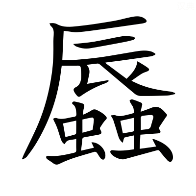

# 成公第八

*〈成公·名黑肱宣公子諡法安民立政曰成〉*

## 成元年

> **元年春王正月公即位** *無傳*
> 
> **二月辛酉葬我君宣公** *無傳*
> 
> **無冰** *無傳周二月今之十二月而無冰書冬溫*
> 
> **三月作丘甲** *周禮九夫為井四井為邑四邑為丘丘十六井出戎馬一匹牛三頭四丘為甸甸六十四井出長轂一乘戎馬四匹牛十二頭甲士三人步卒七十二人此甸所賦今魯使丘出之譏重斂故書〈為甸·徒練反一音繩證反◎一乘·繩證反◎卒七·尊忽反◎重斂·力驗反〉*
> 
> **夏臧孫許及晉侯盟于赤棘** *晉地*
> 
> **秋王師敗績于茅戎** *〈茅戎·亡交反史記及二傳皆作貿戎〉茅戎戎別種也不言戰王者至尊天下莫之得校故以自敗為文不書敗地而書茅戎明為茅戎所敗書秋從告〈別種·章勇反〉*
> 
> **冬十月**

**元年春晉侯使瑕嘉平戎于王** *平文十七年邥垂之役詹嘉處瑕故謂之瑕嘉〈邥垂·音審◎詹嘉·之廉反〉* **單襄公如晉拜成** *〈單襄·音善〉單襄公王卿士謝晉為平戎〈為平·于偽反下文同〉* **劉康公儌戎 *〈徼戎·古堯反要也〉* 將遂伐之** *康公王季子也戎平還欲要其無備〈欲要·一遥反〉* **叔服曰背盟而欺大國 *〈背盟·音佩下同〉* 此必敗** *叔服周內史* **背盟不祥欺大國不義神人弗助將何以勝不聽遂伐茅戎三月癸未敗績于徐吾氏** *徐吾氏茅戎之別也*

**為齊難故 *〈齊難·乃旦反下同〉* 作丘甲** *前年魯乞師於楚欲以伐齊楚師不出故懼而作丘甲* **聞齊將出楚師夏盟于赤棘** *與晉盟懼齊楚*

**秋王人來告敗** *解經所以秋乃書*

**冬臧宣叔令脩賦繕完** *〈繕完·市戰反下和端反〉治完城郭* **具守備 *〈具守·手又反〉* 曰齊楚結好 *〈結好·呼報反〉* 我新與晉盟晉楚爭盟齊師必至雖晉人伐齊楚必救之是齊楚同我也** *同共也* **知難而有備乃可以逞** *逞解也為二年齊侯伐我傳〈逞解·音蟹〉*

## 成二年

> **二年春齊侯伐我北鄙**
> 
> **夏四月丙戌衞孫良夫帥師及齊師戰于新築衞師敗績** *〈新築·音竹〉新築衞地皆陳曰戰大崩曰敗績四月無丙戌丙戌五月一日〈皆陳·直覲反〉*
> 
> **六月癸酉季孫行父臧孫許叔孫僑如公孫嬰齊帥師會晉郤克衞孫良夫曹公子首及齊侯戰于鞌齊師敗績** *〈僑如·其驕反注同◎郤克·去逆反◎于鞌·音安〉魯乞師於晉而不以與謀之例者從盟主之令上行於下非匹敵和成之類例在宣七年曹大夫常不書而書公子首者首命於國備於禮成為卿故也鞌齊地〈以與·音預◎匹敵·如字本或作適亦音敵〉*
> 
> **秋七月齊侯使國佐如師己酉及國佐盟于袁婁** *穀梁曰鞌去齊五百里袁婁去齊五十里*
> 
> **八月壬午宋公鮑卒** *〈公鮑·步卯反〉未同盟而赴以名*
> 
> **庚寅衞侯速卒** *宣十七年盟于斷道據傳庚寅九月七日*
> 
> **取汶陽田** *〈汶陽·音問〉晉使齊還魯故書取不以好得故不言歸〈以好·呼報反〉*
> 
> **冬楚師鄭師侵衞** *子重不書不親伐*
> 
> **十有一月公會楚公子嬰齊于蜀** *公與大夫會不貶嬰齊者時有許蔡之君故* **丙申公及楚人秦人宋人陳人衞人鄭人齊人曹人邾人薛人鄫人盟于蜀** *齊在鄭下非卿傳曰卿不書匱盟也然則楚卿於是始與中國準自此以下楚卿不書皆貶惡也〈匱盟·其位反〉*

**二年春齊侯伐我北鄙圍龍** *龍魯邑在泰山博縣西南* **頃公之嬖人盧蒲就魁門焉** *〈頃公·音傾◎嬖人·必計反◎就魁·苦回反〉攻龍門也* **龍人囚之齊侯曰勿殺吾與而盟無入而封** *封竟〈封竟·音境〉* **弗聽殺而膊諸城上** *〈而膊·普各反磔也〉膊磔也〈磔也·陟百反〉* **齊侯親鼓士陵城三日取龍遂南侵及巢丘** *取龍侵巢丘不書其義未聞*

**衞侯使孫良夫石稷甯相向禽將侵齊 *〈甯相·息亮反◎向禽·舒亮反〉* 與齊師遇** *齊伐魯還相遇於衞地良夫孫林父之父石稷石碏四世孫甯相甯俞子〈石碏·七畧反◎甯俞·羊朱反〉* **石子欲還孫子曰不可以師伐人遇其師而還將謂君何** *言無以答君* **若知不能則如無出今既遇矣不如戰也夏有** *闕文失新築戰事* **石成子曰師敗矣子不少須衆懼盡** *成子石稷也衞師已敗而孫良夫復欲戰故成子欲使須救〈復欲·扶又反〉* **子喪師徒 *〈子喪·息浪反〉* 何以復命皆不對又曰子國卿也隕子辱矣** *〈隕子·于敏反〉隕見禽獲* **子以衆退我此乃止** *我於此止禦齊師〈止御·魚吕反〉* **且告車來甚衆** *新築人教孫桓子故並告令軍中* **齊師乃止次于鞫居** *〈鞫居·居六反〉鞫居衞地* **新築人仲叔于奚救孫桓子桓子是以免** *于奚守新築大夫* **既衞人賞之以邑** *賞于奚* **辭請曲縣** *〈曲縣·音玄注同〉軒縣也周禮天子樂宮縣四周諸侯軒縣闕南方* **繁纓以朝 *〈繁纓·步于反注同〉* 許之** *繁纓馬飾皆諸侯之服* **仲尼聞之曰惜也不如多與之邑唯器與名不可以假人** *器車服名爵號* **君之所司也名以出信** *名位不愆為民所信〈不愆·起虔反〉* **信以守器** *動不失信則車服可保* **器以藏禮** *車服所以表尊卑* **禮以行義** *尊卑有禮各得其宜* **義以生利** *得其宜則利生* **利以平民政之大節也若以假人與人政也政亡則國家從之弗可止也已**

**孫桓子還於新築不入** *不入國* **遂如晉乞師臧宣叔亦如晉乞師皆主郤獻子** *宣十七年郤克至齊為婦人所笑遂怒故魯衞因之孫桓子臧宣叔皆不以國命各自詣郤克故不書* **晉侯許之七百乘** *五萬二千五百人* **郤子曰此城濮之賦也** *〈城濮·音卜〉城濮在僖二十八年* **有先君之明與先大夫之肅故捷克於先大夫無能為役** *不中為之役使* **請八百乘許之** *六萬人* **郤克將中軍 *〈將中·子匠反〉* 士燮佐上軍** *范文子代荀庚* **欒書將下軍** *代趙朔* **韓厥為司馬以救魯衞臧宣叔逆晉師且道之 *〈且道·音導〉* 季文子帥師會之及衞地韓獻子將斬人郤獻子馳將救之至則既斬之矣郤子使速以徇 *〈以徇·似俊反〉* 告其僕曰吾以分謗也** *不欲使韓氏獨受謗* **師從齊師于莘** *〈于莘·所巾反〉莘齊地* **六月壬申師至于靡笄之下** *〈靡笄·如字又音摩笄音雞〉靡笄山名* **齊侯使請戰曰子以君師辱於敝邑不腆敝賦 *〈不腆·他典反〉* 詰朝請見** *〈詰·起吉反◎朝·如字注及下朝夕朝食同◎請見·賢遍反〉詰朝平旦* **對曰晉與魯衞兄弟也來告曰大國朝夕釋憾 *〈釋感·胡暗反本又作憾〉* 於敝邑之地** *大國謂齊敝邑魯衞自稱* **寡君不忍使羣臣請於大國無令輿師 *〈無令·力呈反◎輿師·如字下無令輿師同一音所類反〉* 淹於君地** *輿衆也淹久也* **能進不能退君無所辱命** *言自欲戰不復須君命〈不復·扶又反〉* **齊侯曰大夫之許寡人之願也若其不許亦將見也齊高固入晉師桀石以投人** *桀擔也〈擔也·丁甘反〉* **禽之而乘其車** *既獲其人因釋己車而載所獲者車* **繫桑本焉以徇齊壘** *〈齊壘·力軌反〉將至齊壘以桑樹繫車而走欲自異* **曰欲勇者賈余餘勇** *〈賈余·音古賣也注同〉賈買也言己勇有餘欲賣之〈欲賣·摩懈反〉* **癸酉師陳于鞌 *〈師陳·直覲反〉* 邴夏御齊侯 *〈邴·音丙又彼命反◎夏·戶雅反〉* 逢丑父為右晉解張御郤克 *〈解張·音蟹下如字一音直亮反〉* 鄭丘緩為右齊侯曰余姑翦滅此而朝食** *姑且也翦盡也* **不介馬而馳之** *介甲也* **郤克傷於矢流血及屨未絕鼓音** *中軍將自執旗鼓故雖傷而擊鼓不息〈軍將·子匠反下將在左同〉* **曰余病矣張侯曰自始合而矢貫余手 *〈貫余·古亂反下注同〉* 及肘 *〈及肘·竹九反〉* 余折以御 *〈余折·之設反〉* 左輪朱殷 *〈朱殷·於閑反徐於辰反注同〉* 豈敢言病吾子忍之** *張侯解張也朱血色血色久則殷殷音近烟今人謂赤黑為殷色言血多汙車輪御猶不敢息〈近烟·附近之近◎汙車·汙穢之汙字林一故反〉* **緩曰自始合苟有險余必下推車 *〈推車·昌誰反又他回反注及下推車同〉* 子豈識之然子病矣** *以其不識己推車* **張侯曰師之耳目在吾旗鼓進退從之此車一人殿之 *〈殿之·多練反注同〉* 可以集事** *殿鎮也集成也* **若之何其以病 *〈若之何其以病·絶句〉* 敗君之大事也擐甲執兵 *〈擐甲·音患〉* 固即死也** *擐貫也即就也* **病未及死吾子勉之左并轡 *〈左并·必政反徐方聘反〉* 右援枹而鼓 *〈右援·音袁◎桴·音浮鼓槌也字林云擊鼓柄也〉* 馬逸不能止師從之** *晉師從郤克車* **齊師敗績逐之三周華不注** *〈三周華·如字又戶化反◎不注·之住反〉華不注山名* **韓厥夢子輿謂己曰旦辟左右** *子輿韓厥父* **故中御而從齊侯** *居中代御者自非元帥御者皆在中將在左〈元帥·所類反〉* **邴夏曰射其御者君子也公曰謂之君子而射之非禮也** *齊侯不知戎禮* **射其左 *〈射其·食亦反下幷注皆同〉* 越于車下** *越隊也〈越隊·直類反〉* **射其右斃于車中綦毋張喪車 *〈綦毋·音其下音無◎喪車·息浪反〉* 從韓厥曰請寓乘** *〈寓乘·繩證反寓寄也〉綦毋張晉大夫寓寄也* **從左右皆肘之使立於後** *以左右皆死不欲使立其處〈其處·昌慮反〉* **韓厥俛定其右** *〈俛定·音勉俯也〉俛俯也右被射仆車中故俯安隱之〈仆車·音赴又蒲北反〉* **逢丑父與公易位** *居公處* **將及華泉 *〈華泉·戶化反〉* 驂絓於木 *〈絓於·戶卦反一音卦〉* 而止** *驂馬絓也〈驂馬·七南反〉* **丑父寢於轏中** *〈轏中·仕産反又仕板反士車也字林仕諫反云臥車也〉轏士車* **蛇出於其下以肱擊之 *〈以肱·古弘反〉* 傷而匿之 *〈而匿·女力反注同〉* 故不能推車而及** *為韓厥所及丑父欲為右故匿其傷* **韓厥執縶馬前** *〈執縶·張立反馬絆也〉縶馬絆也執之示脩臣僕之職〈絆也·音半〉* **再拜稽首奉觴 *〈奉觴·式羊反〉* 加璧以進** *進觴璧亦以示敬* **曰寡君使羣臣為魯衞請 *〈為魯·于偽反注同〉* 曰無令輿師 *〈無令·力呈反〉* 陷入君地** *本但為二國救請不欲乃過入君地謙辭* **下臣不幸屬當戎行 *〈屬當·音燭注同適也◎戎行·下郎反〉* 無所逃隱** *屬適* **且懼奔辟 *〈奔辟·音避注同徐扶臂反服氏扶亦反〉* 而忝兩君臣辱戎士** *若奔辟則為辱晉君并為齊侯羞故言二君此蓋韓厥自處臣僕謙敬之飾言* **敢告不敏攝官承乏** *言欲以己不敏攝承空乏從君俱還〈從君·才用反又如字〉* **丑父使公下如華泉取飲鄭周父御佐車宛茷為右 *〈宛·紆元反◎茷·扶廢反〉* 載齊侯以免** *佐車副車* **韓厥獻丑父郤獻子將戮之呼曰 *〈呼曰·火故反〉* 自今無有代其君任患者 *〈任患·音壬〉* 有一於此將為戮乎郤子曰人不難以死免其君 *〈不難·乃旦反〉* 我戮之不祥赦之以勸事君者乃免之齊侯免求丑父三入三出** *重其待己故三入晉軍求之* **每出齊師以帥退入于狄卒** *〈狄卒·子忽反注及下同〉齊師大敗皆有退心故齊侯輕出其衆以帥厲退者遂迸入狄卒狄卒者狄人從晉討齊者〈輕出·遣政反◎迸入·補諍反〉* **狄卒皆抽戈楯冒之 *〈戈楯·食準反又音允◎冒之·亡報反〉* 以入于衞師衞師免之** *狄衞畏齊之強故不敢害齊侯皆共免護之* **遂自徐關入齊侯見保者曰勉之齊師敗矣** *所過城邑皆勉勵其守者〈守者·手又反〉* **辟女子** *〈辟女子·音避注皆同一音扶亦反〉使辟君也齊侯單還故婦人不辟之〈單還·音丹〉* **女子曰君免乎曰免矣曰銳司徒免乎 *〈銳司徒·悅歳反〉* 曰免矣** *銳司徒主銳兵者* **曰苟君與吾父免矣可若何** *言餘人不可復如何〈可復·扶又反〉* **乃奔** *走辟君* **齊侯以為有禮** *先問君後問父故也* **既而問之辟司徒之妻也** *〈辟司徒·音壁必覓反注同徐甫亦反〉辟司徒主壘壁者* **予之石窌** *〈石窌·力救反一音力到反〉石窌邑名濟北盧縣東有地名石窌* **晉師從齊師入自丘輿擊馬陘** *〈馬陘·音刑〉丘輿馬陘皆齊邑* **齊侯使賓媚人 *〈賔媚·美兾反〉* 賂以紀甗 *〈賂以·音路◎紀甗·魚輦反徐音彦又音言字林牛健反玉甑也〉* 玉磬與地** *媚人國佐也甗玉甑皆滅紀所得〈玉甑·子孕反又慈陵反〉* **不可則聽客之所為賓媚人致賂晉人不可曰必以蕭同叔子為質** *〈為質·徐音致下同〉同叔蕭君之字齊侯外祖父子女也難斥言其母故遠言之〈難斥·乃旦反〉* **而使齊之封內盡東其畒** *〈盡東·津忍反〉使壟畝東西行〈使壟·力勇反◎東西行·戶郎反又如字〉* **對曰蕭同叔子非他寡君之母也若以匹敵則亦晉君之母也吾子布大命於諸侯而曰必質其母以為信其若王命何** *言違王命* **且是以不孝令也詩曰孝子不匱永錫爾類** *詩大雅言孝心不乏者又能以孝道長賜其志類* **若以不孝令於諸侯其無乃非德類也乎** *不以孝德賜同類* **先王疆理天下 *〈疆理·居良反注下皆同〉* 物土之宜而布其利** *疆界也理正也物土之宜播殖之物各從土宜* **故詩曰我疆我理南東其畒** *詩小雅或南或東從其土宜* **今吾子疆理諸侯而曰盡東其畒而已唯吾子戎車是利** *晉之伐齊循壟東行易〈易也·以豉反〉* **無顧土宜其無乃非先王之命也乎反先王則不義何以為盟主其晉實有闕** *闕失* **四王之王也** *〈四王·夏禹殷湯周文王武王也◎之王·于況反〉禹湯文武* **樹德而濟同欲焉** *樹立也濟成也* **五伯之霸也** *〈五伯·夏伯昆吾商伯大彭豕韋周伯齊桓晉文也或曰齊桓晉文宋襄秦穆楚莊〉夏伯昆吾商伯大彭豕韋周伯齊桓晉文* **勤而撫之以役王命** *役事也* **今吾子求合諸侯以逞無疆之欲** *疆竟也〈疆竟·如字又音境〉* **詩曰布政優優百祿是遒** *〈是遒·在由反徐子由反聚也〉詩頌殷湯布政優和故百祿來聚遒聚也* **子實不優而弃百祿諸侯何害焉** *言不能為諸侯害* **不然** *不見許* **寡君之命使臣 *〈命使·所吏反〉* 則有辭矣曰子以君師辱於敝邑不腆敝賦以犒從者** *〈以犒·苦報反◎從者·才用反〉戰而曰犒為孫辭* **畏君之震師徒橈敗** *〈橈敗·乃敎反曲也〉震動橈曲也* **吾子惠儌齊國之福不泯其社稷 *〈不泯·彌忍反〉* 使繼舊好 *〈舊好·呼報反〉* 唯是先君之敝器土地不敢愛子又不許請收合餘燼** *〈收合·如字一音閤◎餘燼·似刃反〉燼火餘木* **背城借一** *〈背城·音佩〉欲於城下復借一戰〈復借·扶又反〉* **敝邑之幸亦云從也況其不幸敢不唯命是聽** *言完全之時尚不敢違晉今若不幸則從命* **魯衞諫曰齊疾我矣** *諫郤克也* **其死亡者皆親暱也 *〈親暱·女乙反〉* 子若不許讎我必甚唯子則又何求子得其國寶** *謂甗磬* **我亦得地** *齊歸所侵* **而紓於難** *〈而紓·音舒緩也一音直吕反◎於難·乃旦反注同〉齊服則難緩* **其榮多矣齊晉亦唯天所授豈必晉晉人許之對曰羣臣帥賦輿** *賦輿猶兵車* **以為魯衞請 *〈以為·于偽反〉* 若苟有以藉口 *〈以藉·在夜反注同薦也〉* 而復於寡君** *藉薦復白也* **君之惠也敢不唯命是聽禽鄭自師逆公** *禽鄭魯大夫歸逆公會晉師* **秋七月晉師及齊國佐盟于爰婁使齊人歸我汶陽之田公會晉師于上鄍** *〈上鄍·覓經反〉上鄍地闕公會晉師不書史闕* **賜三帥 *〈三帥·所類反注及下同〉* 先路三命之服** *三帥郤克士燮欒書已嘗受王先路之賜今改而易新并此車所建所服之物* **司馬司空輿帥候正亞旅皆受一命之服** *晉司馬司空皆大夫輿帥主兵車候正主斥候亞旅亦大夫也皆魯侯賜*

**八月宋文公卒始厚葬用蜃炭 *〈用·市忍反蛤也◎炭·吐旦反燒蛤為炭也〉* 益車馬始用殉** *〈用殉·似俊反殺人從葬〉燒蛤為炭以瘞壙多埋車馬用人從葬〈燒蛤·古荅反◎以瘞·於例反◎壙·苦晃反一音曠〉* **重器備** *〈重器備·直恭反多也注同〉重猶多也* **椁有四阿 *〈椁有·音郭〉* 棺有翰檜** *〈有翰·戶旦反一音韓◎檜·古外反徐音會〉四阿四注椁也翰旁飾檜上飾皆王禮* **君子謂華元樂舉於是乎不臣臣治煩去惑者也 *〈去惑·起吕反下去之同〉* 是以伏死而爭 *〈而爭·爭鬭之爭〉* 今二子者君生則縱其惑** *謂文十八年殺母弟須* **死又益其侈 *〈其侈·昌氏反又式氏反〉* 是弃君於惡也何臣之為** *若言何用為臣*

**九月衞穆公卒晉三子自役弔焉哭於大門之外** *師還過衞故因弔之未復命故不敢成禮〈過衞·古禾反又古臥反〉* **衞人逆之** *逆於門外設喪位* **婦人哭於門內** *喪位婦人哭於堂賓在門外故移在門內* **送亦如之遂常以葬** *至葬行此禮*

**楚之討陳夏氏也** *〈夏氏·戶雅反下同〉在宣十一年* **莊王欲納夏姬申公巫臣曰不可君召諸侯以討罪也今納夏姬貪其色也貪色為淫淫為大罰周書曰明德愼罰** *周書康誥* **文王所以造周也明德務崇之之謂也愼罰務去之之謂也若興諸侯以取大罰非愼之也君其圖之王乃止子反欲取之巫臣曰是不祥人也是夭子蠻** *子蠻鄭靈公夏姬之兄殺死無後〈殺死·申志反下文殺靈侯同〉* **殺御叔** *〈殺御叔·魚據反〉御叔夏姬之夫亦早死* **弒靈侯** *陳靈公也* **戮夏南** *夏姬子徵舒* **出孔儀** *孔寧儀行父* **喪陳國** *〈喪陳·息浪反下注而喪同〉楚滅陳* **何不祥如是人生實難其有不獲死乎** *言死易得無為取夏姬以速之〈死易·以豉反〉* **天下多美婦人何必是子反乃止王以予連尹襄老襄老死於邲不獲其尸** *邲戰在宣十二年* **其子黑要烝焉** *〈黑要·一遥反◎烝焉·之承反〉黑要襄老子* **巫臣使道焉 *〈使道·音導注同〉* 曰歸吾聘女** *〈吾聘女·匹政反下音汝〉道夏姬使歸鄭* **又使自鄭召之曰尸可得也** *襄老尸* **必來逆之姬以告王王問諸屈巫** *〈屈巫·居勿反〉屈巫巫臣* **對曰其信知罃之父 *〈知罃·音智下於耕反〉* 成公之嬖也而中行伯之季弟也** *知罃父荀首也中行伯荀林父也邲之戰楚人囚知罃* **新佐中軍而善鄭皇戌甚愛此子** *愛知罃也* **其必因鄭而歸王子與襄老之尸以求之** *王子楚公子穀臣也邲之戰荀首囚之* **鄭人懼於邲之役而欲求媚於晉其必許之王遣夏姬歸將行謂送者曰不得尸吾不反矣巫臣聘諸鄭鄭伯許之** *聘夏姬* **及共王即位 *〈共王·音恭〉* 將為陽橋之役** *楚伐魯至陽橋在此年冬* **使屈巫聘于齊且告師期巫臣盡室以行** *室家盡去* **申叔跪從其父 *〈申叔跪·其委反一音居委反◎從其父·才用反〉* 將適郢 *〈適郢·以并反又以政反〉* 遇之** *叔跪申叔時之子* **曰異哉夫子有三軍之懼而又有桑中之喜宜將竊妻以逃者也** *桑中衞風淫奔之詩* **及鄭使介反幣 *〈使介·音界〉* 而以夏姬行** *介副也幣聘物* **將奔齊齊師新敗曰吾不處不勝之國遂奔晉而因郤至** *至郤克族子* **以臣於晉晉人使為邢大夫** *〈邢大夫·音刑〉邢晉邑* **子反請以重幣錮之** *〈錮之·音固〉禁錮勿令仕〈勿令·力呈反〉* **王曰止其自為謀也 *〈自為·于偽反又如字〉* 則過矣其為吾先君謀也 *〈為吾·于偽反〉* 則忠忠社稷之固也所蓋多矣** *蓋覆也* **且彼若能利國家雖重幣晉將可乎** *言不許* **若無益於晉晉將弃之何勞錮焉** *為七年楚滅巫臣族晉南通吳張本*

**晉師歸范文子後入武子曰無為吾望爾也乎** *武子士會文子之父* **對曰師有功國人喜以逆之先入必屬耳目焉 *〈必屬·章欲反後同〉* 是代帥受名也 *〈代帥·所類反下注稱帥軍帥將帥同〉* 故不敢武子曰吾知免矣** *〈吾知免矣·一本無知字〉知其不益己禍* **郤伯見公 *〈郤伯見·賢遍反下同〉* 曰子之力也夫 *〈也夫·音扶〉* 對曰君之訓也二三子之力也臣何力之有焉** *郤伯郤克* **范叔見勞之如郤伯 *〈勞之·力報反〉* 對曰庚所命也克之制也燮何力之有焉** *荀庚將上軍時不出范文子上軍佐代行故稱帥以讓〈庚將·子匠反下同〉* **欒伯見公亦如之對曰燮之詔也士用命也書何力之有焉** *詔告也欒書下軍帥故推功上軍傳言晉將帥克讓所以能勝齊*

**宣公使求好于楚 *〈求好·呼報反下同〉* 莊王卒宣公薨不克作好** *在宣十八年* **公即位受盟于晉** *元年盟赤棘* **會晉伐齊衞人不行使于楚** *〈行使·所吏反〉不聘楚* **而亦受盟于晉從於伐齊故楚令尹子重為陽橋之役以救齊將起師子重曰君弱** *傳曰寡人生十年而喪先君共王即位至是二年蓋年十二三矣* **羣臣不如先大夫師衆而後可詩曰濟濟多士 *〈濟濟·子禮反〉* 文王以寧** *詩大雅言文王以衆士安* **夫文王猶用衆況吾儕乎** *〈吾儕·仕皆反等也〉儕等* **且先君莊王屬之曰無德以及遠方莫如惠恤其民而善用之乃大戶** *閱民戶口〈閱民·音悅〉* **已責** *弃逋責〈棄逋·補吳反〉* **逮鰥** *〈逮鰥·古頑反〉施及老鰥〈施及·始豉反〉* **救乏赦罪悉師王卒盡行 *〈王卒·子忽反注同〉* 彭名御戎蔡景公為左許靈公為右** *王卒盡行故王戎車亦行雖無楚王令二君當左右之位〈令二君·力呈反〉* **二君弱皆強冠之 *〈皆強·其丈反◎冠之·古亂反〉* 冬楚師侵衞遂侵我師于蜀** *公賂之而退故不書侵* **使臧孫往** *臧孫宣叔也* **辭曰楚遠而久固將退矣無功而受名臣不敢** *不敢虛受退楚名* **楚侵及陽橋** *陽橋魯地* **孟孫請往賂之** *楚侵遂深故孟孫請以賂往孟孫獻子也* **以執斵執鍼織紝** *〈執斲·竹角反◎執鍼·之林反◎織絍·女金反徐而鴆反〉執斵匠人執鍼女工織紝織繒布者* **皆百人公衡為質** *〈為質·音致〉公衡成公子* **以請盟楚人許平十一月公及楚公子嬰齊蔡侯許男秦右大夫說 *〈大夫說·音悅〉* 宋華元陳公孫寧衞孫良夫鄭公子去疾 *〈去疾·起吕反〉* 及齊國之大夫盟于蜀** *齊大夫不書其名非卿也* **卿不書匱盟也於是乎畏晉而竊與楚盟故曰匱盟** *匱乏也* **蔡侯許男不書乘楚車也謂之失位** *乘楚王車為左右則失位也卿不書則稱人諸侯不書皆不見經君臣之別〈不見·賢遍反◎之別·彼列反〉* **君子曰位其不可不愼也乎蔡許之君一失其位不得列於諸侯況其下乎詩曰不解于位 *〈不解·佳賣反〉* 民之攸塈** *〈攸墍·許器反息也〉詩大雅言在上者勤正其位則國安而民息也攸所也塈息也* **其是之謂矣楚師及宋公衡逃歸臧宣叔曰衡父不忍數年之不宴** *〈數年·所主反〉宴樂也〈宴樂·音洛〉* **以弃魯國國將若之何誰居 *〈誰居·音基語辭也〉* 後之人必有任是夫 *〈有任·音壬當也◎是夫·音扶〉* 國弃矣** *居辭也言後人必有當此患* **是行也晉辟楚畏其衆也君子曰衆之不可以已也大夫為政猶以衆克況明君而善用其衆乎大誓所謂商兆民離周十人同者衆也** *大誓周書萬億曰兆民離則弱合則成衆言殷以散亡周以衆興*

**晉侯使鞏朔獻齊捷于周 *〈齊捷·在妾反〉* 王弗見使單襄公辭焉曰蠻夷戎狄不式王命** *式用也* **淫湎毀常 *〈淫湎·面善反〉* 王命伐之則有獻捷王親受而勞之 *〈而勞·力報反〉* 所以懲不敬勸有功也兄弟甥舅侵敗王略** *〈侵敗·必邁反〉兄弟同姓國甥舅異姓國略經略法度* **王命伐之告事而已不獻其功所以敬親暱** *〈親暱·女乙反〉告伐事而不獻囚俘* **禁淫慝也** *〈淫慝·他得反〉淫慝謂虣掠百姓取囚俘也〈謂暴·本又作虣薄報反◎掠·音亮〉* **今叔父克遂有功于齊** *克能也* **而不使命卿鎮撫王室所使來撫余一人而鞏伯實來未有職司於王室** *鞏朔上軍大夫非命卿名位不達於王室* **又奸先王之禮** *〈又奸·音干〉謂獻齊捷* **余雖欲於鞏伯** *欲受其獻* **其敢廢舊典以忝叔父夫齊甥舅之國也而大師之後也** *〈大師·音泰〉齊世與周昏故曰甥舅* **寧不亦淫從其欲 *〈淫從·子用反本亦作縱〉* 以怒叔父抑豈不可諫誨士莊伯不能對** *莊伯鞏朔* **王使委於三吏** *〈三吏·三吏三公也三公者天子之吏也〉委屬也三吏三公也* **禮之如侯伯克敵使大夫告慶之禮降於卿禮一等王以鞏伯宴而私賄之使相告之 *〈使相·息亮反注同〉* 曰非禮也勿籍** *相相禮者籍書也王畏晉故私宴賄以慰鞏朔*

## 成三年

> **三年春王正月公會晉侯宋公衞侯曹伯伐鄭** *宋衞未葬而稱爵以接鄰國非禮也*
> 
> **辛亥葬衞穆公** *無傳*
> 
> **二月公至自伐鄭** *無傳*
> 
> **甲子新宮災三日哭** *無傳三年喪畢宣公神主新入廟故謂之新宮書三日哭善得禮宗廟親之神靈所馮居而遇災故哀而哭之〈所馮·皮冰反〉*
> 
> **乙亥葬宋文公** *無傳七月而葬緩*
> 
> **夏公如**
> 
> **晉鄭公子去疾帥師伐許**
> 
> **公至自晉** *無傳*
> 
> **秋叔孫僑如帥師圍棘** *棘汶陽田之邑在濟北蛇丘縣〈蛇丘·以支反一音如字〉*
> 
> **大雩** *無傳以過時書*
> 
> **晉郤克衞孫良夫伐廧咎如** *〈廧·在良反◎咎如·古刀反〉赤狄別種〈別種·章勇反〉*
> 
> **冬十有一月晉侯使荀庚來聘衞侯使孫良夫來聘丙午及荀庚盟丁未及孫良夫盟** *先晉後衞尊霸主*
> 
> **鄭伐許** *無傳不書將帥告辭略〈書將·子匠反◎帥·所類反〉*

**三年春諸侯伐鄭次于伯牛討邲之役也** *伯牛鄭地邲役在宣十二年* **遂東侵鄭** *晉潛軍深入* **鄭公子偃帥師禦之** *偃穆公子* **使東鄙覆諸鄤** *〈覆諸·扶又反㐲兵也注同◎鄤·亡袁反又莫千反徐武旦反一音万〉覆伏兵* **敗諸丘輿** *鄤丘輿皆鄭地晉偏軍為鄭所敗故不書* **皇戌如楚獻捷**

**夏公如晉拜汶陽之田** *前年晉使齊歸魯汶陽田故*

**許恃楚而不事鄭鄭子良伐許**

**晉人歸楚公子穀臣與連尹襄老之尸于楚以求知罃** *邲之戰楚獲知罃* **於是荀首佐中軍矣** *荀首知罃父* **故楚人許之王送知罃曰子其怨我乎對曰二國治戎臣不才不勝其任 *〈不勝·音升下注同〉* 以為俘馘 *〈俘·芳夫反◎馘·古獲反〉* 執事不以釁鼓** *〈以釁·許覲反〉以血塗鼓為釁鼓* **使歸即戮君之惠也臣實不才又誰敢怨王曰然則德我乎對曰二國圖其社稷而求紓其民** *〈求紓·音舒緩也〉紓緩也* **各懲其忿 *〈各懲·直升反〉* 以相宥也** *〈相宥·音又〉宥赦也* **兩釋纍囚 *〈纍·力誰反繫也〉* 以成其好** *〈其好·呼報反下同〉纍繫也* **二國有好臣不與及 *〈不與·音預〉* 其誰敢德** *言二國本不為己〈不為·于偽反〉* **王曰子歸何以報我對曰臣不任受怨 *〈臣不任·音壬下亦不任同〉* 君亦不任受德無怨無德不知所報王曰雖然必告不穀對曰以君之靈纍臣得歸骨於晉寡君之以為戮死且不朽** *戮其不勝任* **若從君之惠而免之以賜君之外臣首** *稱於異國君曰外臣* **首其請於寡君而以戮於宗亦死且不朽若不獲命** *君不許戮* **而使嗣宗職** *嗣其祖宗之位職* **次及於事而帥偏師以脩封疆 *〈封疆·居良反〉* 雖遇執事** *遇楚將帥〈楚將·子亮反◎帥·所類反〉* **其弗敢違** *違辟也* **其竭力致死無有二心以盡臣禮所以報也王曰晉未可與爭重為之禮而歸之**

**秋叔孫僑如圍棘取汶陽之田棘不服故圍之** *僑如叔孫得臣子*

**晉郤克衞孫良夫伐廧咎如討赤狄之餘焉** *宣十五年晉滅赤狄潞氏其餘民散入廧咎如故討之* **廧咎如潰 *〈如潰·戶內反〉* 上失民也** *此傳釋經之文而經無廧咎如潰蓋經闕此四字*

**冬十一月晉侯使荀庚來聘且尋盟** *尋元年赤棘盟荀庚林父之子* **衞侯使孫良夫來聘且尋盟** *尋宣七年盟* **公問諸臧宣叔曰中行伯之於晉也其位在三** *下卿* **孫子之於衞也位為上卿將誰先對曰次國之上卿當大國之中中當其下下當其上大夫** *降一等* **小國之上卿當大國之下卿中當其上大夫下當其下大夫** *降大國二等* **上下如是古之制也** *古制公為大國侯伯為次國子男為小國* **衞在晉不得為次國** *春秋時以強弱為大小故衞雖侯爵猶為小國* **晉為盟主其將先之** *計等則二人位敵以盟主故先晉* **丙午盟晉丁未盟衞禮也**

**十二月甲戌晉作六軍** *為六軍僭王也萬二千五百人為軍〈僭王·子念反〉* **韓厥趙括鞏朔韓穿荀騅 *〈荀騅·音徍〉* 趙旃皆為卿賞鞌之功也** *韓厥為新中軍趙括佐之鞏朔為新上軍韓穿佐之荀騅為新下軍趙旃佐之晉舊自有三軍今增此故為六軍*

**齊侯朝于晉將授玉** *行朝禮* **郤克趨進曰此行也君為婦人之笑辱也 *〈君為·于偽反下為兩君同〉* 寡君未之敢任** *〈敢任·音壬注同〉言齊侯之來以謝婦人之笑非為脩好故云晉君不任當此* **晉侯享齊侯齊侯視韓厥韓厥曰君知厥也乎齊侯曰服改矣** *戎朝異服也言服改明識其人* **韓厥登舉爵曰臣之不敢愛死為兩君之在此堂也**

**荀罃之在楚也鄭賈人 *〈賈人·音古下同〉* 有將寘諸褚中 *〈寘諸·之豉反◎褚中·中吕反〉* 以出既謀之未行而楚人歸之賈人如晉荀罃善視之如實出己賈人曰吾無其功敢有其實乎吾小人不可以厚誣君子遂適齊** *傳言知罃之賢*

## 成四年

> **四年春宋公使華元來聘**
> 
> **三月壬申鄭伯堅卒** *無傳二年大夫盟于蜀壬申二月二十八日*
> 
> **杞伯來朝**
> 
> **夏四月甲寅臧孫許卒** *無傳*
> 
> **公如晉**
> 
> **葬鄭襄公** *無傳*
> 
> **秋公至自晉**
> 
> **冬城鄆** *〈城鄆·音運〉無傳公欲叛晉故城而為備*
> 
> **鄭伯伐許**

**四年春宋華元來聘通嗣君也** *宋共公即位〈宋共·音恭〉*

**杞伯來朝歸叔姬故也** *將出叔姬先脩禮朝魯言其故*

**夏公如晉晉侯見公不敬季文子曰晉侯必不免** *言將不能壽終也後十年陷廁而死* **詩曰敬之敬之天惟顯思命不易哉** *〈不易·以豉反〉詩頌言天道顯明受其命甚難不可不敬以奉之* **夫晉侯之命在諸侯矣可不敬乎** *敬諸侯則得天命* **秋公至自晉欲求成于楚而叛晉季文子曰不可晉雖無道未可叛也國大臣睦而邇於我** *邇近也* **諸侯聽焉未可以貳** *聽服也* **史佚之志有之** *周文王大史〈大史·音泰〉* **曰非我族類其心必異楚雖大非吾族也** *與魯異姓* **其肯字我乎公乃止** *字愛也*

**冬十一月鄭公孫申帥師疆許田** *〈疆許·居良反〉前年鄭伐許侵其田今正其界* **許人敗諸展陂 *〈展陂·彼皮反〉* 鄭伯伐許取鉏任泠敦之田** *〈取鉏·仕居反◎任·音壬◎泠敦·力丁反〉展陂亦許地* **晉欒書將中軍** *〈將中·子匠反〉代郤克* **荀首佐之士燮佐上軍以救許伐鄭取氾祭** *〈取氾·音凡注同或音祀◎祭·側界反〉氾祭鄭地成皐縣東有氾水* **楚子反救鄭鄭伯與許男訟焉** *於子反前爭曲直* **皇戌攝鄭伯之辭** *代之對* **子反不能決也曰君若辱在寡君寡君與其二三臣共聽兩君之所欲成其可知也** *欲使自屈在楚子前決之* **不然側不足以知二國之成** *側子反名為明年許愬鄭於楚張本〈許愬·音素〉*

**晉趙嬰通于趙莊姬** *趙嬰趙盾弟莊姬趙朔妻朔盾之子*

## 成五年

> **五年春王正月杞叔姬來歸** *出也傳在前年*
> 
> **仲孫蔑如宋**
> 
> **夏叔孫僑如會晉荀首于穀** *穀齊地*
> 
> **梁山崩** *記異也梁山在馮翊夏陽縣北*
> 
> **秋大水** *無傳*
> 
> **冬十有一月己酉天王崩**
> 
> **十有二月己丑公會晉侯齊侯宋公衞侯鄭伯曹伯邾子杞伯同盟于蟲牢** *蟲牢鄭地陳留封丘縣北有桐牢*

**五年春原屏放諸齊** *〈原屏·步丁反〉放趙嬰也原同屏季嬰之兄* **嬰曰我在故欒氏不作我亡吾二昆其憂哉且人各有能有不能** *言己雖淫而能令莊姬護趙氏〈原屏·步丁反〉* **舍我何害 *〈舍我·音捨又音赦〉* 弗聽 *〈弗聽·吐丁反〉* 嬰夢天使謂己祭余余福女 *〈福女·音汝〉* 使問諸士貞伯貞伯曰不識也既而告其人** *自告貞伯從人〈從人·才用反〉* **曰神福仁而禍淫淫而無罰福也祭其得亡乎** *以得放遣為福* **祭之之明日而亡** *為八年晉殺趙同趙括傳*

**孟獻子如宋報華元也** *前年宋華元來聘*

**夏晉荀首如齊逆女故宣伯餫諸穀** *〈餫諸·音鄆〉野饋曰餫運糧饋之敬大國也〈野饋·其媿反〉*

**梁山崩晉侯以傳召伯宗** *〈以傳·中戀反驛也注及下同〉傳驛〈驛也·音亦〉* **伯宗辟重 *〈辟重·匹亦反徐甫赤反本又作僻〉* 曰辟傳** *〈曰辟·音避〉重載之車* **重人曰待我不如捷之速也** *〈捷之·在妾反〉捷邪出〈邪出·似嗟反〉* **問其所曰絳人也 *〈絳人·古巷反〉* 問絳事焉曰梁山崩將召伯宗謀之問將若之何曰山有朽壤而崩 *〈朽壤·如丈反〉* 可若何國主山川** *主謂所主祭* **故山崩川竭君為之不舉** *〈君為·于偽反〉去盛饌〈去盛·起吕反◎饌也·仕戀反〉* **降服** *損盛服* **乘縵** *〈乘縵·武旦反又莫半反〉車無文* **徹樂** *息八音* **出次** *舍於郊* **祝幣** *陳玉帛* **史辭** *自罪責* **以禮焉** *禮山川* **其如此而已雖伯宗若之何伯宗請見之** *〈請見·賢遍反注皆同〉見之於晉君* **不可** *不肯見* **遂以告而從之** *從重人言*

**許靈公愬鄭伯于楚** *前比年鄭伐許故* **六月鄭悼公如楚訟不勝楚人執皇戌及子國** *以鄭伯不直故也子國鄭穆公子* **故鄭伯歸使公子偃請成于晉秋八月鄭伯及晉趙同盟于垂棘** *垂棘晉地*

**宋公子圍龜為質于楚 *〈為質·音致下注同〉* 而歸** *圍龜文公子* **華元享之請鼓譟以出 *〈鼓譟·素報反〉* 鼓譟以復入** *〈復入·扶又反下同〉出入輒擊鼓* **曰習攻華氏宋公殺之** *蓋宣十五年宋楚平後華元使圍龜代己為質故怨而欲攻華氏*

**冬同盟于蟲牢鄭服也諸侯謀復會宋公使向為人 *〈向為人·舒亮反〉* 辭以子靈之難** *〈辭以子靈之難·乃旦反又一本無之難二字〉子靈圍龜也宋公不欲會以新誅子靈為辭為明年侵宋傳〈以新誅子靈為辭·一本無為辭二字〉*

**十一月己酉定王崩** *經在蟲牢盟上傳在下月倒錯衆家傳悉無此八字或衍文〈月倒·丁老反〉*

## 成六年

> **六年春王正月公至自會** *無傳*
> 
> **二月辛巳立武宮** *魯人自鞌之功至今無患故築武軍又作先君武公宮以告成事欲以示後世*
> 
> **取鄟** *〈取鄟·徐音專又市臠反〉附庸國也*
> 
> **衞孫良夫帥師侵宋**
> 
> **夏六月邾子來朝** *無傳*
> 
> **公孫嬰齊如晉** *嬰齊叔肸子*
> 
> **壬申鄭伯費卒** *〈伯費·音祕〉前年同盟蟲牢*
> 
> **秋仲孫蔑叔孫僑如帥師侵宋**
> 
> **楚公子嬰齊帥師伐鄭**
> 
> **冬季孫行父如晉**
> 
> **晉欒書帥師救鄭**

**六年春鄭伯如晉拜成** *謝前年再盟* **子游相** *〈子游相·息亮反下甯相同〉子游公子偃* **授玉于東楹之東** *禮授玉兩楹之間鄭伯行疾故東過* **士貞伯曰鄭伯其死乎自弃也已視流而行速不安其位宜不能久** *視流不端諦〈端諦·音帝〉*

**二月季文子以鞌之功立武宮非禮也** *宣十二年潘黨勸楚子立武軍楚子答以武有七德非己所堪其為先君宮告成事而已今魯倚晉之功又非霸主而立武宮故譏之〈魯倚·於綺反〉* **聽於人以救其難 *〈其難·乃旦反注同〉* 不可以立武立武由己非由人也** *言請人救難勝非己功*

**取鄟言易也** *〈言易·以鼓反〉*

**三月晉伯宗夏陽說 *〈夏陽·戶雅反◎說·音悅下文注同〉* 衞孫良夫甯相鄭人伊雒之戎陸渾蠻氏 *〈陸渾·戶門反〉* 侵宋** *夏陽說晉大夫蠻氏戎別種也河南新城縣東南有蠻城經唯書孫良夫獨衞告也〈別種·章勇反〉* **以其辭會也** *辭會在前年* **師于鍼 *〈于鍼·其廉反一音針〉* 衞人不保** *不守備* **說欲襲衞曰雖不可入多俘而歸有罪不及死伯宗曰不可衞唯信晉故師在其郊而不設備若襲之是弃信也雖多衞俘而晉無信何以求諸侯乃止師還衞人登陴** *〈登陴·毗支反〉聞說謀故*

**晉人謀去故絳** *晉復命新田為絳故謂此故絳〈復命·扶又反〉* **諸大夫皆曰必居郇瑕氏之地** *〈郇瑕·音荀〉郇瑕古國名河東解縣西北有郇城〈解縣·音蟹〉* **沃饒而近盬** *〈而近·附近之近下及注近寶皆同◎盬·音古鹽也〉盬鹽也猗氏縣鹽池是〈猗氏·於冝反〉* **國利君樂 *〈君樂·音洛下謂樂同〉* 不可失也韓獻子將新中軍 *〈將新·子匠反下注軍將同〉* 且為僕大夫** *兼大僕〈大僕·音泰〉* **公揖而入獻子從公立於寢庭** *路寢之庭* **謂獻子曰何如** *問諸大夫言是非* **對曰不可郇瑕氏土薄水淺** *土薄地下* **其惡易覯** *〈惡易·以豉反下注同◎覯·古豆反成也〉惡疾疢覯成也〈疾疢·勑覲反本或作！同〉* **易覯則民愁民愁則墊隘** *〈墊·丁念反◎隘·於賣反〉墊隘羸困也〈羸困·劣偽反〉* **於是乎有沈溺重膇之疾** *〈沈溺·乃歷反沈溺濕疾也◎重膇·治偽反一音直媿反重膇足腫〉沈溺濕疾重膇足腫〈足腫·章勇反一音常勇反〉* **不如新田** *今平陽絳邑縣是* **土厚水深居之不疾** *高燥故* **有汾澮 *〈有汾·扶云反水名也◎澮·古外反水名〉* 以流其惡** *汾水出大原經絳北西南入河澮水出平陽絳縣南西入汾惡垢穢〈垢穢·古口反〉* **且民從教** *無災患* **十世之利也夫山澤林盬國之寶也國饒則民驕佚** *〈驕佚·音逸〉財易致則民驕侈* **近寶公室乃貧不可謂樂** *近寶則民不務本* **公說 *〈公說·音悅〉* 從之夏四月丁丑晉遷于新田** *為季孫如晉傳*

**六月鄭悼公卒** *終士貞伯之言*

**子叔聲伯如晉命伐宋** *晉人命聲伯* **秋孟獻子叔孫宣伯侵宋晉命也**

**楚子重伐鄭鄭從晉故也** *前年從晉盟*

**冬季文子如晉賀遷也**

**晉欒書救鄭與楚師遇於繞角** *繞角鄭地* **楚師還晉師遂侵蔡楚公子申公子成 *〈公子成·音城〉* 以申息之師救蔡** *申息楚二縣* **禦諸桑隧** *〈禦諸·魚吕反◎桑隧·音遂〉汝南朗陵縣東有桑里在上蔡西南* **趙同趙括欲戰請於武子武子將許之** *武子欒書* **知莊子** *荀首中軍佐* **范文子** *士燮上軍佐* **韓獻子** *韓厥新中軍將* **諫曰不可吾來救鄭楚師去我吾遂至於此** *此蔡地* **是遷戮也戮而不已又怒楚師戰必不克** *遷戮不義怒敵難當故不克* **雖克不令成師以出而敗楚之二縣何榮之有焉** *六軍悉出故曰成師以大勝小不足為榮* **若不能敗為辱已甚不如還也乃遂還於是軍帥之欲戰者衆 *〈軍帥·所類反下注同〉* 或謂欒武子曰聖人與衆同欲是以濟事子盍從衆** *〈子盍·戶臘反何不也〉盍何不也* **子為大政** *中軍元帥* **將酌於民者也** *酌取民心以為政* **子之佐十一人** *六軍之卿佐* **其不欲戰者三人而已** *知范韓也* **欲戰者可謂衆矣商書曰三人占從二人衆故也** *商書洪範* **武子曰善鈞從衆** *鈞等也* **夫善衆之主也三卿為主可謂衆矣** *三卿皆晉之賢人* **從之不亦可乎** *傳善欒書得從衆之義且為八年晉侵蔡傳*

## 成七年

> **七年春王正月鼷鼠食郊牛角改卜牛鼷鼠又食其角乃免牛** *〈鼷鼠·音兮〉無傳稱牛未卜日免放也免牛可也不郊非禮也*
> 
> **吳伐郯** *〈伐郯·音談〉*
> 
> **夏五月曹伯來朝**
> 
> **不郊猶三望** *無傳書不郊間有事三望非禮*
> 
> **秋楚公子嬰齊帥師伐鄭公會晉侯齊侯宋公衞侯曹伯莒子邾子杞伯救鄭八月戊辰同盟于馬陵** *馬陵衞地陽平元城縣東南有地名馬陵*
> 
> **公至自會** *無傳*
> 
> **吳入州來** *州來楚邑淮南下蔡縣是也*
> 
> **冬大雩** *無傳書過*
> 
> **衞孫林父出奔晉**

**七年春吳伐郯郯成季文子曰中國不振旅蠻夷入伐而莫之或恤** *振整也旅衆也* **無弔者也夫** *〈者也夫·音扶〉言中國不能相愍恤故夷狄內侵* **詩曰不弔昊天 *〈昊天·戶老反〉* 亂靡有定其此之謂乎** *詩小雅刺在上者不能弔愍下民故號天告亂〈號天·戶刀反〉* **有上不弔其誰不受亂** *上謂霸主* **吾亡無日矣君子曰知懼如是斯不亡矣**

**鄭子良相成公 *〈相成·息亮反〉* 以如晉見 *〈如晉見·賢遍反〉* 且拜師** *謝前年晉救鄭之師為楚伐鄭張本*

**夏曹宣公來朝**

**秋楚子重伐鄭師于氾** *〈于汜·音凡〉氾鄭地在襄城縣南* **諸侯救鄭鄭共仲 *〈共仲·音恭〉* 侯羽軍楚師** *二子鄭大夫* **囚鄖公鍾儀 *〈鄖公·本亦作貟音云邑名〉* 獻諸晉八月同盟于馬陵尋蟲牢之盟且莒服故也** *蟲牢盟在五年莒本屬齊齊服故莒從之* **晉人以鍾儀歸囚諸軍府** *軍藏府也為九年晉侯見鍾儀張本〈軍藏·才浪反〉*

**楚圍宋之役** *在宣十四年* **師還子重請取於申呂以為賞田王許之** *分申呂之田以自賞* **申公巫臣曰不可此申呂所以邑也 *〈此申吕所邑也·一本作所以邑也〉* 是以為賦以御北方 *〈以御·魚吕反〉* 若取之是無申呂也** *言申呂賴此田成邑耳不得此田則無以出兵賦而二邑壞也* **晉鄭必至于漢王乃止子重是以怨巫臣子反欲取夏姬巫臣止之遂取以行子反亦怨之及共王即位** *〈共王·音恭〉楚共王以魯成公元年即位* **子重子反殺巫臣之族子閻 *〈子閻·音鹽〉* 子蕩及清尹弗忌** *皆巫臣之族* **及襄老之子黑要** *〈黑要·一遥反〉以夏姬故并怨黑要* **而分其室子重取子閻之室使沈尹與王子罷 *〈子罷·音皮下同〉* 分子蕩之室子反取黑要與清尹之室巫臣自晉遺二子書** *〈遺二子·唯季反〉子重子反* **曰爾以讒慝貪惏事君 *〈讒慝·他得反◎貪惏·力含反〉* 而多殺不辜余必使爾罷於奔命以死巫臣請使於吳 *〈請使·所吏反〉* 晉侯許之吳子壽夢說之 *〈壽夢·莫公反◎說之·音悅〉* 乃通吳于晉** *壽夢季札父〈季札·側八反〉* **以兩之一卒適吳 *〈一卒·子忽反注同〉* 舍偏兩之一焉** *〈舍偏·音赦舊音捨〉司馬法百人為卒二十五人為兩車九乘為小偏十五乘為大偏蓋留九乘車及一兩二十五人令吳習之〈九乘·繩證反下注同◎令吳·力呈反〉* **與其射御教吳乘車教之戰陳 *〈戰陳·直覲反〉* 教之叛楚** *前是吳常屬楚* **寘其子狐庸焉 *〈寘其·之豉反〉* 使為行人於吳吳始伐楚伐巢伐徐** *巢徐楚屬國* **子重奔命** *救徐巢* **馬陵之會吳入州來子重自鄭奔命** *因伐鄭而行* **子重子反於是乎一歲七奔命蠻夷屬於楚者吳盡取之是以始大通吳於上國** *上國諸夏〈諸夏·戶雅反〉*

**衞定公惡孫林父 *〈惡孫·烏路反〉* 冬孫林父出奔晉** *林父孫良夫之子* **衞侯如晉晉反戚焉** *〈反戚·七狄反〉戚林父邑林父出奔戚隨屬晉*

## 成八年

> **八年春晉侯使韓穿來言汶陽之田歸之于齊** *齊服事晉故晉來語魯使還二年所取田〈來語·魚據反〉*
> 
> **晉欒書帥師侵蔡**
> 
> **公孫嬰齊如莒**
> 
> **宋公使華元來聘**
> 
> **夏宋公使公孫壽來納幣** *昏聘不使卿今華元將命故特書之宋公無主昏者自命之故稱使也公孫壽蕩意諸之父*
> 
> **晉殺其大夫趙同趙括** *傳曰原屏咎之徒也明本不以德義自居宜其見討故從告辭而稱名*
> 
> **秋七月天子使召伯來賜公命** *諸侯即位天子賜以命圭與之合瑞八年乃來緩也天子天王王者之通稱〈通稱·尺證反〉*
> 
> **冬十月癸卯杞叔姬卒** *前五年來歸者女既適人雖見出弃猶以成人禮書之終為杞伯所葬故稱杞叔姬*
> 
> **晉侯使士燮來聘**
> 
> **叔孫僑如會**
> 
> **晉士燮齊人邾人伐郯** *先謀而稱會盟主之命不同之於列國*
> 
> **衞人來媵** *〈來媵·以證反又繩證反〉古者諸侯取適夫人及左右媵各有姪娣皆同姓之國國三人凡九女所以廣繼嗣也魯將嫁伯姬於宋故衞來媵之〈適夫人·丁歷反◎姪·大結反字林丈一反◎娣·大計反〉*

**八年春晉侯使韓穿來言汶陽之田歸之于齊季文子餞之** *〈餞之·錢淺反送行飲酒也說文云送去食也字林子扇反毛詩箋云祖而舍軷飲酒於其側曰餞〉餞送行飲酒* **私焉** *私與之言* **曰大國制義以為盟主是以諸侯懷德畏討無有貳心謂汶陽之田敝邑之舊也而用師於齊使歸諸敝邑** *用師鞌之戰* **今有二命曰歸諸齊信以行義義以成命小國所望而懷也信不可知義無所立四方諸侯其誰不解體** *言不復肅敬於晉〈不復·扶又反〉* **詩曰女也不爽士貳其行 *〈其行·下孟反注同〉* 士也罔極二三其德** *爽差也極中也詩衞風婦人怨丈夫不一其行喻魯事晉猶女之事夫不敢過差而晉有罔極之心反二三其德〈過差·初賣反又初佳反〉* **七年之中一與一奪二三孰甚焉士之二三猶喪妃耦 *〈猶喪·息浪反◎妃耦·音配下五口反〉* 而況霸主霸主將德是以** *以用也* **而二三之其何以長有諸侯乎 *〈長有諸侯·如字一音丁丈反〉* 詩曰猶之未遠是用大簡** *猶圖也簡諫也詩大雅言王者圖事不遠故用大道諫之* **行父懼晉之不遠猶而失諸侯也是以敢私言之**

**晉欒書侵蔡** *六年未得志故* **遂侵楚獲申驪** *〈申驪·力馳反〉申驪楚大夫* **楚師之還也** *謂六年遇於繞角時* **晉侵沈獲沈子揖初 *〈沈子揖·徐音集又於立反〉* 從知范韓也** *繞角之役欒書從知莊子范文子韓獻子之言不與楚戰自是常從其謀師出有功故傳善之沈國今汝南平與縣〈平輿·音餘一音預〉* **君子曰從善如流宜哉** *宜有功也如流喻速* **詩曰愷悌君子 *〈愷·開在反樂也◎悌·徒禮反易也〉* 遐不作人** *遐遠也作用也詩大雅言文王能遠用善人不語助* **求善也夫 *〈也夫·音扶〉* 作人斯有功績矣是行也鄭伯將會晉師** *會伐蔡之師* **門于許東門大獲焉** *過許見其無備因攻之〈過許·古禾反〉*

**聲伯如莒逆也** *自為逆婦而書者因聘而逆〈自為·于偽反下文為趙嬰同〉*

**宋華元來聘聘共姬也** *〈共姬·音恭〉穆姜之女成公姊妹為宋共公夫人聘不應使卿故傳發其事而已*

**夏宋公使公孫壽來納幣禮也** *納幣應使卿*

**晉趙莊姬為趙嬰之亡故譖之于晉侯** *趙嬰亡在五年* **曰原屏將為亂欒郤為徵** *欒氏郤氏亦徵其為亂* **六月晉討趙同趙括武從姬氏畜于公宮** *趙武莊姬之子莊姬晉成公女畜養也* **以其田與祁奚 *〈祁奚·巨之反字林上尸反〉* 韓厥言於晉侯曰成季之勳宣孟之忠** *成季趙衰宣孟趙盾〈趙衰·初危反◎趙盾·徒本反〉* **而無後為善者其懼矣三代之令王皆數百年 *〈皆數·所主反〉* 保天之祿夫豈無辟王 *〈無僻·匹亦反注及下同〉* 賴前哲以免也** *〈前喆·陟列反〉言三代亦有邪辟之君但賴其先人以免禍耳〈有邪·似嗟反〉* **周書曰不敢侮鰥寡 *〈敢侮·亡甫反◎鰥寡·古頑反〉* 所以明德也** *周書康誥言文王不侮鰥寡而德益明欲使晉侯之法文王* **乃立武而反其田焉**

**秋召桓公來賜公命** *召桓公周卿士*

**晉侯使申公巫臣如吳假道于莒與渠丘公立於池上** *渠丘公莒子朱也池城池也渠丘邑名莒縣有蘧里〈蘧里·其居反〉* **曰城已惡 *〈城已惡·如字已猶太也本或作城已惡矣〉* 莒子曰辟陋在夷其孰以我為虞** *虞度也〈虞度·待洛反〉* **對曰夫狡焉** *〈狡焉·交卯反〉狡猾之人〈狡猾·于八反〉* **思啟封疆 *〈封疆·居良反注同〉* 以利社稷者何國蔑有唯然 *〈唯然·音維本或作雖後人改也〉* 故多大國矣唯或思或縱也** *世有思開封疆者有縱其暴掠者莒人當唯此為命〈暴掠·音亮〉* **勇夫重閉 *〈勇夫重·直龍反又直勇反◎閉·補計反又補結反一音戶旦反〉* 況國乎** *為明年莒潰傳*

**冬杞叔姬卒來歸自杞故書** *愍其見出來歸故書卒也若更適大夫則不復書卒〈不復·扶又反〉*

**晉士燮來聘言伐郯也以其事吳故** *七年郯與吳成* **公賂之請緩師文子不可** *文子士燮* **曰君命無貳失信不立禮無加貨事無二成** *公私不兩成* **君後諸侯 *〈君後諸侯·如字徐胡豆反〉* 是寡君不得事君也** *欲與魯絕* **燮將復之季孫懼使宣伯帥師會伐郯**

**衞人來媵共姬禮也凡諸侯嫁女同姓媵之異姓則否** *必以同姓者參骨肉至親所以息陰訟*

## 成九年

> **九年春王正月杞伯來逆叔姬之喪以歸**
> 
> **公會晉侯齊侯宋公衞侯鄭伯曹伯莒子杞伯同盟于蒲** *蒲衞地在長垣縣西南*
> 
> **公至自會** *無傳*
> 
> **二月伯姬歸于宋** *宋不使卿逆非禮*
> 
> **夏季孫行父如宋致女** *女嫁三月又使大夫隨加聘問謂之致女所以致成婦禮篤昏姻之好〈之好·呼報反〉*
> 
> **晉人來媵** *媵伯姬也*
> 
> **秋七月丙子齊侯無野卒** *無傳五同盟丙子六月一日書七月從赴*
> 
> **晉人執鄭伯** *鄭伯既受盟於蒲又受楚賂會於鄧故晉執之稱人者晉以無道於民告諸侯例在十五年* **晉欒書帥師伐鄭**
> 
> **冬十有一月葬齊頃公** *〈頃公·音傾〉無傳*
> 
> **楚公子嬰齊帥師伐莒庚申莒潰** *民逃其上曰潰* **楚人入鄆** *鄆莒別邑也楚偏師入鄆故稱人*
> 
> **秦人白狄伐晉**
> 
> **鄭人圍許**
> 
> **城中城** *魯邑也在東海廩丘縣西南此閏月城在十一月之後十二月之前故傳曰書時*

**九年春杞桓公來逆叔姬之喪請之也** *叔姬已絕於杞魯復強請杞使還取葬〈魯復·扶又反下同◎強請·其丈反〉* **杞叔姬卒為杞故也** *〈為杞·于偽反下注為魯下文為歸汶陽同〉還為杞婦故卒稱杞* **逆叔姬為我也** *〈逆叔姬·絶句◎我也·本或作為我也為衍字〉既弃而復逆其喪明為魯故*

**為歸汶陽之田故諸侯貳於晉** *歸田在前年* **晉人懼會於蒲以尋馬陵之盟** *馬陵盟在七年* **季文子謂范文子曰德則不競尋盟何為** *競強也* **范文子曰勤以撫之寬以待之堅彊以御之 *〈以御·魚吕反〉* 明神以要之 *〈以要·一遥反〉* 柔服而伐貳德之次也是行也將始會吳吳人不至** *為十五年會鍾離傳*

**二月伯姬歸于宋** *為致女復命起*

**楚人以重賂求鄭鄭伯會楚公子成于鄧** *為晉人執鄭伯傳*

**夏季文子如宋致女復命公享之賦韓奕之五章** *韓奕詩大雅篇名其五章言蹶父嫁女於韓侯為女相所居莫如韓樂文子喻魯侯有蹶父之德宋公如韓侯宋土如韓樂〈蹶父·九衞反◎為女·于偽反◎相所·息亮反◎韓樂·音洛下同〉* **穆姜出于房再拜曰大夫勤辱不忘先君以及嗣君施及未亡人** *〈施及·以豉反〉穆姜伯姬母聞文子言宋樂喜而出謝其行勞婦人夫死自稱未亡人* **先君猶有望也** *言先君亦望文子之若此* **敢拜大夫之重勤 *〈重勤·直勇反又直用反〉* 又賦綠衣之卒章 *〈緑衣·如字本又作禒吐亂反注同〉* 而入** *綠衣詩邶風也取其我思古人實獲我心喻文子言得己意〈邶風·音佩又作鄁〉* **晉人來媵禮也** *同姓故*

**秋鄭伯如晉晉人討其貳於楚也執諸銅鞮** *〈銅鞮·丁兮反〉銅鞮晉別縣在上黨* **欒書伐鄭鄭人使伯蠲行成 *〈伯蠲·古玄反又音圭〉* 晉人殺之非禮也兵交使在其間 *〈使在·所吏反〉* 可也** *明殺行人例* **楚子重侵陳以救鄭** *陳與晉故*

**晉侯觀于軍府見鍾儀問之曰南冠而縶者 *〈而縶·中立反〉* 誰也** *南冠楚冠縶拘執〈拘執·九于反〉* **有司對曰鄭人所獻楚囚也使稅之** *〈使稅·吐活反解也徐始銳反注同〉鄭獻鍾儀在七年稅解也* **召而弔之再拜稽首問其族對曰泠人也** *〈泠人·力丁反樂官也依字作伶〉泠人樂官* **公曰能樂乎對曰先父之職官也敢有二事** *言不敢學他事* **使與之琴操南音** *〈操南音·七刀反下同〉南音楚聲* **公曰君王何如對曰非小人之所得知也固問之對曰其為大子也師保奉之以朝于嬰齊而夕于側也** *嬰齊令尹子重側司馬子反言其尊卿敬老* **不知其他公語范文子 *〈公語·魚據反〉* 文子曰楚囚君子也言稱先職不背本也 *〈不背·音佩下同〉* 樂操土風不忘舊也稱大子抑無私也** *舍其近事而遠稱少小以示性所自然明至誠〈舍其·音捨◎少小·詩照反〉* **名其二卿尊君也** *尊晉君也* **不背本仁也不忘舊信也無私忠也尊君敏也** *敏達也* **仁以接事信以守之忠以成之敏以行之事雖大必濟** *言有此四德必能成大事* **君盍歸之 *〈君盍·戶臘反〉* 使合晉楚之成公從之重為之禮使歸求成** *為下十二月晉楚結成張本*

**冬十一月楚子重自陳伐莒圍渠丘渠丘城惡衆潰奔莒戊申楚入渠丘** *月六日* **莒人囚楚公子平楚人曰勿殺吾歸而俘莒人殺之楚師圍莒莒城亦惡庚申莒潰** *月十八日* **楚遂入鄆莒無備故也** *終巫臣之言* **君子曰恃陋而不備罪之大者也備豫不虞善之大者也莒恃其陋而不脩城郭浹辰之間 *〈浹辰·子協反徐又音子荅反〉* 而楚克其三都無備也夫** *〈也夫·音扶〉浹辰十二日也* **詩曰雖有絲麻無弃菅蒯 *〈菅·古顔反◎蒯·苦怪反〉* 雖有姬姜無弃蕉萃 *〈蕉·在遥反◎萃·在醉反〉* 凡百君子莫不代匱 *〈代匱·其位反〉* 言備之不可以已也** *逸詩也姬姜大國之女蕉萃陋賤之人*

**秦人白狄伐晉諸侯貳故也**

**鄭人圍許示晉不急君也** *此秋晉執鄭伯* **是則公孫申謀之曰我出師以圍許** *示不畏晉* **為將改立君者 *〈為將·並如字或于偽反非也本或作偽將也〉* 而紓晉使** *〈而紓·音舒◎晉使·所吏反注及下同〉紓緩也勿亟遣使詣晉示欲更立君〈勿亟·紀力反急也或欺異反數也〉* **晉必歸君** *為明年晉侯歸鄭伯張本*

**城中城書時也**

**十二月楚子使公子辰如晉報鍾儀之使請脩好結成** *〈脩好·呼報反〉鍾儀奉晉命歸故楚報之*

## 成十年

> **十年春衞侯之弟黑背帥師侵鄭**
> 
> **夏四月五卜郊不從乃不郊** *無傳卜常祀不郊皆非禮故書*
> 
> **五月公會晉侯齊侯宋公衞侯曹伯伐鄭** *晉侯大子州蒲也稱爵見其生代父居位失人子之禮〈見生代·賢遍反〉*
> 
> **齊人來媵** *無傳媵伯姬也異姓來媵非禮也*
> 
> **丙午晉侯獳卒** *〈獳卒·乃侯反〉六同盟據傳丙午六月七日有日無月*
> 
> **秋七月公如晉**
> 
> **冬十月**

**十年春晉侯使糴茷如楚** *〈糴·徐徒弔反一音杜敖反又士弔反◎茷·徐扶廢反一音蒲發反又蒲艾反〉糴茷晉大夫* **報大宰子商之使也** *〈大宰·音泰◎之使·所吏反下及注使在同〉子商楚公子辰使在前年*

**衞子叔黑背侵鄭晉命也** *晉命衞使侵鄭*

**鄭公子班聞叔申之謀** *改立君之謀* **三月子如立公子繻** *〈公子繻·音須〉子如公子班* **夏四月鄭人殺繻立髡頑 *〈立髠·苦門反◎頑·如字徐五班反〉* 子如奔許** *髡頑鄭成公大子* **欒武子曰鄭人立君我執一人焉何益不如伐鄭而歸其君以求成焉晉侯有疾五月晉立大子州蒲以為君 *〈州蒲·本或作州滿〉* 而會諸侯伐鄭** *生立子為君此父不父子不子經因書晉侯其惡明* **鄭子罕賂以襄鐘** *子罕穆公子襄鐘鄭襄公之廟鐘* **子然盟于脩澤子駟為質** *〈為質·音致〉子然子駟皆穆公子熒陽卷縣東有脩武亭〈卷縣·音權字林立權反如淳漢書音同〉* **辛巳鄭伯歸** *鄭伯歸不書鄭不告入*

**晉侯夢大厲被髮及地 *〈被髮·皮寄反〉* 搏膺而踊 *〈搏膺·音博◎而踊·音勇〉* 曰殺余孫不義** *厲鬼也趙氏之先祖也八年晉侯殺趙同趙括故怒* **余得請於帝矣壞大門及寢門 *〈壞大門·音怪下同◎及寢門·一本無及字〉* 而入公懼入于室又壞戶公覺 *〈公覺·古孝反〉* 召桑田巫** *桑田晉邑* **巫言如夢** *巫云鬼怒如公所夢* **公曰何如曰不食新矣** *言公不得及食新麥* **公疾病求醫于秦 *〈求醫·於其反〉* 秦伯使醫緩為之** *緩醫名為猶治也* **未至公夢疾為二豎子曰彼良醫也懼傷我 *〈懼傷我·絶句〉* 焉逃之 *〈焉·徐於虔反一讀如字屬上句◎逃之·絶句〉* 其一曰居肓之上 *〈居肓·徐音荒鬲也說文云心下鬲上也〉* 膏之下若我何** *肓鬲也心下為膏〈肓鬲·音革〉* **醫至曰疾不可為也在肓之上膏之下攻之不可 *〈攻之·音工〉* 達之不及 *〈達之不及·達鍼也〉* 藥不至焉不可為也** *達針〈鍼也·音針〉* **公曰良醫也厚為之禮而歸之六月丙午晉侯欲麥** *周六月今四月麥始熟* **使甸人獻麥** *〈甸人·徒練反〉甸人主為公田者* **饋人為之 *〈饋人·其媿反◎為之·如字〉* 召桑田巫示而殺之將食張 *〈張·中亮反腹滿也注同〉* 如廁陷而卒** *張腹滿也* **小臣有晨夢負公以登天及日中負晉侯出諸廁遂以為殉** *傳言巫以明術見殺小臣以言夢自禍*

**鄭伯討立君者戊申殺叔申叔禽** *叔禽叔申弟* **君子曰忠為令德非其人猶不可況不令乎** *言叔申為忠不得其人還害身*

**秋公如晉** *親弔非禮* **晉人止公使逆葬於是糴茷未反** *是春晉使糴茷至楚結成晉謂魯貳於楚故留公須糴茷還驗其虛實* **冬葬晉景公公送葬諸侯莫在魯人辱之故不書諱之也** *諱不書晉葬也*

## 成十一年

> **十有一年春王三月公至自晉** *正月公在晉不書諱見止*
> 
> **晉侯使郤犫來聘己丑及郤犫盟** *〈郤犫·尺由反〉郤犫郤克從父兄弟*
> 
> **夏季孫行父如晉**
> 
> **秋叔孫僑如如齊** *〈僑如·其驕反〉*
> 
> **冬十月**

**十一年春王三月公至自晉晉人以公為貳於楚故止公公請受盟而後使歸** *前年七月公如晉弔至是乃得歸* **郤犫來聘且涖盟** *〈且涖·音利又音類〉公請受盟故使大夫來臨之* **聲伯之母不聘** *〈不娉·本亦作聘匹政反〉聲伯之母叔肸之妻不聘無媒禮〈叔肸·許乙反◎無媒·亡回反〉* **穆姜曰吾不以妾為姒** *〈為姒·音似〉昆弟之妻相謂為姒穆姜宣公夫人宣公叔肸同母昆弟* **生聲伯而出之嫁於齊管于奚生二子而寡以歸聲伯聲伯以其外弟為大夫** *外弟管于奚之子為魯大夫* **而嫁其外妹於施孝叔** *孝叔魯惠公五世孫* **郤犫來聘求婦於聲伯聲伯奪施氏婦以與之婦人曰鳥獸猶不失儷** *〈失儷·力計反耦也〉儷耦也* **子將若何曰吾不能死亡** *言不與郤犫婦懼能忿致禍* **婦人遂行生二子於郤氏郤氏亡晉人歸之施氏施氏逆諸河沈其二子** *〈沈其·徐直䕃反注同一音如字〉沈之於河* **婦人怒曰己不能庇其伉儷 *〈已不能·音以又音紀◎庇其·必利反又音祕◎伉·苦浪反敵也〉* 而亡之** *伉敵也* **又不能字人之孤而殺之** *字愛也* **將何以終遂誓施氏** *約誓不復為之婦也傳言郤犫淫縱所以亡也〈不復·扶又反下文注復岀皆同〉*

**夏季文子如晉報聘且涖盟也** *郤犫文子交盟魯晉之君其意一也故但書來盟舉重略輕*

**周公楚惡惠襄之偪也** *〈惡惠·烏路反〉惠王襄王之族* **且與伯與爭政** *〈伯與·音餘本亦作輿〉伯與周卿士* **不勝怒而出及陽樊** *陽樊晉地* **王使劉子復之盟于鄄而入 *〈于鄄·音絹〉* 三日復出奔晉** *王既復之而復出所以自絕於周為明年周公出奔傳鄄周邑*

**秋宣伯聘于齊以脩前好** *〈前好·呼報反注同〉鞌以前之好*

**晉郤至與周爭鄇田** *〈鄇田·音侯字林音候〉鄇溫別邑今河內懷縣西南有鄇人亭〈候人·如字本又作鄇又音侯〉* **王命劉康公單襄公訟諸晉 *〈單襄·音善〉* 郤至曰溫吾故也故不敢失** *言溫郤氏舊邑* **劉子單子曰昔周克商使諸侯撫封** *各撫有其封內之地* **蘇忿生以溫為司寇與檀伯達 *〈與檀·徒丹反〉* 封于河** *蘇忿生周武王司寇蘇公也與檀伯達俱封於河內* **蘇氏即狄又不能於狄而奔衞** *事在僖十年* **襄王勞文公 *〈勞文·力報反〉* 而賜之溫** *在僖二十五年* **狐氏陽氏先處之** *狐溱陽處父先食溫地〈狐溱·側巾反〉* **而後及子若治其故則王官之邑也子安得之晉侯使郤至勿敢爭** *傳言郤至貪所以亡*

**宋華元 *〈華元·戶化反〉* 善於令尹子重又善於欒武子聞楚人既許晉糴茷成而使歸復命矣** *在往年* **冬華元如楚遂如晉合晉楚之成** *為明年盟宋西門外張本*

**秦晉為成將會于令狐 *〈令狐·力丁反〉* 晉侯先至焉秦伯不肯涉河次于王城使史顆 *〈史顆·苦果反〉* 盟晉侯于河東** *史顆秦大夫* **晉郤犫盟秦伯于河西** *就盟王城* **范文子曰是盟也何益齊盟所以質信也** *齊一心質成也* **會所信之始也始之不從其可質乎秦伯歸而背晉成** *〈而背·音佩卷內皆同〉為十三年伐秦傳*

## 成十二年

> **十有二年春周公出奔晉**
> 
> **夏公會晉侯衞侯于瑣澤** *〈璅澤·素果反依字冝作瑣〉瑣澤地闕*
> 
> **秋晉人敗狄于交剛** *交剛地闕*
> 
> **冬十月**

**十二年春王使以周公之難來告** *〈之難·乃旦反〉周公奔在前年* **書曰周公出奔晉凡自周無出周公自出故也** *天子無外故奔者不言出周公為王所復而自絕於周故書出以非之*

**宋華元克合晉楚之成** *終前年事* **夏五月晉士燮會楚公子罷許偃** *〈公子罷·音皮〉二子楚大夫* **癸亥盟于宋西門之外曰凡晉楚無相加戎好惡同之 *〈好惡·並如字又上呼報反下烏路反〉* 同恤菑危 *〈菑危·音災〉* 備救凶患若有害楚則晉伐之在晉楚亦如之交贄往來 *〈交贄·本又作摯之二反〉* 道路無雍** *〈無壅·於勇反〉贄幣也* **謀其不協而討不庭** *討背叛不來在王庭者* **有渝此盟 *〈有渝·羊朱反〉* 明神殛之** *〈殛·本亦作極紀力反誅也注同〉殛誅也* **俾隊其師 *〈卑·必爾反使也本亦作俾◎隊·直類反失也注同〉* 無克胙國** *〈胙國·才故反〉俾使也隊失也* **鄭伯如晉聽成** *聽猶受也晉楚既成鄭往受命* **會于瑣澤成故也** *晉既與楚成合諸侯以申成好〈成好·呼報反盡年皆同〉*

**狄人間宋之盟 *〈閒宋·閒厠之間〉* 以侵晉而不設備秋晉人敗狄于交剛**

**晉郤至如楚聘且涖盟楚子享之子反相 *〈子反相·息亮反〉* 為地室而縣焉** *〈而縣·音玄注同〉縣鐘鼓也* **郤至將登** *登堂* **金奏作於下** *擊鐘而奏樂* **驚而走出子反曰日云莫矣 *〈云莫·音暮本亦作暮〉* 寡君須矣吾子其入也賓曰君不忘先君之好施及下臣 *〈施及·以豉反〉* 貺之以大禮重之以備樂** *〈重之·直用反〉貺賜也* **如天之福兩君相見何以代此下臣不敢** *言此兩君相見之禮* **子反曰如天之福兩君相見無亦唯是一矢以相加遺 *〈加遺·唯季反〉* 焉用樂** *〈焉用·於虔反〉言兩君戰乃相見無用此樂* **寡君須矣吾子其入也賓曰** *傳諸交讓得賓主辭者多曰賓主以明之* **若讓之以一矢禍之大者其何福之為世之治也 *〈之治·直吏反下注治世同〉* 諸侯間於天子之事 *〈閒於·音閑注同〉* 則相朝也** *王事間缺則脩私好* **於是乎有享宴之禮 *〈享宴·許丈反舊又許亮反本亦作饗宴音於見反徐於顯反〉* 享以訓共儉** *享有體薦設几而不倚爵盈而不飲肴乾而不食所以訓共儉〈不倚·於綺反〉* **宴以示慈惠** *宴則折俎相與共食〈則折·之設反〉* **共儉以行禮而慈惠以布政政以禮成民是以息百官承事朝而不夕** *〈朝而·直遥反朝日朝徐音朝旦之朝〉不夕言無事* **此公侯之所以扞城其民也** *〈以扞·戶旦反蔽也〉扞蔽也言享宴結好鄰國所以蔽扞其民* **故詩曰赳赳武夫 *〈赳赳·居黝反一音居醜反〉* 公侯干城** *〈干城·戶旦反本亦作扞又如字〉詩周南之風赳赳武貌干扞也言公侯之與武夫止于扞難而已〈扞難·乃旦反〉* **及其亂也諸侯貪冒 *〈貪冒·莫報反又亡北反〉* 侵欲不忌爭尋常以盡其民** *八尺曰尋倍尋曰常言爭尺丈之地以相攻伐* **略其武夫以為己腹心股肱爪牙** *略取也言世亂則公侯制禦武夫以從己志使侵害鄰國為搏噬之用無已〈為搏·音博◎噬之·市制反〉* **故詩曰赳赳武夫公侯腹心** *舉詩之正以駮亂義詩言治世則武夫能合德公侯外為扞城內制其腹心〈以駁·邦角反〉* **天下有道則公侯能為民干城 *〈能為·于偽反又如字〉* 而制其腹心亂則反之** *略其武夫以為己腹心爪牙* **今吾子之言亂之道也不可以為法然吾子主也至敢不從遂入卒事歸以語范文子 *〈以語·魚據反〉* 文子曰無禮必食言吾死無日矣夫** *〈矣夫·音扶本亦無此字〉言晉楚不能久和必復相伐為十六年鄢陵戰張本〈必復·扶又反◎鄢陵·謁晚反漢書音義一建反〉*

**冬楚公子罷如晉聘且涖盟** *報郤至* **十二月晉侯及楚公子罷盟于赤棘** *晉地*

## 成十三年

> **十有三年春晉侯使郤錡來乞師** *〈郤錡·魚綺反〉將伐秦也侯伯當召兵而乞師謙辭*
> 
> **三月公如京師** *伐秦道過京師因朝王〈道過·古禾反又古臥反〉*
> 
> **夏五月公自京師遂會晉侯齊侯宋公衞侯鄭伯曹伯邾人滕人伐秦**
> 
> **曹伯盧卒于師** *〈伯廬·力吳反本亦作盧〉五同盟*
> 
> **秋七月公至自伐秦** *無傳*
> 
> **冬葬曹宣公**

**十三年春晉侯使郤錡來乞師將事不敬** *將事致君命* **孟獻子曰郤氏其亡乎禮身之幹也敬身之基也郤子無基且先君之嗣卿也受命以求師將社稷是衞而惰 *〈而惰·徒臥反〉* 弃君命也不亡何為** *郤錡郤克子故曰嗣卿為十七年晉殺郤錡傳*

**三月公如京師宣伯欲賜** *欲王賜己* **請先使 *〈先使·所吏反〉* 王以行人之禮禮焉** *不加厚* **孟獻子從 *〈子從·才用反〉* 王以為介 *〈為介·音界〉* 而重賄之** *介輔相威儀者獻子相公以禮故王重賜之〈輔相·息亮反下同〉* **公及諸侯朝王遂從劉康公成肅公會晉侯伐秦** *劉康公王季子劉成二公不書兵不加秦* **成子受脤于社 *〈受脤·市軫反冝社之肉也〉* 不敬** *脤宜社之肉也盛以脤器故曰脤宜出兵祭社之名〈盛以·音成〉* **劉子曰吾聞之民受天地之中以生所謂命也是以有動作禮義威儀之則以定命也能者養以之福** *養威儀以致福* **不能者敗以取禍是故君子勤禮小人盡力 *〈盡力·津忍反下同〉* 勤禮莫如致敬盡力莫如敦篤敬在養神篤在守業國之大事在祀與戎祀有執膰** *〈執膰·音煩祭肉也〉膰祭肉* **戎有受脤神之大節也** *交神之大節* **今成子惰弃其命矣** *惰則失中和之氣* **其不反乎** *為成肅公卒于瑕張本* **夏四月戊午晉侯使呂相絕秦** *〈吕相·息亮反注同〉呂相魏錡子蓋口宣己命* **曰昔逮我獻公及穆公** *〈逮我·音代一音大計反〉晉獻公秦穆公* **相好 *〈相好·呼報反下同〉* 勠力同心 *〈勠力·相承音六嵇康力幽反吕靜字韻與飂同字林音遼〉* 申之以盟誓重之以昏姻** *穆公夫人獻公之女* **天禍晉國文公如齊惠公如秦** *辟驪姬也不言狄梁舉所恃大國〈辟麗·上音避下力知反〉* **無祿獻公即世穆公不忘舊德俾我惠公 *〈卑我·必爾反本亦作俾下及注同〉* 用能奉祀于晉** *僖十年秦納惠公* **又不能成大勳而為韓之師** *僖十五年秦伐晉獲惠公* **亦悔于厥心用集我文公** *集成也* **是穆之成也** *成功於晉* **文公躬擐甲冑 *〈躬擐·音患◎甲胄·直又反〉* 跋履山川** *〈跋履·蒲末反草行也〉草行為跋* **踰越險阻征東之諸侯虞夏商周之胤而朝諸秦則亦既報舊德矣鄭人怒君之疆埸 *〈之疆·居良反◎埸·音亦〉* 我文公帥諸侯及秦圍鄭** *晉自以鄭貳於楚故圍之鄭非侵秦也晉以此誣秦事在僖三十年* **秦大夫不詢于我寡君 *〈不詢·思巡反謀也〉* 擅及鄭盟** *〈擅及·市戰反〉詢謀也盟者秦伯謙言大夫* **諸侯疾之將致命于秦** *致死命而討秦時無諸侯蓋諸侯遙致此意* **文公恐懼 *〈恐懼·丘勇反〉* 綏靜諸侯秦師克還無害則是我有大造于西也** *造成也言晉有成功於秦* **無祿文公即世穆為不弔** *不見弔傷* **蔑死我君 *〈蔑死我君·本或以我字在死上非〉* 寡我襄公** *寡弱也* **迭我殽地 *〈迭我·直結反徐音逸◎殽地·戶交反〉* 奸絕我好 *〈奸絶·音干〉* 伐我保城殄滅我費滑** *〈費·符味反◎滑·于八反〉伐保城誣之費滑滑國都於費今緱氏縣〈緱氏·古侯反〉* **散離我兄弟撓亂我同盟** *〈撓亂·乃卯反徐許髙反〉滑晉同姓* **傾覆我國家 *〈傾覆·孚服反下同〉* 我襄公未忘君之舊勳** *納文公之勳* **而懼社稷之隕 *〈之隕·于敏反下同〉* 是以有殽之師** *在僖三十三年* **猶願赦罪于穆公** *晉欲求解於秦* **穆公弗聽而即楚謀我天誘其衷成王隕命** *秦使鬭克歸楚求成事見文十四年文元年楚弒成王〈事見·賢遍反〉* **穆公是以不克逞志于我** *〈逞志·勑景反快也〉逞快也* **穆襄即世康靈即位** *文六年晉襄秦穆皆卒* **康公我之自出** *晉外甥* **又欲闕翦我公室 *〈欲闕·其月反徐如字〉* 傾覆我社稷帥我蝥賊 *〈蝥賊·莫侯反爾雅蟲食苗為蝥食節為賊〉* 以來蕩搖我邊疆** *蝥賊食禾稼蟲名謂秦納公子雍* **我是以有令狐之役** *在文七年* **康猶不悛 *〈不悛·七全反改也〉* 入我河曲** *悛改也* **伐我涑川 *〈涑川·徐息録反又音速字林同〉* 俘我王官** *〈俘我·芳夫反〉涑水出河東聞喜縣西南至蒲坂縣入河* **翦我羈馬我是以有河曲之戰** *在文十二年* **東道之不通則是康公絕我好也** *言康公自絕故不復東通晉〈不復·扶又反〉* **及君之嗣也** *君秦桓公* **我君景公引領西望曰庶撫我乎** *望秦撫恤晉* **君亦不惠稱盟** *〈惠稱·尺證反注同〉不肯稱晉望而共盟* **利吾有狄難** *〈狄難·乃旦反〉謂晉滅潞氏時* **入我河縣焚我箕郜 *〈箕·音基一音其◎郜·古報反〉* 芟夷我農功** *〈芟·所銜反◎痍·音夷本又作夷傷也〉夷傷也* **虔劉我邊垂** *虔劉皆殺也* **我是以有輔氏之聚** *〈之聚·才喻反衆也注同〉聚衆也在宣十五年* **君亦悔禍之延** *延長也* **而欲儌福于先君獻穆** *〈儌福·古堯反〉晉獻秦穆* **使伯車來命我景公** *伯車秦桓公子* **曰吾與女 *〈與女·音汝下文皆同〉* 同好弃惡 *〈同好·呼報反一音如字〉* 復脩舊德 *〈復脩·音服又扶又反〉* 以追念前勳言誓未就景公即世我寡君 *〈我寡君·讀者亦作寡人？〉* 是以有令狐之會** *令狐會在十一年申厲公之命宜言寡人稱君誤也* **君又不祥** *祥善也* **背弃盟誓白狄及君同州** *及與也* **君之仇讎而我昏姻也** *季隗廧咎如赤狄之女也白狄伐而獲之納諸文公〈季隗·五罪反◎廧·在良反◎咎如·音羔〉* **君來賜命曰吾與女伐狄寡君不敢顧昏姻畏君之威而受命于吏君有二心於狄曰晉將伐女狄應且憎 *〈狄應·應對之應注同〉* 是用告我** *言狄雖應答秦而心實憎秦無信* **楚人惡君之二三其德也 *〈惡君·烏路反下同〉* 亦來告我曰秦背令狐之盟而來求盟于我昭告昊天上帝 *〈昊天·戶老反〉* 秦三公楚三王** *三公穆康共三王成穆莊〈康共·音恭〉* **曰余雖與晉出入** *出入猶往來* **余唯利是視不穀惡其無成德是用宣之以懲不壹 *〈以懲·直升反〉* 諸侯備聞此言斯是用痛心疾首暱就寡人** *〈昵就·女乙反親也〉疾亦痛也暱親也* **寡人帥以聽命唯好是求君若惠顧諸侯矜哀寡人而賜之盟則寡人之願也其承寧諸侯以退** *承君之意以寧靜諸侯* **豈敢儌亂** *儌要也〈要也·一遥反〉* **君若不施大惠寡人不佞其不能以諸侯退矣敢盡布之執事俾執事實圖利之** *俾使也* **秦桓公既與晉厲公為令狐之盟而又召狄與楚欲道以伐晉 *〈欲道·音導〉* 諸侯是以睦於晉** *晉辭多誣秦故傳據此三事以正秦罪* **晉欒書將中軍 *〈將中軍·子匠反凡將某軍者放此以意求之〉* 荀庚佐之** *庚代荀首* **士燮將上軍** *代荀庚* **郤錡佐之** *代士燮* **韓厥將下軍** *代郤錡* **荀罃佐之** *代趙同* **趙旃將新軍** *〈趙旃·之然反〉代韓厥* **郤至佐之** *代趙括* **郤毅御戎欒鍼為右** *〈欒鍼·其廉反〉郤毅郤至弟欒鍼欒書子* **孟獻子曰晉帥乘和 *〈晉帥·所類反注同◎乘和·繩證反注同〉* 師必有大功** *帥軍帥乘車士* **五月丁亥晉師以諸侯之師及秦師戰于麻隧 *〈麻隧·音遂〉* 秦師敗績獲秦成差 *〈成差·初佳反徐初冝反〉* 及不更女父** *〈不更·音庚◎女父·音汝〉不更秦爵戰敗績不書以為晉直秦曲則韓役書戰時公在師復不須告克獲有功亦無所諱蓋經文闕漏傳文獨存〈復不·扶又反〉* **曹宣公卒于師師遂濟涇及侯麗而還** *〈侯麗·力馳反〉涇水出安定東南經扶風京兆高陸縣入渭也〈徑扶風·音經〉* **迓晉侯于新楚** *〈迓·本又作訝五嫁反迎也〉迓迎也既戰晉侯止新楚故師還過迎之麻隧侯麗新楚皆秦地* **成肅公卒于瑕** *終劉子之言瑕晉地*

**六月丁卯夜鄭公子班 *〈子般·音班林作班〉* 自訾求入于大宮 *〈自訾·子斯反◎大宫·音泰下同〉* 不能殺子印子羽** *〈子印·一刃反〉訾鄭地大宮鄭祖廟十年班出奔許今欲還為亂子印子羽皆穆公子* **反軍于市己巳子駟帥國人盟于大宮** *子駟穆公子* **遂從而盡焚之** *焚燒也* **殺子如子駹 *〈子駹·武邦反〉* 孫叔孫知** *子如公子班子駹班弟孫叔子如子孫知子駹子*

**曹人使公子負芻守 *〈負芻·初俱反◎守·手又反〉* 使公子欣時 *〈欣時·如字徐云或作款亦音欣案公羊傳作喜時冝音忻〉* 逆曹伯之喪** *二子皆曹宣公庶子* **秋負芻殺其大子而自立也** *宣公大子* **諸侯乃請討之晉人以其役之勞請俟他年冬葬曹宣公既葬子臧將亡** *子臧公子欣時* **國人皆將從之** *不義負芻故* **成公乃懼** *成公負芻* **告罪且請焉** *請留子臧* **乃反而致其邑** *還邑於成公為十五年執曹伯傳*

## 成十四年

> **十有四年春王正月莒子朱卒** *無傳九年盟于蒲*
> 
> **夏衞孫林父自晉歸于衞** *晉納之故曰歸*
> 
> **秋叔孫僑如如齊逆女** *成公逆夫人最為得禮而經無納幣者文闕絕也*
> 
> **鄭公子喜帥師伐許**
> 
> **九月僑如以夫人婦姜氏至自齊**
> 
> **冬十月庚寅衞侯臧卒** *五同盟*
> 
> **秦伯卒** *無傳二年大夫盟於蜀而不赴以名例在隱七年*

**十四年春衞侯如晉晉侯強見孫林父焉** *〈侯彊·其丈反注同◎見·賢遍反注強見下而見之同〉林父以七年奔晉強見欲歸之* **定公不可夏衞侯既歸晉侯使郤犫送孫林父而見之衞侯欲辭定姜曰不可** *定姜定公夫人* **是先君宗卿之嗣也** *同姓之卿* **大國又以為請 *〈又以為·如字或于偽反〉* 不許將亡雖惡之 *〈雖惡·烏路反〉* 不猶愈於亡乎君其忍之** *違大國必見伐故亡* **安民而宥宗卿 *〈而宥·音又〉* 不亦可乎衞侯見而復之** *復林父位* **衞侯饗苦成叔** *成叔郤犫* **甯惠子相** *〈子相·息浪反注同〉相佐禮惠子甯殖* **苦成叔傲 *〈叔傲·五報反本又作敖音同下同〉* 甯子曰苦成家其亡乎古之為享食也 *〈享食·音嗣〉* 以觀威儀省禍福也故詩曰兕觵其觩 *〈兕·徐辭姊反◎觥·古橫反◎其觩·徐音虯又巨彪反一音巨秋反〉* 旨酒思柔** *詩小雅言君子好禮飲酒皆思柔德雖設兕觵觩然不用以兕角為觵所以罰不敬觩陳設之貌〈好禮·呼報反〉* **彼交匪傲萬福來求** *彼之交於事而不惰傲乃萬福之所求* **今夫子傲取禍之道也** *為十七年郤氏亡*

**秋宣伯如齊逆女稱族尊君命也**

**八月鄭子罕伐許敗焉** *為許所敗〈所敗·必邁反下同〉* **戊戌鄭伯復伐許 *〈復伐·扶又反〉* 庚子入其郛** *郛郭也* **許人平以叔申之封** *四年鄭公孫申疆許田許人敗之不得定其封疆今許以是所封田求和於鄭〈疆許·居良反下同〉*

**九月僑如以夫人婦姜氏至自齊舍族 *〈舍族·音捨注同〉* 尊夫人也** *舍族謂不稱叔孫* **故君子曰春秋之稱 *〈之稱·尺證反〉* 微而顯** *辭微而義顯* **志而晦** *〈而晦·呼內反〉志記也晦亦微也謂約言以記事事敘而文微* **婉而成章** *〈婉而·怨晩反〉婉曲也謂屈曲其辭有所辟諱以示大順而成篇章* **盡而不汙** *〈不汙·憂于反曲也注同〉謂直言其事盡其事實無所汙曲* **懲惡而勸善** *〈懲惡·直升反〉善名必書惡名不滅所以為懲勸* **非聖人誰能脩之** *脩史策成此五者*

**衞侯有疾使孔成子甯惠子立敬姒之子衎 *〈子衎·涂苦旦反〉* 以為大子** *成子孔達之孫敬姒定公妾衎獻公* **冬十月衞定公卒夫人姜氏既哭而息見大子之不哀也不內酌飲 *〈不內·如字徐音納◎酌飲·市畧反又章畧反〉* 歎曰是夫也將不唯衞國之敗其必始於未亡人** *定姜言獻公行無禮必從己始下言暴妾使余是也* **烏呼天禍衞國也夫 *〈國也夫·音扶〉* 吾不獲鱄也 *〈鱄也·徐市戀反一音專〉* 使主社稷** *鱄衎之母弟* **大夫聞之無不聳懼 *〈不聳·息勇反〉* 孫文子自是不敢舍其重器於衞** *〈舍其·音赦或音捨〉寶器* **盡寘諸戚** *〈盡寘·之豉反〉寘置也戚孫氏邑* **而甚善晉大夫** *備亂起欲以為援為襄十四年衞侯出奔傳*

## 成十五年

> **十有五年春王二月葬衞定公** *無傳*
> 
> **三月乙巳仲嬰齊卒** *無傳襄仲子公孫歸父弟宣十八年逐東門氏既而又使嬰齊紹其後曰仲氏*
> 
> **癸丑公會晉侯衞侯鄭伯曹伯宋世子成齊國佐邾人同盟于戚晉侯執曹伯歸于京師** *〈世子成·音城〉不稱人以執者曹伯罪不及民歸之京師禮也*
> 
> **公至自會** *無傳*
> 
> **夏六月宋公固卒** *四同盟*
> 
> **楚子伐鄭**
> 
> **秋八月庚辰葬宋共公** *〈共公·音恭〉三月而葬速*
> 
> **宋華元出奔晉宋華元自晉歸于宋** *華元欲挾晉以自重故以外納告〈欲挾·音協〉* **宋殺其大夫山** *不書氏明背其族* **宋魚石出奔楚** *公子目夷之曾孫*
> 
> **冬十有一月叔孫僑如會晉士燮齊高無咎宋華元衞孫林父鄭公子鰌邾人會吳于鍾離** *〈士夑·息協反◎無咎·其九反◎子鰌·音秋〉吳夷未嘗與中國會今始來通晉帥諸侯大夫而會之故殊會明本非同好鍾離楚邑淮南縣〈同好·呼報反〉*
> 
> **許遷于葉** *〈于葉·舒涉反〉許畏鄭南依楚故以自遷為文葉今南陽葉縣也*

**十五年春會于戚討曹成公也** *討其殺大子而自立事在十三年* **執而歸諸京師書曰晉侯執曹伯不及其民也** *惡不及民* **凡君不道於其民諸侯討而執之則曰某人執某侯** *稱人示衆所欲執* **不然則否** *謂身犯不義者* **諸侯將見子臧於王而立之 *〈將見·賢遍反〉* 子臧辭曰前志有之曰聖達節** *聖人應天命不拘常禮〈應天·應對之應◎不拘·九于反〉* **次守節** *謂賢者* **下失節** *愚者妄動* **為君非吾節也雖不能聖敢失守乎遂逃奔宋**

**夏六月宋共公卒** *為下宋亂起*

**楚將北師** *侵鄭衞* **子囊曰 *〈子囊·乃郎反〉* 新與晉盟而背之無乃不可乎子反曰敵利則進何盟之有** *晉楚盟在十二年子囊莊王子公子貞* **申叔時老矣在申** *老歸本邑* **聞之曰子反必不免信以守禮禮以庇身 *〈以庇·必利反又音祕〉* 信禮之亡欲免得乎** *言不得免* **楚子侵鄭及暴隧 *〈暴隧·音遂〉* 遂侵衞及首止鄭子罕侵楚取新石** *新石楚邑* **欒武子欲報楚韓獻子曰無庸** *庸用也* **使重其罪民將叛之** *背盟數戰罪也〈數戰·所角反〉* **無民孰戰** *為明年晉敗楚於鄢陵傳*

**秋八月葬宋共公於是華元為右師魚石為左師蕩澤為司馬** *蕩澤公孫壽之孫* **華喜為司徒** *華父督之玄孫* **公孫師為司城** *莊公孫* **向為人為大司寇鱗朱為少司寇** *〈少司宼·詩照反下同〉鱗矔孫〈鱗矔·古亂反〉* **向帶為大宰 *〈向蔕·音帶本又作帶◎大宰·音㤗〉* 魚府為少宰蕩澤弱公室殺公子肥** *輕公室以為弱故殺其枝黨肥文公子* **華元曰我為右師君臣之訓師所司也今公室卑而不能正** *不能討蕩澤* **吾罪大矣不能治官敢賴寵乎乃出奔晉二華戴族也** *華元華喜* **司城莊族也六官者皆桓族也** *魚石蕩澤向為人鱗朱向帶魚府皆出桓公* **魚石將止華元魚府曰右師反必討是無桓氏也** *恐華元還討蕩澤并及六族* **魚石曰右師苟獲反雖許之討必不敢** *言畏桓族強* **且多大功國人與之不反懼桓氏之無祀於宋也** *華元大功克合晉楚之成劫子反以免宋圍* **右師討猶有戌在** *〈戌在·音恤〉向戌桓公曾孫言其賢華元必不討* **桓氏雖亡必偏** *偏不盡* **魚石自止華元于河上請討許之乃反使華喜公孫師帥國人攻蕩氏殺子山** *喜師非桓族故使攻之* **書曰宋殺其大夫山言背其族也** *蕩氏宋公族還害公室故去族以示其罪〈故去·起吕反〉* **魚石向為人鱗朱向帶魚府出舍於睢上** *〈於睢·音雖徐許惟反又音綏〉睢水名五大夫畏同族罪及將出奔* **華元使止之不可冬十月華元自止之不可乃反** *五子不止華元還* **魚府曰今不從不得入矣** *不得復入宋〈得復·扶又反〉* **右師視速而言疾有異志焉若不我納今將馳矣登丘而望之則馳 *〈登丘而望之則馳·絶句〉* 騁而從之** *〈騁而·勑景反〉五子亦馳逐之* **則決睢澨** *〈睢澨·市制反水涯也〉澨水涯決壞也〈水涯·本又作崖魚佳反一音冝◎決壞·音怪〉* **閉門登陴矣 *〈登陴·毗支反〉* 左師二司寇二宰遂出奔楚** *四大夫不書獨魚石告* **華元使向戌為左師老佐為司馬樂裔為司寇 *〈樂裔·以制反〉* 以靖國人** *老佐戴公五世孫*

**晉三郤害伯宗譖而殺之及欒弗忌** *欒弗忌晉賢大夫* **伯州犂奔楚** *〈州犂·力兮反〉伯宗子* **韓獻子曰郤氏其不免乎善人天地之紀也而驟絕之 *〈而驟·仕救反〉* 不亡何待** *既殺伯宗又及弗忌故曰驟也為十七年晉殺三郤傳* **初伯宗每朝其妻必戒之曰盜憎主人民惡其上 *〈民惡·烏路反〉* 子好直言 *〈子好·呼報反〉* 必及於難** *〈於難·乃旦反〉傳見雖婦人之言不可廢〈傳見·賢遍反〉*

**十一月會吳于鍾離始通吳也** *始與中國接*

**許靈公畏偪于鄭請遷于楚辛丑楚公子申遷許于葉**

## 成十六年

> **十有六年春王正月雨木冰** *〈雨木冰·如字公羊傳云雨而木冰也舊于付反〉無傳記寒過節冰封著樹〈著樹·直畧反〉*
> 
> **夏四月辛未滕子卒** *不書名未同盟*
> 
> **鄭公子喜帥師侵宋** *喜穆公子子罕也*
> 
> **六月丙寅朔日有食之** *無傳*
> 
> **晉侯使欒黶來乞師** *〈欒黶·於斬反徐於玷反〉將伐鄭黶欒書子* **甲午晦晉侯及楚子鄭伯戰于鄢陵楚子鄭師敗績** *〈鄢陵·謁晚反又於建反〉楚師未大崩楚子傷目而退故曰楚子敗績鄢陵鄭地今屬潁川郡* **楚殺其大夫公子側** *側子反背盟無禮卒以敗師故書名*
> 
> **秋公會晉侯齊侯衞侯宋華元邾人于沙隨** *沙隨宋地梁國寧陵縣北有沙隨亭* **不見公** *不及鄢陵戰故不諱者恥輕於執止*
> 
> **公至自會** *無傳*
> 
> **公會尹子晉侯齊國佐邾人伐鄭** *尹子王卿士子爵*
> 
> **曹伯歸自京師** *為晉侯所赦故書歸諸侯歸國或書名或不書名或言歸自某或言自某歸傳無義例從告辭*
> 
> **九月晉人執季孫行父舍之于苕丘** *〈苕丘·音條〉苕丘晉地舍之苕丘明不以歸不稱行人非使人〈非使·所吏反〉*
> 
> **冬十月乙亥叔孫僑如出奔齊** *公未歸命國人逐之*
> 
> **十有二月乙丑季孫行父及晉郤犫盟于扈** *晉許魯平故盟*
> 
> **公至自會** *無傳伐而以會致史異文* **乙酉刺公子偃** *〈㓨公子·七賜反爾雅云殺也依字作刺〉魯殺大夫皆言刺義取於周禮三刺之法*

**十六年春楚子自武城使公子成以汝陰之田求成于鄭** *汝水之南近鄭地〈近鄭·附近之近〉* **鄭叛晉子駟從楚子盟于武城** *為晉伐鄭起*

**夏四月滕文公卒鄭子罕伐宋** *滕宋之與國鄭因滕有喪而伐宋故傳舉滕侯卒侵伐經傳異文經從告傳言實他皆放此* **宋將鉏樂懼 *〈將鉏·仕魚反徐在魚反〉* 敗諸汋陂** *〈諸汋·七藥反徐音酌一音市藥反◎陂·彼冝反〉敗鄭師也樂懼戴公六世孫將鉏樂氏族* **退舍於夫渠 *〈夫渠·音扶〉* 不儆** *〈不儆·京領反〉宋師不儆備* **鄭人覆之 *〈覆之·徐敷目反一音扶又反又芳又反〉* 敗諸汋陵 *〈汋陵·音勺又七藥反一音常藥反〉* 獲將鉏樂懼宋恃勝也** *汋陂夫渠汋陵皆宋地*

**衞侯伐鄭至于鳴鴈為晉故也** *〈為晉·于偽反〉鳴鴈在陳留雍丘縣西北*

**晉侯將伐鄭范文子曰若逞吾願諸侯皆叛晉可以逞** *逞快也晉厲公無道三郤驕故欲使諸侯叛冀其懼而思德* **若唯鄭叛晉國之憂可立俟也欒武子曰不可以當吾世而失諸侯必伐鄭乃興師欒書將中軍士燮佐之** *代荀庚* **郤錡將上軍** *代士燮* **荀偃佐之** *代郤錡偃荀庚子* **韓厥將下軍郤至佐新軍荀罃居守** *〈居守·手又反〉荀罃下軍佐於是郤犫代趙旃將新軍新上下軍罷矣* **郤犫如衞遂如齊皆乞師焉欒黶來乞師孟獻子曰有勝矣** *卑讓有禮故知其將勝楚* **戊寅晉師起鄭人聞有晉師使告于楚姚句耳與往** *〈句耳·古侯反◎與往·音預注同〉句耳鄭大夫與往非使也為先歸張本〈非使·所吏反〉* **楚子救鄭司馬將中軍** *子反* **令尹將左** *子重* **右尹子辛將右** *公子壬夫* **過申 *〈過申·古禾反〉* 子反入見申叔時** *叔時老在申* **曰師其何如對曰德刑詳義禮信戰之器也** *器猶用也* **德以施惠刑以正邪 *〈正邪·似嗟反注皆同〉* 詳以事神義以建利禮以順時信以守物民生厚而德正** *財足則思無邪* **用利而事節** *動不失利則事得其節* **時順而物成** *羣生得所* **上下和睦周旋不逆** *動順理* **求無不具** *下應上〈下應·應對之應〉* **各知其極** *無二心* **故詩曰立我烝民 *〈烝民·之承反注同〉* 莫匪爾極** *烝衆也極中也詩頌言先王立其衆民無不得中正* **是以神降之福時無災害民生敦厖 *〈敦厖·莫邦反敦厚也厖大也〉* 和同以聽** *敦厚厖大也* **莫不盡力以從上命致死以補其闕** *闕戰死者* **此戰之所由克也今楚內弃其民** *不施惠* **而外絕其好** *〈其好·呼報反〉義不建利* **瀆齊盟** *〈瀆齊·徒木反〉不詳事神* **而食話言** *〈話言·戶快反〉信不守物* **奸時以動** *〈奸時·音干本或作干〉禮不順時周四月今二月妨農業* **而疲民以逞** *〈而罷·音皮本亦作疲下注同〉刑不正邪而苟快意* **民不知信進退罪也人恤所厎 *〈所底·徐音旨一音之履反〉* 其誰致死** *厎至也* **子其勉之吾不復見子矣** *〈吾不復見子矣·扶又反一本無復字〉言其必敗不反* **姚句耳先歸子駟問焉對曰其行速過險而不整速則失志** *不思慮也* **不整喪列 *〈喪列·息浪反下同〉* 志失列喪將何以戰楚懼不可用也五月晉師濟河聞楚師將至范文子欲反曰我偽逃楚可以紓憂** *〈以紓·音舒緩也〉紓緩也* **夫合諸侯非吾所能也以遺能者 *〈以遺·唯季反下注問遺也同〉* 我若羣臣輯睦 *〈集睦·集又作輯音同亦七入反〉* 以事君多矣武子曰不可六月晉楚遇於鄢陵范文子不欲戰郤至曰韓之戰惠公不振旅** *衆散敗也在僖十五年* **箕之役先軫不反命** *死於狄也在僖三十三年* **邲之師荀伯不復從** *〈復從·徐子容反音或如字〉荀林父奔走不復故道在宣十二年* **皆晉之恥也子亦見先君之事矣** *見先君成敗之事* **今我辟楚又益恥也文子曰吾先君之亟戰也 *〈之亟·去吏反數也〉* 有故** *亟數也〈亟數·所角反〉* **秦狄齊楚皆彊不盡力子孫將弱今三彊服矣** *齊秦狄* **敵楚而已唯聖人能外內無患自非聖人外寧必有內憂** *驕亢則憂患生也〈驕亢·苦浪反〉* **盍釋楚 *〈盍釋·戶臘反〉* 以為外懼乎甲午晦楚晨壓晉軍而陳** *〈晨壓·於甲反徐於輒反◎而陳·直覲反下及注皆同〉壓笮其未備〈笮其·側直反〉* **軍吏患之范匄趨進** *〈范匄·本又作丏古害反〉匄士燮子* **曰塞井夷竈陳於軍中而疏行首** *〈行首·戶郎反一音如字注同〉疏行首者當陳前決開營壘為戰道〈營壘·力軌反〉* **晉楚唯天所授何患焉文子執戈逐之曰國之存亡天也童子何知焉欒書曰楚師輕窕 *〈輕窕·勑彫反又勑弔反〉* 固壘而待之三日必退退而擊之必獲勝焉郤至曰楚有六間不可失也其二卿相惡** *〈相惡·如字又烏路反〉子重子反* **王卒以舊** *〈王卒·子忽反下皆同〉罷老不代* **鄭陳而不整** *不整列* **蠻軍而不陳** *蠻夷從楚者不結陳* **陳不違晦** *晦月終陰之盡故兵家以為忌* **在陳而嚻** *〈而嚻·許驕反徐讀曰嗷五髙反注及後同〉嚻喧嘩也〈諠·況元反本又作喧◎譁·音華本又作嘩〉* **合而加嚻** *陳合宜靜而益有聲* **各顧其後莫有鬭心** *人恤其所厎* **舊不必良以犯天忌我必克之楚子登巢車 *〈巢車·說文作轈云兵車髙如巢以望敵也字林同〉* 以望晉軍** *巢車車上為櫓〈為櫓·音魯〉* **子重使大宰伯州犂 *〈大宰·音泰官名大者多同以意求之〉* 侍于王後** *州犂晉伯宗子前年奔楚* **王曰騁而左右何也** *騁走也* **曰召軍吏也皆聚於中軍矣曰合謀也張幕矣 *〈張幕·音莫〉* 曰虔卜於先君也** *虔敬也* **徹幕矣曰將發命也甚嚻且塵上矣 *〈塵上·時掌反〉* 曰將塞井夷竈而為行也** *〈為行·戶郎反下夾公行同〉夷平也* **皆乘矣 *〈皆乘·繩證反下同〉* 左右執兵而下矣曰聽誓也** *左將帥右車右〈左將·子匠反下去將同◎帥·所類反下元帥同〉* **戰乎曰未可知也乘而左右皆下矣曰戰禱也** *〈戰禱·丁老反或丁報反〉禱請於鬼神* **伯州犂以公卒告王** *公晉侯* **苗賁皇 *〈賁皇·扶云反〉* 在晉侯之側亦以王卒告** *賁皇楚鬭椒子宣四年奔晉* **皆曰國士在且厚不可當也** *晉侯左右皆以伯州犂在楚知晉之情且謂楚衆多故憚合戰與苗賁皇意異〈故憚·徒旦反〉* **苗賁皇言於晉侯曰楚之良在其中軍王族而已請分良以擊其左右而三軍萃於王卒** *〈萃於·似醉反〉萃集也* **必大敗之公筮之史曰吉其卦遇復** *震下坤上復無變* **曰南國蹙 *〈國䠞·子六反〉* 射其元王 *〈射其·食亦反注及下射之同〉* 中厥目** *〈中厥·丁仲反注同〉此卜者辭也復陽長之卦陽氣起子南行推陰故曰南國蹙也南國勢蹙則離受其咎離為諸侯又為目陽氣激南飛矢之象故曰射其元王中厥目〈陽長·丁丈反◎激南·古狄反〉* **國蹙王傷不敗何待公從之** *從其言而戰* **有淖於前** *〈有淖·乃孝反徐徒較反泥也〉淖泥也* **乃皆左右相違於淖** *違辟也* **步毅御晉厲公欒鍼為右** *步毅即郤毅* **彭名御楚共王 *〈共王·音恭〉* 潘黨為右石首御鄭成公唐苟為右欒范以其族夾公行** *〈夾公·古洽反〉二族強故在公左右* **陷於淖欒書將載晉侯鍼曰書退國有大任焉得專之** *〈焉得·於虔反〉在君前故子名其父大任謂元帥之職* **且侵官冒也** *〈冒也·莫報反徐莫北反〉載公為侵官* **失官慢也** *去將而御失官也* **離局姦也** *〈離局·力智反注同〉遠其部曲為離局〈遠其·于萬反〉* **有三罪焉不可犯也乃掀公以出於淖** *〈掀公·徐許言反云捧轂舉之則公軒起也一曰掀引也胡根反一音虚斤反字林云舉出也火氣也又丘近反〉掀舉也* **癸巳潘尪之黨 *〈潘尪·烏黃反◎之黨·一本作潘尪之子黨案注云黨潘尪之子也則傳文不得有子字古本此及襄二十三年申鮮虞之傅摯皆無子字〉* 與養由基蹲甲而射之 *〈蹲甲·在尊反徐又在損反聚也一音才官反〉* 徹七札焉** *〈七札·側八反徐又側乙反〉黨潘尪之子蹲聚也一發達七札言其能陷堅* **以示王曰君有二臣如此何憂於戰** *二子以射夸王〈夸王·苦瓜反〉* **王怒曰大辱國** *賤其不尚知謀〈尚知·音智〉* **詰朝爾射 *〈詰朝·如字注同〉* 死藝** *言女以射自多必當以藝死也詰朝猶明朝是戰日〈言女·音汝〉* **呂錡夢射月 *〈夢射·食亦反下至使射吕錡皆同〉* 中之 *〈中之·丁仲反下及注皆同〉* 退入於泥** *呂錡魏錡* **占之曰姬姓日也** *周世姬姓尊* **異姓月也** *異姓卑* **必楚王也射而中之退入於泥亦必死矣** *錡自入泥亦死象* **及戰射共王中目王召養由基與之兩矢使射呂錡中項伏弢** *〈中項·戶講反◎伏弢·他刀反弓衣也〉弢弓衣* **以一矢復命** *言一發而中* **郤至三遇楚子之卒見楚子必下免冑而趨風** *疾如風* **楚子使工尹襄問之以弓** *問遺也* **曰方事之殷也** *殷盛也* **有韎韋之跗注 *〈韎韋·莫拜反又音妳徐莫蓋反◎之跗·方于反◎注·之樹反〉* 君子也** *韎赤色跗注戎服若袴而屬於跗與袴連〈若袴·苦故反◎而屬·章玉反〉* **識見不穀而趨無乃傷乎** *恐其傷* **郤至見客免冑承命曰君之外臣至從寡君之戎事以君之靈間蒙甲冑** *間猶近也〈猶近·如字一本作與音預〉* **不敢拜命** *介者不拜〈介者·音界〉* **敢告不寧君命之辱** *以君辱賜命故不敢自安* **為事之故 *〈為事·于偽反〉* 敢肅使者** *〈使者·所吏反注及下同〉言君辱命來問以有軍事不得答故肅使者肅手至地若今撎〈今撎·伊志反揖也字林云舉首下手也〉* **三肅使者而退晉韓厥從鄭伯** *從逐也* **其御杜溷羅 *〈杜溷·戶昬反又戶本反〉* 曰速從之其御屢顧不在馬可及也韓厥曰不可以再辱國君乃止** *二年鞌戰韓厥已辱齊侯* **郤至從鄭伯其右茀翰胡 *〈茀·府勿反◎翰胡·徐音韓〉* 曰諜輅之 *〈諜·音牒◎輅之·五嫁反〉* 余從之乘 *〈之乘·繩證反〉* 而俘以下** *欲遣輕兵單進以距鄭伯車前而自後登其車以執之〈輕兵·遣政反又如字〉* **郤至曰傷國君有刑亦止石首曰衞懿公唯不去其旗 *〈不去·起吕反〉* 是以敗於熒 *〈於熒·戶扃反〉* 乃內旌於弢中** *〈內旌·音精〉熒戰在閔二年* **唐苟謂石首曰子在君側敗者壹大我不如子子以君免我請止乃死** *敗者壹大謂軍大崩也言石首亦君之親臣而執御與車右不同故首當御君以退己當死戰* **楚師薄於險** *薄迫也* **叔山冉 *〈叔山冉·如琰反〉* 謂養由基曰雖君有命為國故 *〈為國故·于偽反〉* 子必射** *王有死藝命* **乃射 *〈乃射·食亦反〉* 再發盡殪 *〈再發·如字徐音廢◎盡殪·於計反〉* 叔山冉搏人以投 *〈搏人·音博〉* 中車折軾 *〈中軍？·丁仲反◎折·之設反又市列反◎軾·音式〉* 晉師乃止** *言二子皆有過人之能* **囚楚公子茷** *〈子茷·扶廢反〉為郤至見譖張本* **欒鍼見子重之旌請曰楚人謂夫旌 *〈謂夫·音扶〉* 子重之麾也 *〈之麾·許危反〉* 彼其子重也日臣之使於楚也 *〈日臣·人實反◎之使·所吏反下免使者同〉* 子重問晉國之勇臣對曰好以衆整 *〈好以·呼報反下及注皆同〉* 曰又何如** *又問其餘* **臣對曰好以暇** *暇間暇〈閒暇·音閑〉* **今兩國治戎行人不使 *〈不使·所吏反又如字〉* 不可謂整臨事而食言不可謂暇** *食好整之言* **請攝飲焉** *攝持也持飲往飲子重〈往飲·於鴆反〉* **公許之使行人執榼承飲 *〈執榼·苦臘反〉* 造于子重** *〈造于·七報反〉承奉也* **曰寡君乏使使鍼御持矛** *御侍也* **是以不得犒從者 *〈得犒·苦報反◎從者·才用反〉* 使某攝飲子重曰夫子嘗與吾言於楚必是故也不亦識乎** *知其以往言好暇故致飲* **受而飲之免使者而復鼓** *〈而復·扶又反注及下同〉免脫也* **旦而戰見星未已子反命軍吏察夷傷** *夷亦傷也* **補卒乘** *〈卒乘·繩證反下同〉補死亡* **繕甲兵** *繕治也* **展車馬** *展陳也〈展陳·如字〉* **雞鳴而食唯命是聽** *復欲戰* **晉人患之苗賁皇徇曰 *〈徇曰·似俊反〉* 蒐乘補卒** *〈蒐乘·所留反〉蒐閱也* **秣馬利兵** *〈秣馬·音末〉秣穀馬也* **脩陳固列** *〈脩陳·直覲反又如字〉固堅也* **蓐食申禱** *〈蓐食·音辱〉申重也〈申重·直用反〉* **明日復戰乃逸楚囚** *逸縱也〈逸縱·子用反〉* **王聞之召子反謀穀陽豎獻飲於子反子反醉而不能見** *〈能見·賢遍反〉穀陽子反內豎* **王曰天敗楚也夫 *〈天敗楚也夫·音扶〉* 余不可以待乃宵遁晉入楚軍三日穀** *〈三日榖·本或作三日館榖誤也〉食楚粟三日也* **范文子立於戎馬之前曰君幼 *〈君幼·本或作君幼弱〉* 諸臣不佞** *佞才也* **何以及此君其戒之** *戒勿驕* **周書曰惟命不于常有德之謂** *周書康誥言勝無常命惟德是與* **楚師還及瑕** *瑕楚地* **王使謂子反曰先大夫之覆師徒者 *〈之覆·芳服反〉* 君不在** *謂子玉敗城濮時王不在軍* **子無以為過不穀之罪也子反再拜稽首曰君賜臣死死且不朽** *王引過亦所以責子反* **臣之卒實奔 *〈臣之卒·從此巳前皆子忽反〉* 臣之罪也子重使謂子反曰初隕師徒者 *〈初隕·于敏反〉* 而亦聞之矣盍圖之** *〈盍圖·戶臘反〉聞子玉自殺終二卿相惡* **對曰雖微先大夫有之大夫命側側敢不義** *言以義命己不敢不受* **側亡君師敢忘其死王使止之弗及而卒**

**戰之日齊國佐高無咎至于師** *無咎高固子* **衞侯出于衞公出于壞隤** *〈壞隤·戶怪反徐音懷下徒回反〉壞隤魯邑齊衞皆後非獨魯明晉以僑如故不見公*

**宣伯通於穆姜** *穆姜成公母* **欲去季孟 *〈欲去·起吕反〉* 而取其室** *季文子孟獻子* **將行穆姜送公而使逐二子公以晉難告** *〈晉難·乃且反〉會晉伐鄭* **曰請反而聽命姜怒公子偃公子鉏趨過** *〈子鉏·仕居反〉二子公庶弟* **指之曰女不可 *〈女不可·音汝〉* 是皆君也** *言欲廢公更立君* **公待於壞隤申宮儆備** *〈儆備·京領反〉申勑宮備* **設守而後行 *〈設守·手又反〉* 是以後** *後晉楚戰期* **使孟獻子守于公宮**

**秋會于沙隨謀伐鄭也** *鄭猶未服* **宣伯使告郤犫曰魯侯待于壞隤以待勝者** *觀晉楚之勝負* **郤犫將新軍且為公族大夫以主東諸侯** *主齊魯之屬* **取貨于宣伯而訴公于晉侯** *訴譖也* **晉侯不見公**

**曹人請于晉曰自我先君宣公即世** *在十三年* **國人曰若之何憂猶未弭** *〈未弭·亡氏反〉弭息也既葬國人皆將從子臧所謂憂未息* **而又討我寡君** *前年晉侯執曹伯* **以亡曹國社稷之鎮公子** *謂子臧逃奔宋* **是大泯曹也** *泯滅也* **先君無乃有罪乎** *言今君無罪而見討得無以先君故* **若有罪則君列諸會矣** *諸侯雖有篡弒之罪侯伯已與之會則不復討前年會于戚曹伯在列盟畢乃執之故曹人以為無罪〈有篡·初患反◎殺·音試◎不復·扶又反下及下文復請同〉* **君唯不遺德刑** *遺失也* **以伯諸侯 *〈以伯·如字又音霸〉* 豈獨遺諸敝邑敢私布之** *為曹伯歸不以名告傳*

**七月公會尹武公及諸侯伐鄭將行姜又命公如初** *復欲使公逐季孟* **公又申守而行 *〈申守·手又反下注同〉* 諸侯之師次于鄭西我師次于督揚不敢過鄭** *〈敢過·古臥反又古禾反〉督揚鄭東地* **子叔聲伯使叔孫豹請逆于晉師** *豹叔孫僑如弟也僑如於是遂作亂豹因奔齊* **為食於鄭郊師逆以至** *聲伯戒叔孫以必須所逆晉師至乃食* **聲伯四日不食以待之食使者** *〈食使者·音嗣使音所吏反注同〉使者豹之介〈之介·音界下文敢介大國同〉* **而後食** *〈而後食·一本作聲伯而後食〉言其忠也* **諸侯遷于制田** *熒陽宛陵縣東有制澤* **知武子佐下軍** *武子荀罃* **以諸侯之師侵陳至于鳴鹿** *陳國武平縣西南有鹿邑* **遂侵蔡未反** *侵陳蔡不書公不與〈不與·音預〉* **諸侯遷于潁上戊午鄭子罕宵軍之宋齊衞皆失軍** *將主與軍相失宋衞不書後也〈將主·子匠反〉*

**曹人復請于晉晉侯謂子臧反吾歸而君** *以曹人重子臧故* **子臧反曹伯歸** *子臧自宋還* **子臧盡致其邑與卿而不出** *不出仕*

**宣伯使告郤犫曰魯之有季孟猶晉之有欒范也政令於是乎成今其謀曰晉政多門不可從也** *政不由君* **寧事齊楚有亡而已蔑從晉矣** *蔑無也* **若欲得志於魯請止行父而殺之** *行父季文子也* **我斃蔑也** *〈我斃·婢世反〉蔑孟獻子時留守公宮* **而事晉蔑有貳矣魯不貳小國必睦不然歸必叛矣九月晉人執季文子于苕丘公還待于鄆** *鄆魯西邑東郡廩丘縣東有鄆城〈廩丘·力甚反〉* **使子叔聲伯請季孫于晉郤犫曰苟去仲孫蔑 *〈苟去·起吕反下同〉* 而止季孫行父吾與子國親於公室** *親魯甚於晉公室* **對曰僑如之情子必聞之矣** *聞其淫慝情〈淫慝·吐得反下文同〉* **若去蔑與行父是大弃魯國而罪寡君也若猶不弃而惠儌周公之福使寡君得事晉君則夫二人者 *〈則夫·音扶〉* 魯國社稷之臣也若朝亡之 *〈若朝·如字〉* 魯必夕亡以魯之密邇仇讎** *仇讎謂齊楚* **亡而為讎治之何及** *言魯屬齊楚則還為晉讎* **郤犫曰吾為子請邑 *〈吾為·于偽反〉* 對曰嬰齊魯之常隸也** *隸賤官* **敢介大國以求厚焉** *介因也* **承寡君之命以請** *承奉也* **若得所請吾子之賜多矣又何求范文子謂欒武子曰季孫於魯相二君矣** *〈相二·息亮反〉二君宣成* **妾不衣帛 *〈不衣·於旣反〉* 馬不食粟 *〈不食·舊如字對上句應作嗣音〉* 可不謂忠乎信讒慝而弃忠良若諸侯何子叔嬰齊奉君命無私** *不受郤犫請邑* **謀國家不貳** *謂四日不食以堅事晉* **圖其身不忘其君** *辭邑不食皆先君而後身* **若虛其請是弃善人也子其圖之乃許魯平赦季孫冬十月出叔孫僑如而盟之僑如奔齊** *諸大夫共盟以僑如為戒* **十二月季孫及郤犫盟于扈歸刺公子偃** *偃與鉏俱為姜所指而獨殺偃偃與謀〈偃與·音預〉* **召叔孫豹于齊而立之** *近此七月聲伯使豹請逆於晉聞魯人將討僑如豹乃辟其難先奔齊生二子而魯乃召之故襄二年豹始見經傳於此因言其終〈其難·乃旦反◎始見·賢遍反〉* **齊聲孟子通僑如** *聲孟子齊靈公母宋女* **使立於高國之間** *位比二卿* **僑如曰不可以再罪奔衞亦間於卿** *〈亦閒·徐音閒厠之閒讀者或如字〉傳亦終言僑如之佞*

**晉侯使郤至獻楚捷于周與單襄公語驟稱其伐** *伐功也* **單子語諸大夫 *〈語諸·魚據反〉* 曰溫季其亡乎** *溫季郤至* **位於七人之下** *佐新軍位在八* **而求掩其上** *稱己之伐掩上功* **怨之所聚亂之本也多怨而階亂何以在位** *怨為亂階* **夏書曰怨豈在明不見是圖** *〈不見·賢遍反又如字注同〉逸書也不見細微也* **將愼其細也今而明之其可乎** *言郤至顯稱己功所以明怨咎*

## 成十七年

> **十有七年春衞北宮括帥師侵鄭** *〈北宫括·古活反〉括成公曾孫*
> 
> **夏公會尹子單子晉侯齊侯宋公衞侯曹伯邾人伐鄭** *晉未能服鄭故假天子威周使二卿會之晉為兵主而猶先尹單尊王命也單伯稱子蓋降爵* **六月乙酉同盟于柯陵** *〈柯陵·古河反〉柯陵鄭西地*
> 
> **秋公至自會** *無傳*
> 
> **齊高無咎出奔莒**
> 
> **九月辛丑用郊** *無傳九月郊祭非禮明矣書用郊從史文*
> 
> **晉侯使荀罃來乞師** *無傳將伐鄭*
> 
> **冬公會單子晉侯宋公衞侯曹伯齊人邾人伐鄭** *鄭猶未服故*
> 
> **十有一月公至自伐鄭** *無傳*
> 
> **壬申公孫嬰卒于貍脤** *〈貍·力之反◎脤·市軫反〉十一月無壬申日誤也貍脤闕*
> 
> **十有二月丁巳朔日有食之** *無傳*
> 
> **邾子貜且卒** *〈貜·俱縛反徐居碧反◎且·子餘反〉無傳五同盟*
> 
> **晉殺其大夫郤錡郤犫郤至**
> 
> **楚人滅舒庸**

**十七年春王正月鄭子駟侵晉虛滑** *〈虛滑·起居反〉虛滑晉二邑滑故滑國為秦所滅時屬晉後屬周* **衞北宮括救晉侵鄭至于高氏** *不書救以侵告高氏在陽翟縣西南*

**夏五月鄭大子髡頑 *〈髠頑·苦門反〉* 侯獳 *〈侯獳·乃侯反〉* 為質於楚** *〈為質·音致〉侯獳鄭大夫* **楚公子成公子寅戍鄭公會尹武公單襄公及諸侯伐鄭自戲童 *〈戲童·許冝反〉* 至于曲洧** *〈曲洧·于軌反〉今新汲縣治曲洧城臨洧水〈治曲·直吏反〉*

**晉范文子反自鄢陵** *前年鄢陵戰還* **使其祝宗祈死** *祝宗主祭祀祈禱者* **曰君驕侈 *〈驕侈·尺氏反又尸氏反〉* 而克敵是天益其疾也難將作矣 *〈難將·乃旦反下同〉* 愛我者唯祝我 *〈祝我·之又反〉* 使我速死無及於難范氏之福也六月戊辰士燮卒** *傳言厲公無道故賢臣憂懼因禱自裁*

**乙酉同盟于柯陵尋戚之盟也** *戚盟在十五年*

**楚子重救鄭師于首止諸侯還** *畏楚強*

**齊慶克通于聲孟子與婦人蒙衣 *〈與婦人·如字徐音預〉* 乘輦而入于閎** *〈于閎·音宏巷門也〉慶克慶封父蒙衣亦為婦人服與婦人相冒閎巷門〈相冒·亡報反〉* **鮑牽見之以告國武子** *鮑牽鮑叔牙曾孫* **武子召慶克而謂之慶克久不出** *慙臥於家夫人所以怪之* **而告夫人曰國子謫我** *〈讁我·直革反責也〉謫譴責也〈譴責·遣戰反〉* **夫人怒國子相靈公以會** *〈相靈·息亮反下相施氏同〉會伐鄭* **高鮑處守** *〈處守·手又反〉高無咎鮑牽* **及還將至閉門而索客** *〈而索·所白反注同〉蒐索備姦人* **孟子訴之曰高鮑將不納君而立公子角國子知之** *角頃公子〈頃公·音傾〉* **秋七月壬寅刖鮑牽 *〈刖鮑·音月又五刮反〉* 而逐高無咎無咎奔莒高弱以盧叛** *弱無咎子盧高氏邑* **齊人來召鮑國而立之** *國牽之弟文子* **初鮑國去鮑氏而來為施孝叔臣施氏卜宰匡句須吉** *〈匡句須·其俱反〉卜立家宰* **施氏之宰有百室之邑與匡句須邑使為宰以讓鮑國而致邑焉施孝叔曰子實吉對曰能與忠良吉孰大焉鮑國相施氏忠故齊人取以為鮑氏後仲尼曰鮑莊子之知 *〈之知·音智〉* 不如葵葵猶能衞其足** *葵傾葉向日以蔽其根言鮑牽居亂不能危行言孫〈嚮日·許亮反本亦作向◎危行·下孟反〉*

**冬諸侯伐鄭** *前夏未得志故* **十月庚午圍鄭楚公子申救鄭師于汝上十一月諸侯還** *不書圍畏楚救不成圍而還*

**初聲伯夢涉洹** *〈涉洹·音桓一音恒今土俗音袁〉洹水出汲郡林慮縣東北至魏郡長樂縣入清水〈林慮·力於反◎長樂·音洛下樂平縣同〉* **或與己瓊瑰 *〈瓊·求營反玉也◎瑰·古回反珠也〉* 食之** *瓊玉瑰珠也食珠玉含象〈含象·戶暗反本亦作唅〉* **泣而為瓊瑰盈其懷** *淚下化為珠玉滿其懷* **從而歌之曰濟洹之水贈我以瓊瑰歸乎歸乎瓊瑰盈吾懷乎** *從就也夢中為此歌* **懼不敢占也還自鄭壬申至于貍脤而占之曰余恐死故不敢占也今衆繁而從余三年矣無傷也言之之莫而卒** *〈言之之莫·音暮〉繁猶多也傳戒數占夢〈戒數·所角反〉*

**齊侯使崔杼為大夫 *〈崔杼·直吕反〉* 使慶克佐之帥師圍盧** *討高弱* **國佐從諸侯圍鄭以難請而歸** *〈以難·乃旦反下及注同〉請於諸侯* **遂如盧師殺慶克以穀叛** *疾克淫亂故殺之* **齊侯與之盟于徐關而復之十二月盧降 *〈盧降·下江反〉* 使國勝告難于晉待命于清** *勝國佐子使以高氏難告晉齊欲討國佐故留其子於外清陽平樂縣是為明年殺國佐傳*

**晉厲公侈多外嬖** *外嬖愛幸大夫* **反自鄢陵 *〈反自鄢·一本又作自鄢陵〉* 欲盡去羣大夫 *〈盡去·起吕反下文同〉* 而立其左右** *終如士燮言* **胥童以胥克之廢也怨郤氏** *童胥克之子宣八年郤缺廢胥克* **而嬖於厲公 *〈而嬖·必計反〉* 郤錡奪夷陽五田五亦嬖於厲公郤犫與長魚矯爭田 *〈魚矯·居表反〉* 執而梏之** *〈而梏·古毒反〉梏械也〈械也·戶戒反〉* **與其父母妻子同一轅** *繫之車轅* **既矯亦嬖於厲公欒書怨郤至以其不從己而敗楚師也欲廢之** *鄢陵戰欒書欲固壘郤至言楚有六間以取勝也* **使楚公子茷告公曰此戰也郤至實召寡君** *鄢陵戰晉囚公子茷以歸* **以東師之未至也** *齊魯衞之師* **與軍帥之不具也 *〈軍帥·所類反〉* 曰此必敗** *荀罃佐下軍居守郤犫將新軍乞師故言不具〈居守·手又反〉* **吾因奉孫周以事君** *孫周晉襄公曾孫悼公君楚王也* **公告欒書書曰其有焉不然豈其死之不恤而受敵使乎** *〈敵使·所吏反〉謂鄢陵戰時楚子問郤至以弓* **君盍嘗使諸周 *〈君盍·戶臘反◎嘗使·所吏反又如字〉* 而察之** *嘗試也* **郤至聘于周欒書使孫周見之公使覘之信** *〈覘之·勑廉反〉覘伺也〈伺也·音司又絲嗣反〉* **遂怨郤至厲公田與婦人先殺而飲酒後使大夫殺** *傳言厲公無道先婦人而後卿佐* **郤至奉豕** *進之於公* **寺人孟張奪之** *寺人奄士* **郤至射而殺之 *〈射而·食亦反〉* 公曰季子欺余** *季子郤至公反以為郤至奪孟張豕* **厲公將作難胥童曰必先三郤族大多怨去大族不偪** *〈不偪·彼力反下同〉不偪公室* **敵多怨有庸** *討多怨者易有功〈易有·以豉反〉* **公曰然郤氏聞之郤錡欲攻公曰雖死君必危郤至曰人所以立信知勇也 *〈信知·音智下同〉* 信不叛君知不害民勇不作亂失茲三者其誰與我死而多怨將安用之** *言俱死無用多其怨咎* **君實有臣而殺之其謂君何我之有罪吾死後矣若殺不辜將失其民欲安得乎** *言不得安君位* **待命而已受君之祿是以聚黨有黨而爭命** *爭死命* **罪孰大焉** *傳言郤至無反心* **壬午胥童夷羊五帥甲八百將攻郤氏** *八百人* **長魚矯請無用衆公使清沸魋助之** *〈淸沸·甫味反◎魋·徒回反〉沸魋亦嬖人* **抽戈結衽** *〈結衽·而甚反徐而鴆反〉衽裳際* **而偽訟者** *偽與清沸魋訟* **三郤將謀於榭** *榭講武堂* **矯以戈殺駒伯苦成叔於其位** *位所坐處也駒伯郤錡苦成叔郤犫〈坐處·昌慮反〉* **溫季曰逃威也遂趨** *郤至本意欲稟君命而死今矯等不以君命而來故欲逃凶賊為害故曰威言可畏也或曰威當為藏* **矯及諸其車以戈殺之皆尸諸朝** *陳其尸於朝* **胥童以甲劫欒書中行偃於朝矯曰不殺二子憂必及君公曰一朝而尸三卿 *〈一朝·如字〉* 余不忍益也對曰人將忍君** *人謂書與偃* **臣聞亂在外為姦在內為軌 *〈為軌·本又作宄音同〉* 御姦以德** *〈御姦·魚吕反下同〉德綏遠* **御軌以刑** *刑治近* **不施而殺 *〈不施·如字或式豉反〉* 不可謂德臣偪而不討不可謂刑德刑不立姦軌並至臣請行遂出奔狄** *行去也* **公使辭於二子** *辭謝書與偃* **曰寡人有討於郤氏郤氏既伏其辜矣大夫無辱其復職位** *胥童劫而執之故云辱* **皆再拜稽首曰君討有罪而免臣於死君之惠也二臣雖死敢忘君德乃皆歸公使胥童為卿公遊于匠麗氏** *匠麗嬖大夫家* **欒書中行偃遂執公焉召士匄士匄辭** *辭不往* **召韓厥韓厥辭曰昔吾畜於趙氏孟姬之讒吾能違兵** *畜養也違去也韓厥少為趙盾所待養及孟姬之亂晉將討趙氏而厥去其兵示不與黨言此者明己無所偏助孟姬亂在八年〈違去·起吕反下同◎厥少·詩照反〉* **古人有言曰殺老牛莫之敢尸而況君乎二三子不能事君焉用厥也** *〈焉用·於虔反〉尸主也*

**舒庸人以楚師之敗也** *敗於鄢陵舒庸東夷國* **道吳人 *〈道吳·音導下及注同〉* 圍巢伐駕 *〈伐駕·如字一音加〉* 圍釐虺** *〈釐·力之反◎虺·許鬼反〉巢駕釐虺楚四邑* **遂恃吳而不設備楚公子橐師 *〈橐師·他洛反〉* 襲舒庸滅之**

**閏月乙卯晦欒書中行偃殺胥童** *以其劫己故* **民不與郤氏胥童道君為亂故皆書曰晉殺其大夫** *厲公以私欲殺三郤而三郤死不以無罪書書偃以家怨害胥童而胥童受國討文明郤氏失民胥童道亂宜其為國戮*

## 成十八年

> **十有八年春王正月晉殺其大夫胥童** *傳在前年經在今春從告*
> 
> **庚申晉弒其君州蒲** *不稱臣君無道*
> 
> **齊殺其大夫國佐** *國武子*
> 
> **公如晉**
> 
> **夏楚子鄭伯伐宋宋魚石復入于彭城** *〈復入·扶又反〉傳例曰以惡入也彭城宋邑今彭城縣*
> 
> **公至自晉**
> 
> **晉侯使士匄來聘**
> 
> **秋杞伯來朝**
> 
> **八月邾子來朝**
> 
> **築鹿囿** *〈鹿囿·音又〉築墻為鹿苑*
> 
> **己丑公薨于路寢**
> 
> **冬楚人鄭人侵宋** *子重先遣輕軍侵宋故稱人而不言伐〈遣輕·遣政反〉* **晉侯使士魴來乞師 *〈士魴·音房〉* 十有二月仲孫蔑會晉侯宋公衞侯邾子齊崔杼同盟于虛朾** *〈于虚·起居反◎朾·他丁反〉虛朾地闕* **丁未葬我君成公**

**十八年春王正月庚申晉欒書中行偃使程滑弒厲公** *程滑晉大夫* **葬之于翼東門之外以車一乘** *〈一乘·繩證反注同〉言不以君禮葬諸侯葬車七乘* **使荀罃士魴逆周子于京師而立之** *悼公周* **生十四年矣大夫逆于清原周子曰孤始願不及此雖及此豈非天乎** *言有命* **抑人之求君使出命也立而不從將安用君二三子用我今日否亦今日共而從君神之所福也** *傳言其少有才所以能自固〈其少·詩照反〉* **對曰羣臣之願也敢不唯命是聽庚午盟而入** *與諸大夫盟* **館于伯子同氏** *晉大夫家館舍也* **辛巳朝于武宮** *武宮曲沃始命君* **逐不臣者七人** *夷羊五之屬* **周子有兄而無慧不能辨菽麥 *〈菽麥·音叔〉* 故不可立** *菽大豆也豆麥殊形易別故以為癡者之候不慧蓋世所謂白癡〈易別·以豉反下彼列反◎癡者·勑疑反〉*

**齊為慶氏之難** *〈齊為·于偽反◎之難·乃旦反〉前年國佐殺慶克* **故甲申晦齊侯使士華免以戈殺國佐于內宮之朝** *華免齊大夫內宮夫人宮* **師逃于夫人之宮** *伏兵內宮恐不勝* **書曰齊殺其大夫國佐弃命專殺以穀叛故也** *國佐本疾淫亂殺慶克齊以是討之嫌其罪不及死故傳明言其三罪* **使清人殺國勝** *勝國佐子前年待命于清者* **國弱來奔** *弱勝之弟* **王湫奔萊** *〈王湫·子小反徐子鳥反◎奔萊·音來〉湫國佐黨* **慶封為大夫慶佐為司寇** *封佐皆慶克子* **既齊侯反國弱使嗣國氏禮也** *佐之罪不及不祀*

**二月乙酉朔晉悼公即位于朝** *朝廟五日而即位也厲公殺絕故悼公不以嗣子居喪〈殺絶·音試〉* **始命百官** *始為政* **施舍已責** *〈施舍·如字一音始豉反〉施恩惠舍勞役止逋責〈止逋·布吳反〉* **逮鰥寡** *〈逮鰥·古頑反〉惠及微* **振廢滯** *起舊德* **匡乏困救災患** *匡亦救也* **禁淫慝 *〈淫慝·他得反〉* 薄賦斂 *〈賦斂·力驗反〉* 宥罪戾** *〈宥·音又◎罪戾·力制反〉宥寬也* **節器用** *節省也〈節省·所景反下同〉* **時用民** *使民以時* **欲無犯時** *不縱私欲〈不從·子用反本亦作縱〉* **使魏相士魴魏頡趙武為卿** *〈魏相·息亮反◎魏頡·戶結反〉相魏錡子魴士會子頡魏顆子武趙朔子此四人其父祖皆有勞於晉國〈魏顆·苦果反〉* **荀家荀會欒黶韓無忌為公族大夫使訓卿之子弟共儉孝弟** *〈孝弟·音悌本或作悌〉無忌韓厥子* **使士渥濁為大傅 *〈渥濁·於角反〉* 使脩范武子之法** *渥濁士貞子武子為景公大傅* **右行辛為司空 *〈右行·戶郎反〉* 使脩士蒍之法** *〈士蔿·于委反〉辛將右行因以為氏士蒍獻公司空也〈辛將·子匠反下軍將同〉* **弁糾御戎 *〈弁·皮彦反本又作下同◎糾·居黝反〉* 校正屬焉** *〈校正·戶孝反注同〉弁糾欒糾也校正主馬官* **使訓諸御知義** *戎士尚節義* **荀賓為右司士屬焉** *司士車右之官* **使訓勇力之士時使** *勇力皆車右也勇力多不順命故訓之以共時之使〈共時·音恭本亦作供下文同〉* **卿無共御立軍尉以攝之** *省卿戎御令軍尉攝御而已〈省卿·所景反◎令軍·力呈反〉* **祁奚為中軍尉羊舌職佐之魏絳為司馬** *魏犫子也* **張老為候奄鐸遏寇為上軍尉 *〈鐸·待洛反◎遏·於葛反徐音謁〉* 籍偃為之司馬** *偃籍談父為上軍司馬* **使訓卒乘 *〈訓卒·子忽反◎乘·繩證反下及注皆同〉* 親以聽命** *相親以聽上命* **程鄭為乘馬御六騶屬焉 *〈六騶·側留反〉* 使訓羣騶知禮** *程鄭荀氏別族乘馬御乘車之僕也六騶六閑之騶周禮諸侯有六閑馬乘車尚禮容故訓羣騶使知禮* **凡六官之長 *〈之長·丁文反〉* 皆民譽也** *大國三卿晉時置六卿為軍帥故揔舉六官則知羣官無非其人〈軍帥·所類反下之帥為帥皆同〉* **舉不失職官不易方** *官守其業無相踰易* **爵不踰德** *量德授爵* **師不陵正旅不偪師** *正軍將命卿也師二千五百人之帥也旅五百人之帥也言上下有禮不相陵偪* **民無謗言所以復霸也** *〈以復·扶又反下及注復入皆同〉此以上通言悼公所行未必皆在即位之年〈以上·時掌反〉*

**公如晉朝嗣君也**

**夏六月鄭伯侵宋及曹門外** *曹門宋城門* **遂會楚子伐宋取朝郟 *〈取朝·如字◎郟·古洽反〉* 楚子辛鄭皇辰侵城郜 *〈城郜·古報反〉* 取幽丘同伐彭城** *朝郟城郜幽丘皆宋邑* **納宋魚石向為人鱗朱向帶魚府焉** *五子以十五年出奔楚獨書魚石為帥告* **以三百乘戍之 *〈三百乘·繩證反〉* 而還書曰復入** *惡其依阻大國以兵威還故書復入〈惡其·烏路反〉* **凡去其國國逆而立之曰入** *謂本無位紹繼而立* **復其位曰復歸** *〈曰復歸·音服一音扶又反〉亦國逆* **諸侯納之曰歸** *謂諸侯以言語告請而納之有位無位皆曰歸* **以惡曰復入** *〈以惡曰復入·本或作以惡入曰復入〉謂身為戎首稱兵入伐害國殄民者也此四條所以明外內之援辨逆順之辭通君臣取國有家之大例* **宋人患之西鉏吾曰何也** *〈西鉏·仕居反徐在居反◎吾·音魚西鉏吾人名也〉西鉏吾宋大夫* **若楚人與吾同惡以德於我吾固事之也不敢貳矣** *惡謂魚石* **大國無厭 *〈無猒·於鹽反〉* 鄙我猶憾** *〈猶憾·戶暗反〉言己事之則以我為鄙邑猶恨不足此吾患也* **不然而收吾憎使贊其政** *謂不同惡魚石而用之使佐政* **以間吾釁 *〈以閒·如字又閒厠之閒◎吾釁·許靳反〉* 亦吾患也今將崇諸侯之姦而披其地** *〈而披·普彼反注同分也〉崇長也謂楚今取彭城以封魚石披猶分也〈崇長·丁文反〉* **以塞夷庚** *夷庚吳晉往來之要道楚封魚石於彭城欲以絕吳晉之道* **逞姦而攜服毒諸侯而懼吳晉** *隔吳晉之道故懼攜離也* **吾庸多矣非吾憂也且事晉何為晉必恤之** *言宋常事晉何為顧有此患難〈患難·乃旦反〉*

**公至自晉晉范宣子來聘且拜朝也** *拜謝公朝* **君子謂晉於是乎有禮** *有卑讓之禮*

**秋杞桓公來朝勞公 *〈勞公·力報反〉* 且問晉故公以晉君語之** *〈語之·魚據反注同〉語其德政* **杞伯於是驟朝于晉而請為昏** *為平公不徹樂張本*

**七月宋老佐華喜圍彭城老佐卒焉** *言所以不克彭城*

**八月邾宣公來朝即位而來見也** *〈來見·賢遍反〉*

**築鹿囿書不時也** *非土功時*

**己丑公薨于路寢言道也** *在路寢得君薨之道*

**冬十一月楚子重救彭城伐宋** *使偏師與鄭人侵宋子重為後鎮* **宋華元如晉告急韓獻子為政** *於是欒書卒韓厥代將中軍* **曰欲求得人必先勤之** *勤恤其急* **成霸安疆自宋始矣晉侯師于台谷以救宋** *〈台谷·勑才反一音臺〉台谷地闕* **遇楚師於靡角之谷楚師還** *畏晉強也靡角宋地*

**晉士魴來乞師** *將救宋* **季文子問師數於臧武仲** *武仲宣叔之子* **對曰伐鄭之役知伯實來下軍之佐也** *知伯荀罃* **今彘季亦佐下軍** *〈彘季·直例反〉彘季士魴* **如伐鄭可也** *伐鄭在十七年* **事大國無失班爵而加敬焉禮也從之** *從武仲言*

**十二月孟獻子會于虛朾謀救宋也宋人辭諸侯而請師以圍彭城** *不敢煩諸侯故但請其師為襄元年圍彭城傳* **孟獻子請于諸侯而先歸會葬**

**丁未葬我君成公書順也** *薨于路寢五月而葬國家安靜世適承嗣故曰書順也〈世適·丁歴反〉*
