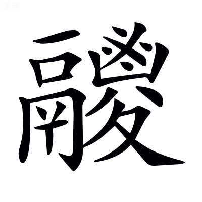
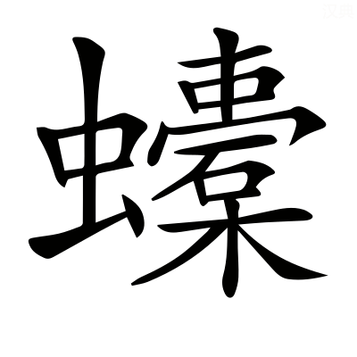

# 襄公第九

*〈襄公·名午成公子母定姒諡法因事有功曰襄辟土有德曰襄〉*

## 襄元年

> **元年春王正月公即位** *無傳於是公年四歲*
> 
> **仲孫蔑會晉欒黶宋華元衞甯殖曹人莒人邾人滕人薛人圍宋彭城** *魯與謀於虛朾而書會者稟命霸主非匹敵故〈魯與·音預〉*
> 
> **夏晉韓厥帥師伐鄭**
> 
> **仲孫蔑會齊崔杼曹人邾人杞人次于鄫** *〈于鄫·才陵反〉鄫鄭地在陳留襄邑縣東南書次兵不加鄭次鄫以待晉師*
> 
> **秋楚公子壬夫帥師侵宋**
> 
> **九月辛酉天王崩** *無傳辛酉九月十五日*
> 
> **邾子來朝**
> 
> **冬衞侯使公孫剽來聘** *〈公孫剽·匹妙反字林匹召反〉剽子叔黑背子*
> 
> **晉侯使荀罃來聘** *冬者十月初也王崩赴未至皆未聞喪故各得行朝聘之禮而傳善之*

**元年春己亥圍宋彭城** *下有二月則此己亥為正月正月無己亥日誤* **非宋地追書也** *成十八年楚取彭城以封魚石故曰非宋地夫子治春秋追書繫之宋* **於是為宋討魚石 *〈為宋·于偽反〉* 故稱宋且不登叛人也** *登成也不與其專邑叛君故使彭城還繫宋* **謂之宋志** *稱宋亦以成宋志* **彭城降晉 *〈彭城降·戶江反注同〉* 晉人以宋五大夫在彭城者歸寘諸瓠丘** *〈歸寘·之豉反◎瓠丘·徐侯吳反音戶故反〉彭城降不書賤略之瓠丘晉地河東東垣縣東南有瓠丘五大夫魚石向為人鱗朱向帶魚府〈東垣·音袁〉*

**齊人不會彭城晉人以為討二月齊大子光為質於晉** *〈為質·音致〉光齊靈公大子*

**夏五月晉韓厥荀偃帥諸侯之師伐鄭入其郛** *〈其郛·芳夫反〉荀偃不書非元帥〈元帥·所類反〉* **敗其徒兵於洧上** *〈於洧·于軌反〉徒兵步兵洧水出密縣東南至長平入潁* **於是東諸侯之師次于鄫以待晉師** *齊魯曹邾杞* **晉師自鄭以鄫之師侵楚焦夷及陳** *〈焦夷·如字徐在堯反〉於是孟獻子自鄫先歸不與侵陳楚故不書〈不與·音預〉* **晉侯衞侯次于戚以為之援** *為韓厥援*

**秋楚子辛救鄭侵宋呂留** *呂留二縣今屬彭城郡* **鄭子然侵宋取犬丘** *譙國酇縣東北有犬丘城迂迴疑〈鄼縣·才河反又子旦反◎迂迴·音于〉*

**九月邾子來朝禮也** *邾宣公*

**冬衞子叔晉知武子來聘禮也凡諸侯即位小國朝之** *小事大* **大國聘焉** *大字小* **以繼好結信 *〈繼好·呼報反〉* 謀事補闕禮之大者也** *闕猶過也禮以安國家利民人為大*

## 襄二年

> **二年春王正月葬簡王** *無傳五月而葬速*
> 
> **鄭師伐宋** *書伐從告*
> 
> **夏五月庚寅夫人姜氏薨**
> 
> **六月庚辰鄭伯睔卒** *〈伯睔·古囷反徐又胡忖反〉未與襄同盟而赴以名庚辰七月九日書六月經誤*
> 
> **晉師宋師衞甯殖侵鄭** *〈甯殖·市力反〉宋雖非卿師重故敘衞上*
> 
> **秋七月仲孫蔑會晉荀罃宋華元衞孫林父曹人邾人于戚**
> 
> **己丑葬我小君齊姜** *〈齊姜·如字諡法執心克莊曰齊或音側皆反非〉齊謚也三月而葬速*
> 
> **叔孫豹如宋** *豹於此始自齊還為卿*
> 
> **冬仲孫蔑會晉荀罃齊崔杼宋華元衞孫林父曹人邾人滕人薛人小邾人于戚遂城虎牢** *以偪鄭*
> 
> **楚殺其大夫公子申**

**二年春鄭師侵宋楚令也** *以彭城故*

**齊侯伐萊 *〈伐萊·音來〉* 萊人使正輿子 *〈正輿子·音餘本亦作與〉* 賂夙沙衞以索馬牛 *〈以索·所白反〉* 皆百匹** *夙沙衞齊寺人索簡擇好者* **齊師乃還君子是以知齊靈公之為靈也** *謚法亂而不損曰靈言謚應其行〈諡應·應對之應年末同◎其行·下孟反〉*

**夏齊姜薨初穆姜使擇美檟** *〈美檟·古雅反木名〉檟梓之屬* **以自為櫬與頌琴** *〈為櫬·初覲反棺也〉櫬棺也頌琴琴名猶言雅琴皆欲以送終* **季文子取以葬君子曰非禮也禮無所逆婦養姑者也 *〈養姑·徐余亮反〉* 虧姑以成婦逆莫大焉** *穆姜成公母齊姜成公婦* **詩曰其惟哲人告之話言 *〈話言·戶快反善也〉* 順德之行** *詩大雅哲知也話善也言知者行事無不順〈哲知·音致下同〉* **季孫於是為不哲矣** *〈為不哲矣·一本作不為哲矣〉言逆德* **且姜氏君之妣也** *〈之妣·必履反〉襄公適母故曰君之妣〈公適·丁歷反本亦作嫡〉* **詩曰為酒為醴烝畀祖妣 *〈丞·之承反◎畀·必利反與也注同〉* 以洽百禮 *〈以洽·戶夾反◎孔偕·音皆〉* 降福孔偕** *詩周頌烝進也畀與也偕徧也言敬事祖妣則鬼神降福季孫葬姜氏不以禮是不敬祖妣〈偕徧·音遍〉*

**齊侯使諸姜宗婦來送葬** *宗婦同姓大夫之婦婦人越疆送葬非禮〈越疆·居良反〉* **召萊子萊子不會故晏弱城東陽以偪之** *為六年滅萊傳東陽齊竟上邑〈齊竟·音境〉*

**鄭成公疾子駟請息肩於晉** *欲辟楚役以負擔喻〈負擔·都暫反〉* **公曰楚君以鄭故親集矢於其目** *謂鄢陵戰晉射楚王目〈射楚·食亦反〉* **非異人任 *〈非異人任·音壬注同絶句一讀至人字絶句〉* 寡人也** *言楚子任此患不為他人蓋在己〈不為·于偽反〉* **若背之 *〈若背·音佩〉* 是弃力與言 *〈棄力·服本作棄功〉* 其誰暱我** *〈誰暱·本又作昵女乙反徐乃吉反〉言盟誓之言* **免寡人唯二三子秋七月庚辰鄭伯睔卒於是子罕當國** *攝君事* **子駟為政** *為政卿* **子國為司馬晉師侵鄭** *晉伐喪非禮* **諸大夫欲從晉子駟曰官命未改** *成公未葬嗣君未免喪故言未改不欲違先君意*

**會于戚謀鄭故也** *鄭久叛晉謀討之* **孟獻子曰請城虎牢以偪鄭** *虎牢舊鄭邑今屬晉* **知武子曰善鄫之會吾子聞崔子之言今不來矣** *元年孟獻子與齊崔杼次于鄫崔杼有不服晉之言獻子以告知武子* **滕薛小邾之不至皆齊故也** *三國齊之屬* **寡君之憂不唯鄭** *言復憂齊叛〈復憂·扶又反下文將復復會同〉* **罃將復於寡君而請於齊** *以城事白晉君而請齊會之欲以觀齊志* **得請而告吾子之功也** *得請謂齊人應命告諸侯會築虎牢* **若不得請事將在齊** *將伐齊* **吾子之請諸侯之福也** *城虎牢足以服鄭息征伐* **豈唯寡君賴之** *傳言荀罃能用善謀*

**穆叔聘于宋通嗣君也**

**冬復會于戚齊崔武子及滕薛小邾之大夫皆會知武子之言故也** *武子言事將在齊齊人懼帥小國而會之* **遂城虎牢鄭人乃成** *如孟獻子之謀*

**楚公子申為右司馬多受小國之賂以偪子重子辛** *偪奪其權勢* **楚人殺之故書曰楚殺其大夫公子申** *言所以致國討之文*

## 襄三年

> **三年春楚公子嬰齊帥師伐吳**
> 
> **公如晉**
> 
> **夏四月壬戌公及晉侯盟于長樗** *〈長樗·勑居反〉晉侯出其國都與公盟于外*
> 
> **公至自晉** *無傳不以長樗至本非會*
> 
> **六月公會單子晉侯宋公衞侯鄭伯莒子邾子齊世子光己未同盟于雞澤** *〈單子·音善〉雞澤在廣平曲梁縣西南周靈王新即位使王官伯出與諸侯盟以安王室故無譏* **陳侯使袁僑如會** *〈袁僑·其驕反〉陳疾楚政而來屬晉本非召會而自來故言如會* **戊寅叔孫豹及諸侯之大夫及陳袁僑盟** *諸侯既盟袁僑乃至故使大夫別與之盟言諸侯之大夫則在雞澤之諸侯也殊袁僑者明諸侯大夫所以盟盟袁僑也據傳盟在秋長歷推戊寅七月十三日經誤*
> 
> **秋公至自會** *無傳*
> 
> **冬晉荀罃帥師伐許**

**三年春楚子重伐吳為簡之師** *簡選練* **克鳩茲至于衡山** *鳩茲吳邑在丹陽無湖縣東今皐夷也衡山在吳興烏程縣南* **使鄧廖 *〈鄧廖·力彫反〉* 帥組甲三百 *〈組甲·音祖下皆同〉* 被練三千** *〈被練·皮義反徐扶偽反注及下同〉組甲被練皆戰備也組甲漆甲成組文被練練袍* **以侵吳吳人要而擊之 *〈要而·於遥反〉* 獲鄧廖其能免者組甲八十被練三百而已子重歸既飲至三日吳人伐楚取駕駕良邑也鄧廖亦楚之良也君子謂子重於是役也所獲不如所亡** *當時君子* **楚人以是咎子重 *〈咎子·其九反〉* 子重病之遂遇心疾而卒** *憂恚故成心疾〈憂恚·一偽反〉*

**公如晉始朝也** *公即位而朝* **夏盟於長樗孟獻子相 *〈子相·息亮反皆同〉* 公稽首** *相儀也稽首首至地* **知武子曰天子在而君辱稽首寡君懼矣** *稽首事天子之禮* **孟獻子曰以敝邑介在東表 *〈介在·音界〉* 密邇仇讎** *仇讎謂齊楚與晉爭〈晉爭·爭鬭之爭〉* **寡君將君是望敢不稽首** *傳言獻子能固事盟主*

**晉為鄭服故 *〈為鄭·于偽反〉* 且欲脩吳好** *〈吳好·呼報反〉鄭服在前年* **將合諸侯使士匄告于齊曰寡君使匄以歲之不易 *〈不易·以豉反注同〉* 不虞之不戒寡君願與一二兄弟相見** *不易多難也虞度也戒備也列國之君相謂兄弟〈多難·乃旦反年內同◎虞度·待洛反〉* **以謀不協請君臨之使匄乞盟齊侯欲勿許而難為不協乃盟於耏外** *〈于耏·音而〉與士匄盟耏水名*

**祁奚請老** *老致仕* **晉侯問嗣焉** *嗣續其職者* **稱解狐 *〈解狐·音蟹〉* 其讎也將立之而卒** *解狐卒* **又問焉對曰午也可** *午祁奚子* **於是羊舌職死矣晉侯曰孰可以代之對曰赤也可** *赤職之子伯華* **於是使祁午為中軍尉羊舌赤佐之** *各代其父* **君子謂祁奚於是能舉善矣稱其讎不為諂 *〈為諂·他檢反〉* 立其子不為比 *〈為比·毗志反〉* 舉其偏不為黨** *諂媚也偏屬也* **商書曰無偏無黨王道蕩蕩** *商書洪範也蕩蕩平正無私* **其祁奚之謂矣解狐得舉** *未得位故曰得舉* **祁午得位伯華得官建一官而三物成** *一官軍尉物事也* **能舉善也夫 *〈能舉善也夫·音扶絶句一讀以夫為下句首〉* 唯善故能舉其類詩云惟其有之是以似之祁奚有焉** *詩小雅言唯有德之人能舉似己者*

**六月公會單頃公 *〈頃公·音傾〉* 及諸侯己未同盟于雞澤** *單頃公王卿士* **晉侯使荀會逆吳子于淮上吳子不至** *道遠多難* **楚子辛為令尹侵欲於小國陳成公使袁僑如會求成** *患楚侵欲袁僑濤塗四世孫* **晉侯使和組父告于諸侯** *告陳服* **秋叔孫豹及諸侯之大夫及陳袁僑盟陳請服也** *其君不來使大夫盟之匹敵之宜* **晉侯之弟揚干亂行於曲梁** *〈亂行·戶郎反注同〉行陳次〈行陳·直覲反〉* **魏絳戮其僕** *僕御也* **晉侯怒謂羊舌赤曰合諸侯以為榮也揚干為戮何辱如之必殺魏絳無失也對曰絳無貳志事君不辟難有罪不逃刑其將來辭何辱命焉言終魏絳至授僕人書** *僕人晉侯御僕* **將伏劒士魴張老止之公讀其書曰日君乏使使臣斯司馬** *斯此也* **臣聞師衆以順為武** *順莫敢違* **軍事有死無犯為敬** *守官行法雖死不敢有違* **君合諸侯臣敢不敬君師不武執事不敬罪莫大焉臣懼其死以及揚干無所逃罪** *懼自犯不武不敬之罪* **不能致訓至於用鉞** *〈用鉞·音越〉用鉞斬揚干之僕* **臣之罪重敢有不從以怒君心** *言不敢不從戮* **請歸死於司寇** *致尸於司寇使戮之* **公跣而出 *〈公跣·先典反〉* 曰寡人之言親愛也吾子之討軍禮也寡人有弟弗能教訓使干大命寡人之過也子無重寡人之過** *〈無重·直用反注同〉聽絳死為重過* **敢以為請** *請使無死* **晉侯以魏絳為能以刑佐民矣反役與之禮食 *〈禮食·音嗣注同又如字〉* 使佐新軍** *羣臣旅會今欲顯絳故特為設禮食〈特為·于偽反〉* **張老為中軍司馬** *代魏絳* **士富為候奄** *代張老士富士會別族*

**楚司馬公子何忌侵陳陳叛故也**

**許靈公事楚不會于雞澤冬晉知武子帥師伐許**

## 襄四年

> **四年春王三月己酉陳侯午卒** *前年大夫盟雞澤三月無己酉日誤*
> 
> **夏叔孫豹如晉**
> 
> **秋七月戊子夫人姒氏薨** *成公妾襄公母姒杞姓*
> 
> **葬陳成公** *無傳*
> 
> **八月辛亥葬我小君定姒** *無傳定謚也赴同祔姑反哭成喪皆以正夫人禮母以子貴踰月而葬速*
> 
> **冬公如晉**
> 
> **陳人圍頓**

**四年春楚師為陳叛故 *〈為陳·于偽反〉* 猶在繁陽** *前年何忌之師侵陳今猶未還繁陽楚地在汝南鮦陽縣南〈鮦陽·孟康音紂直九反一音童或音直勇反非〉* **韓獻子患之言於朝曰文王帥殷之叛國以事紂唯知時也** *知時未可爭* **今我易之難哉** *晉力未能服楚受陳為非時* **三月陳成公卒楚人將伐陳聞喪乃止** *軍禮不伐喪* **陳人不聽命** *不聽楚命* **臧武仲聞之曰陳不服於楚必亡大國行禮焉而不服在大猶有咎 *〈有咎·其九反下同〉* 而況小乎夏楚彭名侵陳陳無禮故也** *為下陳圍頓傳*

**穆叔如晉報知武子之聘也** *武子聘在元年* **晉侯享之金奏肆夏之三 *〈肆夏·戶雅反注及下同〉* 不拜** *肆夏樂曲名周禮以鐘鼓奏九夏其二曰肆夏一名樊三曰韶夏一名遏四曰夏納一名渠盖擊鐘而奏此三夏曲〈奏九夏·一曰王夏二曰肆夏三曰韶夏四曰納夏五曰章夏六曰齊夏七曰族夏八曰陔夏九曰驁夏◎肆夏一名樊·國語云金奏肆夏樊遏渠杜遂分為三夏之別名吕叔玉云肆夏時邁也樊遏執競也渠思文也◎韶夏·上招反◎名遏·於葛反◎夏納·本或為納夏誤◎名渠·其居反〉* **工歌文王之三又不拜** *工樂人也文王之三大雅之首文王大明緜* **歌鹿鳴之三三拜** *小雅之首鹿鳴四牡皇皇者華* **韓獻子使行人子員問之** *〈子員·音云徐于貧反〉行人通使之官〈通使·所吏反下注及文皆同〉* **曰子以君命辱於敝邑先君之禮藉之以樂 *〈藉之·在夜反薦也〉* 以辱吾子** *藉薦也* **吾子舍其大 *〈舍其·音捨〉* 而重拜其細 *〈而重·直用反下皆同〉* 敢問何禮也對曰三夏天子所以享元侯也使臣弗敢與聞** *〈敢與·音預下及與同〉元侯牧伯〈牧伯·徐音目〉* **文王兩君相見之樂也臣不敢及** *及與也文王之三皆稱文王之德受命作周故諸侯會同以相樂〈相樂·音洛〉* **鹿鳴君所以嘉寡君也敢不拜嘉** *晉以叔孫為嘉賓故歌鹿鳴之詩取其我有嘉賓叔孫奉君命而來嘉叔孫乃所以嘉魯君* **四牡君所以勞使臣也 *〈以勞·力報反注以此勞同〉* 敢不重拜** *詩言使臣乘四牡騑騑然行不止勤勞也晉以叔孫來聘故以此勞之〈騑騑·芳非反〉* **皇皇者華君教使臣曰必諮於周** *皇皇者華君遣使臣之詩言忠臣奉使能光輝君命如華之皇皇然又當諮于忠信以補己不及忠信為周其詩曰周爰諮諏周爰諮謀周爰諮度周爰諮詢言必於忠信之人諮此四事〈咨諏·子須反◎咨度·待洛反下文注同◎咨詢·音荀〉* **臣聞之訪問於善為咨** *問善道* **咨親為詢** *問親戚之義* **咨禮為度** *問禮宜* **咨事為諏** *問政事* **咨難為謀** *〈咨難·乃旦反〉問患難* **臣獲五善敢不重拜** *五善謂諮詢度諏謀*

**秋定姒薨不殯于廟無櫬不虞** *櫬親身棺季孫以定姒本賤既無器備議其喪制欲殯不過廟又不反哭〈不過·古禾反〉* **匠慶謂季文子** *匠慶魯大匠* **曰子為正卿而小君之喪不成** *謂如季孫所議則為夫人禮不成* **不終君也** *慢其母是不終事君之道* **君長誰受其咎** *〈君長·丁丈反注同〉言襄公長將責季孫* **初季孫為己 *〈為己·于偽反下注為定姒為言下為執事同〉* 樹六檟於蒲圃東門之外** *〈蒲圃·布古反〉蒲圃場圃名季文子樹檟欲自為櫬〈場·直良反〉* **匠慶請木** *為定姒作櫬* **季孫曰略** *不以道取為略* **匠慶用蒲圃之檟季孫不御** *〈不御·魚吕反止也注同〉御止也傳言遂得成禮故經無異文* **君子曰志所謂多行無禮必自及也其是之謂乎**

**冬公如晉聽政** *受貢賦多少之政* **晉侯享公公請屬鄫** *鄫小國也欲得使屬魯如須句顓臾之比使助魯出貢賦公時年七歲蓋相者為之言鄫今琅邪鄫縣〈須句·其俱反◎顓·音專◎臾·羊朱反◎之比·必二反◎蓋相·息亮反〉* **晉侯不許孟獻子曰以寡君之密邇於仇讎而願固事君無失官命** *晉官徵發之命* **鄫無賦於司馬** *晉司馬又掌諸侯之賦* **為執事朝夕之命敝邑 *〈朝夕·如字〉* 敝邑褊小 *〈褊小·必淺反〉* 闕而為罪** *闕不共也〈不共·音恭〉* **寡君是以願借助焉** *〈願借·子亦反注同〉借鄫以自助* **晉侯許之** *為明年叔孫豹鄫世子巫如晉傳*

**楚人使頓間陳而侵伐之 *〈閒陳·閒厠之閒〉* 故陳人圍頓** *間伺間缺〈伺·音司◎閒·音閑又閒厠之閒又如字〉*

**無終子嘉父使孟樂如晉** *無終山戎國名孟樂其使臣〈其使·所吏反〉* **因魏莊子納虎豹之皮以請和諸戎** *欲戎與晉和莊子魏絳* **晉侯曰戎狄無親而貪不如伐之魏絳曰諸侯新服陳新來和將觀於我我德則睦否則攜貳勞師於戎而楚伐陳必弗能救是弃陳也諸華必叛** *諸華中國* **戎禽獸也獲戎失華無乃不可乎夏訓有之曰 *〈夏訓·戶雅反下注皆同〉* 有窮后羿** *夏訓夏書有窮國名后君也羿有窮君之號* **公曰后羿何如** *怪其言不次故問之* **對曰昔有夏之方衰也后羿自鉏 *〈自鉏·仕居反〉* 遷于窮石因夏民以代夏政** *禹孫大康淫放失國夏人立其弟仲康仲康亦微弱仲康卒子相立羿遂代相號曰有窮鉏羿本國名〈大康·音泰◎中康·音仲下同◎子相·息亮反下及注同〉* **恃其射也** *羿善射* **不脩民事而淫于原獸** *淫放原野* **弃武羅伯因熊髡尨圉** *四子皆羿之賢臣〈熊髠·苦門反◎尨·莫邦反◎圉·魚吕反〉* **而用寒浞 *〈寒浞·仕角反徐在角反〉* 寒浞伯明氏之讒子弟也** *寒國北海平壽縣東有寒亭伯明其君名* **伯明后寒弃之夷羿收之** *夷氏* **信而使之以為己相浞行媚于內** *內宮人* **而施賂于外愚弄其民** *欺罔之* **而虞羿于田** *樂之以游田〈樂之·音洛下樂安同〉* **樹之詐慝 *〈詐慝·他得反後同〉* 以取其國家** *樹立也* **外內咸服** *信浞詐* **羿猶不悛** *〈不悛·七全反改也〉悛改也* **將歸自田** *羿獵還* **家衆殺而亨之 *〈而亨·普彭反煮也〉* 以食其子** *〈以食·音嗣注同〉食羿子* **其子不忍食諸死于窮門** *殺之於國門* **靡奔有鬲氏** *〈有鬲·音革〉靡夏遺臣事羿者有鬲國名今平原鬲縣* **浞因羿室** *就其妃妾* **生澆及豷 *〈生澆·五弔反◎及豷·許器反〉* 恃其讒慝詐偽而不德于民使澆用師滅斟灌及斟尋氏** *〈斟·之林反◎灌·古亂反〉二國夏同姓諸侯仲康之子后相所依樂安壽光縣東南有灌亭北海平壽縣東南有斟亭* **處澆于過 *〈于過·古禾反注及下同〉* 處豷于戈** *〈于戈·古禾反〉過戈皆國名東萊掖縣北有過鄉戈在宋鄭之間〈掖縣·音亦漢書作夜孟康音掖〉* **靡自有鬲氏收二國之燼** *〈之燼·才刃反遺民也〉燼遺民* **以滅浞而立少康** *〈少康·詩照反注及下同〉少康夏后相之子* **少康滅澆于過后杼滅豷于戈** *〈后杼·直吕反〉后杼少康子* **有窮由是遂亡失人故也** *浞因羿室故不改有窮之號* **昔周辛甲之為大史也命百官官箴王闕** *〈官箴·之林反〉辛甲周武王大史闕過也使百官各為箴辭戒王過* **於虞人之箴** *虞人掌田獵* **曰芒芒禹迹 *〈芒芒·莫郎反遠貌〉* 畫為九州** *〈畫為·乎麥反分也〉芒芒遠貌畫分也* **經啟九道** *啟開九州之道* **民有寢廟獸有茂草各有攸處 *〈攸家·如字本或作攸處〉* 德用不擾** *〈不擾·如小反亂也〉人神各有所歸故德不亂* **在帝夷羿冒于原獸** *〈冒于·莫報反貪也又亡北反〉冒貪也* **忘其國恤而思其麀牡** *〈其麀·音憂鹿牝也◎牡·茂后反〉言但念獵* **武不可重** *〈可重·直用反下文同〉重猶數也〈猶數·所角反〉* **用不恢于夏家** *〈不恢·苦回反大也〉羿以好武雖有夏家而不能恢大之〈以好·呼報反下文同〉* **獸臣司原敢告僕夫** *獸臣虞人告僕夫不敢斥尊* **虞箴如是可不懲乎 *〈不懲·直升反〉* 於是晉侯好田故魏絳及之** *及后羿事* **公曰然則莫如和戎乎對曰和戎有五利焉戎狄荐居 *〈荐居·在薦反又才遜反聚也或云草也〉* 貴貨易土** *〈易土·以豉反輕也徐神豉反注同〉荐聚也易猶輕也* **土可賈焉 *〈可賈·音古〉* 一也邊鄙不聳 *〈不聳·息勇反懼也〉* 民狎其野穡人成功二也** *聳懼狎習也* **戎狄事晉四鄰振動諸侯威懷三也以德綏戎師徒不勤甲兵不頓四也** *頓壞也* **鑒于后羿而用德度** *以后羿為鑒戒* **遠至邇安五也君其圖之公說 *〈公說·音悅〉* 使魏絳盟諸戎脩民事田以時** *傳言晉侯能用善謀*

**冬十月邾人莒人伐鄫臧紇救鄫侵邾 *〈臧紇·恨發反〉* 敗於狐駘** *〈狐駘·徒來反徐勑才反〉臧紇武仲也鄫屬魯故救之狐駘邾地魯國番縣東南有目台亭〈番縣·本又作蕃應劭作皮一音方袁反白襃魯國記云陳子遊為魯相番子也國人為諱改曰皮◎目台·吐才反〉* **國人逆喪者皆髽 *〈皆髽·側瓜反〉* 魯於是乎始髽** *髽麻髮合結也遭喪者多故不能備凶服髽而已〈合髻·音計本又作結又作紒音同〉* **國人誦之曰臧之狐裘敗我於狐駘** *臧紇時服狐裘* **我君小子朱儒是使 *〈朱儒·本或作侏亦音朱〉* 朱儒朱儒使我敗於邾** *襄公幼弱故曰小子臧紇短小故曰朱儒敗不書魯人諱之*

## 襄五年

> **五年春公至自晉**
> 
> **夏鄭伯使公子發來聘** *發子產父*
> 
> **叔孫豹鄫世子巫如晉** *〈子巫·亡扶反〉比魯大夫故書巫如晉*
> 
> **仲孫蔑衞孫林父會吳于善道** *魯衞俱受命於晉故不言及吳先在善道二大夫往會之故曰會吳善道地闕*
> 
> **秋大雩**
> 
> **楚殺其大夫公子壬夫** *書名罪其貪*
> 
> **公會晉侯宋公陳侯衞侯鄭伯曹伯莒子邾子滕子薛伯齊世子光吳人鄫人于戚** *穆叔使鄫人聽命于會故鄫見經不復殊吳者吳來會于戚〈鄫見·賢遍反◎不復·扶又反下同〉*
> 
> **公至自會** *無傳*
> 
> **冬戍陳** *諸侯在戚會皆受命戍陳各還國遣戍不復有告命故獨書魯戍*
> 
> **楚公子貞帥師伐陳公會晉侯宋公衞侯鄭伯曹伯齊世子光救陳**
> 
> **十有二月公至自救陳** *無傳*
> 
> **辛未季孫行父卒**

**五年春公至自晉** *公在晉既聽屬鄫聞其見伐遙命臧紇出救故傳稱經公至以明之*

**王使王叔陳生愬戎于晉** *〈愬戎·悉路反〉王叔周卿士也戎陵虣周室故告愬盟主〈淩虣·白報反〉* **晉人執之士魴如京師言王叔之貳於戎也** *王叔反有二心於戎失奉使之義故晉執之〈奉使·所吏反〉*

**夏鄭子國來聘通嗣君也** *鄭僖公初即位*

**穆叔覿鄫大子于晉 *〈覿鄫·直歷反見也〉* 以成屬鄫** *覿見也前年請屬鄫故將鄫大子巫如晉以成之〈見也·賢遍反〉* **書曰叔孫豹鄫大子巫如晉言比諸魯大夫也** *豹與巫俱受命於魯故經不書及比之魯大夫*

**吳子使壽越如晉** *壽越吳大夫* **辭不會于雞澤之故** *三年會雞澤吳不至今來謝之* **且請聽諸侯之好** *〈之好·呼報反〉更請會* **晉人將為之合諸侯 *〈將為·于偽反〉* 使魯衞先會吳且告會期** *以其道遠故使魯衞先告期* **故孟獻子孫文子會吳于善道** *二子皆受晉命而行*

**秋大雩旱也** *雩夏祭所以祈甘雨若旱則又脩其禮故雖秋雩非書過也然經與過雩同文是以傳每釋之曰旱也雩而獲雨故書雩而不書旱*

**楚人討陳叛故** *討治也* **曰由令尹子辛實侵欲焉乃殺之書曰楚殺其大夫公子壬夫貪也君子謂楚共王於是不刑** *〈共王·音恭〉陳之叛楚罪在子辛共王既不能素明法教陳叛之日又不能嚴斷威刑以謝小國而擁其罪人興兵致討加禮於陳而陳恨彌篤乃怨而歸罪子辛子辛之貪雖足以取死然共王用刑為失其節故言不刑〈嚴斷·丁亂反〉* **詩曰周道挺挺 *〈挺挺·他頂反正直也〉* 我心扃扃 *〈扃扃·工迥反徐孔穎反明察也〉* 講事不令集人來定** *逸詩也挺挺正直也扃扃明察也講謀也言謀事不善當聚致賢人以定之* **己則無信而殺人以逞不亦難乎** *共王伐宋封魚石背盟敗于鄢陵殺子反公子申及壬夫八年之中戮殺三卿欲以屬諸侯故君子以為不可〈背盟·音佩〉* **夏書曰成允成功** *亦逸書也允信也言信成然後有成功*

**九月丙午盟于戚會吳且命戍陳也** *公及其會而不書盟非公後會蓋不以盟告廟* **穆叔以屬鄫為不利使鄫大夫聽命于會** *鄫近魯竟故欲以為屬國既而與莒有忿魯不能救恐致譴責故復乞還之傳言鄫人所以見於戚會〈鄫近·附近之近下文陳近同◎魯竟·音境◎致譴·棄戰反◎故復·扶又反◎所以見·賢遍反〉*

**楚子囊為令尹** *〈子囊·乃郎反〉公子貞* **范宣子曰我喪陳矣 *〈我喪·息浪反〉* 楚人討貳而立子囊必改行** *〈改行·如字徐下孟反〉改子辛所行* **而疾討陳** *疾急也* **陳近於楚民朝夕急 *〈民朝·如字〉* 能無往乎有陳非吾事也無之而後可** *言晉力不能及陳故七年陳侯逃歸*

**冬諸侯戍陳** *備楚* **子囊伐陳十一月甲午會于城棣以救之** *〈城棣·直計反一音徒妹反〉公及救陳而不及會故不書城棣城棣鄭地陳留酸棗縣西南有棣城*

**季文子卒大夫入斂 *〈入斂·力豔反〉* 公在位** *在阼階西鄉〈西鄉·許亮反〉* **宰庀家器為葬備** *庀具也* **無衣帛之妾 *〈無衣·於旣反〉* 無食粟之馬 *〈無食·如字又音嗣〉* 無藏金玉無重器備** *〈無重·如字又直龍反〉器備謂珍寶甲兵之物* **君子是以知季文子之忠於公室也相三君矣 *〈相三·息亮反〉* 而無私積 *〈私積·子賜反〉* 可不謂忠乎**

## 襄六年

> **六年春王三月壬午杞伯姑容卒**
> 
> **夏宋華弱來奔** *華椒孫*
> 
> **秋葬杞桓公** *無傳*
> 
> **滕子來朝**
> 
> **莒人滅鄫**
> 
> **冬叔孫豹如邾**
> 
> **季孫宿如晉** *行父之子*
> 
> **十有二月齊侯滅萊** *書十二月從告*

**六年春杞桓公卒始赴以名同盟故也** *杞入春秋未嘗書名桓公三與成同盟故赴以名*

**宋華弱與樂轡少相狎 *〈少相·詩照反◎狎·戶甲反習也〉* 長相優 *〈長相·丁丈反〉* 又相謗也** *狎親習也優調戲也〈調戲·徒弔反〉* **子蕩怒以弓梏華弱于朝** *〈梏華·古毒反〉子蕩樂轡也張弓以貫其頸若械之在手故曰梏〈以貫·古亂反〉* **平公見之曰司武而梏於朝難以勝矣** *司武司馬言其懦弱不足以勝敵〈其懦·乃亂反又乃臥反〉* **遂逐之夏宋華弱來奔司城子罕曰同罪異罰非刑也專戮於朝罪孰大焉亦逐子蕩子蕩射子罕之門 *〈射子罕·食亦反注同〉* 曰幾日而不我從** *〈幾日·居豈反〉言我射女門女亦當以不勝任見逐〈射女·音汝◎不勝·音升〉* **子罕善之如初** *言子罕雖見辱不追忿所以得安*

**秋滕成公來朝始朝公也**

**莒人滅鄫鄫恃賂也** *鄫有貢賦之賂在魯恃之而慢莒故滅之*

**冬穆叔如邾聘且脩平** *平四年狐駘戰* **晉人以鄫故來討曰何故亡鄫** *鄫屬魯恃賂而慢莒魯不致力輔助無何以還晉尋便見滅故晉責魯* **季武子如晉見且聽命** *〈見且·賢遍反注同〉始代父為卿見大國且謝亡鄫聽命受罪*

**十一月齊侯滅萊萊恃謀也** *賂夙沙衞之謀也事在二年* **於鄭子國之來聘也四月晏弱城東陽而遂圍萊** *子國聘在五年二年晏弱城東陽至五年四月復託治城因遂圍萊〈復託·扶又反〉* **甲寅堙之環城 *〈堙之·音因土山◎環城·戶關反又音患〉* 傅於堞** *〈傅於·音附◎堞·音牒女牆也一名俾亦謂之俾倪徐養涉反〉堞女墻也堙土山也周城為土山及女墻* **及杞桓公卒之月** *此年三月* **乙未王湫帥師 *〈王湫·子小反徐子鳥反〉* 及正輿子棠人軍齊師** *王湫故齊人成十八年奔萊正輿子萊大夫棠萊邑也北海即墨縣有棠鄉三人帥別邑兵來解圍* **齊師大敗之** *敗湫等* **丁未入萊萊共公 *〈共公·音恭〉* 浮柔奔棠正輿子王湫奔莒莒人殺之四月陳無宇獻萊宗器于襄宮** *無宇桓子陳完玄孫襄宮齊襄公廟* **晏弱圍棠十一月丙辰而滅之遷于郳** *〈遷于郳·五兮反本或作遷萊于郳萊衍字〉遷萊子于郳國* **高厚崔杼定其田** *定其疆界高厚高固子〈其疆·居良反〉*

## 襄七年

> **七年春郯子來朝** *〈郯子·音談〉*
> 
> **夏四月三卜郊不從乃免牲** *稱牲既卜日也卜郊又非禮也*
> 
> **小邾子來朝**
> 
> **城費** *〈城費·音祕〉南遺假事難而城之〈事難·乃旦反〉*
> 
> **秋季孫宿如衞**
> 
> **八月螽** *無傳為災故書*
> 
> **冬十月衞侯使孫林父來聘壬戌及孫林父盟**
> 
> **楚公子貞帥師圍陳**
> 
> **十有二月公會晉侯宋公陳侯衞侯曹伯莒子邾子于鄬** *〈于鄬·于軌反字林几吹反〉謀救陳陳侯逃歸不成救故不書救也鄬鄭地* **鄭伯髡頑如會未見諸侯丙戌卒于鄵** *〈于鄵·七報反又禾南反字林千消反〉實為子駟所弒以瘧疾赴故不書弒稱名為書卒同盟故也如會會於鄬也未見諸侯未至會所而死鄵鄭地不欲再稱鄭伯故約文上其名於會上〈所殺·音試下同◎為書·于偽反◎上其名·時掌反〉* **陳侯逃歸** *畏楚逃晉而歸*

**七年春郯子來朝始朝公也**

**夏四月三卜郊不從乃免牲孟獻子曰吾乃今而後知有卜筮夫郊祀后稷以祈農事也** *郊祀后稷以配天后稷周始祖能播殖者* **是故啟蟄而郊 *〈啓蟄·直立反〉* 郊而後耕今既耕而卜郊宜其不從也** *啟蟄夏正建寅之月耕謂春分〈夏正·戶雅反〉*

**南遺為費宰** *費季氏邑* **叔仲昭伯為隧正** *〈隧正·音遂〉隧正主役徒昭伯叔仲惠伯之孫* **欲善季氏而求媚於南遺謂遺請城費** *使遺請城* **吾多與而役故季氏城費** *傳言祿去公室季氏所以強*

**小邾穆公來朝亦始朝公也** *亦郯子也*

**秋季武子如衞報子叔之聘且辭緩報非貳也** *子叔聘在元年言國家多難故不時報〈多難·乃旦反〉*

**冬十月晉韓獻子告老公族穆子有廢疾** *穆子韓厥長子成十八年為公族大夫〈長子·丁丈反下師長同〉* **將立之** *代厥為卿* **辭曰詩曰豈不夙夜謂行多露** *詩言雖欲早夜而行懼多露之濡己義取非禮不可妄行* **又曰弗躬弗親庶民弗信** *詩小雅譏在位者不躬親政事則庶民不奉信其命言己有疾不能躬親政事* **無忌不才讓其可乎請立起也** *無忌穆子名起無忌弟宣子也* **與田蘇游而曰好仁** *〈好仁·呼報反注及下同〉田蘇晉賢人蘇言起好仁* **詩曰靖共爾位 *〈靖共·音恭下注同〉* 好是正直神之聽之介爾景福** *〈介爾·音界下及注同〉靖安也介助也景大也詩小雅言君子當思不出其位求正直之人與之並立如是則神明順之致大福也* **恤民為德** *靖共其位所以恤民* **正直為正** *正己心* **正曲為直** *正人曲* **參和為仁** *〈參和·七南反或音三〉德正直三者備乃為仁* **如是則神聽之介福降之立之不亦可乎** *言起有此三德故可立* **庚戌使宣子朝遂老** *韓厥致仕* **晉侯謂韓無忌仁使掌公族大夫** *為之師長*

**衞孫文子來聘且拜武子之言** *緩報非貳之言* **而尋孫桓子之盟** *盟在成三年* **公登亦登** *禮登階臣後君一等〈臣後·胡豆反下文不後寡君同〉* **叔孫穆子相 *〈子相·息亮反下子駟相同〉* 趨進曰諸侯之會寡君未嘗後衞君** *〈未甞後·如字徐胡豆反〉敵體並登* **今吾子不後寡君寡君未知所過吾子其少安** *安徐也* **孫子無辭亦無悛容** *〈無悛·七全反〉悛改也* **穆叔曰孫子必亡為臣而君過而不悛亡之本也詩曰退食自公委蛇委蛇** *〈委蛇·於危反下以支反下同〉委蛇順貌詩召南言人臣自公門入私門無不順禮〈召南·上照反〉* **謂從者也** *從順也* **衡而委蛇必折** *衡橫也橫不順道必毀折為十四年林父逐君起本*

**楚子囊圍陳會于鄬以救之** *晉會諸侯*

**鄭僖公之為大子也於成之十六年** *魯成公* **與子罕適晉不禮焉又與子豐適楚亦不禮焉** *子豐穆公子* **及其元年朝于晉** *鄭僖元年魯襄三年* **子豐欲愬諸晉而廢之子罕止之及將會于鄬子駟相又不禮焉侍者諫不聽又諫殺之及鄵子駟使賊夜弒僖公而以瘧疾赴于諸侯** *傳言經所以不書弒* **簡公生五年奉而立之** *僖公子*

**陳人患楚** *楚圍陳故* **慶虎慶寅謂楚人曰吾使公子黃往而執之** *二慶陳執政大夫公子黃哀公弟* **楚人從之** *為執黃〈為執·于偽反〉* **二慶使告陳侯于會** *鄬之會* **曰楚人執公子黃矣君若不來羣臣不忍社稷宗廟懼有二圖** *背君屬楚〈背君·音佩〉* **陳侯逃歸** *鄬會所以不書救*

## 襄八年

> **八年春王正月公如晉**
> 
> **夏葬鄭僖公** *無傳*
> 
> **鄭人侵蔡獲蔡公子燮** *〈公子燮·悉協反〉鄭子國稱人刺其無故侵蔡以生國患燮蔡莊公子*
> 
> **季孫宿會晉侯鄭伯齊人宋人衞人邾人于邢丘** *〈邢丘·徐音刑〉時公在晉晉悼難勞諸侯唯使大夫聽命故季孫在會而公先歸〈悼難·乃旦反〉*
> 
> **公至自晉** *無傳*
> 
> **莒人伐我東鄙**
> 
> **秋九月大雩**
> 
> **冬楚公子貞帥師伐鄭**
> 
> **晉侯使士匄來聘**

**八年春公如晉朝且聽朝聘之數** *晉悼復脩霸業故朝而稟其多少〈復脩·扶又反◎伯業·音霸又如字本亦作霸〉*

**鄭羣公子以僖公之死也謀子駟子駟先之 *〈先之·悉薦反又如字〉* 夏四月庚辰辟殺 *〈辟殺·婢亦反罪也注同〉* 子狐子熙 *〈子熙·許其反徐音怡〉* 子侯子丁** *辟罪也加罪以戮之* **孫擊孫惡出奔衞** *二孫子孤之子*

**庚寅鄭子國子耳侵蔡獲蔡司馬公子燮** *鄭侵蔡欲以求媚於晉子耳子良之子不言敗唯以獲告* **鄭人皆喜唯子產不順** *子產子國子不順衆而喜* **曰小國無文德而有武功禍莫大焉楚人來討能勿從乎從之晉師必至晉楚伐鄭自今鄭國不四五年弗得寧矣子國怒之曰爾何知國有大命而有正卿童子言焉將為戮矣** *大命起師行軍之命*

**五月甲辰會于邢丘以命朝聘之數使諸侯之大夫聽命季孫宿齊高厚宋向戌衞甯殖邾大夫會之** *晉難重煩諸侯故使大夫聽命* **鄭伯獻捷于會故親聽命** *獻蔡捷也* **大夫不書尊晉侯也** *晉悼復文襄之業制朝聘之節儉而有禮德義可尊故退諸侯大夫以崇之*

**莒人伐我東鄙以疆鄫田** *〈以疆·居良反注同〉莒既滅鄫魯侵其西界故伐魯東鄙以正其封疆*

**秋九月大雩旱也**

**冬楚子囊伐鄭討其侵蔡也子駟子國子耳欲從楚子孔子蟜子展 *〈子蟜·居表反〉* 欲待晉** *待晉來救子孔穆公子子蟜子游子子展子罕子* **子駟曰周詩有之曰俟河之清人壽幾何** *〈人壽·音授或如字注同◎幾何·居豈反〉逸詩也言人壽促而河清遲喻晉之不可待* **兆云詢多職競作羅** *兆卜詢謀也職主也言既卜且謀多則競作羅網之難無成功〈之難·乃旦反〉* **謀之多族民之多違** *族家也* **事滋無成** *滋益也* **民急矣姑從楚以紓吾民 *〈以紓·音舒〉* 晉師至吾又從之敬共幣帛 *〈敬共·音恭〉* 以待來者小國之道也犧牲玉帛待於二竟** *〈二竟·音境注同〉二竟晉楚界上* **以待彊者而庇民焉 *〈而庇·必利反又音秘下同〉* 寇不為害民不罷病 *〈不罷·音皮〉* 不亦可乎子展曰小所以事大信也小國無信兵亂日至亡無日矣五會之信** *謂三年會雞澤五年會戚又會城棣七年會鄬八年會邢丘* **今將背之 *〈背之·音佩至卷未皆同〉* 雖楚救我將安用之** *言失信得楚不足貴* **親我無成** *晉親鄭* **鄙我是欲** *楚欲以鄭為鄙邑而反欲與成* **不可從也** *言子駟不可從* **不如待晉晉君方明四軍無闕八卿和睦必不弃鄭** *四軍謂上中下新軍也軍有二卿* **楚師遼遠糧食將盡必將速歸何患焉舍之聞之** *舍之子展名* **杖莫如信 *〈杖莫·直亮反下同〉* 完守以老楚 *〈完守·手又反或如字下守官并注同〉* 杖信以待晉不亦可乎子駟曰詩云謀夫孔多是用不集** *詩小雅孔甚也集就也言人欲為政是非相亂而不成* **發言盈庭誰敢執其咎** *〈其咎·其九反下同〉言謀者多若有不善無適受其咎〈無適·丁歷反下同〉* **如匪行邁謀是用不得于道** *匪彼也行邁謀謀於路人也不得于道衆無適從* **請從楚騑也受其咎** *〈騑也·芳非反〉騑子駟名* **乃及楚平使王子伯駢告于晉** *〈伯駢·扶賢反又扶經反〉伯駢鄭大夫* **曰君命敝邑脩而車賦儆而師徒 *〈儆而·居領反〉* 以討亂略蔡人不從敝邑之人不敢寧處悉索敝賦** *〈悉索·悉各反盡也注同一音所百反〉索盡也* **以討于蔡獲司馬燮獻于邢丘今楚來討曰女何故 *〈女何·音汝〉* 稱兵于蔡** *稱舉也* **焚我郊保** *郭外曰郊保守也* **馮陵我城郭** *〈馮陵·皮冰反注同〉馮迫也* **敝邑之衆夫婦男女不皇啟處以相救也** *皇暇也啟跪也〈啓跪·其委反〉* **翦焉傾覆 *〈傾覆·芳服反〉* 無所控告** *〈所控·苦貢反引也〉翦盡也控引也* **民死亡者非其父兄即其子弟夫人愁痛** *〈夫人·音扶注同〉夫人猶人人也* **不知所庇民知窮困而受盟于楚孤也與其二三臣不能禁止** *孤鄭伯* **不敢不告知武子使行人子員對之曰君有楚命** *見討之命* **亦不使一个行李 *〈一个·古賀反注同〉* 告于寡君** *一个獨使也行李行人也〈獨使·所吏反〉* **而即安于楚君之所欲也誰敢違君寡君將帥諸侯以見于城下 *〈以見·賢遍反或如字〉* 唯君圖之** *為明年晉伐鄭傳*

**晉范宣子來聘且拜公之辱** *謝公此春朝* **告將用師于鄭公享之宣子賦摽有梅** *〈摽有·徐扶妙反又扶表反落也〉摽有梅詩召南摽落也梅盛極則落詩人以興女色盛則有衰衆士求之宜及其時宣子欲魯及時共討鄭取其汲汲相赴〈以興·許譍反〉* **季武子曰誰敢哉** *言誰敢不從命* **今譬於草木 *〈今辟·音譬本多即作譬字後放此〉* 寡君在君君之臭味也** *言同類* **歡以承命何時之有** *遲速無時* **武子賦角弓** *角弓詩小雅取其兄弟昏姻無相遠也* **賓將出武子賦彤弓** *〈彤弓·徒冬反〉彤弓天子賜有功諸侯之詩欲使晉君繼文之業復受彤弓於王〈復受·扶又反〉* **宣子曰城濮之役** *〈城濮·音卜〉在僖二十八年* **我先君文公獻功于衡雍 *〈衡雍·於用反〉* 受彤弓于襄王以為子孫藏** *〈孫臧·如字徐才浪反〉藏之以示子孫* **匄也先君守官之嗣也敢不承命** *言己嗣其父祖為先君守官不敢廢命欲匡晉君* **君子以為知禮** *彤弓之義義在晉君故范匄受之所謂知禮*

## 襄九年

> **九年春宋災** *天火曰災來告故書*
> 
> **夏季孫宿如晉**
> 
> **五月辛酉夫人姜氏薨** *成公母*
> 
> **秋八月癸未葬我小君穆姜** *無傳四月而葬速*
> 
> **冬公會晉侯宋公衞侯曹伯莒子邾子滕子薛伯杞伯小邾子齊世子光伐鄭十有二月己亥同盟于戲** *〈于戲·許冝反〉伐鄭而書同盟則鄭受盟可知傳言十一月己亥以長歷推之十二月無己亥經誤戲鄭地*
> 
> **楚子伐鄭**

**九年春宋災樂喜為司城以為政** *樂喜子罕也為政卿知將有火災素戒為備火之政* **使伯氏司里** *伯氏宋大夫司里里宰* **火所未至徹小屋塗大屋** *大屋難徹就塗之* **陳畚挶 *〈畚·音本草器也◎挶·九録反土轝也〉* 具綆缶** *〈具綆·古杏反汲水索◎缶·方九反汲水瓦器〉畚簣籠挶土轝綆汲索缶汲器〈蕢·其位反◎籠·力東反◎土輿·音預◎汲·音急◎索·悉各反〉* **備水器** *盆鑒之屬〈盆·戶暫反〉* **量輕重** *計人力所任〈所任·音壬〉* **蓄水潦 *〈畜·勑六反本又作蓄◎水潦·音老〉* 積土塗巡丈城繕守備** *〈繕守·手又反注守備同〉巡行也丈度也繕治也行度守備之處恐因災有亂〈巡行·下孟反下同◎丈度·待洛反下同◎之處·昌慮反〉* **表火道** *火起則從其所趣摽表之〈摽表·必遥反〉* **使華臣具正徒** *華臣華元子為司徒正徒役徒也司徒之所主也* **令隧正 *〈隧正·音遂〉* 納郊保奔火所** *隧正官名也五縣為隧納聚郊野保守之民使隨火所起往救之* **使華閱 *〈華閱·音悅〉* 討右官官庀其司** *〈官庀·芳婢反具也下同〉亦華元子代元為右師討治也庀具也使具其官屬* **向戌討左亦如之** *向戌左師* **使樂遄 *〈樂遄·市專反〉* 庀刑器亦如之** *樂遄司寇刑器刑書* **使皇鄖 *〈皇鄖·音云本亦作貟音同〉* 命校正出馬 *〈校正·戶敎反注同◎出馬·如字徐尺遂反下同〉* 工正出車備甲兵庀武守** *〈武守·手又反下同〉皇鄖皇父充石之後校正主馬工正主車使各備其官* **使西鉏吾 *〈西鉏吾·音魚〉* 庀府守** *鉏吾大宰也府六官之典* **令司宮巷伯儆宮** *〈儆宫·音景〉司宮奄臣巷伯寺人皆掌宮內之事* **二師令四鄉正敬享** *二師左右師也鄉正鄉大夫享祀也* **祝宗用馬于四墉 *〈四庸·本又作墉音同城也〉* 祀盤庚 *〈般庚·步干反字亦作盤〉* 于西門之外** *祝大祝宗宗人墉城也用馬祭于四城以禳火盤庚殷王宋之遠祖城積陰之氣故祀之凡天災有幣無牲用馬祀盤庚皆非禮〈以禳·如羊反〉* **晉侯問於士弱** *弱士渥濁之子莊子〈渥濁·於角反〉* **曰吾聞之宋災於是乎知有天道何故** *問宋何故自知天道將災* **對曰古之火正或食於心或食於咮 *〈於咮·竹又反徐下遘反〉* 以出內火 *〈以出·如字徐尺遂反◎內·如字徐音納〉* 是故咮為鶉火 *〈鶉火·音純〉* 心為大火** *謂火正之官配食於火星建辰之月鶉火星昏在南方則令民放火建戌之月大火星伏在日下夜不得見則令民內火禁放火〈得見·如字又賢遍反〉* **陶唐氏之火正閼伯 *〈閼伯·於葛反〉* 居商丘** *陶唐堯有天下號閼伯高辛氏之子傳曰遷閼伯于商丘主辰辰大火也今為宋星然則商丘在宋地* **祀大火而火紀時焉** *謂出內火時* **相土因之 *〈相土·息亮反注同〉* 故商主大火** *相土契孫商之祖也始代閼伯之後居商丘祀大火〈契孫·息列反〉* **商人閱其禍敗之釁 *〈之釁·許靳反〉* 必始於火是以日知其有天道也** *閱猶數也商人數所更歷恒多火災宋是殷商之後故知天道之災必火〈猶數·所主反下同◎所更·音庚〉* **公曰可必乎對曰在道國亂無象不可知也** *言國無道則災變亦殊故不可必知*

**夏季武子如晉報宣子之聘也** *宣子聘在八年*

**穆姜薨於東宮** *大子宮也穆姜淫僑如欲廢成公故徙居東宮事在成十六年* **始往而筮之遇艮之八** *〈遇艮·古恨反〉艮下艮上艮周禮大卜掌三易然則雜用連山歸藏周易二易皆以七八為占故言遇艮之八* **史曰是謂艮之隨** *震下兌上隨史疑古易遇八為不利故更以周易占變爻得隨卦而論之* **隨其出也** *史謂隨非閉固之卦* **君必速出姜曰亡** *〈曰亡·如字猶無也讀者或音無〉亡猶無也* **是於周易曰隨元亨 *〈元亨·許庚反下同〉* 利貞無咎** *易筮皆以變者占遇一爻變義異則論彖故姜亦以彖為占也史據周易故指言周易以折之〈論彖·吐亂反◎以折·之設反〉* **元體之長也 *〈之長·丁丈反下同〉* 亨嘉之會也利義之和也貞事之幹也體仁足以長人嘉德足以合禮 *〈嘉德·易作嘉會〉* 利物足以和義貞固足以幹事然故不可誣也是以雖隨無咎** *言不誣四德乃遇隨無咎明無四德者則為淫而相隨非吉事* **今我婦人而與於亂 *〈而與·音預〉* 固在下位** *婦人卑於丈夫* **而有不仁不可謂元不靖國家不可謂亨作而害身不可謂利弃位而姣** *〈而姣·戶交反注同徐又如字服氏同嵇叔夜音效〉姣淫之別名* **不可謂貞有四德者隨而無咎我皆無之豈隨也哉我則取惡能無咎乎必死於此弗得出矣** *傳言穆姜辯而不德*

**秦景公使士雃 *〈士雃·苫田反〉* 乞師于楚將以伐晉楚子許之子囊曰不可當今吾不能與晉爭晉君類能而使之** *隨所能* **舉不失選** *〈失選·息戀反注同〉得所選* **官不易方** *方猶宜也* **其卿讓於善** *讓勝己者* **其大夫不失守** *各任其職* **其士競於教** *奉上命* **其庶人力於農穡** *種曰農收曰穡* **商工皁隸不知遷業** *四民不雜* **韓厥老矣知罃稟焉以為政** *代將中軍* **范匄少於中行偃 *〈少於·詩照反下同◎中行·戶郎反〉* 而上之使佐中軍** *使匄佐中軍偃將上軍* **韓起少於欒黶 *〈欒黶·於斬反〉* 而欒黶士魴上之使佐上軍** *黶魴讓起起佐上軍黶將下軍魴佐之* **魏絳多功以趙武為賢而為之佐** *武新軍將〈新軍將·子匠反〉* **君明臣忠上讓下競** *尊官相讓勞職力競* **當是時也晉不可敵事之而後可君其圖之王曰吾既許之矣雖不及晉必將出師秋楚子師于武城以為秦援秦人侵晉晉饑 *〈晉饑·音飢又音機〉* 弗能報也** *為十年晉伐秦傳*

**冬十月諸侯伐鄭** *鄭從楚也* **庚午季武子齊崔杼宋皇鄖從荀罃士匄門于鄟門** *〈鄟門·音專本亦作專〉鄭城門也三國從中軍* **衞北宮括曹人邾人從荀偃韓起門于師之梁** *師之梁亦鄭城門三國從上軍* **滕人薛人從欒黶士魴門于北門** *二國從下軍* **杞人郳人從趙武魏絳斬行栗** *〈行栗·如字行道也栗表道樹〉二國從新軍行栗表道樹* **甲戌師于氾** *〈于氾·音凡〉衆軍還聚氾氾鄭地東氾* **令於諸侯曰脩器備** *兵器戰備* **盛餱糧** *〈盛·音成◎餱糧·音侯乾食也〉餱乾食* **歸老幼** *示將久師* **居疾于虎牢** *諸侯已取鄭虎牢故使諸軍疾病息其中* **肆眚圍鄭** *〈肆眚·生領反徐所幸反〉肆緩也眚過也不書圍鄭逆服不成圍* **鄭人恐乃行成** *〈人恐·丘勇反〉與晉成也* **中行獻子曰遂圍之以待楚人之救也而與之戰不然無成** *獻子荀偃也恐楚救鄭鄭復屬之〈鄭復·扶又反〉* **知武子曰許之盟而還師以敝楚人** *敝罷也〈敝罷·音皮〉* **吾三分四軍** *分四軍為三部* **與諸侯之銳以逆來者** *來者楚也* **於我未病楚不能矣** *晉各一動而楚三來故曰不能* **猶愈於戰** *勝聚戰* **暴骨以逞 *〈暴骨·蒲卜反注同徐扶沃反〉* 不可以爭** *〈以爭·爭鬭之爭注同又如字〉言爭當以謀不可以暴骨* **大勞未艾 *〈未艾·魚廢反息也一音五蓋反注同〉* 君子勞心小人勞力先王之制也** *艾息也言當從勞心之勞* **諸侯皆不欲戰乃許鄭成十一月己亥同盟于戲鄭服也** *鄭服故言同* **將盟鄭六卿公子騑** *子駟* **公子發** *子國* **公子嘉** *子孔* **公孫輒** *子耳* **公孫蠆** *〈公孫蠆·勑邁反〉子蟜* **公孫舍之** *子展* **及其大夫門子皆從鄭伯** *〈皆從·才用反〉門子卿之適子〈適子·丁歷反〉* **晉士莊子為載書** *莊子士弱載書盟書* **曰自今日既盟之後鄭國而不唯晉命是聽而或有異志者有如此盟** *如違盟之罰* **公子騑趨進曰天禍鄭國使介居二大國之間** *〈使介·音界注同〉介猶間也〈介猶閒也·音閒厠之閒又如字〉* **大國不加德音而亂以要之** *〈以要之·一遥反注強要下要人要盟皆同〉謂以兵亂之力強要鄭〈強要·其丈反〉* **使其鬼神不獲歆其禋祀 *〈歆其·許今反〉* 其民人不獲享其土利夫婦辛苦墊隘 *〈墊·丁念反◎隘·於懈反〉* 無所厎告** *〈所厎·音旨至也〉墊隘猶委頓厎至也* **自今日既盟之後鄭國而不唯有禮與彊可以庇民者是從 *〈以庇·必利反〉* 而敢有異志者亦如之** *亦如此盟* **荀偃曰改載書** *子駟亦以所言載於策故欲改之* **公孫舍之曰昭大神要言焉** *要誓以告神* **若可改也大國亦可叛也知武子謂獻子曰我實不德而要人以盟豈禮也哉非禮何以主盟姑盟而退脩德息師而來終必獲鄭何必今日我之不德民將弃我豈唯鄭若能休和 *〈能休·許虯反〉* 遠人將至何恃於鄭乃盟而還** *遂兩用載書*

**晉人不得志於鄭以諸侯復伐之 *〈復伐·扶又反下注同〉* 十二月癸亥門其三門** *三門鄟門師之梁北門也癸亥月五日晉果三分其軍各攻一門* **閏月戊寅 *〈閏月·依注讀為門五日〉* 濟于陰阪 *〈隂阪·音反又扶板反〉* 侵鄭** *以長歷參校上下此年不得有閏月戊寅戊寅是十二月二十日疑閏月當為門五日五字上與門合為閏則後學者自然轉日為月晉人三番四軍更攻鄭門門各五日晉各一攻鄭三受敵欲以苦之癸亥去戊寅十六日以癸亥始攻攻輒五日凡十五日鄭故不服而去明日戊寅濟于陰阪復侵鄭外邑陰阪洧津〈三番·芳元反◎更攻·音庚◎洧津·于軌反〉* **次于陰口而還** *陰口鄭地名* **子孔曰晉師可擊也師老而勞且有歸志必大克之子展曰不可** *傳言子展能守信*

**公送晉侯晉侯以公宴于河上問公年季武子對曰會于沙隨之歲寡君以生** *沙隨在成十六年* **晉侯曰十二年矣是謂一終一星終也** *歲星十二歲而一周天* **國君十五而生子冠而生子 *〈冠而·古亂反注下皆同〉* 禮也** *冠成人之服故必冠而後生子* **君可以冠矣大夫盍為冠具 *〈盍為·戶臘反〉* 武子對曰君冠必以祼享之禮行之** *〈以祼·古亂反〉祼謂灌鬯酒也享祭先君也〈謂灌·古亂反◎鬯酒·勑亮反〉* **以金石之樂節之** *以鐘磬為舉動之節* **以先君之祧處之** *〈之祧·他彫反〉諸侯以始祖之廟為祧* **今寡君在行未可具也請及兄弟之國而假備焉晉侯曰諾公還及衞冠于成公之廟** *成公今衞獻公之曾祖從衞所處* **假鐘磬焉禮也**

**楚子伐鄭** *與晉成故* **子駟將及楚平子孔子蟜曰與大國盟口血未乾而背之可乎子駟子展曰吾盟固云唯彊是從今楚師至晉不我救則楚彊矣盟誓之言豈敢背之且要盟無質神弗臨也** *質主也* **所臨唯信信者言之瑞也** *瑞符也* **善之主也是故臨之** *神臨之* **明神不蠲要盟** *蠲絜也* **背之可也乃及楚平公罷戎入盟 *〈罷戎·音皮徐音彼〉* 同盟于中分** *〈中分·並如字徐音丁仲反〉中分鄭城中里名罷戎楚大夫* **楚莊夫人卒** *共王母* **王未能定鄭而歸**

**晉侯歸謀所以息民魏絳請施舍** *施恩惠舍勞役* **輸積聚以貸** *〈輸積·子賜反下同◎聚·才住反〉輸盡也〈以貸·他代反〉* **自公以下苟有積者盡出之國無滯積** *散在民* **亦無困人** *不匱乏* **公無禁利** *與民共* **亦無貪民** *禮讓行* **祈以幣更** *不用牲* **賓以特牲** *務崇省〈崇省·所景反〉* **器用不作** *因仍舊* **車服從給** *足給事也* **行之期年 *〈期年·音基本亦作朞〉* 國乃有節三駕而楚不能與爭** *三駕三興師謂十年師於牛首十一年師於向其秋觀兵於鄭東門自是鄭遂服〈于向·舒亮反〉*

## 襄十年

> **十年春公會晉侯宋公衞侯曹伯莒子邾子滕子薛伯杞伯小邾子齊世子光會吳于柤** *〈于柤·莊加反〉吳子在柤晉以諸侯往會之故曰會吳吳不稱子從所稱也柤楚地* **夏五月甲午遂滅偪陽** *〈偪陽·徐甫目反又彼力反本或作逼〉偪陽妘姓國今彭城傅陽縣也因柤會而滅之故曰遂〈妘姓·音云〉*
> 
> **公至自會** *無傳*
> 
> **楚公子貞鄭公孫輒帥師伐宋**
> 
> **晉師伐秦** *荀罃不書不親兵也*
> 
> **秋莒人伐我東鄙**
> 
> **公會晉侯宋公衞侯曹伯莒子邾子齊世子光滕子薛伯杞伯小邾子伐鄭** *齊世子光先至於師為盟主所尊故在滕上*
> 
> **冬盜殺鄭公子騑公子發公孫輒** *非國討當兩稱名氏殺者非卿故稱盜以盜為文故不得言其大夫*
> 
> **戍鄭虎牢** *伐鄭諸侯各受晉命戍虎牢不復為告命故獨書魯戍而不敘諸侯〈不復·扶又反〉*
> 
> **楚公子貞帥師救鄭**
> 
> **公至自伐鄭** *無傳*

**十年春會于柤會吳子壽夢也** *〈壽夢·莫公反〉壽夢吳子乘*

**三月癸丑齊高厚相大子光 *〈相大子·息亮反下同〉* 以先會諸侯于鍾離不敬** *吳子未至光從東道與東諸侯會遇非本期地故不書會高厚高固子也癸丑月二十六日* **士莊子曰高子相大子以會諸侯將社稷是衞而皆不敬** *厚與光俱不敬* **弃社稷也其將不免乎** *為十九年齊殺高厚二十五年弒其君光傳*

**夏四月戊午會于柤** *經書春書始行也戊午月一日* **晉荀偃士匄請伐偪陽而封宋向戌焉** *以宋常事晉而向戌有賢行故欲封之為附庸〈賢行·下孟反〉* **荀罃曰城小而固勝之不武弗勝為笑固請丙寅圍之弗克** *丙寅四月九日* **孟氏之臣秦堇父輦重如役** *〈秦堇·徐音謹〉堇父孟獻子家臣步挽重車以從師〈步挽·音晚〉* **偪陽人啟門諸侯之士門焉** *見門開故攻之* **縣門發 *〈縣門·音玄注及下同〉* 郰人紇抉之 *〈郰人·側留反◎紇·恨發反◎抉之·烏穴反徐又古穴反〉* 以出門者** *〈以出·如字一音尺遂反〉門者諸侯之士在門內者也紇郰邑大夫仲尼父叔梁紇也郰邑魯縣東南莝城是也言紇多力抉舉縣門出在內者* **狄虒彌 *〈狄虒·音斯◎彌·徐音弥一音武脾反〉* 建大車之輪而蒙之以甲以為櫓** *〈為櫓·音魯大楯也〉狄虒彌魯人也蒙覆也櫓大楯〈大楯·常尹反又音尹〉* **左執之右拔戟以成一隊** *〈一隊·徒對反徐徒偎反〉百人為隊* **孟獻子曰詩所謂有力如虎者也** *詩邶風也〈邶風·音佩〉* **主人縣布堇父登之及堞而絕之** *〈及堞·音牒徐養陟反〉偪陽人縣布以試外勇者* **隊則又縣之 *〈隊則·直類反〉* 蘇而復上者三 *〈而復·扶又反注同◎上·時掌反◎者三·息暫反又如字〉* 主人辭焉乃退** *主人嘉其勇故辭謝不復縣布* **帶其斷 *〈其斷·徒亂反〉* 以徇於軍三日** *〈以徇·似俊反〉帶其斷布以示勇* **諸侯之師久於偪陽荀偃士匄請於荀罃曰水潦將降 *〈水潦·音老〉* 懼不能歸** *向夏恐有久雨從丙寅至庚寅二十五日故曰久* **請班師** *班還也* **知伯怒** *〈知伯·音智〉知伯荀罃* **投之以机 *〈以几·本又作机同〉* 出於其間** *出偃匄之間* **曰女成二事 *〈女成·音汝下及注皆同〉* 而後告余** *二事伐偪陽封向戌* **余恐亂命以不女違** *既成改之為亂命* **女既勤君而興諸侯牽帥老夫以至于此既無武守** *無武功可執守* **而又欲易余罪曰是實班師不然克矣** *謂偃匄將言爾* **余羸老也 *〈余羸·劣危反〉* 可重任乎** *〈可重·直用反◎任乎·音壬注同〉不任受女此責* **七日不克必爾乎取之** *言當取女以謝不克之罪* **五月庚寅** *月四日* **荀偃士匄帥卒 *〈帥卒·子忽反〉* 攻偪陽親受矢石** *躬在矢石間* **甲午滅之** *月八日* **書曰遂滅偪陽言自會也** *言其因會以滅國非之也* **以與向戌向戌辭曰君若猶辱鎮撫宋國而以偪陽光啟寡君羣臣安矣其何貺如之** *〈何貺·音況賜也〉言見賜之厚無過此* **若專賜臣是臣興諸侯以自封也其何罪大焉敢以死請乃予宋公宋公享晉侯於楚丘請以桑林** *桑林殷天子之樂名* **荀罃辭** *辭讓之* **荀偃士匄曰諸侯宋魯於是觀禮** *宋王者後魯以周公故皆用天子禮樂故可觀* **魯有禘樂 *〈有禘·大計反〉* 賓祭用之** *禘三年大祭則作四代之樂別祭羣公則用諸侯樂* **宋以桑林享君不亦可乎** *言俱天子樂也* **舞師題以旌夏** *〈題以·大兮反識也◎旌夏·戶雅反注同〉師帥也旌夏大旌也題識也以大旌表識其行列〈師帥·所類反◎題識·申志反又如字下同◎其行·戶郎反〉* **晉侯懼而退入于房** *旌夏非常卒見之人心偶有所畏〈卒見·寸忽反〉* **去旌 *〈去旌·起吕反〉* 卒享而還及著雍疾** *〈及著·徐都慮反一音除慮反◎雍·於用反〉晉侯疾也著雍晉地* **卜桑林見** *〈桑林見·賢遍反注同〉祟見於卜兆〈祟見·息遂反〉* **荀偃士匄欲奔請禱焉** *〈請禱·丁老反〉奔走還宋禱謝* **荀罃不可曰我辭禮矣彼則以之** *以用也* **猶有鬼神於彼加之** *言自當加罪於宋* **晉侯有間** *間疾差也〈疾差·初賣反〉* **以偪陽子歸獻于武宮謂之夷俘** *〈夷俘·芳夫反〉諱俘中國故謂之夷* **偪陽妘姓也使周內史選其族嗣納諸霍人禮也** *霍晉邑內史掌爵祿廢置者使選偪陽宗族賢者令居霍奉妘姓之祀善不滅姓故曰禮也使周史者示有王命〈令居·力呈反下令在勸令同〉* **師歸孟獻子以秦堇父為右** *嘉其勇力* **生秦丕茲 *〈秦丕玆·一本作泰不兹〉* 事仲尼** *言二父以力相尚子事仲尼以德相高*

**六月楚子囊鄭子耳伐宋師于訾毋** *〈于訾毋·子斯反下音無〉宋地* **庚午圍宋門于桐門** *不成圍而攻其城門*

**晉荀罃伐秦報其侵也** *侵在九年*

**衞侯救宋師于襄牛鄭子展曰必伐衞不然是不與楚也得罪於晉又得罪於楚國將若之何子駟曰國病矣** *師數出疲病也〈師數·所角反◎疲病·音皮〉* **子展曰得罪於二大國必亡病不猶愈於亡乎諸大夫皆以為然故鄭皇耳帥師侵衞楚令也** *亦兼受楚之勑命也皇耳皇戌子* **孫文子卜追之獻兆於定姜姜氏問繇** *〈問繇·直救反兆卦之辭〉繇兆辭* **曰兆如山陵有夫出征而喪其雄 *〈而喪·息浪反下同〉* 姜氏曰征者喪雄禦寇之利也 *〈禦寇·魚吕反〉* 大夫圖之衞人追之孫蒯獲鄭皇耳于犬丘** *〈孫蒯·苦怪反〉蒯孫林父子*

**秋七月楚子囊鄭子耳侵我西鄙** *於魯無所恥諱而不書其義未聞* **還圍蕭八月丙寅克之** *蕭宋邑* **九月子耳侵宋北鄙孟獻子曰鄭其有災乎師競已甚** *競爭競也〈爭競·爭鬭之爭下文與之爭同〉* **周猶不堪競況鄭乎** *周謂天王* **有災其執政之三士乎** *鄭簡公幼少子駟子國子耳秉政故知三士任其禍也為下盜殺三大夫傳〈幼少·詩照反◎任其·音壬〉*

**莒人間諸侯之有事也 *〈閒諸侯·閒厠之閒〉* 故伐我東鄙** *諸侯有討鄭之事*

**諸侯伐鄭齊崔杼使大子光先至于師故長於滕** *〈故長·丁丈反〉大子宜賓之以上卿而今晉悼以一時之宜令在滕侯上故傳從而釋之* **己酉師于牛首** *鄭地*

**初子駟與尉止有爭將禦諸侯之師而黜其車** *禦牛首師也黜減損* **尉止獲又與之爭** *獲囚俘* **子駟抑尉止曰爾車非禮也** *言女車猶多過制* **遂弗使獻** *不使獻所獲* **初子駟為田洫 *〈田洫·況域反〉* 司氏堵氏 *〈堵氏·音者或丁古反〉* 侯氏子師氏皆喪田焉** *〈皆喪·息浪反下同〉洫田畔溝也子駟為田洫以正封疆而侵四族田〈封疆·居良反〉* **故五族聚羣不逞之人因公子之徒以作亂** *八年子駟所殺公子熙等之黨〈子媐·許其反本亦作熈又音怡〉* **於是子駟當國** *攝君事也* **子國為司馬子耳為司空子孔為司徒冬十月戊辰尉止司臣侯晉堵女父子師僕帥賊以入晨攻執政于西宮之朝** *公宮* **殺子駟子國子耳劫鄭伯以如北宮子孔知之故不死** *子孔公子嘉也知難不告利得其處也為十九年殺公子嘉傳〈知難·乃旦反◎其處·昌慮反〉* **書曰盜言無大夫焉** *尉止等五人皆士也大夫謂卿* **子西聞盜不儆而出** *〈不儆·音景〉子西公孫夏子駟子〈公孫夏·戶雅反〉* **尸而追盜** *先臨尸而逐賊* **盜入於北宮乃歸授甲臣妾多逃器用多喪子產聞盜** *子國子* **為門者** *置守門* **庀羣司** *〈庀羣·匹婢反〉具衆官* **閉府庫愼閉藏 *〈閉藏·才浪反又如字〉* 完守備 *〈完守·手又反〉* 成列而後出兵車十七乘** *〈七乘·繩證反〉千二百七十五人* **尸而攻盜於北宮子蟜帥國人助之殺尉止子師僕盜衆盡死侯晉奔晉堵女父司臣尉翩 *〈尉翩·音篇〉* 司齊奔宋** *尉翩尉止子司齊司臣子* **子孔當國** *代子駟* **為載書以位序聽政辟** *〈政辟·婢亦反〉自羣卿諸司各守其職位以受執政之法不得與朝政〈得與·音預下魯不與同〉* **大夫諸司門子弗順將誅之** *子孔欲誅不順者* **子產止之請為之焚書** *〈請為·于偽反〉既止子孔又勸令燒除載書* **子孔不可曰為書以定國衆怒而焚之是衆為政也國不亦難乎** *難以至治〈至治·直吏反〉* **子產曰衆怒難犯專欲難成合二難以安國危之道也不如焚書以安衆子得所欲** *欲為政也* **衆亦得安不亦可乎專欲無成犯衆興禍子必從之乃焚書於倉門之外衆而後定** *不於朝內燒欲使遠近見所燒*

**諸侯之師城虎牢而戍之晉師城梧及制** *〈城梧·音吾〉欲以偪鄭也不書城魯不與也梧制皆鄭舊地* **士魴魏絳戍之書曰戍鄭虎牢非鄭地也言將歸焉** *二年晉城虎牢而居之今鄭復叛故脩其城而置戍鄭服則欲以還鄭故夫子追書繫之于鄭以見晉志〈鄭復·扶又反◎以見·賢遍反下同〉* **鄭及晉平楚子囊救鄭十一月諸侯之師還鄭而南 *〈還鄭·本又作環戶關反徐音患注同繞也〉* 至於陽陵** *還繞也陽陵鄭地* **楚師不退知武子欲退曰今我逃楚楚必驕驕則可與戰矣** *武子荀罃* **欒黶曰逃楚晉之恥也合諸侯以益恥不如死我將獨進師遂進己亥與楚師夾潁而軍** *〈夾潁·音穎〉潁水出城陽至下蔡入淮* **子矯曰諸侯既有成行必不戰矣** *言有成去之志* **從之將退不從亦退** *從猶服也* **退楚必圍我猶將退也不如從楚亦以退之** *以退楚* **宵涉潁與楚人盟** *夜渡畏晉知之* **欒黶欲伐鄭師** *伐涉潁者* **荀罃不可曰我實不能禦楚 *〈能御·魚吕反〉* 又不能庇鄭 *〈能庇·必利反〉* 鄭何罪不如致怨焉而還** *致怨為後伐之資* **今伐其師楚必救之戰而不克為諸侯笑克不可命** *勝負難要不可命以必克〈難要·一遥反〉* **不如還也丁未諸侯之師還侵鄭北鄙而歸** *欲以致怨* **楚人亦還** *鄭服故也*

**王叔陳生與伯輿爭政** *〈伯輿·本又作與音同〉二子王卿士* **王右伯輿** *〈王右·音又注同助也〉右助也* **王叔陳生怒而出奔及河王復之** *欲奔晉* **殺史狡以說焉** *〈史狡·古卯反◎以說·音悅注同又如字〉說王叔也* **不入遂處之** *處叔河上* **晉侯使士匄平王室王叔與伯輿訟焉** *爭曲直* **王叔之宰** *宰家臣* **與伯輿之大夫瑕禽** *瑕禽伯輿屬大夫* **坐獄於王庭** *獄訟也周禮命夫命婦不躬坐獄訟故使宰與屬大夫對爭曲直* **士匄聽之王叔之宰曰篳門閨竇之人 *〈篳門·音必篳門柴門也◎閨·音圭本亦作圭◎竇·音豆〉* 而皆陵其上其難為上矣** *篳門柴門閨竇小戶穿壁為戶上銳下方狀如圭也言伯輿微賤之家* **瑕禽曰昔平王東遷吾七姓從王 *〈從王·才用反注同又如字〉* 牲用備具王賴之而賜之騂旄之盟** *〈騂·息營反字林許營反◎旄·音毛〉平王徙時大臣從者有七姓伯輿之祖皆在其中主為王備犧牲共祭祀王恃其用故與之盟使世守其職騂旄赤牛也舉騂旄者言得重盟不以犬雞〈主為·于偽反◎共祭·音恭〉* **曰世世無失職若篳門閨竇其能來東厎乎 *〈東厎·音旨〉* 且王何賴焉** *言我若貧賤何能來東使王恃其用而與之盟邪厎至也* **今自王叔之相也 *〈之相·息亮反下同〉* 政以賄成** *〈以賄·呼罪反〉隨財制政* **而刑放於寵** *寵臣專刑不任法* **官之師旅不勝其富** *〈不勝·音升〉師旅之長皆受賂〈之長·丁丈反〉* **吾能無篳門閨竇乎** *言王叔之屬富故使吾貧* **唯大國圖之** *圖猶議也* **下而無直則何謂正矣** *〈則何謂正矣·何或作可誤也〉正者不失下之直* **范宣子曰天子所右 *〈所右·音又下同亦並如字〉* 寡君亦右之所左 *〈所左·音佐下同亦並如字〉* 亦左之** *宣子知伯輿直不欲自專故推之於王* **使王叔氏與伯輿合要** *合要辭* **王叔氏不能舉其契** *〈其契·苦計反注同〉要契之辭* **王叔奔晉不書不告也單靖公為卿士以相王室** *代王室*

## 襄十一年

> **十有一年春王正月作三軍** *增立中軍萬二千五百人為軍*
> 
> **夏四月四卜郊不從乃不郊** *無傳*
> 
> **鄭公孫舍之帥師侵宋**
> 
> **公會晉侯宋公衞侯曹伯齊世子光莒子邾子滕子薛伯杞伯小邾子伐鄭** *世子光至復在莒子之先故晉悼亦進之〈復在·扶又反〉* **秋七月己未同盟于亳城北** *〈于亳·蒲各反徐扶各反〉亳城鄭地伐鄭而書同盟鄭與盟可知〈鄭與·音預〉*
> 
> **公至自伐鄭** *無傳*
> 
> **楚子鄭伯伐宋**
> 
> **公會晉侯宋公衞侯曹伯齊世子光莒子邾子滕子薛伯杞伯小邾子伐鄭** *晉遂尊光* **會于蕭魚** *鄭服而諸侯會蕭魚鄭地*
> 
> **公至自會** *無傳以會至者觀兵而不果侵伐*
> 
> **楚人執鄭行人良霄** *〈良霄·徐音消〉良霄公孫輒子伯有也*
> 
> **冬秦人伐晉**

**十一年春季武子將作三軍** *魯本無中軍唯上下二軍皆屬於公有事三卿更帥以征伐季氏欲專其民人故假立中軍因以改作〈更帥·音庚〉* **告叔孫穆子曰請為三軍各征其軍** *征賦稅也三家各征其軍之家屬〈賦稅·舒銳反〉* **穆子曰政將及子子必不能** *政者霸國之政令禮大國三軍魯次國而為大國之制貢賦必重故憂不能堪* **武子固請之穆子曰然則盟諸** *穆子知季氏將復變易故盟之〈將復·扶又反〉* **乃盟諸僖閎** *〈僖閎·音宏〉僖宮之門* **詛諸五父之衢** *〈詛諸·側慮反◎五父·音甫◎之衢·其俱反〉五父衢道名在魯國東南詛以禍福之言相要〈相要·一遥反〉* **正月作三軍三分公室而各有其一** *三分國民衆* **三子各毀其乘** *〈其乘·繩證反注及下並同〉壞其軍乘分以足成三軍〈壞其·音怪◎足成·將住反亦如字〉* **季氏使其乘之人以其役邑入者無征** *使軍乘之人率其邑役入季氏者無公征* **不入者倍征** *不入季氏者則使公家倍征之設利病欲驅使入己故昭五年傳曰季氏盡征之民辟倍征故盡屬季氏* **孟氏使半為臣若子若弟** *取其子弟之半也四分其乘之人以三歸公而取其一* **叔孫氏使盡為臣** *盡取子弟以其父兄歸公* **不然不舍** *〈不舍·音捨〉制軍分民不如是則三家不舍其故而改作也此蓋三家盟詛之本言*

**鄭人患晉楚之故諸大夫曰不從晉國幾亡** *〈國幾·音機近也注同徐音畿〉幾近也* **楚弱於晉晉不吾疾也** *疾急也* **晉疾楚將辟之何為而使晉師致死於我** *言當作何計* **楚弗敢敵而後可固與也** *固與晉也* **子展曰與宋為惡諸侯必至吾從之盟楚師至吾又從之則晉怒甚矣晉能驟來楚將不能吾乃固與晉大夫說之 *〈說之·音悅〉* 使疆埸之司惡於宋** *〈使疆·居良反注同◎埸之·音亦注同〉使守疆埸之吏侵犯宋* **宋向戌侵鄭大獲子展曰師而伐宋可矣若我伐宋諸侯之伐我必疾吾乃聽命焉且告於楚楚師至吾乃與之盟而重賂晉師乃免矣** *言如此乃免於晉楚之難〈之難·乃旦反〉* **夏鄭子展侵宋** *欲以致諸侯* **四月諸侯伐鄭己亥齊大子光宋向戌先至于鄭門于東門** *傳釋齊大子光所以序莒上也向戌不書宋公在會故* **其莫 *〈其莫·音暮〉* 晉荀罃至于西郊東侵舊許** *許之舊國鄭新邑* **衞孫林父侵其北鄙六月諸侯會于北林師于向** *〈于向·舒亮反〉向地在潁川長社縣東北* **右還次于瑣** *〈于瑣·素果反〉北行而西為右還熒陽宛陵縣西有瑣候亭〈宛陵·於阮反又於元反〉* **圍鄭觀兵于南門** *觀示也* **西濟于濟隧** *〈濟隧·子禮反下音遂〉濟隧水名* **鄭人懼乃行成秋七月同盟于亳范宣子曰不愼必失諸侯** *愼敬威儀謹辭令* **諸侯道敝而無成能無貳乎** *數伐鄭皆罷於道路〈數伐·所角反◎罷於·音皮〉* **乃盟載書曰凡我同盟毋蕰年** *〈毋·音無下皆同◎蕰年·紆粉反〉蕰積年穀而不分災* **毋壅利** *〈毋壅·於勇反〉專山川之利* **毋保姦** *藏罪人* **毋留慝** *〈留慝·他得反下同〉速去惡〈速去·起吕反〉* **救災患恤禍亂同好惡 *〈同好惡·並如字或讀上呼報反下烏路反〉* 獎王室** *〈獎王·將丈反助也〉獎助也* **或間茲命 *〈閒·閒厠之閒◎玆命·本或作兹盟誤〉* 司愼司盟名山名川** *二司天神* **羣神羣祀** *羣祀在祀典者* **先王先公** *先王諸侯之大祖宋祖帝乙鄭祖厲王之比也先公始封君〈大祖·音泰凡大祖大廟大宫皆放此◎之比·必利反〉* **七姓十二國之祖** *七姓晉魯衞鄭曹滕姬姓邾小邾曹姓宋子姓齊姜姓莒己姓杞姒姓薛任姓實十三國言十二誤也〈己姓·音紀或音杞◎任姓·音壬〉* **明神殛之** *〈殛之·紀力反注同誅也〉殛誅也* **俾失其民 *〈俾失·本又作卑必爾反〉* 隊命亡氏 *〈隊命·直類反〉* 踣其國家** *〈踣其·蒲北反徐又敷豆反〉踣斃也〈斃·婢世反〉* **楚子囊乞旅于秦** *乞師旅於秦* **秦右大夫詹 *〈大夫詹·之廉反〉* 帥師從楚子將以伐鄭鄭伯逆之丙子伐宋** *鄭逆服故更伐宋也秦師不書不與伐宋而還〈不與·音預〉* **九月諸侯悉師以復伐鄭** *〈以復·扶又反注同〉此夏諸侯皆復來故曰悉師* **鄭人使良霄大宰石㚟 *〈石㚟·勑畧反〉* 如楚告將服于晉曰孤以社稷之故不能懷君君若能以玉帛綏晉不然則武震以攝威之 *〈以攝·如字又之涉反〉* 孤之願也楚人執之書曰行人言使人也** *〈言使·所吏反注同〉書行人言非使人之罪古者兵交使在其間所以通命示整或執殺之皆以為譏也既成而後告故書在蕭魚下石㚟為介故不書〈為介·音界〉* **諸侯之師觀兵于鄭東門鄭人使王子伯駢行成甲戌晉趙武入盟鄭伯冬十月丁亥鄭子展出盟晉侯** *二盟不書不告* **十二月戊寅會于蕭魚** *經書秋史失之* **庚辰赦鄭囚皆禮而歸之納斥候** *〈納斥·徐音尺一音昌夜反〉不相備也* **禁侵掠 *〈侵掠·音亮〉* 晉侯使叔肸告于諸侯** *〈叔肸·許乙反〉叔肸叔向也告諸侯亦使赦鄭囚〈叔向·許丈反〉* **公使臧孫紇對曰凡我同盟小國有罪大國致討苟有以藉手 *〈以藉·在夜反注同〉* 鮮不赦宥 *〈鮮不·息淺反◎赦宥·音又〉* 寡君聞命矣** *言晉討小國有藉手之功則赦其罪人德義如是不敢不承命* **鄭人賂晉侯以師悝師觸師蠲** *〈師悝·普回反◎師蠲·古玄反又音圭〉悝觸蠲皆樂師名* **廣車軘車淳十五乘甲兵備** *〈廣車·古曠反注同◎軘車·徒温反◎淳十·述倫反耦也徐又之倫反◎五乘·繩證反下及注同〉廣車軘車皆兵車名淳耦也* **凡兵車百乘** *他兵車及廣軘共百乘* **歌鐘二肆** *〈二肆·音四〉肆列也縣鐘十六為一肆二肆三十二枚〈縣鍾·音玄〉* **及其鎛磬** *〈其鎛·音博〉鎛磬皆樂器* **女樂二八** *十六人* **晉侯以樂之半賜魏絳曰子教寡人和諸戎狄以正諸華** *在四年* **八年之中九合諸侯 *〈九合諸侯·謂五年會戚又會城棣救陳七年會鄬八年會邢丘九年盟于戲十年會柤又伐鄭戍虎牢十一年同盟亳城北又會蕭魚〉* 如樂之和無所不諧** *諧亦和也* **請與子樂之** *〈與子樂之·音洛一音岳注同〉共此樂* **辭曰夫和戎狄國之福也八年之中九合諸侯諸侯無慝君之靈也二三子之勞也臣何力之有焉抑臣願君安其樂而思其終也詩曰樂旨君子殿天子之邦** *〈殿天·都遍反注及下同〉詩小雅也謂諸侯有樂美之德可以鎮撫天子之邦殿鎮也* **樂旨君子福祿攸同** *攸所也* **便蕃左右 *〈便蕃·音煩注同〉* 亦是帥從** *便蕃數也言遠人相帥來服從便蕃然在左右〈數也·所角反〉* **夫樂以安德** *和其心也* **義以處之** *處位以義* **禮以行之** *行教令* **信以守之** *守所行* **仁以厲之** *厲風俗* **而後可以殿邦國同福祿來遠人所謂樂也** *言五德皆備乃為樂非但金石* **書曰居安思危** *逸書* **思則有備有備無患敢以此規** *規正公* **公曰子之教敢不承命抑微子寡人無以待戎** *待遇接納* **不能濟河** *渡河南服鄭* **夫賞國之典也藏在盟府** *司盟之府有賞功之制* **不可廢也子其受之魏絳於是乎始有金石之樂禮也** *禮大夫有功則賜樂*

**秦庶長鮑 *〈庶長·丁丈反下及注同◎鮑·步卯反〉* 庶長武帥師伐晉以救鄭** *庶長秦爵也不書救鄭已屬晉無所救* **鮑先入晉地士魴禦之 *〈御之·魚吕反後放此〉* 少秦師而弗設備壬午武濟自輔氏** *從輔氏渡河* **與鮑交伐晉師己丑秦晉戰于櫟 *〈于櫟·力的反徐失灼反〉* 晉師敗績易秦故也** *〈易秦·以豉反〉不書敗績晉恥易秦而敗故不告也櫟晉地*

## 襄十二年

> **十有二年春王三月莒人伐我東鄙圍台** *〈圍台·勑才反又音臺一音翼之反〉琅邪費縣南有台亭* **季孫宿帥師救台遂入鄆** *〈入鄆·音運〉鄆莒邑*
> 
> **夏晉侯使士魴來聘**
> 
> **秋九月吳子乘卒** *五年會於戚公不與盟而赴以名〈不與·音預〉*
> 
> **冬楚公子貞帥師侵宋**
> 
> **公如晉**

**十二年春莒人伐我東鄙圍台季武子救台遂入鄆** *乘勝入鄆報見伐* **取其鐘以為公盤**

**夏晉士魴來聘且拜師** *謝前年伐鄭師*

**秋吳子壽夢卒** *壽夢吳子之號* **臨於周廟禮也** *〈臨於·力䕃反下同〉周廟文王廟也周公出文王故魯立其廟吳始通故曰禮* **凡諸侯之喪異姓臨於外** *於城外向其國〈嚮其·許亮反或作向〉* **同姓於宗廟** *所出王之廟* **同宗於祖廟** *始封君之廟* **同族於禰廟** *〈於禰·乃禮反〉父廟也同族謂高祖以下* **是故魯為諸姬 *〈魯為·于偽反下皆同〉* 臨於周廟** *諸姬同姓國* **為邢凡蔣茅胙祭 *〈為邢·音刑◎凡蔣·將丈反案富辰所稱邢在蔣下今傳在凡上未知何者為是◎茅·亡交反◎胙·才故反◎祭·側戒反徐又如字〉* 臨於周公之廟** *即祖廟也六國皆周公之支子別封為國共祖周公*

**冬楚子囊秦庶長無地 *〈庶長·丁丈反下同〉* 伐宋師于揚梁以報晉之取鄭也** *取鄭在前年梁國雎陽縣東有地名揚梁*

**靈王求后于齊齊侯問對於晏桓子桓子對曰先王之禮辭有之天子求后於諸侯諸侯對曰夫婦所生若而人** *不敢譽亦不敢毀故曰若如人〈敢譽·音餘又如字〉* **妾婦之子若而人** *言非適也〈非適·丁歷反〉* **無女而有姊妹及姑姊妹則曰先守某公之遺女若而人 *〈先守·手又反〉* 齊侯許昏王使陰里結之** *陰里周大夫結成也為十五年劉夏逆王后傳〈劉夏·戶雅反〉*

**公如晉朝且拜士魴之辱禮也** *士魴聘在此年夏嫌君臣不敵故曰禮*

**秦嬴歸于楚** *〈秦嬴·音盈〉秦景公妹為楚共王夫人* **楚司馬子庚聘于秦為夫人寧禮也** *子庚莊王子午也諸侯夫人父母既沒歸寧使卿故曰禮*

## 襄十三年

> **十有三年春公至自晉**
> 
> **夏取邿** *〈取邿·音詩〉邿小國也任城亢父縣有邿亭傳例曰書取言易也〈任城·音壬◎亢父·苦浪反又音剛下音甫◎言易·以豉反傳同〉*
> 
> **秋九月庚辰楚子審卒** *共王也成二年大夫盟于蜀*
> 
> **冬城防**

**十三年春公至自晉孟獻子書勞于廟禮也** *書勳勞於策也桓二年傳曰公至自唐告於廟也凡公行告於宗廟反行飲至舍爵策勳焉禮也桓十六年傳又曰公至自伐鄭以飲至之禮也然則還告廟及飲至及書勞三事偏行一禮則亦書至悉闕乃不書至傳因獻子之事以發明凡例釋例詳之〈舍爵·如字又音捨〉*

**夏邿亂分為三** *國分為三部志力各異* **師救邿遂取之** *魯師也經不稱師不滿二千五百人傳通言之* **凡書取言易也** *不用師徒及用師徒而不勞雖國亦曰取* **用大師焉曰滅** *敵人距戰斬獲俘馘用力難重雖邑亦曰滅〈俘馘·古獲反〉* **弗地曰入** *謂勝其國邑不有其地*

**荀罃士魴卒晉侯蒐于緜上以治兵** *為將命軍帥也必蒐而命之所以與衆共〈為將·于偽反◎軍帥·所類反下文無帥同〉* **使士匄將中軍辭曰伯游長** *〈伯游長·丁丈反〉伯游荀偃* **昔臣習於知伯是以佐之非能賢也** *七年韓厥老知罃代將中軍士匄佐之匄今將讓故謂爾時之舉不以己賢事見九年〈事見·賢遍反〉* **請從伯游荀偃將中軍** *代荀罃* **士匄佐之** *位如故* **使韓起將上軍辭以趙武又使欒黶** *以武位卑故不聽更命黶* **辭曰臣不如韓起韓起願上趙武君其聽之使趙武將上軍** *武自新軍超四等代荀偃* **韓起佐之** *位如故* **欒黶將下軍魏絳佐之** *黶亦如故絳自新軍佐超一等代士魴* **新軍無帥** *將佐皆遷〈將佐·子匠反〉* **晉侯難其人 *〈難其·乃旦反或如字〉* 使其什吏 *〈什吏·音十〉* 率其卒乘官屬 *〈卒乘·子忽反下繩證反〉* 以從於下軍禮也** *得愼舉之禮* **晉國之民是以大和諸侯遂睦君子曰讓禮之主也范宣子讓其下皆讓欒黶為汏 *〈為汰·音泰〉* 弗敢違也晉國以平數世賴之 *〈數世·所主反〉* 刑善也夫** *〈也夫·音扶〉刑法也* **一人刑善百姓休和 *〈休和·許虯反〉* 可不務乎書曰一人有慶兆民賴之其寧惟永其是之謂乎** *周書呂刑也一人天子也寧安也永長也義取上有好善之慶則下賴其福〈有好·呼報反〉* **周之興也其詩曰儀刑文王萬邦作孚** *詩大雅言文王善用法故能為萬國所信孚信也* **言刑善也及其衰也其詩曰大夫不均我從事獨賢** *詩小雅刺幽王役使不均故從事者怨恨稱己之勞以為獨賢無讓心* **言不讓也世之治也 *〈之治·直吏反〉* 君子尚能而讓其下** *能者在下位則貴尚而讓之* **小人農力以事其上是以上下有禮而讒慝黜遠 *〈讒慝·他得反◎黜遠·于万反又如字〉* 由不爭也 *〈不爭·爭鬭之爭〉* 謂之懿德及其亂也君子稱其功以加小人** *加陵也君子在位者* **小人伐其技 *〈其技·其綺反〉* 以馮君子** *〈以馮·皮冰反注同〉馮亦陵也自稱其能為伐* **是以上下無禮亂虐並生由爭善也** *爭自善也* **謂之昏德國家之敝恒必由之** *傳言晉之所以興*

**楚子疾告大夫曰不穀不德少主社稷 *〈少主·詩照反〉* 生十年而喪先君 *〈而喪·息浪反〉* 未及習師保之教訓而應受多福** *多福謂為君* **是以不德而亡師于鄢** *〈于鄢·音偃〉鄢在成十六年* **以辱社稷為大夫憂其弘多矣** *弘大也* **若以大夫之靈獲保首領以沒於地 *〈以殁·音没〉* 唯是春秋窀穸之事** *〈窀·張倫反厚也一音徒門反◎穸·音夕夜也〉窀厚也穸夜也厚夜猶長夜春秋謂祭祀長夜謂葬埋* **所以從先君於禰廟者** *從先君代為禰廟* **請為靈若厲** *欲受惡謚以歸先君也亂而不損曰靈戮殺不辜曰厲* **大夫擇焉莫對及五命乃許秋楚共王卒子囊謀謚大夫曰君有命矣子囊曰君命以共 *〈以共·音供下同〉* 若之何毀之赫赫楚國而君臨之撫有蠻夷奄征南海以屬諸夏 *〈諸夏·戶雅反〉* 而知其過可不謂共乎請謚之共大夫從之** *傳言子囊之善*

**吳侵楚養由基奔命子庚以師繼之** *子庚楚司馬* **養叔曰吳乘我喪謂我不能師也** *養叔養由基也* **必易我 *〈必易·以豉反徐神豉反〉* 而不戒** *戒備也* **子為三覆以待我** *〈三覆·扶又反注同伏兵也〉覆伏兵* **我請誘之子庚從之戰于庸浦** *〈庸浦·判五反〉庸浦楚地* **大敗吳師獲公子黨君子以吳為不弔** *不用天道相弔恤* **詩曰不弔昊天 *〈昊天·胡考反〉* 亂靡有定** *言不為昊天所恤則致罪也為明年會向傳*

**冬城防書事時也** *土功雖有常節通以事間為時〈事閒·音閑〉* **於是將早城臧武仲請俟畢農事禮也**

**鄭良霄大宰石㚟猶在楚** *十一年楚人執之至今* **石㚟言於子囊曰先王卜征五年** *先征五年而卜吉凶也征謂巡守征行〈先征·息薦反◎巡守·手又反下同本又作狩〉* **而歲習其祥祥習則行** *五年五卜皆同吉乃巡狩* **不習則增脩德而改卜** *〈不習則增·絶句一本無増字則連下揔為句〉不習謂卜不吉* **今楚實不競行人何罪** *不能脩德與晉競* **止鄭一卿以除其偪** *一卿謂良霄* **使睦而疾楚以固於晉焉用之** *〈焉用之·於虔反本或作將焉用之〉位不偪則大臣睦怨疾楚則事晉固* **使歸而廢其使** *〈其使·所吏反注同〉行而見執於楚鄭又遂堅事晉是鄭廢本見使之意* **怨其君以疾其大夫而相牽引也不猶愈乎楚人歸之**

## 襄十四年

> **十有四年春王正月季孫宿叔老會晉士匄齊人宋人衞人鄭公孫蠆曹人莒人邾人滕人薛人杞人小邾人會吳于向** *叔老聲伯子也魯使二卿會晉敬事霸國晉人自是輕魯幣而益敬其使故叔老雖介亦列於會也齊崔杼宋華閱衞北宮括在會惰慢不攝故貶稱人蓋欲以督率諸侯獎成霸功也吳來在向諸侯會之故曰會吳向鄭地〈其使·所吏反◎雖介·音界〉*
> 
> **二月乙未朔日有食之** *無傳*
> 
> **夏四月叔孫豹會晉荀偃齊人宋人衞北宮括鄭公孫蠆曹人莒人邾人滕人薛人杞人小邾人伐秦** *齊宋大夫不書義與向同*
> 
> **己未衞侯出奔齊** *諸侯之策書孫甯逐衞侯春秋以其自取奔亡之禍以諸侯失國者皆不書逐君之賊也不書名從告*
> 
> **莒人侵我東鄙** *無傳報入鄆*
> 
> **秋楚公子貞帥師伐吳**
> 
> **冬季孫宿會晉士匄宋華閱衞孫林父鄭公孫蠆莒人邾人于戚**

**十四年春吳告敗于晉** *前年為楚所敗* **會于向為吳謀楚故也** *〈為吳·于偽反注為吳卒不為同〉謀為吳伐楚* **范宣子數吳之不德也以退吳人** *吳伐楚喪故以為不德數而遣之卒不為伐楚* **執莒公子務婁** *〈務婁·徐莫侯反下力侯反務又音如字婁或音力俱反〉在會不書非卿* **以其通楚使也** *〈楚使·所吏反〉莒貳於楚故比年伐魯* **將執戎子駒支** *駒支戎子名* **范宣子親數諸朝** *行之所在亦設朝位* **曰來姜戎氏昔秦人迫逐乃祖吾離于瓜州** *〈迫逐·音百◎瓜州·古華反〉四嶽之後皆姜姓又別為允姓瓜州地在今燉煌〈今燉·徒門反◎煌·音皇〉* **乃祖吾離被苫蓋** *〈被·普皮反◎苫·式占反◎蓋·戶臘反爾雅曰白蓋謂之苦〉蓋苫之別名* **蒙荊棘以來歸我先君** *蒙冒也〈蒙冒·莫報反〉* **我先君惠公有不腆之田** *〈不腆·他典反〉腆厚也* **與女剖分而食之** *〈與女·音汝下同◎剖分·普口反中分也〉中分為剖〈中分·丁仲反又如字〉* **今諸侯之事我寡君不如昔者蓋言語漏洩 *〈漏洩·息列反徐以世反〉* 則職女之由** *職主也* **詰朝之事 *〈詰朝·起吉反下如字注同〉* 爾無與焉** *〈無與·音預注及下同〉詰朝明旦不使復得與會事〈使復·扶又反〉* **與將執女對曰昔秦人負恃其衆貪于土地逐我諸戎惠公蠲其大德** *蠲明也* **謂我諸戎是四嶽之裔冑也** *〈裔·以制反◎胄·直又反〉四嶽堯時方伯姜姓也裔遠也冑後也* **毋是翦弃** *〈毋是·音無〉翦削也* **賜我南鄙之田狐貍所居 *〈狐狸·力之反又作貍同〉* 豺狼所噑 *〈豺狼·仕皆反◎所噑·戶羔反〉* 我諸戎除翦其荊棘驅其狐貍豺狼以為先君不侵不叛之臣至于今不貳** *不內侵亦不外叛* **昔文公與秦伐鄭秦人竊與鄭盟而舍戍焉** *在僖三十年* **於是乎有殽之師** *〈有殽·戶交反〉在僖三十三年* **晉禦其上戎亢其下** *〈戎亢·苦浪反當也〉亢猶當也* **秦師不復我諸戎實然譬如捕鹿 *〈捕鹿·音步徐又音賦〉* 晉人角之諸戎掎之** *〈掎之·居綺反〉掎其足也* **與晉踣之** *〈踣·蒲北反又敷豆反僵也〉踣僵也〈僵也·居良反〉* **戎何以不免自是以來晉之百役與我諸戎相繼于時** *言給晉役不曠時* **以從執政猶殽志也** *意常如殽無中二也* **豈敢離逷 *〈離逷·他歷反〉* 今官之師旅無乃實有所闕以攜諸侯而罪我諸戎我諸戎飲食衣服不與華同贄幣不通 *〈贄幣·音至〉* 言語不達何惡之能為不與於會 *〈不與於會·音預〉* 亦無瞢焉** *〈無瞢·莫贈反徐又武登反悶也一音武忠反〉瞢悶也* **賦青蠅而退** *〈靑蠅·以仍反〉青蠅詩小雅取其愷悌君子無信讒言* **宣子辭焉** *辭謝* **使即事於會成愷悌也** *〈凱悌·開在反下徒禮反下文及注同〉成愷悌不信讒也不書者戎為晉屬不得特達* **於是子叔齊子為季武子介 *〈子介·音界〉* 以會自是晉人輕魯幣而益敬其使** *〈其使·所吏反注同〉齊子叔老字也言晉敬魯使經所以並書二卿*

**吳子諸樊既除喪** *諸樊吳子乘之長子也乘卒至此春十七月既葬而除喪〈之長·丁丈反〉* **將立季札** *〈季札·側八反〉札諸樊少弟〈少弟·詩召反〉* **季札辭曰曹宣公之卒也諸侯與曹人不義曹君** *曹君公子負芻也殺大子而自立事在成十三年* **將立子臧子臧去之遂弗為也以成曹君君子曰能守節君義嗣也** *諸樊適子故曰義嗣〈適子·丁歷反〉* **誰敢奸君 *〈奸君·音干〉* 有國非吾節也札雖不才願附於子臧以無失節固立之弃其室而耕乃舍之** *傳言季札之讓且明吳兄弟相傳〈相傳·直專反〉*

**夏諸侯之大夫從晉侯伐秦以報櫟之役也** *櫟役在十一年* **晉侯待于竟 *〈于竟·音境〉* 使六卿帥諸侯之師以進** *言經所以不稱晉侯* **及涇不濟** *諸侯之師不肯渡也涇水出安定朝那縣至京兆高陸縣入渭〈朝那·如字下乃多反如淳朝音株〉* **叔向見叔孫穆子穆子賦匏有苦葉** *〈匏有·白交反〉詩邶風也義取於深則厲淺則揭言己志在於必濟〈則揭·起例反〉* **叔向退而具舟魯人莒人先濟鄭子蟜見衞北宮懿子曰與人而不固取惡莫甚焉若社稷何懿子說 *〈子說·音悅〉* 二子見諸侯之師而勸之濟濟涇而次** *傳言北宮括所以書於伐秦* **秦人毒涇上流師人多死** *飲毒水故* **鄭司馬子蟜帥鄭師以進師皆從之至于棫林** *〈棫林·位逼反徐于目反一音於鞠反〉棫林秦地* **不獲成焉** *秦不服* **荀偃令曰雞鳴而駕塞井夷竈** *示不反* **唯余馬首是瞻** *言進退從己* **欒黶曰晉國之命未是有也余馬首欲東乃歸** *黶惡偃自專故弃之歸〈黶惡·烏路反〉* **下軍從之左史謂魏莊子曰不待中行伯乎** *中行伯荀偃也莊子魏絳也左史晉大史* **莊子曰夫子命從帥** *夫子謂荀偃* **欒伯吾帥也吾將從之從帥 *〈從帥·所類反下及注皆同〉* 所以待夫子也** *以從命為待也欒黶下軍帥莊子為佐故曰吾帥* **伯游曰吾令實過悔之何及多遺秦禽** *〈多遺·唯季反〉軍帥不和恐多為秦所禽獲* **乃命大還晉人謂之遷延之役** *遷延却退* **欒鍼曰此役也報櫟之敗也役又無功晉之恥也吾有二位於戎路** *欒鍼欒黶弟也二位謂黶將下軍鍼為戎右* **敢不恥乎與士鞅馳秦師死焉士鞅反** *鞅士匄子* **欒黶謂士匄曰余弟不欲往而子召之余弟死而子來是而子殺余之弟也弗逐余亦將殺之士鞅奔秦** *欒黶汏侈誣逐士鞅也而女也〈汏奓·昌氏反本或作侈又尺氏反◎而女·音汝〉* **於是齊崔杼宋華閱仲江會伐秦不書惰也** *臨事惰慢不脩也仲江宋公孫師之子* **向之會亦如之衞北宮括不書於向** *亦惰* **書於伐秦攝也** *能自攝整從鄭子蟜俱濟涇* **秦伯問於士鞅曰晉大夫其誰先亡對曰其欒氏乎秦伯曰以其汏乎對曰然欒黶汏虐已甚猶可以免其在盈乎** *盈黶之子* **秦伯曰何故對曰武子之德在民如周人之思召公焉 *〈召公·上照反注同〉* 愛其甘棠況其子乎** *武子欒書黶之父也召公奭聽訟舍於甘棠之下周人思之不害其樹而作勿伐之詩在召南〈公奭·許亦反〉* **欒黶死盈之善未能及人武子所施沒矣 *〈所施·如字又始豉反〉* 而黶之怨實章將於是乎在秦伯以為知言為之請於晉 *〈為之·于偽反〉* 而復之** *為傳二十一年晉滅欒氏張本*

**衞獻公戒孫文子甯惠子食** *勑戒二子欲共宴食* **皆服而朝** *服朝服待命於朝* **日旰不召** *〈日旰·古旦反晏也〉旰晏也* **而射鴻於囿 *〈而射·食亦反〉* 二子從之** *從公於囿〈於囿·音又〉* **不釋皮冠而與之言** *皮冠田獵之冠也既不釋冠又不與食* **二子怒孫文子如戚** *戚孫文子邑* **孫蒯入使** *〈入使·所吏反又如字〉孫蒯孫文子之子* **公飲之酒 *〈公飲·於鴆反〉* 使大師歌巧言之卒章** *巧言詩小雅其卒章曰彼何人斯居河之麋無拳無勇職為亂階戚衞河上邑公欲以喻文子居河上而為亂大師掌樂大夫〈之麋·亡悲反本或作湄◎無拳·音權〉* **大師辭師曹請為之** *辭以為不可師曹樂人* **初公有嬖妾 *〈有嬖·必計反〉* 使師曹誨之琴** *誨教也* **師曹鞭之公怒鞭師曹三百故師曹欲歌之以怒孫子以報公公使歌之遂誦之** *恐孫蒯不解故〈不解·音蟹〉* **蒯懼告文子文子曰君忌我矣弗先必死** *欲先公作亂〈欲先·悉薦反〉* **并帑於戚** *〈并·必政反◎帑·音奴子也〉帑子也* **而入見蘧伯玉 *〈蘧伯玉·其居反〉* 曰君之暴虐子所知也大懼社稷之傾覆 *〈傾覆·芳服反〉* 將若之何** *伯玉蘧瑗〈蘧瑗·于眷反〉* **對曰君制其國臣敢奸之** *奸猶犯也* **雖奸之庸知愈乎** *〈知愈·羊主反差也〉言逐君更立未知當差否〈當差·初賣反〉* **遂行從近關出** *懼難作欲速出竟〈懼難·乃旦反◎出竟·音境下文皆同〉* **公使子蟜子伯子皮 *〈子蟜·居表反〉* 與孫子盟于丘宮孫子皆殺之** *三子衞羣公子疑孫子故盟之丘宮近戚地〈近戚·附近之近〉* **四月己未子展奔齊** *子展衞獻公弟* **公如鄄** *〈如鄄·音絹〉鄄衞地* **使子行於孫子孫子又殺之** *使往請和也子行羣公子* **公出奔齊孫氏追之敗公徒于阿澤** *濟北東阿縣西南有大澤* **鄄人執之** *公徒因敗散還故為公執之〈故為·于偽反下為孫氏同〉* **初尹公佗 *〈公佗·徒何反〉* 學射於庾公差 *〈公差·初佳反徐初冝反〉* 庾公差學射於公孫丁二子追公** *二子佗與差為孫氏逐公* **公孫丁御公** *為公御也* **子魚曰射為背師 *〈射為·食亦反下及注除禮射一字皆同或一讀射而禮乎音食夜反◎背師·音佩〉* 不射為戮射為禮乎** *子魚庾公差禮射不求中〈求中·丁仲反〉* **射兩軥而還** *〈兩軥·其俱反徐又古豆反說文同云軛下曲者服云車軛兩邊又馬頸者〉軥車軛卷者〈車軛·於革反◎卷者·音權又起權反〉* **尹公佗曰子為師 *〈子為·于偽反〉* 我則遠矣乃反之** *佗不從丁學故言遠始與公差俱退悔而獨還射丁* **公孫丁授公轡而射之貫臂** *〈貫臂·古亂反一音官注同〉貫佗臂* **子鮮從公** *〈子鮮·音仙〉子鮮公母弟* **及竟公使祝宗告亡且告無罪** *告宗廟也* **定姜曰無神何告若有不可誣也** *誣欺也定姜公適母〈適母·丁歷反〉* **有罪若何告無舍大臣 *〈舍大臣·音捨〉* 而與小臣謀一罪也先君有冢卿以為師保而蔑之二罪也** *謂不釋皮冠之比〈之比·必二反〉* **余以巾櫛 *〈巾櫛·側乙反〉* 事先君而暴妾使余三罪也告亡而已無告無罪** *時姜在國故不使得告無罪* **公使厚成叔 *〈厚成叔·本或作郈音同〉* 弔于衞 *〈弔于衞·本或作弔于衞侯侯衍字也〉* 曰寡君使瘠 *〈使瘠·在亦反〉* 聞君不撫社稷而越在他竟** *越遠也瘠厚成叔名* **若之何不弔以同盟之故使瘠敢私於執事** *執事衞諸大夫* **曰有君不弔** *弔恤也* **有臣不敏** *敏達也* **君不赦宥臣亦不帥職增淫發洩 *〈發洩·息列反〉* 其若之何衞人使大叔儀對** *〈大叔·音泰〉大叔儀衞大夫* **曰羣臣不佞得罪於寡君寡君不以即刑而悼弃之以為君憂君不忘先君之好 *〈之好·呼報反〉* 辱弔羣臣又重恤之** *〈又重·直用反注及下同〉重恤謂愍其不達也* **敢拜君命之辱重拜大貺** *謝重恤之賜* **厚孫歸復命語臧武仲曰 *〈語臧·魚據反〉* 衞君其必歸乎有大叔儀以守** *〈以守·手又反〉守於國* **有母弟鱄以出 *〈弟鱄·徐市臠反又音專〉* 或撫其內或營其外能無歸乎齊人以郲寄衞侯** *〈以郲·音來〉郲齊所滅郲國* **及其復也以郲糧歸** *言其貪* **右宰穀從而逃歸 *〈從而·才用反又如字注同〉* 衞人將殺之** *穀衞大夫也以其從君故欲殺之* **辭曰余不說初矣** *〈不說·音悅注及下同〉言初從君非說之不獲已耳* **余狐裘而羔袖** *〈羔袖·本又作褎在又反〉言一身盡善唯少有惡喻己雖從君出其罪不多* **乃赦之衞人立公孫剽** *〈公孫剽·匹妙反一音甫遥反字林父召反〉剽穆公孫* **孫林父甯殖相之 *〈相之·息亮反〉* 以聽命於諸侯** *聽盟會之命* **衞侯在郲臧紇如齊唁衞侯 *〈唁衞侯·魚變反徐作？音唁弔失國曰唁〉* 與之言虐退而告其人曰衞侯其不得入矣其言糞土也 *〈糞土·方問反〉* 亡而不變何以復國** *武仲不書未為卿* **子展子鮮聞之見臧紇與之言道** *順道理* **臧孫說謂其人曰衞君必入夫二子者或輓之或推之 *〈或輓·音晚◎或推·如字又他回反〉* 欲無入得乎** *為二十六年衞侯歸傳*

**師歸自伐秦晉侯舍新軍 *〈舍新軍·音捨下及注同〉* 禮也成國不過半天子之軍** *成國大國* **周為六軍諸侯之大者三軍可也於是知朔 *〈知朔·音智〉* 生盈而死** *朔知罃之長子盈朔弟也盈生而朔死〈之長·丁丈反〉* **盈生六年而武子卒彘裘亦幼 *〈彘裘·直例反〉* 皆未可立也新軍無帥 *〈無帥·所類反注同〉* 故舍之** *裘士魴子也十三年荀罃士魴卒其子皆幼未任為卿故新軍無帥遂舍之〈未任·音壬〉*

**師曠侍於晉侯** *師曠晉樂大師子野* **晉侯曰衞人出其君 *〈出其君·如字徐出音黜〉* 不亦甚乎對曰或者其君實甚良君將賞善而刑淫養民如子蓋之如天容之如地民奉其君愛之如父母仰之如日月 *〈卬之·音仰本亦作仰〉* 敬之如神明畏之如雷霆 *〈雷霆·徒丁反又音挺本亦作電〉* 其可出乎夫君神之主而民之望也若困民之主匱神乏祀 *〈匱神·其位反◎乏祀·本或作之祀誤也〉* 百姓絕望社稷無主將安用之弗去何為 *〈弗去·起吕反〉* 天生民而立之君使司牧之勿使失性有君而為之貳** *貳卿佐* **使師保之勿使過度是故天子有公諸侯有卿卿置側室** *側室支子之官* **大夫有貳宗** *貳宗宗子之副貳者* **士有朋友庶人工商皁隷牧圉皆有親暱 *〈親暱·女乙反〉* 以相輔佐也善則賞之** *賞謂宣揚* **過則匡之** *匡正也* **患則救之** *救其難也〈其難·乃旦反〉* **失則革之** *革更也* **自王以下各有父兄子弟以補察其政** *補其愆過察其得失* **史為書** *謂大史君舉則書* **瞽為詩** *〈瞽為詩·音古〉瞽盲者為詩以風刺〈盲者·莫庚反◎以風·方鳳反〉* **工誦箴諫** *〈箴諫·之林反〉工樂人也誦箴諫之辭* **大夫規誨** *規正諫誨其君* **士傳言** *〈士傳·直專反注同〉士卑不得徑達聞君過失傳告大夫* **庶人謗** *庶人不與政聞君過得誹謗〈不與·音預◎非謗·如字本或作誹音亦同又甫味反〉* **商旅于市** *旅陳也陳其貨物以示時所貴尚* **百工獻藝** *獻其技藝以喻政事〈其技·其綺反〉* **故夏書曰遒人以木鐸徇於路** *〈遒人·在由反徐又在幽反又子由反◎木鐸·待洛反◎徇於·似俊反〉逸書遒人行人之官也木鐸木舌金鈴徇於路求歌謠之言〈鈴也·力丁反〉* **官師相規** *官師大夫自相規正* **工執藝事以諫** *所謂獻藝* **正月孟春於是乎有之諫失常也** *有遒人徇路之事* **天之愛民甚矣豈其使一人肆於民上** *肆放也* **以從其淫 *〈以從·子用反本或作縱〉* 而弃天地之性必不然矣** *傳善師曠能因問盡言*

**秋楚子為庸浦之役故** *〈為庸·于偽反〉在前年* **子囊師于棠以伐吳吳不出而還子囊殿** *〈囊殿·多練反〉殿軍後* **以吳為不能而弗儆 *〈弗儆·音景〉* 吳人自皐舟之隘 *〈之隘·於懈反〉* 要而擊之** *〈要而·一遥反〉皐舟吳險阨之道〈險阨·於革反〉* **楚人不能相救吳人敗之獲楚公子宜穀** *傳言不備不可以師*

**王使劉定公賜齊侯命** *將昏於齊故也定公劉夏位賤以能而使之傳稱謚舉其終* **曰昔伯舅大公右我先王 *〈右我·音又〉* 股肱周室師保萬民世胙大師 *〈世胙·才故反〉* 以表東海** *胙報也表顯也謂顯封東海以報大師之功* **王室之不壞 *〈不壞·如字服本作懷〉* 繄伯舅是賴** *〈繄·烏兮反〉繄發聲* **今余命女環** *〈命女·音汝◎環·戶關反〉環齊靈公名* **茲率舅氏之典纂乃祖考無忝乃舊敬之哉無廢朕命** *纂繼也因昏而加褒顯傳言王室不能命有功*

**晉侯問衞故於中行獻子** *問衞逐君當討否獻子荀偃* **對曰不如因而定之衞有君矣** *謂剽已立* **伐之未可以得志而勤諸侯史佚有言曰 *〈史佚·音逸〉* 因重而撫之** *重不可移就撫安之* **仲虺有言曰 *〈仲虺·許鬼反〉* 亡者侮之 *〈侮之·亡甫反〉* 亂者取之推亡固存國之道也** *仲虺湯左相〈左相·息亮反〉* **君其定衞以待時乎** *待其昏亂之時乃伐之*

**冬會于戚謀定衞也** *定立剽* **范宣子假羽毛於齊而弗歸齊人始貳** *析羽為旌王者游車之所建齊私有之因謂之羽毛宣子聞而借觀之〈析羽·星歷反〉*

**楚子囊還自伐吳卒將死遺言謂子庚必城郢** *楚徙都郢未有城郭公子燮公子儀因築城為亂事未得訖子囊欲訖而未暇故遺言見意〈見意·賢遍反〉* **君子謂子囊忠君薨不忘增其名** *謂前年謚君為共* **將死不忘衞社稷可不謂忠乎忠民之望也詩曰行歸于周 *〈行歸·下孟反注同〉* 萬民所望忠也** *詩小雅忠信為周言德行歸於忠信即為萬民所瞻望*

## 襄十五年

> **十有五年春宋公使向戌來聘二月己亥及向戌盟于劉**
> 
> **劉夏逆王后于齊** *劉采地夏名也天子卿書字劉夏非卿故書名天子無外所命則成故不言逆女*
> 
> **夏齊侯伐我北鄙圍成公救成至遇** *無傳遇魯地書至遇公畏齊不敢至成*
> 
> **季孫宿叔孫豹帥師城成郛** *備齊故夏城非例所譏*
> 
> **秋八月丁巳日有食之** *無傳八月無丁巳丁巳七月一日也日月必有誤*
> 
> **邾人伐我南鄙**
> 
> **冬十有一月癸亥晉侯周卒** *四同盟*

**十五年春宋向戌來聘且尋盟** *報二年豹之聘尋十一年亳之盟* **見孟獻子尤其室** *尤責過也* **曰子有令聞 *〈令聞·音問〉* 而美其室非所望也對曰我在晉吾兄為之毀之重勞 *〈重勞·直用反〉* 且不敢間** *〈敢閒·閒厠之閒〉傳言獻子友于兄且不隱其實*

**官師從單靖公逆王后于齊卿不行非禮也** *官師劉夏也天子官師非卿也劉夏獨過魯告昏故不書單靖公天子不親昏使上卿逆而公監之故曰卿不行非禮〈過魯·古禾反◎公監·工銜反〉*

**楚公子午為令尹** *代子囊* **公子罷戎為右尹 *〈罷戎·音皮又戶買反〉* 蒍子馮為大司馬** *〈蔿·于委反◎子馮·皮冰反〉子馮叔敖從子〈從子·才用反〉* **公子橐師為右司馬 *〈橐師·音託〉* 公子成為左司馬 *〈公子成·音城〉* 屈到為莫敖** *〈屈到·居勿反〉屈到屈蕩子* **公子追舒為箴尹** *〈箴尹·之林反〉追舒莊王子子南* **屈蕩為連尹養由基為宮廏尹 *〈宫廏·徐音救〉* 以靖國人君子謂楚於是乎能官人官人國之急也能官人則民無覦心** *無覬覦以求幸〈無覦·羊朱反徐音喻◎無覬·音兾〉* **詩云嗟我懷人寘彼周行 *〈寘彼·之豉反下同◎周行·戶郎反注及下同〉* 能官人也** *詩周南也寘置也行列也周徧也詩人嗟歎言我思得賢人置之徧於列位是后妃之志以官人為急〈周徧·音遍下同〉* **王及公侯伯子男甸采衞大夫各居其列所謂周行也** *言自王以下諸侯大夫各任其職則是詩人周行之志也甸采衞五服之名也天子所居千里曰圻其外曰侯服次曰甸服次曰男服次曰采服次曰衞服五百里為一服不言侯男略舉也〈各任·音壬◎曰圻·音祈〉*

**鄭尉氏司氏之亂其餘盜在宋** *亂在十年* **鄭人以子西伯有子產之故納賂于宋** *三子之父皆為尉氏所殺故* **以馬四十乘** *〈四十乘·繩證反下千乘同〉百六十匹* **與師茷師慧** *〈師茷·扶廢反徐音伐〉樂師也茷慧其名* **二月公孫黑為質焉** *〈為質·音致〉公孫黑子皙〈子晳·星歷反〉* **司城子罕以堵女父 *〈女父·音汝〉* 尉翩司齊與之良司臣而逸之** *賢而放之* **託諸季武子武子寘諸卞** *〈諸卞·皮彦反〉子罕以司臣託季氏* **鄭人醢之三人也** *三人堵女父尉翩司齊* **師慧過宋朝將私焉** *私小便* **其相曰 *〈其相·息亮反注及下皆同〉* 朝也** *相師者* **慧曰無人焉相曰朝也何故無人慧曰必無人焉若猶有人豈其以千乘之相易淫樂之矇 *〈易淫樂·以豉反輕也◎之矇·音蒙〉* 必無人焉故也** *千乘相謂子產等也言不為子產殺三盜得賂而歸之是重淫樂而輕國相〈不為·于偽反下文為之攻之同〉* **子罕聞之固請而歸之** *言子罕能改過*

**夏齊侯圍成貳於晉故也** *不畏霸主故敢伐魯* **於是乎城成郛** *郛郭也*

**秋邾人伐我南鄙** *亦貳於晉故* **使告于晉晉將為會以討邾莒** *十二年十四年莒人伐魯未之討也* **晉侯有疾乃止冬晉悼公卒遂不克會** *為明年會湨梁傳〈湨·古闃反〉* **鄭公孫夏如晉奔喪子蟜送葬** *夏子西也言諸侯畏晉故卿共葬〈卿共·音恭〉*

**宋人或得玉獻諸子罕子罕弗受獻玉者曰以示玉人** *玉人能治玉者* **玉人以為寶也故敢獻之子罕曰我以不貪為寶爾以玉為寶若以與我皆喪寶也 *〈皆喪·息浪反〉* 不若人有其寶稽首而告曰小人懷璧不可以越鄉** *言必為盜所害* **納此以請死也** *請免死* **子罕寘諸其里使玉人為之攻之** *攻治也* **富而後使復其所** *賣玉得富*

**十二月鄭人奪堵狗之妻 *〈堵苟·音者苟本或作狗〉* 而歸諸范氏** *堵狗堵女父之族狗娶於晉范氏鄭人既誅女父畏狗因范氏而作亂故奪其妻歸范氏先絕之傳言鄭之有謀〈娶於·七住反〉*

## 襄十六年

> **十有六年春王正月葬晉悼公** *踰月而葬速也*
> 
> **三月公會晉侯宋公衞侯鄭伯曹伯莒子邾子薛伯杞伯小邾子于湨梁** *〈湨梁·古闃反徐公壁反〉不書高厚逃歸故也湨水出河內軹縣東南至溫入河〈軹縣·之氏反韋昭音枳〉* **戊寅大夫盟** *諸大夫本欲盟高厚高厚逃歸故遂自共盟雞澤會重序諸侯今此間無異事即上諸侯大夫可知〈重序·直用反〉* **晉人執莒子邾子以歸** *邾莒二國數侵魯又無道於其民故稱人以執不以歸京師非禮也〈數侵·所角反〉*
> 
> **齊侯伐我北鄙** *無傳齊貳晉故*
> 
> **夏公至自會** *無傳*
> 
> **五月甲子地震** *無傳*
> 
> **叔老會鄭伯晉荀偃衞甯殖宋人伐許** *荀偃主兵當序鄭上方示叔老可以會鄭伯故荀偃在下*
> 
> **秋齊侯伐我北鄙圍成** *〈圍郕·音成〉*
> 
> **大雩** *無傳書過*
> 
> **冬叔孫豹如晉**

**十六年春葬晉悼公平公即位** *平公悼公子彪〈彪也·彼虯反〉* **羊舌肸為傅** *〈羊舌肸·許乙反〉肸叔向也代士渥濁〈叔向·許丈反〉* **張君臣為中軍司馬** *張老子代其父* **祁奚韓襄欒盈士鞅為公族大夫** *祁奚去中軍尉為公族大夫去劇職就間官韓襄無忌子〈就閒·音閑〉* **虞丘書為乘馬御** *〈乘馬·繩證反〉代程鄭* **改服脩官烝于曲沃** *〈烝于·之承反冬祭也〉既葬改喪服脩官選賢能曲沃晉祖廟烝冬祭也諸侯五月而葬既葬卒哭作主然後烝嘗於廟今晉踰月葬作主而烝祭傳言晉將有湨梁之會故速葬* **警守而下 *〈警·居領反◎守·手又反〉* 會于湨梁** *順河東行故曰下* **命歸侵田** *諸侯相侵取之田* **以我故執邾宣公莒犂比公** *〈莒犂·徐力私反一音力兮反◎比公·音毗注同〉犂比莒子號也十二年十四年莒人侵魯前年邾人伐魯晉將為魯討之悼公卒不克會故平公終其事〈將為·于偽反下文為夷同〉* **且曰通齊楚之使** *〈之使·所吏反〉邾莒在齊楚往來道中故并以此責之經書執在大夫盟下既盟而後告* **晉侯與諸侯宴于溫使諸大夫舞曰歌詩必類** *歌古詩當使各從義類* **齊高厚之詩不類** *齊有二心故* **荀偃怒且曰諸侯有異志矣使諸大夫盟高厚高厚逃歸** *齊為大國高厚若此知小國必當有從者* **於是叔孫豹晉荀偃宋向戌 *〈向戌·舒亮反下音恤〉* 衞甯殖鄭公孫蠆 *〈公孫蠆·勑邁反〉* 小邾之大夫盟曰同討不庭** *自曹以下大夫不書故傳舉小邾以包之* **許男請遷于晉** *許欲叛楚* **諸侯遂遷許許大夫不可晉人歸諸侯** *唯以其師討許之不肯遷* **鄭子蟜聞將伐許 *〈子蟜·居表反〉* 遂相鄭伯 *〈遂相·息亮反〉* 以從諸侯之師** *鄭與許有宿怨故其君親行* **穆叔從公** *〈從公·才用反又如字注同〉從公歸* **齊子帥師會晉荀偃書曰會鄭伯為夷故也** *夷平也春秋於魯事所記不與外事同者客主之言所以為文固當異也魯卿每會公侯春秋無譏故於此示例不先書主兵之荀偃而書後至之鄭伯時皆諸侯大夫義取皆平故得會鄭伯* **夏六月次于棫林 *〈棫林·為逼反徐于目反〉* 庚寅伐許次于函氏** *〈函氏·音咸〉棫林函氏皆許地* **晉荀偃欒黶 *〈欒黶·於斬反〉* 帥師伐楚以報宋揚梁之役** *晉師獨進揚梁役在十二年* **楚公子格 *〈子格·古百反〉* 帥師及晉師戰于湛阪** *〈湛·市林反徐丈林反一音直斬反◎阪·音反徐又扶板反〉襄城昆陽縣北有湛水東入汝* **楚師敗績晉師遂侵方城之外** *不書不告* **復伐許而還** *〈復伐·扶又反〉許未遷故*

**秋齊侯圍成** *成魯孟氏邑貳晉故伐魯* **孟孺子速儌之** *〈孟孺·本又作𡦗如住反◎子速·本亦作遬音同◎徼之·古堯反要也〉孟獻子之子莊子速也儌要也〈要也·一遥反〉* **齊侯曰是好勇 *〈好勇·呼報反〉* 去之以為之名速遂塞海陘而還** *〈海陘·音刑徐古定反〉海陘魯隘道〈魯隘·於懈反〉*

**冬穆叔如晉聘且言齊故** *言齊再伐魯* **晉人曰以寡君之未禘祀** *禘祀三年喪畢之吉祭〈禘祀·大計反〉* **與民之未息** *新伐許及楚* **不然不敢忘穆叔曰以齊人之朝夕釋憾於敝邑之地 *〈朝夕·如字下同◎釋感·胡暗反本亦作憾〉* 是以大請敝邑之急朝不及夕引領西望曰庶幾乎** *庶幾晉來救* **比執事之間 *〈比執·必利反◎之閒·音閑〉* 恐無及也見中行獻子 *〈中行·户郎反〉* 賦圻父** *〈圻父·其依反下音甫注同〉圻父詩小雅周司馬掌封畿之兵甲故謂之圻父詩人責圻父為王爪牙不脩其職使百姓受困苦之憂而無所止居* **獻子曰偃知罪矣敢不從執事以同恤社稷而使魯及此** *及此憂* **見范宣子賦鴻鴈之卒章** *鴻鴈詩小雅卒章曰鴻鴈于飛哀鳴嗸嗸唯此哲人謂我劬勞言魯憂困嗸嗸然若鴻鴈之失所大曰鴻小曰鴈〈嗸嗸·五刀反◎劬勞·求于反〉* **宣子曰匄在此 *〈匄在·古害反〉* 敢使魯無鳩乎** *〈無鳩·居牛反集也〉鳩集也*

## 襄十七年

> **十有七年春王二月庚午邾子牼卒** *〈子牼·苦耕反徐戶耕反〉無傳宣公也四同盟*
> 
> **宋人伐陳夏衞石買帥師伐曹** *買石稷子*
> 
> **秋齊侯伐我北鄙圍桃高厚帥師伐我北鄙圍防** *弁縣東南有桃虛〈桃虚·起居反〉*
> 
> **九月大雩** *無傳書過*
> 
> **宋華臣出奔陳** *〈華臣·戶化反〉暴亂宗室懼而出奔實以冬出書秋者以始作亂時來告*
> 
> **冬邾人伐我南鄙**

**十七年春宋莊朝伐陳 *〈莊朝·如字凡人名字皆放此〉* 獲司徒卬 *〈司徒卬·五郎反注同〉* 卑宋也** *司徒卬陳大夫卑宋不設備*

**衞孫蒯田于曹隧** *〈孫蒯·苦怪反◎曹隧·音遂〉越竟而獵孫蒯林父之子〈越竟·音境〉* **飲馬于重丘** *〈遂飲？·於鴆反◎重丘·直龍反〉重丘曹邑* **毀其瓶 *〈其瓶·步經反〉* 重丘人閉門而訽之** *〈而訽·呼豆反罵也〉訽罵也〈罵也·馬嫁反〉* **曰親逐而君爾父為厲** *厲惡鬼林父逐君在十四年* **是之不憂而何以田為夏衞石買孫蒯伐曹取重丘** *孫蒯不書非卿* **曹人愬于晉** *〈愬于·悉路反〉為明年晉人執石買傳*

**齊人以其未得志于我故** *前年圍成辟孟孺子* **秋齊侯伐我北鄙圍桃高厚圍臧紇于防** *〈臧紇·恨發反〉防臧紇邑* **師自陽關逆臧孫至于旅松** *陽關在泰山鉅平縣東旅松近防地也魯師畏齊不敢至防〈近防·附近之近下居近澤門同〉* **郰叔紇 *〈鄹叔·側留反〉* 臧疇臧賈帥甲三百宵犯齊師送之而復** *郰叔紇叔梁紇臧疇臧賈臧紇之昆弟也三子與臧紇共在防故夜送臧紇於旅松而復還守防〈復還守·扶又反又音服〉* **齊師去之** *失臧紇故* **齊人獲臧堅** *堅臧紇之族* **齊侯使夙沙衞唁之 *〈唁之·音彦〉* 且曰無死** *使無自殺* **堅稽首曰拜命之辱抑君賜不終姑又使其刑臣禮於士以杙抉其傷而死** *〈以杙·羊職反◎抉·烏穴反徐又古穴反◎其傷·如字一本作瘍音羊〉言使賤人來唁己是惠賜不終也夙沙衞奄人故謂之刑臣*

**冬邾人伐我南鄙為齊故也** *〈為齊·于偽反〉齊未得志於魯故邾助之*

**宋華閱卒華臣弱皐比之室** *〈皐比·音毗〉臣閱之弟皐比閱之子弱侵易之〈侵易·以豉反〉* **使賊殺其宰華吳賊六人以鈹 *〈以鈹·普皮反〉* 殺諸盧門合左師之後** *盧門宋城門合向戌邑後屋後* **左師懼曰老夫無罪賊曰皐比私有討於吳遂幽其妻** *幽吳妻也* **曰畀余而大璧** *〈畀余·必利反與也注同〉畀與也* **宋公聞之曰臣也不唯其宗室是暴大亂宋國之政必逐之左師曰臣也亦卿也大臣不順國之恥也不如蓋之乃舍之左師為己短策苟過華臣之門必騁** *〈必騁·勑領反〉惡之〈惡之·烏路反年末注同〉* **十一月甲午國人逐瘈狗 *〈瘈狗·徐居世反一音制字林作狾九世反云狂犬也〉* 瘈狗入於華臣氏國人從之華臣懼遂奔陳** *華臣心不自安見逐狗而驚走*

**宋皇國父為大宰 *〈大宰·音泰後放此〉* 為平公築臺 *〈為平公·于偽反〉* 妨於農收** *〈妨於·音芳◎農收·如字又手又反〉周十一月今九月收斂時* **子罕請俟農功之畢公弗許築者謳曰 *〈謳曰·烏侯反〉* 澤門之皙 *〈澤門·如字本或作皐門者誤◎之晳·星歷反徐思益反白也〉* 實興我役** *澤門宋東城南門也皇國父白皙而居近澤門* **邑中之黔 *〈之黔·徐音琴一音其廉反黑也〉* 實慰我心** *子罕黑色而居邑中* **子罕聞之親執扑** *〈執扑·普卜反杖也〉扑杖* **以行築者 *〈以行·下孟反〉* 而抶其不勉者 *〈而抶·恥乙反〉* 曰吾儕小人 *〈吾儕·仕皆反〉* 皆有闔廬 *〈有闔·戶臘反◎廬·力居反〉* 以辟燥濕寒暑** *闔謂門戶閉塞* **今君為一臺而不速成何以為役** *役事也* **謳者乃止或問其故子罕曰宋國區區 *〈區區·丘于反小貌〉* 而有詛有祝 *〈有詛·莊慮反◎有祝·之又反〉* 禍之本也** *傳善子罕分謗〈分謗·補浪反〉*

**齊晏桓子卒** *晏嬰父也* **晏嬰麤縗斬** *〈麁·本又作麤◎衰·七雷反本又作縗同注同〉斬不緝之也縗在胷前麤三升布〈不緝·七入反〉* **苴絰帶 *〈苴·七余反麻有子者也◎絰帶·直結反以苴麻為絰及帶〉* 杖菅屨** *〈杖·竹杖也禮記云苴杖竹也◎菅·古顔反草也◎屨·也具反以草為屨〉苴麻之有子者取其麤也杖竹杖菅屨草屨* **食鬻 *〈食鬻·之六反一音羊六反謂朝一溢米暮一溢米〉* 居倚廬 *〈倚廬·於綺反廬倚東牆而為之故曰倚廬〉* 寢苫 *〈寢苫·傷廉反編草也〉* 枕草** *〈枕草·之鴆反注同王儉云夏枕凷冬枕草〉此禮與士喪禮略同其異唯枕草耳然枕凷亦非喪服正文〈枕凷·苦對反一音苦怪反〉* **其老曰非大夫之禮也** *時之所行士及大夫縗服各有不同晏子為大夫而行士禮其家臣不解故譏之〈不解·音蟹〉* **曰唯卿為大夫** *晏子惡直己以斥時失禮故孫辭略答家老*

## 襄十八年

> **十有八年春白狄來** *不言朝不能行朝禮*
> 
> **夏晉人執衞行人石買** *石買即是伐曹者宜即懲治本罪而晉因其為行人之使執之故書行人以罪晉〈之使·所吏反〉*
> 
> **秋齊師伐我北鄙** *不書齊侯齊侯不入竟〈入竟·音境〉*
> 
> **冬十月公會晉侯宋公衞侯鄭伯曹伯莒子邾子滕子薛伯杞伯小邾子同圍齊** *齊數行不義諸侯同心俱圍之〈齊數·所角反〉*
> 
> **曹伯負芻卒于師** *〈負芻·初俱反〉無傳禮當與許男同三同盟*
> 
> **楚公子午帥師伐鄭**

**十八年春白狄始來** *白狄狄之別名未嘗與魯接故曰始*

**夏晉人執衞行人石買于長子 *〈長子·丁丈反或如字〉* 執孫蒯于純留** *〈純留·徒温反或如字地理志作屯〉長子純留二縣今皆屬上黨郡孫蒯不書父在位蒯非卿* **為曹故也** *〈為曹·于偽反〉前年衞伐曹*

**秋齊侯伐我北鄙中行獻子將伐齊夢與厲公訟弗勝** *厲公獻子所弒者〈所殺·申志反〉* **公以戈擊之首隊於前 *〈首隊·直位反〉* 跪而戴之 *〈跪而·其委反〉* 奉之以走 *〈奉之·芳勇反〉* 見梗陽之巫皐** *〈梗陽·古杏反◎巫皐·古刀反〉梗陽晉邑在大原晉陽縣南皐巫名也夢并見之* **他日見諸道與之言同** *巫亦夢見獻子與厲公訟* **巫曰今茲主必死若有事於東方則可以逞** *巫知獻子有死徵故勸使快意伐齊* **獻子許諾晉侯伐齊將濟河獻子以朱絲係玉二瑴** *〈二瑴·古學反〉雙玉曰瑴* **而禱曰 *〈而禱·丁老反一音丁報反〉* 齊環怙恃其險 *〈怙恃·音戶〉* 負其衆庶** *環齊靈公名負依也* **弃好背盟 *〈棄好·呼報反◎背盟·音佩〉* 陵虐神主** *神主民也謂數伐魯殘民人〈謂數·所角反〉* **曾臣彪將率諸侯以討焉** *彪晉平公名稱臣者明上有天子以謙告神曾臣猶末臣* **其官臣偃實先後之** *〈實先·悉薦反◎後之·戶豆反〉守官之臣偃獻子名〈守官·手又反又如字〉* **苟捷有功無作神羞** *羞恥也* **官臣偃無敢復濟** *〈敢復·扶又反下注復欲同〉偃信巫言故以死自誓* **唯爾有神裁之沈玉而濟 *〈沈玉·音鴆或如字〉* 冬十月會于魯濟 *〈魯濟·子禮反〉* 尋湨梁之言同伐齊** *湨梁在十六年盟曰同討不庭* **齊侯禦諸平陰 *〈禦諸·魚吕反〉* 塹防門 *〈塹防·七豔反〉* 而守之廣里** *〈廣里·古曠反注同〉平陰城在濟北盧縣東北其城南有防防有門於門外作塹橫行廣一里故經書圍* **夙沙衞曰不能戰莫如守險** *謂防門不足為險* **弗聽諸侯之士門焉齊人多死范宣子告析文子** *〈析文·星歷反〉析文子齊大夫子家* **曰吾知子敢匿情乎 *〈敢匿·女力反〉* 魯人莒人皆請以車千乘 *〈千乘·繩證反〉* 自其鄉入既許之矣若入君必失國子盍圖之 *〈子盍·户臘反〉* 子家以告公公恐 *〈公恐·曲勇反〉* 晏嬰聞之曰君固無勇而又聞是弗能久矣** *不能久敵晉* **齊侯登巫山以望晉師** *巫山在盧縣東北* **晉人使司馬斥山澤之險 *〈斥山澤·音尺一音昌夜反〉* 雖所不至必旆而疏陳之** *〈必旆·步蓋反◎䟽陳·直覲反注同〉斥候也疏建旌旗以為陳示衆也* **使乘車者左實右偽以旆先** *偽以衣服為人形也建旆以先驅* **輿曳柴而從之** *以揚塵* **齊侯見之畏其衆也乃脫歸** *〈乃脫·勑括反注同一音他外反〉脫不張旗幟〈旗幟·申志反一音赤志反〉* **丙寅晦齊師夜遁 *〈夜遁·徒困反〉* 師曠告晉侯曰鳥烏之聲樂 *〈聲樂·音洛注同〉* 齊師其遁** *鳥烏得空營故樂也* **邢伯告中行伯** *邢伯晉大夫邢侯也中行伯獻子* **曰有班馬之聲** *夜遁馬不相見故鳴班別也〈班別·彼列反〉* **齊師其遁叔向告晉侯曰城上有烏齊師其遁十一月丁卯朔入平陰遂從齊師夙沙衞連大車 *〈連大·並如字〉* 以塞隧而殿** *〈塞隧·音遂道也◎而殿·丁練反下及注同〉此衞所欲守險* **殖綽郭最 *〈郭最·徐子會反〉* 曰子殿國師齊之辱也** *奄人殿師故以為辱* **子姑先乎乃代之殿衞殺馬於隘 *〈於隘·於懈反〉* 以塞道** *恨二子故塞其道欲使晉得之* **晉州綽及之射殖綽 *〈射殖·食亦反下注同〉* 中肩 *〈中肩·丁仲反〉* 兩矢夾脰** *〈矢夾·古洽反或古協反◎脰·音豆頸也〉脰頸也* **曰止將為三軍獲不止將取其衷** *〈其衷·音忠〉不止復欲射兩矢中央* **顧曰為私誓州綽曰有如日** *言必不殺女明如日〈殺女·音汝〉* **乃弛弓 *〈乃弛·式氏反本又作施音同〉* 而自後縛之** *反縛之* **其右具丙** *州綽之右* **亦舍兵 *〈亦舍·音捨〉* 而縛郭最皆衿甲面縛** *〈皆衿·其鴆反〉衿甲不解甲* **坐于中軍之鼓下晉人欲逐歸者魯衞請攻險** *險固城守者〈城守·手又反〉* **己卯荀偃士匄以中軍克京茲** *在平陰城東南* **乙酉魏絳欒盈以下軍克邿** *〈克邿·音詩〉欒黶死其子盈佐下軍平陰西有邿山* **趙武韓起以上軍圍盧弗克十二月戊戌及秦周伐雍門之萩** *〈雍門·於用反◎之萩·音秋本又作秋〉秦周魯大夫趙武及之共伐萩也雍門齊城門* **范鞅門于雍門其御追喜以戈殺犬于門中** *殺犬示間暇〈示閒·音閑〉* **孟莊子斬其橁 *〈其橁·勑倫反又相倫反木名〉* 以為公琴** *莊子孺子速也橁木名* **己亥焚雍門及西郭南郭劉難 *〈劉難·乃多反或如字〉* 士弱率諸侯之師焚申池之竹木** *二子晉大夫* **壬寅焚東郭北郭范鞅門于揚門** *齊西門* **州綽門于東閭** *齊東門* **左驂迫 *〈左驂·七南反◎迫·音百〉* 還于門中 *〈還于·音旋一音患〉* 以枚數闔** *〈以枚·每回反馬檛也◎數·所主反注同◎闔·户臘反門板〉枚馬檛也闔門扇也數其板示不恐〈馬檛·陟瓜反◎不恐·曲勇反〉* **齊侯駕將走郵棠** *〈郵棠·音尤〉郵棠齊邑* **大子與郭榮扣馬** *〈扣馬·音口〉大子光也榮齊大夫* **曰師速而疾略也** *言欲略行其地無久攻意〈畧行·下孟反〉* **將退矣君何懼焉且社稷之主不可以輕 *〈以輕·遣政反下同〉* 輕則失衆君必待之將犯之大子抽劒斷鞅 *〈斷鞅·音短〉* 乃止甲辰東侵及濰 *〈及濰·本又作維音同水名〉* 南及沂** *〈及沂·魚依反〉濰水在東莞東北至北海都昌縣入海沂水出東莞蓋縣至下邳入泗〈東莞·音官◎蓋縣·古害反◎下邳·蒲悲反◎入泗·音四〉*

**鄭子孔欲去諸大夫** *〈欲去·起吕反下同〉欲專權* **將叛晉而起楚師以去之使告子庚子庚弗許** *子庚楚令尹公子午* **楚子聞之使揚豚尹宜 *〈揚豚·徒門反〉* 告子庚曰國人謂不穀主社稷而不出師死不從禮** *不能承先君之業死將不得從先君之禮* **不穀即位於今五年師徒不出人其以不穀為自逸而忘先君之業矣** *謂己未嘗統師自出* **大夫圖之其若之何子庚歎曰君王其謂午懷安乎吾以利社稷也見使者 *〈見使·所吏反〉* 稽首而對曰諸侯方睦於晉臣請嘗之** *嘗試其難易也〈難易·以豉反〉* **若可君而繼之不可收師而退可以無害君亦無辱子庚帥師治兵於汾** *〈於汾·扶云反〉襄城縣東北有汾丘城* **於是子蟜伯有子張從鄭伯伐齊** *子張公孫黑肱* **子孔子展子西守 *〈子西守·手又反下完守同〉* 二子知子孔之謀** *二子子展子西* **完守入保** *完城郭內保守* **子孔不敢會楚師楚師伐鄭次於魚陵** *魚陵魚齒山也在南陽犫縣北鄭地〈犫縣·尺由反〉* **右師城上棘遂涉潁次于旃然** *〈旃然·章延反〉將涉潁故於水邊權築小城以為進退之備旃然水出熒陽成皐縣東入汴〈入汴·皮彦反〉* **蒍子馮 *〈薳·于委反本又作蔿◎子馮·皮冰反〉* 公子格率銳師侵費滑 *〈侵費·扶味反◎滑·于八反〉* 胥靡獻于雍梁** *〈雍梁·於用反〉胥靡獻于雍梁皆鄭邑河南陽翟縣東北有雍氏城* **右回梅山** *〈右回·如字徐胡猥反〉在熒陽密縣東北* **侵鄭東北至于蟲牢而反 *〈蟲牢·力刀反〉* 子庚門于純門 *〈純門·如字一音市荀反〉* 信于城下而還** *信再宿也* **涉於魚齒之下** *魚齒山之下有滍水故言涉〈滍水·音蜼〉* **甚雨及之楚師多凍 *〈多凍·丁弄反〉* 役徒幾盡 *〈幾盡·音祈〉* 晉人聞有楚師師曠曰不害吾驟歌北風 *〈吾驟·仕救反〉* 又歌南風南風不競** *歌者吹律以詠八風南風音微故曰不競也師曠唯歌南北風者聽晉楚之強弱* **多死聲楚必無功董叔曰天道多在西北** *歲在豕韋月又建亥故曰多在西北* **南師不時必無功** *不時謂觸歲月* **叔向曰在其君之德也** *言天時地利不如人和*

## 襄十九年

> **十有九年春王正月諸侯盟于祝柯** *〈祝柯·古多反〉前年圍齊之諸侯也祝柯縣今屬濟南郡*
> 
> **晉人執邾子** *稱人以執惡及民也*
> 
> **公至自伐齊** *無傳*
> 
> **取邾田自漷水** *〈漷水·好？反徐音郭又虎伯反字林口郭口獲二反〉取邾田以漷水為界也漷水出東海合鄉縣西南經魯國至高平湖陸縣入泗*
> 
> **季孫宿如晉**
> 
> **葬曹成公** *無傳*
> 
> **夏衞孫林父帥師伐齊**
> 
> **秋七月辛卯齊侯環卒** *世子光三與魯同盟*
> 
> **晉士匄帥師侵齊至穀聞齊侯卒乃還** *詳錄所至及還者善得禮*
> 
> **八月丙辰仲孫蔑卒** *無傳*
> 
> **齊殺其大夫高厚**
> 
> **鄭殺其大夫公子嘉**
> 
> **冬葬齊靈公** *無傳*
> 
> **城西郛** *〈西郛·芳扶反〉魯西郭*
> 
> **叔孫豹會晉士匄于柯** *魏郡內黃縣東北有柯城*
> 
> **城武城** *泰山南武城縣*

**十九年春諸侯還自沂上盟于督揚 *〈督揚·丁毒反〉* 曰大毋侵小** *〈毋侵·音無〉督揚即祝柯也* **執邾悼公以其伐我故** *伐魯在十七年* **遂次于泗上疆我田** *〈疆我·居良反〉正邾魯之界也泗水名* **取邾田自漷水歸之于我** *邾田在漷水北今更以漷為界故曰取邾田* **晉侯先歸公享晉六卿于蒲圃** *〈蒲圃·布古反〉六卿過魯〈過魯·古禾反〉* **賜之三命之服軍尉司馬司空輿尉候奄皆受一命之服** *如鞌戰還之賜唯無先輅〈如鞌·音安〉* **賄荀偃束錦加璧乘馬先吳壽夢之鼎** *〈賄荀·呼罪反◎乘馬·繩證反注四馬為乘同◎先吳·悉薦反又如字◎壽夢·莫公反〉荀偃中軍元帥故特賄之五匹為束四馬為乘壽夢吳子乘也獻鼎於魯因以為名古之獻物必有以先今以璧馬為鼎之先〈元帥·所類反〉* **荀偃癉疽 *〈癉·丁但反徐音旦◎疽·七徐反〉* 生瘍於頭** *〈生瘍·音羊〉癉疽惡創〈惡創·初良反〉* **濟河及著雍 *〈及著·張慮反又直慮反◎雍·於用反〉* 病目出大夫先歸者皆反士匄請見 *〈請見·賢遍反〉* 弗內請後曰鄭甥可** *士匄中軍佐故問後也鄭甥荀吳其母鄭女* **二月甲寅卒而視不可含** *〈而視·如字徐市至反下同◎不可含·户暗反本亦作唅下同〉目開口噤〈口噤·其䕃反〉* **宣子盥而撫之 *〈盥而·音管〉* 曰事吳敢不如事主猶視** *大夫稱主* **欒懷子曰其為未卒事於齊故也乎** *〈其為·于偽反下注為懷子同〉懷子欒盈* **乃復撫之 *〈乃復·扶又反〉* 曰主苟終所不嗣事于齊者有如河乃瞑受含** *〈乃瞑·亡丁反一音亡平反桓譚以為荀偃病而目出初死其目未合戶冷乃合非其有所知也傳因其異而記之耳〉嗣續也* **宣子出曰吾淺之為丈夫也** *自恨以私待人* **晉欒魴帥師從衞孫文子伐齊** *為懷子之言故也欒魴欒氏族不書兵并林父不別告也經書夏從告〈兵幷·如字又必政反〉*

**季武子如晉拜師** *謝討齊* **晉侯享之范宣子為政** *代荀偃將中軍〈將中軍·子匠反後放此〉* **賦黍苗** *黍苗詩小雅美召伯勞來諸侯如陰雨之長黍苗也喻晉君憂勞魯國猶召伯〈召伯·上照反下同◎勞·力報反◎來·力代反◎之長·丁丈反〉* **季武子興再拜稽首曰小國之仰大國也 *〈之仰·如字徐五亮反下同〉* 如百穀之仰膏雨焉 *〈膏雨·如字徐古報反〉* 若常膏之 *〈常膏·古報反又如字〉* 其天下輯睦 *〈輯睦·音集本又作集〉* 豈唯敝邑賦六月** *六月尹吉甫佐天子征伐之詩以晉侯比吉甫出征以匡王國*

**季武子以所得於齊之兵作林鐘而銘魯功焉** *林鐘律名鑄鐘聲應林鐘因以為名〈鑄鍾·之樹反◎聲應·應對之應〉* **臧武仲謂季孫曰非禮也夫銘天子令德** *天子銘德不銘功* **諸侯言時計功** *舉得時動有功則可銘也* **大夫稱伐** *銘其功伐之勞* **今稱伐則下等也** *從大夫故* **計功則借人也** *〈則借·如字一音倩亦反〉借晉力也* **言時則妨民多矣何以為銘且夫大伐小 *〈且夫·音扶〉* 取其所得以作彝器** *〈彞器·以之反〉彝常也謂鐘鼎為宗廟之常器* **銘其功烈以示子孫昭明德而懲無禮也 *〈而懲·直升反〉* 今將借人之力以救其死若之何銘之小國幸於大國** *以勝大國為幸* **而昭所獲焉以怒之亡之道也** *為城西郛武城傳*

**齊侯娶于魯 *〈娶于·七住反〉* 曰顏懿姬無子其姪鬷聲姬 *〈其姪·直結反◎聲·子公反〉* 生光以為大子** *兄子曰姪顏鬷皆二姬母姓因以為號懿聲皆謚* **諸子仲子戎子 *〈中子·音仲亦作仲下皆放此〉* 戎子嬖** *〈子嬖·必計反〉諸子諸妾姓子者二子皆宋女* **仲子生牙屬諸戎子** *〈屬諸·之蜀反注同〉屬託之* **戎子請以為大子許之** *齊侯許之* **仲子曰不可廢常不祥** *廢立嫡之常〈立適·丁歷反本或作嫡〉* **間諸侯難** *〈閒諸侯·閒厠之閒〉事難成也* **光之立也列於諸侯矣** *列諸侯之會* **今無故而廢之是專黜諸侯** *謂光已有諸侯之尊* **而以難犯不祥也君必悔之公曰在我而已遂東大子光** *廢而徙之東鄙* **使高厚傅牙以為大子夙沙衞為少傅 *〈少傅·詩照反下注簡公猶少同〉* 齊侯疾崔杼微逆光 *〈崔杼·直吕反〉* 疾病而立之光殺戎子** *終言之* **尸諸朝非禮也婦人無刑** *無黥刖之刑〈黥·其京反◎刖·音月又五刮反〉* **雖有刑不在朝市** *謂犯死刑者猶不暴尸〈不暴·蒲卜反〉* **夏五月壬辰晦齊靈公卒** *經書七月辛卯光定位而後赴* **莊公即位** *大子光也* **執公子牙於句瀆之丘 *〈於句·古侯反◎瀆·音豆〉* 以夙沙衞易己衞奔高唐以叛** *光謂衞教公易己高唐在祝柯縣西北* **晉士匄侵齊及穀聞喪而還禮也** *禮之常不必待君命*

**於四月丁未** *於此年四月* **鄭公孫蠆卒赴於晉大夫范宣子言於晉侯以其善於伐秦也** *十四年晉伐秦子蟜見諸侯師而勸之濟涇* **六月晉侯請於王王追賜之大路使以行禮也** *大路天子所賜車之揔名以行葬禮傳言大夫有功則賜服路*

**秋八月齊崔杼殺高厚於灑藍 *〈灑藍·色買反徐所綺反藍音力甘反〉* 而兼其室** *灑藍齊地* **書曰齊殺其大夫從君於昏也** *傳解經不言崔杼殺而為國討文*

**鄭子孔之為政也專** *專權* **國人患之乃討西宮之難** *〈之難·乃旦反注及下同〉十年尉止等作難西宮子孔知而不言* **與純門之師** *前年子孔召楚師至純門* **子孔當罪以其甲及子革子良氏之甲守** *〈甲守·手又反下問守備同〉以自守也* **甲辰子展子西率國人伐之殺子孔而分其室書曰鄭殺其大夫專也** *亦以國討為文* **子然子孔宋子之子也** *子然子革父* **士子孔圭媯之子也** *〈圭嬀·居危反〉宋子圭媯皆鄭穆公妾士子孔子良父* **圭媯之班亞宋子 *〈亞宋子·於嫁反〉* 而相親也** *亞次也* **二子孔亦相親也僖之四年子然卒** *鄭僖四年魯襄六年* **簡之元年士子孔卒** *魯襄八年* **司徒孔實相子革子良之室** *〈實相·息亮反注同〉司徒孔與二父相親故相助其子* **三室如一** *言同心* **故及於難** *故二子并及難* **子革子良出奔楚子革為右尹** *子革即鄭丹* **鄭人使子展當國子西聽政立子產為卿** *簡公猶幼故大夫當國*

**齊慶封圍高唐弗克** *夙沙衞以叛故圍之* **冬十一月齊侯圍之見衞在城上號之乃下** *〈號之·徐胡報反召也一音户刀反〉衞下與齊侯語* **問守備焉以無備告揖之乃登** *齊侯以衞告誠揖而禮之欲生之也衞志於戰死故不順齊侯之揖而還登城* **聞師將傅 *〈將傅·音附〉* 食高唐人 *〈食髙唐·音嗣〉* 殖綽工僂會夜縋納師** *〈工僂·吕侯反◎夜縋·直偽反〉因其會食二子齊大夫* **醢衞于軍** *〈醢衞·音海〉*

**城西郛懼齊也** *前年與晉伐齊又鑄其器為鐘故懼*

**齊及晉平盟于大隧** *〈大隧·音遂〉大隧地闕* **故穆叔會范宣子于柯** *齊晉平魯懼齊故為柯會以自固* **穆叔見叔向賦載馳之四章** *四章曰控于大邦誰因誰極控引也取其欲引大國以自救助〈控于·苦貢反〉* **叔向曰肸敢不承命** *叔向度齊未肯以盟服故許救魯〈度齊·待洛反〉* **穆叔歸曰齊猶未也不可以不懼乃城武城**

**衞石共子卒** *〈共子·音恭〉石買* **悼子不哀** *買之子石惡* **孔成子曰是謂蹷其本** *〈蹷其·徐求月反拔也一音居月反又居衞反〉蹷猶拔也* **必不有其宗** *為二十八年石惡出奔傳*

## 襄二十年

> **二十年春王正月辛亥仲孫速會莒人盟于向** *〈于向·舒亮反〉向莒邑*
> 
> **夏六月庚申公會晉侯齊侯宋公衞侯鄭伯曹伯莒子邾子滕子薛伯杞伯小邾子盟于澶淵** *〈于澶·市然反〉澶淵在頓丘縣南今名繁汙此衞地又近戚田〈繁汙·音紆◎又近·附近之近〉*
> 
> **秋公至自會** *無傳*
> 
> **仲孫速帥師伐邾**
> 
> **蔡殺其大夫公子燮** *〈公子燮·悉協反〉莊公子* **蔡公子履出奔楚** *燮母弟也*
> 
> **陳侯之弟黃出奔楚** *稱弟明無罪也*
> 
> **叔老如齊**
> 
> **冬十月丙辰朔日有食之** *無傳*
> 
> **季孫宿如宋**

**二十年春及莒平孟莊子會莒人盟于向督揚之盟故也** *莒數伐魯前年諸侯盟督揚以和解之故二國自復共盟結其好〈莒數·所角反下同◎和解·古買反又戶買反◎自復·扶又反下始復同◎其好·呼報反下皆同〉*

**夏盟于澶淵齊成故也** *齊與晉平*

**邾人驟至以諸侯之事弗能報也** *驟數也謂十五年十七年伐魯* **秋孟莊子伐邾以報之** *既盟而又伐之非*

**蔡公子燮欲以蔡之晉** *背楚〈背楚·音佩〉* **蔡人殺之公子履其母弟也故出奔楚** *與兄同謀故* **陳慶虎慶寅畏公子黃之偪** *〈之偪·彼力反〉二慶陳卿恐黃偪奪其政* **愬諸楚曰與蔡司馬同謀** *同欲之晉* **楚人以為討** *討責陳* **公子黃出奔楚** *奔楚自理* **初蔡文侯欲事晉曰先君與於踐土之盟** *〈與於·音預〉先君文侯父莊侯甲午也踐土盟在僖二十八年* **晉不可弃且兄弟也畏楚不能行而卒** *宣十七年文侯卒* **楚人使蔡無常** *徵發無准* **公子燮求從先君以利蔡不能而死書曰蔡殺其大夫公子燮言不與民同欲也** *罪其違衆* **陳侯之弟黃出奔楚言非其罪也** *稱弟罪陳侯及二慶* **公子黃將出奔呼於國 *〈呼於·火故反〉* 曰慶氏無道求專陳國暴蔑其君而去其親 *〈而去·起吕反〉* 五年不滅是無天也** *為二十三年陳殺二慶傳*

**齊子初聘于齊禮也** *齊魯有怨朝聘禮絕今始復通故曰初繼好息民故曰禮*

**冬季武子如宋報向戌之聘也** *向戌聘在十五年* **褚師段逆之 *〈褚師·張吕反◎段·徐徒亂反〉* 以受享** *段共公子子石也逆以入國受享禮〈共公子·音恭〉* **賦常棣之七章以卒** *〈常棣·大計反〉武子賦也七章以卒盡八章取其妻子好合如鼓瑟琴宜爾室家樂爾妻帑言二國好合宜其室家相親如兄弟〈樂爾·音洛◎妻帑·音奴〉* **宋人重賄之歸復命公享之賦魚麗之卒章** *〈魚麗·力馳反〉魚麗詩小雅卒章曰物其有矣維其時矣喻聘宋得其時* **公賦南山有臺** *南山有臺詩小雅取其樂只君子邦家之基邦家之光喻武子奉使能為國光煇〈樂只·之氏反本亦作旨◎奉使·所吏反〉* **武子去所曰臣不堪也** *去所辟席*

**衞甯惠子疾召悼子** *悼子甯喜* **曰吾得罪於君悔而無及也名藏在諸侯之策 *〈之策·初革反〉* 曰孫林父甯殖出其君 *〈出其君·如字徐音黜〉* 君入則掩之** *掩惡名* **若能掩之則吾子也若不能猶有鬼神吾有餒而已 *〈有餒·奴罪反餓也〉* 不來食矣** *餒餓也* **悼子許諾惠子遂卒** *為二十六年衞侯歸傳*

## 襄二十一年

> **二十有一年春王正月公如晉**
> 
> **邾庶其以漆閭丘來奔** *〈以漆·本或作淶徐音七◎閭丘·力於反〉二邑在高平南平陽縣東北有漆鄉西北有顯閭亭以邑出為叛適魯而言來奔內外之辭*
> 
> **夏公至自晉** *無傳*
> 
> **秋晉欒盈出奔楚** *盈不能防閑其母以取奔亡稱名罪之*
> 
> **九月庚戌朔日有食之** *無傳*
> 
> **冬十月庚辰朔日有食之** *無傳*
> 
> **曹伯來朝公會晉侯齊侯宋公衞侯鄭伯曹伯莒子邾子于商任** *〈商任·音壬〉商任地闕*

**二十一年春公如晉拜師及取邾田也** *謝十八年伐齊之師漷水之田*

**邾庶其以漆閭丘來奔** *庶其邾大夫* **季武子以公姑姊妻之** *〈公姑姊·杜以公之姑及姊是二人也或曰列女傳稱梁有節姑妹謂父之妹也此云姑姊是父之姊也一人耳以杜氏為誤案成二年楚侵及陽橋孟孫往賂以公衡為質杜云衡成公子也楚師及宋公衡逃歸臧宣叔云衡父不忍數年之不宴以棄魯國則公衡之年下計猶十七八成公是其父固當三十有餘從成二年至此三十八歳姑又成公之姊則年近七十矣假令公衡非成公之子猶是成公之弟成九年伯姬歸于宋伯者長稱九年始嫁則為成公之妹成公不得有姊矣若成公別有庶長之姊以成公公衡之年推之亦不復堪嫁故知二人也唯公羊以成公即位年幼據左氏成四年傳云公如晉晉侯見公不敬公歸欲求成于楚得季文子諫而止此非年幼也反覆推之杜氏不誤◎妻之·七計反下同〉計公年不得有未嫁姑姊蓋寡者二人* **皆有賜於其從者 *〈其從·才用反下同〉* 於是魯多盜季孫謂臧武仲曰子盍詰盜** *〈子盍·胡臘反下盍反同◎詰盜·起吉反治也〉詰治也* **武仲曰不可詰也紇又不能季孫曰我有四封而詰其盜何故不可子為司寇將盜是務去 *〈務去·起吕反下皆同〉* 若之何不能武仲曰子召外盜而大禮焉何以止吾盜** *吾謂國中* **子為正卿而來外盜使紇去之將何以能庶其竊邑於邾以來子以姬氏妻之而與之邑** *使食漆閭丘* **其從者皆有賜焉若大盜禮焉以君之姑姊與其大邑其次皁牧輿馬** *〈皁牧·在早反〉給其賤役從皁至牧凡八等之人〈凡八等之人·謂皁輿隸僚僕臺圉牧也〉* **其小者衣裳劒帶是賞盜也賞而去之其或難焉紇也聞之在上位者洒濯其心 *〈洒·西禮反◎濯·直角反〉* 壹以待人軌度其信 *〈軌度·待洛反〉* 可明徵也** *徵驗也* **而後可以治人夫上之所為民之歸也上所不為而民或為之是以加刑罰焉而莫敢不懲 *〈不懲·直升反〉* 若上之所為而民亦為之乃其所也又可禁乎夏書曰念茲在茲** *逸書也茲此也謂行此事當念使可施之於此* **釋茲在茲** *釋除也謂欲有所治除於人亦當顧己得無亦有之* **名言茲在茲** *名此事言此事亦皆當令可施於此〈當令·力呈反〉* **允出茲在茲** *允信也信出於此則善亦在此* **惟帝念功** *言帝念功則功成也* **將謂由己壹也信由己壹而後功可念也** *言非但意念而已當須信己誠至* **庶其非卿也以地來雖賤必書重地也** *重地故書其人其人書則惡名彰以懲不義*

**齊侯使慶佐為大夫** *慶佐崔杼黨* **復討公子牙之黨 *〈復討·扶又反〉* 執公子買于句瀆之丘公子鉏來奔 *〈公子鉏·仕居反〉* 叔孫還奔燕** *〈叔孫還·音旋〉三子齊公族言莊公斥逐親戚以成崔慶之勢終有弒殺之禍〈殺之·申志反又如字〉*

**夏楚子庚卒楚子使薳子馮為令尹訪於申叔豫** *叔豫叔時孫* **叔豫曰國多寵而王弱** *弱政教微而貴臣強* **國不可為也遂以疾辭方暑闕地 *〈闕地·求月反〉* 下冰而牀焉重繭衣裘 *〈繭·古典反緜衣也禮記云纊為繭◎衣裘·於旣反〉* 鮮食而寢** *〈鮮食·息淺反少也下鮮過并注同〉繭緜衣* **楚子使醫視之復曰瘠則甚矣** *〈瘠則·在亦反〉瘠瘦也〈瘦也·所又反〉* **而血氣未動** *言無疾* **乃使子南為令尹** *子南公子追舒也為二十二年殺追舒傳*

**欒桓子娶於范宣子生懷子** *桓子欒黶懷子盈也* **范鞅以其亡也怨欒氏** *十四年欒黶強逐范鞅使奔秦〈彊逐·其丈反〉* **故與欒盈為公族大夫而不相能 *〈不相能·如字徐乃代反〉* 桓子卒欒祁與其老州賓通** *欒祁桓子妻范宣子女盈之母也范氏堯後祁姓* **幾亡室矣** *〈幾亡·其依反〉言亂甚* **懷子患之祁懼其討也愬諸宣子曰盈將為亂以范氏為死桓主而專政矣** *桓主欒黶* **曰吾父逐鞅也不怒而以寵報之** *謂宣子不為黶責怒鞅而反與鞅寵位〈不為·于偽反下文吾為同〉* **又與吾同官而專之** *同為公族大夫而鞅專其權勢* **吾父死而益富死吾父而專於國有死而已吾蔑從之矣** *言宣子專政盈欲以死作難〈作難·乃旦反〉* **其謀如是懼害於主吾不敢不言范鞅為之徵** *證其有此* **懷子好施 *〈懷子好·呼報反◎施·式豉反〉* 士多歸之宣子畏其多士也信之懷子為下卿** *下軍佐* **宣子使城著 *〈城著·直據反又張慮反〉* 而遂逐之** *著晉邑在外易逐〈易逐·以豉反〉* **秋欒盈出奔楚宣子殺箕遺黃淵嘉父司空靖邴豫 *〈邴豫·音丙〉* 董叔邴師申書羊舌虎叔羆** *〈叔罷·彼皮反〉十子皆晉大夫欒盈之黨也羊舌虎叔向弟* **囚伯華叔向籍偃** *籍偃上軍司馬* **人謂叔向曰子離於罪其為不知乎** *〈不知·音智下及注同〉譏其受囚而不能去* **叔向曰與其死亡若何** *言雖囚何若於死亡* **詩曰優哉游哉聊以卒歲知也** *詩小雅言君子優游於衰世所以辟害卒其壽是亦知也〈詩小雅·案今小雅無此全語唯采菽詩云優哉游哉亦是戾矣〉* **樂王鮒見叔向 *〈王鮒·音附〉* 曰吾為子請叔向弗應 *〈弗應·應對之應下注同一本作不應〉* 出不拜** *樂王鮒晉大夫樂桓子* **其人皆咎叔向 *〈皆咎·其九反〉* 叔向曰必祁大夫** *祁大夫祁奚也食邑於祁因以為氏祁縣今屬大原* **室老聞之曰樂王鮒言於君無不行** *其言皆得行* **求赦吾子吾子不許** *謂不應出不拜* **祁大夫所不能也** *不能動君* **而曰必由之何也叔向曰樂王鮒從君者也何能行祁大夫外舉不弃讎內舉不失親其獨遺我乎詩曰有覺德行 *〈德行·下孟反注同〉* 四國順之** *詩大雅言德行直則天下順之* **夫子覺者也** *覺較然正直〈較然·音角〉* **晉侯問叔向之罪於樂王鮒對曰不弃其親其有焉** *言叔向篤親親必與叔虎同謀* **於是祁奚老矣** *老去公族大夫* **聞之乘馹而見宣子 *〈乘馹·人實反傳也〉* 曰詩曰惠我無疆 *〈無疆·居良反下注同〉* 子孫保之** *詩周頌也言文武有惠訓之德加於百姓故子孫保賴之* **書曰聖有謩勳 *〈有謩·莫胡反◎勲·如字書作訓〉* 明徵定保** *逸書謩謀也勳功也言聖哲有謀功者當明信定安之* **夫謀而鮮過惠訓不倦者叔向有焉** *謀鮮過有謩勳也惠訓不倦惠我無疆也* **社稷之固也猶將十世宥之 *〈宥之·音又〉* 以勸能者今壹不免其身** *壹以弟故* **以弃社稷不亦惑乎鯀殛而禹興** *〈鯀·古本反◎殛·紀力反〉言不以父罪廢其子* **伊尹放大甲而相之 *〈大甲·音泰◎而相·息亮反〉* 卒無怨色** *大甲湯孫也荒淫失度伊尹放之桐宮三年改悔而復之而無恨心言不以一怨妨大德* **管蔡為戮周公右王** *〈右王·音又〉言兄弟罪不相及* **若之何其以虎也弃社稷子為善誰敢不勉多殺何為宣子說 *〈宣子說·音悅〉* 與之乘 *〈之乘·繩證反〉* 以言諸公而免之** *共載入見公〈入見公·賢遍反下文始見并注同〉* **不見叔向而歸** *言為國非私叔向也〈言為國·于偽反下不為己亦為子皆同〉* **叔向亦不告免焉而朝** *不告謝之明不為己* **初叔向之母妬叔虎之母美 *〈妬叔·丁故反〉* 而不使** *不使見叔向父* **其子皆諫其母其母曰深山大澤實生龍蛇** *言非常之地多生非常之物* **彼美余懼其生龍蛇以禍女 *〈禍女·音汝下同〉* 女敝族也** *敝衰壞也龍蛇喻奇怪* **國多大寵** *六卿專權* **不仁人間之 *〈人閒·閒廁之閒〉* 不亦難乎 *〈於難·乃旦反〉* 余何愛焉使往視寢生叔虎美而有勇力欒懷子嬖之故羊舌氏之族及於難欒盈過於周周西鄙掠之** *〈掠之·音亮〉劫掠財物* **辭於行人** *王行人也* **曰天子陪臣盈** *諸侯之臣稱於天子曰陪臣* **得罪於王之守臣** *范宣子為王所命故曰守臣〈守臣·手又反注同〉* **將逃罪罪重於郊甸** *〈罪重·直用反注同◎郊甸·徒練反〉重得罪於郊甸謂為郊甸所侵掠也郭外曰郊郊外曰甸* **無所伏竄 *〈伏竄·七亂反〉* 敢布其死** *布陳也* **昔陪臣書能輸力於王室王施惠焉** *輸力謂輔相晉國以翼戴天子〈輔相·息亮反〉* **其子黶不能保任其父之勞 *〈保任·音壬〉* 大君若不弃書之力亡臣猶有所逃** *大君謂天王* **若弃書之力而思黶之罪臣戮餘也** *罪戮之餘* **將歸死於尉氏** *尉氏討姦之官* **不敢還矣敢布四體唯大君命焉** *布四體言無所隱* **王曰尤而效之 *〈傚之·户敎反或作效〉* 其又甚焉** *尤晉逐盈而自掠之是效尤* **使司徒禁掠欒氏者歸所取焉使候出諸轘轅** *〈轘轅·音袁〉候送迎賓客之官也轘轅關在緱氏縣東南*

**冬曹武公來朝始見也** *即位三年始來見公*

**會於商任錮欒氏也** *〈錮欒·音固〉禁錮欒盈使諸侯不得受* **齊侯衞侯不敬叔向曰二君者必不免會朝禮之經也禮政之輿也** *政須禮而行* **政身之守也** *政存則身安* **怠禮失政失政不立是以亂也** *為二十五年齊弒光二十六年衞弒剽傳〈齊殺·申志反下同◎剽·匹妙反〉*

**知起 *〈知起·音智〉* 中行喜 *〈中行喜·户郎反〉* 州綽刑蒯 *〈邢蒯·苦怪反〉* 出奔齊** *四子晉大夫* **皆欒氏之黨也樂王鮒謂范宣子曰盍反州綽邢蒯勇士也宣子曰彼欒氏之勇也余何獲焉** *言不為己用* **王鮒曰子為彼欒氏乃亦子之勇也** *言子待之如欒氏亦為子用也* **齊莊公朝指殖綽郭最曰是寡人之雄也州綽曰君以為雄誰敢不雄然臣不敏平陰之役先二子鳴** *〈先二子·悉薦反〉十八年晉伐齊及平陰州綽獲殖綽郭最故自比於雞鬭勝而先鳴* **莊公為勇爵** *設爵位以命勇士* **殖綽郭最欲與焉** *〈欲與·音預下同〉自以為勇* **州綽曰東閭之役臣左驂迫還於門中識其枚數** *〈其枚·本亦作板〉識門版數亦在十八年* **其可以與於此乎公曰子為晉君也 *〈子為·于偽反〉* 對曰臣為隷新** *言但為僕隷尚新耳* **然二子者譬於禽獸臣食其肉而寢處其皮矣** *言嘗射得之〈嘗射·食亦反〉*

## 襄二十二年

> **二十有二年春王正月公至自會** *無傳*
> 
> **夏四月**
> 
> **秋七月辛酉叔老卒** *無傳子叔齊子*
> 
> **冬公會晉侯齊侯宋公衞侯鄭伯曹伯莒子邾子薛伯杞伯小邾子于沙隨**
> 
> **公至自會** *無傳*
> 
> **楚殺其大夫公子追舒** *書名者寵近小人貪而多馬為國所患〈寵近·附近之近〉*

**二十二年春臧武仲如晉** *公頻與晉侯外會今各將罷還魯之守卿遣武仲為公謝不敏故不書〈之守·手又反◎為公·于偽反〉* **雨過御叔 *〈雨過·古禾反◎御叔·魚吕反又魚據反〉* 御叔在其邑將飲酒** *御叔魯御邑大夫* **曰焉用聖人** *〈焉用·於虔反〉武仲多知時人謂之聖〈多知·音智又如字〉* **我將飲酒而已雨行何以聖為穆叔聞之曰不可使也而傲使人** *〈而傲·五報反◎使人·所吏反注同〉言御叔不任使四方〈不任·音壬〉* **國之蠹也 *〈之蠹·丁故反〉* 令倍其賦** *古者家其國邑故以重賦為罰傳言穆叔能用教*

**夏晉人徵朝于鄭** *召鄭使朝* **鄭人使少正公孫僑對** *〈孫僑·其驕反〉少正鄭卿官也公孫僑子產* **曰在晉先君悼公九年我寡君於是即位** *魯襄八年* **即位八月** *即位年之八月* **而我先大夫子駟從寡君以朝于執事執事不禮於寡君** *言朝執事謙不敢斥晉侯* **寡君懼因是行也我二年六月朝于楚** *因朝晉不見禮生朝楚心* **晉是以有戲之役** *〈有戲·許冝反〉在九年* **楚人猶競而申禮於敝邑敝邑欲從執事而懼為大尤曰晉其謂我不共有禮 *〈不共·音恭下共祀同〉* 是以不敢攜貳於楚我四年三月先大夫子蟜又從寡君以觀釁於楚** *〈觀釁·許靳反〉實朝言觀釁飾辭也言欲往視楚知可去否* **晉於是乎有蕭魚之役** *在十一年* **謂我敝邑邇在晉國譬諸草木吾臭味也** *晉鄭同姓故* **而何敢差池** *〈差·初冝反又初佳反一音七何反注同◎池·徐本作沱直知反一音徒何反注同〉差池不齊一* **楚亦不競寡君盡其土實** *土地所有* **重之以宗器** *〈重之·直用反〉宗廟禮樂之器鐘磬之屬* **以受齊盟** *齊同也* **遂帥羣臣隨于執事以會歲終** *朝正* **貳於楚者子侯石盂歸而討之** *〈石盂·音于〉石盂石㚟〈石㚟·勑畧反〉* **湨梁之明年** *湨梁在十六年* **子蟜老矣公孫夏從寡君 *〈公孫夏·户雅反下同〉* 以朝于君見於嘗酎** *〈見於·賢遍反又如字◎嘗酎·直又反〉酒之新熟重者為酎嘗新飲酒為嘗酎* **與執燔焉** *〈與執·音預◎燔焉·本又作膰音煩祭肉也〉助祭* **間二年 *〈閒二年·閒厠之間又如字〉* 聞君將靖東夏** *謂二十年澶淵盟* **四月又朝以聽事期** *先澶淵二月往朝以聽會期〈先澶·悉薦反〉* **不朝之間無歲不聘無役不從以大國政令之無常國家罷病 *〈罷病·音皮〉* 不虞荐至** *〈荐至·在薦反仍也〉荐仍也* **無日不惕 *〈不惕·他歴反懼也〉* 豈敢忘職** *惕懼也* **大國若安定之其朝夕在庭 *〈朝夕·如字〉* 何辱命焉** *言自將往不須來召* **若不恤其患而以為口實** *口實但有其言而已* **其無乃不堪任命 *〈堪任·音壬〉* 而翦為仇讎** *翦削也謂見剝削不堪命則成仇讎* **敝邑是懼其敢忘君命委諸執事執事實重圖之** *傳言子產有辭所以免大國之討*

**秋欒盈自楚適齊晏平仲言於齊侯曰商任之會受命於晉** *受錮欒氏之命* **今納欒氏將安用之小所以事大信也失信不立君其圖之弗聽退告陳文子曰君人執信臣人執共忠信篤敬上下同之天之道也君自弃也弗能久矣** *為二十五年齊弒其君光傳*

**九月鄭公孫黑肱有疾 *〈黑肱·古弘反〉* 歸邑于公** *黑肱子張* **召室老宗人立段** *段子石黑肱子* **而使黜官薄祭** *黜官無多受職* **祭以特羊殷以少牢** *四時祀以一羊三年盛祭以羊豕殷盛也* **足以共祀盡歸其餘邑 *〈盡歸·津忍反凡此例可求故特音之〉* 曰吾聞之生於亂世貴而能貧民無求焉可以後亡敬共事君與二三子生在敬戒不在富也己巳伯張卒君子曰善戒詩曰愼爾侯度用戒不虞鄭子張其有焉** *詩大雅侯維也義取愼法度戒未然*

**冬會于沙隨復錮欒氏也** *〈復錮·扶又反注同下復使下注復生不復行皆同〉晉知欒盈在齊故復錮也* **欒盈猶在齊晏子曰禍將作矣齊將伐晉不可以不懼** *為明年齊伐晉傳*

**楚觀起有寵於令尹子南未益祿而有馬數十乘** *〈馬數·所主反◎十乘·繩證反〉言子南偏寵觀起令富〈令富·力呈反〉* **楚人患之王將討焉子南之子弃疾為王御士** *御王車者* **王每見之必泣弃疾曰君三泣臣矣敢問誰之罪也王曰令尹之不能爾所知也國將討焉爾其居乎** *問能止事我否* **對曰父戮子居君焉用之 *〈君焉·於虔反下焉入同〉* 洩命重刑 *〈泄命·息列反漏也又以制反〉* 臣亦不為** *漏洩君命罪之重* **王遂殺子南於朝轘觀起於四竟** *〈轘觀起·音患車裂也◎四竟·音境下同〉轘車裂以徇* **子南之臣謂弃疾請徙子尸於朝** *欲犯命取殯〈取殯·必刃反〉* **曰君臣有禮唯二三子** *不欲犯命移尸* **三日弃疾請尸王許之既葬其徒曰行乎** *行去也* **曰吾與殺吾父 *〈吾與·音預◎殺吾·如字一音試〉* 行將焉入曰然則臣王乎曰弃父事讎吾弗忍也** *於事是讎於實是君故雖謂讎而不敢報* **遂縊而死** *〈遂縊·一賜反〉傳譏康王與人子謀其父失君臣之義* **復使薳子馮為令尹公子齮為司馬 *〈公子齮·五綺反〉* 屈建為莫敖** *〈屈建·居勿反〉屈建子木也* **有寵於薳子者八人皆無祿而多馬他日朝與申叔豫言弗應而退 *〈弗應·應對之應〉* 從之入於人中** *申叔辟薳子不欲與語* **又從之遂歸退朝見之** *薳子就申叔家見之* **曰子三困我於朝吾懼不敢不見 *〈不敢不見·賢遍反〉* 吾過子姑告我何疾我也對曰吾不免是懼何敢告子** *言恐與子并罪故不敢與子語* **曰何故對曰昔觀起有寵於子南子南得罪觀起車裂何故不懼自御而歸不能當道** *薳子惶懼意不在御* **至謂八人者曰吾見申叔夫子所謂生死而肉骨也** *已死復生白骨更肉* **知我者如夫子則可** *夫子謂申叔也如夫子謂以義匡己* **不然請止** *止不相知* **辭八人者而後王安之** *辭遣之*

**十二月鄭游眅將如晉** *〈游昄·呼板反〉游眅公孫蠆子* **未出竟遭逆妻者奪之以館于邑** *舍止其邑不復行* **丁巳其夫攻子明殺之以其妻行** *十二月無丁巳丁巳十一月十四日也* **子展廢良而立大叔** *〈大叔·音泰〉良游昄子大叔昄弟* **曰國卿君之貳也民之主也不可以苟請舍子明之類** *〈請舍·音捨〉子明有罪而良又不賢故* **求亡妻者使復其所使游氏勿怨** *鄭國不討專殺之人所以抑強扶弱臨時之宜* **曰無昭惡也** *交怨則父之不脩益明也*

## 襄二十三年

> **二十有三年春王二月癸酉朔日有食之** *無傳*
> 
> **三月己巳杞伯匄卒** *〈伯匄·古害反〉五同盟*
> 
> **夏邾畀我來奔** *〈畀我·必利反〉無傳畀我是庶其之黨同有竊邑叛君之罪來奔故書*
> 
> **葬杞孝公** *無傳*
> 
> **陳殺其大夫慶虎及慶寅** *書名皆罪其專國叛君言及史異辭無義例* **陳侯之弟黃自楚歸于陳** *諸侯納之曰歸黃至楚自理得直欲為楚所納*
> 
> **晉欒盈復入于晉** *〈復入·扶又反注同〉以惡入曰復入* **入于曲沃** *兵敗奔曲沃據曲沃衆還與君爭非欲出附他國故不言叛〈還與·户關反◎君爭·爭鬭之爭〉*
> 
> **秋齊侯伐衞遂伐晉** *兩事故言遂*
> 
> **八月叔孫豹帥師救晉次于雍榆** *〈雍榆·於用反〉豹救晉待命于雍榆故書次雍榆晉地汲郡朝歌縣東有雍城〈朝歌·如字〉*
> 
> **己卯仲孫速卒** *孟莊子也*
> 
> **冬十月乙亥臧孫紇出奔邾** *書名者阿順季氏為之廢長立少以取奔亡罪之〈為之·于偽反◎廢長·丁丈反◎立少·詩照反〉*
> 
> **晉人殺欒盈**
> 
> **齊侯襲莒** *輕行掩其不備曰襲因伐晉還襲莒不言遂者間有事〈輕行·遣政反〉*

**二十三年春杞孝公卒晉悼夫人喪之** *〈喪之·如字徐息浪反〉悼夫人晉平公母杞孝公姊妹* **平公不徹樂非禮也** *徹去也〈徹去·起吕反〉* **禮為鄰國闕** *〈禮為·于偽反下注為召下而為並同〉禮諸侯絕期故以鄰國責之〈絶期·居其反〉*

**陳侯如楚** *朝也* **公子黃愬二慶於楚 *〈愬二·悉路反〉* 楚人召之** *二慶虎及寅也二十年二慶譖黃黃奔楚自理今陳侯往楚乃信黃為召二慶* **使慶樂往 *〈使慶樂往·絶句〉* 殺之** *慶樂二慶之族二慶畏誅故不敢自往* **慶氏以陳叛** *因陳侯在楚而叛之不書叛不以告* **夏屈建從陳侯圍陳 *〈從陳侯·才用反又如字〉* 陳人城** *治城以距君屈建楚莫敖* **板隊而殺人 *〈板隊·直類反注同〉* 役人相命各殺其長** *〈其長·丁丈反〉慶氏忿其板隊遂殺築人故役人怒而作亂* **遂殺慶虎慶寅楚人納公子黃君子謂慶氏不義不可肆也** *肆放也* **故書曰惟命不于常** *周書康誥言有義則存無義則亡*

**晉將嫁女于吳齊侯使析歸父媵之 *〈析歸父·星歷反◎媵之·以證反又繩證反〉* 以藩載欒盈及其士** *〈以藩·方元反注同〉藩車之有障蔽者使若媵妾在其中〈有鄣·之亮反又音章〉* **納諸曲沃** *欒盈邑也* **欒盈夜見胥午而告之** *胥午守曲沃大夫* **對曰不可天之所廢誰能興之子必不免吾非愛死也知不集也** *〈知不·音智又如字〉集成也* **盈曰雖然因子而死吾無悔矣我實不天子無咎焉** *〈無咎·其九反〉言我雖不為天所祐子無天咎故可因〈所祐·音又〉* **許諾伏之而觴曲沃人** *〈而觴·式羊反〉胥午匿盈而飲其衆〈午匿·女力反◎而飲·於鴆反〉* **樂作午言曰今也得欒孺子何如** *孺子欒盈* **對曰得主而為之死猶不死也皆歎有泣者爵行又言皆曰得主何貳之有盈出徧拜之** *〈徧拜·音遍〉謝衆之思己* **四月欒盈帥曲沃之甲因魏獻子以晝入絳** *獻子魏舒絳晉國都* **初欒盈佐魏莊子於下軍** *莊子魏絳獻子之父* **獻子私焉故因之** *私相親愛* **趙氏以原屏之難怨欒氏** *〈原屛·薄經反◎之難·乃旦反〉成八年莊姬譖之欒郤為徵* **韓趙方睦** *韓起讓趙武故和睦* **中行氏以伐秦之役怨欒氏** *十四年晉伐秦欒黶違荀偃命曰余馬首欲東* **而固與范氏和親** *范宣子佐中行偃於中軍* **知悼子少 *〈知悼·音智◎子少·詩照反注同〉* 而聽於中行氏** *悼子知罃之子荀盈也少年十七知氏中行氏同祖故相聽從* **程鄭嬖於公** *〈嬖於·必計反〉鄭亦荀氏宗* **唯魏氏及七輿大夫與之** *〈七輿·音餘〉七輿官名* **樂王鮒侍坐於范宣子 *〈王鮒·音附◎侍坐·如字一音才臥反〉* 或告曰欒氏至矣宣子懼桓子曰奉君以走 *〈以走·如字一音奏〉* 固宮必無害也** *桓子樂王鮒* **且欒氏多怨子為政欒氏自外子在位其利多矣既有利權又執民柄** *〈民柄·彼命反〉賞罰為民柄* **將何懼焉欒氏所得其唯魏氏乎而可強取也 *〈可強·其丈反下注強取同〉* 夫克亂在權子無懈矣 *〈無解·徒賣反〉* 公有姻喪** *夫人有杞喪* **王鮒使宣子墨縗冒絰** *〈墨縗·七雷反本又作衰音同◎冒·莫報反◎絰·直結反冒絰以絰冒其首也一云縗冒絰三者皆墨之〉晉自殽戰還遂常墨縗* **二婦人輦以如公** *恐欒氏有內應距之故為婦人服而入〈內應·應對之應〉* **奉公以如固宮** *固宮宮之有臺觀備守者〈臺觀·官喚反◎備守·手又反〉* **范鞅逆魏舒** *用王鮒計欲強取之* **則成列既乘 *〈旣乘·繩證反下驂乘超乘幷注同〉* 將逆欒氏矣趨進曰欒氏帥賊以入鞅之父與二三子在君所矣** *二三子諸大夫* **使鞅逆吾子鞅請驂乘持帶** *驂乘必持帶備隋隊〈備隋·待果反◎隊也·直類反〉* **遂超乘** *跳上獻子車〈跳·徒彫反◎上獻子·時掌反〉* **右撫劒左援帶** *〈左援·音袁〉劫之* **命驅之出僕請** *請所至* **鞅曰之公宣子逆諸階** *逆獻子也* **執其手賂之以曲沃** *恐不與己同心* **初斐豹 *〈斐豹·音非一音芳匪反〉* 隸也著於丹書** *蓋犯罪沒為官奴以丹書其罪* **欒氏之力臣曰督戎 *〈督戎·丁毒反〉* 國人懼之斐豹謂宣子曰苟焚丹書我殺督戎宣子喜曰而殺之所不請於君焚丹書者有如日** *言不負要明如日* **乃出豹而閉之** *閉著門外〈閉著·陟畧反〉* **督戎從之踰隱而待之** *隱短牆也* **督戎踰入豹自後擊而殺之范氏之徒在臺後** *公臺之後* **欒氏乘公門** *乘登也* **宣子謂鞅曰矢及君屋死之鞅用劒以帥卒** *〈帥卒·子忽反〉用劒短兵接敵欲致死* **欒氏退攝車從之** *鞅攝宣子戎車* **遇欒樂** *樂盈之族* **曰樂免之死將訟女於天** *〈訟女·音汝注同〉言雖死猶不舍女罪* **樂射之不中 *〈射之·食亦反◎不中·丁仲反〉* 又注** *〈又注·之住反注同〉注屬矢於弦也〈屬矢·之玉反〉* **則乘槐本而覆** *〈槐本·音懷◎而覆·芳服反注同〉欒樂車轢槐而覆〈轢槐·音歷〉* **或以戟鉤之斷肘而死 *〈斷·音短◎肘·張九反〉* 欒魴傷欒盈奔曲沃晉人圍之** *魴欒氏族*

**秋齊侯伐衞先驅穀榮御王孫揮召揚為右** *〈王孫揮·許韋反◎召揚·上照反〉先驅前鋒軍* **申驅成秩御莒恒申鮮虞之傅摯為右** *〈申鮮虞·音仙◎之傅摯·音至本或作申鮮虞之子傅摯〉申驅次前軍傅摯申鮮虞之子* **曹開御戎晏父戎為右** *〈晏父戎·音甫〉公御右也* **貳廣 *〈貳廣·古曠反注同〉* 上之登御邢公 *〈邢公·音刑〉* 盧蒲癸為右** *貳廣公副車* **啟牢成 *〈牢成·魯刀反一本作罕成〉* 御襄罷師 *〈襄罷師·音皮徐音彼一音皮買反〉* 狼蘧疏為右** *〈狼·音郎◎蘧䟽·其居反〉左翼曰啟* **胠 *〈胠·起居反徐又音脅或起業反〉* 商子車御侯朝 *〈侯朝·如字一音直遥反〉* 桓跳為右** *〈桓跳·徒彫反〉右翼曰胠* **大殿 *〈大殿·都練反注同〉* 商子游御夏之御寇 *〈夏之·戶雅反◎御寇·魚吕反〉* 崔如為右** *大殿後軍* **燭庸之越駟乘** *〈駟乘·繩證反〉四人共乘殿車也傳具載此言莊公廢舊臣任武力* **自衞將遂伐晉晏平仲曰君恃勇力以伐盟主若不濟國之福也不德而有功憂必及君崔杼諫曰不可臣聞之小國間大國之敗 *〈閒大國·閒厠之閒又如字〉* 而毀焉必受其咎 *〈其咎·其九反〉* 君其圖之弗聽陳文子見崔武子** *文子陳完之孫須無武子崔杼也* **曰將如君何武子曰吾言於君君弗聽也以為盟主而利其難 *〈其難·乃旦反〉* 羣臣若急君於何有** *言有急不能顧君欲弒之以說晉〈欲殺·申志反下同◎以說·音悅又如字〉* **子姑止之文子退告其人曰崔子將死乎謂君甚而又過之** *弒君之惡過於背盟主〈於背·音佩〉* **不得其死過君以義猶自抑也況以惡乎** *自抑損* **齊侯遂伐晉取朝歌** *朝歌今屬汲郡* **為二隊 *〈二隊·徒對反徐徒猥反〉* 入孟門登大行** *〈登大·音泰◎行·徐戶郎反一音如字〉二隊分兵為二部孟門晉隘道大行山在河內郡北〈隘道·於懈反〉* **張武軍於熒庭** *〈熒·戶扃反◎廷·音庭本亦作庭〉張武軍謂築壘壁熒庭晉地〈築壘·力軌反◎辟也·音壁〉* **戍郫邵** *〈郫·婢支反〉取晉邑而守之* **封少水** *封晉尸於少水以為京觀〈少水·詩照反少水地名下注孟氏之少立少同◎京觀·官喚反〉* **以報平陰之役乃還** *平陰役在十八年* **趙勝帥東陽之師以追之 *〈趙勝·音升一音申證反〉* 獲晏氂** *〈晏氂·力之反徐音來〉趙勝趙旃之子東陽晉之山東魏郡廣平以北晏氂齊大夫*

**八月叔孫豹帥師救晉次于雍榆禮也** *救盟主故曰禮*

**季武子無適子 *〈無適·丁歷反〉* 公彌長 *〈公彌長·丁丈反下皆同〉* 而愛悼子欲立之** *公彌公鉏悼子紇也〈公鉏·仕居反◎紇也·恨發反〉* **訪於申豐曰彌與紇吾皆愛之欲擇才焉而立之申豐趨退歸盡室將行** *申豐季氏屬大夫* **他日又訪焉對曰其然將具敝車而行** *〈具敝車·婢世反徐扶滅反〉其然猶必爾* **乃止** *止不立紇* **訪於臧紇臧紇曰飲我酒 *〈飲我·於鴆反下皆同〉* 吾為子立之 *〈吾為·于偽反下注為定為公鉏同〉* 季氏飲大夫酒臧紇為客** *為上賓* **既獻** *已獻酒* **臧孫命北面重席 *〈重席·直恭反〉* 新樽絜之** *〈新樽·音尊本亦作尊〉酒樽既新復絜澡之〈復絜·扶又反下非復下文復戰同◎澡之·音早〉* **召悼子降逆之大夫皆起** *臧孫下迎悼子* **及旅而召公鉏** *獻酬禮畢而通行為旅* **使與之齒** *使從庶子之禮列在悼子之下* **季孫失色** *恐公鉏不從* **季氏以公鉏為馬正** *馬正家司馬* **慍而不出 *〈慍而·紆運反怨也怒也〉* 閔子馬見之** *閔子馬閔馬父* **曰子無然禍福無門唯人所召為人子者患不孝不患無所** *所位處〈位處·昌慮反〉* **敬共父命何常之有** *言廢置在父無常位也* **若能孝敬富倍季氏可也** *父寵之則可富* **姦回不軌禍倍下民可也** *禍甚於貧賤* **公鉏然之敬共朝夕 *〈朝夕·如字〉* 恪居官次** *〈恪居·苦各反〉次舍也* **季孫喜使飲己酒而以具往盡舍旃** *〈舍旃·音捨〉具饗燕之具* **故公鉏氏富又出為公左宰** *出季氏家臣仕於公* **孟孫惡臧孫** *〈惡臧·烏路反下之惡子之惡我亦君所惡同〉不相善* **季孫愛之** *愛其成己志* **孟氏之御騶 *〈騶·側留反〉* 豐點 *〈豐㸃·都簟反徐之廉反〉* 好羯也** *〈好·呼報反◎羯·居竭反〉羯孟莊子之庶子孺子秩之弟孝伯也* **曰從余言必為孟孫** *為孟孫後* **再三云羯從之孟莊子疾豐點謂公鉏苟立羯請讎臧氏** *使孟氏與公鉏共憎臧孫* **公鉏謂季孫曰孺子秩固其所也** *固自當立* **若羯立則季氏信有力於臧氏矣** *臧氏因季孫之欲而為定之猶為有力今若專立孟氏之少則季氏有力過於臧氏* **弗應 *〈弗應·應對之應〉* 己卯孟孫卒公鉏奉羯立于戶側** *戶側喪主* **季孫至入哭而出曰秩焉在 *〈焉在·於虔反〉* 公鉏曰羯在此矣季孫曰孺子長公鉏曰何長之有唯其才也** *季孫廢鉏立紇云欲擇才故以此答之* **且夫子之命也** *遂誣孟孫* **遂立羯秩奔邾臧孫入哭甚哀多涕出其御曰孟孫之惡子也而哀如是季孫若死其若之何臧孫曰季孫之愛我疾疢也** *〈疾疢·恥刃反〉常志相順從身之害* **孟孫之惡我藥石也** *常志相違戾猶藥石之療疾〈之療·力召反〉* **美疢不如惡石夫石猶生我** *愈己疾也* **疢之美其毒滋多孟孫死吾亡無日矣孟氏閉門告於季孫曰臧氏將為亂不使我葬** *欲為公鉏讎臧氏* **季孫不信臧孫聞之戒** *戒為備也* **冬十月孟氏將辟藉除於臧氏** *〈將辟·婢亦反徐甫亦反注同◎藉除·徐音借又如字藉亦借也〉辟穿藏也於臧氏借人除葬道〈穿藏·才浪反〉* **臧孫使正夫助之** *正夫隧正〈隧正·音遂下文且于之隧同〉* **除於東門甲從己而視之** *〈甲從·才用反注同一音如字〉畏孟氏故從甲士視作者* **孟氏又告季孫季孫怒命攻臧氏** *見其有甲故* **乙亥臧紇斬鹿門之關以出奔邾** *魯南城東門* **初臧宣叔娶于鑄 *〈娶于·七住反◎鑄·之樹反〉* 生賈及為而死** *鑄國濟北蛇丘縣所治〈蛇丘·音移◎所治·直吏反〉* **繼室以其姪** *〈其姪·大結反又丈一反〉女子謂兄弟之子為姪* **穆姜之姨子也** *姪穆姜姨母之子與穆姜為姨昆弟* **生紇長於公宮姜氏愛之故立之** *立為宣叔嗣* **臧賈臧為出在鑄** *還舅氏也* **臧武仲自邾使告臧賈且致大蔡焉** *〈大蔡·龜名也一云龜出蔡地因以為名〉大蔡大龜* **曰紇不佞失守宗祧** *〈宗祧·他彫反〉遠祖廟為祧* **敢告不弔** *不為天所弔恤* **紇之罪不及不祀** *言應有後* **子以大蔡納請其可** *請為先人立後〈請為先人·于偽反下為已請自為請為其先人下文遂自為也皆同〉* **賈曰是家之禍也非子之過也賈聞命矣再拜受龜使為以納請** *賈使為為己請* **遂自為也** *為自為請* **臧孫如防** *防臧孫邑* **使來告曰紇非能害也知不足也** *〈知不足·音智〉言使甲從己但慮事淺耳* **非敢私請** *為其先人請也* **苟守先祀無廢二勳** *二勳文仲宣叔* **敢不辟邑** *據邑請後故孔子以為要君〈要君·一遥反下同〉* **乃立臧為臧紇致防而奔齊其人曰其盟我乎** *謂陳其罪惡盟諸大夫以為戒* **臧孫曰無辭** *廢長立少季孫所忌故謂無辭以罪己* **將盟臧氏季孫召外史掌惡臣而問盟首焉** *惡臣謂奔亡者盟首載書之章首* **對曰盟東門氏也曰毋或如東門遂 *〈毋或·音無下同〉* 不聽公命 *〈不聽·吐定反〉* 殺適立庶** *〈殺適·丁歷反〉文公命立子惡公子遂殺之立宣公* **盟叔孫氏也曰毋或如叔孫僑如欲廢國常蕩覆公室** *〈蕩覆·芳服反〉謂譖公與季孟於晉* **季孫曰臧孫之罪皆不及此孟椒曰盍以其犯門斬關 *〈盍以·戶臘反〉* 季孫用之乃盟臧氏曰無或如臧孫紇干國之紀犯門斬關** *干亦犯也* **臧孫聞之曰國有人焉誰居 *〈誰居·音基注同〉* 其孟椒乎** *孟椒孟獻子之孫子服惠伯居猶與也〈猶與·音餘〉*

**晉人克欒盈于曲沃盡殺欒氏之族黨欒魴出奔宋書曰晉人殺欒盈不言大夫言自外也** *自外犯君而入非復晉大夫*

**齊侯還自晉不入** *不入國* **遂襲莒門于且于** *〈且于·子餘反〉且于莒邑* **傷股而退** *齊侯傷* **明日將復戰期于壽舒** *壽舒莒地* **杞殖華還載甲 *〈杞殖·市力反◎華還·胡化反下音旋〉* 夜入且于之隧宿於莒郊** *二子齊大夫且于隧狹路〈狹路·戶夾反〉* **明日先遇莒子於蒲侯氏** *蒲侯氏近莒之邑〈近莒·附近之近〉* **莒子重賂之使無死曰請有盟** *欲以盟要二子無致死戰* **華周對曰貪貨弃命亦君所惡也** *華周即華還* **昏而受命日未中而弃之何以事君莒子親鼓之從而伐之獲杞梁** *杞梁即杞殖* **莒人行成** *勝大國益懼故行成* **齊侯歸遇杞梁之妻於郊** *梁戰死妻行迎喪* **使弔之辭曰殖之有罪何辱命焉** *言若有罪不足弔* **若免於罪猶有先人之敝廬在 *〈敝廬·力居反〉* 下妾不得與郊弔** *〈得與·音預〉婦人無外事故下猶賤也* **齊侯弔諸其室** *傳善婦人有禮* **齊侯將為臧紇田** *與之田邑* **臧孫聞之見齊侯 *〈臧孫聞之見·賢遍反◎齊侯·絶句一讀以見字絶句齊侯向下讀〉* 與之言伐晉** *齊侯自道伐晉之功* **對曰多則多矣抑君似鼠夫鼠晝伏夜動不穴於寢廟畏人故也今君聞晉之亂而後作焉** *作起兵也* **寧將事之非鼠如何乃弗與田** *臧孫知齊侯將敗不欲受其邑故以比鼠欲使怒而止* **仲尼曰知之難也 *〈知之·音智下同〉* 有臧武仲之知** *謂能辟齊禍* **而不容於魯國抑有由也作不順而施不恕也夏書曰念茲在茲** *逸書也念此事在此身言行事當常念如在己身也* **順事恕施也**

## 襄二十四年

> **二十有四年春叔孫豹如晉** *賀克欒氏*
> 
> **仲孫羯帥師侵齊**
> 
> **夏楚子伐吳**
> 
> **秋七月甲子朔日有食之既** *無傳*
> 
> **齊崔杼帥師伐莒**
> 
> **大水** *無傳*
> 
> **八月癸巳朔日有食之** *無傳*
> 
> **公會晉侯宋公衞侯鄭伯曹伯莒子邾子滕子薛伯杞伯小邾子于夷儀**
> 
> **冬楚子蔡侯陳侯許男伐鄭**
> 
> **公至自會** *無傳*
> 
> **陳鍼宜咎出奔楚** *〈陳鍼·其廉反◎冝咎·其九反〉陳鍼子八世孫慶氏之黨書名惡之也〈惡之·烏路反〉*
> 
> **叔孫豹如京師**
> 
> **大饑** *〈大饑·居疑反又音機〉無傳*

**二十四年春穆叔如晉范宣子逆之問焉曰古人有言曰死而不朽何謂也穆叔未對宣子曰昔匄之祖自虞以上 *〈以上·時掌反注同〉* 為陶唐氏** *陶唐堯所治地大原晉陽縣也終虞之世以為號故曰自虞以上〈所治·直吏反〉* **在夏為御龍氏** *謂劉累也事見昭二十九年〈事見·賢遍反〉* **在商為豕韋氏** *豕韋國名東郡白馬縣東南有韋城* **在周為唐杜氏** *唐杜二國名殷末豕韋國於唐周成王滅唐遷之於杜為杜伯杜伯之子隰叔奔晉四世及士會食邑於范復為范氏杜今京兆杜縣〈隰叔·徐入反◎復為·扶又反下同〉* **晉主夏盟 *〈主夏·戶雅反注同〉* 為范氏其是之謂乎** *晉為諸夏盟主范氏復為之佐言己世為興家* **穆叔曰以豹所聞此之謂世祿非不朽也魯有先大夫曰臧文仲既沒其言立** *〈旣没其言立·今俗本皆作其言立於世檢元熈以前本則無於世二字〉立謂不廢絕* **其是之謂乎豹聞之大上有立德** *〈大上·音泰〉黃帝堯舜* **其次有立功** *禹稷* **其次有立言** *史佚周任臧文仲〈史佚·音逸◎周任·音壬〉* **雖久不廢此之謂不朽若夫保姓受氏以守宗祊** *〈宗祊·布彭反注同〉祊廟門* **世不絕祀無國無之祿之大者不可謂不朽** *傳善穆叔之知言*

**范宣子為政諸侯之幣重鄭人病之二月鄭伯如晉子產寓書於子西 *〈寓書·音遇寄也〉* 以告宣子** *寓寄也* **曰子為晉國四鄰諸侯不聞令德而聞重幣僑也惑之僑聞君子長國家者 *〈長國·丁丈反〉* 非無賄之患而無令名之難 *〈之難·如字又乃旦反〉* 夫諸侯之賄 *〈之賄·呼罪反〉* 聚於公室則諸侯貳** *貳離也* **若吾子賴之則晉國貳** *賴恃用之* **諸侯貳則晉國壞晉國貳則子之家壞何沒沒也** *〈没没·如字一音妹沈溺也〉沒沒沈滅之言* **將焉用賄 *〈將焉·於虔反〉* 夫令名德之輿也** *德須令名以遠聞〈遠聞·音問又如字〉* **德國家之基也有基無壞無亦是務乎有德則樂樂則能久 *〈則樂樂則·並音洛〉* 詩云樂旨君子邦家之基有令德也夫** *〈也夫·音扶下也夫同〉詩小雅言君子樂美其道為邦家之基所以濟令德* **上帝臨女 *〈臨女·音汝〉* 無貳爾心有令名也夫** *詩大雅言武王為天所臨不敢懷貳心所以濟令名* **恕思以明德則令名載而行之是以遠至邇安毋寧使人謂子 *〈毋寧·音無〉* 子實生我** *無寧寧也* **而謂子浚我以生乎** *〈浚我·思俊反取也〉浚取也言取我財以自生* **象有齒以焚其身 *〈以焚·扶云反斃也服云焚讀曰僨僨僵也〉* 賄也** *焚斃也〈焚斃·婢世反〉* **宣子說 *〈子說·音悅〉* 乃輕幣是行也鄭伯朝晉為重幣故 *〈為重幣·于偽反下注魯為同〉* 且請伐陳也鄭伯稽首宣子辭子西相 *〈子西相·息亮反〉* 曰以陳國之介恃大國 *〈介恃·音戒因也注及下同〉* 而陵虐於敝邑** *介因也大國楚也* **寡君是以請請罪焉** *〈是以請請罪焉·請並七井反徐上請字音情〉請得罪施陳也* **敢不稽首** *為明年鄭入陳傳*

**孟孝伯侵齊晉故也** *前年齊伐晉魯為晉報侵*

**夏楚子為舟師以伐吳** *舟師水軍* **不為軍政** *不設賞罰之差* **無功而還** *為下吳召舒鳩起本*

**齊侯既伐晉而懼將欲見楚子楚子使薳啟彊如齊聘 *〈薳啓彊·其良反又居良反〉* 且請期** *請會期* **齊社蒐軍實 *〈蒐軍·所求反〉* 使客觀之** *祭社因閱數軍器以示薳啟彊〈因閱·音悅◎數·所主反〉* **陳文子曰齊將有寇吾聞之兵不戢 *〈不戢·側立反藏也〉* 必取其族** *戢藏也族類也取其族還自害也* **秋齊侯聞將有晉師** *夷儀之師* **使陳無宇從薳啟彊如楚辭且乞師** *辭有晉師未得相見* **崔杼帥師送之遂伐莒侵介根** *介根莒邑今城陽黔陬縣東北計基城是也齊既與莒平因兵出侵之言無信也〈黔·其廉反又其今反如淳音耿弇反◎陬縣·側留反又子侯反韋昭音諏◎計其·音基又如字漢書作斤如淳斤音基〉*

**會于夷儀將以伐齊水不克** *晉合諸侯以報前年見伐*

**冬楚子伐鄭以救齊門于東門次于棘澤** *以齊無宇乞師故也* **諸侯還救鄭** *夷儀諸侯* **晉侯使張骼輔躒 *〈張骼·庚百反一音古洛反◎輔躒·力狄反徐音洛〉* 致楚師求御于鄭** *欲得鄭人自御知其地利故也* **鄭人卜宛射犬吉** *〈宛·於元反◎射犬·食亦反徐神石反〉射犬鄭公孫* **子大叔 *〈子大叔·音泰〉* 戒之曰大國之人不可與也** *言不可與等也欲使卑下之大叔游吉〈卑下·遐嫁反〉* **對曰無有衆寡其上一也** *言在己上者有常分無大小國之異〈常分·扶問反〉* **大叔曰不然部婁無松柏** *〈部·蒲口反徐扶苟反◎婁·本或作樓路口反徐力侯反部婁小阜也〉部婁小阜松柏大木喻小國異於大國〈小阜·扶有反〉* **二子在幄 *〈在幄·於角反帳也〉* 坐射犬于外** *二子張骼輔躒幄帳也* **既食而後食之 *〈而後食·音嗣〉* 使御廣車而行** *〈御廣·古曠反注同〉廣車兵車* **己皆乘乘車** *〈己皆乘乘車·下乘字繩證反注及下皆同〉乘車安車* **將及楚師而後從之乘皆踞轉 *〈皆踞·俱慮反◎轉·張戀反注及下同衣裝也一音張臠反〉* 而鼓琴** *轉衣裝〈衣裝·側良反一本作囊〉* **近不告而馳之** *射犬恨故近敵不告而馳* **皆取冑於櫜 *〈取胄·直救反◎於櫜·古毛反〉* 而冑入壘 *〈入壘·力軌反〉* 皆下搏人以投 *〈搏人·音愽徐甫各反〉* 收禽挾囚** *〈挾囚·音協〉禽獲也* **弗待而出** *射犬又不待二子* **皆超乘抽弓而射既免復踞轉 *〈復踞·扶又反下復討同〉* 而鼓琴曰公孫同乘兄弟也** *言同乘義如兄弟* **胡再不謀** *謂不告而馳不待而出* **對曰曩者志入而已 *〈曩者·奴黨反曏也〉* 今則怯也 *〈怯也·去業反〉* 皆笑曰公孫之亟也** *〈之亟·居力反急也注同〉亟急也言其性急不能受屈* **楚子自棘澤還使薳啟彊帥師送陳無宇** *傳言齊楚固相結也*

**吳人為楚舟師之役故** *〈為楚·于偽反下注同〉在此年夏* **召舒鳩人舒鳩人叛楚** *舒鳩楚屬國召欲與共伐楚* **楚子師于荒浦** *〈荒浦·判五反〉荒浦舒鳩地* **使沈尹壽與師祁犂讓之** *〈師祁犂·力兮反又利之反〉二子楚大夫* **舒鳩子敬逆二子而告無之且請受盟二子復命王欲伐之薳子曰不可** *令尹薳子馮* **彼告不叛且請受盟而又伐之伐無罪也姑歸息民以待其卒** *卒終也* **卒而不貳吾又何求若猶叛我無辭有庸乃還** *彼無辭我有功為明年楚滅舒鳩傳*

**陳人復討慶氏之黨鍼宜咎出奔楚** *言宜咎所以稱名*

**齊人城郟** *〈城郟·古洽反〉郟王城也於是穀雒鬭毀王宮齊叛晉欲求媚於天子故為王城之*

**穆叔如周聘且賀城王嘉其有禮也賜之大路** *大路天子所賜車之揔名為昭四年叔孫以所賜路葬張本*

**晉侯嬖程鄭使佐下軍** *代欒盈也* **鄭行人公孫揮如晉聘** *〈公孫揮·許韋反〉揮子羽也* **程鄭問焉曰敢問降階何由** *問自降下之道〈降下·戶嫁反又如字〉* **子羽不能對歸以語然明** *〈以語·魚據反〉然明鬷蔑〈鬷蔑·子公反〉* **然明曰是將死矣不然將亡貴而知懼懼而思降乃得其階** *階猶道也* **下人而已 *〈下人·戶嫁反〉* 又何問焉** *言易知〈言易·以䜴反〉* **且夫既登而求降階者 *〈且夫·音扶〉* 知人也 *〈知人·音智〉* 不在程鄭其有亡釁乎 *〈亡釁·許覲反〉* 不然其有惑疾將死而憂也** *言鄭本小人為明年程鄭卒張本*

## 襄二十五年

> **二十有五年春齊崔杼帥師伐我北鄙**
> 
> **夏五月乙亥齊崔杼弒其君光** *齊侯雖背盟主未有無道於民故書臣罪崔杼也〈雖背·音佩〉*
> 
> **公會晉侯宋公衞侯鄭伯曹伯莒子邾子滕子薛伯杞伯小邾子于夷儀**
> 
> **六月壬子鄭公孫舍之帥師入陳** *子產之言陳以不義見入故舍之無譏釋例詳之*
> 
> **秋八月己巳諸侯同盟于重丘** *〈重丘·直龍反〉夷儀之諸侯也重丘齊地己巳七月十二日經誤*
> 
> **公至自會** *無傳*
> 
> **衞侯入于夷儀** *夷儀本邢地衞滅邢而為衞邑晉愍衞衎失國使衞分之一邑書入者自外而入之辭非國逆之例〈衞衎·苦旦反〉*
> 
> **楚屈建帥師滅舒鳩** *傳在衞侯入夷儀上經在下從告*
> 
> **冬鄭公孫夏帥師伐陳** *陳猶未服*
> 
> **十有二月吳子遏伐楚門于巢卒** *〈吳子遏·於葛反徐音謁〉遏諸樊也為巢牛臣所殺不書滅者楚人不獲其尸吳以卒告未同盟而赴以名*

**二十五年春齊崔杼帥師伐我北鄙以報孝伯之師也** *前年魯使孟孝伯為晉伐齊〈為晉·于偽反下為己娶同〉* **公患之使告于晉孟公綽曰 *〈孟公綽·昌若反徐本作卓音綽〉* 崔子將有大志** *志在弒君孟公綽魯大夫* **不在病我必速歸何患焉其來也不寇** *不為寇害* **使民不嚴** *欲得民心* **異於他日齊師徒歸** *徒空也*

**齊棠公之妻東郭偃之姊也** *棠公齊棠邑大夫* **東郭偃臣崔武子棠公死偃御武子以弔焉見棠姜而美之** *美其色也* **使偃取之** *〈使偃取之·如字又七住反注同音七住反注本或作娶字〉為己取也* **偃曰男女辨姓** *辨別也〈辯別·彼列反〉* **今君出自丁** *齊丁公崔杼之祖* **臣出自桓不可** *齊桓公小白東郭偃之祖同姜姓故不可昏* **武子筮之遇困** *坎下兌上困〈坎下·苦敢反◎兌上·徒外反〉* **之大過** *巽下兌上大過困六三變為大過〈巽下·音遜〉* **史皆曰吉** *阿崔子* **示陳文子文子曰夫從風** *坎為中男故曰夫變而為巽故曰從風〈中男·丁仲反〉* **風隕妻不可娶也** *〈風隕·于敏反◎不可取·七住反注同〉風能隕落物者變而隕落故曰妻不可娶* **且其繇曰 *〈其繇·直又反〉* 困于石據于蒺蔾 *〈蒺·音疾◎藜·力私反〉* 入于其宮不見其妻凶** *困六三爻辭* **困于石往不濟也** *坎為險為水水之險者石不可以動* **據于蒺蔾所恃傷也** *坎為險兌為澤澤之生物而險者蒺蔾恃之則傷* **入于其宮不見其妻凶無所歸也** *易曰非所困而困名必辱非所據而據身必危既辱且危死其將至妻其可得見邪今卜昏而遇此卦六三失位無應則喪其妻失其所歸也〈無應·應對之應◎則喪·息浪反〉* **崔子曰嫠也 *〈嫠也·本又作釐力之反寡婦也〉* 何害先夫當之矣** *寡婦曰嫠言棠公已當此凶* **遂取之莊公通焉驟如崔氏 *〈驟如·愁又反徐在遘反〉* 以崔子之冠賜人侍者曰不可公曰不為崔子其無冠乎** *言雖不為崔子猶自應有冠* **崔子因是** *因是怒公* **又以其間伐晉也** *〈閒伐·閒廁之閒注閒晉之難同〉間晉之難而伐之〈之難·乃旦反〉* **曰晉必將報欲弒公 *〈欲殺·申志反〉* 以說于晉 *〈以說·音悅又如字〉* 而不獲間公鞭侍人賈舉而又近之 *〈又近·附近之近下近於公宫并注同〉* 乃為崔子間公** *〈乃為·于偽反下莒為下注為崔子同〉伺公間隙* **夏五月莒為且于之役故 *〈且于·子餘反〉* 莒子朝于齊** *且于役在二十三年* **甲戌饗諸北郭崔子稱疾不視事** *欲使公來* **乙亥公問崔子** *問疾* **遂從姜氏姜入于室與崔子自側戶出公拊楹而歌** *〈公拊·芳甫反拍也◎楹·音盈〉歌以命姜* **侍人賈舉止衆從者 *〈衆從·才用反〉* 而入閉門** *為崔子閉公也重言侍人者別下賈舉〈重言·直用反◎別下·彼列反〉* **甲興公登臺而請弗許** *請免* **請盟弗許請自刃於廟弗許** *求還廟自殺也* **皆曰君之臣杼疾病不能聽命** *不能親聽公命* **近於公宮** *言崔子宮近公宮或淫者詐稱公* **陪臣干掫有淫者 *〈陪臣干·徐云讀曰犴胡旦反注同服音如字◎掫·側留反徐又子俱反一音作侯反說文云掫夜戒有所擊也從手取聲字林同音子侯反服本作諏子須反云謀也今傳本或作諏猶依揶音〉* 不知二命** *干掫行夜言行夜得淫人受崔子命討之不知他命〈行夜也·下孟反下同〉* **公踰牆又射之中股 *〈又射·食亦反◎之中·丁仲反◎股·音古〉* 反隊 *〈反隊·直類反〉* 遂弒之賈舉州綽邴師公孫敖封具鐸父 *〈封具·求付反◎鐸父·徒洛反〉* 襄伊僂堙 *〈僂·力侯反◎堙·音因〉* 皆死** *八子皆齊勇力之臣為公所嬖者與公共死於崔子之宮* **祝佗父 *〈祝佗·徒何反〉* 祭於高唐** *高唐有齊別廟也* **至復命不說弁 *〈不說·他活反◎弁·皮彦反〉* 而死於崔氏** *爵弁祭服* **申蒯侍漁者** *〈申蒯·苦怪反〉侍漁監取魚之官〈監取·古銜反〉* **退謂其宰曰爾以帑免** *〈以帑·音奴〉帑宰之妻子* **我將死其宰曰免是反子之義也與之皆死** *反死君之義* **崔氏殺鬷蔑于平陰** *〈鬷蔑·子公反〉鬷蔑平陰大夫公外嬖傳言莊公所養非國士故其死難皆嬖寵之人〈死難·乃旦反下皆同〉* **晏子立於崔氏之門外** *聞難而來* **其人曰死乎曰獨吾君也乎哉吾死也** *言己與衆臣無異* **曰行乎曰吾罪也乎哉吾亡也** *自謂無罪* **曰歸乎曰君死安歸** *言安可以歸* **君民者豈以陵民社稷是主臣君者豈為其口實 *〈豈為·于偽反注皆為及下文同〉* 社稷是養** *言君不徒居民上臣不徒求祿皆為社稷* **故君為社稷死則死之為社稷亡則亡之** *謂以公義死亡* **若為己死而為己亡非其私暱 *〈私暱·女乙反〉* 誰敢任之** *〈敢任·音壬當也〉私暱所親愛也非所親愛無為當其禍* **且人有君而弒之 *〈而殺·申志反〉* 吾焉得死之 *〈吾焉·於虔反下同〉* 而焉得亡之** *言己非正卿見待無異於衆臣故不得死其難也* **將庸何歸** *將用死亡之義何所歸趣* **門啟而入枕尸股而哭** *〈枕尸·之鴆反注同〉以公尸枕己股* **興三踊而出 *〈三踊·羊寵反〉* 人謂崔子必殺之崔子曰民之望也舍之得民** *舍置也* **盧蒲癸奔晉王何奔莒** *二子莊公黨為二十八年殺慶舍張本* **叔孫宣伯之在齊也** *宣伯魯叔孫僑如成十六年奔齊* **叔孫還 *〈叔孫還·音旋〉* 納其女於靈公嬖生景公** *還齊羣公子納宣伯女於靈公* **丁丑崔杼立而相之 *〈而相·息亮反下同〉* 慶封為左相盟國人於大宮** *〈大宫·音泰注同〉大宮大公廟* **曰所不與崔慶者 *〈曰所不與崔慶者·本或此下有有如此盟四字者後人妄加〉* 晏子仰天歎曰嬰所不唯忠於君利社稷者是與有如上帝乃歃** *〈乃歃·所洽反又所甲反〉盟書云所不與崔慶者有如上帝讀書未終晏子抄答易其辭因自歃* **辛巳公與大夫及莒子盟** *莒子朝齊遇崔杼作亂未去故復與景公盟〈故復·扶又反〉* **大史書曰崔杼弒其君崔子殺之其弟嗣書而死者二人** *嗣續也并前有三人死* **其弟又書乃舍之南史氏聞大史盡死執簡以往聞既書矣乃還** *傳言齊有直史崔杼之罪所以聞* **閭丘嬰以帷縳其妻 *〈以帷·位悲反◎縳其·直轉反〉* 而載之與申鮮虞乘而出** *〈虞乘·繩證反〉二子莊公近臣* **鮮虞推而下之** *〈推而·如字又他回反〉下嬰妻也* **曰君昏不能匡危不能救死不能死而知匿其暱** *〈知匿·女力反藏也◎其暱·女乙反親也〉匿藏也暱親也* **其誰納之行及弇中 *〈及弇·於檢反又於廉反〉* 將舍** *弇中狹道* **嬰曰崔慶其追我鮮虞曰一與一誰能懼我** *言道狹雖衆無所用〈狹道·音洽〉* **遂舍枕轡而寢** *〈枕轡·之鴆反〉恐失馬也* **食馬而食 *〈食馬·音嗣〉* 駕而行出弇中謂嬰曰速驅之崔慶之衆不可當也遂來奔** *道廣衆得用故不可當* **崔氏側莊公于北郭** *側瘞埋之不殯於廟〈瘞·於滯反◎埋之·無皆反〉* **丁亥葬諸士孫之里** *士孫人姓因名里死十三日便葬不待五月* **四翣** *〈四翣·所甲反〉喪車之飾諸侯六翣* **不蹕** *〈不蹕·音必止行也〉蹕止行人* **下車七乘 *〈七乘·繩證反注及下七百乘同〉* 不以兵甲** *下車送葬之車齊舊依上公禮九乘又有甲兵今皆降損*

**晉侯濟自泮** *〈自泮·普半反〉泮闕* **會于夷儀伐齊以報朝歌之役** *朝歌役在二十三年不書伐齊齊人逆服兵不加* **齊人以莊公說** *〈以莊公說·如字又音悅注同〉以弒莊公說晉也* **使隰鉏請成 *〈隰鉏·仕居反〉* 慶封如師** *慶封獨使於晉不通諸侯故不書鉏隰朋之曾孫〈獨使·所吏反〉* **男女以班賂晉侯以宗器樂器** *宗器祭祀之器樂器鐘磬之屬* **自六正** *三軍之六卿* **五吏三十帥** *〈三十帥·所類反注及下注將帥同〉五吏文職三十帥武職皆軍卿之屬官* **三軍之大夫百官之正長師旅** *〈正長·丁丈反注同〉百官正長羣有司也師旅小將帥* **及處守者 *〈處守·手又反注處守同〉* 皆有賂** *皆以男女為賂處守守國者〈守國者·如字或手又反〉* **晉侯許之** *晉侯受賂還不譏者齊有喪師自宜退* **使叔向告於諸侯** *告齊服* **公使子服惠伯對曰君舍有罪以靖小國君之惠也寡君聞命矣**

**晉侯使魏舒宛沒 *〈宛没·於元反〉* 逆衞侯** *衞獻公以十四年奔齊* **將使衞與之夷儀崔子止其帑以求五鹿** *崔杼欲得衞之五鹿故留衞侯妻子於齊以質之*

**初陳侯會楚子伐鄭** *在前年* **當陳隧者 *〈陳隧·音遂徑也徐又徒猥反下同〉* 井堙木刊** *〈井堙·音因塞也◎木刊·苦干反除也〉隧徑也堙塞也刊除也〈隧徑·古定反〉* **鄭人怨之六月鄭子展子產帥車七百乘伐陳宵突陳城** *突穿也* **遂入之陳侯扶其大子偃師奔墓** *欲逃冢間* **遇司馬桓子曰載余** *陳之司馬* **曰將巡城** *不欲載公以巡城辭* **遇賈獲** *賈獲陳大夫* **載其母妻下之而授公車公曰舍而母辭曰不祥** *雖急猶不欲男女無別〈無別·彼列反下文同〉* **與其妻扶其母以奔墓亦免子展命師無入公宮與子產親御諸門** *〈親御·魚吕反〉欲服之而已故禁侵掠〈侵掠·音亮〉* **陳侯使司馬桓子賂以宗器陳侯免 *〈陳侯免·音問注同徐又音萬喪冠也〉* 擁社** *〈擁社·於勇反抱也社社主也〉免喪服擁社抱社主示服* **使其衆男女別而纍 *〈而纍·類悲反一音吕軌反〉* 以待於朝** *纍自囚係以待命* **子展執縶而見** *〈執縶·陟立反◎而見·賢遍反注同〉見陳侯* **再拜稽首承飲而進獻** *承飲奉觴示不失臣敬* **子美入數俘而出** *〈數俘·所主反注但數同下芳夫反〉子美子產也但數其所獲人數不將以歸* **祝祓社 *〈祝祓·芳弗反徐音廢〉* 司徒致民司馬致節司空致地乃還** *祓除也節兵符陳亂故正其衆官脩其所職以安定之乃還也*

**秋七月己巳同盟于重丘齊成故也** *伐齊而稱同盟以明齊亦同盟* **趙文子為政** *趙武代范匄* **令薄諸侯之幣而重其禮** *以重禮待諸侯* **穆叔見之謂穆叔曰自今以往兵其少弭矣** *〈少弭·亡氏反〉弭止也* **齊崔慶新得政將求善於諸侯武也知楚令尹** *令尹屈建* **若敬行其禮道之以文辭 *〈道之·音導〉* 以靖諸侯兵可以弭** *為二十七年晉楚盟于宋傳*

**楚薳子馮卒屈建為令尹** *屈建子木* **屈蕩為莫敖** *代屈建宣十二年邲之役楚有屈蕩為左廣之右世本屈蕩屈建之祖父今此屈蕩與之同姓名〈邲之役·扶必反◎左廣·古曠反〉* **舒鳩人卒叛** *前年辭不叛* **楚令尹子木伐之及離城** *離城舒鳩城* **吳人救之子木遽以右師先** *〈遽以·其據反〉先至舒鳩* **子彊息桓子捷子駢子盂 *〈子捷·在接反◎子駢·蒲賢反又蒲丁反◎子盂·音于〉* 帥左師以退** *五人不及子木與吳相遇而退* **吳人居其間七日** *居楚兩軍之間* **子彊曰久將墊隘 *〈墊·丁念反方言云下也◎隘·於懈反〉* 隘乃禽也不如速戰** *墊隘慮水雨* **請以其私卒誘之 *〈私卒·子忽反下同〉* 簡師陳以待我** *〈陳以·直覲反注同〉簡閱精兵駐後為陳〈駐後？·張住反〉* **我克則進奔則亦視之** *視其形勢而救助之* **乃可以免不然必為吳禽從之五人以其私卒先擊吳師吳師奔登山以望見楚師不繼復逐之 *〈復逐·扶又反下復伐陳同〉* 傅諸其軍** *〈傅諸·音附〉吳還逐五子至其本軍* **簡師會之吳師大敗遂圍舒鳩舒鳩潰 *〈舒鳩潰·户內反〉* 八月楚滅舒鳩** *五子既敗吳師遂前及子木共圍滅舒鳩*

**衞獻公入于夷儀** *為下自夷儀與甯喜言張本*

**鄭子產獻捷于晉** *獻入陳之功而不獻其俘* **戎服將事** *戎服軍旅之衣異於朝服* **晉人問陳之罪對曰昔虞閼父為周陶正 *〈虞閼·於葛反〉* 以服事我先王** *閼父舜之後當周之興閼父為武王陶正* **我先王賴其利器用也與其神明之後也** *舜聖故謂之神明* **庸以元女大姬配胡公** *〈大姬·音泰◎妃胡公·音配本亦作配〉庸用也元女武王之長女胡公閼父之子滿也〈之長·丁丈反〉* **而封諸陳以備三恪** *〈三恪·苦洛反〉周得天下封夏殷二王後又封舜後謂之恪并二王後為三國其禮轉降示敬而已故曰三恪* **則我周之自出至于今是賴** *言陳周之甥至今賴周德* **桓公之亂蔡人欲立其出** *陳桓公鮑卒於是陳亂事在魯桓五年蔡出桓公之子厲公也* **我先君莊公奉五父而立之** *五父佗桓公弟殺大子免而代之鄭莊公因就定其位〈五父佗·徒何反〉* **蔡人殺之** *欲立其出故* **我又與蔡人奉戴厲公** *奉戴猶奉事* **至於莊宣皆我之自立** *陳莊公宣公皆厲公子* **夏氏之亂 *〈夏氏·户雅反〉* 成公播蕩 *〈播蕩·補賀反〉* 又我之自入君所知也** *播蕩流移失所宣十一年陳夏徵舒弒靈公靈公之子成公奔晉自晉因鄭而入也* **今陳忘周之大德蔑我大惠弃我姻親介恃楚衆 *〈介恃·音戒〉* 以馮陵我敝邑 *〈以馮·皮冰反〉* 不可億逞** *〈可億·於力反◎逞·勑景反〉億度也逞盡也〈億度·待洛反〉* **我是以有往年之告** *謂鄭伯稽首告晉請伐陳* **未獲成命** *未得伐陳命* **則有我東門之役** *前年陳從楚伐鄭東門* **當陳隧者井堙木刊敝邑大懼不競而恥大姬** *上辱大姬之靈* **天誘其衷 *〈其衷·音忠〉* 啟敝邑心** *啟開也開道其心故得勝〈開道·音導〉* **陳知其罪授手于我用敢獻功晉人曰何故侵小對曰先王之命唯罪所在各致其辟** *〈其辟·婢亦反注同誅也〉辟誅也* **且昔天子之地一圻** *〈一圻·音祈〉方千里* **列國一同** *方百里* **自是以衰** *〈以衰·初危反注同差降也〉衰差降* **今大國多數圻矣 *〈數圻·色主反下數甲兵數疆潦各并注同〉* 若無侵小何以至焉晉人曰何故戎服對曰我先君武莊為平桓卿士** *鄭武公莊公為周平王桓王卿士* **城濮之役 *〈城濮·音卜〉* 文公布命曰各復舊職** *晉文公* **命我文公戎服輔王以授楚捷不敢廢王命故也** *城濮在僖二十八年* **士莊伯不能詰** *〈能詰·起吉反〉士莊伯士弱也* **復於趙文子文子曰其辭順犯順不祥乃受之冬十月子展相鄭伯如晉 *〈相鄭·息亮反〉* 拜陳之功** *謝晉受其功* **子西復伐陳陳及鄭平** *前雖入陳服之而已故更伐以結成* **仲尼曰志有之** *志古書* **言以足志 *〈以足·舊將住反又如字下及注同〉* 文以足言** *足猶成也* **不言誰知其志言之無文行而不遠** *雖得行猶不能及遠* **晉為伯鄭入陳非文辭不為功愼辭哉** *樞機之發榮辱之主*

**楚蒍掩為司馬** *蒍子馮之子* **子木使庀賦** *〈使庀·匹婢反治也〉庀治* **數甲兵** *閱數之* **甲午蒍掩書土田** *書土地之所宜* **度山林** *〈度山·待洛反注及下注同〉度量山林之材以共國用〈以共·音恭〉* **鳩藪澤** *〈藪澤·素口反〉鳩聚也聚成藪澤使民不得焚燎壞之欲以備田獵之處〈焚燎·力召反◎之處·昌慮反〉* **辨京陵** *辨別也絕高曰京大阜曰陵別之以為冢墓之地〈辨別·彼列反下同〉* **表淳鹵** *〈表淳·音純◎鹵·音魯淳鹵埆薄之地也說文云鹵西方鹹也〉淳鹵埆薄之地表異輕其賦稅〈埆薄·音學〉* **數疆潦** *〈疆·居良反注同賈其兩反◎潦·音老〉疆界有流潦者計數減其租入* **規偃豬** *〈規偃·於建反一音如字◎豬·陟魚反尚書傳云停水曰豬〉偃豬下濕之地規度其受水多少* **町原防** *〈町原·徒頂反〉廣平曰原防隄也隄防間地不得方正如井田別為小頃町〈防隄·丁兮反◎小頃·苦穎反〉* **牧隰皐** *〈牧隰·州牧之牧〉隰皐水岸下濕為芻牧之地* **井衍沃** *〈衍沃·以善反賈云下平曰衍有漑曰沃〉衍沃平美之地則如周禮制以為井田六尺為步步百為畒畒百為夫九夫為井* **量入脩賦** *〈量入·音良又音亮注同〉量九土之所入而治理其賦稅* **賦車籍馬** *籍疏其毛色歲齒以備軍用* **賦車兵** *車兵甲士* **徒兵** *步卒〈步卒·子忽反〉* **甲楯之數** *〈甲楯·食準反又音尹〉使器杖有常數〈器杖·直亮反〉* **既成以授子木禮也** *得治國之禮傳言楚之所以興*

**十二月吳子諸樊伐楚以報舟師之役** *舟師在二十四年也* **門于巢** *攻巢門* **巢牛臣曰吳王勇而輕 *〈而輕·遣政反〉* 若啟之將親門** *啟開門也* **我獲射之必殪** *〈獲射·食亦反下同◎必殪·於計反死也〉殪死也* **是君也死疆其少安 *〈疆其·居良反〉* 從之吳子門焉牛臣隱於短牆以射之卒**

**楚子以滅舒鳩賞子木辭曰先大夫蒍子之功也以與蒍掩** *往年楚子將伐舒鳩蒍子馮請退師以須其叛楚子從之卒獲舒鳩故子木辭賞以與其子*

**晉程鄭卒子產始知然明** *前年然明謂程鄭將死今如其言故知之* **問為政焉對曰視民如子見不仁者誅之如鷹鸇之逐鳥雀也 *〈鷹·於陵反◎鸇·之然反徐又居延反〉* 子產喜以語子大叔 *〈以語·魚據反〉* 且曰他日吾見蔑之面而已** *蔑然明名* **今吾見其心矣子大叔問政於子產子產曰政如農功日夜思之思其始而成其終朝夕而行之 *〈朝夕·如字〉* 行無越思** *思而後行* **如農之有畔** *言有次* **其過鮮矣**

**衞獻公自夷儀使與甯喜言** *求復國也* **甯喜許之大叔文子聞之** *大叔儀也* **曰烏呼詩所謂我躬不說 *〈不說·音悅注同詩作閱容也〉* 皇恤我後者甯子可謂不恤其後矣** *皇暇也詩小雅言今我不能自容說何暇念其後乎謂甯子必身受禍不得恤其後也* **將可乎哉殆必不可君子之行思其終也** *思使終可成* **思其復也** *思其可復行* **書曰愼始而敬終終以不困** *逸書* **詩曰夙夜匪解 *〈匪解·佳賣反〉* 以事一人** *一人以喻君* **今甯子視君不如弈棋** *〈弈·音亦圍棋也◎棋·音其〉弈圍棋也* **其何以免乎弈者舉棋不定不勝其耦而況置君而弗定乎必不免矣九世之卿族一舉而滅之可哀也哉** *甯氏出自衞武公及喜九世也*

**會于夷儀之歲齊人城郟** *〈城郟·古洽反〉在二十四年不直言會夷儀者別二十五年夷儀會〈別二十·彼列反〉* **其五月秦晉為成晉韓起如秦涖盟 *〈涖盟·音利又音類〉* 秦伯車如晉涖盟** *〈伯車·音居〉伯車秦伯之弟鍼也〈鍼也·其廉反〉* **成而不結** *不結固也傳為後年脩成起本當繼前年之末而特跳此者傳寫失之〈傳為·于偽反◎特跳·直彫反◎傳寫·直專反一本作轉〉*

## 襄二十六年

> **二十有六年春王二月辛卯衞甯喜弒其君剽衞孫林父入于戚以叛** *〈君剽·匹妙反〉衎雖未居位林父專邑背國猶為叛也〈背國·音佩〉* **甲午衞侯衎復歸于衞** *復其位曰復歸名與不名傳無義例*
> 
> **夏晉侯使荀吳來聘** *吳荀偃子*
> 
> **公會晉人鄭良霄宋人曹人于澶淵** *〈于澶·市延反〉卿會公侯皆應貶方責宋向戌後期故書良霄以駮之若皆稱人則嫌向戌直以會公貶之〈以駮·邦角反〉*
> 
> **秋宋公殺其世子痤** *〈世子痤·才禾反〉稱君以殺惡其父子相殘害〈惡其·烏路反〉*
> 
> **晉人執衞甯喜**
> 
> **八月壬午許男甯卒于楚** *未同盟而赴以名*
> 
> **冬楚子蔡侯陳侯伐鄭**
> 
> **葬許靈公**

**二十六年春秦伯之弟鍼如晉脩成** *脩會夷儀歲之成* **叔向命召行人子員** *〈子員·音云〉欲使答秦命* **行人子朱曰朱也當御** *御進也言次當行* **三云叔向不應 *〈不應·應對之應〉* 子朱怒曰班爵同** *同為大夫* **何以黜朱於朝** *黜退也* **撫劒從之** *從叔向也* **叔向曰秦晉不和久矣今日之事幸而集** *集成* **晉國賴之不集三軍暴骨 *〈暴骨·蒲上反徐扶沃反〉* 子員道二國之言無私 *〈道二國·音導〉* 子常易之姦以事君者吾所能御也 *〈能御·魚吕反〉* 拂衣從之** *〈拂衣·芳弗反〉拂衣褰裳也〈騫裳·起虔反本或作褰音雖同非也說文云褰袴也〉* **人救之平公曰晉其庶乎** *庶幾於治〈於治·直吏反〉* **吾臣之所爭者大師曠曰公室懼卑臣不心競而力爭** *〈而力爭·爭鬭之爭〉謂二子不心競為忠而撫劒拂衣* **不務德而爭善** *爭謂所行為善* **私欲已侈 *〈已侈·昌氏反又尸氏反〉* 能無卑乎** *私欲侈則公義廢*

**衞獻公使子鮮為復** *〈子鮮·音仙◎為復·于偽反注同〉使為己求反國* **辭** *辭不能* **敬姒強命之** *〈敬姒·音似◎強命·其丈反〉敬姒獻公及子鮮之母* **對曰君無信臣懼不免敬姒曰雖然以吾故也許諾初獻公使與甯喜言** *言復國* **甯喜曰必子鮮在不然必敗** *子鮮賢國人信之必欲使在其間* **故公使子鮮子鮮不獲命於敬姒** *不得止命* **以公命與甯喜言曰苟反政由甯氏祭則寡人甯喜告蘧伯玉 *〈蘧伯玉·其居反〉* 伯玉曰瑗 *〈瑗·于眷反徐于万反〉* 不得聞君之出敢聞其入** *十四年孫氏欲逐獻公瑗走從近關出* **遂行從近關出告右宰穀** *衞大夫* **右宰穀曰不可獲罪於兩君** *前出獻公今弒剽〈今殺·申志反〉* **天下誰畜之** *〈誰畜·許六反注同容也一音勑六反〉畜猶容也* **悼子曰吾受命於先人不可以貳** *悼子甯喜也受命在二十年* **穀曰我請使焉而觀之** *〈請使·所吏反〉觀知可還否〈可還·音環〉* **遂見公於夷儀 *〈遂見·賢遍反一音如字〉* 反曰君淹恤在外 *〈淹恤·於廉反徐於嚴反久也〉* 十二年矣** *淹久也* **而無憂色亦無寬言猶夫人也** *〈猶夫人也·夫音扶〉言其為人猶如故* **若不已死無日矣** *已止也* **悼子曰子鮮在右宰穀曰子鮮在何益多而能亡於我何為** *言子鮮為義多不過亡出* **悼子曰雖然弗可以已孫文子在戚孫嘉聘於齊孫襄居守** *〈孫襄居守·手又反〉二子孫文子之子* **二月庚寅甯喜右宰穀伐孫氏不克伯國傷** *伯國孫襄也父兄皆不在故乘弱攻之* **甯子出舍於郊** *欲奔* **伯國死孫氏夜哭國人召甯子甯子復攻孫氏 *〈復攻·扶又反下復愬同〉* 克之辛卯殺子叔及大子角** *子叔衞侯剽言子叔剽無謚故* **書曰甯喜弒其君剽言罪之在甯氏也** *嫌受父命納舊君無罪故發之* **孫林父以戚如晉** *以邑屬晉* **書曰入于戚以叛罪孫氏也臣之祿君實有之義則進否則奉身而退專祿以周旋戮也** *林父事剽而衎入義可以退唯以專邑自隨為罪故傳發之* **甲午衞侯入書曰復歸國納之也** *本晉納之夷儀今從夷儀入國嫌若晉所納故發國納之例言國之所納而復其位* **大夫逆於竟者 *〈於竟·音境〉* 執其手而與之言道逆者自車揖之逆於門者頷之而已** *〈頷之·本又作頜五感反摇頭也〉頷搖其頭言衎驕心易生〈易生·以豉反〉* **公至使讓大叔文子 *〈大叔·音泰〉* 曰寡人淹恤在外二三子皆使寡人朝夕聞衞國之言** *〈朝夕·如字〉二三子諸大夫* **吾子獨不在寡人** *在存問之公聞文子答甯喜之言故忿之* **古人有言曰非所怨勿怨寡人怨矣** *所怨在親親* **對曰臣知罪矣臣不佞不能負羈絏 *〈負羈·居冝反◎紲·息列反〉* 以從扞牧圉 *〈扞·户幹反◎牧圉·魚吕反下同〉* 臣之罪一也有出者有居者** *出謂衎居謂剽也* **臣不能貳通外內之言以事君臣之罪二也有二罪敢忘其死乃行從近關出公使止之** *傳言衞侯不能安和大臣* **衞人侵戚東鄙** *以林父叛故* **孫氏愬于晉晉戍茅氏** *茅氏戚東鄙* **殖綽伐茅氏殺晉戍三百人** *殖綽齊人今來在衞* **孫蒯追之弗敢擊文子曰厲之不如** *厲惡鬼也* **遂從衞師敗之圉** *蒯感父言更還逐殖綽圉衞地* **雍鉏獲殖綽** *雍鉏孫氏臣* **復愬于晉** *〈復愬·悉路反〉為下晉討衞張本*

**鄭伯賞入陳之功** *入陳在前年* **三月甲寅朔享子展賜之先路三命之服** *〈先輅·音路本亦作路〉先路次路皆王所賜車之揔名蓋請之於王* **先八邑** *〈先八邑·徐悉薦反下同或如字〉以路及命服為邑先八邑三十二井* **賜子產次路再命之服先六邑子產辭邑曰自上以下降殺以兩 *〈降殺·所界反〉* 禮也臣之位在四** *上卿子展次卿子西十一年良霄見經十九年乃立子產為卿故位在四〈見經·賢遍反〉* **且子展之功也臣不敢及賞禮請辭邑** *賞禮以禮見賞謂六邑也* **公固予之乃受三邑** *位次當受二邑以公固與之故受三邑* **公孫揮曰子產其將知政矣** *知國政* **讓不失禮**

**晉人為孫氏故 *〈人為·于偽反〉* 召諸侯將以討衞也夏中行穆子來聘召公也** *召公為澶淵會*

**楚子秦人侵吳及雩婁 *〈及雩·音于徐況于反如淳同韋昭音虚或一呼反◎婁·如字徐力俱反如淳音樓〉* 聞吳有備而還** *雩婁縣今屬安豐郡* **遂侵鄭五月至于城麇 *〈城麇·九倫反〉* 鄭皇頡戍之** *〈皇頡·戶結反〉皇頡鄭大夫守城麇之邑* **出與楚師戰敗穿封戌囚皇頡 *〈穿封戌·音恤〉* 公子圍與之爭之** *公子圍共王子靈王也* **正於伯州犂** *正曲直也* **伯州犂曰請問於囚乃立囚伯州犂曰所爭君子也其何不知** *言王子圍及穿封戌皆非細人易別識也〈易·以豉反◎別識·彼列反〉* **上其手曰 *〈上其手·時掌反下注同〉* 夫子為王子圍寡君之貴介弟也** *〈介弟·音界〉介大也* **下其手曰此子為穿封戌方城外之縣尹也誰獲子** *上下手以道囚意〈道囚·音導〉* **囚曰頡遇王子弱焉** *弱敗也言為王子所得* **戌怒抽戈 *〈抽戈·勑留反〉* 逐王子圍弗及楚人以皇頡歸**

**印堇父 *〈印·一刃反◎堇父·音謹〉* 與皇頡戍城麇** *印堇父鄭大夫* **楚人囚之以獻於秦鄭人取貨於印氏以請之子大叔為令正** *主作辭令之正* **以為請子產曰不獲** *謂大叔辭以貨請堇父必不得* **受楚之功而取貨於鄭不可謂國秦不其然** *受楚獻功大名也以貨免之小利故謂秦不爾* **若曰拜君之勤鄭國微君之惠楚師其猶在敝邑之城下其可** *辭如此堇父可得* **弗從遂行秦人不予更幣從子產而後獲之** *更遣使執幣用子產辭乃得堇父傳稱子產之善〈更遣使·所吏反〉*

**六月公會晉趙武宋向戌鄭良霄曹人于澶淵以討衞疆戚田** *〈疆戚·居良反注同〉正戚之封疆* **取衞西鄙懿氏六十以與孫氏** *戚城西北五十里有懿城因姓以名城取田六十井也* **趙武不書尊公也** *罪武會公侯* **向戌不書後也** *後會期* **鄭先宋不失所也** *如期至* **於是衞侯會之** *晉將執之不得與會故不書〈不得與·音預〉* **晉人執甯喜北宮遺使女齊以先歸** *〈女齊·音汝〉討其弒君伐孫氏也遺北宮括之子女齊司馬侯歸晉而後告諸侯故經書在秋* **衞侯如晉晉人執而囚之於士弱氏** *士弱晉主獄大夫* **秋七月齊侯鄭伯為衞侯故如晉** *〈為衞侯故·于偽反下為臣注為林父為臣同〉欲共請之* **晉侯兼亨之晉侯賦嘉樂** *〈嘉樂·户嫁反注同〉嘉樂詩大雅取其嘉樂君子顯顯令德宜民宜人受祿於天* **國景子相齊侯** *〈相齊·息亮反下同〉景子國弱* **賦蓼蕭** *〈蓼蕭·音六〉蓼蕭詩小雅言大平澤及遠若露之在蕭以喻晉君恩澤及諸侯〈大平·音泰〉* **子展相鄭伯賦緇衣** *〈緇衣·側其反〉緇衣詩鄭風義取適子之館兮還予授子之粲兮言不敢違遠於晉〈粲兮·七旦反◎違遠·于万反〉* **叔向命晉侯拜二君曰寡君敢拜齊君之安我先君之宗祧也 *〈宗祧·他彫反〉* 敢拜鄭君之不貳也** *蓼蕭緇衣二詩所趣各不同故拜二君辭異* **國子使晏平仲私於叔向** *私與叔向語* **曰晉君宣其明德於諸侯恤其患而補其闕正其違而治其煩所以為盟主也今為臣執君若之何** *謂晉為林父執衞侯* **叔向告趙文子文子以告晉侯晉侯言衞侯之罪使叔向告二君** *言自以殺晉戍三百人為罪不以林父故* **國子賦轡之柔矣** *逸詩見周書義取寬政以安諸侯若柔轡之御剛馬〈見周書·賢遍反〉* **子展賦將仲子兮** *〈將仲子兮·將音七羊反注同本亦無兮字此依詩序〉將仲子詩鄭風義取衆言可畏言衞侯雖別有罪而衆人猶謂晉為臣執君* **晉侯乃許歸衞侯叔向曰鄭七穆 *〈鄭七穆·謂子展公孫舍之罕氏也子西公孫夏駟氏也子産公孫僑國氏也伯有良霄良氏也子大叔游吉游氏也子石公孫叚豐氏也伯石印段印氏也〉* 罕氏其後亡者也子展儉而壹** *子展鄭子罕之子居身儉而用心壹鄭穆公十一子子然二子孔三族已亡子羽不為卿故唯言七穆〈穆公十一子·謂子良公子去疾也子罕公子喜也子駟公子騑也子國公子發也子孔公子嘉也子游公子偃也子豐也子印也子羽也子然也士子孔也子然二子孔巳亡子羽不為卿故止七也〉*

**初宋芮司徒生女子** *〈宋芮·如銳反〉芮司徒宋大夫* **赤而毛弃諸堤下 *〈諸隄·徐丁兮反沈直兮反〉* 共姬之妾取以入** *〈共姬·音恭〉共姬宋伯姬也* **名之曰弃長而美 *〈長而·丁丈反〉* 平公入夕** *平公共姬子也* **共姬與之食公見弃也而視之尤** *尤甚也* **姬納諸御嬖生佐** *佐元公* **惡而婉** *〈而婉·紆阮反〉佐貌惡而心順* **大子痤美而很** *〈而很·胡墾反〉貌美而心很戾* **合左師畏而惡之** *〈而惡·烏路反下皆同〉合左師向戌* **寺人惠牆伊戾 *〈惠廧·音牆或作牆◎伊戾·力計反〉* 為大子內師而無寵** *惠牆氏伊戾名* **秋楚客聘於晉過宋** *上已有秋復發傳者中間有初不言秋則嫌楚客過在他年〈復發·扶又反〉* **大子知之請野享之公使往伊戾請從之公曰夫不惡女乎** *〈夫不·音扶注同◎惡女·音汝〉夫謂大子也* **對曰小人之事君子也惡之不敢遠 *〈敢遠·于万反〉* 好之不敢近 *〈好之·呼報反◎敢近·附近之近〉* 敬以待命敢有貳心乎縱有共其外 *〈有共·音恭本又作供下同〉* 莫共其內** *伊戾為大子內師不行恐內侍廢闕* **臣請往也遣之至則欿用牲 *〈欿用·古感反〉* 加書徵之** *詐作盟處為大子反徵驗也〈盟處·昌慮反〉* **而騁告公** *〈而騁·勑景反〉騁馳也* **曰大子將為亂既與楚客盟矣公曰為我子又何求對曰欲速** *言欲速得公位* **公使視之則信有焉** *有盟徵也* **問諸夫人與左師** *夫人佐母弃也* **則皆曰固聞之公囚大子大子曰唯佐也能免我** *以其婉也* **召而使請曰日中不來吾知死矣左師聞之聒而與之語** *〈聒而·古活反下同讙也〉聒讙也欲使佐失期〈讙也·呼端反〉* **過期乃縊而死 *〈乃縊·一賜反〉* 佐為大子公徐聞其無罪也乃亨伊戾 *〈乃亨·普彭反〉* 左師見夫人之步馬者** *步馬習馬* **問之對曰君夫人氏也左師曰誰為君夫人余胡弗知圉人歸以告夫人夫人使饋之錦與馬 *〈使饋·其位反〉* 先之以玉** *〈先之·悉薦反又如字〉以玉為錦馬之先* **曰君之妾弃使某獻左師改命曰君夫人而後再拜稽首受之** *左師令使者改命也傳言宋公闇左師諛大子所以無罪而死〈左師令·力呈反◎使者·所吏反下文通使同◎左師諛·羊朱反〉*

**鄭伯歸自晉** *請衞侯歸* **使子西如晉聘辭曰寡君來煩執事懼不免於戾** *言自懼失敬於大國而得罪* **使夏謝不敏** *〈使夏·户雅反〉夏子西名* **君子曰善事大國** *將求於人必先下之言鄭所以能自安〈先下·遐嫁反〉*

**初楚伍參與蔡大師子朝友 *〈子朝·如字〉* 其子伍舉與聲子相善也** *聲子子朝之子伍舉子胥祖父椒舉也* **伍舉娶於王子牟 *〈娶於·七住反◎子牟·亡侯反〉* 王子牟為申公而亡** *〈為申公·如字舊于偽反〉獲罪出奔* **楚人曰伍舉實送之伍舉奔鄭將遂奔晉聲子將如晉遇之於鄭郊班荊相與食而言復故** *班布也布荊坐地共議歸楚事朋友世親* **聲子曰子行也吾必復子及宋向戌將平晉楚** *平在明年* **聲子通使於晉** *為國通平事〈為國·于偽反〉* **還如楚令尹子木與之語問晉故焉** *故事* **且曰晉大夫與楚孰賢對曰晉卿不如楚其大夫則賢皆卿材也如杞梓皮革 *〈杞梓·徐上音起下音子皆木名也〉* 自楚往也** *杞梓皆木名* **雖楚有材晉實用之** *言楚亡臣多在晉* **子木曰夫獨無族姻乎** *夫謂晉* **對曰雖有而用楚材實多歸生聞之** *歸生聲子名* **善為國者賞不僭 *〈不僭·子念反下皆同〉* 而刑不濫 *〈不濫·力暫反〉* 賞僭則懼及淫人刑濫則懼及善人若不幸而過寧僭無濫與其失善寧其利淫無善人則國從之** *從之亡也* **詩曰人之云亡邦國殄瘁 *〈殄·徒典反盡也◎瘁·在醉反病也〉* 無善人之謂也** *詩大雅殄盡也瘁病也* **故夏書曰與其殺不辜寧失不經懼失善也** *逸書也不經不用常法* **商頌有之曰不僭不濫不敢怠皇命于下國封建厥福** *詩商頌言殷湯賞不僭差刑不濫溢不敢怠解自寬暇故能為下國所命為天子〈怠解·佳賣反〉* **此湯所以獲天福也古之治民者勸賞而畏刑** *樂行賞而憚用刑* **恤民不倦賞以春夏刑以秋冬** *順天時* **是以將賞為之加膳 *〈為之·于偽反下為之不舉同〉* 加膳則飫賜** *〈則飫·於據反饜也〉飫饜也酒食賜下無不饜足所謂加膳也〈饜也·本亦作厭於豔反下同〉* **此以知其勸賞也將刑為之不舉不舉則徹樂** *不舉盛饌〈饌·仕眷反〉* **此以知其畏刑也夙興夜寐朝夕臨政 *〈朝夕·如字〉* 此以知其恤民也三者禮之大節也有禮無敗今楚多淫刑其大夫逃死於四方而為之謀主以害楚國不可救療 *〈救療·力召反治也〉* 所謂不能也** *療治也所謂楚人不能用其材也* **子儀之亂析公奔晉** *〈析公·星歷反〉在文十四年* **晉人寘諸戎車之殿 *〈人寘·之豉反◎之殿·多練反注同〉* 以為謀主** *殿後軍* **繞角之役晉將遁矣 *〈將遁·徒困反〉* 析公曰楚師輕窕 *〈輕窕·徐勑堯反又通弔反〉* 易震蕩也 *〈易震·以豉反〉* 若多鼓鈞聲 *〈鈞聲·音均徐居旬反〉* 以夜軍之** *鈞同其聲* **楚師必遁晉人從之楚師宵潰 *〈宵潰·户內反〉* 晉遂侵蔡襲沈獲其君敗申息之師於桑隧 *〈桑隧·音遂〉* 獲申麗而還** *〈申麗·力馳反〉成六年晉欒書救鄭與楚師遇於繞角楚師還晉侵沈獲沈子八年復侵楚敗申息獲申麗〈復侵·扶又反〉* **鄭於是不敢南面楚失華夏 *〈華夏·户雅反〉* 則析公之為也雍子之父兄譖雍子君與大夫不善是也** *不是其曲直* **雍子奔晉晉人與之鄐** *〈之鄐·許六反徐又起六反〉鄐晉邑* **以為謀主彭城之役晉楚遇於靡角之谷** *在成十八年* **晉將遁矣雍子發命於軍曰歸老幼反孤疾二人役歸一人簡兵蒐乘** *〈蒐·所留反◎乘·繩證反〉簡擇蒐閱〈閱也·音悅〉* **秣馬蓐食 *〈秣馬·音末◎蓐食·音辱〉* 師陳焚次** *〈師陳·直覲反〉次舍也焚舍示必死* **明日將戰行歸者而逸楚囚** *欲使楚知之* **楚師宵潰晉降彭城 *〈降彭城·户江反〉* 而歸諸宋以魚石歸** *在元年* **楚失東夷子辛死之則雍子之為也** *楚東小國及陳見楚不能救彭城皆叛五年楚人討陳叛故殺令尹子辛* **子反與子靈爭夏姬** *子靈巫臣* **而雍害其事** *〈而雍害·於勇反注同〉子反亦雍害巫臣不使得取夏姬* **子靈奔晉晉人與之邢** *〈之邢·音刑〉邢晉邑* **以為謀主扞禦北狄通吳於晉教吳叛楚教之乘車射御驅侵使其子狐庸為吳行人焉吳於是伐巢取駕克棘入州來** *駕棘皆楚邑譙國酇縣東北有棘亭〈譙國·在遥反◎鄼縣·才多反又子旦反或作賛〉* **楚罷於奔命 *〈楚罷·音皮〉* 至今為患則子靈之為也** *事見成七年〈事見·賢遍反〉* **若敖之亂伯賁之子 *〈伯賁·扶云反下同〉* 賁皇奔晉晉人與之苗** *若敖亂在宣四年苗晉邑* **以為謀主鄢陵之役** *〈鄢陵·音偃〉在成十六年* **楚晨壓晉軍而陳 *〈晨厭·本又作壓於甲反徐於輒反◎而陳·直覲反下成陳并注同〉* 晉將遁矣苗賁皇曰楚師之良在其中軍王族而已** *言楚之精卒唯在中軍〈精卒·子忽反〉* **若塞井夷竈成陳以當之** *塞井夷竈以為陳* **欒范易行以誘之** *〈欒范易·以豉反注及下易成同賈音亦◎行·户郎反注及下同賈音衡〉欒書時將中軍范燮佐之易行謂簡易兵備欲令楚貪己不復顧二穆之兵〈欲令·力呈反下同◎不復·扶又反下復仕同〉* **中行二郤必克二穆** *郤錡時將上軍中行偃佐之郤至佐新軍令此三人分良以攻二穆之兵楚子重子辛皆出穆王故曰二穆〈郤錡·魚綺反〉* **吾乃四萃於其王族 *〈四萃·在醉反〉* 必大敗之** *四萃四面集攻之* **晉人從之楚師大敗王夷師熸** *〈師熸·子潛反火滅為熸〉夷傷也吳楚之間謂火滅為熸* **子反死之鄭叛吳興楚失諸侯則苗賁皇之為也子木曰是皆然矣聲子曰今又有甚於此椒舉娶於申公子牟 *〈娶於·本又作取七住反〉* 子牟得戾而亡君大夫謂椒舉女實遣之 *〈女實·音汝〉* 懼而奔鄭引領南望曰庶幾赦余亦弗圖也** *言楚亦不以為意* **今在晉矣晉人將與之縣以比叔向** *以舉材能比叔向* **彼若謀害楚國豈不為患子木懼言諸王益其祿爵而復之聲子使椒鳴逆之** *椒鳴伍舉子傳言聲子有辭伍舉所以得反子孫復仕於楚*

**許靈公如楚請伐鄭** *十六年晉伐許他國皆大夫獨鄭伯自行故許恚欲報之〈許恚·一睡反〉* **曰師不興孤不歸矣八月卒于楚楚子曰不伐鄭何以求諸侯冬十月楚子伐鄭** *為許〈為許·于偽反下為國同〉* **鄭人將禦之子產曰晉楚將平諸侯將和** *和在明年* **楚王是故昧於一來** *〈昧於·音妹〉昧猶貪冒〈貪冒·亡報反又亡北反〉* **不如使逞而歸乃易成也** *逞快也* **夫小人之性釁於勇 *〈釁於·許覲反〉* 嗇於禍以足其性 *〈以足·子住反又如字〉* 而求名焉者非國家之利也若何從之** *釁動也嗇貪也言鄭之欲與楚戰者皆釁勇貪名之人非能為國計慮久利不可從也* **子展說 *〈子展說·音悅下注同〉* 不禦寇 *〈不禦·魚吕反〉* 十二月乙酉入南里墮其城** *〈墮其·許規反〉南里鄭邑* **涉於樂氏** *樂氏津名* **門于師之梁** *鄭城門* **縣門發 *〈縣門·音玄〉* 獲九人焉涉于氾而歸** *〈于氾·音凡徐扶嚴反〉於氾城下涉汝水南歸* **而後葬許靈公** *卒靈公之志而後葬之*

**衞人歸衞姬于晉乃釋衞侯** *衞侯以女說晉而後得免* **君子是以知平公之失政也** *傳言晉之衰*

**晉韓宣子聘于周王使請事** *問何事來聘* **對曰晉士起將歸時事於宰旅無他事矣** *起宣子名禮諸侯大夫入天子國稱士時事四時貢職宰旅冢宰之下士言獻職貢於宰旅不敢斥尊* **王聞之曰韓氏其昌阜於晉乎辭不失舊** *阜大也傳言周衰諸侯莫能如禮唯韓起不失舊*

**齊人城郟之歲** *在二十四年* **其夏齊烏餘以廩丘奔晉** *〈廩丘·力甚反〉烏餘齊大夫廩丘今東郡廩丘縣故城是* **襲衞羊角取之** *今廩丘縣所治羊角城是〈所治·直吏反〉* **遂襲我高魚** *高魚城在廩丘縣東北* **有大雨自其竇入** *〈其竇·音豆〉雨故水竇開* **介于其庫** *〈介于·音界〉入高魚庫而介其甲* **以登其城克而取之** *取魯高魚無所諱而不書其義未聞* **又取邑于宋於是范宣子卒** *宣子范匄* **諸侯弗能治也及趙文子為政乃卒治之文子言於晉侯曰晉為盟主諸侯或相侵也則討而使歸其地今烏餘之邑皆討類也** *言於比類宜見討〈於比·必利反〉* **而貪之是無以為盟主也請歸之公曰諾孰可使也對曰胥梁帶能無用師晉侯使往** *胥梁帶晉大夫能無用師言有權謀*

## 襄二十七年

> **二十有七年春齊侯使慶封來聘** *景公即位通嗣君也*
> 
> **夏叔孫豹會晉趙武楚屈建蔡公孫歸生衞石惡陳孔奐鄭良霄許人曹人于宋** *〈孔奐·呼亂反〉案傳會者十四國齊秦不交相見邾滕為私屬皆不與盟宋為主人地於宋則與盟可知故經唯序九國大夫楚先晉歃而書先晉貴信也陳于晉會常在衞上孔奐非上卿故在石惡下〈不與·音預下同◎楚先·悉薦反又如字◎晉歃·所洽反又所甲反〉*
> 
> **衞殺其大夫甯喜** *甯喜弒剽立衎衎今雖不以弒剽致討於大義宜追討之故經以國討為文書名也書在宋會下從赴* **衞侯之弟鱄出奔晉** *〈弟鱄·市轉反又音專〉衞侯始者云政由甯氏祭則寡人而今復患其專緩答免餘既負其前信且不能友于賢弟使至出奔故書弟以罪兄〈復患·扶又反〉*
> 
> **秋七月辛巳豹及諸侯之大夫盟于宋** *夏會之大夫也豹不倚順以顯弱命之君而辨小是以自從故以違命貶之釋例論之備矣〈倚順·於綺反〉*
> 
> **冬十有二月乙亥朔日有食之** *今長歷推十一月朔非十二月傳曰辰在申再失閏若是十二月則為三失閏故知經誤*

**二十七年春胥梁帶使諸喪邑者 *〈諸喪·息浪反注同〉* 具車徒以受地必周** *諸喪邑謂齊魯宋也周密也必密來勿以受地為名* **使烏餘具車徒以受封** *烏餘以地來故詐許封之* **烏餘以其衆出** *出受封也* **使諸侯偽效烏餘之封者** *效致也使齊魯宋偽若致邑封烏餘者* **而遂執之盡獲之** *皆獲其徒衆* **皆取其邑而歸諸侯諸侯是以睦於晉** *傳言趙文子賢故平公雖失政而諸侯猶睦*

**齊慶封來聘其車美孟孫謂叔孫曰慶季之車不亦美乎** *季慶封字* **叔孫曰豹聞之服美不稱 *〈不稱·尺證反〉* 必以惡終美車何為叔孫與慶封食不敬為賦相鼠 *〈為賦·于偽反注同◎相鼠·息亮反注同〉* 亦不知也** *相鼠詩鄘風曰相鼠有皮人而無儀人而無儀不死何為慶封不知此詩為己言其闇甚為明年慶封來奔傳〈鄘風·音容〉*

**衞甯喜專公患之公孫免餘請殺之** *免餘衞大夫* **公曰微甯子不及此** *及此反國也* **吾與之言矣** *言政由甯氏* **事未可知** *恐伐之未必勝* **祗成惡名 *〈祇成·音支適也注同〉* 止也** *祗適也* **對曰臣殺之君勿與知 *〈勿與·音預〉* 乃與公孫無地公孫臣謀** *二公孫衞大夫* **使攻甯氏弗克皆死** *無地及臣皆死* **公曰臣也無罪父子死余矣** *獻公出時公孫臣之父為孫氏所殺* **夏免餘復攻甯氏 *〈復攻·扶又反〉* 殺甯喜及右宰穀尸諸朝** *穀不書非卿也* **石惡將會宋之盟受命而出衣其尸 *〈衣其·於旣反〉* 枕之股而哭之 *〈枕之·之鴆反〉* 欲斂以亡 *〈欲斂·力驗反〉* 懼不免且曰受命矣乃行** *行會于宋為明年石惡奔傳* **子鮮曰逐我者出** *謂孫林父* **納我者死** *〈內我·音納本又作納〉謂甯喜* **賞罰無章何以沮勸 *〈以沮·在吕反〉* 君失其信而國無刑不亦難乎** *難以治國* **且鱄實使之** *使甯喜納君* **遂出奔晉公使止之不可** *不肯留* **及河又使止之止使者 *〈止使者·所吏反〉* 而盟於河** *誓不還* **託於木門** *木門晉邑* **不鄉衞國而坐** *〈不鄉·許亮反本亦作嚮〉怨之深也* **木門大夫勸之仕不可曰仕而廢其事罪也從之昭吾所以出也將誰愬乎** *〈誰愬·悉路反〉從之謂治其事也事治則明己出欲仕無所自愬* **吾不可以立於人之朝矣終身不仕** *自誓不仕終身* **公喪之 *〈公喪·息郎反又息浪反〉* 如稅服終身** *〈稅服·徐云讀曰繐音歳注同謂繐衰也服音吐外反〉稅即繐也喪服繐縗裳縷細而希非五服之常本無月數痛愍子鮮故特為此服此服無月數而獻公尋薨故言終身〈繐衰·七雷反本亦作縗〉* **公與免餘邑六十辭曰唯卿備百邑臣六十矣下有上祿亂也** *此一乘之邑非四井之邑論語稱千室又云十室明通稱〈一乘·繩證反◎通稱·尺證反〉* **臣弗敢聞且甯子唯多邑故死臣懼死之速及也公固與之受其半以為少師 *〈少師·詩照反〉* 公使為卿辭曰大叔儀不貳能贊大事** *贊佐也* **君其命之乃使文子為卿** *文子大叔儀*

**宋向戌善於趙文子又善於令尹子木欲弭諸侯之兵 *〈欲弭·徐武婢反〉* 以為名** *欲獲息民之名* **如晉告趙孟趙孟謀於諸大夫韓宣子曰兵民之殘也財用之蠹** *〈之·本又作蠹丁故反〉蠹害物之蟲* **小國之大菑也 *〈大菑·音災〉* 將或弭之雖曰不可必將許之** *言雖知兵不得久弭今不可不許* **弗許楚將許之以召諸侯則我失為盟主矣晉人許之如楚楚亦許之如齊齊人難之 *〈難之·乃旦反下懼難同〉* 陳文子曰晉楚許之我焉得已 *〈我焉·於虔反下將焉用之焉用有信焉能害我同〉* 且人曰弭兵而我弗許則固攜吾民矣將焉用之齊人許之告於秦秦亦許之皆告於小國為會於宋五月甲辰晉趙武至於宋丙午鄭良霄至六月丁未朔宋人享趙文子叔向為介 *〈為介·音戒後注同〉* 司馬置折俎 *〈折·之設反注同徐又音制◎俎·莊吕反〉* 禮也** *折俎體解節折升之於俎合卿享宴之禮故曰禮也周禮司馬掌會同之事* **仲尼使舉是禮也 *〈使舉是禮也·沈云舉謂記録之也〉* 以為多文辭** *宋向戌自美弭兵之意敬逆趙武趙武叔向因享宴之會展賓主之辭故仲尼以為多文辭* **戊申叔孫豹齊慶封陳須無衞石惡至** *須無陳文子* **甲寅晉荀盈從趙武至** *趙武命盈追己故言從趙武後武遣盈如楚* **丙辰邾悼公至** *小國故君自來* **壬戌楚公子黑肱先至 *〈黑肱·古弘反〉* 成言於晉** *時令尹子木止陳遣黑肱就晉大夫成盟載之言兩相然可* **丁卯宋向戌如陳從子木成言於楚** *就於陳成楚之要言* **戊辰滕成公至** *亦小國君自來* **子木謂向戌請晉楚之從交相見也** *〈更相·音庚〉使諸侯從晉楚者更相朝見〈朝見·賢遍反〉* **庚午向戌復於趙孟趙孟曰晉楚齊秦匹也晉之不能於齊猶楚之不能於秦也** *不能服而使之* **楚君若能使秦君辱於敝邑寡君敢不固請於齊** *請齊使朝楚* **壬申左師復言於子木子木使馹謁諸王** *〈使馹·人實反〉馹傳也謁告也〈傳也·陟戀反〉* **王曰釋齊秦他國請相見也** *經所以不書齊秦* **秋七月戊寅左師至** *從陳還* **是夜也趙孟及子皙盟 *〈子晳·星歷反〉* 以齊言** *子皙公子黑肱素要齊其辭至盟時不得復訟爭〈得復·扶又反〉* **庚辰子木至自陳陳孔奐蔡公孫歸生至** *二國大夫與子木俱至* **曹許之大夫皆至以藩為軍** *〈以藩·方元反〉示不相忌* **晉楚各處其偏** *晉處北楚處南* **伯夙謂趙孟** *伯夙荀盈* **曰楚氛甚惡懼難** *〈楚氛·芳云反徐扶云反〉氛氣也言楚有襲晉之氣* **趙孟曰吾左還入於宋若我何** *營在宋北東頭為上故晉營在東有急可左廻入宋東門* **辛巳將盟於宋西門之外楚人衷甲** *〈衷甲·音忠徐丁仲反〉甲在衣中欲因會擊晉* **伯州犂曰合諸侯之師以為不信無乃不可乎夫諸侯望信於楚是以來服若不信是弃其所以服諸侯也固請釋甲子木曰晉楚無信久矣事利而已苟得志焉焉用有信大宰退** *大宰伯州犂* **告人曰令尹將死矣不及三年求逞志而弃信志將逞乎志以發言言以出信信以立志參以定之** *志言信三者具而後身安存* **信亡何以及三** *為明年子木死起本* **趙孟患楚衷甲以告叔向叔向曰何害也匹夫一為不信猶不可單斃其死** *〈單·音丹盡也注同◎斃·婢世反踣也〉單盡也斃踣也〈踣也·蒲北反〉* **若合諸侯之卿以為不信必不捷矣食言者不病** *不病者單斃於死* **非子之患也** *楚食言當死晉不食言故無患* **夫以信召人而以僭濟之** *〈以僭·子念反不信也〉濟成也* **必莫之與也安能害我且吾因宋以守病** *為楚所病則欲入宋城* **則夫能致死 *〈則夫·如字或音扶〉* 與宋致死雖倍楚可也** *宋為地主致死助我則力可倍楚* **子何懼焉又不及是曰弭兵以召諸侯而稱兵以害我** *稱舉也* **吾庸多矣非所患也** *晉獨取信故其功多* **季武子使謂叔孫以公命曰視邾滕** *兩事晉楚則貢賦重故欲比小國武子恐叔孫不從其言故假公命以敦之* **既而齊人請邾宋人請滕皆不與盟** *〈不與·音預〉私屬二國故* **叔孫曰邾滕人之私也我列國也何故視之宋衞吾匹也乃盟故不書其族言違命也** *季孫專政於國魯君非得有命今君唯以此命告豹豹宜崇大順以顯弱命之君而遂其小是故貶之* **晉楚爭先** *爭先歃血* **晉人曰晉固為諸侯盟主未有先晉者也 *〈先晉·悉薦反或如字〉* 楚人曰子言晉楚匹也若晉常先是楚弱也且晉楚狎主諸侯之盟也久矣** *〈狎主·户甲反更也〉狎更也〈狎更·音庚〉* **豈專在晉叔向謂趙孟曰諸侯歸晉之德只** *〈德只·之氏反〉只辭* **非歸其尸盟也** *尸主也* **子務德無爭先且諸侯盟小國固必有尸盟者** *小國主辨具〈辨具·皮莧反〉* **楚為晉細不亦可乎** *欲推使楚主盟* **乃先楚人書先晉晉有信也** *蓋孔子追正之* **壬午宋公兼享晉楚之大夫趙孟為客** *客一坐所尊故季孫飲大夫酒臧紇為客〈一坐·才臥反◎飲大夫·於鴆反〉* **子木與之言弗能對使叔向侍言焉子木亦不能對也乙酉宋公及諸侯之大夫盟于蒙門之外** *前盟諸大夫不敢敵公禮也今宋公以近在其國故謙而重盟重盟故不書蒙門宋城門〈而重·直用反下二字同〉* **子木問於趙孟曰范武子之德何如** *士會賢聞於諸侯故問之〈聞於·音問又如字〉* **對曰夫子之家事治 *〈事治·直吏反〉* 言於晉國無隱情其祝史陳信於鬼神無愧辭** *〈無媿·九位反〉祝陳馨香德足副之故不愧* **子木歸以語王 *〈以語·魚據反下同〉* 王曰尚矣哉** *尚上也* **能歆神人** *〈能歆·許金反〉歆享也使神享其祭人懷其德* **宜其光輔五君以為盟主也** *五君謂文襄靈成景* **子木又語王曰宜晉之伯也有叔向以佐其卿楚無以當之不可與爭晉**

**荀盈遂如楚涖盟** *重結晉楚之好〈之好·呼報反〉*

**鄭伯享趙孟于垂隴** *〈垂隴·力勇反〉自宋還過鄭* **子展伯有子西子產子大叔二子石從** *〈二子石從·才用反〉二子石印段公孫段* **趙孟曰七子從君以寵武也請皆賦以卒君貺武亦以觀七子之志** *詩以言志* **子展賦草蟲** *〈草蟲·直忠反〉草蟲詩召南曰未見君子憂心忡忡亦既見止亦既覯止我心則降以趙孟為君子〈召南·上照反下同◎忡忡·勑忠反◎旣覯·古豆反◎則降·户江反又如字下注同〉* **趙孟曰善哉民之主也** *在上不忘降故可以主民* **抑武也不足以當之** *辭君子* **伯有賦鶉之賁賁** *〈鶉之·順倫反◎賁賁·音奔〉鶉之賁賁詩鄘風衞人刺其君淫亂鶉鵲之不若義取人之無良我以為兄我以為君也* **趙孟曰牀笫之言不踰閾 *〈牀笫·側里反簀也◎踰閾·音域徐況逼反門限也〉* 況在野乎非使人之所得聞也** *〈非使·所吏反注同〉笫簀也此詩刺淫亂故云牀笫之言閾門限使人趙孟自謂〈簀也·音責〉* **子西賦黍苗之四章** *黍苗詩小雅四章曰肅肅謝功召伯營之列列征師召伯成之比趙孟於召伯* **趙孟曰寡君在武何能焉** *推善於其君* **子產賦隰桑** *隰桑詩小雅義取思見君子盡心以事之曰既見君子其樂如何〈盡心·津忍反◎其樂·音洛下注及文至樂以安民並同〉* **趙孟曰武請受其卒章** *卒章曰心乎愛矣遐不謂矣中心藏之何日忘之趙武欲子產之見規誨* **子大叔賦野有蔓草** *〈蔓·音万〉野有蔓草詩鄭風取其邂逅相遇適我願兮〈邂·戶賣反◎逅·戶豆反〉* **趙孟曰吾子之惠也** *大叔喜於相遇故趙孟受其惠* **印段賦蟋蟀** *〈印段·一刃反◎蟋蟀·所律反〉蟋蟀詩唐風曰無以大康職思其居好樂無荒良士瞿瞿言瞿瞿然顧禮儀〈大康·音泰◎其居·音據◎好樂·呼報反下同◎瞿瞿·俱付反〉* **趙孟曰善哉保家之主也吾有望矣** *能戒懼不荒所以保家* **公孫段賦桑扈** *桑扈詩小雅義取君子有禮文故能受天之祜〈受天之祜·音戶〉* **趙孟曰匪交匪敖 *〈匪敖·五報反〉* 福將焉往** *〈焉往·於虔反下政其焉往同〉此桑扈詩卒章趙孟因以取義* **若保是言也欲辭福祿得乎卒享文子告叔向曰伯有將為戮矣詩以言志志誣其上而公怨之以為賓榮** *言誣則鄭伯未有其實趙孟倡賦詩以自寵故言公怨之以為賓榮〈倡賦·昌亮反〉* **其能久乎幸而後亡** *言必先亡* **叔向曰然已侈 *〈已侈·昌氏反又尸氏反字林充豉反〉* 所謂不及五稔者 *〈五稔·而甚反熟也榖一熟故為一年〉* 夫子之謂矣** *稔年也為三十年鄭殺良霄傳* **文子曰其餘皆數世之主也 *〈皆數·所主反〉* 子展其後亡者也在上不忘降** *謂賦草蟲曰我心則降* **印氏其次也樂而不荒** *謂賦蟋蟀曰好樂無荒* **樂以安民不淫以使之後亡不亦可乎**

**宋左師請賞曰請免死之邑** *欲宋君稱功加厚賞故謙言免死之邑也* **公與之邑六十以示子罕子罕曰凡諸侯小國晉楚所以兵威之畏而後上下慈和慈和而後能安靖其國家以事大國所以存也無威則驕驕則亂生亂生必滅所以亡也天生五材** *金木水火土也* **民並用之廢一不可誰能去兵 *〈能去·起吕反下皆同〉* 兵之設久矣所以威不軌而昭文德也聖人以興** *謂湯武* **亂人以廢** *謂桀紂* **廢興存亡昏明之術皆兵之由也而子求去之不亦誣乎以誣道蔽諸侯 *〈蔽諸侯·必世反徐甫世反服虔王肅董遇並作弊婢世反云踣也〉* 罪莫大焉縱無大討而又求賞無厭之甚也 *〈無厭·於鹽反徐於廉反〉* 削而投之** *削賞左師之書* **左師辭邑向氏欲攻司城** *司城子罕* **左師曰我將亡夫子存我德莫大焉又可攻乎君子曰彼己之子 *〈彼己·音記〉* 邦之司直** *詩鄭風司主也* **樂喜之謂乎** *樂喜子罕也善其不阿向戌* **何以恤我我其收之** *逸詩恤憂也收取也* **向戌之謂乎** *善向戌能知其過*

**齊崔杼生成及彊而寡** *偏喪曰寡寡特也〈偏喪·息浪反〉* **娶東郭姜 *〈娶東·七住反〉* 生明東郭姜以孤入曰棠無咎** *〈无咎·音無本亦作無下其九反〉無咎棠公之子* **與東郭偃相崔氏** *〈相崔·息亮反〉東郭偃姜之弟* **崔成有疾而廢之** *有惡疾也* **而立明成請老于崔** *濟南東朝陽縣西北有崔氏城成欲居崔邑以終老〈朝陽·如字一音直遥反〉* **崔子許之偃與無咎弗予曰崔宗邑也必在宗主** *宗邑宗廟所在宗主謂崔明* **成與彊怒將殺之告慶封曰夫子之身亦子所知也唯無咎與偃是從父兄莫得進矣大恐害夫子敢以告** *夫子謂崔杼* **慶封曰子姑退吾圖之告盧蒲嫳** *〈盧蒲嫳·普結反徐敷結反〉嫳慶封屬大夫封以成彊之言告嫳* **盧蒲嫳曰彼君之讎也天或者將弃彼矣彼實家亂子何病焉** *君謂齊莊公為崔杼所弒* **崔之薄慶之厚也** *崔敗則慶專權* **他日又告** *成彊復告〈復告·扶又反〉* **慶封曰苟利夫子必去之難吾助女 *〈難·乃旦反◎吾助女·音汝〉* 九月庚辰崔成崔彊殺東郭偃棠無咎於崔氏之朝崔子怒而出其衆皆逃求人使駕不得使圉人駕 *〈圉人·魚吕反〉* 寺人御而出** *圉人養馬者寺人奄士* **且曰崔氏有福止余猶可** *恐滅家禍不止其身* **遂見慶封慶封曰崔慶一也** *言如一家* **是何敢然請為子討之 *〈請為·于偽反下注嫳為為齊莊同〉* 使盧蒲嫳帥甲以攻崔氏崔氏堞其宮而守之** *〈堞其·音牒徐養涉反〉堞短垣使其衆居短垣內以守* **弗克使國人助之遂滅崔氏殺成與彊而盡俘其家其妻縊** *妻東郭姜* **嫳復命於崔子且御而歸之** *嫳為崔子御* **至則無歸矣乃縊** *終入於其宮不見其妻凶* **崔明夜辟諸大墓** *〈辟諸·婢亦反徐甫亦反〉開先人之冢以藏之* **辛巳崔明來奔慶封當國** *當國秉政*

**楚薳罷如晉涖盟** *〈薳罷·音皮〉罷令尹子蕩報荀盈也* **晉侯享之將出賦既醉** *既醉詩大雅曰既醉以酒既飽以德君子萬年介爾景福以美晉侯比之大平君子也* **叔向曰薳氏之有後於楚國也宜哉承君命不忘敏子蕩將知政矣敏以事君必能養民政其焉往** *言政必歸之*

**崔氏之亂** *在二十五年* **申鮮虞來奔僕賃於野 *〈僕賃·女鴆反〉* 以喪莊公** *〈以喪·如字又息浪反〉為齊莊公服喪* **冬楚人召之遂如楚為右尹** *傳言楚能用賢*

**十一月乙亥朔日有食之辰在申司歷過也再失閏矣** *謂斗建指申周十一月今之九月斗當建戌而在申故知再失閏也文十一年三月甲子至今年七十一歲應有二十六閏今長歷推得二十四閏通計少再閏釋例言之詳矣*

## 襄二十八年

> **二十有八年春無冰** *前年知其再失閏頓置兩閏以應天正故此年正月建子得以無冰為災而書〈以應·應對之應〉*
> 
> **夏衞石惡出奔晉** *甯喜之黨書名惡之〈惡之·烏路反〉*
> 
> **邾子來朝**
> 
> **秋八月大雩**
> 
> **仲孫羯如晉** *〈孫羯·居謁反〉告將朝楚*
> 
> **冬齊慶封來奔** *崔杼之黨耆酒荒淫而出書名罪之自魯奔吳不書以絕位不為卿〈耆酒·市志反〉*
> 
> **十有一月公如楚** *為宋之盟故朝楚〈為宋·于偽反〉*
> 
> **十有二月甲寅天王崩** *靈王也*
> 
> **乙未楚子昭卒** *康王也十二月無乙未日誤*

**二十八年春無冰梓愼曰 *〈梓愼·音子〉* 今茲宋鄭其饑乎** *梓愼魯大夫今年鄭游吉宋向戌言之明年饑甚傳乃詳其事* **歲在星紀而淫於玄枵** *〈玄枵·許驕反〉歲歲星也星紀在丑斗牛之次玄枵在子虛危之次十八年晉董叔曰天道多在西北是歲歲星在亥至此年十一歲故在星紀明年乃當在玄枵今已在玄枵淫行失次* **以有時菑 *〈時菑·音災注同〉* 陰不堪陽** *時菑無冰也盛陰用事而溫無冰是陰不勝陽地氣發洩〈發泄·息列反下同〉* **蛇乘龍** *蛇玄武之宿虛危之星龍歲星歲星木也木為青龍失次出虛危下為蛇所乘〈之宿·音秀下同〉* **龍宋鄭之星也** *歲星本位在東方東方房心為宋角亢為鄭故以龍為宋鄭之星〈角亢·音剛又苦浪反〉* **宋鄭必饑玄枵虛中也** *玄枵三宿虛星在其中* **枵秏名也 *〈耗名·呼報反〉* 土虛而民秏不饑何為** *歲為宋鄭之星今失常淫入虛秏之次時復無冰地氣發洩故曰土虛民秏〈時復·扶又反〉*

**夏齊侯陳侯蔡侯北燕伯 *〈北燕·烏賢反〉* 杞伯胡子沈子白狄朝于晉宋之盟故也** *陳侯蔡侯胡子沈子楚屬也宋盟曰晉楚之從交相見故朝晉燕國今薊縣〈薊縣·音計〉* **齊侯將行慶封曰我不與盟 *〈不與·音預下同〉* 何為於晉** *以宋盟釋齊秦* **陳文子曰先事後賄 *〈後賄·呼罪反〉* 禮也** *事大國當先從其政事而後薦賄以副己心* **小事大未獲事焉從之如志禮也** *言當從大國請事以順其志* **雖不與盟敢叛晉乎重丘之盟 *〈重丘·直龍反〉* 未可忘也子其勸行** *重丘盟在二十五年*

**衞人討甯氏之黨故石惡出奔晉衞人立其從子圃 *〈從子·才用反◎圃·布古反〉* 以守石氏之祀禮也** *石惡之先石碏有大功於衞國惡之罪不及不祀故曰禮〈石碏·七畧反〉*

**邾悼公來朝時事也** *傳言來朝非宋盟宋盟唯施於朝晉楚*

**秋八月大雩旱也**

**蔡侯歸自晉入于鄭鄭伯享之不敬子產曰蔡侯其不免乎** *不免禍* **日其過此也** *〈日其·人實反◎過此·古禾反又古臥反〉往日至晉時* **君使子展迋勞於東門之外而傲** *〈迋·于況反往也後同◎勞于·力報反◎而傲·五報反下同〉迋往也* **吾曰猶將更之今還受享而惰乃其心也君小國事大國 *〈君小國事大國·古本無小字〉* 而惰傲以為己心 *〈而惰·徒臥反〉* 將得死乎若不免必由其子其為君也淫而不父** *通大子班之妻* **僑聞之如是者恒有子禍** *為三十年蔡世子班弒其君傳*

**孟孝伯如晉告將為宋之盟故如楚也** *〈將為·于偽反〉魯晉屬故告晉而行*

**蔡侯之如晉也鄭伯使游吉如楚及漢楚人還之曰宋之盟君實親辱** *君謂鄭伯* **今吾子來寡君謂吾子姑還吾將使馹 *〈使馹·人實反〉* 奔問諸晉而以告** *問鄭君應來朝否* **子大叔曰宋之盟君命將利小國而亦使安定其社稷鎮撫其民人以禮承天之休** *〈之休·許虯反注同〉休福祿也* **此君之憲令而小國之望也** *憲法也* **寡君是故使吉奉其皮幣** *聘用乘皮束帛〈乘皮·繩證反〉* **以歲之不易 *〈不易·以豉反〉* 聘於下執事** *言歲有饑荒之難故鄭伯不得自朝楚〈之難·乃旦反〉* **今執事有命曰女何與政令之有 *〈曰女·音汝◎何與·音預〉* 必使而君弃而封守跋涉山川 *〈跋涉·白末反草行為跋水行為涉〉* 蒙犯霜露以逞君心小國將君是望敢不唯命是聽無乃非盟載之言以闕君德而執事有不利焉小國是懼不然其何勞之敢憚 *〈敢憚·徒旦反〉* 子大叔歸復命告子展曰楚子將死矣不脩其政德而貪昧於諸侯以逞其願欲久得乎周易有之在復** *震下坤上復* **之頤** *〈之頤·以之反〉震下艮上頤復上六變得頤* **曰迷復凶** *復上六爻辭也復反也極陰反陽之卦上處極位迷而復反失道已遠遠而無應故凶〈無應·應對之應〉* **其楚子之謂乎欲復其願** *謂欲得鄭朝以復其願* **而弃其本** *不脩德* **復歸無所是謂迷復** *失道已遠又無所歸* **能無凶乎君其往也送葬而歸以快楚心** *言楚子必死君往當送其葬* **楚不幾十年 *〈不幾·居依反又音祈近也〉* 未能恤諸侯也** *幾近也言失道遠者復之亦難* **吾乃休吾民矣** *休息也言楚不能復為害〈不能復·扶又反下復顧同〉* **裨竈曰 *〈禆竈·避支反〉* 今茲周王及楚子皆將死** *裨竈鄭大夫* **歲弃其次而旅於明年之次以害鳥帑 *〈鳥帑·音奴〉* 周楚惡之** *〈惡之·如字一音烏路反〉旅客處也歲星弃星紀之次客在玄枵歲星所在其國有福失次於北禍衝在南南為朱鳥鳥尾曰帑鶉火鶉尾周楚之分故周王楚子受其咎俱論歲星過次梓愼則曰宋鄭饑裨竈則曰周楚王死傳故備舉以示卜占惟人所在〈禍衝·尺容反◎之分·扶問反〉* **九月鄭游吉如晉告將朝于楚以從宋之盟子產相鄭伯以如楚 *〈相鄭·息亮反下同〉* 舍不為壇** *〈為壇·徒丹反〉至敵國郊除地封土為壇以受郊勞〈郊勞·力報反〉* **外僕言曰昔先大夫相先君適四國未嘗不為壇** *外僕掌次舍者* **自是至今亦皆循之今子草舍無乃不可乎子產曰大適小則為壇小適大苟舍而已焉用壇 *〈焉用·於虔反下焉用作壇焉避之焉用盟同〉* 僑聞之大適小有五美宥其罪戾 *〈宥其·音又〉* 赦其過失救其菑患 *〈其菑·音災〉* 賞其德刑** *刑法也* **教其不及小國不困懷服如歸是故作壇以昭其功宣告後人無怠於德** *怠解也〈怠解·佳賣反〉* **小適大有五惡說其罪戾** *自解說也* **請其不足行其政事** *奉行大國之政* **共其職貢 *〈共其·音恭〉* 從其時命** *從朝會之命* **不然則重其幣帛以賀其福而弔其凶皆小國之禍也焉用作壇以昭其禍所以告子孫無昭禍焉可也** *無昭禍以告子孫*

**齊慶封好田而耆酒 *〈好田·呼報反◎耆酒·市志反〉* 與慶舍政** *舍慶封子慶封當國不自為政以付舍* **則以其內實遷于盧蒲嫳氏易內而飲酒** *內實寶物妻妾也移而居嫳家* **數日 *〈數日·所主反〉* 國遷朝焉** *就於盧蒲氏朝見封〈見封·賢遍反〉* **使諸亡人得賊者以告而反之** *亡人辟崔氏難出奔者〈之難·乃旦反〉* **故反盧蒲癸癸臣子之** *子之慶舍* **有寵妻之** *〈妻之·七計反注及下注同〉子之以其女妻癸* **慶舍之士謂盧蒲癸曰男女辨姓子不辟宗何也** *辨別也別姓而後可相取慶氏盧蒲氏皆姜姓〈辯別·彼列反下同◎可相取·七住反本亦作娶〉* **曰宗不余辟** *言舍欲妻己* **余獨焉辟之賦詩斷章 *〈斷章·音短〉* 余取所求焉惡識宗** *〈惡識宗·音烏安也注同〉言己苟欲有求於慶氏不能復顧禮譬如賦詩者取其一章而已* **癸言王何而反之二人皆嬖** *〈皆嬖·必計反下同〉二子皆莊公黨二十五年崔氏弒莊公癸何出奔今還求寵於慶氏欲為莊公報讎〈欲為·于偽反〉* **使執寢戈而先後之** *〈而先·悉薦反◎後之·户豆反〉寢戈親近兵杖〈親近·附近之近◎兵杖·直亮反〉* **公膳日雙雞** *〈公膳·市戰反公膳謂公家供卿大夫之常膳〉卿大夫之膳食* **饔人竊更之以鶩 *〈以鶩·徐音木鴨也〉* 御者知之則去其肉 *〈則去·起吕反藏也〉* 而以其洎饋** *〈其洎·其器反肉汁也說文云洎灌釡也字林巳莅反◎饋·其位反〉御進食者饔人御者欲使諸大夫怨慶氏減其膳蓋盧蒲癸王何之謀* **子雅子尾怒** *二子皆惠公孫* **慶封告盧蒲嫳** *以二子怒告嫳* **盧蒲嫳曰譬之如禽獸吾寢處之矣** *言能殺而席其皮* **使析歸父告晏平仲** *欲與共謀子雅子尾* **平仲曰嬰之衆不足用也知無能謀也 *〈知無·音智〉* 言弗敢出** *不敢洩謀* **有盟可也子家曰子之言云** *子家析歸父* **又焉用盟告北郭子車** *子車齊大夫* **子車曰人各有以事君非佐之所能也** *佐子車名* **陳文子謂桓子** *桓子文子之子無宇* **曰禍將作矣吾其何得對曰得慶氏之木百車於莊** *慶封時有此木積於六軌之道* **文子曰可愼守也已** *善其不志於貨財* **盧蒲癸王何卜攻慶氏示子之兆** *龜兆* **曰或卜攻讎敢獻其兆子之曰克見血冬十月慶封田于萊 *〈于萊·音來〉* 陳無宇從 *〈無宇從·才用反〉* 丙辰文子使召之請曰無宇之母疾病請歸慶季卜之** *季慶封* **示之兆曰死奉龜而泣** *〈奉龜·芳勇反〉無宇泣* **乃使歸慶嗣聞之** *〈慶嗣·繼嗣之嗣本或作慶翩誤〉嗣慶封之族* **曰禍將作矣謂子家速歸** *子家慶封字* **禍作必於嘗** *嘗秋祭* **歸猶可及也子家弗聽亦無悛志** *〈無悛·七全反〉悛改寤也〈改寤·五故反〉* **子息曰亡矣幸而獲在吳越** *子息慶嗣* **陳無宇濟水而戕舟發梁** *〈而戕·在羊反殘也〉戕殘壞也不欲慶封得救難〈救難·乃旦反下外難同〉* **盧蒲姜謂癸曰有事而不告我必不捷矣** *姜癸妻慶舍女* **癸告之** *告欲殺慶舍* **姜曰夫子愎 *〈夫子愎·皮逼反〉* 莫之止將不出我請止之** *夫子謂慶舍* **癸曰諾十一月乙亥嘗于大公之廟 *〈大公·音泰〉* 慶舍涖事** *臨祭事* **盧蒲姜告之且止之弗聽曰誰敢者遂如公** *至公所* **麻嬰為尸** *為祭尸* **慶奊為上獻** *〈慶奊·戶結反〉上獻先獻者* **盧蒲癸王何執寢戈慶氏以其甲環公宮** *〈環公宫·如字徐音患〉廟在宮內* **陳氏鮑氏之圉人為優** *〈為優·於求反俳優也〉優俳〈優俳·皮皆反〉* **慶氏之馬善驚士皆釋甲束馬** *束絆之也〈絆之·音半〉* **而飲酒且觀優至於魚里** *魚里里名優在魚里就觀之* **欒高陳鮑之徒介慶氏之甲** *〈介慶·音界〉欒子雅高子尾陳陳須無鮑鮑國* **子尾抽桷擊扉三** *〈抽桷·音角◎擊扉·音非門扇也〉桷椽也扉門闔也以桷擊扉為期〈椽也·直專反◎門闔·戶臘反〉* **盧蒲癸自後刺子之 *〈自後刺·七亦反〉* 王何以戈擊之解其左肩猶援廟桷 *〈猶援·音爰〉* 動於甍** *〈於甍·亡耕反屋棟也字林亡成反〉甍屋棟* **以俎壺投殺人而後死** *言其多力* **遂殺慶繩麻嬰** *慶繩慶奊* **公懼鮑國曰羣臣為君故也** *〈為君·于偽反下為之誦同〉言欲尊公室非為亂* **陳須無以公歸稅服 *〈稅服·吐活反一音如字〉* 而如內宮** *言公懼於外難* **慶封歸遇告亂者丁亥伐西門弗克還伐北門克之入伐內宮** *陳鮑在公所故* **弗克反陳于嶽** *〈反陳·直覲反◎于嶽·五角反〉嶽里名* **請戰弗許遂來奔獻車於季武子美澤可以鑑** *〈以鑑·古暫反〉光鑑形也* **展莊叔見之** *魯大夫* **曰車甚澤人必瘁 *〈必瘁·在醉反本或作萃〉* 宜其亡也叔孫穆子食慶封 *〈食慶封·音嗣〉* 慶封氾祭** *〈氾祭·芳劒反〉禮食有祭示有所先也氾祭遠散所祭不共* **穆子不說 *〈弗說·音悅〉* 使工為之誦茅鴟** *〈茅·亡交反◎鴟·尺之反〉工樂師茅鴟逸詩刺不敬〈刺不敬·七賜反〉* **亦不知既而齊人來讓** *讓魯受慶封* **奔吳吳句餘 *〈吳句餘·古侯反下句瀆同〉* 予之朱方** *句餘吳子夷末也朱方吳邑* **聚其族焉而居之富於其舊子服惠伯謂叔孫曰天殆富淫人慶封又富矣穆子曰善人富謂之賞淫人富謂之殃天其殃之也其將聚而殲旃** *〈而殱·子濳反盡也〉殲盡也旃之也為昭四年殺慶封傳*

**癸巳天王崩未來赴亦未書禮也** *嫌時已聞喪當書故發例*

**崔氏之亂喪羣公子 *〈喪羣·息浪反〉* 故鉏在魯 *〈故鉏·仕居反公子鉏也本或作故公鉏者非〉* 叔孫還在燕賈在句瀆之丘** *〈句瀆·音豆〉在二十五年* **及慶氏亡皆召之具其器用而反其邑焉** *反還也* **與晏子邶殿其鄙六十** *〈邶·蒲對反◎殿·多薦反又如字注及下同〉邶殿齊別都以邶殿邊鄙六十邑與晏嬰* **弗受子尾曰富人之所欲也何獨弗欲對曰慶氏之邑足欲故亡吾邑不足欲也益之以邶殿乃足欲足欲亡無日矣在外不得宰吾一邑不受邶殿非惡富也 *〈非惡·烏路反〉* 恐失富也且夫富如布帛之有幅焉 *〈且夫·音扶◎有幅·音福〉* 為之制度使無遷也** *遷移也* **夫民生厚而用利於是乎正德以幅之** *言厚利皆人之所欲唯正德可以為之幅* **使無黜嫚** *〈無黜·勑律反放也◎嫚·徐音慢〉黜猶放也* **謂之幅利利過則為敗吾不敢貪多所謂幅也與北郭佐邑六十受之與子雅邑辭多受少與子尾邑受而稍致之** *致還公* **公以為忠故有寵釋盧蒲嫳于北竟** *〈北竟·音境〉釋放也* **求崔杼之尸將戮之不得叔孫穆子曰必得之武王有亂十人** *亂治也〈亂治也·直吏反〉* **崔杼其有乎不十人不足以葬** *葬必須十人崔氏不能令十人同心故必得〈能令·力呈反〉* **既崔氏之臣曰與我其拱璧** *〈拱璧·居勇反徐音恭〉崔氏大璧* **吾獻其柩 *〈其柩·其救反〉* 於是得之十二月乙亥朔齊人遷莊公殯于大寢** *更殯之於路寢也十二月戊戌朔乙亥誤* **以其棺尸崔杼於市** *崔氏弒莊公又葬不如禮故以莊公棺著崔杼尸邊以章其罪〈著崔杼·丁畧反〉* **國人猶知之皆曰崔子也** *始求崔杼之尸不得故傳云國人皆知之*

**為宋之盟故 *〈為宋·于偽反〉* 公及宋公陳侯鄭伯許男如楚公過鄭 *〈過鄭·古禾反〉* 鄭伯不在** *已在楚* **伯有迋勞於黃崖 *〈迋勞·力報反◎黃崖·本又作涯魚佳反〉* 不敬** *熒陽宛陵縣西有黃水西南至新鄭城西入洧* **穆叔曰伯有無戾於鄭鄭必有大咎** *伯有不受戮必還為鄭國害* **敬民之主也而弃之何以承守** *言無以承先祖守其家* **鄭人不討必受其辜濟澤之阿** *〈濟澤·子禮反〉言薄土* **行潦之蘋藻** *〈行潦·音老◎之蘋·音頻◎藻·音早〉言賤菜* **寘諸宗室** *〈寘諸·之豉反〉薦宗廟* **季蘭尸之敬也** *言取蘋藻之菜於阿澤之中使服蘭之女而為之主神猶享之以其敬也* **敬可弃乎** *為三十年鄭殺良霄傳* **及漢楚康王卒公欲反叔仲昭伯曰我楚國之為 *〈之為·于偽反下除而為之備一字並同〉* 豈為一人行也** *昭伯叔仲帶* **子服惠伯曰君子有遠慮小人從邇** *邇近也* **飢寒之不恤誰遑其後** *遑暇也* **不如姑歸也叔孫穆子曰叔仲子專之矣** *言足專任* **子服子始學者也** *言未識遠* **榮成伯曰遠圖者忠也** *成伯榮駕鵞〈駕·音加◎鵞·五何反〉* **公遂行** *從昭伯謀* **宋向戌曰我一人之為非為楚也飢寒之不恤誰能恤楚姑歸而息民待其立君而為之備宋公遂反**

**楚屈建卒趙文子喪之如同盟 *〈喪之·如字又息浪反〉* 禮也** *宋盟有衷甲之隙不以此廢好故曰禮〈之𨻶·去逆反本或作郤◎廢好·呼報反〉*

**王人來告喪問崩日以甲寅告故書之以徵過也** *〈徴過·張陵反審也本或作懲誤〉徵審也此緩告非有事宜直臣子怠慢故於此發例*

## 襄二十九年

> **二十有九年春王正月公在楚** *公在外闕朝正之禮甚多而唯書此一年者魯公如楚既非常此公又踰年故發此一事以明常*
> 
> **夏五月公至自楚**
> 
> **庚午衞侯衎卒** *〈侯衎·苦旦反〉無傳四同盟*
> 
> **閽弒吳子餘祭** *〈閽·音昬守門人◎殺吳子·申志反◎餘祭·側戒反〉閽守門者下賤非士故不言盜*
> 
> **仲孫羯會晉荀盈齊高止宋華定衞世叔儀鄭公孫段曹人莒人滕人薛人小邾人城杞** *〈仲孫羯·居謁反〉公孫段伯石也三十年伯有死乃命為卿今蓋以攝卿行*
> 
> **晉侯使士鞅來聘**
> 
> **杞子來盟** *杞復稱子用夷禮也〈杞復·扶又反〉*
> 
> **吳子使札來聘** *〈使札·側八反〉吳子餘祭既遣札聘上國而後死札以六月到魯未聞喪也不稱公子其禮未同於上國*
> 
> **秋九月葬衞獻公** *無傳*
> 
> **齊高止出奔北燕** *〈北燕·音烟〉止高厚之子*
> 
> **冬仲孫羯如晉**

**二十九年春王正月公在楚釋不朝正于廟也** *釋解也告廟在楚解公所以不朝正* **楚人使公親襚** *〈親襚·音遂說文云衣死人衣〉諸侯有遣使賵襚之禮今楚欲依遣使之比〈遣使·所吏反下同◎賵襚·芳鳳反本作贈◎之比·必利反〉* **公患之穆叔曰祓殯而襚 *〈祓殯·音拂徐音廢〉* 則布幣也** *先使巫祓除殯之凶邪而行襚禮與朝而布幣無異〈凶邪·似嗟反〉* **乃使巫以桃茢先祓殯** *〈桃茢·音列徐音例〉茢黍穰〈黍穰·如羊反鄭注周禮云茢苕帚〉* **楚人弗禁既而悔之** *禮君臨臣喪乃祓殯故楚悔之*

**二月癸卯齊人葬莊公於北郭** *兵死不入兆域故葬北郭*

**夏四月葬楚康王公及陳侯鄭伯許男送葬至于西門之外諸侯之大夫皆至于墓楚郟敖即位** *〈郟敖·古交反〉郟敖康王子熊麇也〈熊麇·九倫反〉* **王子圍為令尹** *圍康王弟* **鄭行人子羽曰是謂不宜必代之昌松柏之下其草不殖** *言楚君弱令尹強物不兩盛為昭元年圍弒郟敖起本*

**公還及方城季武子取卞** *〈取弁·本又作卞皮彦反魯邑〉取卞邑以自益* **使公冶問** *〈公冶·音也〉問公起居公冶季氏屬大夫* **璽書追而與之** *〈璽書·音徙印也廣雅云印謂之璽說文作壐從土云王者印也籀文從玉〉璽印也〈印也·一刃反〉* **曰聞守卞者將叛臣帥徒以討之既得之矣敢告公冶致使而退** *〈致使·所吏反注并下注而賞其使同〉致季氏使命* **及舍而後聞取卞** *發書乃聞之* **公曰欲之而言叛祗見疏也** *〈祇見·音支本又作多音同服云祇適也〉言季氏欲得卞而欺我言叛益疏我* **公謂公冶曰吾可以入乎** *以季氏疏己故不敢入* **對曰君實有國誰敢違君公與公冶冕服** *以卿服玄冕賞之* **固辭強之 *〈強之·其丈反〉* 而後受公欲無入榮成伯賦式微乃歸** *式微詩邶風曰式微式微胡不歸式用也義取寄寓之微陋勸公歸〈邶風·音佩◎寄寓·音遇〉* **五月公至自楚公冶致其邑於季氏** *本從季氏得邑故還之* **而終不入焉** *不入季孫家* **曰欺其君何必使余季孫見之則言季氏如他日不見則終不言季氏及疾聚其臣** *大夫家臣* **曰我死必無以冕服斂 *〈服斂·力驗反〉* 非德賞也** *言公畏季氏而賞其使非以我有德* **且無使季氏葬我**

**葬靈王** *不書魯不會* **鄭上卿有事子展使印段往伯有曰弱不可** *印段年少官卑〈年少·詩照反〉* **子展曰與其莫往弱不猶愈乎詩云王事靡盬 *〈靡盬·音古不堅固也〉* 不皇啟處** *詩小雅盬不堅固也啟跪也言王事無不堅固故不暇跪處〈啓跪·其委反〉* **東西南北誰敢寧處** *謂上卿* **堅事晉楚以蕃王室也** *〈以藩·方元反〉言我固事晉楚乃所以蕃屏王室* **王事無曠何常之有遂使印段如周** *傳言周衰卑於晉楚*

**吳人伐越獲俘焉以為閽使守舟吳子餘祭觀舟閽以刀弒之** *言以刀明近刑人〈明近·附近之近〉*

**鄭子展卒子皮即位** *子皮代父為上卿* **於是鄭饑而未及麥民病子皮以子展之命餼國人粟 *〈餼國·許氣反〉* 戶一鍾** *在喪故以父命也六斛四斗曰鍾* **是以得鄭國之民故罕氏常掌國政以為上卿宋司城子罕聞之曰鄰於善民之望也** *民亦望君為善* **宋亦饑請於平公出公粟以貸 *〈以貸·他代反下同〉* 使大夫皆貸司城氏貸而不書** *施而不德〈施而·始豉反下文同〉* **為大夫之無者貸宋無飢人叔向聞之 *〈叔向·許丈反〉* 曰鄭之罕宋之樂其後亡者也二者其皆得國乎** *得掌國政* **民之歸也施而不德樂氏加焉其以宋升降乎** *升降隨宋盛衰*

**晉平公杞出也故治杞** *治理其地脩其城* **六月知悼子 *〈知悼子·音智〉* 合諸侯之大夫以城杞孟孝伯會之鄭子大叔與伯石往** *〈子大叔·音泰下同〉大叔不書不親事* **子大叔見大叔文子** *文子衞大叔儀* **與之語文子曰甚乎其城杞也子大叔曰若之何哉晉國不恤周宗之闕而夏肄是屏** *〈而夏·戶雅反注下皆放此◎肄·以二反餘也詩傳云斬而復生曰肄方言云枿餘也秦晉之閒曰肄〉周宗諸姬也夏肄杞也肄餘也屏城也* **其弃諸姬亦可知也已諸姬是弃其誰歸之吉也聞之弃同即異是謂離德詩曰協比其鄰 *〈協比·毗志反〉* 昏姻孔云** *詩小雅言王者和協近親則昏姻甚歸附* **晉不鄰矣其誰云之** *云猶旋旋歸之* **齊高子容與宋司徒見知伯女齊相禮** *〈女齊·音汝◎相禮·息亮反注同〉子容高止也司徒華定也知伯荀盈也女齊司馬侯也相禮侍威儀也* **賓出司馬侯言於知伯曰二子皆將不免子容專** *專自是也* **司徒侈 *〈司徒侈·昌氏反又尸氏反〉* 皆亡家之主也知伯曰何如對曰專則速及** *速及禍也* **侈將以其力斃** *〈力斃·婢世反〉力盡而自斃* **專則人實斃之 *〈專則人實斃之·絶句〉* 將及矣** *〈將及矣·本或作侈將及矣者非〉為此秋高止出奔燕昭二十年華定出奔陳傳*

**范獻子來聘拜城杞也** *謝魯為杞城〈為杞·于偽反下文為之歌皆同〉* **公享之展莊叔執幣** *公將以酬賓* **射者三耦** *〈三耦·五口反〉二人為耦* **公臣不足取於家臣家臣展瑕展王父為一耦公臣公巫召伯 *〈邵伯·上照反〉* 仲顏莊叔為一耦鄫鼓父黨叔 *〈鄫鼓父·才陵反◎黨叔·徐音掌〉* 為一耦** *言公室卑微公臣不能備於三耦*

**晉侯使司馬女叔侯來治杞田** *使魯歸前侵杞田所歸少故不書* **弗盡歸也晉悼夫人慍曰 *〈愠曰·紆運反怒也怨也〉* 齊也取貨** *夫人平公母杞女也謂叔侯取貨於魯故不盡歸杞田* **先君若有知也不尚取之** *不尚叔侯之取貨* **公告叔侯叔侯曰虞虢焦滑 *〈虞虢·瓜百反◎焦·子消反◎滑·乎八反〉* 霍揚韓魏皆姬姓也** *八國皆晉所滅焦在陝縣揚屬平陽郡* **晉是以大若非侵小將何所取武獻以下兼國多矣** *武公獻公晉始盛之君* **誰得治之杞夏餘也而即東夷** *行夷禮* **魯周公之後也而睦於晉以杞封魯猶可而何有焉** *何有盡歸之* **魯之於晉也職貢不乏玩好時至 *〈玩好·呼報反下好善同〉* 公卿大夫相繼於朝史不絕書** *書魯之朝聘* **府無虛月** *無月不受魯貢* **如是可矣何必瘠魯以肥杞 *〈瘠魯·在亦反〉* 且先君而有知也毋寧夫人 *〈毋寧·音無〉* 而焉用老臣** *〈而焉·於虔反〉言先君毋寧怪夫人之所為無用責我*

**杞文公來盟** *魯歸其田故來盟* **書曰子賤之也** *賤其用夷禮*

**吳公子札來聘見叔孫穆子說之 *〈說之·音悅〉* 謂穆子曰子其不得死乎** *不得以壽死〈壽終·音授〉* **好善而不能擇人吾聞君子務在擇人吾子為魯宗卿而任其大政不愼舉何以堪之禍必及子** *為昭四年豎牛作亂起本* **請觀於周樂** *魯以周公故有天子禮樂* **使工為之歌周南召南** *〈召南·上照反本亦作邵〉此皆各依其本國歌所常用聲曲* **曰美哉** *美其聲* **始基之矣** *周南召南王化之基* **猶未也** *猶有商紂未盡善也〈未盡·津忍反〉* **然勤而不怨矣** *未能安樂然其音不怨怒〈安樂·音洛下注和樂聲下文樂而不荒同〉* **為之歌邶鄘衞** *〈邶鄘·音容〉武王伐紂分其地為三監三監叛周公滅之更封康叔并三監之地故三國盡被康叔之化〈盡被·皮義反〉* **曰美哉淵乎憂而不困者也** *淵深也亡國之音哀以思其民困衞康叔武公德化深遠雖遭宣公淫亂懿公滅亡民猶秉義不至於困〈以思·息嗣反下注憂思同〉* **吾聞衞康叔武公之德如是是其衞風乎** *康叔周公弟武公康叔九世孫皆衞之令德君也聽聲以為別故有疑言〈以為別·彼列反〉* **為之歌王** *王黍離也幽王遇西戎之禍平王東遷王政不行於天下風俗下與諸侯同故不為雅* **曰美哉思而不懼其周之東乎** *宗周隕滅故憂思猶有先王之遺風故不懼〈隕滅·于敏反〉* **為之歌鄭** *詩第七* **曰美哉其細已甚民弗堪也是其先亡乎** *美其有治政之音譏其煩碎知不能久〈有治·直吏反〉* **為之歌齊** *詩第八* **曰美哉泱泱乎大風也哉** *〈泱泱·於良反又於郎反弘大也韋昭於康反〉泱泱弘大之聲* **表東海者其大公乎** *〈大公·音泰〉大公封齊為東海之表式* **國未可量也** *言其或將復興〈將復·扶又反下不復譏同〉* **為之歌豳** *〈歌豳·彼貧反〉詩第十五豳周之舊國在新平漆縣東北* **曰美哉蕩乎樂而不淫 *〈樂而不淫·音岳又音洛注同下而又何樂而可以樂放此〉* 其周公之東乎** *蕩乎蕩然也樂而不淫言有節周公遭管蔡之變東征三年為成王陳后稷先公不敢荒淫以成王業故言其周公之東乎〈為成王·于偽反◎王業·如字又于況反〉* **為之歌秦** *詩第十一後仲尼刪定故不同〈删定·所姦反〉* **曰此之謂夏聲夫能夏則大大之至也其周之舊乎** *秦本在西戎汧隴之西秦仲始有車馬禮樂去戎狄之音而有諸夏之聲故謂之夏聲及襄公佐周平王東遷而受其故地故曰周之舊〈汧隴·苦賢反◎去戎·起吕反又如字〉* **為之歌魏** *詩第九魏姬姓國閔元年晉獻公滅之* **曰美哉渢渢乎 *〈渢渢·扶弓反徐敷劒反中庸之聲也韋昭音凡〉* 大而婉 *〈大而婉·紆阮反約也〉* 險而易行 *〈險而·依注音儉◎易行·以豉反注同〉* 以德輔此則明主也** *渢渢中庸之聲婉約也險當為儉字之誤也大而約則儉節易行惜其國小無明君也* **為之歌唐** *詩第十唐晉詩* **曰思深哉 *〈思深·息嗣反注同〉* 其有陶唐氏之遺民乎不然何憂之遠也** *晉本唐國故有堯之遺風憂深思遠情發於聲* **非令德之後誰能若是為之歌陳** *詩第十二* **曰國無主其能久乎** *淫聲放蕩無所畏忌故曰國無主* **自鄶以下無譏焉** *〈自鄶·古外反〉鄶第十三曹第十四言季子聞此二國歌不復譏論之以其微也* **為之歌小雅** *小雅小正亦樂歌之常* **曰美哉思而不貳** *思文武之德無貳叛之心* **怨而不言** *有哀音* **其周德之衰乎** *衰小也* **猶有先王之遺民焉** *謂有殷王餘俗故未大* **為之歌大雅** *大雅陳文王之德以正天下* **曰廣哉熙熙乎** *熙熙和樂聲* **曲而有直體** *論其聲* **其文王之德乎** *雅頌所以詠盛德形容故但歌其美者不皆歌變雅* **為之歌頌** *頌者以其成功告於神明* **曰至矣哉** *〈至矣哉·一本無矣字〉言道備* **直而不倨** *〈不倨·音據徐音居〉倨傲〈倨傲·五報反〉* **曲而不屈** *屈橈〈屈橈·乃孝反〉* **邇而不偪** *〈不偪·彼力反〉謙退* **遠而不攜** *攜貳* **遷而不淫** *淫過蕩* **復而不厭** *〈不厭·於豔反徐於贍反〉常日新* **哀而不愁** *知命* **樂而不荒** *節之以禮* **用而不匱** *〈不匱·其位反〉德弘大* **廣而不宣** *不自顯* **施而不費** *〈施而·始豉反◎不費·芳味反〉因民所利而利之* **取而不貪** *義然後取* **處而不底** *〈不底·丁禮反〉守之以道* **行而不流** *制之以義* **五聲和** *宮商角徵羽謂之五聲〈角徴·張里反〉* **八風平** *八方之氣謂之八風* **節有度守有序** *八音克諧節有度也無相奪倫守有序也* **盛德之所同也** *頌有殷魯故曰盛德之所同* **見舞象箾南籥者** *〈象箾·徐音朔◎南籥·羊畧反〉象箾舞所執南籥以籥舞也皆文王之樂* **曰美哉猶有憾** *〈有感·戶暗反本亦作憾恨也〉美哉美其容也文王恨不及己致大平〈大平·音泰〉* **見舞大武者** *武王樂* **曰美哉周之盛也其若此乎見舞韶濩者** *〈舞韶·上昭反本或作招音同◎濩·音護徐又音戶郭反〉殷湯樂* **曰聖人之弘也而猶有慙德聖人之難也** *慙於始伐* **見舞大夏者** *禹之樂* **曰美哉勤而不德非禹其誰能脩之** *盡力溝洫勤也〈溝洫·況域反〉* **見舞韶箾者** *〈韶箾·音簫〉舜樂* **曰德至矣哉大矣如天之無不幬也** *〈不幬·徒報反覆也〉幬覆也* **如地之無不載也雖甚盛德其蔑以加於此矣觀止矣若有他樂吾不敢請已** *魯用四代之樂故及韶箾而季子知其終也季札賢明才博在吳雖已涉見此樂歌之文然未聞中國雅聲故請作周樂欲聽其聲然後依聲以參時政知其興衰也聞秦詩謂之夏聲聞頌曰五聲和八風平皆論聲以參政也舞畢知其樂終是素知其篇數* **其出聘也通嗣君也** *吳子餘祭嗣立* **故遂聘于齊說晏平仲 *〈說晏·音悅下皆同〉* 謂之曰子速納邑與政** *納歸之公* **無邑無政乃免於難 *〈於難·乃旦反下皆同〉* 齊國之政將有所歸未獲所歸難未歇也** *〈未歇·許謁反〉歇盡也* **故晏子因陳桓子以納政與邑是以免於欒高之難** *難在昭八年* **聘於鄭見子產如舊相識與之縞帶 *〈縞帶·古老反徐古到反繒也〉* 子產獻紵衣焉** *〈紵衣·直吕反〉大帶也吳地貴縞鄭地貴紵故各獻己所貴示損己而不為彼貨利* **謂子產曰鄭之執政侈難將至矣政必及子子為政愼之以禮不然鄭國將敗** *侈謂伯有* **適衞說蘧瑗** *〈蘧·其居反◎瑗·于眷反〉蘧伯玉* **史狗** *史朝之子文子〈史朝·如字下文公子朝同〉* **史鰌** *〈史鰌·音秋〉史魚* **公子荊公叔發** *公叔文子* **公子朝曰衞多君子未有患也自衞如晉將宿於戚** *戚孫文子之邑* **聞鐘聲焉曰異哉吾聞之也辯而不德必加於戮** *辯猶爭也〈猶爭·爭鬭之爭〉* **夫子獲罪於君以在此** *孫文子以戚叛* **懼猶不足而又何樂夫子之在此也猶燕之巢于幕上** *〈于幕·音莫〉言至危* **君又在殯而可以樂乎** *獻公卒未葬* **遂去之** *不止宿* **文子聞之終身不聽琴瑟** *聞義能改* **適晉說趙文子韓宣子魏獻子曰晉國其萃於三族乎** *〈其萃·在醉反集也〉言晉國之政將集於三家* **說叔向將行謂叔向曰吾子勉之君侈而多良大夫皆富政將在家** *富必厚施故政在家〈厚施·式豉反〉* **吾子好直必思自免於難**

**秋九月齊公孫蠆 *〈公孫蠆·勑邁反〉* 公孫竈放其大夫高止於北燕** *蠆子尾竈子雅放者宥之以遠〈宥之·音又〉* **乙未出書曰出奔罪高止也** *實放書奔所以示罪* **高止好以事自為功 *〈好以·呼報反〉* 且專故難及之**

**冬孟孝伯如晉報范叔也** *范叔士鞅也此年夏來聘*

**為高氏之難故 *〈為髙氏·于偽反下注為子產同〉* 高豎以盧叛** *〈髙豎·上主反〉豎高止子* **十月庚寅閭丘嬰帥師圍盧高豎曰苟請高氏有後請致邑** *還邑於君* **齊人立敬仲之曾孫酀** *〈曽孫酀·於顯反〉敬仲高傒〈髙傒·音兮〉* **良敬仲也** *良猶賢也* **十一月乙卯高豎致盧而出奔晉晉人城緜而寘旃** *〈城緜·音綿◎而寘·之豉反◎旃·之然反〉晉人善其致邑*

**鄭伯有使公孫黑如楚** *黑子皙〈子晳·星歷反〉* **辭曰楚鄭方惡而使余往是殺余也伯有曰世行也** *言女世為行人〈言女·音汝〉* **子皙曰可則往難則已何世之有伯有將強使之 *〈將強·其丈反〉* 子皙怒將伐伯有氏大夫和之十二月己巳鄭大夫盟於伯有氏裨諶曰 *〈禆·婢支反◎湛·市林反本亦作諶〉* 是盟也其與幾何** *〈其與·如字或音預◎幾何·居豈反〉言不能久也裨諶鄭大夫* **詩曰君子屢盟亂是用長 *〈屢盟·力住反◎用長·丁丈反下同〉* 今是長亂之道也禍未歇也必三年而後能紓** *〈能紓·直吕反徐音舒解也〉紓解也〈紓解·音蟹〉* **然明曰政將焉往 *〈將焉·於虔反下同〉* 裨諶曰善之代不善天命也其焉辟子產** *言政必歸子產* **舉不踰等則位班也** *子產位班次應知政* **擇善而舉則世隆也** *世所高也* **天又除之奪伯有魄** *喪其精神為子產驅除〈喪其·息浪反◎驅除·音並如字一讀上丘其反下直據反〉* **子西即世將焉辟之天禍鄭久矣其必使子產息之乃猶可以戾** *戾定也* **不然將亡矣**

## 襄三十年

> **三十年春王正月楚子使薳罷來聘** *〈薳罷·音皮〉*
> 
> **夏四月蔡世子般弒其君固** *〈世子般·音班〉*
> 
> **五月甲午宋災** *天火曰災*
> 
> **宋伯姬卒**
> 
> **天王殺其弟佞夫** *〈佞夫·乃定反〉稱弟以惡王殘骨肉〈以惡王·烏路反下惡宋同一音如字〉*
> 
> **王子瑕奔晉** *不言出奔周無外*
> 
> **秋七月叔弓如宋葬宋共姬** *〈共姬·音恭注皆同傳亦放此〉共姬從夫謚也叔弓叔老之子卿共葬事禮過厚三月而葬速*
> 
> **鄭良霄出奔許** *耆酒荒淫書名罪之〈耆酒·市志反〉* **自許入于鄭** *不言復入獨還無兵〈言復·扶又反〉* **鄭人殺良霄**
> 
> **冬十月葬蔡景公** *無傳*
> 
> **晉人齊人宋人衞人鄭人曹人莒人邾人滕人薛人杞人小邾人會于澶淵宋災故** *〈于澶·市然反字林丈仙反澶水在宋〉會未有言其事者此言宋災故以惡宋人不克己自責而出會求財*

**三十年春王正月楚子使薳罷來聘通嗣君也** *郟敖即位* **穆叔問王子圍之為政何如** *〈問王子圍之為政·一本無圍字服虔王肅本同〉王子圍為令尹* **對曰吾儕小人 *〈吾儕·仕皆反〉* 食而聽事猶懼不給命而不免於戾焉與知政 *〈焉與·於虔反下音預下將與與於食同〉* 固問焉不告穆叔告大夫曰楚令尹將有大事子蕩將與焉** *子蕩薳罷* **助之匿其情矣** *〈匿其·女力反〉子圍素貴郟敖微弱諸侯皆知其將為亂故穆叔問之*

**子產相鄭伯以如晉 *〈相鄭·息亮反〉* 叔向問鄭國之政焉對曰吾得見與否在此歲也駟良方爭 *〈方爭·爭鬭之爭下注駟良爭同〉* 未知所成** *駟氏子皙也良氏伯有也* **若有所成吾得見乃可知也叔向曰不既和矣乎對曰伯有侈而愎** *〈而愎·皮力反很也〉愎很也〈很也·胡墾反〉* **子皙好在人上 *〈好在·呼報反〉* 莫能相下也 *〈相下·戶嫁反〉* 雖其和也猶相積惡也惡至無日矣** *為此年秋良霄出奔傳*

**二月癸未晉悼夫人食輿人之城杞者** *〈食·音嗣◎輿人之·音餘衆也〉輿衆也城杞在往年* **絳縣人或年長矣 *〈年長·丁丈反〉* 無子而往與於食有與疑年使之年** *使言其年* **曰臣小人也不知紀年臣生之歲正月甲子朔四百有四十五甲子矣其季於今三之一也** *所稱正月謂夏正月也三分六甲之一得甲子甲戌盡癸未〈夏正·户雅反〉* **吏走問諸朝** *〈使走·如字速疾之意也一曰走使之人也服虔王肅本作吏云吏不知歷者〉皆不知故問之* **師曠曰魯叔仲惠伯會郤成子于承匡之歲也** *在文十一年* **是歲也狄伐魯叔孫莊叔於是乎敗狄于鹹 *〈于鹹·音咸〉* 獲長狄僑如及虺也豹也 *〈僑如·其驕反◎及虺·虚鬼反〉* 而皆以名其子七十三年矣** *叔孫僑如叔孫豹皆取長狄名* **史趙曰亥有二首六身** *史趙晉大史亥字二畫在上併三六為身如筭之六〈二畫·音獲下同◎併三·步頂反〉* **下二如身是其日數也** *下亥上二畫豎置身旁* **士文伯曰然則二萬六千六百有六旬也** *文伯士弱之子* **趙孟問其縣大夫則其屬也** *屬趙武* **召之而謝過焉曰武不才任君之大事以晉國之多虞不能由吾子** *由用也* **使吾子辱在泥塗久矣武之罪也敢謝不才遂仕之使助為政辭以老與之田使為君復陶** *〈復陶·徐音服一音福〉復陶主衣服之官* **以為絳縣師** *縣師掌地域辨其夫家人民* **而廢其輿尉** *以役孤老故* **於是魯使者在晉 *〈魯使·所吏反〉* 歸以語諸大夫 *〈以語·魚據反〉* 季武子曰晉未可媮也** *〈可媮·他侯反薄也〉媮薄也* **有趙孟以為大夫有伯瑕以為佐** *伯瑕士文伯* **有史趙師曠而咨度焉 *〈咨度·待洛反〉* 有叔向女齊以師保其君其朝多君子其庸可媮乎勉事之而後可** *傳言晉所以強不失諸侯且明歷也*

**夏四月己亥鄭伯及其大夫盟** *駟良爭故* **君子是以知鄭難之不已也** *〈鄭難·乃旦反〉鄭伯微弱不能制其臣下君臣詛盟故曰亂未已〈詛盟·側慮反〉*

**蔡景侯為大子般娶于楚 *〈為大子·于偽反◎娶於·七住反〉* 通焉大子弒景侯** *終子產言有子禍也*

**初王儋季卒** *〈儋季·丁甘反〉儋季周靈王弟* **其子括將見王 *〈子括·古活反◎將見·賢遍反注同〉* 而歎** *括除服見靈王入朝而歎* **單公子愆期 *〈單公·音善◎愆期·起虔反下同〉* 為靈王御士過諸廷** *〈諸廷·音庭注王廷同〉愆期行過王廷* **聞其歎而言曰烏呼必有此夫** *〈嗚呼·本又作烏乎音同◎此夫·音扶〉欲有此朝廷之權* **入以告王且曰必殺之不慼而願大視躁而足高 *〈視躁·早報反〉* 心在他矣不殺必害王曰童子何知及靈王崩儋括欲立王子佞夫** *佞夫靈王子景王弟* **佞夫弗知戊子儋括圍蒍逐成愆** *〈圍蔿·于委反〉成愆蒍邑大夫* **成愆奔平畤** *〈平畤·音止又音市本或作疇〉平畤周邑* **五月癸巳尹言多劉毅單蔑甘過 *〈甘過·音戈〉* 鞏成 *〈鞏成·九勇反〉* 殺佞夫** *五子周大夫* **括瑕廖奔晉** *〈瑕廖·力彫反一音勑留反〉括廖不書賤也* **書曰天王殺其弟佞夫罪在王也** *佞夫不知故經書在宋災下從赴*

**或叫于宋大廟** *〈或叫·徐古弔反◎于宋大廟·音泰一本無大字〉叫呼也〈叫呼·火故反〉* **曰譆譆出出** *〈譆譆·許其反◎岀出·如字鄭注周禮引此作詘詘劉昌宗亦音出〉譆譆熱也出出戒伯姬* **鳥鳴于亳社** *殷社〈亳社·步各反殷社也〉* **如曰譆譆** *皆火妖也* **甲午宋大災宋伯姬卒待姆也** *〈待姆·徐音茂字林亡又反一音母女師也〉姆女師* **君子謂宋共姬女而不婦女待人** *待人而行* **婦義事也** *義從宜也伯姬時年六十左右*

**六月鄭子產如陳蒞盟歸復命告大夫曰陳亡國也不可與也** *不可與結好〈結好·呼報反〉* **聚禾粟繕城郭 *〈繕城·上戰反〉* 恃此二者而不撫其民其君弱植 *〈弱植·徐直吏反一音時力反〉* 公子侈大子卑大夫敖 *〈大夫敖·五報反本亦作慠服本作放云淫放也〉* 政多門** *政不由一人* **以介於大國** *〈以介·音界〉介間也* **能無亡乎不過十年矣** *為昭八年楚滅陳傳*

**秋七月叔弓如宋葬共姬也** *傷伯姬之遇災故使卿共葬〈卿共·音恭〉*

**鄭伯有耆酒 *〈耆酒·市志反〉* 為窟室** *〈窟室·口忽反地室也〉窟室地室* **而夜飲酒擊鐘焉朝至未已朝者曰公焉在** *〈公焉·於虔反〉家臣故謂伯有為公* **其人曰吾公在壑谷** *〈壑谷·呼洛反〉壑谷窟室* **皆自朝布路而罷** *〈而罷·皮買反徐扶彼反〉布路分散* **既而朝** *伯有朝鄭君* **則又將使子皙如楚歸而飲酒庚子子皙以駟氏之甲伐而焚之伯有奔雍梁** *〈雍梁·於用反〉雍梁鄭地* **醒而後知之 *〈醒而·星頂反〉* 遂奔許大夫聚謀子皮曰仲虺之志** *仲虺湯左相〈左相·息亮反〉* **云亂者取之亡者侮之 *〈侮之·亡甫反〉* 推亡固存國之利也罕駟豐同生** *罕子皮駟子皙豐公孫段也三家本同母兄弟* **伯有汏侈 *〈汏侈·音泰〉* 故不免** *三家同出而伯有孤特又汏侈所以亡* **人謂子產就直助彊** *時謂子皙直三家彊* **子產曰豈為我徒** *徒黨也言不以駟良為黨* **國之禍難 *〈禍難·乃旦反下及注同〉* 誰知所敝或主彊直難乃不生** *言能彊能直則可弭難今三家未能則伯有方爭〈弭難·彌氏反◎方爭·爭鬭之爭〉* **姑成吾所** *欲以無所附著為所〈附著·直畧反〉* **辛丑子產斂伯有氏之死者 *〈斂伯有·力豔反下同〉* 而殯之不及謀而遂行** *不與於國謀〈不與·音預下文不與同〉* **印段從之** *義子產* **子皮止之衆曰人不我順何止焉子皮曰夫子禮於死者況生者乎遂自止之壬寅子產入癸卯子石入** *子石印段* **皆受盟于子皙氏乙巳鄭伯及其大夫盟于大宮** *大宮祖廟* **盟國人于師之梁之外** *師之梁鄭城門* **伯有聞鄭人之盟己也怒聞子皮之甲不與攻己也喜曰子皮與我矣癸丑晨自墓門之瀆入** *〈之瀆·徐音豆〉墓門鄭城門* **因馬師頡 *〈師頡·戶結反〉* 介于襄庫 *〈介于·音界下同〉* 以伐舊北門** *馬師頡子羽孫* **駟帶率國人以伐之** *駟帶子西之子子皙之宗主* **皆召子產** *駟氏伯有俱召* **子產曰兄弟而及此吾從天所與** *兄弟恩等故無所偏助* **伯有死於羊肆** *羊肆市列* **子產襚之 *〈禭之·音遂〉* 枕之股而哭之 *〈枕之·之鴆反◎股·音古〉* 斂而殯諸伯有之臣在市側者既而葬諸斗城** *斗城鄭地名* **子駟氏欲攻子產子皮怒之曰禮國之幹也殺有禮禍莫大焉乃止** *斂葬伯有為有禮* **於是游吉如晉還聞難 *〈聞難·乃旦反〉* 不入** *懼禍并及* **復命于介八月甲子奔晉駟帶追之及酸棗與子上盟用兩珪質于河** *〈與子上用兩珪質于河·質音如字一音致一本作與子上盟絶句用兩珪質于河別為句〉子上駟帶也沈珪於河為信也酸棗陳留縣〈沈珪·音鴆又如字〉* **使公孫肸入盟大夫 *〈公孫肸·許乙反〉* 己巳復歸** *游吉歸也* **書曰鄭人殺良霄不稱大夫言自外入也** *既出位絕非復鄭大夫〈非復·扶又反〉* **於子蟜之卒也** *〈子蟜·居表反〉子蟜公孫蠆卒在十九年* **將葬公孫揮 *〈公孫揮·許韋反〉* 與裨竈晨會事焉** *會葬事* **過伯有氏其門上生莠 *〈生莠·羊九反草也〉* 子羽曰其莠猶在乎** *子羽公孫揮以莠喻伯有伯有侈知其不能久存* **於是歲在降婁 *〈降婁·户江反下及注同〉* 降婁中而旦** *降婁奎婁也周七月今五月降婁中而天明〈奎婁·苦圭反〉* **裨竈指之曰猶可以終歲** *指降婁也歲星十二年而一終* **歲不及此次也已** *不及降婁* **及其亡也歲在娵訾之口** *〈娵·子須反◎訾·子斯反〉娵訾營室東壁二十八年歲星淫在玄枵今三十年在娵訾是歲星停在玄枵二年〈東壁·音璧◎玄枵·許驕反〉* **其明年乃及降婁僕展從伯有與之皆死** *僕展鄭大夫伯有黨* **羽頡出奔晉為任大夫** *〈為任·音壬〉羽頡馬師頡任晉縣今屬廣平郡* **雞澤之會** *在三年* **鄭樂成奔楚遂適晉羽頡因之與之比 *〈之比·毗志反〉* 而事趙文子言伐鄭之說焉以宋之盟故不可** *宋盟約弭兵故* **子皮以公孫鉏為馬師** *〈公孫鉏·仕居反〉鉏子罕之子代羽頡*

**楚公子圍殺大司馬薳掩而取其室** *薳掩二十五年為大司馬* **申無宇曰王子必不免** *無宇芋尹〈芋尹·于付反〉* **善人國之主也王子相楚國 *〈相楚·息亮反下善相之同〉* 將善是封殖而虐之是禍國也且司馬令尹之偏** *偏佐也* **而王之四體也** *俱股肱也* **絕民之主去身之偏 *〈去身·起吕反〉* 艾王之體 *〈艾王·魚廢反〉* 以禍其國無不祥大焉何以得免** *為昭十三年楚弒靈王傳*

**為宋災故 *〈為宋·于偽反〉* 諸侯之大夫會以謀歸宋財冬十月叔孫豹會晉趙武齊公孫蠆宋向戌衞北宮佗** *〈北宫佗·徒何反〉佗北宮括之子* **鄭罕虎** *虎子皮* **及小邾之大夫會于澶淵既而無歸於宋故不書其人君子曰信其不可不愼乎澶淵之會卿不書不信也夫 *〈不信也夫·音扶一讀以夫為下句首〉* 諸侯之上卿會而不信寵名皆弃不信之不可也如是** *寵謂族也* **詩曰文王陟降在帝左右信之謂也** *詩大雅言文王所以能上接天下接人動順帝者唯以信* **又曰淑愼爾止無載爾偽不信之謂也** *逸詩也言當善愼舉止無載行詐偽* **書曰某人某人會于澶淵宋災故尤之也** *傳云既而無歸所以釋諸侯大夫之不書也又云宋災故尤之所以釋向戌之并貶也戌為政卿深致火災燒殺其夫人未聞克己之意而以求財合諸侯故與不歸財者同文* **不書魯大夫諱之也** *向戌既以災求財諸大夫許而不歸客主皆貶君子以尊尊之義也君親有隱故略不書魯大夫以示例*

**鄭子皮授子產政** *伯有死子皮知政以子產賢故讓之* **辭曰國小而偪** *〈而偪·彼力反〉偪近大國〈偪近·附近之近〉* **族大寵多不可為也** *為猶治也* **子皮曰虎帥以聽誰敢犯子子善相之國無小** *言在治政〈在治·直吏反〉* **小能事大國乃寬** *為大所恤故也* **子產為政有事伯石賂與之邑** *伯石公孫段有事欲使之* **子大叔曰國皆其國也奚獨賂焉** *言鄭大夫共憂鄭國事何為獨賂之* **子產曰無欲實難** *言人不能無欲* **皆得其欲以從其事而要其成 *〈而要·一遥反下注同〉* 非我有成其在人乎** *言成猶在我非在他* **何愛於邑邑將焉往** *〈焉往·於虔反〉言猶在國* **子大叔曰若四國何** *恐為四鄰所笑* **子產曰非相違也而相從也** *言賂以邑欲為和順* **四國何尤焉鄭書有之** *鄭國史書* **曰安定國家必大焉先** *〈必大焉先·並如字〉先和大族而後國家安* **姑先安大以待其所歸** *要其成也* **既伯石懼而歸邑卒與之** *卒終也* **伯有既死使大史命伯石為卿辭大史退則請命焉** *請大史更命己* **復命之 *〈復命·扶又反〉* 又辭如是三 *〈如是三·息暫反又如字〉* 乃受策 *〈受筴·初革反〉* 入拜子產是以惡其為人也** *〈惡其·烏路反注同〉惡其虛飾* **使次己位** *畏其作亂故寵之* **子產使都鄙有章** *國都及邊鄙車服尊卑各有分部〈分部·扶運反〉* **上下有服** *公卿大夫服不相踰* **田有封洫** *〈封洫·況域反溝也〉封疆也洫溝也〈封疆·居良反〉* **廬井有伍** *廬舍也九夫為井使五家相保* **大人之忠儉者** *〈大人之忠儉者·本或作大夫者非〉謂卿大夫* **從而與之泰侈者因而斃之** *因其有罪而斃踣之〈踣之·蒲北反〉* **豐卷將祭 *〈豐卷·眷勉反徐居阮反〉* 請田焉弗許** *田獵也* **曰唯君用鮮** *鮮野獸* **衆給而已** *衆臣祭以芻豢為足〈芻·初俱反◎豢·音患牛羊曰芻犬豕曰豢〉* **子張怒** *子張豐卷* **退而徵役** *召兵欲攻子產* **子產奔晉子皮止之而逐豐卷豐卷奔晉子產請其田里** *請於公不沒入* **三年而復之反其田里及其入焉** *田里所收入* **從政一年輿人誦之曰取我衣冠而褚之** *〈而褚·張吕反〉褚畜也奢侈者畏法故畜藏〈褚䙒·勑六反又許六反本又作畜同〉* **取我田疇而伍之孰殺子產吾其與之** *並畔為疇〈並畔·薄杏反又薄頂反〉* **及三年又誦之曰我有子弟子產誨之我有田疇子產殖之** *〈殖之·時力反徐是吏反此協下韻〉殖生也* **子產而死誰其嗣之** *嗣續也傳言鄭所以興*

## 襄三十一年

> **三十有一年春王正月**
> 
> **夏六月辛巳公薨于楚宮** *公不居先君之路寢而安所樂失其所也〈所樂·音洛一音岳又一音五敎反〉*
> 
> **秋九月癸巳子野卒** *不書葬未成君*
> 
> **己亥仲孫羯卒**
> 
> **冬十月滕子來會葬** *諸侯會葬非禮*
> 
> **癸酉葬我君襄公**
> 
> **十有一月莒人弒其君密州** *不稱弒者主名君無道也〈殺者·申志反〉*

**三十一年春王正月穆叔至自會** *澶淵會還* **見孟孝伯語之曰 *〈語之·魚據反下吾語諸同〉* 趙孟將死矣其語偷 *〈語偷·他侯反〉* 不似民主** *偷苟且* **且年未盈五十而諄諄焉 *〈諄諄·徐之閏反或一音之純反〉* 如八九十者弗能久矣** *成二年戰於鞌趙朔已死於是趙文子始生至襄三十年會澶淵蓋年四十七八故言未盈五十* **若趙孟死為政者其韓子乎** *韓子韓起* **吾子盍與季孫言之 *〈盍與·戶臘反〉* 可以樹善君子也** *言韓起有君子之德今方知政可素往立善* **晉君將失政矣若不樹焉使早備魯** *使韓子早為魯備* **既而政在大夫韓子懦弱 *〈懦弱·乃亂反〉* 大夫多貪求欲無厭 *〈無厭·於鹽反〉* 齊楚未足與也魯其懼哉孝伯曰人生幾何 *〈民生幾何·居豈反本或作民生無幾何〉* 誰能無偷朝不及夕 *〈朝不·如字注同〉* 將安用樹穆叔出而告人曰孟孫將死矣吾語諸趙孟之偷也而又甚焉** *言朝不及夕偷之甚也* **又與季孫語晉故** *如與孟孫言* **季孫不從及趙文子卒** *在昭元年* **晉公室卑政在侈家韓宣子為政不能圖諸侯魯不堪晉求讒慝弘多 *〈讒慝·他得反〉* 是以有平丘之會** *平丘會在昭十三年晉人執季孫意如*

**齊子尾害閭丘嬰欲殺之使帥師以伐陽州** *陽州魯地* **我問師故** *魯以師往問齊何故伐我* **夏五月子尾殺閭丘嬰以說于我師** *〈以說·如字〉言伐魯者嬰所為也伐陽州不書不成伐* **工僂灑渻竈孔虺賈寅出奔莒** *〈工僂·力侯反◎灑·所蟹反舊所綺反◎渻竈·生領反徐本作省所幸反一音息并反一音銷◎孔虺·許鬼反〉四子嬰之黨* **出羣公子** *為昭十年欒高之難復羣公子起本〈之難·乃旦反〉*

**公作楚宮** *適楚好其宮歸而作之〈好其·呼報反〉* **穆叔曰大誓云 *〈大誓·音泰本亦作泰〉* 民之所欲天必從之** *今尚書大誓亦無此文故諸儒疑之* **君欲楚也夫 *〈君欲楚也夫·音扶〉* 故作其宮若不復適楚 *〈若不復·扶又反〉* 必死是宮也六月辛巳公薨于楚宮叔仲帶竊其拱璧** *〈拱璧·九勇反大璧也〉拱璧公大璧* **以與御人納諸其懷而從取之由是得罪** *得罪謂魯人薄之故子孫不得志於魯* **立胡女敬歸之子子野** *胡歸姓之國敬歸襄公妾* **次于季氏秋九月癸巳卒毀也** *過哀毀瘠以致滅性〈毁瘠·在亦反〉* **己亥孟孝伯卒** *終穆叔言* **立敬歸之娣齊歸之子 *〈之娣·大計反◎齊歸·如字注同〉* 公子裯** *〈公子裯·直由反〉齊謚裯昭公名* **穆叔不欲曰大子死有母弟則立之無則立長** *〈立長·丁丈反〉立庶子則以年* **年鈞擇賢義鈞則卜古之道也** *先人事後卜筮也義鈞謂賢等* **非適嗣 *〈非適·丁歷反〉* 何必娣之子** *言子野非適嗣* **且是人也居喪而不哀在慼而有嘉容是謂不度不度之人鮮不為患 *〈鮮不·息淺反〉* 若果立之必為季氏憂武子不聽卒立之比及葬 *〈比及葬·必利反一本無及字〉* 三易衰 *〈三易·如字又息暫反◎䙑·本又作縗亦作衰同七雷反下同〉* 衰衽如故衰** *〈衰衽·而甚反徐而鴆反裳下也〉言其嬉戲無度〈嬉戲·許其反〉* **於是昭公十九年矣猶有童心君子是以知其不能終也** *為昭二十五年公孫於齊傳*

**冬十月滕成公來會葬惰而多涕** *〈惰而·徒臥反◎多涕·他禮反〉惰不敬也* **子服惠伯曰滕君將死矣怠於其位而哀已甚兆於死所矣** *有死兆* **能無從乎** *為昭三年滕子卒傳*

**癸酉葬襄公**

**公薨之月子產相鄭伯以如晉 *〈相鄭·息亮反〉* 晉侯以我喪故未之見也子產使盡壞其館之垣 *〈使盡·子忍反◎壞·音怪下皆同◎其館·古亂反字從食字林云客舍也旁或作舍非◎之垣·音袁牆也〉* 而納車馬焉士文伯讓之曰敝邑以政刑之不脩寇盜充斥** *充滿斥見言其多〈斥見·賢遍反〉* **無若諸侯之屬辱在寡君者何是以令吏人 *〈是以令·力呈反下注同〉* 完客所館** *〈完客·音丸〉館舍也* **高其閈閎** *〈其閈·戶旦反說文云閭也汝南平輿縣里門曰閈沈云閉也◎閎·獲耕反杜云門也爾雅云衖門謂之閎是也爾雅又云所以止扉謂之閎然爾雅本止扉之名或作閣字讀者因考左傳皆作各音案下文云門不容車此云髙其閈閎俱謂門耳於義自通無為穿鑿〉閎門也* **厚其牆垣以無憂客使** *〈客使·所吏反注同〉無令客使憂寇盜* **今吾子壞之雖從者能戒 *〈雖從·才用反下賔從同〉* 其若異客何以敝邑之為盟主繕完葺牆** *〈葺牆·侵入反徐音集一音七入反覆也謂以草覆牆也〉葺覆也* **以待賓客若皆毀之其何以共命 *〈共命·音恭〉* 寡君使匄請命** *〈寡君使丏·本又作匄古害反士文伯名也今傳本皆作此字或作丏字釋例亦然解者云士文伯是范氏之族不應與范宣子同名作丏是也案士文伯字伯瑕又春秋時人名字皆相配楚令尹陽丏字子瑕即與文伯名字正同又鄭有駟乞字子瑕匄與乞義同則作匄者是又案魯有仲嬰齊是莊公之孫又有公孫嬰齊是文公之孫仲嬰齊於公孫嬰齊為從祖同時同名鄭有公孫叚字子石又云伯石印叚字伯石傳又謂之二子石然印叚即公孫叚從父兄弟之子尚同名字伯瑕與宣子何廢同乎〉請問毀垣之命* **對曰以敝邑褊小 *〈褊小·必淺反〉* 介於大國** *〈介於·音界注同〉介間也* **誅求無時** *誅責也* **是以不敢寧居悉索敝賦 *〈悉索·所白反一音悉各反〉* 以來會時事** *隨時來朝會* **逢執事之不間 *〈不閒·音閑〉* 而未得見 *〈未得見·賢遍反下及注同〉* 又不獲聞命未知見時不敢輸幣亦不敢暴露 *〈敢暴·步卜反下同〉* 其輸之則君之府實也非薦陳之不敢輸也** *薦陳猶獻見也* **其暴露之則恐燥濕之不時 *〈燥濕·素早反〉* 而朽蠹 *〈朽蠧·丁故反蟲敗也〉* 以重敝邑之罪 *〈以重·直用反下重罪同〉* 僑聞文公之為盟主也** *〈僑聞·其驕反〉僑子產名文公晉重耳〈重耳·直龍反〉* **宮室卑庳 *〈卑庳·庳音婢亦音卑〉* 無觀臺榭 *〈無觀·古亂反◎臺榭·音謝本亦作謝土髙曰臺有木曰榭〉* 以崇大諸侯之館館如公寢庫廏繕脩 *〈庫廏·九又反〉* 司空以時平易道路** *〈平易·以䜴反注同治也〉易治也* **圬人以時塓館公室** *〈汚人·本又作圬同音烏汙人塗者◎塓館·莫歷反塗也〉圬人塗者塓塗也* **諸侯賓至甸設庭燎** *〈甸設·徒遍反◎庭燎·力妙反徐力遥反一音力弔反庭燎大燭〉庭燎設火於庭* **僕人巡宮** *巡宮行夜〈行夜·下孟反下巡行同〉* **車馬有所** *有所處* **賓從有代** *代客役* **巾車脂轄** *〈巾車·如字巾車掌車官也劉昌宗周禮音居覲反◎脂轄·户瞎反〉巾車主車之官* **隷人牧圉各瞻其事** *〈各瞻·之廉反視也〉瞻視客所當得* **百官之屬各展其物** *展陳也謂羣官各陳其物以待賓* **公不留賓而亦無廢事** *賓得速去則事不廢* **憂樂同之 *〈憂樂·音洛〉* 事則巡之** *巡行也* **教其不知而恤其不足賓至如歸無寧菑患** *〈菑患·音災〉言見遇如此寧當復有菑患邪無寧寧也〈當復·扶又反〉* **不畏寇盜而亦不患燥濕今銅鞮之宮數里** *〈銅鞮·丁兮反◎數里·所主反〉銅鞮晉離宮* **而諸侯舍於隷人** *舍如隷人舍* **門不容車而不可踰越** *門庭之內迫迮又有牆垣之限〈迫迮·側百反〉* **盜賊公行而天不癘戒** *癘猶災也言水潦無時〈水潦·音老〉* **賓見無時 *〈賔見·賢遍反〉* 命不可知若又勿壞是無所藏幣以重罪也敢請執事將何所命之** *問晉命己所止之宜* **雖君之有魯喪亦敝邑之憂也** *言鄭與魯亦有同姓之憂* **若獲薦幣** *薦進也* **脩垣而行** *行去也* **君之惠也敢憚勤勞文伯復命** *反命於晉君* **趙文子曰信** *信如子產言* **我實不德而以隷人之垣以贏諸侯** *〈贏諸侯·音盈受也〉贏受也* **是吾罪也使士文伯謝不敏焉晉侯見鄭伯有加禮** *禮加敬* **厚其宴好而歸之 *〈宴好·呼報反〉* 乃築諸侯之館叔向曰辭之不可以已也如是夫 *〈如是夫·音扶讀者亦以夫為下句首〉* 子產有辭諸侯賴之若之何其釋辭也詩曰辭之輯矣 *〈之輯·音集又七入反〉* 民之協矣辭之繹矣 *〈之繹·本亦作懌音亦〉* 民之莫矣** *詩大雅言辭輯睦則民協同辭說繹則民安定莫猶定也〈說繹·音悅〉* **其知之矣** *謂詩人知辭之有益* **鄭子皮使印段如楚以適晉告禮也** *得事大國之禮*

**莒犂比公生去疾及展輿** *〈莒犂·徐力私反或音力兮反◎比公·音毗◎去疾·起吕反◎展輿·音餘本又作與音同〉犂比莒子密州之號* **既立展輿** *立以為世子* **又廢之犂比公虐國人患之十一月展輿因國人以攻莒子弒之乃立** *〈殺之乃立·殺音試本或作乃自立者誤〉展輿立為君* **去疾奔齊齊出也** *母齊女也* **展輿吳出也** *為明年奔吳傳* **書曰莒人弒其君買朱鉏** *〈買朱鉏·仕居反〉買朱鉏密州之字* **言罪之在也** *罪在鉏也傳始例申明君臣書弒今者父子故復重明例〈故復·扶又反◎重明·直用反〉*

**吳子使屈狐庸聘于晉** *〈屈狐庸·居勿反狐音胡〉狐庸巫臣之子也成十年適吳為行人* **通路也** *通吳晉之路* **趙文子問焉曰延州來季子其果立乎** *延州來季札邑* **巢隕諸樊** *〈巢隕·于敏反〉在二十五年* **閽戕戴吳** *〈閽·音昬◎戕·在良反〉在二十九年戴吳餘祭〈餘祭·側界反〉* **天似啟之何如對曰不立是二王之命也非啟季子也若天所啟其在今嗣君乎** *嗣君謂夷末* **甚德而度德不失民** *民歸德* **度不失事** *審事情* **民親而事有序其天所啟也有吳國者必此君之子孫實終之季子守節者也雖有國不立** *言其三兄雖欲傳國與之終不肯立〈傳國·直專反〉*

**十二月北宮文子相衞襄公以如楚** *〈相衞·息亮反〉文子北宮佗襄公獻公子* **宋之盟故也** *晉楚之從交相見也* **過鄭 *〈過鄭·古禾反〉* 印段迋勞于棐林 *〈迋·于況反◎勞于·力報反下及注同◎棐林·芳尾反本又作斐〉* 如聘禮而以勞辭** *用聘禮而用郊勞之辭* **文子入聘** *報印段* **子羽為行人馮簡子與子大叔逆客** *逆文子* **事畢而出言於衞侯曰鄭有禮其數世之福也 *〈數世·所主反〉* 其無大國之討乎詩云誰能執熱逝不以濯** *〈以濯·直角反〉詩大雅濯以水濯手* **禮之於政如熱之有濯也濯以救熱何患之有** *此以上文子辭〈以上·時掌反〉* **子產之從政也擇能而使之馮簡子能斷大事 *〈能斷·丁亂反下同〉* 子大叔美秀而文** *其貌美其才秀* **公孫揮能知四國之為** *知諸侯所欲為* **而辨於其大夫之族姓班位貴賤能否而又善為辭令裨諶能謀 *〈禆·婢支反◎諶·市林反〉* 謀於野則獲** *得所謀也* **謀於邑則否** *此才性之敝* **鄭國將有諸侯之事子產乃問四國之為於子羽且使多為辭令與裨諶乘以適野 *〈乘以·繩證反〉* 使謀可否而告馮簡子使斷之事成乃授子大叔使行之以應對賓客是以鮮有敗事 *〈鮮有·息淺反〉* 北宮文子所謂有禮也** *傳跡子產行事以明北宮文子之言* **鄭人游于鄉校** *〈鄉校·戶孝反下同學也鄭國謂學為校〉鄉之學校* **以論執政** *論其得失* **然明謂子產曰毀鄉校如何** *患人於中謗議國政〈謗議·布浪反〉* **子產曰何為夫人朝夕 *〈夫人·音扶下幷注同◎朝夕·直遥反舊如字〉* 退而游焉以議執政之善否其所善者吾則行之其所惡者 *〈所惡·烏路反又如字〉* 吾則改之是吾師也若之何毀之我聞忠善以損怨** *為忠善則怨謗息* **不聞作威以防怨** *欲毀鄉校即作威* **豈不遽止 *〈不遽·其據反〉* 然猶防川** *遽畏懼也* **大決所犯傷人必多吾不克救也不如小決使道** *〈使道·音導注同〉道通也* **不如吾聞而藥之也** *以為己藥石* **然明曰蔑也今而後知吾子之信可事也小人實不才若果行此其鄭國實賴之豈唯二三臣仲尼聞是語也曰以是觀之人謂子產不仁吾不信也** *仲尼以二十二年生於是十歲長而後聞之〈長而·丁丈反〉* **子皮欲使尹何為邑** *為邑大夫* **子產曰少 *〈曰少·詩照反注同〉* 未知可否** *尹何年少* **子皮曰愿 *〈曰愿·音願謹善也〉* 吾愛之不吾叛也** *愿謹善也* **使夫往而學焉夫亦愈知治矣** *〈知治·直吏反下注之治同〉夫謂尹何* **子產曰不可人之愛人求利之也今吾子愛人則以政** *以政與之* **猶未能操刀 *〈能操·七刀反〉* 而使割也其傷實多** *〈其傷多·一本作其傷實多〉多自傷* **子之愛人傷之而已其誰敢求愛於子子於鄭國棟也 *〈棟也·丁弄反〉* 棟折榱崩 *〈榱崩·所追反椽也〉* 僑將厭焉 *〈將厭·本又作壓於甲反徐於輒反下同〉* 敢不盡言子有美錦不使人學製焉** *〈學製·音制〉製裁也* **大官大邑身之所庇也 *〈所庇·必利反又音秘〉* 而使學者製焉其為美錦不亦多乎** *言官邑之重多於美錦* **僑聞學而後入政未聞以政學者也若果行此必有所害譬如田獵射御貫則能獲禽** *〈貫則·古患反習也注同〉貫習也* **若未嘗登車射御則敗績厭覆是懼 *〈厭覆·芳服反〉* 何暇思獲子皮曰善哉虎不敏吾聞君子務知大者遠者小人務知小者近者我小人也衣服附在吾身我知而愼之大官大邑所以庇身也我遠而慢之** *慢易也〈慢易·以豉反〉* **微子之言吾不知也他日我曰子為鄭國我為吾家以庇焉其可也今而後知不足** *自知謀慮不足謀其家* **自今請雖吾家聽子而行子產曰人心之不同如其面焉吾豈敢謂子面如吾面乎抑心所謂危亦以告也子皮以為忠故委政焉子產是以能為鄭國** *傳言子產之治乃子皮之力*

**衞侯在楚北宮文子見令尹圍之威儀言於衞侯曰令尹似君矣將有他志** *言語瞻視行步不常* **雖獲其志不能終也詩云靡不有初鮮克有終 *〈鮮克·息淺反〉* 終之實難令尹其將不免公曰子何以知之對曰詩云敬愼威儀惟民之則令尹無威儀民無則焉民所不則以在民上不可以終公曰善哉何謂威儀對曰有威而可畏謂之威有儀而可象謂之儀君有君之威儀其臣畏而愛之則而象之故能有其國家令聞長世 *〈令聞·音問本亦作問〉* 臣有臣之威儀其下畏而愛之故能守其官職保族宜家順是以下皆如是是以上下能相固也衞詩曰 *〈衞詩·此邶風刺衞頃公故曰衞詩〉* 威儀棣棣 *〈棣棣·本又作逮直計反〉* 不可選也** *〈可選·息兖反注同〉詩邶風棣棣富而閑也選數也〈選數·所主反下同〉* **言君臣上下父子兄弟內外大小皆有威儀也周詩曰朋友攸攝攝以威儀** *詩大雅攸所也攝佐也* **言朋友之道必相教訓以威儀也周書數文王之德** *逸書* **曰大國畏其力小國懷其德言畏而愛之也詩云不識不知順帝之則言則而象之也** *大雅又言文王行事無所斟酌唯在則象上天〈斟酌·之林反〉* **紂囚文王七年諸侯皆從之囚紂於是乎懼而歸之可謂愛之文王伐崇再駕而降為臣** *〈而降·戶江反注同〉文王聞崇德亂而伐之三旬不降退脩教而復伐之因壘而降〈而復·扶又反〉* **蠻夷帥服可謂畏之文王之功天下誦而歌舞之可謂則之文王之行 *〈之行·下孟反下同〉* 至今為法可謂象之有威儀也故君子在位可畏施舍可愛進退可度周旋可則容止可觀作事可法德行可象聲氣可樂 *〈可樂·音洛又音岳〉* 動作有文言語有章以臨其下謂之有威儀也**
