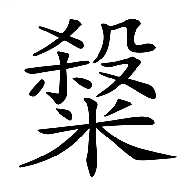
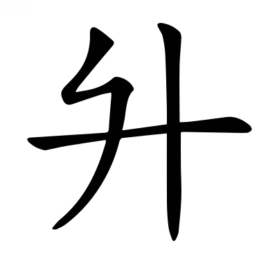
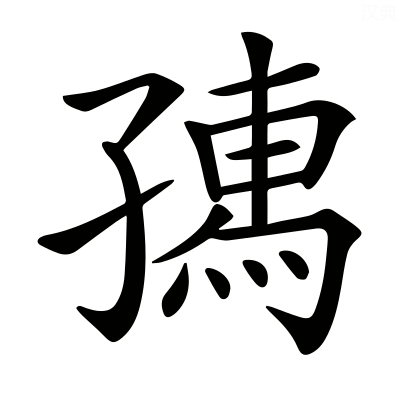
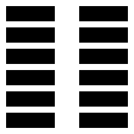
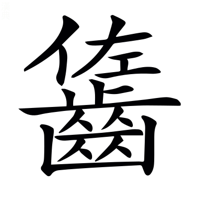
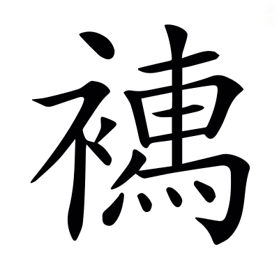

# 昭公第十

*〈昭公·名裯襄公子母齊歸在位二十五年遜于齊在外八年凡三十三年薨于乾侯諡法威儀恭明曰昭〉*

## 昭元年

> **元年春王正月公即位** *無傳*
> 
> **叔孫豹會晉趙武楚公子圍齊國弱宋向戌衞齊惡陳公子招蔡公孫歸生鄭罕虎許人曹人于虢** *〈公子招·常遥反◎于虢·瓜百反〉招實陳侯母弟不稱弟者義與莊二十五年公子友同今讀舊書則楚當先晉而先書趙武者亦取宋盟貴武之信故尚之也衞在陳蔡上先至於會〈當先·悉薦反〉*
> 
> **三月取鄆** *〈取鄆·音運〉不稱將帥將卑師少書取言易也〈不稱將·子匠反下同◎帥·所類反◎言易·以豉反〉*
> 
> **夏秦伯之弟鍼出奔晉** *〈弟鍼·其廉反〉稱弟罪秦伯*
> 
> **六月丁巳邾子華卒** *無傳三同盟*
> 
> **晉荀吳帥師敗狄于大鹵** *〈大鹵·大如字徐音泰下音魯榖梁傳云中國曰大原夷狄曰大鹵〉大鹵大原晉陽縣*
> 
> **秋莒去疾自齊入于莒** *〈莒去疾·起吕反〉國逆而立之曰入* **莒展輿出奔吳** *〈莒展出奔吳·一本作莒展輿〉弒君賊未會諸侯故不稱爵*
> 
> **叔弓帥師疆鄆田** *〈疆鄆·居良反注同〉春取鄆今正其封疆*
> 
> **葬邾悼公** *無傳*
> 
> **冬十有一月己酉楚子麇卒** *〈子麇·九倫反〉楚以瘧疾赴故不書弒〈以瘧·音虐◎書弑·申志反或作殺音同〉* **楚公子比出奔晉** *書名罪之*

**元年春楚公子圍聘于鄭且娶於公孫段氏 *〈且娶·七住反〉* 伍舉為介** *〈為介·音界注同〉伍舉椒舉介副也* **將入館** *就客舍* **鄭人惡之** *〈人惡·烏路反〉知楚懷詐* **使行人子羽與之言乃館於外** *舍城外* **既聘將以衆逆** *以兵入逆婦* **子產患之使子羽辭曰以敝邑褊小 *〈褊小·必淺反下同〉* 不足以容從者 *〈從者·才用反〉* 請墠聽命** *〈請墠·音善除地也〉欲於城外除地為墠行昏禮* **令尹命大宰伯州犂對曰君辱貺寡大夫圍 *〈辱貺·音況〉* 謂圍將使豐氏撫有而室** *豐氏公孫段* **圍布几筵 *〈布几·本亦作机◎筵·音延〉* 告於莊共之廟而來** *〈莊共·音恭〉莊王圍之祖共王圍之父* **若野賜之是委君貺於草莽也 *〈草莽·莫蕩反〉* 是寡大夫不得列於諸卿也** *言不得從卿禮* **不寧唯是又使圍蒙其先君** *蒙欺也告先君而來不得成禮於女氏之廟故以為欺先君* **將不得為寡君老** *大臣稱老懼辱命而黜退* **其蔑以復矣唯大夫圖之子羽曰小國無罪恃實其罪** *恃大國而無備則是罪* **將恃大國之安靖己而無乃包藏禍心以圖之小國失恃而懲諸侯 *〈而懲·直升反〉* 使莫不憾者 *〈不憾·户暗反〉* 距違君命而有所壅塞不行是懼** *〈所雍·於勇反本文作壅注及下注同〉言己失所恃則諸侯懲恨以距君命壅塞不行所懼唯此* **不然敝邑館人之屬也** *館人守舍人也* **其敢愛豐氏之祧** *〈之祧·他彫反遠祖廟也〉祧遠祖廟* **伍舉知其有備也請垂櫜而入** *〈垂櫜·古刀反弓衣也〉垂櫜示無弓* **許之正月乙未入逆而出遂會於虢** *虢鄭地* **尋宋之盟也** *宋盟在襄二十七年* **祁午謂趙文子曰宋之盟楚人得志於晉** *得志謂先歃午祁奚子〈先歃·所洽反〉* **今令尹之不信諸侯之所聞也子弗戒懼又如宋** *恐楚復得志〈復得·扶又反下雖復同〉* **子木之信稱於諸侯猶詐晉而駕焉** *〈而駕·如字又音加注及下同〉駕猶陵也詐謂衷甲〈衷甲·音忠〉* **況不信之尤者乎** *尤甚也* **楚重得志於晉 *〈楚重·直用反〉* 晉之恥也子相晉國 *〈子相·息亮反〉* 以為盟主於今七年矣** *襄二十五年始為政以春言故云七年* **再合諸侯** *襄二十五年會夷儀二十六年會澶淵* **三合大夫** *襄二十七年會于宋三十年會澶淵及今會虢也* **服齊狄寧東夏** *〈東夏·户雅反〉襄二十八年齊侯白狄朝晉* **平秦亂** *襄二十六年秦晉為成* **城淳于** *〈淳于·音純〉襄二十九年城杞之淳于杞遷都* **師徒不頓國家不罷 *〈不罷·音皮〉* 民無謗讟** *〈謗讟·音獨〉讟誹也〈誹也·方畏反〉* **諸侯無怨天無大災子之力也有令名矣而終之以恥午也是懼吾子其不可以不戒文子曰武受賜矣** *受午言* **然宋之盟子木有禍人之心武有仁人之心是楚所以駕於晉也今武猶是心也楚又行僭** *〈行僭·子念反下同〉僭不信* **非所害也武將信以為本循而行之譬如農夫是穮是蓘** *〈是穮·彼驕反耘也◎是蓘·古本反〉穮耘也壅苗為蓘〈耘也·音云除草也〉* **雖有饑饉 *〈饑饉·其靳反〉* 必有豐年** *言耕鉏不以水旱息必獲豐年之收〈耕鉏·住居反◎之收·手又反又如字〉* **且吾聞之能信不為人下吾未能也** *自恐未能信也* **詩曰不僭不賊鮮不為則 *〈鮮不·息淺反〉* 信也** *詩大雅僭不信賊害人也* **能為人則者不為人下矣吾不能是難 *〈是難·乃旦反下注並同〉* 楚不為患楚令尹圍請用牲讀舊書加于牲上而已** *舊書宋之盟書楚恐晉先歃故欲從舊書加于牲上不歃血經所以不書盟* **晉人許之三月甲辰盟楚公子圍設服離衞** *設君服二人執戈陳於前以自衞離陳也* **叔孫穆子曰楚公子美矣君哉** *美服似君* **鄭子皮曰二執戈者前矣** *禮國君行有二執戈者在前* **蔡子家曰蒲宮有前不亦可乎** *公子圍在會特緝蒲為王殿屋屏蔽以自殊異言既造王宮而居之雖服君服無所怪也〈特緝·七入反〉* **楚伯州犂曰此行也辭而假之寡君** *聞諸大夫譏之故言假以飾令尹過* **鄭行人揮曰假不反矣** *言將遂為君* **伯州犂曰子姑憂子皙之欲背誕也** *〈欲背·音佩注同◎誕也·音但〉襄三十年鄭子皙殺伯有背命放誕將為國難言子且自憂此無為憂令尹不反戈* **子羽曰當璧猶在假而不反子其無憂乎** *子羽行人揮當璧謂弃疾事在昭十三年言弃疾有當璧之命圍雖取國猶將有難不無憂也* **齊國子曰吾代二子愍矣** *國子國弱也二子謂王子圍及伯州犂圍此冬便篡位不能自終州犂亦尋為圍所殺故言可愍〈便篡·初患反〉* **陳公子招曰不憂何成二子樂矣** *〈二子樂·音洛注及下樂憂而樂同〉言以憂生事事成而樂* **衞齊子曰苟或知之雖憂何害** *齊子齊惡言先知為備雖有憂難無所損害* **宋合左師曰大國令小國共 *〈小國共·音恭注及下同〉* 吾知共而已** *共承大國命不能知其禍福* **晉樂王鮒曰 *〈樂王鮒·音附〉* 小旻之卒章善矣 *〈小旻·亡巾反〉* 吾從之** *小旻詩小雅其卒章義取非唯暴虎馮河之可畏也不敬小人亦危殆王鮒從斯義故不敢譏議公子圍〈馮河·皮冰反〉* **退會子羽謂子皮曰叔孫絞而婉** *〈絞·古卯反切也◎而婉·紆阮反注同〉絞切也譏其似君反謂之美故曰婉* **宋左師簡而禮** *無所臧否故曰簡共事大國故曰禮〈臧否·悲矣反舊方九反〉* **樂王鮒字而敬** *字愛也不犯凶人所以自愛敬* **子與子家持之** *〈持之·如字本或作特誤〉子子皮子家蔡公孫歸生持之言無所取與* **皆保世之主也齊衞陳大夫其不免乎國子代人憂子招樂憂齊子雖憂弗害夫弗及而憂與可憂而樂與憂而弗害皆取憂之道也憂必及之大誓曰民之所欲天必從之** *逸書* **三大夫兆憂憂能無至乎** *開憂兆也* **言以知物其是之謂矣** *物類也察言以知禍福之類八年陳招殺大子國弱齊惡當身各無患〈當身·丁浪反〉*

**季武子伐莒取鄆** *兵未加莒而鄆服故書取而不言伐* **莒人告於會楚告於晉曰尋盟未退** *尋弭兵之盟* **而魯伐莒瀆齊盟** *〈瀆齊·徒木反〉瀆慢也* **請戮其使** *〈其使·所吏反下注其使出使下召使者同〉時叔孫豹在會欲戮之* **樂桓子相趙文子** *〈相趙·息亮反注同〉桓子樂王鮒相佐也* **欲求貨於叔孫而為之請 *〈而為·于偽反下注為諸侯同〉* 使請帶焉** *難指求貨故以帶為辭* **弗與梁其踁曰 *〈梁其踁·戶定反〉* 貨以藩身 *〈以藩·方元反〉* 子何愛焉** *踁叔孫家臣* **叔孫曰諸侯之會衞社稷也我以貨免魯必受師** *言不戮其使必伐其國* **是禍之也何衞之為人之有牆以蔽惡也** *喻己為國衞如牆為人蔽* **牆之隙壞 *〈之隙·去逆反〉* 誰之咎也** *〈之咎·其九反注同〉咎在牆* **衞而惡之吾又甚焉** *罪甚牆* **雖怨季孫魯國何罪** *怨季孫之伐莒* **叔出季處有自來矣吾又誰怨** *季孫守國叔孫出使所從來久今遇此戮無所怨也* **然鮒也賄 *〈也賄·呼罪反〉* 弗與不已召使者裂裳帛而與之曰帶其褊矣** *言帶褊盡故裂裳示不相逆* **趙孟聞之曰臨患不忘國忠也** *謂言魯國何罪* **思難不越官 *〈思難·乃旦反下同〉* 信也** *謂言叔出季處* **圖國忘死貞也** *謂不以貨免* **謀主三者義也** *三者忠信貞* **有是四者又可戮乎** *并義而四* **乃請諸楚曰魯雖有罪其執事不辟難** *執事謂叔孫* **畏威而敬命矣** *謂不敢辟戮* **子若免之以勸左右可也若子之羣吏處不辟汙** *〈辟汚·音烏注及下同〉汙勞事* **出不逃難** *不苟免* **其何患之有患之所生汙而不治難而不守所由來也能是二者又何患焉不靖其能其誰從之** *安靖賢能則衆附從* **魯叔孫豹可謂能矣請免之以靖能者子會而赦有罪** *不伐魯* **又賞其賢** *赦叔孫* **諸侯其誰不欣焉望楚而歸之視遠如邇疆埸之邑 *〈疆·居良反注及下至莒之疆事同◎埸·音亦注同〉* 一彼一此何常之有** *言今衰世疆埸無定主* **王伯之令也** *言三王五伯有令德時* **引其封疆** *引正也正封界* **而樹之官** *樹立也立官以守國* **舉之表旗** *〈表旗·音其〉旌旗以表貴賤* **而著之制令** *為諸侯作制度法令使不得相侵犯* **過則有刑猶不可壹於是乎虞有三苗** *三苗饕餮放三危者〈饕·吐刀反◎餮·吐結反〉* **夏有觀扈** *〈夏有·戶雅反◎觀·音館舊音官◎扈·音戶〉觀國今頓丘衞縣扈在始平鄠縣書序曰啟與有扈戰於甘之野〈鄠縣·音戶〉* **商有姺邳** *〈姺·西典反又西禮反◎邳·皮悲反〉二國商諸侯邳今下邳縣* **周有徐奄** *二國皆嬴姓書序曰成王伐淮夷遂踐奄徐即淮夷〈嬴姓·音盈〉* **自無令王諸侯逐進** *逐猶競也* **狎主齊盟 *〈狎主·戶甲反〉* 其又可壹乎** *彊弱無常故更主盟〈故更·音庚〉* **恤大舍小足以為盟主** *大謂篡弒滅亡之禍* **又焉用之** *〈又焉·於虔反注同〉焉用治小事* **封疆之削何國蔑有主齊盟者誰能辯焉** *辯治也* **吳濮有釁 *〈吳濮·音卜◎有釁·許靳反過也〉* 楚之執事豈其顧盟** *吳在東濮在南今建寧郡南有濮夷釁過也* **莒之疆事楚勿與知 *〈勿與·音預〉* 諸侯無煩不亦可乎莒魯爭鄆為日久矣苟無大害於其社稷可無亢也** *〈無亢·苦浪反徐又音剛禦也〉亢禦〈禦也·魚吕反〉* **去煩宥善 *〈去煩·起吕反◎宥善·音又〉* 莫不競勸子其圖之固請諸楚楚人許之乃免叔孫令尹享趙孟賦大明之首章** *大明詩大雅首章言文王明明照於下故能赫赫盛於上令尹意在首章故特稱首章以自光大* **趙孟賦小宛之二章** *〈小宛·紆阮反〉小宛詩小雅二章取其各敬爾儀天命不又言天命一去不可復還以戒令尹〈可復·扶又反〉* **事畢趙孟謂叔向曰令尹自以為王矣何如** *問將能成否* **對曰王弱令尹彊其可哉** *言可成* **雖可不終趙孟曰何故對曰彊以克弱而安之彊不義也** *安於勝君是彊而不義* **不義而彊其斃必速詩曰赫赫宗周褒姒滅之 *〈襃姒·音似◎滅之·如字詩作烕音呼悅反〉* 彊不義也** *詩小雅褒姒周幽王后幽王惑焉而行不義遂至滅亡言雖赫赫盛彊不義足以滅之* **令尹為王必求諸侯晉少懦矣** *〈少懦·乃亂反弱也〉懦弱也* **諸侯將往若獲諸侯其虐滋甚** *滋益也* **民弗堪也將何以終夫以彊取** *取不以道* **不義而克必以為道** *以不義為道* **道以淫虐弗可久已矣** *為十三年楚弒靈王傳*

**夏四月趙孟叔孫豹曹大夫入于鄭** *會罷過鄭〈過鄭·古禾反〉* **鄭伯兼享之子皮戒趙孟** *戒享期* **禮終趙孟賦瓠葉** *〈瓠葉·戶故反〉受所戒禮畢而賦詩瓠葉詩小雅義取古人不以微薄廢禮雖瓠葉兔首猶與賓客享之〈猶與賓客享之·許丈反又普庚反〉* **子皮遂戒穆叔且告之** *告以趙孟賦瓠葉* **穆叔曰趙孟欲一獻** *瓠葉詩義取薄物而以獻酬知欲一獻* **子其從之子皮曰敢乎** *言不敢* **穆叔曰夫人之所欲也 *〈夫人·音扶注同〉* 又何不敢** *夫人趙孟* **及享具五獻之籩豆於幕下** *〈於幕·武博反〉朝聘之制大國之卿五獻* **趙孟辭** *趙孟自以今非聘鄭故辭五獻* **私於子產** *私語* **曰武請於冢宰矣** *冢宰子皮請謂賦瓠葉* **乃用一獻趙孟為客禮終乃宴** *卿會公侯享宴皆折俎不體薦〈折俎·之設反〉* **穆叔賦鵲巢** *鵲巢詩召南言鵲有巢而鳩居之喻晉君有國趙孟治之* **趙孟曰武不堪也又賦采蘩** *〈采蘩·音煩〉亦詩召南義取蘩菜薄物可以薦公侯享其信不求其厚* **曰小國為蘩大國省穡而用之 *〈省穡·所景反徐所幸反注同〉* 其何實非命** *穆叔言小國微薄猶蘩菜大國能省愛用之而不弃則何敢不從命穡愛也* **子皮賦野有死麕之卒章** *〈死麏·九倫反〉野有死麕詩召南卒章曰舒而脫脫兮無感我帨兮無使尨也吠脫脫安徐帨佩巾義取君子徐以禮來無使我失節而使狗驚吠喻趙孟以義撫諸侯無以非禮相加陵〈脫脫·吐外反◎我帨·始銳反◎使尨·武江反◎也吠·扶廢反〉* **趙孟賦常棣** *〈常棣·直計反〉常棣詩小雅取其凡今之人莫如兄弟言欲親兄弟之國* **且曰吾兄弟比以安 *〈兄弟比·毗志反下注德比同〉* 尨也可使無吠** *受子皮之詩* **穆叔子皮及曹大夫興拜** *三大夫皆兄弟國興起也* **舉兕爵 *〈兕爵·徐履反〉* 曰小國賴子知免於戾矣** *〈於戾·力計反下同〉兕爵所以罰不敬言小國蒙趙孟德比以安自知免此罰戮* **飲酒樂 *〈飲酒樂·音洛注同〉* 趙孟出曰吾不復此矣** *〈不復此·扶又反注及下不復年幷注同〉不復見此樂*

**天王使劉定公勞趙孟於潁 *〈勞趙孟·力報反下以勞之同◎於潁·營井反水名〉* 館於雒汭** *〈於雒汭·如銳反〉王周景王定公劉夏潁水出陽城縣雒汭在河南鞏縣南水曲流為汭〈劉夏·戶雅反〉* **劉子曰美哉禹功** *見河雒而思禹功* **明德遠矣微禹吾其魚乎吾與子弁冕端委 *〈弁端委·本亦作弁冕端委〉* 以治民臨諸侯禹之力也** *弁冕冠也端委禮衣言今得共服冠冕有國家者皆由禹之力* **子盍亦遠績禹功 *〈子盍·戶臘反何不也◎亦遠績功·本或作亦遠績禹功〉* 而大庇民乎** *〈大庇·必利反又音祕〉勸趙孟使纂禹功* **對曰老夫罪戾是懼焉能恤遠 *〈焉能·於虔反下焉用焉能同〉* 吾儕偷食 *〈吾儕·仕皆反〉* 朝不謀夕 *〈朝不·如字下同〉* 何其長也** *言欲苟免目前不能念長久* **劉子歸以語王 *〈以語·魚據反〉* 曰諺所謂老將知 *〈將知·音智〉* 而耄及之者** *〈而耄·莫報反亂也〉八十曰耄耄亂也* **其趙孟之謂乎為晉正卿以主諸侯而儕於隷人朝不謀夕** *言其自比於賤人而無恤民之心* **弃神人矣** *民為神主不恤民故神人皆去* **神怒民叛何以能久趙孟不復年矣** *言將死不復見明年* **神怒不歆其祀 *〈不歆·許金反〉* 民叛不即其事祀事不從又何以年** *為此冬趙孟卒起本*

**叔孫歸** *虢會歸* **曾夭 *〈曾夭·於兆反〉* 御季孫以勞之旦及日中不出** *恨季孫伐莒使己幾被戮〈幾被·音祈〉* **曾夭謂曾阜** *〈曾阜·扶九反〉曾阜叔孫家臣* **曰旦及日中吾知罪矣魯以相忍為國也忍其外不忍其內焉用之** *欲受楚戮是忍其外日中不出是不忍其內* **阜曰數月於外** *〈數月·所主反注同〉言叔孫勞役在外數月* **一旦於是庸何傷賈而欲贏 *〈賈而·音古注同◎欲贏·音盈注同利也〉* 而惡嚻乎** *〈而惡·烏路反注及下同◎嚻乎·許驕反徐五髙反注同〉言譬如商賈求贏利者不得惡諠嚻之聲〈惡讙·呼端反或作諠〉* **阜謂叔孫曰可以出矣叔孫指楹 *〈指楹·音盈柱也〉* 曰雖惡是其可去乎 *〈可去·起吕反〉* 乃出見之** *楹柱也以喻魯有季孫猶屋有柱*

**鄭徐吾犯之妹美** *犯鄭大夫* **公孫楚聘之矣** *楚子南穆公孫* **公孫黑又使強委禽焉** *禽鴈也納采用鴈* **犯懼告子產子產曰是國無政非子之患也唯所欲與犯請於二子請使女擇焉皆許之子皙盛飾入布幣而出** *布陳贄幣子皙公孫黑〈贄幣·音至〉* **子南戎服入左右射超乘而出 *〈超乘·繩證反〉* 女自房觀之曰子皙信美矣抑子南夫也** *言丈夫* **夫夫婦婦所謂順也適子南氏子皙怒既而櫜甲以見子南 *〈櫜甲·古刀反本或作衷丁隆反〉* 欲殺之而取其妻子南知之執戈逐之及衝 *〈及衝·尺容反交道也〉* 擊之以戈** *衝交道* **子皙傷而歸告大夫曰我好見之 *〈我好·如字一音呼報反〉* 不知其有異志也故傷大夫皆謀之子產曰直鈞 *〈直鈞·音均絶句〉* 幼賤有罪罪在楚也** *先聘子南直也子南用戈子皙直也子產力未能討故鈞其事歸罪於楚* **乃執子南而數之曰國之大節有五女皆奸之** *〈女皆·音汝下皆同◎奸之·音干犯也〉奸犯也* **畏君之威聽其政尊其貴事其長 *〈其長·丁丈反下同〉* 養其親 *〈養其親·如字下同〉* 五者所以為國也今君在國女用兵焉不畏威也奸國之紀不聽政也** *奸國之紀謂傷人* **子皙上大夫女嬖大夫 *〈女嬖·必計反〉* 而弗下之 *〈弗下·户嫁反〉* 不尊貴也幼而不忌不事長也** *忌畏也* **兵其從兄 *〈兵其從兄·如字又才用反〉* 不養親也君曰余不女忍殺宥女以遠勉速行乎無重而罪 *〈無重·直用反又直勇反〉* 五月庚辰鄭放游楚於吳將行子南子產咨於大叔** *大叔游楚之兄子* **大叔曰吉不能亢身 *〈能亢·苦浪反〉* 焉能亢宗** *亢蔽也* **彼國政也非私難也 *〈私難·乃旦反〉* 子圖鄭國利則行之又何疑焉周公殺管叔而蔡蔡叔** *〈而蔡蔡叔·上蔡字音素葛反放也說文作音同字從殺下米云䊝散之也會杜義下蔡叔如字〉蔡放也* **夫豈不愛 *〈夫豈·音扶〉* 王室故也吉若獲戾子將行之何有於諸游** *為二年鄭殺公孫黑傳*

**秦后子有寵於桓如二君於景** *后子秦桓公子景公母弟鍼也其權寵如兩君* **其母曰弗去懼選** *〈懼選·息轉反徐素短反注及下同數也〉選數也恐景公數其罪而加戮〈選數·所主反注及下文數世同〉* **癸卯鍼適晉其車千乘 *〈千乘·繩證反下及注同〉* 書曰秦伯之弟鍼出奔晉罪秦伯也** *罪失教* **后子享晉侯** *為晉侯設享禮〈為晉侯·于偽反〉* **造舟于河** *〈造舟·七報反注同造舟為梁也李巡注爾雅云比其舩而度也郭云併舟為橋〉造舟為梁通秦晉之道* **十里舍車** *一舍八乘為八反之備* **自雍及絳** *〈自雍·於用反〉雍絳相去千里用車八百乘* **歸取酬幣** *備九獻之儀始禮自齎其一故續送其八酬酒幣〈自齎·子兮反本又作賫同〉* **終事八反** *每十里以八乘車各以次載幣相授而還不徑至故言八反千里用車八百乘其二百乘以自隨故言千乘傳言秦鍼之出極奢富以成禮欲盡敬於所赴〈而還·音環◎不徑·古定反〉* **司馬侯問焉曰子之車盡於此而已乎對曰此之謂多矣若能少此吾何以得見** *〈得見·賢遍反〉言己坐車多故出奔〈己坐·才臥反〉* **女叔齊以告公** *〈女叔齊·音汝〉叔齊司馬侯* **且曰秦公子必歸臣聞君子能知其過必有令圖令圖天所贊也后子見趙孟趙孟曰吾子其曷歸** *問何時當歸* **對曰鍼懼選於寡君是以在此將待嗣君趙孟曰秦君何如對曰無道趙孟曰亡乎對曰何為一世無道國未艾也** *〈未艾·魚廢反注同〉艾絕也* **國於天地有與立焉** *言欲輔助之者多* **不數世淫弗能斃也趙孟曰天乎對曰有焉趙孟曰其幾何 *〈其幾何·居豈反下同〉* 對曰鍼聞之國無道而年穀和熟天贊之也** *贊佐助也* **鮮不五稔** *〈鮮不·息淺反注同◎五稔·而甚反〉鮮少也少尚當歷五年多則不啻〈不啻·始豉反〉* **趙孟視蔭 *〈視䕃·於金反本亦作隂〉* 曰朝夕不相及 *〈朝夕·如字注同〉* 誰能待五** *蔭日景也趙孟意衰以日景自喻故言朝夕不相及誰能待五〈日景·如字又於領反〉* **后子出而告人曰趙孟將死矣主民翫歲 *〈翫歳·五喚反說文云習厭也又作玩云貪也〉* 而愒日** *〈而愒·苦蓋反貪也〉翫愒皆貪也* **其與幾何** *〈其與·如字又音預〉言不能久*

**鄭為游楚亂故** *〈鄭為·于偽反〉游楚子南* **六月丁巳鄭伯及其大夫盟于公孫段氏罕虎公孫僑公孫段印段游吉駟帶私盟于閨門之外 *〈閨門·音圭〉* 實薰隧** *〈實薫·許云反◎隧·音遂〉閨門鄭城門薰隧門外道名實之者為明年子產數子皙罪稱薰隧盟起本〈數子晳·色主反又色具反〉* **公孫黑強與於盟 *〈強與·其丈反下音預〉* 使大史書其名且曰七子** *自欲同於六卿故曰七子* **子產弗討** *子皙強討之恐亂國*

**晉中行穆子敗無終及羣狄于大原** *〈大原·音泰〉即大鹵也無終山戎* **崇卒也** *〈崇卒·子忽反下及注皆同〉崇聚也* **將戰魏舒曰彼徒我車所遇又阨** *〈又阨·本又作隘於懈反〉地險不便車〈不便·婢面反〉* **以什共車 *〈以什·音十◎共車·音恭〉* 必克** *更增十人以當一車之用* **困諸阨又克** *車每困於阨道今去車故為必克〈今去·起吕反下皆同〉* **請皆卒** *去車為步卒* **自我始乃毀車以為行** *〈為行·戶郎反〉魏舒先自毀其屬車為步陳〈步陳·直覲反下文五陳未陳同〉* **五乘為三伍** *〈五乘·繩證反注五乘同〉乘車者車三人五乘十五人今改去車更以五人為伍分為三伍* **荀吳之嬖人不肯即卒斬以徇** *〈以徇·辭俊反〉魏舒輒斬之荀吳不恨所以能立功* **為五陳以相離兩於前伍於後專為右角參為左角偏為前拒** *〈前拒·九甫反〉皆臨時處置之名* **以誘之翟人笑之** *笑其失常* **未陳而薄之大敗之** *傳言荀吳能用善謀*

**莒展輿立而奪羣公子秩公子召去疾于齊秋齊公子鉏納去疾** *齊雖納去疾莒人先召之故從國逆例書入去疾奔齊在襄三十一年* **展輿奔吳** *吳外孫*

**叔弓帥師疆鄆田 *〈疆鄆·居良反注同〉* 因莒亂也** *此春取鄆今正其疆界* **於是莒務婁瞀胡 *〈務婁·並如字務又音謀一音無◎瞀胡·徐音茂一音謀〉* 及公子滅明以大厖 *〈大厖·武江反〉* 與常儀靡奔齊** *三子展輿黨大厖常儀靡莒二邑* **君子曰莒展之不立弃人也夫** *〈也夫·音扶〉奪羣公子秩是弃人* **人可弃乎詩曰無競惟人善矣** *詩周頌言惟得人則國家彊*

**晉侯有疾鄭伯使公孫僑如晉聘且問疾叔向問焉曰寡君之疾病卜人曰實沈臺駘為祟 *〈臺駘·他才反◎為祟·息遂反〉* 史莫之知敢問此何神也子產曰昔高辛氏有二子伯曰閼伯 *〈閼伯·於葛反〉* 季曰實沈** *高辛帝嚳〈帝嚳·苦毒反〉* **居于曠林不相能也** *〈相能·如字又奴代反〉曠林地闕* **日尋干戈以相征討** *尋用也* **后帝不臧** *后帝堯也臧善也* **遷閼伯于商丘主辰** *商丘宋地主祀辰星辰大火也* **商人是因故辰為商星** *商人湯先相土封商丘因閼伯故國祀辰星〈相土·息亮反〉* **遷實沈于大夏主參** *〈大夏·戶雅反注及下同◎主參·所林反注及下同〉大夏今晉陽縣* **唐人是因以服事夏商** *唐人若劉累之等累遷魯縣此在大夏* **其季世曰唐叔虞** *唐人之季世其君曰叔虞* **當武王邑姜方震大叔** *〈方震·本又作娠之愼反又音申懷妊也◎大叔·音泰注及下同〉邑姜武王后齊大公之女懷胎為震大叔成王之弟叔虞〈懷胎·他來反〉* **夢帝謂己余命而子曰虞** *帝天取唐君之名* **將與之唐屬諸參 *〈屬諸·之玉反〉* 而蕃育其子孫 *〈而蕃·音煩〉* 及生有文在其手曰虞遂以命之及成王滅唐而封大叔焉故參為晉星** *叔虞封唐是為晉侯〈叔虞封唐是為晉侯·案史記叔虞封唐侯叔虞之子爕父改為晉侯〉* **由是觀之則實沈參神也昔金天氏有裔子 *〈有裔·以制反遠也〉* 曰昧 *〈曰昧·音妹〉* 為玄冥師 *〈為玄冥師·師長也為水官之長〉* 生允格臺駘** *金天氏帝少暭裔遠也玄冥水官昧為水官之長〈少皡·詩照反下户老反◎之長·丁丈反下殖長同〉* **臺駘能業其官** *纂昧之業〈纂昧·子管反〉* **宣汾洮** *〈宣汾·扶云反◎洮·他刀反〉宣猶通也汾洮二水名* **障大澤** *〈障大澤·之尚反又音章注同〉陂障之〈陂障·彼皮反〉* **以處大原** *大原晉陽也臺駘之所居* **帝用嘉之封諸汾川** *帝顓頊〈顓頊·音專下許玉反〉* **沈姒蓐黃 *〈沈·音審◎姒·音似〉* 實守其祀** *四國臺駘之後* **今晉主汾而滅之矣** *滅四國* **由是觀之則臺駘汾神也抑此二者不及君身山川之神則水旱癘疫之災 *〈癘·音例◎疫·音役〉* 於是乎禜之** *〈禜之·音詠徐又音營〉有水旱之災則禜祭山川之神若臺駘者周禮四曰禜祭為營櫕用幣以祈福祥〈營櫕·子管反〉* **日月星辰之神則雪霜風雨之不時於是乎禜之** *星辰之神若實沈者* **若君身則亦出入飲食哀樂之事也 *〈哀樂·音洛〉* 山川星辰之神又何為焉** *言實沈臺駘不為君疾* **僑聞之君子有四時朝以聽政** *〈朝以·如字〉聽國政* **晝以訪問** *問可否* **夕以脩令** *念所施* **夜以安身於是乎節宣其氣** *宣散也* **勿使有所壅閉湫底 *〈所壅·於勇反◎湫·子小反集也徐音秋又在酒反服云著也◎底·丁禮反滯也服云止也〉* 以露其體** *湫集也底滯也露羸也壹之則血氣集滯而體羸露〈露羸·劣危反下同〉* **茲心不爽而昏亂百度** *茲此也爽明也百度百事之節* **今無乃壹之** *同四時也* **則生疾矣僑又聞之內官不及同姓** *內官嬪御〈嬪御·婢人反〉* **其生不殖** *殖長也* **美先盡矣則相生疾** *同姓之相與先美矣美極則盡盡則生疾* **君子是以惡之 *〈以惡·如字又烏路反〉* 故志曰買妾不知其姓則卜之違此二者古之所愼也** *壹四時取同姓二者古人所愼〈取同·七住反〉* **男女辨姓禮之大司也** *辨別也〈辨別·彼列反〉* **今君內實有四姬焉** *同姓姬四人* **其無乃是也乎若由是二者弗可為也已** *為治也* **四姬有省猶可 *〈有省·所景反徐所幸反注同〉* 無則必生疾矣** *據異姓去同姓故言省〈去同·起吕反〉* **叔向曰善哉肸未之聞也此皆然矣叔向出行人揮送之** *送叔向* **叔向問鄭故焉且問子皙對曰其與幾何** *〈其與·如字又音預◎幾何·居豈反〉言將敗不久* **無禮而好陵人 *〈而好·呼報反〉* 怙富而卑其上 *〈怙富·音户〉* 弗能久矣** *為明年鄭殺公孫黑傳* **晉侯聞子產之言曰博物君子也重賄之晉侯求醫於秦秦伯使醫和視之曰疾不可為也是謂近女 *〈近女·附近之近下同〉* 室疾如蠱** *〈如蠱·音古〉蠱惑疾* **非鬼非食惑以喪志** *〈以喪·息浪反〉惑女色而失志* **良臣將死天命不祐** *〈不祐·音又〉良臣不匡救君過故將死而不為天所祐* **公曰女不可近乎對曰節之先王之樂所以節百事也故有五節** *五聲之節* **遲速本末以相及中聲以降 *〈以降·音絳下及注同罷退也或音戶江反〉* 五降之後不容彈矣** *〈容彈·徒丹反又徒旦反〉此謂先王之樂得中聲聲成五降而息也降罷退* **於是有煩手淫聲慆堙心耳 *〈慆·吐刀反下同◎堙·音因〉* 乃忘平和君子弗聽也** *五降而不息則雜聲並奏所謂鄭衞之聲* **物亦如之** *言百事皆如樂不可失節* **至於煩乃舍也已 *〈乃舍·音捨注同〉* 無以生疾** *煩不舍則生疾* **君子之近琴瑟以儀節也非以慆心也** *為心之節儀使動不過度* **天有六氣** *謂陰陽風雨晦明也* **降生五味** *謂金味辛木味酸水味鹹火味苦土味甘皆由陰陽風雨而生* **發為五色** *辛色白酸色青鹹色黑苦色赤甘色黃發見也〈發見·賢遍反〉* **徵為五聲** *白聲商青聲角黑聲羽赤聲徵黃聲宮徵驗也〈赤聲徴·張里反〉* **淫生六疾** *淫過也滋味聲色所以養人然過則生害* **六氣曰陰陽風雨晦明也分為四時序為五節** *六氣之化分而序之則成四時得五行之節* **過則為菑 *〈為菑·音災下同〉* 陰淫寒疾** *寒過則為冷* **陽淫熱疾** *熱過則喘渴〈喘渴·昌兖反〉* **風淫末疾** *末四支也風為緩急* **雨淫腹疾** *雨濕之氣為洩注〈洩注·息列反下如字〉* **晦淫惑疾** *晦夜也為宴寢過節則心惑亂* **明淫心疾** *明晝也思慮煩多心勞生疾〈思慮·息利反〉* **女陽物而晦時淫則生內熱惑蠱之疾** *女常隨男故言陽物家道當在夜故言晦時* **今君不節不時能無及此乎出告趙孟趙孟曰誰當良臣對曰主是謂矣主相晉國 *〈主相·息亮反〉* 於今八年晉國無亂諸侯無闕可謂良矣和聞之國之大臣榮其寵祿任其大節有菑禍興而無改焉** *改改行以救菑〈改行·下孟反〉* **必受其咎 *〈其咎·其九反〉* 今君至於淫以生疾將不能圖恤社稷禍孰大焉主不能禦 *〈能御·魚吕反本亦作禦〉* 吾是以云也** *云主將死* **趙孟曰何謂蠱對曰淫溺惑亂之所生也** *〈淫溺·乃狄反〉溺沈沒於耆欲〈耆欲·時志反〉* **於文皿蟲為蠱** *〈皿蟲·命景反說文讀若猛字林音猛〉文字也皿器也器受蟲害者為蠱* **穀之飛亦為蠱** *穀久積則變為飛蟲名曰蠱* **在周易女惑男風落山謂之蠱** *巽下艮上蠱巽為長女為風艮為少男為山少男而說長女非匹故惑山木得風而落〈巽下·音遜◎艮上·古恨反◎長女·丁丈反下同◎少男·詩照反下同◎而說·音悅〉* **皆同物也** *物猶類也* **趙孟曰良醫也厚其禮而歸之** *贈賄之禮*

**楚公子圍使公子黑肱伯州犂城犫櫟郟** *〈城犫·尺州反◎櫟·音歷徐失灼反◎郟·古洽反〉黑肱王子圍之弟子皙也犫縣屬南陽郟縣屬襄城櫟今河南陽翟縣三邑本鄭地* **鄭人懼子產曰不害令尹將行大事** *謂將弒君* **而先除二子也** *二子謂黑肱伯州犂* **禍不及鄭何患焉冬楚公子圍將聘于鄭伍舉為介 *〈為介·音界〉* 未出竟 *〈出竟·音境〉* 聞王有疾而還伍舉遂聘十一月己酉公子圍至入問王疾縊而弒之** *〈縊而·一豉反絞也◎殺之·申志反〉縊絞也孫卿曰以冠纓絞之長歷推己酉十二月六日經傳皆言十一月月誤也〈絞也·古卯反〉* **遂殺其二子幕及平夏** *〈幕·音莫◎平夏·戶雅反〉皆郟敖子* **右尹子干出奔晉** *子干王子比* **宮廄尹子皙出奔鄭** *〈宫廏·居久反〉因築城而去* **殺大宰伯州犂于郟葬王于郟謂之郟敖** *郟敖楚子麇* **使赴于鄭伍舉問應為後之辭焉** *問赴者* **對曰寡大夫圍伍舉更之曰共王之子圍為長** *〈共王·音恭◎為長·丁丈反〉伍舉更赴辭使從禮此告終稱嗣不以篡弒赴諸侯* **子干奔晉從車五乘 *〈從車·才用反◎五乘·繩證反下同〉* 叔向使與秦公子同食** *食祿同* **皆百人之餼** *〈之餼·許氣反〉百人一卒也其祿足百人〈一卒·子忽反〉* **趙文子曰秦公子富** *謂秦鍼富強秩祿不宜與子干同* **叔向曰厎祿以德** *〈厎禄·音旨〉厎致也* **德鈞以年年同以尊公子以國不聞以富且夫以千乘去其國 *〈且夫·音扶〉* 彊禦已甚詩曰不侮鰥寡 *〈不侮·亡甫反◎鰥寡·古頑反〉* 不畏彊禦** *詩大雅侮陵也* **秦楚匹也使后子與子干齒** *以年齒為高下而坐* **辭曰鍼懼選楚公子不獲是以皆來亦唯命** *不獲不得自安言俱奔事有優劣唯主人命所處謙辭* **且臣與羈齒無乃不可乎** *后子先來仕欲自同於晉臣為主人子干後來奔以為羈旅之客* **史佚有言曰 *〈史佚·音逸〉* 非羈何忌** *忌敬也欲謙以自別〈自別·彼列反〉* **楚靈王即位薳罷為令尹 *〈薳罷·音皮〉* 薳啟彊為大宰** *〈薳啟彊·其良反又居良反〉靈王公子圍也即位易名熊虔* **鄭游吉如楚葬郟敖且聘立君歸謂子產曰具行器矣** *行器會備* **楚王汏侈 *〈汏侈·音泰〉* 而自說其事 *〈自說·徐音悅一音始悅反〉* 必合諸侯吾往無日矣子產曰不數年未能也** *〈不數·所主反〉為四年會申傳*

**十二月晉既烝** *〈旣烝·之承反冬祭名〉烝冬祭也* **趙孟適南陽將會孟子餘** *孟子餘趙衰趙武之曾祖其廟在晉之南陽溫縣往會祭之〈趙衰·初危反〉* **甲辰朔烝于溫** *趙氏烝祭甲辰十二月朔晉既烝趙孟乃烝其家廟則晉烝當在甲辰之前傳言十二月月誤* **庚戌卒** *十二月七日終劉定公秦后子之言* **鄭伯如晉弔及雍乃復** *〈及雍·於用反〉弔趙氏蓋趙氏辭之而還傳言大夫彊諸侯畏而弔之*

## 昭二年

> **二年春晉侯使韓起來聘**
> 
> **夏叔弓如晉** *叔弓叔老子*
> 
> **秋鄭殺其大夫公孫黑** *書名惡之薰隧盟子產不討遂以為卿故書之〈惡之·烏路反〉*
> 
> **冬公如晉至河乃復** *弔少姜也晉人辭之故還〈少姜·詩照反傳放此〉*
> 
> **季孫宿如晉** *致襚服也公實以秋行冬還乃書〈致襚·音遂〉*

**二年春晉侯使韓宣子來聘** *公即位故* **且告為政而來見禮也** *〈來見·賢遍反〉代趙武為政雖盟主而脩好同盟故曰禮〈脩好·呼報反〉* **觀書於大史氏見易象與魯春秋曰周禮盡在魯矣** *易象上下經之象辭魯春秋史記之策書春秋遵周公之典以序事故曰周禮盡在魯矣* **吾乃今知周公之德與周之所以王也** *〈所以王·于況反周弘正依字讀〉易象春秋文王周公之制當此時儒道廢諸國多闕唯魯備故宣子適魯而說之〈而說·音悅〉* **公享之季武子賦緜之卒章** *緜詩大雅卒章義取文王有四臣故能以緜緜致興盛以晉侯比文王以韓子比四輔〈四臣·大顚閎天散冝生南宫适◎四輔·謂先後奔奏䟽附禦悔〉* **韓子賦角弓** *角弓詩小雅取其兄弟昏姻無胥遠矣言兄弟之國宜相親* **季武子拜曰敢拜子之彌縫敝邑寡君有望矣** *〈彌縫·扶恭反〉彌縫猶補合也謂以兄弟之義〈補合·如字一音閤〉* **武子賦節之卒章** *〈賦節·才結反徐又如字〉節詩小雅卒章取式訛爾心以畜萬邦以言晉德可以畜萬邦〈式訛·五禾反〉* **既享宴于季氏有嘉樹焉宣子譽之** *〈譽之·音餘注同〉譽其好也* **武子曰宿敢不封殖此樹以無忘角弓** *封厚也殖長也〈殖長·丁丈反〉* **遂賦甘棠** *甘棠詩召南召伯息於甘棠之下詩人思之而愛其樹武子欲封殖嘉樹如甘棠以宣子比召公〈召南·上照反下同〉* **宣子曰起不堪也無以及召公宣子遂如齊納幣** *為平公聘少姜〈為平公·于偽反下文為之請同〉* **見子雅子雅召子旗** *子旗子雅之子* **使見宣子 *〈使見·賢遍反下見彊同〉* 宣子曰非保家之主也不臣** *志氣亢〈亢也·苦浪反〉* **見子尾子尾見彊** *彊子尾之子* **宣子謂之如子旗** *亦不臣* **大夫多笑之唯晏子信之曰夫子君子也** *夫子韓起* **君子有信其有以知之矣** *為十年齊欒施高彊來奔張本* **自齊聘於衞衞侯享之北宮文子賦淇澳** *〈淇·音其◎澳·於六反〉淇澳詩衞風美武公也言宣子有武公之德* **宣子賦木瓜** *木瓜亦衞風義取於欲厚報以為好〈為好·呼報反後文注皆同〉*

**夏四月韓須如齊逆女** *須韓起之子逆少姜* **齊陳無宇送女致少姜少姜有寵於晉侯晉侯謂之少齊** *〈少齊·詩照反〉為立別號所以寵異之* **謂陳無宇非卿** *欲使齊以適夫人禮送少姜〈以適·丁歷反〉* **執諸中都** *中都晉邑在西河界休縣東南〈介休·音界下許虯反〉* **少姜為之請曰送從逆班** *班列也* **畏大國也猶有所易是以亂作** *韓須公族大夫陳無宇上大夫言齊畏晉改易禮制使上大夫送遂致此執辱之罪蓋少姜謙以示譏*

**叔弓聘于晉報宣子也** *此春韓宣子來聘* **晉侯使郊勞** *〈郊勞·力報反注皆同〉聘禮賓至近郊君使卿勞之* **辭曰寡君使弓來繼舊好固曰女無敢為賓 *〈女無·音汝下及注皆同〉* 徹命於執事敝邑弘矣** *徹達也* **敢辱郊使 *〈郊使·所吏反下同〉* 請辭** *辭郊勞* **致館辭曰寡君命下臣來繼舊好好合使成臣之祿也** *得通君命則於己為榮祿* **敢辱大館** *敢不敢* **叔向曰子叔子知禮哉吾聞之曰忠信禮之器也卑讓禮之宗也** *宗猶主也* **辭不忘國忠信也** *謂稱舊好* **先國後己卑讓也** *始稱敝邑之弘先國也次稱臣之祿後己也* **詩曰敬愼威儀以近有德 *〈以近·附近之近下同〉* 夫子近德矣** *詩大雅*

**秋鄭公孫黑將作亂欲去游氏 *〈欲去·起吕反〉* 而代其位** *游氏大叔之族黑為游楚所傷故欲害其族* **傷疾作而不果** *前年游楚所擊創〈擊創·初良反〉* **駟氏與諸大夫欲殺之** *駟氏黑之族* **子產在鄙聞之懼弗及乘遽而至** *〈乘遽·其據反爾雅云馹遽傳也孫炎注云傳車驛馬〉遽傳驛〈傳·中戀反◎驛·音亦〉* **使吏數之** *責數其罪* **曰伯有之亂** *在襄三十年* **以大國之事而未爾討也** *務共大國之命不暇治女罪〈務共·音恭下文注皆同〉* **爾有亂心無厭 *〈無厭·於鹽反〉* 國不女堪專伐伯有而罪一也昆弟爭室而罪二也** *謂爭徐吾犯之妹* **薰隧之盟女矯君位 *〈女矯·居表反〉* 而罪三也** *謂使大史書七子* **有死罪三何以堪之不速死大刑將至再拜稽首辭曰死在朝夕 *〈朝夕·如字下同〉* 無助天為虐子產曰人誰不死凶人不終命也作凶事為凶人不助天其助凶人乎請以印為褚師** *〈以印·一刃反◎褚師·張吕反注同〉印子皙之子褚師市官* **子產曰印也若才君將任之不才將朝夕從女女罪之不恤而又何請焉不速死司寇將至七月壬寅縊尸諸周氏之衢** *〈之衢·其于反〉衢道也* **加木焉** *書其罪於木以加尸上*

**晉少姜卒公如晉及河晉侯使士文伯來辭曰非伉儷也** *〈非伉·苦浪反◎儷·力計反〉晉侯溺於所幸為少姜行夫人之服故諸侯弔不敢以私煩諸侯故止之* **請君無辱公還季孫宿遂致服焉** *致少姜之襚服公以末秋行始冬還還乃書之故經在冬* **叔向言陳無宇於晉侯曰彼何罪** *彼無宇* **君使公族逆之齊使上大夫送之猶曰不共君求以貪國則不共** *逆卑於送是晉國不共* **而執其使 *〈其使·所吏反〉* 君刑已頗 *〈已頗·普多反〉* 何以為盟主** *頗不平* **且少姜有辭** *謂請無宇之辭* **冬十月陳無宇歸** *晉侯赦之* **十一月鄭印段如晉弔** *弔少姜*

## 昭三年

> **三年春王正月丁未滕子原卒** *襄二十五年盟重丘〈重丘·直恭反〉*
> 
> **夏叔弓如滕五月葬滕成公** *卿共小國之葬禮過厚葬襄公滕子來會故魯厚報之〈卿共·音恭傳放此〉*
> 
> **秋小邾子來朝**
> 
> **八月大雩**
> 
> **冬大雨雹** *〈大雨·于付反◎雹·蒲學反〉無傳記災*
> 
> **北燕伯款出奔齊** *不書大夫逐之而言奔罪之也書名從告*

**三年春王正月鄭游吉如晉送少姜之葬梁丙與張趯見之** *〈張趯·他歷反〉二子晉大夫* **梁丙曰甚矣哉子之為此來也** *〈為此來·于偽反〉卿共妾葬過禮甚* **子大叔曰將得已乎** *言不得止* **昔文襄之霸也** *晉文公襄公* **其務不煩諸侯令諸侯三歲而聘五歲而朝有事而會不協而盟** *明王之制歲聘間朝在十三年今簡之〈閒朝·閒厠之閒〉* **君薨大夫弔卿共葬事夫人士弔大夫送葬** *先王之制諸侯之喪士弔大夫送葬在三十年蓋時俗過制故文襄雖節之猶過於古* **足以昭禮命事謀闕而已** *朝聘以昭禮盟會以謀闕* **無加命矣** *命有常* **今嬖寵之喪不敢擇位而數於守適** *〈而數於·所具反徐所主反◎守適·丁歷反注同本或作嫡下同〉不敢以其位卑而令禮數如守適夫人然則時適夫人之喪弔送之禮以過文襄之制〈而令·力呈反〉* **唯懼獲戾豈敢憚煩少齊有寵而死齊必繼室** *繼室復薦女〈復薦·扶又反下不出者皆同〉* **今茲吾又將來賀不唯此行也張趯曰善哉吾得聞此數也然自今子其無事矣譬如火焉** *火心星* **火中寒暑乃退** *心以季夏昏中而暑退季冬旦中而寒退* **此其極也能無退乎晉將失諸侯諸侯求煩不獲** *言將不能復煩諸侯* **二大夫退子大叔告人曰張趯有知 *〈有知·音智〉* 其猶在君子之後乎** *譏其無隱諱*

**丁未滕子原卒同盟故書名** *同盟於襄之世亦應從同盟之禮故傳發之*

**齊侯使晏嬰請繼室於晉** *復以女繼少姜* **曰寡君使嬰曰寡人願事君朝夕不倦 *〈朝夕·如字〉* 將奉質幣以無失時 *〈奉質·徐之二反又音如字〉* 則國家多難 *〈多難·乃旦反〉* 是以不獲** *不得自來* **不腆先君之適** *〈不腆·他典反〉謂少姜* **以備內官焜燿 *〈焜·胡本反又音昆服云明也◎燿·羊照反服云照也〉* 寡人之望則又無祿早世隕命 *〈殞命·于敏反〉* 寡人失望君若不忘先君之好 *〈之好·呼報反〉* 惠顧齊國辱收寡人儌福於大公丁公** *〈徼福·古堯反◎大公·音泰〉儌要也二公齊先君言收恤寡人則先君與之福也〈要也·一遥反〉* **照臨敝邑鎮撫其社稷則猶有先君之適** *適夫人之女* **及遺姑姊妹** *遺餘也* **若而人** *言如常人不敢譽〈敢譽·音餘〉* **君若不弃敝邑而辱使董振擇之 *〈董振·之刃反一音眞注同〉* 以備嬪嬙 *〈嬪廧·本又作嬙在良反〉* 寡人之望也** *董正也振整也嬪嬙婦官* **韓宣子使叔向對曰寡君之願也寡君不能獨任其社稷之事 *〈獨任·音壬〉* 未有伉儷在縗絰之中 *〈在衰·七雷反本亦作縗◎絰·直結反〉* 是以未敢請** *制夫人之服則葬訖君臣乃釋服* **君有辱命惠莫大焉若惠顧敝邑撫有晉國賜之內主豈唯寡君舉羣臣實受其貺 *〈其貺·音況〉* 其自唐叔以下實寵嘉之** *唐叔晉之祖* **既成昏** *許昏成* **晏子受禮** *受賓享之禮* **叔向從之宴相與語叔向曰齊其何如** *問興衰* **晏子曰此季世也吾弗知齊其為陳氏矣** *〈吾弗知·絶句〉不知其他唯知齊將為陳氏* **公弃其民而歸於陳氏** *弃民不恤* **齊舊四量 *〈四量·音亮下及注同〉* 豆區釜鍾 *〈豆區·烏侯反注及下皆同〉* 四升為豆各自其四以登於釜** *四豆為區區斗六升四區為釜釜六斗四升登成也* **釜十則鍾** *六斛四斗* **陳氏三量皆登一焉鍾乃大矣** *登加也加一謂加舊量之一也以五升為豆五豆為區五區為釜則區二斗釜八斗鍾八斛〈以五升為豆四豆為區四區為釡·舊本如此直加豆為五升而區釡自大故杜云區二斗釡八斗是也本或作五豆為區五區為釡者謂加舊豆區為五亦與杜注相會非於五升之豆又五五而加也〉* **以家量貸 *〈量貸·他代反〉* 而以公量收之** *貸厚而收薄* **山木如市弗加於山魚鹽蜃蛤 *〈蜃·食軫反◎蛤·古荅反〉* 弗加於海** *賈如在山海不加貴〈賈如·音嫁〉* **民參其力 *〈民參·七南反又音三〉* 二入於公而衣食其一** *言公重賦斂〈賦斂·力驗反〉* **公聚朽蠹 *〈公聚·徐在喻反一音在主反◎朽蠧·丁故反〉* 而三老凍餒** *〈三老·杜云八十以上上中下壽也服云工老商老農老也◎凍·丁貢反◎餒·奴罪反〉三老謂上壽中壽下壽皆八十已上不見養遇〈上壽·音授下同◎以上·時掌反〉* **國之諸市屨賤踊貴** *〈屨賤·九具反◎踊貴·音勇刖足者之履也〉踊刖足者屨言刖多〈刖者·音月又五刮反〉* **民人痛疾而或燠休之** *〈而或燠·於喻反徐音憂又於到反一音於六反◎休之·虚喻反徐許留反燠休痛念之聲也賈云燠厚也休美也〉燠休痛念之聲謂陳氏也* **其愛之如父母而歸之如流水欲無獲民將焉辟之 *〈將焉·於虔反〉* 箕伯直柄虞遂伯戲** *〈伯戲·許冝反〉四人皆舜後陳氏之先* **其相胡公大姬 *〈其相·息亮反服如字◎大姬·音泰〉* 已在齊矣** *胡公四人之後周始封陳之祖大姬其妃也言陳氏雖為人臣然將有國其先祖鬼神已與胡公共在齊* **叔向曰然雖吾公室今亦季世也戎馬不駕卿無軍行** *〈軍行·戶郎反〉言晉衰弱不能征討救諸侯* **公乘無人 *〈公乘·繩證反〉* 卒列無長** *〈卒列·子忽反注同◎無長·丁丈反注同〉百人為卒言人皆非其人非其長* **庶民罷敝 *〈罷敝·音皮〉* 而宮室滋侈** *〈滋侈·尺氏反又昌氏反〉滋益也* **道殣相望** *〈道殣·音覲餓死為殣說又云道中死者人所覆也毛詩作瑾傳云墐路冢也〉餓死為殣* **而女富溢尤** *女嬖寵之家* **民聞公命如逃寇讎欒郤胥原 *〈欒郤·去逆反〉* 狐續慶伯降在皁隷** *〈皁·才早反◎隸·力計反〉八姓晉舊臣之族也皁隷賤官* **政在家門** *大夫專政* **民無所依君日不悛 *〈不悛·七全反改也〉* 以樂慆憂** *〈以樂·音洛又音岳◎慆憂·吐刀反藏也〉慆藏也悛改也* **公室之卑其何日之有** *言今至* **讒鼎之銘** *〈讒鼎·壬咸反鼎名也服云疾讒之鼎也〉讒鼎名也* **曰昧旦丕顯 *〈昧旦·音妹◎㔻顯·普悲反〉* 後世猶怠** *昧旦早起也丕大也言夙興以務大顯後世猶解怠〈怠解·隹賣反〉* **況日不悛 *〈況日·人實反〉* 其能久乎晏子曰子將若何** *問何以免此難〈此難·乃旦反〉* **叔向曰晉之公族盡矣肸聞之 *〈肸聞·許乙反〉* 公室將卑其宗族枝葉先落則公從之肸之宗十一族** *同祖為宗* **唯羊舌氏在而已肸又無子** *無賢子* **公室無度** *無法度* **幸而得死** *言得以壽終為幸* **豈其獲祀** *言必不得祀* **初景公欲更晏子之宅曰子之宅近市 *〈近市·附近之近下同〉* 湫隘嚻塵 *〈湫·子小反徐音秋又在酒反下同◎隘·於賣反小也◎嚻塵·許驕反一音五髙反嚻聲也塵土也〉* 不可以居** *湫下隘小嚻聲塵土* **請更諸爽塏者** *〈爽塏·苦待反爽明也塏燥也〉爽明塏燥〈燥也·素早反〉* **辭曰君之先臣容焉** *先臣晏子之先人* **臣不足以嗣之於臣侈矣** *侈奢也* **且小人近市朝夕得所求 *〈朝夕·如字下雖朝夕同〉* 小人之利也敢煩里旅** *旅衆也不敢勞衆為己宅* **公笑曰子近市識貴賤乎對曰既利之敢不識乎公曰何貴何賤於是景公繁於刑** *繁多也* **有鬻踊者 *〈有鬻·羊六反賣也〉* 故對曰踊貴屨賤既已告於君故與叔向語而稱之** *傳護晏子令不與張趯同譏〈令不與·力呈反〉* **景公為是省於刑 *〈為是·于偽反◎省於·所景反下同〉* 君子曰仁人之言其利博哉晏子一言而齊侯省刑詩曰君子如祉 *〈如祉·音恥〉* 亂庶遄已** *〈遄巳·市專反〉詩小雅如行也祉福也遄疾也言君子行福則庶幾亂疾止也* **其是之謂乎及晏子如晉公更其宅反則成矣既拜** *拜謝新宅* **乃毀之而為里室皆如其舊** *本壞里室以大晏子之宅故復之〈本壞·音怪◎故復·音服下卒復為其復欲復之同〉* **則使宅人反之** *還其故室〈還其·音環〉* **曰諺曰 *〈諺曰·音彦〉* 非宅是卜唯鄰是卜** *卜良鄰* **二三子先卜鄰矣** *二三子謂鄰人* **違卜不祥君子不犯非禮** *去儉即奢為非禮* **小人不犯不祥古之制也吾敢違諸乎卒復其舊宅公弗許因陳桓子以請乃許之** *傳言齊晉之衰賢臣懷憂且言陳氏之興*

**夏四月鄭伯如晉公孫段相 *〈段相·息亮反〉* 甚敬而卑禮無違者晉侯嘉焉授之以策** *〈筴·初革反〉策賜命之書* **曰子豐有勞於晉國** *子豐段之父* **余聞而弗忘賜女州田** *〈賜女·音汝〉州縣今屬河內郡* **以胙乃舊勳 *〈以胙·才路反〉* 伯石再拜稽首受策以出君子曰禮其人之急也乎伯石之汏也** *〈之汰·音泰驕也〉汏驕也* **一為禮於晉猶荷其祿 *〈猶荷·戶可反任也又音可〉* 況以禮終始乎詩曰人而無禮胡不遄死其是之謂乎初州縣欒豹之邑也** *豹欒盈族* **及欒氏亡范宣子趙文子韓宣子皆欲之文子曰溫吾縣也** *州本屬溫溫趙氏邑* **二宣子曰自郤稱以別三傳矣** *〈自郤稱·尺證反◎以別·絶句◎三傳矣·直專反注同〉郤稱晉大夫始受州自是州與溫別至今傳三家* **晉之別縣不唯州誰獲治之** *言縣邑既別甚多無有得追而治取之* **文子病之乃舍之 *〈乃舍·音赦又音捨下同〉* 二子曰吾不可以正議而自與也皆舍之及文子為政趙獲曰可以取州矣** *獲趙文子之子* **文子曰退** *使獲退也* **二子之言義也** *二子二宣子也* **違義禍也余不能治余縣又焉用州 *〈又焉·於虔反〉* 其以儌禍也君子曰弗知實難** *患不知禍所起* **知而弗從禍莫大焉有言州必死豐氏故主韓氏** *故猶舊也豐氏至晉舊以韓氏為主人* **伯石之獲州也韓宣子為之請之 *〈為之請之·于偽反下為其復為少姜下注為之辟仇為平公逆皆同〉* 為其復取之之故** *後若還晉因自欲取之為七年豐氏歸州張本*

**五月叔弓如滕葬滕成公子服椒為介 *〈為介·音界〉* 及郊遇懿伯之忌敬子不入** *忌怨也懿伯椒之叔父敬子叔弓也叔弓禮椒為之辟仇〈辟仇·音避〉* **惠伯曰公事有公利無私忌椒請先入乃先受館敬子從之** *惠伯子服椒也傳言叔弓之有禮*

**晉韓起如齊逆女** *為平公逆* **公孫蠆為少姜之有寵也 *〈公孫蠆·勑邁反〉* 以其子更公女而嫁公子** *更嫁公女* **人謂宣子子尾欺晉晉胡受之宣子曰我欲得齊而遠其寵 *〈而遠·于万反〉* 寵將來乎** *寵謂子尾*

**秋七月鄭罕虎如晉賀夫人且告曰楚人日徵敝邑以不朝立王之故** *楚靈王新立* **敝邑之往則畏執事其謂寡君而固有外心其不往則宋之盟云** *云交相見* **進退罪也寡君使虎布之** *布陳也* **宣子使叔向對曰君若辱有寡君在楚何害脩宋盟也君苟思盟寡君乃知免於戾矣君若不有寡君雖朝夕辱於敝邑寡君猜焉** *〈猜焉·七才反疑也〉猜疑也* **君實有心何辱命焉** *言若有事晉心至楚可不須告* **君其往也苟有寡君在楚猶在晉也張趯使謂大叔曰自子之歸也** *歸在此年春* **小人糞除先人之敝廬 *〈糞除·甫問反〉* 曰子其將來今子皮實來小人失望大叔曰吉賤不獲來** *賤非上卿* **畏大國尊夫人也且孟曰而將無事吉庶幾焉** *孟張趯也庶幾如趯言*

**小邾穆公來朝季武子欲卑之** *不欲以諸侯禮待之* **穆叔曰不可曹滕二邾實不忘我好 *〈實不忘我好·呼報反下同絶句一讀以好字向下〉* 敬以逆之猶懼其貳又卑一睦焉** *一睦謂小邾* **逆羣好也其如舊而加敬焉志曰能敬無災又曰敬逆來者天所福也季孫從之**

**八月大雩旱也**

**齊侯田於莒** *莒齊東竟〈東竟·音境下同〉* **盧蒲嫳見 *〈盧蒲嫳·普結反又匹舌反◎見·賢遍反〉* 泣且請曰余髮如此種種 *〈種種·徐本作董董音章勇反短也〉* 余奚能為** *嫳慶封之黨襄二十八年放之於竟種種短也自言衰老不能復為害* **公曰諾吾告二子** *二子子雅子尾* **歸而告之子尾欲復之子雅不可曰彼其髮短而心甚長其或寢處我矣** *言不可信* **九月子雅放盧蒲嫳于北燕** *恐其復作亂*

**燕簡公多嬖寵欲去諸大夫 *〈欲去·起吕反〉* 而立其寵人冬燕大夫比 *〈大夫比·毗志反注同〉* 以殺公之外嬖** *比相親比* **公懼奔齊書曰北燕伯款出奔齊罪之也** *款罪輕於衞衎重於蔡朱故舉中示例〈衞衎·苦旦反〉*

**十月鄭伯如楚子產相 *〈子産相·息亮反〉* 楚子享之賦吉日** *吉日詩小雅宣王田獵之詩楚王欲與鄭伯共田故賦之* **既享子產乃具田備王以田江南之夢** *〈之夢·如字徐莫公反注同〉楚之雲夢跨江南北*

**齊公孫竈卒** *竈子雅* **司馬竈見晏子** *司馬竈齊大夫* **曰又喪子雅矣 *〈又喪·息浪反〉* 晏子曰惜也子旗不免殆哉** *以其不臣* **姜族弱矣而媯將始昌** *〈而嬀·九危反〉媯陳氏* **二惠競爽猶可** *子雅子尾皆齊惠公之孫也競彊也爽明也* **又弱一个焉 *〈一个·古賀反〉* 姜其危哉**

## 昭四年

> **四年春王正月大雨雹** *〈大雨·于付反傳大雨雹同◎雹·蒲學反〉當雪而雹故以為災而書之*
> 
> **夏楚子蔡侯陳侯鄭伯許男徐子滕子頓子胡子沈子小邾子宋世子佐淮夷會于申** *〈沈子·音審〉楚靈王始合諸侯* **楚人執徐子** *稱人以執以不道於其民告* **秋七月楚子蔡侯陳侯許男頓子胡子沈子淮夷伐吳** *因申會以伐吳不言諸侯者鄭徐滕小邾宋不在故也胡國汝陰縣西北有胡城* **執齊慶封殺之** *楚子欲行霸為齊討慶封故稱齊〈為齊·于偽反〉* **遂滅賴**
> 
> **九月取鄫** *〈取鄫·才陵反〉鄫莒邑傳例曰克邑不用師徒曰取*
> 
> **冬十有二月乙卯叔孫豹卒**

**四年春王正月許男如楚楚子止之** *欲與俱田* **遂止鄭伯復田江南 *〈復田·扶又反注同〉* 許男與焉** *〈與焉·音預〉前年楚子已與鄭伯田江南故言復* **使椒舉如晉求諸侯二君待之** *二君鄭許* **椒舉致命曰寡君使舉曰日君有惠賜盟于宋** *宋盟在襄二十七年* **曰晉楚之從交相見也以歲之不易** *〈不易·以豉反注同〉不易言有難〈有難·乃旦反下及注同〉* **寡人願結驩於二三君** *〈結驩·喚端反〉欲得諸侯謀事補闕* **使舉請間 *〈請閒·徐音閑一音如字〉* 君若苟無四方之虞** *虞度也〈虞度·待洛反〉* **則願假寵以請於諸侯** *欲借君之威寵以致諸侯* **晉侯欲勿許司馬侯曰不可楚王方侈 *〈方侈·昌氏反又尺氏反〉* 天或者欲逞其心 *〈欲逞·勑景反〉* 以厚其毒而降之罰未可知也其使能終亦未可知也晉楚唯天所相** *〈所相·息亮反助也注同〉相助也* **不可與爭君其許之而脩德以待其歸若歸於德吾猶將事之況諸侯乎若適淫虐楚將弃之** *弃不以為君* **吾又誰與爭公曰晉有三不殆 *〈不殆·直改反危也〉* 其何敵之有** *殆危也* **國險而多馬齊楚多難** *多篡弒之難〈多簒·初患反◎殺·申志反〉* **有是三者何鄉而不濟 *〈何鄉·許亮反本又作嚮〉* 對曰恃險與馬而虞鄰國之難是三殆也四嶽** *〈四嶽·音岳〉東嶽岱西嶽華南嶽衡北嶽恒〈岱·音代在兖州◎華·如字又胡化反在雍州◎衡·如字在荆州◎恒·如字本或作常在冀州案作恒者是也北岳本名恒山漢為文帝諱改作常耳〉* **三塗** *〈三塗·山名服云大行轘轅崤澠也〉在河南陸渾縣南〈陸渾·戶昬反又戶困反〉* **陽城** *在陽城縣東北* **大室** *〈大室·音泰下文大室同大室即中岳嵩髙山也在豫州〉在河南陽城縣西南* **荊山** *在新城沶鄉縣南〈沶鄉·音市又音示漢書音義音稺或一音肄則當水旁作示恐非本或作渫字誤也〉* **中南** *在始平武功縣南* **九州之險也是不一姓** *雖是天下至險無德則滅亡* **冀之北土** *燕代〈燕代·烏賢反〉* **馬之所生無興國焉恃險與馬不可以為固也從古以然是以先王務脩德音以亨神人** *〈以亨·許庚反注同通也〉亨通也* **不聞其務險與馬也鄰國之難不可虞也或多難以固其國啟其疆土 *〈其疆·居良反〉* 或無難以喪其國 *〈以喪·息浪反下同〉* 失其守宇** *於國則四垂為宇* **若何虞難齊有仲孫之難而獲桓公至今賴之** *仲孫公孫無知事在莊九年* **晉有里丕之難 *〈里㔻·普悲反〉* 而獲文公是以為盟主** *里克丕鄭事在僖九年* **衞邢無難 *〈衞邢·音刑〉* 敵亦喪之** *閔二年狄滅衞僖二十五年衞滅邢* **故人之難不可虞也恃此三者而不脩政德亡於不暇又何能濟君其許之紂作淫虐 *〈紂作·直九反〉* 文王惠和殷是以隕 *〈以隕·于敏反〉* 周是以興夫豈爭諸侯乃許楚使 *〈許楚使·所吏反〉* 使叔向對曰 *〈叔向·許丈反〉* 寡君有社稷之事是以不獲春秋時見** *〈時見·賢遍反下注朝見昬見同〉言不得自往謙辭* **諸侯君實有之何辱命焉椒舉遂請昏** *蓋楚子遣舉時兼使求昏* **晉侯許之楚子問於子產曰晉其許我諸侯乎對曰許君晉君少安 *〈少安·如字〉* 不在諸侯** *安於小小不能遠圖* **其大夫多求** *貪也* **莫匡其君在宋之盟又曰如一** *晉楚同也* **若不許君將焉用之** *〈將焉·於虔反注同〉焉用宋盟* **王曰諸侯其來乎對曰必來從宋之盟承君之歡不畏大國** *大國晉也* **何故不來不來者其魯衞曹邾乎曹畏宋邾畏魯魯衞偪於齊 *〈偪·彼力反〉* 而親於晉唯是不來其餘君之所及也誰敢不至** *言楚威力所能及* **王曰然則吾所求者無不可乎對曰求逞於人不可** *逞快也求人以快意人必違之* **與人同欲盡濟** *為下會申傳*

**大雨雹季武子問於申豐曰雹可禦乎** *〈可禦·魚吕反止也下誰能禦之同〉禦止也申豐魯大夫* **對曰聖人在上無雹雖有不為災古者日在北陸而藏冰** *陸道也謂夏十二月日在虛危冰堅而藏之〈謂夏·戶雅反下同〉* **西陸朝覿 *〈西陸朝·如字注同◎覿·徒歷反〉* 而出之** *謂夏三月日在昴畢蟄蟲出而用冰春分之中奎星朝見東方〈在昴·音卯◎蟄蟲·直立反下除中反◎奎星·苦圭反〉* **其藏冰也深山窮谷固陰沍寒 *〈冱寒·戶故反閉也〉* 於是乎取之** *沍閉也必取積陰之冰所以道達其氣使不為災〈以道·音導〉* **其出之也朝之祿位賓食喪祭於是乎用之** *言不獨共公〈獨共·音恭〉* **其藏之也黑牡秬黍 *〈黑牡·茂后反黑牡黑牲也◎秬黍·音巨黑黍〉* 以享司寒** *黑牡黑牲也秬黑黍也司寒玄冥北方之神故物皆用黑有事於冰故祭其神〈玄冥·亡丁反〉* **其出之也桃弧棘矢 *〈桃弧·音胡以桃為弓〉* 以除其災** *桃弓棘箭所以禳除凶邪將御至尊故〈以禳·如羊反◎凶邪·似嗟反〉* **其出入也時食肉之祿冰皆與焉** *〈皆與·音預〉食肉之祿謂在朝廷治其職事就官食者* **大夫命婦喪浴用冰** *〈喪浴·音欲〉命婦大夫妻* **祭寒而藏之** *〈祭寒而藏之·本或作祭司寒者非〉享司寒* **獻羔而啟之** *謂二月春分獻羔祭韭始開冰室〈祭韭·音九〉* **公始用之** *公先用優尊* **火出而畢賦** *火星昏見東方謂三月四月中* **自命夫命婦至於老疾無不受冰** *老致仕在家者* **山人取之縣人傳之** *〈傳之·直專反〉山人虞官縣人遂屬* **輿人納之 *〈輿人·音餘〉* 隷人藏之** *輿隷皆賤官* **夫冰以風壯** *〈風壯·側亮反〉冰因風寒而堅* **而以風出** *順春風而散用* **其藏之也周** *周密也* **其用之也徧** *〈也徧·音遍〉及老疾* **則冬無愆陽** *〈無愆·起虔反過也〉愆過也謂冬溫* **夏無伏陰** *伏陰謂夏寒* **春無淒風** *〈淒風·七西反寒也〉淒寒也* **秋無苦雨** *霖雨為人所患苦〈霖雨·音林〉* **雷出不震** *震霆也〈震霆·音亭又音挺又音亭佞反〉* **無菑霜雹 *〈無菑·音災下同〉* 癘疾不降** *〈癘疾·音例〉癘惡氣也* **民不夭札** *〈夭札·側八反一音截夭死曰札字林作壯列反云夭死也〉短折為夭大死為札* **今藏川池之冰弃而不用** *既不藏深山窮谷之冰又火出不畢賦有餘則弃之* **風不越而殺 *〈而殺·如字又色界反徐色例反〉* 雷不發而震** *越散也言陰陽失序雷風為害* **雹之為菑誰能禦之七月之卒章藏冰之道也** *七月詩豳風卒章曰二之日鑿冰沖沖謂十二月鑿而取之三之日納於凌陰凌陰冰室也四之日其蚤獻羔祭韭謂二月春分蚤開冰室以薦宗廟〈豳風·彼貧反◎鑿·在洛反◎沖沖·直忠反◎凌隂·陵證反一音陵◎其蚤·音早〉*

**夏諸侯如楚魯衞曹邾不會曹邾辭以難 *〈以難·乃旦反〉* 公辭以時祭衞侯辭以疾** *如子產言* **鄭伯先待于申** *自楚先至會地* **六月丙午楚子合諸侯于申椒舉言於楚子曰臣聞諸侯無歸禮以為歸今君始得諸侯其愼禮矣霸之濟否在此會也夏啟有鈞臺之享** *〈夏啓·戶雅反注放此啓夏禹子◎鈞臺·音均〉啟禹子也河南陽翟縣南有鈞臺陂蓋啟享諸侯於此〈臺陂·彼冝反〉* **商湯有景亳之命** *〈景亳·步各反〉河南鞏縣西南有湯亭或言亳即偃師〈鞏縣·九勇反〉* **周武有孟津之誓** *〈盟津·音孟〉將伐紂也* **成有岐陽之蒐** *〈岐陽·其冝反◎之蒐·所求反〉周成王歸自奄大蒐於岐山之陽岐山在扶風美陽縣西北* **康有酆宮之朝** *〈酆宫·芳弓反〉酆在始平鄠縣東有靈臺康王於是朝諸侯* **穆有塗山之會** *周穆王會諸侯於塗山塗山在壽春東北* **齊桓有召陵之師** *〈召陵·上照反〉在僖四年* **晉文有踐土之盟** *在僖二十八年* **君其何用宋向戌鄭公孫僑在 *〈向戌·舒亮反下音恤◎公孫僑·其驕反〉* 諸侯之良也君其選焉** *選擇所用* **王曰吾用齊桓** *用會召陵之禮* **王使問禮於左師與子產左師曰小國習之大國用之敢不薦聞** *言所聞謙示所未行* **獻公合諸侯之禮六** *其禮六儀也宋爵公故獻公禮* **子產曰小國共職 *〈共職·音恭〉* 敢不薦守 *〈薦守·手又反〉* 獻伯子男會公之禮六** *鄭伯爵故獻伯子男會公之禮其禮同所從言之異* **君子謂合左師善守先代子產善相小國 *〈善相·息亮反〉* 王使椒舉侍於後以規過** *規正二子之過* **卒事不規王問其故對曰禮吾所未見者有六焉又何以規** *左師子產所獻六禮楚皆未嘗行* **宋大子佐後至王田於武城久而弗見椒舉請辭焉** *請王辭謝之* **王使往曰屬有宗祧之事於武城** *〈屬有·章玉反適也◎宗祧·他彫反〉言為宗廟田獵〈言為·于偽反〉* **寡君將墮幣焉 *〈將墮·許規反布也服云輸也〉* 敢謝後見** *〈後見·如字一音賢遍反〉恨其後至故言將因諸侯會布幣乃相見經并書宋大子佐知此言在會前* **徐子吳出也以為貳焉故執諸申** *言楚子以疑罪執諸侯* **楚子示諸侯侈** *自奢侈* **椒舉曰夫六王二公之事** *六王啟湯武成康穆也二公齊桓晉文* **皆所以示諸侯禮也諸侯所由用命也夏桀為仍之會 *〈為仍·而承反〉* 有緡叛之** *〈有緡·亡巾反〉仍緡皆國名* **商紂為黎之蒐 *〈為黎·力兮反〉* 東夷叛之** *黎東夷國名* **周幽為大室之盟戎狄叛之** *大室中嶽* **皆所以示諸侯汏也 *〈汰也·音泰〉* 諸侯所由弃命也今君以汏無乃不濟乎王弗聽子產見左師曰吾不患楚矣汏而愎諫** *〈而愎·皮逼反〉愎很也〈很也·胡墾反〉* **不過十年左師曰然不十年侈其惡不遠遠惡而後弃** *惡及遠方則人弃之* **善亦如之德遠而後興** *為十三年楚弒其君傳* **秋七月楚子以諸侯伐吳宋大子鄭伯先歸** *經所以更敘諸侯也時晉之屬國皆歸獨言二國者鄭伯久於楚宋大子不得時見故慰遣之〈時見·賢遍反又如字〉* **宋華費遂鄭大夫從** *〈費遂·扶味反◎大夫從·才用反注同〉從伐吳以答見慰* **使屈申圍朱方** *〈屈申·居勿反〉朱方吳邑齊慶封所封也屈申屈蕩之子* **八月甲申克之執齊慶封而盡滅其族** *慶封以襄二十八年奔吳八月無甲申日誤* **將戮慶封椒舉曰臣聞無瑕者可以戮人慶封唯逆命是以在此** *逆命謂性不恭順* **其肯從於戮乎** *言不肯默而從戮* **播於諸侯 *〈播扵·波佐反又波可反揚也徐云字或作幡敷袁反〉* 焉用之** *〈焉用之·於虔反〉播揚也* **王弗聽負之斧鉞 *〈斧鉞·音越〉* 以徇於諸侯 *〈以徇·似俊反〉* 使言曰無或如齊慶封弒其君弱其孤以盟其大夫** *齊崔杼弒君慶封其黨也故以弒君罪責之〈崔杼·直吕反〉* **慶封曰無或如楚共王之庶子圍 *〈楚共·音恭〉* 弒其君兄之子麇 *〈麇·九倫反〉* 而代之以盟諸侯王使速殺之遂以諸侯滅賴賴子面縛銜璧士袒輿櫬從之 *〈士袒·音但◎輿櫬·初覲反棺也〉* 造於中軍** *〈造於·七報反〉中軍王所將〈所將·子匠反下將帥同〉* **王問諸椒舉對曰成王克許** *在僖六年* **許僖公如是王親釋其縛 *〈釋其縛·如字舊扶臥反〉* 受其璧焚其櫬王從之** *從舉言* **遷賴於鄢** *〈於鄢·於晚反又於建反〉鄢楚邑* **楚子欲遷許於賴使鬭韋龜與公子弃疾城之而還** *為許城也韋龜子文之玄孫〈為許·于偽反〉* **申無宇曰楚禍之首將在此矣召諸侯而來伐國而克城竟莫校** *〈城竟·音境注同〉謂築城於外竟諸侯無與爭〈與爭·爭鬭之爭〉* **王心不違民其居乎** *言將有事不得安也* **民之不處其誰堪之不堪王命乃禍亂也**

**九月取鄫言易也 *〈言易·以豉反〉* 莒亂著丘公立 *〈著丘公·直居反徐直據反〉* 而不撫鄫鄫叛而來故曰取凡克邑不用師徒曰取** *著丘公去疾也不書奔者潰散而來將帥微也重發例者以通叛而自來〈去疾·起吕反◎潰散·戶對反◎將帥·所類反◎重發·直用反〉*

**鄭子產作丘賦** *丘十六井當出馬一匹牛三頭今子產別賦其田如魯之田賦田賦在哀十一年* **國人謗之** *謗毀也* **曰其父死於路** *謂子國為尉氏所殺* **己為蠆尾** *〈蠆尾·勑邁反〉謂子產重賦毒害百姓* **以令於國國將若之何子寬以告** *子寬鄭大夫* **子產曰何害苟利社稷死生以之** *以用也* **且吾聞為善者不改其度故能有濟也民不可逞度不可改** *度法也* **詩曰禮義不愆何恤於人言** *逸詩也子產自以為權制濟國於禮義無愆* **吾不遷矣** *遷移也* **渾罕曰 *〈渾·侯温反◎罕·徐許但反〉* 國氏其先亡乎** *渾罕子寬* **君子作法於涼 *〈於涼·音良薄也徐音亮〉* 其敝猶貪** *涼薄也* **作法於貪敝將若之何** *言不可久行* **姬在列者** *在列國也* **蔡及曹滕其先亡乎偪而無禮** *蔡偪楚曹滕偪宋* **鄭先衞亡偪而無法** *偪晉楚* **政不率法而制於心民各有心何上之有** *子產權時救急渾罕譏之正道*

**冬吳伐楚入棘櫟麻** *〈棘櫟·力狄反徐又失灼反〉棘櫟麻皆楚東鄙邑譙國酇縣東北有棘亭汝陰新蔡縣東北有櫟亭〈鄼縣·才河反〉* **以報朱方之役** *朱方役在此年秋* **楚沈尹射奔命於夏汭** *〈沈尹射·食夜反又食亦反一音夜◎於夏·戶雅反◎汭·如銳反〉夏汭漢水曲入江今夏口也吳兵在東北楚盛兵在東南以絕其後* **葴尹宜咎城鍾離** *〈葴尹·之林反◎冝咎·其九反〉宜咎本陳大夫襄二十四年奔楚* **薳啟彊城巢 *〈薳·于委反◎啓彊·其良反又居良反〉* 然丹城州來** *然丹鄭穆公孫襄十九年奔楚* **東國水不可以城彭生罷賴之師** *〈罷賴·皮買反徐甫綺反〉彭生楚大夫罷鬭韋龜城賴之師*

**初穆子去叔孫氏及庚宗** *成十六年辟僑如之難奔齊庚宗魯地* **遇婦人使私為食而宿焉問其行告之故哭而送之** *〈之難？·乃旦反〉婦人聞而哭之* **適齊娶於國氏** *〈娶於·七住反〉國氏齊正卿姜姓* **生孟丙仲壬夢天壓己弗勝** *〈天壓·於甲反又於輒反◎弗勝·音升下同〉穆子夢也* **顧而見人黑而上僂** *〈上僂·力主反〉上僂肩傴〈肩傴·紆甫反〉* **深目而豭喙** *〈而猳·音加豬也◎喙·許穢反口也〉口象豬* **號之 *〈號之·徐胡到反一音戶刀反下同〉* 曰牛助余乃勝之旦而皆召其徒無之** *徒從者〈從者·才用反〉* **且曰志之** *志識也〈志識·申志反一音式〉* **及宣伯奔齊饋之** *〈饋之·求位反餉也〉宣伯僑如穆子之兄成十六年奔齊穆子饋宣伯* **宣伯曰魯以先子之故** *先子宣伯先人* **將存吾宗必召女 *〈召女·音汝下同〉* 召女何如對曰願之久矣** *言兄始為亂己則有今日之願蓋忿言* **魯人召之不告而歸既立** *在齊生孟丙仲壬魯召之立為卿襄二年始見經〈始見·賢遍反下接見同〉* **所宿庚宗之婦人獻以雉** *獻穆子* **問其姓** *〈問其姓·女生曰姓姓謂子也〉問有子否* **對曰余子長矣 *〈子長·丁丈反下同〉* 能奉雉而從我矣** *〈能奉·芳勇反〉襄二年豎牛五六歲* **召而見之則所夢也未問其名號之曰牛曰唯 *〈曰唯·維癸反徐以水反唯應辭猶喏也〉* 皆召其徒使視之遂使為豎** *〈為豎·上注反小臣也〉豎小臣也傳言從夢未必吉* **有寵長使為政** *為家政* **公孫明知叔孫於齊** *公孫明齊大夫子明也與叔孫相親知* **歸未逆國姜子明取之** *〈取之·七住反又如字〉國姜孟仲母* **故怒其子長而後使逆之** *子孟丙仲壬* **田於丘蕕** *〈丘蕕·音由〉丘蕕地名* **遂遇疾焉豎牛欲亂其室而有之強與孟盟 *〈強與·其丈反下同〉* 不可** *欲使從己孟不肯* **叔孫為孟鐘 *〈為孟鍾·于偽反又如字〉* 曰爾未際** *際接也孟未與諸大夫相接見* **饗大夫以落之** *以豭豬血釁鐘曰落〈釁鍾·許覲反〉* **既具** *饗禮具* **使豎牛請日** *請饗日* **入弗謁** *謁白也* **出命之日** *詐命日* **及賓至聞鐘聲牛曰孟有北婦人之客** *北婦人國姜也客謂公孫明* **怒將往牛止之賓出使拘 *〈使拘·音俱〉* 而殺諸外** *殺孟丙* **牛又強與仲盟不可仲與公御萊書觀於公** *〈萊書·音來萊書人姓名◎觀於公·古亂反注同又如字〉萊書公御士名仲與之私遊觀於公宮* **公與之環** *賜玉環* **使牛入示之** *示叔孫* **入不示出命佩之牛謂叔孫見仲而何** *〈見仲·賢遍反下及注并杜泄見同〉而何如何* **叔孫曰何為** *怪牛言* **曰不見既自見矣** *言仲已自往見公* **公與之環而佩之矣遂逐之奔齊疾急命召仲牛許而不召杜洩見 *〈杜泄·息列反〉* 告之飢渴授之戈** *杜洩叔孫氏宰也牛不食叔孫叔孫怒欲使杜洩殺之〈不食·音嗣〉* **對曰求之而至又何去焉** *〈何去·起吕反注及下同〉言求食可得無為去豎牛蓋杜洩力不能去設辭以免* **豎牛曰夫子疾病不欲見人使寘饋于个而退** *〈使寘·之豉反置也本或作奠◎于个·古賀反謂廂屋〉寘置也个東西廂〈廂也·本又作箱息羊反〉* **牛弗進則置虛命徹** *寫器令空示若叔孫已食命去之〈令空·力呈反〉* **十二月癸丑叔孫不食乙卯卒** *三日絕糧* **牛立昭子而相之** *〈而相·息亮反〉昭子豹之庶子叔孫婼也〈叔孫婼·勑略反〉* **公使杜洩葬叔孫豎牛賂叔仲昭子與南遺** *〈牛賂·音路〉昭子叔仲帶也南遺季氏家臣* **使惡杜洩於季孫而去之** *〈使惡·烏路反〉憎洩不與己同志* **杜洩將以路葬且盡卿禮** *路王所賜叔孫車* **南遺謂季孫曰叔孫未乘路葬焉用之 *〈葬焉·於虔反下將焉用同〉* 且冢卿無路介卿以葬 *〈介卿·音界次也〉* 不亦左乎** *〈左乎·如字注同不便也舊音佐〉冢卿謂季孫介次也左不便〈不便·婢面反〉* **季孫曰然使杜洩舍路** *舍置也〈舍路·式夜反置也注同或音捨〉* **不可曰夫子受命於朝而聘於王** *在襄二十四年夫子謂叔孫* **王思舊勳而賜之路** *感其有禮以念其先人* **復命而致之君** *豹不敢自乘* **君不敢逆王命而復賜之 *〈而復賜·扶又反〉* 使三官書之吾子為司徒實書名** *謂季孫也書名定位號* **夫子為司馬與工正書服** *謂叔孫也服車服之器工正所書* **孟孫為司空以書勳** *勳功也* **今死而弗以是弃君命也書在公府而弗以是廢三官也若命服生弗敢服死又不以將焉用之乃使以葬季孫謀去中軍豎牛曰夫子固欲去之** *誣叔孫以媚季孫〈以媚·眉冀反〉*

## 昭五年

> **五年春王正月舍中軍** *〈舍中軍·音捨傳同〉襄十一年始立中軍*
> 
> **楚殺其大夫屈申** *書名罪之*
> 
> **公如晉**
> 
> **夏莒牟夷以牟婁及防茲來奔** *〈牟夷·亡侯反〉城陽平昌縣西南有防亭姑幕縣東北有茲亭〈姑幕·亡博反〉*
> 
> **秋七月公至自晉**
> 
> **戊辰叔弓帥師敗莒師于蚡泉** *〈蚡泉·扶粉反〉蚡泉魯地*
> 
> **秦伯卒** *無傳不書名未同盟*
> 
> **冬楚子蔡侯陳侯許男頓子沈子徐人越人伐吳**

**五年春王正月舍中軍卑公室也** *罷中軍季孫稱左師孟氏稱右師叔孫氏則自以叔孫為軍名* **毀中軍于施氏成諸臧氏** *〈臧氏·子郎反〉季孫不欲親其議勑二家會諸大夫發毀置之計又取其令名* **初作中軍三分公室而各有其一** *三家各有一軍家屬* **季氏盡征之** *無所入於公* **叔孫氏臣其子弟** *以父兄歸公* **孟氏取其半焉** *復以子弟之半歸公〈復以·扶又反〉* **及其舍之也四分公室季氏擇二** *簡擇取二分〈取二分·扶運反或如字〉* **二子各一皆盡征之而貢于公** *國人盡屬三家三家隨時獻公而已* **以書使杜洩告於殯** *〈於殯·必刃反〉告叔孫之柩〈之柩·其又反〉* **曰子固欲毀中軍既毀之矣故告杜洩曰夫子唯不欲毀也故盟諸僖閎 *〈僖閎·音宏〉* 詛諸五父之衢** *〈詛諸·側慮反◎之衢·其俱反〉皆在襄十一年* **受其書而投之** *投擲地〈擲地·直亦反〉* **帥士而哭之** *痛叔孫之見誣* **叔仲子謂季孫曰帶受命於子叔孫曰葬鮮者自西門** *〈葬鮮·音仙徐息淺反不以壽終為鮮注同〉不以壽終為鮮西門非魯朝正門〈不以壽·音授〉* **季孫命杜洩** *命使從西門* **杜洩曰卿喪自朝魯禮也** *從生存朝覲之正路* **吾子為國政未改禮而又遷之** *遷易也* **羣臣懼死不敢自也** *自從也* **既葬而行** *善杜洩能辟禍* **仲至自齊** *聞喪而來* **季孫欲立之南遺曰叔孫氏厚則季氏薄彼實家亂子勿與知 *〈勿與·音預〉* 不亦可乎南遺使國人助豎牛以攻諸大庫之庭** *攻仲壬也魯城內有大庭氏之虛於其上作庫〈之虚·起居反〉* **司宮射之 *〈射之·食亦反〉* 中目而死 *〈中目·丁仲反〉* 豎牛取東鄙三十邑以與南遺** *取叔孫氏邑* **昭子即位朝其家衆曰豎牛禍叔孫氏使亂大從** *〈使亂大從·如字杜云使從於亂也服云使亂大和順之道也〉使從於亂* **殺適立庶 *〈殺適·丁歷反本又作嫡〉* 又披其邑 *〈又披·普彼反析也〉* 將以赦罪** *披析也謂以邑與南遺昭子不知豎牛餓殺其父故但言其見罪〈析也·星歷反◎其見·賢遍反〉* **罪莫大焉必速殺之豎牛懼奔齊孟仲之子殺諸塞關之外** *〈塞關·悉代反〉齊魯界上關* **投其首於寧風之棘上** *寧風齊地* **仲尼曰叔孫昭子之不勞不可能也** *不以立己為功勞據其所言善之時魯人不以餓死語昭子〈死語·魚據反〉* **周任有言曰 *〈周任·音壬〉* 為政者不賞私勞不罰私怨詩云有覺德行四國順之** *詩大雅覺直也言德行直則四方順從之〈德行·下孟反注同〉* **初穆子之生也莊叔以周易筮之** *莊叔穆子父得臣也* **遇明夷** *離下坤上明夷* **之謙** *艮下坤上謙明夷初九變為謙〈艮下·古恨反◎坤上·苦門反〉* **以示卜楚丘** *楚丘卜人姓名* **曰是將行** *行出奔* **而歸為子祀** *奉祭祀* **以讒人入其名曰牛卒以餒死 *〈以餒·如罪反餓也〉* 明夷日也** *離為日夷傷也日明傷* **日之數十** *甲至癸* **故有十時亦當十位自王已下其二為公其三為卿** *日中當王食時當公平旦為卿雞鳴為士夜半為皁人定為輿黃昏為隷日入為僚晡時為僕日昳為臺隅中日出闕不在第尊王公曠其位〈為皁·才早反◎為輿·音餘◎為僚·力彫反◎晡時·布吳反◎日昳·由結反◎禺中·遇俱反〉* **日上其中** *日中盛明故以當王* **食日為二** *公位* **旦日為三** *卿位* **明夷之謙明而未融其當旦乎** *融朗也離在坤下日在地中之象又變為謙謙道卑退故曰明而未融日明未融故曰其當旦乎* **故曰為子祀** *莊叔卿也卜豹為卿故知為子祀* **日之謙當鳥故曰明夷于飛** *離為日為鳥離變為謙日光不足故當鳥鳥飛行故曰于飛* **明而未融故曰垂其翼** *於日為未融於鳥為垂翼* **象日之動故曰君子于行** *明夷初九得位有應君子象也在明傷之世居謙下之位故將辟難而行〈有應·應對之應◎謙下·如字又遐嫁反◎避難·乃旦反〉* **當三在旦故曰三日不食** *旦位在三又非食時故曰三日不食* **離火也艮山也離為火火焚山山敗** *離艮合體故* **於人為言** *艮為言* **敗言為讒** *〈敗言·必邁反又如字注同〉為離所焚故言敗* **故曰有攸往 *〈有攸·音由〉* 主人有言言必讒也** *離變為艮故言有所往往而見燒故主人有言言而見敗故必讒言* **純離為牛** *易離上離下離畜牝牛吉故言純離為牛〈牝牛·頻忍反舊扶死反〉* **世亂讒勝勝將適離故曰其名曰牛** *離焚山則離勝譬世亂則讒勝山焚則離獨存故知名牛也豎牛非牝牛故不吉* **謙不足飛不翔** *謙道沖退故飛不遠翔* **垂不峻翼不廣** *峻高也翼垂下故不能廣遠* **故曰其為子後乎** *不遠翔故知不遠去* **吾子亞卿也抑少不終** *旦日正卿之位莊叔父子世為亞卿位不足以終盡卦體蓋引而致之*

**楚子以屈申為貳於吳乃殺之** *造生貳心* **以屈生為莫敖** *生屈建子* **使與令尹子蕩如晉逆女過鄭 *〈過鄭·古禾反〉* 鄭伯勞子蕩于氾 *〈勞子蕩·力報反後皆同◎于汜·徐扶嚴反〉* 勞屈生于菟氏** *〈菟氏·大胡反〉氾菟氏皆鄭地* **晉侯送女于邢丘子產相鄭伯 *〈子産相·息亮反〉* 會晉侯于邢丘** *傳言楚強諸侯畏敬其使〈其使·所吏反〉*

**公如晉** *即位而往見〈往見·賢遍反〉* **自郊勞至于贈賄** *〈贈賄·呼罪反〉往有郊勞去有贈賄* **無失禮** *揖讓之禮* **晉侯謂女叔齊曰 *〈女叔齊·音汝〉* 魯侯不亦善於禮乎對曰魯侯焉知禮 *〈焉知·於虔反〉* 公曰何為自郊勞至于贈賄禮無違者何故不知對曰是儀也不可謂禮禮所以守其國行其政令無失其民者也今政令在家** *在大夫* **不能取也有子家羈 *〈子家羈·居冝反〉* 弗能用也** *羈莊公玄孫懿伯也* **奸大國之盟 *〈奸大國·音干〉* 陵虐小國** *謂伐莒取鄆〈取鄆·音運〉* **利人之難** *〈之難·乃旦反下及注並同〉謂往年莒亂而取鄫* **不知其私** *不自知有私難* **公室四分民食於他** *他謂三家也言魯君與民無異* **思莫在公 *〈思莫·徐息吏反謂羣臣慮也一音如字〉* 不圖其終** *無為公謀終始者〈無為·于偽反〉* **為國君難將及身不恤其所禮之本末將於此乎在** *在恤民與憂國* **而屑屑焉 *〈屑屑·先結反〉* 習儀以亟** *〈以亟·紀力反急也〉言以習儀為急* **言善於禮不亦遠乎君子謂叔侯於是乎知禮** *時晉侯亦失政叔齊以此諷諫〈以此諷·方鳳反本亦作風音同〉*

**晉韓宣子如楚送女叔向為介 *〈為介·音界〉* 鄭子皮子大叔 *〈子大叔·音泰〉* 勞諸索氏** *〈索氏·悉落反〉河南成皐縣東有大索城* **大叔謂叔向曰楚王汏侈已甚子其戒之叔向曰汏侈已甚身之災也焉能及人 *〈焉能·於虔反〉* 若奉吾幣帛愼吾威儀守之以信行之以禮敬始而思終終無不復** *事皆可復行* **從而不失儀** *從順也* **敬而不失威道之以訓辭 *〈道之·音導〉* 奉之以舊法考之以先王** *以先王之禮成其好〈其好·呼報反〉* **度之以二國** *〈度之·待洛反注同〉度晉楚之勢而行之* **雖汏侈若我何及楚楚子朝其大夫曰晉吾仇敵也 *〈吾仇·音求〉* 苟得志焉無恤其他今其來者上卿上大夫也若吾以韓起為閽** *〈為閽·音昬〉刖足使守門〈刖足·音月又五刮反〉* **以羊舌肸為司宮** *〈羊舌肸·許乙反〉加宮刑* **足以辱晉吾亦得志矣可乎大夫莫對薳啟彊曰可苟有其備何故不可恥匹夫不可以無備況恥國乎是以聖王務行禮不求恥人朝聘有珪** *珪以為信* **享覜有璋** *〈享覜·他弔反徐又他彫反◎有璋·音章〉享饗也覜見也既朝聘而享見也臣為君使執璋〈享饗·並許丈反鄭服皆以享為獻耳◎覜見·賢遍反下同◎臣為·于偽反◎君使·所吏反〉* **小有述職** *〈述職·述其所治國之功職也〉諸侯適天子曰述職* **大有巡功** *〈巡功·巡所守之功績〉天子巡狩曰巡功〈巡守·手又反〉* **設机而不倚 *〈設机·音几◎不倚·於綺反〉* 爵盈而不飲** *言務行禮* **宴有好貨** *〈有好·呼報反注及下同〉宴飲以貨為好衣服車馬在客所無* **飧有陪鼎** *〈飧有·音孫熟食◎陪鼎·薄𢌞反徐扶坯反加也〉熟食為飧陪加也加鼎所以厚殷勤* **入有郊勞** *賓至逆勞之於郊* **出有贈賄** *去則贈之以貨賄* **禮之至也國家之敗失之道也則禍亂興** *失朝聘宴好之道* **城濮之役** *〈城濮·音卜〉在僖二十八年* **晉無楚備以敗於邲** *〈於邲·皮必反〉在宣十二年言兵禍始於城濮* **邲之役楚無晉備以敗於鄢** *〈於鄢·於晚反〉在成十六年* **自鄢以來晉不失備而加之以禮重之以睦** *〈重之以睦·直用反〉君臣和也* **是以楚弗能報而求親焉既獲姻親 *〈姻親·音因〉* 又欲恥之以召寇讎備之若何** *言何以為備* **誰其重此** *言怨重* **若有其人恥之可也** *謂有賢人以敵晉則可恥之* **若其未有君亦圖之晉之事君臣曰可矣求諸侯而麇至** *〈而麇·丘隕反又其鄖反羣也注同〉麇羣也* **求昏而薦女** *薦進也* **君親送之上卿及上大夫致之猶欲恥之君其亦有備矣不然奈何韓起之下趙成中行吳魏舒范鞅知盈** *〈中行吳·戶郎反◎范鞅·於丈反◎知盈·音智〉五卿位在韓起之下皆三軍之將佐也成趙武之子吳荀偃之子〈之將·子匠反〉* **羊舌肸之下祁午張趯 *〈張趯·他歷反〉* 籍談女齊梁丙張骼 *〈張骼·古百反或音各〉* 輔躒苗賁皇 *〈輔櫟·力狄反又力各反本又作躒同◎苗賁皇·扶云反〉* 皆諸侯之選也** *〈之選·息戀反〉言非凡人* **韓襄為公族大夫韓須受命而使矣** *〈而使·所吏反注及下注同〉襄韓無忌子也為公族大夫須起之門子年雖幼已任出使〈任出·音壬〉* **箕襄邢帶** *二人韓氏族* **叔禽叔椒子羽** *皆韓起庶子* **皆大家也韓賦七邑 *〈韓賦七邑·韓襄起之兄子箕襄邢帶二人韓氏族韓須叔禽叔椒子羽四人皆韓起子凡七人人一邑〉* 皆成縣也** *成縣賦百乘也〈百乘·繩證反下皆同〉* **羊舌四族 *〈羊舌四族·見注不録〉* 皆彊家也** *四族銅鞮伯華叔向叔魚叔虎兄弟四人〈銅鞮·丁兮反〉* **晉人若喪韓起楊肸 *〈若喪·息浪反◎楊肸·叔向本羊舌氏食采於楊故又號楊肸也〉* 五卿八大夫** *五卿趙成以下八大夫祁午以下* **輔韓須楊石** *石叔向子食我也〈食我·音嗣〉* **因其十家九縣** *韓氏七羊舌氏四而言十家舉大數也羊舌四家共二縣故但言彊家* **長轂九百** *〈長轂·古木反〉長轂戎車也縣百乘* **其餘四十縣遺守四千** *計遺守國者尚有四千乘* **奮其武怒以報其大恥伯華謀之** *伯華叔向兄* **中行伯魏舒帥之** *伯中行吳* **其蔑不濟矣君將以親易怨** *失昏姻之親* **實無禮以速寇而未有其備使羣臣往遺之禽 *〈往遺·唯季反〉* 以逞君心何不可之有王曰不穀之過也大夫無辱** *謝薳啟彊* **厚為韓子禮王欲敖叔向以其所不知 *〈王欲敖·五報反◎叔向以其所不知·絶句〉* 而不能** *言叔向之多知〈多知·如字一音智〉* **亦厚其禮韓起反鄭伯勞諸圉** *圉鄭地名* **辭不敢見禮也** *〈不敢見·賢遍反〉奉使君命未反故*

**鄭罕虎如齊娶於子尾氏** *〈娶於·七住反〉自為逆也〈自為·于偽反〉* **晏子驟見之 *〈驟見·仕救反〉* 陳桓子問其故對曰能用善人民之主也** *謂授子產政*

**夏莒牟夷以牟婁及防茲來奔牟夷非卿而書尊地也** *尊重也重地故書以名其人終為不義* **莒人愬于晉** *〈愬于·悉路反〉愬魯受牟夷* **晉侯欲止公范獻子曰不可人朝而執之誘也 *〈誘也·音酉〉* 討不以師而誘以成之惰也 *〈惰·徒臥反〉* 為盟主而犯此二者無乃不可乎請歸之間而以師討焉** *〈閒而·音閑注同又如字〉間暇也* **乃歸公秋七月公至自晉莒人來討** *討受牟夷* **不設備戊辰叔弓敗諸蚡泉莒未陳也** *〈未陳·直覲反〉嫌君臣異故重發例〈故重·直用反〉*

**冬十月楚子以諸侯及東夷伐吳以報棘櫟麻之役** *役在四年* **薳射 *〈薳射·食夜反又音食亦反〉* 以繁揚之師會於夏汭** *會楚子* **越大夫常壽過 *〈常壽過·古禾反〉* 帥師會楚子于瑣** *〈於瑣·素果反〉瑣楚地* **聞吳師出薳啟彊帥師從之** *從吳師也* **遽不設備 *〈遽不·其據反〉* 吳人敗諸鵲岸** *〈鵲岸·五旦反〉廬江舒縣有鵲尾渚* **楚子以馹 *〈以馹·人實反〉* 至於羅汭** *馹傳也羅水名〈傳也·中戀反〉* **吳子使其弟蹶由犒師** *〈蹶由·居衞反◎犒師·苦報反〉犒勞* **楚人執之將以釁鼓 *〈以釁·許覲反〉* 王使問焉曰女卜來吉乎 *〈女卜·音汝〉* 對曰吉寡君聞君將治兵於敝邑卜之以守龜 *〈以守·手又反下同〉* 曰余亟使人犒師 *〈余亟·紀力反〉* 請行以觀王怒之疾徐而為之備尚克知之** *言吳令龜如此* **龜兆告吉曰克可知也君若驩焉好逆使臣 *〈好逆·呼報反◎使臣·所吏反下並同〉* 滋敝邑休怠** *休解也〈休解·佳賣反〉* **而忘其死亡無日矣今君奮焉震電馮怒** *〈馮怒·皮冰反盛也徐又敷冰反注同〉馮盛也* **虐執使臣將以釁鼓則吳知所備矣敝邑雖羸 *〈雖羸·力危反〉* 若早脩完** *〈脩完·音丸〉完器備* **其可以息師** *息楚之師* **難易有備 *〈難易·以豉反〉* 可謂吉矣且吳社稷是卜豈為一人 *〈豈為·于偽反〉* 使臣獲釁軍鼓而敝邑知備以禦不虞 *〈以禦·魚吕反〉* 其為吉孰大焉國之守龜其何事不卜** *言常卜* **一臧一否 *〈一否·悲矣反舊方有反〉* 其誰能常之城濮之兆其報在邲** *城濮戰楚卜吉其效乃在邲* **今此行也其庸有報志** *言吳有報楚意* **乃弗殺楚師濟於羅汭沈尹赤會楚子次於萊山 *〈萊山·音來〉* 薳射帥繁揚之師先入南懷楚師從之及汝清** *南懷汝清皆楚界* **吳不可入** *有備* **楚子遂觀兵於坻箕之山** *〈觀兵·舊音官注云示也讀爾雅者皆官奐反注同◎坻箕·直夷反〉觀示也* **是行也吳早設備楚無功而還以蹶由歸楚子懼吳使沈尹射待命于巢薳啟彊待命于雩婁 *〈雩·音于徐況于反如淳同韋昭音虚◎婁·力侯反徐力俱反如淳音樓〉* 禮也** *善有備*

**秦后子復歸於秦** *元年奔晉* **景公卒故也** *終五稔之言〈五稔·而甚反〉*

## 昭六年

> **六年春王正月杞伯益姑卒** *再同盟*
> 
> **葬秦景公**
> 
> **夏季孫宿如晉**
> 
> **葬杞文公** *無傳*
> 
> **宋華合比出奔衞** *〈華·户化反◎合比·如字又毗志反〉合比事君不以道自取奔亡書名罪之*
> 
> **秋九月大雩**
> 
> **楚薳罷帥師伐吳** *〈薳罷·音皮〉*
> 
> **冬叔弓如楚**
> 
> **齊侯伐北燕**

**六年春王正月杞文公卒弔如同盟禮也** *魯怨杞因晉取其田而今不廢喪紀故禮之*

**大夫如秦葬景公禮也** *合先王士弔大夫送葬之禮*

**三月鄭人鑄刑書** *〈鑄刑·之樹反〉鑄刑書於鼎以為國之常法* **叔向使詒子產書** *〈使詒·以之反遺也〉詒遺也〈遺·唯季反〉* **曰始吾有虞於子** *虞度也言準度子產以為己法〈虞度·待洛反下同〉* **今則已矣** *已止也* **昔先王議事以制不為刑辟 *〈刑辟·婢亦反下皆同〉* 懼民之有爭心也** *〈有爭·爭鬭之爭注及下皆同〉臨事制刑不豫設法也法豫設則民知爭端* **猶不可禁禦 *〈禁禦·魚吕反〉* 是故閑之以義** *閑防也* **糾之以政** *糾舉也* **行之以禮守之以信奉之以仁** *奉養也* **制為祿位以勸其從** *勸從教* **嚴斷刑罰 *〈嚴斷·丁亂反下及注同〉* 以威其淫** *淫放也* **懼其未也故誨之以忠聳之以行** *〈聳之·息勇反◎以行·下孟反〉聳懼也* **教之以務** *時所急* **使之以和** *說以使民〈說以·音悅〉* **臨之以敬涖之以彊** *〈莅之·音利又音類〉施之於事為涖* **斷之以剛** *義斷恩* **猶求聖哲之上明察之官** *上公王也官卿大夫也* **忠信之長 *〈之長·丁丈反〉* 慈惠之師民於是乎可任使也而不生禍亂民知有辟則不忌於上** *權移於法故民不畏上* **並有爭心以徵於書而儌幸以成之** *〈而儌·本又作邀古堯反〉因危文以生爭緣儌幸以成其巧偽〈其巧·如字又苦孝反〉* **弗可為矣** *為治也* **夏有亂政 *〈夏有·戶雅反注同〉* 而作禹刑商有亂政而作湯刑** *夏商之亂著禹湯之法言不能議事以制* **周有亂政而作九刑** *周之衰亦為刑書謂之九刑* **三辟之興皆叔世也** *言刑書不起於始盛之世* **今吾子相鄭國 *〈相鄭·息亮反〉* 作封洫** *〈封洫·況域反〉在襄三十年* **立謗政** *〈立謗·布浪反〉作丘賦在四年* **制參辟 *〈參辟·七南反一音三〉* 鑄刑書** *制參辟謂用三代之末法* **將以靖民不亦難乎詩曰儀式刑文王之德日靖四方** *〈日靖·音靜〉詩頌言文王以德為儀式故能日有安靖四方之功刑法也* **又曰儀刑文王萬邦作孚** *詩大雅言文王作儀法為天下所信孚信也* **如是何辟之有** *言詩唯以德與信不以刑也* **民知爭端矣將弃禮而徵於書** *以刑書為徵* **錐刀之末 *〈錐刀·音追〉* 將盡爭之** *〈盡爭·此一字如字〉錐刀末喻小事* **亂獄滋豐賄賂並行終子之世鄭其敗乎肸聞之國將亡必多制** *數改法〈數改·所角反〉* **其此之謂乎復書曰若吾子之言** *復報也* **僑不才不能及子孫吾以救世也既不承命敢忘大惠** *以見箴戒為惠〈見鍼·之林反〉* **士文伯曰火見鄭其火乎** *〈火見·賢遍反注同〉火心星也周五月昏見* **火未出而作火以鑄刑器** *刑器鼎也* **藏爭辟焉火如象之不火何為** *象類也同氣相求火未出而用火相感而致災*

**夏季孫宿如晉拜莒田也** *謝前年受牟夷邑不見討* **晉侯享之有加籩** *籩豆之數多於常禮* **武子退使行人告曰小國之事大國也苟免於討不敢求貺** *〈求貺·音況〉貺賜也* **得貺不過三獻** *周禮大夫三獻* **今豆有加下臣弗堪無乃戾也** *懼以不堪為罪* **韓宣子曰寡君以為驩也** *〈為驩·音歡〉以加禮致驩心* **對曰寡君猶未敢** *未敢當此加也* **況下臣君之隸也敢聞加貺固請徹加而後卒事晉人以為知禮重其好貨** *〈好貨·呼報反注同〉宴好之貨*

**宋寺人柳有寵** *〈寺人·本又作侍◎柳·良久反寺人名〉有寵於平公* **大子佐惡之 *〈惡之·烏路反〉* 華合比曰我殺之** *欲以求媚大子* **柳聞之乃坎用牲埋書** *詐為盟處〈盟處·昌慮反下同〉* **而告公曰合比將納亡人之族** *亡人華臣也襄十七年奔陳* **既盟于北郭矣公使視之有焉遂逐華合比合比奔衞於是華亥欲代右師** *亥合比弟欲得合比處* **乃與寺人柳比 *〈乃與寺人柳比·毗志反〉* 從為之徵曰聞之久矣** *聞合比欲納華臣* **公使代之** *代合比為右師* **見於左師** *〈見於·賢遍反又如字〉左師向戌* **左師曰女夫也人亡** *〈女夫·音汝下并注同夫音方于反注同〉夫謂華亥* **女喪而宗室 *〈女喪·息浪反〉* 於人何有人亦於女何有** *言人亦不能愛女* **詩曰宗子惟城毋俾城壞 *〈毋俾·必爾反〉* 毋獨斯畏** *詩大雅言宗子之固若城俾使也* **女其畏哉** *為二十年華亥出奔傳*

**六月丙戌鄭災** *終士文伯之言*

**楚公子弃疾如晉報韓子也** *報前年送女* **過鄭 *〈過鄭·古臥反又古禾反〉* 鄭罕虎公孫僑游吉從鄭伯 *〈從鄭伯·才用反或如字〉* 以勞諸柤 *〈以勞·力報反注及下同◎諸柤·側加反〉* 辭不敢見** *〈不敢見·賢遍反下見如見王注見鄭伯如見楚王私見鄭伯同〉不敢當國君之勞柤鄭地* **固請見之見如見王** *見鄭伯如見楚王言弃疾共而有禮* **以其乘馬八匹私面** *〈乘馬·繩證反〉私見鄭伯* **見子皮如上卿** *如見楚卿* **以馬六匹見子產以馬四匹見子大叔以馬二匹** *降殺以兩〈降殺·所界反〉* **禁芻牧采樵 *〈芻·初俱反◎采樵·似遥反下同〉* 不入田** *不犯田種* **不樵樹不采蓺** *蓺種也* **不抽屋 *〈不抽·勑留反〉* 不強匄 *〈不強·其丈反又其良反◎匄·本或作丏音蓋乞也說文作匄云乞也逯安說亡人為匄〉* 誓曰有犯命者君子廢小人降** *君子則廢黜不得居位小人則退給下劇也〈廢黜·勑律反〉* **舍不為暴主不慁賓** *〈不慁·户困反患也〉慁患也* **往來如是鄭三卿皆知其將為王也** *三卿罕虎公孫僑游吉* **韓宣子之適楚也楚人弗逆公子弃疾及晉竟 *〈晉竟·音境下注同〉* 晉侯將亦弗逆叔向曰楚辟我衷** *〈楚僻·匹亦反注及下同邪也◎我衷·音忠〉辟邪也衷正也〈僻邪·似嗟反〉* **若何效辟 *〈效僻·戶孝反下同〉* 詩曰爾之教矣民胥效矣** *詩小雅言上教下效* **從我而已焉用效人之辟 *〈焉用·於虔反〉* 書曰聖作則** *逸書則法也* **無寧以善人為則** *無寧寧也* **而則人之辟乎匹夫為善民猶則之況國君乎晉侯說 *〈侯說·音悅〉* 乃逆之** *傳言叔向知禮*

**秋九月大雩旱也**

**徐儀楚聘于楚** *儀楚徐大夫* **楚子執之逃歸懼其叛也使薳洩伐徐** *〈薳泄·息列反〉薳洩楚大夫* **吳人救之令尹子蕩帥師伐吳師于豫章而次于乾谿** *〈乾谿·苦兮反〉乾谿在譙國城父縣南楚東竟〈城父·音甫〉* **吳人敗其師於房鐘** *房鐘吳地* **獲宮廄尹弃疾** *〈宫廏·九又反〉鬭韋龜之父* **子蕩歸罪於薳洩而殺之** *歸罪於薳洩不以敗告故不書*

**冬叔弓如楚聘且弔敗也** *弔為吳所敗*

**十一月齊侯如晉請伐北燕也** *告盟主* **士匄相士鞅 *〈士匄·古害反本或作丏◎相·息亮反為介也注同◎士鞅·於丈反今傳本皆作士匄相士鞅古本士匄或作王正董遇王肅本同學者皆以士匄是范宣子即士鞅之父不應取其父同姓名人以為介今傳本誤也依王正為是王亢規云古人質口不言之耳何妨為介也案士文伯是士鞅之族亦名匄無妨令相范鞅即文伯也然士文伯名古本或有作正者解見前卷襄三十一年〉* 逆諸河禮也** *士匄晉大夫相為介得敬逆來者之禮〈為介·音界〉* **晉侯許之十二月齊侯遂伐北燕將納簡公** *簡公北燕伯三年出奔齊* **晏子曰不入燕有君矣民不貳吾君賄左右諂諛 *〈左右諂·勑檢反◎諛·羊朱反〉* 作大事不以信未嘗可也** *為明年暨齊平傳*

## 昭七年

> **七年春王正月暨齊平** *〈曁齊·其器反與也傳同〉暨與也燕與齊平前年冬齊伐燕間無異事故不重言燕從可知〈不重·直用反〉*
> 
> **三月公如楚**
> 
> **叔孫婼如齊涖盟** *〈叔孫婼·勑略反徐又音釋〉無傳公將遠適楚故叔孫如齊尋舊好〈舊好·呼報反〉*
> 
> **夏四月甲辰朔日有食之**
> 
> **秋八月戊辰衞侯惡卒** *元年大夫盟于虢*
> 
> **九月公至自楚**
> 
> **冬十有一月癸未季孫宿卒**
> 
> **十有二月癸亥葬衞襄公**

**七年春王正月暨齊平齊求之也** *齊伐燕燕人賂之反從求平如晏子言* **癸巳齊侯次于虢** *〈于虢·瓜百反〉虢燕竟〈燕竟·音境〉* **燕人行成曰敝邑知罪敢不聽命先君之敝器請以謝罪** *敝器瑤罋玉櫝之屬〈瑶·音遥◎罋·烏送反徐於容反◎玉櫝·徒木反〉* **公孫皙曰 *〈公孫晳·星歷反徐思益反〉* 受服而退俟釁而動可也** *〈俟釁·許覲反〉皙齊大夫* **二月戊午盟于濡上** *〈濡上·徐音須說文女于反一音而又而于二反〉濡水出高陽縣東北至河間鄚縣入易水〈鄚縣·音莫本又作莫〉* **燕人歸燕姬** *嫁女與齊侯* **賂以瑤罋玉櫝斝耳 *〈斝耳·古雅反一音嫁玉爵也禮記夏曰醆殷曰斝周曰爵說文斝從斗〉* 不克而還** *瑤玉也櫝匱也斝耳玉爵〈匱也·其位反〉*

**楚子之為令尹也為王旌以田** *〈王旌·音精〉析羽為旌王旌游至於軫〈析羽·星歷反◎游至·音留◎於軫·之刃反〉* **芋尹無宇斷之 *〈芋尹·于付反◎斷之·音短〉* 曰一國兩君其誰堪之及即位為章華之宮納亡人以實之** *章華南郡華容縣* **無宇之閽入焉** *有罪亡入章華宮* **無宇執之有司弗與** *王有司也* **曰執人於王宮其罪大矣執而謁諸王** *執無宇也* **王將飲酒** *遇其歡也* **無宇辭曰天子經略** *經營天下略有四海故曰經略* **諸侯正封** *封疆有定分〈封疆·居良反下同◎定分·扶問反〉* **古之制也封略之內何非君土食土之毛誰非君臣** *毛草也* **故詩曰普天之下 *〈溥天·音普毛傳云大也今之左氏傳本或作普〉* 莫非王土率土之濱 *〈之濵·音賓〉* 莫非王臣** *詩小雅濱涯也〈濵涯·五佳反〉* **天有十日** *甲至癸* **人有十等** *王至臺* **下所以事上上所以共神也 *〈所以共·音恭〉* 故王臣公公臣大夫大夫臣士士臣皁皁臣輿輿臣隷隷臣僚僚臣僕僕臣臺馬有圉 *〈有圉·魚吕反養馬者也〉* 牛有牧** *養馬曰圉養牛曰牧* **以待百事今有司曰女胡執人於王宮 *〈女胡·音汝〉* 將焉執之 *〈將焉·於虔反〉* 周文王之法曰有亡荒閱** *〈荒閱·音悅〉荒大也閱蒐也有亡人當大蒐其衆〈閱蒐·所求反〉* **所以得天下也吾先君文王** *楚文王* **作僕區之法** *〈僕區·烏侯反徐又如字僕區刑書名也服云僕隱也區匿也為隱匿亡人之法也〉僕區刑書名* **曰盜所隱器** *隱盜所得器* **與盜同罪所以封汝也** *行善法故能啟疆北至汝水* **若從有司是無所執逃臣也逃而舍之是無陪臺也** *言皆將逃* **王事無乃闕乎昔武王數紂之罪 *〈數紂·色具反或色主反〉* 以告諸侯曰紂為天下逋逃主萃淵藪** *〈逋逃·布吳反◎萃·在醉反◎藪·素口反〉萃集也天下逋逃悉以紂為淵藪集而歸之* **故夫致死焉** *〈故夫·音扶又方于反〉人欲致死討紂* **君王始求諸侯而則紂無乃不可乎若以二文之法取之盜有所在矣** *言王亦為盜* **王曰取而臣以往** *往去也* **盜有寵未可得也** *盜有寵王自謂為葬靈王張本* **遂赦之** *赦無宇*

**楚子成章華之臺願以諸侯落之** *宮室始成祭之為落臺今在華容城內* **大宰薳啟彊曰臣能得魯侯薳啟彊來召公辭曰昔先君成公命我先大夫嬰齊曰吾不忘先君之好 *〈之好·呼報反〉* 將使衡父照臨楚國鎮撫其社稷以輯寧爾民 *〈以輯·音集又七入反〉* 嬰齊受命于蜀** *蜀盟在成二年衡父公衡* **奉承以來弗敢失隕 *〈失隕·于敏反〉* 而致諸宗祧** *〈宗祧·他彫反〉言奉成公此語以告宗廟* **日我先君共王 *〈共王·音恭〉* 引領北望日月以冀** *冀魯朝* **傳序相授 *〈傳序·直專反〉* 於今四王矣** *四王共康郟敖及靈王〈郟敖·古洽反〉* **嘉惠未至唯襄公之辱臨我喪** *襄公二十八年如楚臨康王喪* **孤與其二三臣悼心失圖** *在哀喪故* **社稷之不皇況能懷思君德** *皇暇也言有大喪多不暇* **今君若步玉趾辱見寡君** *趾足也* **寵靈楚國以信蜀之役致君之嘉惠是寡君既受貺矣何蜀之敢望** *言但欲使君來不敢望如蜀復有質子〈復有·扶又反◎質子·音致又如字〉* **其先君鬼神實嘉賴之豈唯寡君君若不來使臣請問行期** *〈使臣·所吏反〉問魯見伐之期* **寡君將承質幣 *〈質幣·音至徐之二反又如字〉* 而見于蜀 *〈而見·賢遍反〉* 以請先君之貺** *請問也* **公將往夢襄公祖** *祖祭道神* **梓愼曰君不果行襄公之適楚也夢周公祖而行今襄公實祖君其不行子服惠伯曰行先君未嘗適楚故周公祖以道之 *〈以道之·音導下同〉* 襄公適楚矣而祖以道君不行何之三月公如楚鄭伯勞于師之梁** *〈勞于·力報反下同〉鄭城門* **孟僖子為介 *〈為介·音界〉* 不能相儀** *〈相儀·息亮反〉僖子仲孫貜〈仲孫貜·俱縛反又俱碧反〉* **及楚不能答郊勞** *為下僖子病不能相禮張本*

**夏四月甲辰朔日有食之晉侯問於士文伯曰誰將當日食對曰魯衞惡之** *〈惡之·如字或烏路反非也〉受其凶惡* **衞大魯小公曰何故對曰去衞地如魯地** *衞地豕韋也魯地降婁也日食於豕韋之末及降婁之始乃息故禍在衞大在魯小也周四月今二月故日在降婁〈降婁·户江反下同〉* **於是有災魯實受之** *災發於衞而魯受其餘禍* **其大咎其衞君乎 *〈大咎·其九反〉* 魯將上卿** *八月衞侯卒十一月季孫宿卒* **公曰詩所謂彼日而食于何不臧者何也** *感日食而問詩* **對曰不善政之謂也國無政不用善則自取謫于日月之災** *〈取謫·直革反譴也〉謫譴也〈譴也·遣戰反〉* **故政不可不愼也務三而已一曰擇人** *擇賢人* **二曰因民** *因民所利而利之* **三曰從時** *順四時之所務*

**晉人來治杞田** *前女叔侯不盡歸今公適楚晉人恨故復來治杞田〈故復·扶又反下復伐同〉* **季孫將以成與之** *成孟氏邑本杞田* **謝息為孟孫守 *〈為孟·于偽反注及下為杞取成同◎孫守·手又反下守臣同〉* 不可** *謝息僖子家臣* **曰人有言曰雖有挈缾之知 *〈挈·苦結反◎缾·蒲丁反◎之知·音智注小知同〉* 守不假器禮也** *挈缾汲者喻小知為人守器猶知不以借人〈汲者·音急◎以借·子夜反〉* **夫子從君而守臣喪邑** *〈喪邑·息浪反〉夫子謂孟僖子從公如楚* **雖吾子亦有猜焉** *〈有猜·七才反〉言季孫亦將疑我不忠* **季孫曰君之在楚於晉罪也** *言晉罪君之至楚* **又不聽晉魯罪重矣晉師必至吾無以待之不如與之間晉而取諸杞** *〈閒晉·如字注同〉候晉間隙可復伐杞取之* **吾與子桃** *魯國卞縣東南有桃虛〈桃虚·起居反〉* **成反誰敢有之是得二成也魯無憂而孟孫益邑子何病焉辭以無山與之萊柞** *〈萊·音來◎柞·子洛反又音昨〉萊柞二山* **乃遷于桃** *謝息遷也* **晉人為杞取成** *不書非公命*

**楚子享公于新臺** *章華臺也* **使長鬣者相** *〈長鬣·力輒反◎者相·息亮反〉鬣鬚也欲光夸魯侯〈鬚·音須◎先夸·苦華反〉* **好以大屈** *〈好以·呼報反注同◎大屈·居勿反大屈弓名服同又云大曲也賈云寳金可以為劒出大屈地〉宴好之賜大屈弓名* **既而悔之薳啟彊聞之見公 *〈見公·賢遍反〉* 公語之 *〈公語·魚據反〉* 拜賀公曰何賀對曰齊與晉越欲此久矣寡君無適與也 *〈無適·丁歷反〉* 而傳諸君 *〈而傳·直專反〉* 君其備禦三鄰** *言齊晉越將伐魯而取之* **愼守寶矣敢不賀乎公懼乃反之** *傳言楚靈不信所以不終*

**鄭子產聘于晉晉侯疾韓宣子逆客私焉** *私語* **曰寡君寢疾於今三月矣並走羣望** *晉所望祀山川皆走往祈禱〈祈禱·丁老反一音丁報反〉* **有加而無瘳 *〈無瘳·勑留反〉* 今夢黃熊入於寢門 *〈黃能·如字一音奴來反亦作熊音雄獸名能三足鼈也解者云獸非入水之物故是鼈也一曰旣為神何妨是獸案說文及字林皆云能熊屬足似鹿然則能旣熊屬又為鼈類今本作能者勝也東海人祭禹廟不用熊白及鼈為膳斯豈鯀化為二物乎〉* 其何厲鬼也對曰以君之明子為大政其何厲之有昔堯殛鯀于羽山** *〈堯殛·紀力反誅也本又作極音義同◎鯀·古本反禹父也〉羽山在東海祝其縣西南* **其神化為黃熊以入于羽淵實為夏郊 *〈夏郊·戶雅反注及下同〉* 三代祀之** *鯀禹父夏家郊祭之歷殷周二代又通在羣神之數并見祀* **晉為盟主其或者未之祀也乎** *言周衰晉為盟主得佐天子祀羣神* **韓子祀夏郊** *祀鯀* **晉侯有間** *間差也〈差也·初賣反〉* **賜子產莒之二方鼎** *方鼎莒所貢* **子產為豐施歸州田於韓宣子** *〈為豐·于偽反下為初言同〉豐施鄭公孫段之子三年晉以州田賜段* **曰日君以夫公孫段為能任其事 *〈以夫·音扶◎能任·音壬下同〉* 而賜之州田今無祿早世不獲久享君德其子弗敢有不敢以聞於君私致諸子** *此年正月公孫段卒* **宣子辭子產曰古人有言曰其父析薪 *〈析薪·星歷反〉* 其子弗克負荷** *〈負荷·本亦作何河可反又音河〉荷擔也以微薄喻貴重〈擔也·丁甘反〉* **施將懼不能任其先人之祿其況能任大國之賜縱吾子為政而可後之人若屬有疆埸之言 *〈若屬·音燭◎有疆·居良反◎埸·音亦〉* 敝邑獲戾** *恐後代宣子者將以鄭取晉邑罪鄭* **而豐氏受其大討吾子取州是免敝邑於戾而建置豐氏也敢以為請** *傳言子產貞而不諒* **宣子受之以告晉侯晉侯以與宣子宣子為初言病有之** *初言謂與趙文子爭州田* **以易原縣於樂大心** *樂大心宋大夫原晉邑以賜樂大心也*

**鄭人相驚以伯有曰伯有至矣則皆走不知所往** *襄三十年鄭人殺伯有言其鬼至* **鑄刑書之歲二月** *在前年* **或夢伯有介而行** *〈介而·音界〉介甲也* **曰壬子余將殺帶也** *駟帶助子皙殺伯有壬子六年三月三日* **明年壬寅余又將殺段也** *公孫段豐氏黨壬寅此年正月二十八日* **及壬子駟帶卒國人益懼齊燕平之月** *此年正月* **壬寅公孫段卒國人愈懼其明月子產立公孫洩及良止 *〈公孫泄·息列反〉* 以撫之乃止** *公孫洩子孔之子也襄十九年鄭殺子孔良止伯有子也立以為大夫使有宗廟* **子大叔問其故子產曰鬼有所歸乃不為厲吾為之歸也大叔曰公孫洩何為** *子孔不為厲問何為復立洩〈復立·扶又反〉* **子產曰說也 *〈說也·如字下及注同徐始銳反〉* 為身無義而圖說** *伯有無義以妖鬼故立之恐惑民并立洩使若自以大義存誅絕之後者以解說民心* **從政有所反之以取媚也** *民不可使知之故治政或當反道以求媚於民〈治政·直吏反〉* **不媚不信** *說而後信之〈說而後信·音悅〉* **不信民不從也及子產適晉趙景子問焉** *景子晉中軍佐趙成* **曰伯有猶能為鬼乎子產曰能人生始化曰魄** *〈曰魄·普白反〉魄形也* **既生魄陽曰魂** *陽神氣也* **用物精多則魂魄彊** *物權勢* **是以有精爽至於神明** *爽明也* **匹夫匹婦強死 *〈強死·其丈反注及下同〉* 其魂魄猶能馮依於人 *〈馮依·皮冰反注同〉* 以為淫厲** *強死不病也人謂匹夫匹婦賤身* **況良霄我先君穆公之冑 *〈之胄·直又反〉* 子良之孫子耳之子敝邑之卿從政三世矣 *〈從政三世矣·子良公子去疾生子耳公孫輒輒生伯有良霄三世為鄭卿〉* 鄭雖無腆** *〈無腆·他典反〉腆厚也* **抑諺曰蕞爾國** *〈蕞爾·在最反小貌〉蕞小貌* **而三世執其政柄 *〈政柄·彼命反〉* 其用物也弘矣其取精也多矣其族又大所馮厚矣** *良霄魂魄所馮者貴重* **而強死能為鬼不亦宜乎** *傳言子產之博敏* **子皮之族飲酒無度** *相尚以奢相困以酒* **故馬師氏與子皮氏有惡** *馬師氏公孫鉏之子罕朔也襄三十年馬師頡出奔公孫鉏代之為馬師與子皮俱同一族〈公孫鉏·仕居反◎馬師頡·戶結反〉* **齊師還自燕之月** *在此年二月* **罕朔殺罕魋** *〈罕魋·徒回反〉魋子皮弟* **罕朔奔晉韓宣子問其位於子產** *問朔可使在何位* **子產曰君之羈臣苟得容以逃死何位之敢擇卿違從大夫之位** *謂以禮去者降位一等* **罪人以其罪降** *罪重則降多* **古之制也朔於敝邑亞大夫也其官馬師也** *大夫位馬師職* **獲戾而逃唯執政所寘之 *〈所寘·之豉反〉* 得免其死為惠大矣又敢求位宣子為子產之敏也 *〈為子産·于偽反注同〉* 使從嬖大夫** *〈從嬖·必計反〉為子產故使降一等不以罪降*

**秋八月衞襄公卒晉大夫言於范獻子曰衞事晉為睦** *睦和也* **晉不禮焉庇其賊人 *〈庇其·必利反又音秘〉* 而取其地** *賊人孫林父其地戚也* **故諸侯貳詩曰䳭鴒在原 *〈䳭·本又作即精亦反◎鴒·本又作令力丁反〉* 兄弟急難** *〈急難·如字又乃旦反注同〉詩小雅䳭鴒雝渠也飛則鳴行則搖喻兄弟相救於急難不可自舍〈行則摇·音遥又以照反〉* **又曰死喪之威兄弟孔懷** *威畏也言有死喪則兄弟宜相懷思* **兄弟之不睦於是乎不弔** *不相弔恤* **況遠人誰敢歸之今又不禮於衞之嗣** *嗣新君也* **衞必叛我是絕諸侯也獻子以告韓宣子宣子說 *〈宣子說·音悅〉* 使獻子如衞弔且反戚田** *傳言戚田所由還衞〈還衞·音環〉* **衞齊惡告喪于周且請命王使成簡公如衞弔** *簡公王卿士也* **且追命襄公曰叔父陟恪 *〈陟恪·苦各反〉* 在我先王之左右以佐事上帝** *陟登也恪敬也帝天也叔父謂襄公命如今之哀策* **余敢忘高圉亞圉** *〈髙圉·魚吕反〉二圉周之先也為殷諸侯亦受殷王追命者*

**九月公至自楚孟僖子病不能相禮** *〈孟僖子病不能禮·本或作病不能相禮相音息亮反〉不能相儀答郊勞以此為己病〈相儀·息亮反◎郊勞·力報反〉* **乃講學之** *講習也* **苟能禮者從之及其將死也** *二十四年孟僖子卒傳終言之* **召其大夫** *僖子屬大夫* **曰禮人之幹也無禮無以立吾聞將有達者曰孔丘** *僖子卒時孔丘年三十五* **聖人之後也** *聖人殷湯* **而滅於宋** *孔子六代祖孔父嘉為宋督所殺其子奔魯* **其祖弗父何以有宋而授厲公** *弗父何孔父嘉之高祖宋閔公之子厲公之兄何適嗣當立以讓厲公〈適嗣·丁歷反〉* **及正考父** *弗父何之曾孫* **佐戴武宣** *三人皆宋君* **三命茲益共** *三命上卿也言位高益共* **故其鼎銘云** *考父廟之鼎* **一命而僂 *〈而僂·力主反〉* 再命而傴 *〈而傴·紆羽反〉* 三命而俯** *俯共於傴傴共於僂* **循牆而走** *言不敢安行* **亦莫余敢侮** *〈敢侮·亡甫反〉其共如是人亦不敢侮慢之* **饘於是 *〈饘·之然反爾雅餬饘也〉* 鬻於是 *〈鬻·之六反孫炎云淖麋也〉* 以餬余口** *〈以餬·音胡〉於是鼎中為饘鬻饘鬻餬屬言至儉* **其共也如是臧孫紇有言** *紇武仲也* **曰聖人有明德者若不當世其後必有達人** *聖人之後有明德而不當大位謂正考父* **今其將在孔丘乎我若獲沒** *得以壽終* **必屬說與何忌於夫子 *〈必屬·音燭〉* 使事之** *說南宮敬叔何忌孟懿子皆僖子之子* **而學禮焉以定其位** *知禮則位安* **故孟懿子與南宮敬叔師事仲尼仲尼曰能補過者君子也詩曰君子是則是效** *詩小雅* **孟僖子可則效已矣**

**單獻公弃親用羈** *〈單獻·音善〉獻公周卿士單靖公之子頃公之孫羈寄客也* **冬十月辛酉襄頃之族 *〈襄頃·音傾〉* 殺獻公而立成公** *襄公頃公之父成公獻公弟*

**十一月季武子卒晉侯謂伯瑕** *伯瑕士文伯* **曰吾所問日食從矣可常乎** *衞侯武子皆卒故* **對曰不可六物不同** *各異時* **民心不壹** *政教殊* **事序不類** *有變易* **官職不則** *治官居職非一法* **同始異終胡可常也詩曰或燕燕居息或憔悴事國** *〈或憔·在遥反詩作盡◎悴·在醉反〉詩小雅言不同* **其異終也如是公曰何謂六物對曰歲時日月星辰是謂也公曰多語寡人辰而莫同 *〈多語·魚據反〉* 何謂辰對曰日月之會是謂辰** *一歲日月十二會所會謂之辰* **故以配日** *謂以子丑配甲乙*

**衞襄公夫人姜氏無子** *姜氏宣姜* **嬖人婤姶 *〈婤·音周又直周反徐又勑周反◎姶·烏荅反〉* 生孟縶 *〈孟縶·張立反〉* 孔成子夢康叔謂己立元** *成子衞卿孔達之孫烝鉏也元孟縶弟夢時元未生〈烝鉏·之承反〉* **余使羈之孫圉 *〈使羈·居冝反〉* 與史苟相之** *〈相之·息亮反下同〉羈烝鉏子苟史朝子〈史朝·如字〉* **史朝亦夢康叔謂己余將命而子苟與孔烝鉏之曾孫圉相元史朝見成子告之夢夢協** *協合也* **晉韓宣子為政聘于諸侯之歲** *在二年* **婤姶生子名之曰元孟縶之足不良能行** *跛也〈跛也·波我反〉* **孔成子以周易筮之曰元尚享衞國主其社稷** *令蓍辭* **遇屯** *〈遇屯·張倫反〉震下坎上屯* **又曰余尚立縶尚克嘉之** *嘉善也* **遇屯之比** *〈之比·毗志反注同〉坤下坎上比屯初九爻變* **以示史朝史朝曰元亨 *〈元亨·許庚反注元亨皆同〉* 又何疑焉** *周易曰屯元亨* **成子曰非長之謂乎** *〈非長·丁丈反注同〉言屯之元亨謂年長非謂名元* **對曰康叔名之 *〈康叔名之·如字徐武政反〉* 可謂長矣** *善之長也* **孟非人也將不列於宗不可謂長** *足跛非全人不可列為宗主* **且其繇曰利建侯** *〈其繇·直又反〉繇卦辭* **嗣吉何建 *〈嗣吉何建·本或作可建〉* 建非嗣也** *嗣子有常位故無所卜又無所建今以位不定卜嗣得吉則當從吉而建之也* **二卦皆云** *謂再得屯卦皆有建侯之文* **子其建之康叔命之二卦告之筮襲於夢武王所用也弗從何為** *外傳云大誓曰朕夢協朕卜襲於休祥戎商必克此武王辭* **弱足者居** *跛則偏弱居其家不能行* **侯主社稷臨祭祀奉民人事鬼神從會朝又焉得居 *〈又焉·於虔反〉* 各以所利不亦可乎** *孟跛利居元吉利建* **故孔成子立靈公十二月癸亥葬衞襄公** *靈公元也*

## 昭八年

> **八年春陳侯之弟招殺陳世子偃師** *〈招·常遥反〉以首惡從殺例故稱弟又稱世子*
> 
> **夏四月辛丑陳侯溺卒** *〈侯溺·乃歷反〉襄二十七年大夫盟于宋*
> 
> **叔弓如晉**
> 
> **楚人執陳行人干徵師殺之** *〈干徴師·古丹反〉稱行人明非行人罪* **陳公子留出奔鄭** *留為招所立未成君而出奔*
> 
> **秋蒐于紅** *〈蒐·所求反◎于紅·戶東反〉革車千乘不言大者經文闕也紅魯地沛國蕭縣西有紅亭遠疑〈千乘·繩證反◎沛國·音貝〉*
> 
> **陳人殺其大夫公子過** *〈子過·古禾反〉與招共殺偃師書名罪之*
> 
> **大雩** *無傳不旱而秋雩過也*
> 
> **冬十月壬午楚師滅陳** *不稱將帥不以告壬午月十八日〈不稱將·子匠反◎帥·所類反〉* **執陳公子招放之于越** *無傳復稱公子兄已卒〈復稱·扶又反〉* **殺陳孔奐** *〈孔奐·呼亂反〉無傳招之黨楚殺之*
> 
> **葬陳哀公** *嬖人袁克葬之魯往會故書〈嬖人·必計反〉*

**八年春石言于晉魏榆** *〈魏榆·地名服云魏邑也榆州里名〉魏榆晉地* **晉侯問於師曠曰石何故言對曰石不能言或馮焉** *〈或馮焉·皮冰反注同〉謂有精神馮依石而言* **不然民聽濫也** *〈聽濫·力暫反失也〉濫失也* **抑臣又聞之** *抑疑辭* **曰作事不時怨讟動於民 *〈怨讟·徒木反〉* 則有非言之物而言今宮室崇侈 *〈崇侈·昌氏反又尸氏反〉* 民力彫盡** *彫傷也* **怨讟並作莫信其性** *性命也民不敢自保其性命* **石言不亦宜乎於是晉侯方築虒祁之宮** *〈虒·音斯本又作？同◎祁·巨之反一音巨支反〉虒祁地名在絳西四十里臨汾水〈臨汾·扶云反〉* **叔向曰子野之言君子哉** *子野師曠字* **君子之言信而有徵故怨遠於其身** *〈怨遠·于萬反注同〉怨咎遠其身也〈怨咎·其九反下文同〉* **小人之言僭而無徵 *〈僭而·子念反注同不信也〉* 故怨咎及之詩曰哀哉不能言匪舌是出 *〈是出·如字又尺遂反〉* 唯躬是瘁** *〈是瘁·在醉反〉詩小雅也不能言謂不知言理以僭言見退者其言非不從舌出以僭而無信自取瘁病故哀之* **哿矣能言 *〈哿矣·古可反嘉也毛詩傳云可也〉* 巧言如流俾躬處休 *〈卑躬·必爾反本又作俾◎處休·許虯反美也〉* 其是之謂乎** *哿嘉也巧言如流謂非正言而順敘以聽言見答者言其可嘉以信而有徵自取安逸師曠此言緣問流轉終歸于諫故以比巧言如流也當叔向時詩義如此故與今說詩者小異* **是宮也成諸侯必叛君必有咎夫子知之矣** *為十年晉侯彪卒傳*

**陳哀公元妃鄭姬生悼大子偃師** *元妃嫡夫人也〈適夫人·丁歷反本又作嫡〉* **二妃生公子留下妃生公子勝 *〈公子勝·證反又音〉* 二妃嬖留有寵屬諸司徒招 *〈屬諸·音燭〉* 與公子過** *招及過皆哀公弟也* **哀公有癈疾 *〈廢疾·甫肺反〉* 三月甲申公子招公子過殺悼大子偃師而立公子留夏四月辛亥哀公縊** *〈哀公縊·一豉反〉憂恚自殺經書辛丑從赴〈憂恚·一睡反〉* **干徵師赴于楚** *干徵師陳大夫* **且告有立君公子勝愬之于楚** *以招過殺偃師告愬也* **楚人執而殺之** *殺干徵師* **公子留奔鄭書曰陳侯之弟招殺陳世子偃師罪在招也楚人執陳行人干徵師殺之罪不在行人也** *疑為招赴楚當同罪故重發之〈疑為·于偽反下為子良立宰為之立宰同◎故重·直用反〉*

**叔弓如晉賀虒祁也** *賀宮成* **游吉相鄭伯以如晉 *〈相鄭·息亮反下而相吾室同〉* 亦賀虒祁也史趙見子大叔曰甚哉其相蒙也** *蒙欺也* **可弔也而又賀之子大叔曰若何弔也 *〈若何弔也·本或作若可弔也〉* 其非唯我賀將天下實賀** *言諸侯畏晉非獨鄭*

**秋大蒐于紅自根牟至于商衞革車千乘** *〈千乘·繩證反注同〉大蒐數軍實簡車馬也根牟魯東界琅邪陽都縣有牟鄉商宋地魯西竟接宋衞也言千乘明大蒐且見魯衆之大數也〈數軍·色主反◎西竟·音境◎且見·賢遍反〉*

**七月甲戌齊子尾卒子旗欲治其室** *子旗欒施也欲并治子尾之家政* **丁丑殺梁嬰** *梁嬰子尾家宰* **八月庚戌逐子成子工子車** *三子齊大夫子尾之屬子成頃公子固也子工成之弟鑄也子車頃公之孫捷也〈頃公·音傾下文並同◎鑄也·之樹反◎捷也·在接反〉* **皆來奔** *不書非卿* **而立子良氏之宰** *子良子尾之子高彊也子旗為子良立宰* **其臣曰孺子長矣** *〈孺子·而樹反本亦作◎長矣·丁丈反〉孺子謂子良* **而相吾室欲兼我也** *兼并也* **授甲將攻之陳桓子善於子尾亦授甲將助之或告子旗子旗不信則數人告 *〈則數人·色主反下同〉* 將往又數人告於道遂如陳氏桓子將出矣聞之而還** *聞子旗至* **游服而逆之** *去戎備著常游戲之服〈去戎·起吕反◎著常·張略反〉* **請命** *問桓子所至* **對曰聞彊氏授甲將攻子子聞諸曰弗聞子盍亦授甲 *〈子盍·胡臘反下同〉* 無宇請從** *〈請從·才用反〉無宇桓子名* **子旗曰子胡然彼孺子也吾誨之猶懼其不濟吾又寵秩之** *謂為之立宰* **其若先人何子盍謂之** *謂之使無攻我* **周書曰惠不惠茂不茂** *周書康誥也言當施惠於不惠者勸勉於不勉者茂勉也* **康叔所以服弘大也** *服行也* **桓子稽顙 *〈稽顙·音啓下素黨反〉* 曰頃靈福子** *頃公靈公樂氏所事之君* **吾猶有望** *望子旗惠及己* **遂和之如初** *和欒高二家*

**陳公子招歸罪於公子過而殺之** *言招所以不死而得放* **九月楚公子弃疾帥師奉孫吳圍陳** *孫吳悼大子偃師之子惠公* **宋戴惡會之** *戴惡宋大夫* **冬十一月壬午滅陳** *壬午十月十八日傳言十一月誤* **輿嬖袁克殺馬毀玉以葬** *輿衆也袁克嬖人之貴者欲以非禮厚葬哀公* **楚人將殺之請寘之** *〈請寘·之豉反〉置馬玉* **既又請私** *私盡君臣恩* **私於幄 *〈於幄·於角反〉* 加絰於顙而逃** *〈加絰·直結反〉幄帳也逃不欲為楚臣* **使穿封戌為陳公** *〈使穿·音川◎封戌·音恤〉戌楚大夫滅陳為縣使戌為縣公* **曰城麇之役不諂** *〈城麇·九倫反◎不諂·勑檢反〉城麇役在襄二十六年戌與靈王爭皇頡〈皇頡·戶結反〉* **侍飲酒於王王曰城麇之役女知寡人之及此 *〈女知·音汝下同〉* 女其辟寡人乎** *及此謂為王* **對曰若知君之及此臣必致死禮以息楚國** *息寧靜也* **晉侯問於史趙曰陳其遂亡乎對曰未也公曰何故對曰陳顓頊之後也** *〈顓·音專◎頊·許玉反〉陳祖舜舜出顓頊* **歲在鶉火 *〈鶉火·市春反〉* 是以卒滅陳將如之** *顓頊氏以歲在鶉火而滅火盛而水滅* **今在析木之津 *〈析木·星歷反〉* 猶將復由** *〈將復·扶又反一音服〉箕斗之間有天漢故謂之析木之津由用也* **且陳氏得政于齊而後陳卒亡** *物莫能兩盛* **自幕至于瞽瞍無違命** *〈自幕·音莫◎瞽·音古◎瞍·素口反〉幕舜之先瞽瞍舜父從幕至瞽瞍間無違天命廢絕者* **舜重之以明德 *〈舜重·直用反〉* 寘德於遂** *遂舜後蓋殷之興存舜之後而封遂言舜德乃至於遂* **遂世守之及胡公不淫故周賜之姓使祀虞帝** *胡公滿遂之後也事周武王賜姓曰媯封諸陳紹舜後〈曰嬀·九危反〉* **臣聞盛德必百世祀虞之世數未也繼守將在齊其兆既存矣** *言陳氏興盛於齊形兆已見〈已見·賢遍反〉*

## 昭九年

> **九年春叔弓會楚子于陳** *以事往非行會禮*
> 
> **許遷于夷** *許畏鄭欲遷故以自遷為文*
> 
> **夏四月陳災** *天火曰災陳既已滅降為楚縣而書陳災者猶晉之梁山沙鹿崩不書晉災害繫於所災所害故以所在為名*
> 
> **秋仲孫貜如齊** *〈仲孫貜·俱縛反徐又居碧反〉*
> 
> **冬築郎囿** *〈郎囿·音又苑也於郎地築苑也舊于目反〉*

**九年春叔弓宋華亥鄭游吉衞趙黶 *〈趙黶·於減反〉* 會楚子于陳** *楚子在陳故四國大夫往非盟主所召不行會禮故不揔書* **二月庚申楚公子弃疾遷許于夷實城父** *此時改城父為夷故傳實之城父縣屬譙郡* **取州來淮北之田以益之** *益許田* **伍舉授許男田然丹遷城父人於陳以夷濮西田益之** *〈濮西·音卜〉以夷田在濮水西者與城父人* **遷方城外人於許** *成十五年許遷於葉因謂之許今許遷於夷故以方城外人實其處傳言靈王使民不安〈於葉·始涉反◎其處·昌慮反〉*

**周甘人與晉閻嘉爭閻田** *〈閻嘉·以廉反〉甘人甘大夫襄也閻嘉晉閻縣大夫* **晉梁丙張趯率陰戎伐潁** *〈張趯·他歷反〉陰戎陸渾之戎潁周邑* **王使詹桓伯辭於晉** *〈詹桓·之廉反〉辭責讓之桓伯周大夫* **曰我自夏以后稷 *〈自夏·戶雅反注同〉* 魏駘芮岐畢 *〈駘·他來反依字應作邰◎芮·如銳反◎岐·其冝反〉* 吾西土也** *在夏世以后稷功受此五國為西土之長駘在始平武功縣所治釐城岐在扶風美陽縣西北〈之長·丁丈反下師長同◎所治·直吏反◎漦城·他來反又音來一音力之反本或作釐〉* **及武王克商蒲姑商奄 *〈蒲姑·如字又音薄◎商奄·於檢反〉* 吾東土也** *樂安博昌縣北有蒲姑城〈樂安·音洛〉* **巴濮楚鄧 *〈巴·必加反〉* 吾南土也肅愼燕亳 *〈燕·於賢反◎亳·步各反〉* 吾北土也** *肅愼北夷在玄菟北三千餘里* **吾何邇封之有** *邇近也* **文武成康之建母弟以蕃屏周 *〈以蕃·方元反◎屏周·必并反〉* 亦其廢隊是為** *〈廢隊·直類反注同◎是為·于偽反注同〉為後世廢隊兄弟之國當救濟之* **豈如弁髦 *〈如卞·本又作弁皮彦反◎髦·音毛〉* 而因以敝之** *童子垂髦始冠必三加冠成禮而弃其始冠故言弁髦因以敝之弁亦冠也〈始冠·古亂反〉* **先王居檮杌于四裔 *〈檮·徒刀反◎杌·五忽反◎四裔·以制反〉* 以禦螭魅** *〈以禦·魚吕反◎螭·勑知反◎魅·本又作鬽武冀反〉言檮杌略舉四凶之一下言四裔則三苗在其中* **故允姓之姦居于瓜州** *〈之姦·古顔反◎瓜州·古華反〉允姓陰戎之祖與三苗俱放三危者瓜州今敦煌〈敦·徒門反◎煌·音皇〉* **伯父惠公歸自秦而誘以來** *僖十五年晉惠公自秦歸二十二年秦晉遷陸渾之戎於伊川* **使偪我諸姬 *〈使偪·彼力反〉* 入我郊甸 *〈郊甸·徒遍反〉* 則戎焉取之** *〈戎焉·於虔反又如字〉邑外為郊郊外為甸言戎取周郊甸之地* **戎有中國誰之咎也** *〈之咎·其九反〉咎在晉* **后稷封殖天下 *〈封殖·時力反〉* 今戎制之不亦難乎** *后稷脩封疆殖五穀今戎得之唯以畜牧〈封疆·居良反◎以畜·許又反一音許六反◎牧·音目又音茂〉* **伯父圖之我在伯父猶衣服之有冠冕木水之有本原民人之有謀主也** *民人謀主宗族之師長* **伯父若裂冠毀冕拔本塞原專弃謀主雖戎狄其何有余一人** *伯父猶然則雖戎狄無所可責晉率陰戎伐周邑故云然* **叔向謂宣子曰文之伯也 *〈文之伯·如字又音霸〉* 豈能改物** *言文公雖霸未能改正朔易服色* **翼戴天子而加之以共** *翼佐也* **自文以來世有衰德而暴蔑宗周** *宗周天子* **以宣示其侈諸侯之貳不亦宜乎且王辭直子其圖之宣子說 *〈子說·音悅〉* 王有姻喪** *外親之喪* **使趙成如周弔且致閻田與襚** *〈與襚·音遂贈死衣服〉襚送死衣* **反潁俘 *〈潁俘·芳夫反〉* 王亦使賓滑 *〈賓滑·呼八反又于八反〉* 執甘大夫襄以說於晉 *〈以說·如字又音悅〉* 晉人禮而歸之** *賓滑周大夫*

**夏四月陳災鄭裨竈曰五年陳將復封 *〈將復·扶又反下注復封皆同〉* 封五十二年而遂亡子產問其故對曰陳水屬也** *陳顓頊之後故為水屬* **火水妃也** *〈水妃也·芳非反一音配注同〉火畏水故為之妃* **而楚所相也** *〈所相·息亮反注同治也〉相治也楚之先祝融為高辛氏火正主治火事* **今火出而火陳** *火心星也火出於周為五月而以四月出者以長歷推前年誤置閏* **逐楚而建陳也** *水得妃而興陳興則楚衰故曰逐楚而建陳* **妃以五成 *〈妃以五成·妃音配注並同〉* 故曰五年** *妃合也五行各相妃合得五而成故五歲而陳復封為十三年陳侯吳歸于陳傳* **歲五及鶉火而後陳卒亡楚克有之天之道也故曰五十二年** *是歲歲在星紀五歲及大梁而陳復封自大梁四歲而及鶉火後四周四十八歲凡五及鶉火五十二年天數以五為紀故五及鶉火火盛水衰*

**晉荀盈如齊逆女** *自為逆〈自為·于偽反〉* **還六月卒于戲陽** *〈戲陽·許冝反〉魏郡內黃縣北有戲陽城* **殯于絳未葬晉侯飲酒樂 *〈飲酒樂·音洛〉* 膳宰屠蒯趨入 *〈屠·音徒禮記作杜◎蒯·苦怪反〉* 請佐公使尊** *〈請佐公使尊·使音如字亦所吏反〉公之使人執尊酌酒請為之佐* **許之** *公許之* **而遂酌以飲工** *〈以飲·於鴆反下又飲同〉工樂師師曠也* **曰女為君耳 *〈女為·音汝下皆同〉* 將司聦也** *樂所以聦耳* **辰在子卯謂之疾日** *疾惡也紂以甲子喪桀以乙卯亡故國君以為忌日〈甲子喪·息浪反〉* **君徹宴樂學人舍業 *〈人舍·音捨〉* 為疾故也 *〈為疾·于偽反下為是同〉* 君之卿佐是謂股肱股肱或虧何痛如之** *言痛疾過於忌日* **女弗聞而樂是不聦也** *不聞是義而作樂* **又飲外嬖嬖叔** *外都大夫之嬖者* **曰女為君目將司明也** *職在外故主視* **服以旌禮** *旌表也* **禮以行事** *事政令* **事有其物** *物類也* **物有其容** *容貌也* **今君之容非其物也** *有卿佐之喪而作樂歡會故曰非其物* **而女不見是不明也亦自飲也曰味以行氣氣以實志** *氣和則志充* **志以定言** *在心為志發口為言* **言以出令臣實司味二御失官而君弗命臣之罪也** *工與嬖叔侍御君者失官不聰明* **公說 *〈公說·音悅〉* 徹酒初公欲廢知氏 *〈知氏·音智下同〉* 而立其外嬖為是悛而止 *〈悛·七全反〉* 秋八月使荀躒佐下軍以說焉** *〈荀躒·本又作櫟力狄反徐音洛〉躒荀盈之子知文子也佐下軍代父也說自解說*

**孟僖子如齊殷聘禮也** *自叔老聘齊至今二十年禮意久曠今脩盛聘以無忘舊好故曰禮〈舊好·呼報反〉*

**冬築郎囿書時也季平子欲其速成也叔孫昭子曰詩曰經始勿亟 *〈勿亟·紀力反〉* 庶民子來** *詩大雅言文王始經營靈臺非急疾之衆民自以子義來勸樂為之〈勸樂·如字又五敎反一音洛〉* **焉用速成 *〈焉用·於虔反〉* 其以勦民也** *〈以勦·初交反又子小反勞也〉勦勞也* **無囿猶可無民其可乎**

## 昭十年

> **十年春王正月**
> 
> **夏齊欒施來奔** *耆酒好內以取敗亡故書名〈耆酒·市志反傳同◎好內·呼報反〉*
> 
> **秋七月季孫意如叔弓仲孫貜帥師伐莒** *三大夫皆卿故書之季孫為主二子從之*
> 
> **戊子晉侯彪卒** *〈侯彪·彼虯反〉五同盟*
> 
> **九月叔孫婼如晉葬晉平公** *三月而葬速*
> 
> **十有二月甲子宋公成卒** *〈宋公成·音城何休音恤〉十一同盟也無冬史闕文*

**十年春王正月有星出于婺女** *〈婺女·武付反〉客星也不書非孛〈非孛·蒲對反〉* **鄭裨竈言於子產 *〈裨竈·婢支反〉* 曰七月戊子晉君將死今茲歲在顓頊之虛** *〈之虚·起魚反注同〉歲歲星也顓頊之虛謂玄枵〈玄枵·許驕反〉* **姜氏任氏實守其地** *〈任氏·音壬注同〉姜齊姓任薛姓齊薛二國守玄枵之地* **居其維首而有妖星焉告邑姜也** *客星居玄枵之維首邑姜齊大公女晉唐叔之母星占婺女為既嫁之女織女為處女邑姜齊之既嫁女妖星在婺女齊得歲故知禍歸邑姜〈大公·音泰〉* **邑姜晉之妣也 *〈之妣·必履反〉* 天以七紀** *二十八宿面七〈二十八宿·音秀〉* **戊子逢公以登星斯於是乎出** *逢公殷諸侯居齊地者逢公將死妖星出婺女時非歲星所在故齊自當禍而以戊子日卒* **吾是以譏之** *為晉侯彪卒傳*

**齊惠欒高氏皆耆酒** *欒高二族皆出惠公* **信內多怨** *說婦人言故多怨〈說婦人·音悅〉* **彊於陳鮑氏而惡之** *〈而惡·烏路反注同〉惡陳鮑* **夏有告陳桓子曰子旗子良將攻陳鮑亦告鮑氏桓子授甲而如鮑氏遭子良醉而騁** *〈而騁·勑領反〉欲及子良醉故騁告鮑文子* **遂見文子** *文子鮑國* **則亦授甲矣使視二子** *二子子旗子良* **則皆將飲酒桓子曰彼雖不信** *彼傳言者〈傳言者·直專反〉* **聞我授甲則必逐我及其飲酒也先伐諸 *〈先伐諸·一本無伐字〉* 陳鮑方睦遂伐欒高氏子良曰先得公陳鮑焉往** *〈焉往·於虔反下焉歸同〉欲以公自輔助* **遂伐虎門** *欲入公不聽故伐公門* **晏平仲端委立于虎門之外** *端委朝服* **四族召之無所往** *四族欒高陳鮑* **其徒曰助陳鮑乎曰何善焉** *言無善義可助* **助欒高乎曰庸愈乎** *罪惡不差於陳鮑〈不差·初賣反〉* **然則歸乎曰君伐焉歸公召之而後入公卜使王黑以靈姑銔率吉 *〈靈姑銔·扶眉反又音㔻◎率吉·所律反徐所類反〉* 請斷三尺焉而用之** *〈請斷·丁管反注同〉王黑齊大夫靈姑銔公旗名斷三尺不敢與君同* **五月庚辰戰于稷** *〈于稷·杜云祀后稷之處也一云稷地名六國時齊有稷下館〉稷祀后稷之處〈之處·昌慮反〉* **欒高敗又敗諸莊** *莊六軌之道* **國人追之又敗諸鹿門** *鹿門齊城門* **欒施高彊來奔** *高彊不書非卿* **陳鮑分其室晏子謂桓子必致諸公讓德之主也讓之謂懿德凡有血氣皆有爭心 *〈有爭·爭鬭之爭〉* 故利不可強** *〈可強·其丈反注同〉不可強取* **思義為愈義利之本也薀利生孽** *〈藴利·紆粉反◎生㜸·魚列反〉薀畜也孽妖害也〈藴畜·勑六反〉* **姑使無薀乎可以滋長 *〈滋長·丁丈反〉* 桓子盡致諸公而請老于莒** *莒齊邑* **桓子召子山** *子山子商子周襄三十一年子尾所逐羣公子* **私具幄幕器用從者之衣屨** *〈具幄·於角反◎幕·音莫◎從者·才用反◎衣屨·九具反〉私具不告公* **而反棘焉** *棘子山故邑齊國西安縣東有戟里亭* **子商亦如之而反其邑子周亦如之而與之夫于** *子周本無邑故更與之濟南於陵縣西北有于亭* **反子城子公公孫捷** *三子八年子旗所逐* **而皆益其祿凡公子公孫之無祿者私分之邑** *桓子以己邑分之* **國之貧約孤寡者私與之粟曰詩云陳錫載周 *〈載周·如字詩作哉毛云哉載也鄭云始也〉* 能施也** *〈能施·始豉反下注同〉詩大雅言文王能布陳大利以賜天下行之周徧〈周徧·音遍〉* **桓公是以霸** *齊桓公亦能施以致霸* **公與桓子莒之旁邑辭** *讓不受* **穆孟姬為之請高唐 *〈為之·于偽反〉* 陳氏始大** *穆孟姬景公母傳言陳氏所以興*

**秋七月平子伐莒取郠** *〈取郠·古杏反〉郠莒邑取郠不書公見討平丘魯諱之* **獻俘 *〈獻俘·芳夫反〉* 始用人於亳社** *〈亳社·步洛反〉以人祭殷社* **臧武仲在齊聞之曰周公其不饗魯祭乎周公饗義魯無義詩曰德音孔昭視民不佻** *〈視民·如字詩作示字◎不佻·他彫反偷也〉詩小雅佻偷也言明德君子必愛民* **佻之謂甚矣而壹用之將誰福哉** *壹同也同人於畜牲〈畜牲·許又反〉*

**戊子晉平公卒** *如裨竈之言* **鄭伯如晉及河晉人辭之游吉遂如晉** *禮諸侯不相弔故辭* **九月叔孫婼齊國弱宋華定衞北宮喜鄭罕虎許人曹人莒人邾人滕人薛人杞人小邾人如晉葬平公也** *經不書諸侯大夫者非盟會* **鄭子皮將以幣行** *見新君之贄〈見新·賢遍反下不得見下文因見同◎之贄·音至〉* **子產曰喪焉用幣 *〈喪焉·於虔反〉* 用幣必百兩** *載幣用車百乘〈百乘·繩證反〉* **百兩必千人千人至將不行** *行用也* **不行必盡用之** *不得見新君將自費用盡〈自費·芳味反下同〉* **幾千人而國不亡** *〈幾千人·居豈反〉言千人之費不可數〈不可數·所角反〉* **子皮固請以行既葬諸侯之大夫欲因見新君叔孫昭子曰非禮也弗聽叔向辭之曰大夫之事畢矣** *送葬禮畢* **而又命孤孤斬焉在衰絰之中** *〈在衰·七雷反本又作縗◎絰·直結反〉既葬未卒哭故猶服斬衰* **其以嘉服見 *〈嘉服見·如字又賢遍反下同〉* 則喪禮未畢其以喪服見是重受弔也 *〈是重·直用反〉* 大夫將若之何皆無辭以見 *〈以見·賢遍反下同〉* 子皮盡用其幣歸謂子羽曰非知之實難將在行之** *言不患不知患不能行* **夫子知之矣我則不足** *言己由子產之戒既知其不可而遂行之是我之不足* **書曰欲敗度縱敗禮** *〈欲敗·必邁反下同〉逸書* **我之謂矣夫子知度與禮矣我實縱欲而不能自克也** *欲因喪以慶新君故縱而行之不能自勝〈自勝·音升〉*

**昭子至自晉大夫皆見高彊見而退** *高彊子良* **昭子語諸大夫曰 *〈語諸·魚據反〉* 為人子不可不愼也哉昔慶封亡子尾多受邑而稍致諸君君以為忠而甚寵之將死疾于公宮** *在公宮被疾* **輦而歸君親推之** *〈親推·如字又他回反注同〉推其車而送之* **其子不能任 *〈能任·音壬下同〉* 是以在此忠為令德其子弗能任罪猶及之難不愼也喪夫人之力 *〈喪夫人·息浪反夫音扶注同〉* 弃德曠宗以及其身不亦害乎** *夫人謂子尾曠空也* **詩曰不自我先不自我後其是之謂乎** *詩小雅言禍亂不在他正當己身以喻高彊身自取此禍*

**冬十二月宋平公卒初元公惡寺人柳 *〈惡寺人柳·烏路反寺又作侍〉* 欲殺之** *元公平公大子佐也* **及喪柳熾炭于位** *〈柳熾·尺志反◎炭·吐旦反〉以溫地* **將至則去之** *〈則去·起吕反〉使公坐其處〈其處·昌慮反〉* **比葬又有寵** *〈比葬·必利反〉言元公好惡無常〈元公好·呼報反◎惡·烏路反〉*

## 昭十一年

> **十有一年春王二月叔弓如宋葬宋平公**
> 
> **夏四月丁巳楚子虔誘蔡侯般殺之于申** *〈子虔·其連反◎侯般·音班〉蔡侯雖弒父而立楚子誘而殺之刑其羣士蔡大夫深怨故以楚子名告〈雖殺·申志反傳放此〉* **楚公子弃疾帥師圍蔡**
> 
> **五月甲申夫人歸氏薨** *昭公母胡女歸姓*
> 
> **大蒐于比蒲** *〈比蒲·音毗徐扶夷反〉*
> 
> **仲孫貜會邾子盟于祲祥** *〈祲祥·子鴆反徐又七林反〉祲祥地闕*
> 
> **秋季孫意如會晉韓起齊國弱宋華亥衞北宮佗鄭罕虎曹人杞人于厥憖** *〈北宫他·徒河反◎厥憖·魚靳反徐五巾反一音五轄反〉厥憖地闕*
> 
> **九月己亥葬我小君齊歸** *〈齊歸·如字〉齊謚*
> 
> **冬十有一月丁酉楚師滅蔡執蔡世子有以歸用之** *用之殺以祭山*

**十一年春王二月叔弓如宋葬平公也** *嫌以聘事行故傳具之*

**景王問於萇弘曰 *〈萇弘·直良反〉* 今茲諸侯何實吉何實凶** *萇弘周大夫* **對曰蔡凶此蔡侯般弒其君之歲也歲在豕韋** *襄三十年蔡世子般弒其君歲在豕韋至今十三歲歲復在豕韋般即靈侯也〈歳復在·扶又反下歳復在同〉* **弗過此矣** *言蔡凶不過此年* **楚將有之然壅也** *〈然壅·於勇反注及後同〉蔡近楚故知楚將有之楚無德而享大利所以壅積其惡〈蔡近·附近之近下同〉* **歲及大梁蔡復楚凶天之道也** *楚靈王弒立之歲歲在大梁到昭十三年歲復在大梁美惡周必復故知楚凶* **楚子在申召蔡靈侯靈侯將往蔡大夫曰王貪而無信唯蔡於感** *〈於感·戶暗反〉蔡近楚之大國故楚常恨其不服順* **今幣重而言甘誘我也不如無往蔡侯不可三月丙申楚子伏甲而饗蔡侯於申醉而執之夏四月丁巳殺之刑其士七十人公子弃疾帥師圍蔡** *傳言楚子無道* **韓宣子問於叔向曰楚其克乎對曰克哉蔡侯獲罪於其君** *謂弒父而立* **而不能其民** *不能施德* **天將假手於楚以斃之** *〈以斃·婢世反〉借楚手以討蔡* **何故不克然肸聞之不信以幸不可再也楚王奉孫吳以討於陳曰將定而國陳人聽命而遂縣之** *事在八年* **今又誘蔡而殺其君以圍其國雖幸而克必受其咎弗能久矣桀克有緡 *〈有緡·武巾反〉* 以喪其國 *〈以喪·息浪反下且喪君同〉* 紂克東夷而隕其身** *〈而隕·于敏反〉紂為黎之蒐東夷叛之桀為仍之會有緡叛之故伐而克之* **楚小位下而亟暴於二王 *〈而亟·欺冀反數也〉* 能無咎乎 *〈無咎·其九反下同〉* 天之假助不善非祚之也 *〈非胙·本又作祚在路反〉* 厚其凶惡而降之罰也且譬之如天其有五材而將用之力盡而敝之是以無拯 *〈無拯·拯濟之拯救也注同〉* 不可沒振** *〈没振·之愼反〉金木水火土五者為物用久則必有敝盡盡則弃捐故言無拯拯猶救助也不可沒振猶沒不可復振〈弃捐󠄂·以專反◎捄助·音救本亦作救◎不可復振·扶又反本亦無此字〉*

**五月齊歸薨大蒐于比蒲非禮也孟僖子會邾莊公盟于祲祥脩好禮也** *〈脩好·呼報反〉蒐非存亡之由故臨喪不宜為之盟會以安社稷故喪盟謂之禮* **泉丘人有女夢以其帷幕孟氏之廟** *〈夢以帷·位悲反一本作夢以其帷◎幕孟·音莫〉泉丘魯邑* **遂奔僖子其僚從之** *〈其僚·力彫反〉鄰女為僚友者隨而奔僖子* **盟于清丘之社曰有子無相弃也** *二女自共盟* **僖子使助薳氏之簉** *〈薳氏·為彼反本又作蔿◎之簉·本又作造初又反副倅也說文簉從艹〉簉副倅也薳氏之女為僖子副妾別居在外故僖子納泉丘人女令副助之〈副倅·七對反◎令副·力呈反〉* **反自祲祥宿於薳氏生懿子及南宮敬叔於泉丘人其僚無子使字敬叔** *字養也似雙生〈雙生·如字或一音所敬反〉*

**楚師在蔡** *向四月之師〈鄉四月·本又作曏亦作向同許亮反〉* **晉荀吳謂韓宣子曰不能救陳又不能救蔡物以無親** *物事也* **晉之不能亦可知也已為盟主而不恤亡國將焉用之 *〈將焉·於虔反〉* 秋會于厥憖謀救蔡也** *不書救蔡不果救* **鄭子皮將行子產曰行不遠不能救蔡也蔡小而不順楚大而不德天將弃蔡以壅楚盈而罰之** *盈楚惡* **蔡必亡矣且喪君而能守者鮮矣 *〈鮮矣·息淺反〉* 三年王其有咎乎美惡周必復王惡周矣** *元年楚子弒君而立歲在大梁後三年十三歲歲星周復於大梁〈復在·扶又反本或作於〉* **晉人使狐父請蔡于楚 *〈狐父·音胡〉* 弗許** *狐父晉大夫*

**單子會韓宣子于戚** *單子單成公* **視下言徐叔向曰單子其將死乎朝有著定** *〈有著·張慮反徐治居反注及下同〉著定朝內列位常處謂之表著〈常處·昌慮反〉* **會有表** *野會設表以為位* **衣有襘 *〈有襘·古外反領會也說文云帶所結也〉* 帶有結** *襘領會結帶結也* **會朝之言必聞于表著之位所以昭事序也視不過結襘之中所以道容貌也 *〈所以道·音導下同〉* 言以命之容貌以明之失則有闕今單子為王官伯而命事於會視不登帶言不過步貌不道容而言不昭矣不道不共不昭不從** *貌正曰共言順曰從* **無守氣矣** *為此年冬單子卒起本*

**九月葬齊歸公不慼晉士之送葬者歸以語史趙 *〈以語·魚據反〉* 史趙曰必為魯郊** *言昭公必出在郊野不能有國* **侍者曰何故曰歸姓也不思親祖不歸也** *姓生也言不思親則不為祖考所歸祐〈歸祐·音又〉* **叔向曰魯公室其卑乎君有大喪國不廢蒐** *謂蒐比蒲* **有三年之喪而無一日之慼國不恤喪不忌君也** *忌畏也* **君無慼容不顧親也國不忌君君不顧親能無卑乎殆其失國** *為二十五年公孫於齊傳*

**冬十一月楚子滅蔡用隱大子于岡山** *〈岡山·音剛〉蔡靈公之大子蔡侯廬之父〈侯廬·力吳反〉* **申無宇曰不祥五牲不相為用 *〈相為·于偽反或如字〉* 況用諸侯乎** *五牲牛羊豖犬雞* **王必悔之** *悔為暴虐*

**十二月單成公卒** *終叔向之言*

**楚子城陳蔡不羹** *〈不羹·舊音郎漢書地理志作更字〉襄城縣東南有不羹城定陵西北有不羹亭* **使弃疾為蔡公王問於申無宇曰弃疾在蔡何如對曰擇子莫如父擇臣莫如君鄭莊公城櫟 *〈城櫟·力狄反〉* 而寘子元焉 *〈而寘·之豉反下同〉* 使昭公不立** *子元鄭公子莊公寘子元於櫟桓十五年厲公因之以殺櫟大夫檀伯遂居櫟卒使昭公不安位而見殺〈檀伯·徒丹反〉* **齊桓公城穀而寘管仲焉至于今賴之** *城穀在莊三十二年* **臣聞五大不在邊五細不在庭** *上古金木水火土謂之五官玄鳥氏丹鳥氏亦有五又以五鳩鳩民五雉為五工正蓋立官之本也末世隨事施職是以官無常數今無宇稱習古言故云五大也言五官之長專盛過節則不可居邊細弱不勝任亦不可居朝廷〈之長·丁丈反◎不勝·音升〉* **親不在外羈不在內今弃疾在外鄭丹在內** *襄十九年丹奔楚* **君其少戒王曰國有大城何如對曰鄭京櫟實殺曼伯** *〈曼伯·音萬〉曼伯檀伯也厲公得櫟又并京* **宋蕭亳實殺子游** *在莊十二年* **齊渠丘實殺無知** *在莊九年渠丘今齊國西安縣也齊大夫雍廩邑* **衞蒲戚實出獻公** *〈實出·如字徐音黜〉蒲甯殖邑戚孫林父邑出獻公在襄十四年* **若由是觀之則害於國末大必折** *折其本* **尾大不掉 *〈不掉·徒弔反〉* 君所知也** *為十三年陳蔡作亂傳*

## 昭十二年

> **十有二年春齊高偃帥師納北燕伯于陽** *三年燕伯出奔齊高偃高傒玄孫齊大夫陽即唐燕別邑中山有唐縣不言于燕未得國都〈髙傒·音奚〉*
> 
> **三月壬申鄭伯嘉卒** *五同盟*
> 
> **夏宋公使華定來聘** *定華椒孫*
> 
> **公如晉至河乃復** *晉人以莒故辭公*
> 
> **五月葬鄭簡公** *三月而葬速*
> 
> **楚殺其大夫成熊** *〈成熊·音雄〉傳在葬簡公上經從赴*
> 
> **秋七月**
> 
> **冬十月公子憖出奔齊** *〈公子憖·魚覲反一讀為整正領反〉書名謀亂故也*
> 
> **楚子伐徐** *不書圍以乾谿師告*
> 
> **晉伐鮮虞** *不書將帥史闕文〈不書將·子匠反◎帥·所類反〉*

**十二年春齊高偃納北燕伯款于唐因其衆也** *言因唐衆欲納之故得先入唐*

**三月鄭簡公卒將為葬除** *〈將為·于偽反〉除葬道* **及游氏之廟** *游氏子大叔族* **將毀焉子大叔使其除徒執用以立而無庸毀** *用毀廟具* **曰子產過女 *〈過女·音汝〉* 而問何故不毀乃曰不忍廟也諾將毀矣** *教毀廟者之辭* **既如是子產乃使辟之司墓之室有當道者** *簡公別營葬地不在鄭先公舊墓故道有臨時迂直也司墓之室鄭之掌公墓大夫徒屬之家〈迂直·音于一音於〉* **毀之則朝而塴** *〈則朝·如字◎而塴·北鄧反徐甫贈反下棺也禮家作窆彼驗反義同〉塴下棺* **弗毀則日中而塴子大叔請毀之曰無若諸侯之賓何** *不欲久留賓* **子產曰諸侯之賓能來會吾喪豈憚日中 *〈豈憚·待旦反〉* 無損於賓而民不害何故不為遂弗毀日中而葬君子謂子產於是乎知禮禮無毀人以自成也**

**夏宋華定來聘通嗣君也** *宋元公新即位* **享之為賦蓼蕭 *〈為賦·于偽反◎蓼蕭·音六〉* 弗知又不答賦** *蓼蕭詩小雅義取燕笑語兮是以有譽處兮樂與華定燕語也又曰既見君子為龍為光欲以寵光賓也又曰宜兄宜弟令德壽凱言賓有令德可以壽樂也又曰和鸞雍雍萬福攸同言欲與賓同福祿也〈壽樂·音洛〉* **昭子曰必亡宴語之不懷** *懷思也* **寵光之不宣** *宣揚也* **令德之不知同福之不受將何以在** *為二十年華定出奔傳*

**齊侯衞侯鄭伯如晉朝嗣君也** *晉昭公新立* **公如晉** *亦欲朝嗣君* **至河乃復取郠之役** *在十年* **莒人愬于晉晉有平公之喪未之治也故辭公公子憖遂如晉** *憖魯大夫如晉不書還不復命而奔故史不書於策* **晉侯享諸侯子產相鄭伯 *〈相鄭伯·息亮反下同〉* 辭於享請免喪而後聽命** *簡公未葬* **晉人許之禮也** *善晉不奪孝子之情* **晉侯以齊侯宴中行穆子相** *穆子荀吳* **投壺晉侯先穆子曰有酒如淮 *〈有酒如淮·舊如字四瀆水也學者皆以淮坻之韻不切云淮當為濰濰齊地水名下稱澠亦是齊國水也案澠是齊水齊侯稱之荀吳旣非齊人不應遠舉濰水古韻緩作淮足得無勞改也〉* 有肉如坻** *〈如坻·直疑反徐直夷反杜云山名也詩云宛在水中坻坻水中髙地也〉淮水名坻山名* **寡君中此 *〈中此·丁仲反下及注同〉* 為諸侯師中之齊侯舉矢曰有酒如澠 *〈如澠·音繩〉* 有肉如陵** *澠水出齊國臨淄縣北入時水陵大阜也〈入時水·如字本或作溡音同〉* **寡人中此與君代興** *代更也〈代更·音庚〉* **亦中之伯瑕謂穆子** *伯瑕士文伯* **曰子失辭吾固師諸侯矣壺何為焉其以中雋也** *言投壺中不足為雋異* **齊君弱吾君 *〈齊君弱吾君·輕吾君以為弱也〉* 歸弗來矣** *欲與晉君代興是弱之* **穆子曰吾軍帥彊禦 *〈軍帥·所類反◎強禦·魚吕反〉* 卒乘競勸 *〈卒·子忽反◎乘·繩證反〉* 今猶古也齊將何事** *言晉德不衰於古齊不事晉將無所事* **公孫傁趨進曰 *〈公孫傁·素口反徐又所流反〉* 日旰君勤 *〈日旰·古旦反〉* 可以出矣以齊侯出** *傁齊大夫傳言晉之衰*

**楚子謂成虎若敖之餘也遂殺之** *成虎令尹子玉之孫與鬭氏同出於若敖宣四年鬭椒作亂今楚子信譖而託討若敖之餘* **或譖成虎於楚子成虎知之而不能行書曰楚殺其大夫成虎懷寵也** *解經所以書名*

**六月葬鄭簡公** *傳終子產辭享明既葬則為免喪經書五月誤*

**晉荀吳偽會齊師者假道於鮮虞遂入昔陽** *鮮虞白狄別種在中山新市縣昔陽肥國都樂平沾縣東有昔陽城〈別種·章勇反◎沾縣·張廉反韋昭音拈字林他兼反〉* **秋八月壬午滅肥以肥子緜皐歸** *〈緜皐·古刀反〉肥白狄也緜皐其君名鉅鹿下曲陽縣西南有肥累城為下晉伐鮮虞起〈肥累·劣彼反又力輒反〉*

**周原伯絞 *〈伯絞·古卯反〉* 虐其輿臣使曹逃** *原伯絞周大夫原公也輿衆也曹羣也* **冬十月壬申朔原輿人逐絞而立公子跪尋** *〈跪尋·求委反又音詭〉跪尋絞弟* **絞奔郊** *郊周地* **甘簡公無子立其弟過** *〈弟過·古禾反下庾皮之子過同〉甘簡公周卿士* **過將去成景之族** *〈將去·起吕反〉成公景公皆過之先君* **成景之族賂劉獻公** *欲使殺過劉獻公亦周卿士劉定公子* **丙申殺甘悼公** *悼公即過* **而立成公之孫鰌** *〈孫鰌·音秋〉鰌平公* **丁酉殺獻大子之傅庾皮之子過** *過劉獻公大子之傅* **殺瑕辛于市及宮嬖綽王孫沒劉州鳩陰忌老陽子** *六子周大夫及庾過皆甘悼公之黨傳言周衰原甘二族所以遂微*

**季平子立而不禮於南蒯** *〈南蒯·苦怪反〉蒯南遺之子季氏費邑宰〈費邑·音祕〉* **南蒯謂子仲** *子仲公子憖* **吾出季氏而歸其室於公** *室季氏家財* **子更其位** *〈子更·音庚注同〉更代也* **我以費為公臣子仲許之南蒯語叔仲穆子 *〈蒯語·魚據反注同〉* 且告之故** *穆子叔仲帶之子叔仲小也語以欲出季氏以不見禮故* **季悼子之卒也叔孫昭子以再命為卿** *悼子季武子之子平子父也傳言叔孫之見命乃在平子為卿之前* **及平子伐莒克之更受三命** *十年平子伐莒以功加三命昭子不伐莒亦以例加為三命* **叔仲子欲構二家** *欲構使相憎* **謂平子曰三命踰父兄非禮也** *言昭子受三命自踰其先人* **平子曰然故使昭子** *使昭子自貶黜* **昭子曰叔孫氏有家禍殺適立庶 *〈殺適·丁歷反〉* 故婼也及此** *禍在四年* **若因禍以斃之則聞命矣** *言因亂討己不敢辭* **若不廢君命則固有著矣** *著位次* **昭子朝而命吏曰婼將與季氏訟書辭無頗** *〈無頗·普河反偏也〉頗偏也* **季孫懼而歸罪於叔仲子故叔仲小南蒯公子憖謀季氏憖告公而遂從公如晉** *憖子仲* **南蒯懼不克以費叛如齊子仲還及衞聞亂逃介而先** *〈逃介·音界注同〉介副使也〈副使·所吏反〉* **及郊聞費叛遂奔齊** *言及郊解經所以書出* **南蒯之將叛也其鄉人或知之過之而歎** *鄉人過蒯而歎* **且言曰恤恤乎湫乎攸乎** *〈湫乎·子小反徐又在酒反一音秋◎攸乎·如字徐以帚反〉恤恤憂患湫愁隘攸懸危之貌〈愁隘·於賣反◎懸危·音玄本又作縣〉* **深思而淺謀 *〈深思·息嗣反注同〉* 邇身而遠志家臣而君圖** *家臣而圖人君之事故言思深而謀淺身近而志遠* **有人矣哉** *言今有此人微以感之* **南蒯枚筮之** *〈枚筮·武回反〉不指其事汎卜吉凶〈汎卜·芳劒反〉* **遇坤** *〈遇坤·苦門反〉坤下坤上坤* **之比** *〈之比·毗志反注同〉坤下坎上比坤六五爻變* **曰黃裳元吉** *坤六五爻辭* **以為大吉也示子服惠伯曰即欲有事何如惠伯曰吾嘗學此矣忠信之事則可不然必敗外彊內溫忠也** *坎險故彊坤順故溫彊而能溫所以為忠* **和以率貞信也** *水和而土安正和正信之本也* **故曰黃裳元吉黃中之色也裳下之飾也元善之長也 *〈之長·丁丈反〉* 中不忠不得其色** *言非黃* **下不共不得其飾** *不為裳* **事不善不得其極** *失中德* **外內倡和為忠** *〈外內倡·昌亮反◎和·戶臥反〉不相違也* **率事以信為共** *率猶行也* **供養三德為善** *〈供養·九用反下餘亮反〉三德謂正直剛克柔克也* **非此三者弗當** *〈弗當·如字注同或丁浪反〉非忠信善不當此卦* **且夫易不可以占險 *〈且夫·音扶注同〉* 將何事也且可飾乎** *夫易猶此易謂黃裳元吉之卦問其何事欲令從下之飾〈欲令·力呈反〉* **中美能黃上美為元下美則裳參成可筮** *〈參成·七南反又音三〉參美盡備吉可如筮* **猶有闕也筮雖吉未也** *有闕謂不參成* **將適費飲鄉人酒** *〈飲鄉人·於鴆反〉南蒯自其家還適費* **鄉人或歌之曰我有圃生之杞乎** *〈有圃·布古反園也◎之杞·音起〉言南蒯在費欲為亂如杞生於園圃非宜也杞世所謂枸杞也〈枸杞·音苟本又作狗〉* **從我者子乎** *子男子之通稱言從己可不失今之尊〈通稱·又證反〉* **去我者鄙乎倍其鄰者恥乎** *〈倍其·音佩〉鄰猶親也* **已乎已乎非吾黨之士乎** *已乎已乎言自遂不改* **平子欲使昭子逐叔仲小** *欲以自解說* **小聞之不敢朝昭子命吏謂小待政於朝曰吾不為怨府** *言不能為季氏逐小生怨禍之聚為明年叔弓圍費傳〈為季·于偽反下同〉*

**楚子狩于州來** *〈守于·本亦作狩同手又反注同〉狩冬獵也* **次于潁尾** *潁水之尾在下蔡西* **使蕩侯潘子 *〈潘子·普干反〉* 司馬督嚻尹午陵尹喜 *〈司馬裻·音篤本亦作督◎嚻尹午·五刀反徐許驕反〉* 帥師圍徐以懼吳** *五子楚大夫徐吳與國故圍之以偪吳* **楚子次于乾谿** *在譙國城父縣南* **以為之援 *〈之援·于眷反〉* 雨雪 *〈雨雪·于付反〉* 王皮冠 *〈王皮冠·一本作楚子皮冠〉* 秦復陶** *〈秦復陶·復音服一音福陶音徒刀反復陶雨衣也〉秦所遺羽衣也〈所遺·唯季反〉* **翠被** *〈翠被·普義反注及下同〉以翠羽飾被* **豹舄** *〈豹舄·音昔〉以豹皮為履* **執鞭以出** *〈執鞭·必緜反或革傍作更者五孟反非也〉執鞭以教令* **僕析父從** *〈析父·星歷反◎從·才用反〉楚大夫* **右尹子革夕** *子革鄭丹夕莫見〈莫見·音暮下賢遍反〉* **王見之去冠被舍鞭** *〈去冠·起吕反◎舍鞭·音捨〉敬大臣* **與之語曰昔我先王熊繹** *〈熊繹·音亦〉楚始封君* **與呂級** *〈吕級·音急本又作汲〉齊大公之子丁公* **王孫牟** *衞康叔子康伯* **燮父** *〈燮父·素協反下音甫下同〉晉唐叔之子* **禽父** *周公子伯禽* **並事康王** *康王成王子* **四國皆有分 *〈有分·扶問反下及注皆同〉* 我獨無有** *四國齊晉魯衞分珍寶之器* **今吾使人於周求鼎以為分王其與我乎對曰與君王哉昔我先王熊繹辟在荊山** *〈辟在·匹亦反〉在新城沶鄉縣南〈沶鄉·音市又音示〉* **篳路藍縷 *〈篳路·音必◎藍縷·力甘反下力主反〉* 以處草莽 *〈草莽·武黨反〉* 跋涉山林 *〈跋涉·蒲末反〉* 以事天子唯是桃弧棘矢以共禦王事** *〈以共·音恭◎禦·魚吕反〉桃弧棘矢以禦不祥言楚在山林少所出有* **齊王舅也** *成王母齊大公女* **晉及魯衞王母弟也楚是以無分而彼皆有今周與四國服事君王將唯命是從豈其愛鼎王曰昔我皇祖伯父昆吾舊許是宅** *陸終氏生六子長曰昆吾少曰季連季連楚之祖故謂昆吾為伯父昆吾嘗居許地故曰舊許是宅〈長曰·丁丈反◎少曰·詩照反◎曾居·才能反一本作甞〉* **今鄭人貪賴其田而不我與我若求之其與我乎對曰與君王哉周不愛鼎鄭敢愛田王曰昔諸侯遠我而畏晉 *〈遠我·于萬反〉* 今我大城陳蔡不羹 *〈不羹·音郎〉* 賦皆千乘 *〈千乘·繩證反〉* 子與有勞焉 *〈子與·音預〉* 諸侯其畏我乎對曰畏君王哉是四國者專足畏也** *四國陳蔡二不羹* **又加之以楚敢不畏君王哉工尹路請曰君王命剝圭以為鏚柲** *〈剥圭·邦角反◎鏚·音戚斧也◎柲·音秘柄也〉鏚斧也柲柄也破圭玉以飾斧柄* **敢請命** *請制度之命* **王入視之析父謂子革吾子楚國之望也今與王言如響 *〈如響·許丈反本又作嚮音同〉* 國其若之何** *譏其順王心如響應聲〈響應·應對之應〉* **子革曰摩厲以須王出吾刃將斬矣** *以己喻鋒刃欲自摩厲以斬王之淫慝〈以斷·音短◎淫慝·他得反〉* **王出復語 *〈出復·扶又反〉* 左史倚相趨過** *〈左史倚·於綺反徐其綺反◎相·息亮反〉倚相楚史名* **王曰是良史也子善視之是能讀三墳五典八索九丘** *〈三墳·扶云反◎八索·所白反本或作素〉皆古書名* **對曰臣嘗問焉昔穆王欲肆其心** *周穆王肆極也* **周行天下 *〈周行·如字又下孟反〉* 將皆必有車轍馬跡焉 *〈車轍·直列反〉* 祭公謀父作祈招之詩 *〈祭公·側界反◎祈招·常遥反又音昭〉* 以止王心** *謀父周卿士祈父周司馬世掌甲兵之職招其名祭公方諫遊行故指司馬官而言此詩逸〈祈父·音甫〉* **王是以獲沒於祗宮** *〈獲殁·音没◎祗宫·音之又音祁〉獲沒不見篡弒〈簒·初患反◎殺·申志反〉* **臣問其詩而不知也若問遠焉其焉能知之 *〈其焉能·於虔反〉* 王曰子能乎對曰能其詩曰祈招之愔愔 *〈愔愔·一心反徐於林反安和貌〉* 式昭德音** *愔愔安和貌式用也昭明也* **思我王度式如玉式如金** *金玉取其堅重* **形民之力而無醉飽之心** *言國之用民當隨其力任如金冶之器隨器而制形故言形民之力去其醉飽過盈之心〈金冶·音也◎去其·起吕反〉* **王揖而入饋不食 *〈饋不食·其位反〉* 寢不寐數日** *〈數日·色主反〉深感子革之言* **不能自克以及於難** *〈於難·乃旦反〉克勝也〈克勝·升證反又音升〉* **仲尼曰古也有志克己復禮仁也信善哉楚靈王若能如是豈其辱於乾谿**

**晉伐鮮虞因肥之役也** *肥役在此年*

## 昭十三年

> **十有三年春叔弓帥師圍費** *〈圍費·音祕〉不書南蒯以費叛不以告廟*
> 
> **夏四月楚公子比自晉歸于楚弒其君虔于乾谿** *〈乾谿·苦兮反〉比去晉而不送書歸者依陳蔡以入言陳蔡猶列國也比歸而靈王死故書弒其君靈王無道而弒稱臣比非首謀而反書弒比雖脅立猶以罪加也靈王死在五月又不在乾谿楚人生失靈王故本其始禍以赴之* **楚公子弃疾殺公子比** *比雖為君而未列於諸侯故不稱爵殺不稱人罪弃疾*
> 
> **秋公會劉子晉侯齊侯宋公衞侯鄭伯曹伯莒子邾子滕子薛伯杞伯小邾子于平丘** *平丘在陳留長垣縣西南〈長垣·音袁〉* **八月甲戌同盟于平丘** *書同齊服故* **公不與盟** *〈不與·音預注同〉魯不堪晉求讒慝弘多公不與盟非國惡故不諱〈讒慝·他得反〉* **晉人執季孫意如以歸**
> 
> **公至自會** *無傳*
> 
> **蔡侯廬歸于蔡陳侯吳歸于陳** *〈侯廬·音盧又力居反〉陳蔡皆受封于楚故稱爵諸侯納之曰歸*
> 
> **冬十月葬蔡靈公** *蔡復而後以君禮葬之*
> 
> **公如晉至河乃復** *晉人辭公*
> 
> **吳滅州來** *州來楚邑用大師焉曰滅*

**十三年春叔弓圍費弗克敗焉** *為費人所敗不書諱之* **平子怒令見費人執之以為囚俘 *〈囚俘·芳夫反〉* 冶區夫曰非也** *〈冶區夫·上音也區音烏侯反一音丘于反〉區夫魯大夫* **若見費人寒者衣之 *〈衣之·於旣反〉* 飢者食之 *〈食之·音嗣〉* 為之令主而共其乏困 *〈而共·音恭〉* 費來如歸南氏亡矣民將叛之誰與居邑若憚之以威 *〈若憚·待旦反〉* 懼之以怒民疾而叛為之聚也 *〈為之聚也·于偽反〉* 若諸侯皆然費人無歸不親南氏將焉入矣 *〈將焉·於虔反〉* 平子從之費人叛南氏** *費叛南氏在明年傳善區夫之謀終言其效〈其效·戶孝反〉*

**楚子之為令尹也殺大司馬薳掩而取其室** *〈薳·于委反◎掩·於檢反〉在襄三十年* **及即位奪薳居田** *居掩之族言薳氏所以怨* **遷許而質許圍** *〈而質·音致〉遷許在九年圍許大夫* **蔡洧有寵於王 *〈蔡洧·于軌反〉* 王之滅蔡也其父死焉** *楚滅蔡在十一年洧仕楚其父在國故死* **王使與於守而行** *〈使與·音預◎於守·手又反〉使洧守國王行至乾谿* **申之會越大夫戮焉** *申會在四年* **王奪鬭韋龜中犫** *〈中犫·尺州反〉韋龜令尹子文玄孫中犫邑名* **又奪成然邑而使為郊尹** *成然韋龜子郊尹治郊竟大夫〈郊竟·音境〉* **蔓成然故事蔡公** *〈蔓成然·音萬〉蔡公弃疾也故猶舊也韋龜以弃疾有當璧之命故使成然事之* **故薳氏之族及薳居許圍蔡洧蔓成然皆王所不禮也因羣喪職之族 *〈羣喪·息浪反〉* 啟越大夫常壽過作亂** *〈常壽過·古禾反〉常壽過申會所戮者* **圍固城克息舟城而居之** *息舟楚邑城之堅固者* **觀起之死也其子從在蔡 *〈其子從·如字〉* 事朝吳** *〈朝吳·如字〉觀起死在襄二十二年朝吳故蔡大夫聲子之子* **曰今不封蔡蔡不封矣我請試之** *觀從以父死怨楚故欲試作亂* **以蔡公之命召子干子皙** *〈子晳·星歷反〉二子皆靈王弟元年子干奔晉子皙奔鄭* **及郊而告之情** *告以蔡公不知謀* **強與之盟 *〈強與·其丈反〉* 入襲蔡蔡公將食見之而逃** *不知其故驚起辟之* **觀從使子干食坎用牲加書而速行** *使子干居蔡公之牀食蔡公之食並偽與蔡公盟之徵驗以示衆* **己徇於蔡** *〈己徇·音紀下似浚反〉己觀從也* **曰蔡公召二子將納之與之盟而遣之矣將師而從之** *詐言蔡公將以師助二子* **蔡人聚將執之** *執觀從* **辭曰失賊成軍而殺余何益乃釋之** *賊謂子干子皙也言蔡公已成軍殺己不解罪* **朝吳曰二三子若能死亡則如違之以待所濟** *言若能為靈王死亡則可違蔡公之命以待成敗所在〈能為·于偽反〉* **若求安定則如與之以濟所欲** *言與蔡公則可得安定* **且違上何適而可** *言不可違上也上謂蔡公* **衆曰與之乃奉蔡公召二子而盟于鄧** *潁川召陵縣西南有鄧城二子子干子皙* **依陳蔡人以國** *國陳蔡而依之* **楚公子比** *子干* **公子黑肱** *〈黑肱·古弘反〉子皙* **公子弃疾** *蔡公* **蔓成然蔡朝吳帥陳蔡不羹許葉之師 *〈不羹·音郎◎許葉·始涉反〉* 因四族之徒** *四族薳氏許圍蔡洧蔓成然* **以入楚及郊陳蔡欲為名故請為武軍** *欲築壘壁以示後人為復讎之名〈築壘·力軌反◎辟·音壁本亦作壁〉* **蔡公知之曰欲速且役病矣請藩而已 *〈請藩·方元反注同離也〉* 乃藩為軍** *藩籬也〈離也·依字應作籬今作離假借也力知反〉* **蔡公使須務牟與史猈先入 *〈須務牟·亡侯反◎史猈·皮佳反徐扶蟹反又扶移反又或扶瞻反本或作篺音同〉* 因正僕人殺大子祿及公子罷敵** *〈罷敵·音皮徐甫綺反一音蒲買反〉須務牟史猈楚大夫蔡公之黨也正僕大子之近官* **公子比為王公子黑肱為令尹次于魚陂** *〈魚陂·彼冝反〉竟陵縣城西北有甘魚陂* **公子弃疾為司馬先除王宮使觀從從師于乾谿而遂告之** *從乾谿之師告使叛靈王* **且曰先歸復所後者劓** *〈後者劓·魚器反截鼻之刑〉劓截鼻* **師及訾梁而潰** *〈訾梁·子斯反注同◎而潰·戶內反〉靈王還至訾梁而衆散* **王聞羣公子之死也自投于車下曰人之愛其子也亦如余乎侍者曰甚焉小人老而無子知擠于溝壑矣** *〈知擠·子細反隊也說文云排也一音子禮反◎溝壑·許各反〉擠隊也〈隊也·直類反〉* **王曰余殺人子多矣能無及此乎右尹子革曰請待于郊以聽國人** *聽國人之所與* **王曰衆怒不可犯也曰若入於大都而乞師於諸侯王曰皆叛矣曰若亡於諸侯以聽大國之圖君也王曰大福不再祗取辱焉 *〈祗取·音支〉* 然丹乃歸于楚** *然丹子革弃王歸* **王沿夏 *〈王㳂·以全反順流也◎夏·戶雅反漢水也〉* 將欲入鄢** *〈入鄢·徐於建反一音於晚反入本或作至〉夏漢別名順流為沿順漢水南至鄢* **芋尹無宇之子申亥曰 *〈芋尹·于付反徐又音羽〉* 吾父再奸王命** *〈再奸·音干〉謂斷王旌執人於章華宮〈謂斷·丁管反〉* **王弗誅惠孰大焉君不可忍惠不可弃吾其從王乃求王遇諸棘闈以歸** *〈棘闈·音韋棘里名闈門也孔晁云棘楚邑闈巷門〉棘里名闈門也* **夏五月癸亥王縊于芋尹申亥氏** *〈王縊·一豉反〉癸亥五月二十六日皆在乙卯丙辰後傳終言之經書四月誤* **申亥以其二女殉而葬之 *〈殉而·似俊反〉* 觀從謂子干曰 *〈觀從謂子干·本或作謂子干曰〉* 不殺弃疾雖得國猶受禍也子干曰余不忍也子玉曰人將忍子** *子玉觀從* **吾不忍俟也乃行國每夜駭 *〈夜駭·户楷反〉* 曰王入矣** *相恐以靈王也〈相恐·丘勇反下同〉* **乙卯夜弃疾使周走而呼曰 *〈而呼·好故反下同〉* 王至矣** *周徧也乙卯十八日〈周徧·音遍〉* **國人大驚使蔓成然走告子干子皙曰王至矣國人殺君司馬將來矣** *司馬謂弃疾也言司馬見殺以恐子干* **君若早自圖也可以無辱衆怒如水火焉不可為謀又有呼而走至者曰衆至矣二子皆自殺** *不書弒君位未定也〈不書殺·申志反〉* **丙辰弃疾即位名曰熊居 *〈熊居·音雄〉* 葬子干于訾實訾敖** *不成君無號謚者楚皆謂之敖* **殺囚衣之王服 *〈衣之·於旣反〉* 而流諸漢乃取而葬之以靖國人使子旗為令尹** *〈子旗·音其〉子旗蔓成然* **楚師還自徐** *前年圍徐之師* **吳人敗諸豫章獲其五帥** *〈五帥·所類反謂蕩侯潘子司馬裻嚻尹午陵尹喜五人〉定二年楚人伐吳師于豫章吳人見舟于豫章而潛師于巢以軍楚師於豫章又柏舉之役吳人舍舟于淮汭而自豫章與楚夾漢此皆當在江北淮水南蓋後徙在江南豫章〈見舟·賢遍反◎淮汭·如銳反〉* **平王封陳蔡復遷邑** *復九年所遷邑* **致羣賂** *〈羣賂·音路〉始舉事時所貨賂* **施舍寬民宥罪舉職** *〈宥罪·音又〉舉職脩廢官* **召觀從王曰唯爾所欲** *觀從教子干殺弃疾弃疾今召用之明在君為君之義〈為君·于偽反〉* **對曰臣之先佐開卜乃使為卜尹** *佐卜人開龜兆* **使枝如子躬聘于鄭且致犫櫟之田** *〈犫櫟·力狄反〉犫櫟本鄭邑楚中取之平王新立故還以賂鄭* **事畢弗致** *知鄭自說服不復須賂故〈自說·音悅◎不復·扶又反下將復使同〉* **鄭人請曰聞諸道路將命寡君以犫櫟敢請命對曰臣未聞命既復王問犫櫟降服而對** *降服如今解冠也謝違命* **曰臣過失命未之致也王執其手曰子毋勤 *〈毋勤·音無〉* 姑歸不穀有事其告子也** *王善其有權有事將復使之* **他年芋尹申亥以王柩告 *〈王柩·其久反〉* 乃改葬之初靈王卜曰余尚得天下** *尚庶幾* **不吉投龜詬天而呼曰 *〈詬天·本又作訽呼豆反徐許后反◎而呼·火故反〉* 是區區者而不余畀** *〈余畀·必利反徐甫至反與也〉區區小天下* **余必自取之民患王之無厭也 *〈無厭·於鹽反〉* 故從亂如歸初共王無冢適** *〈共王·音恭◎冢適·丁歷反下無適音同〉冢大也* **有寵子五人無適立焉乃大有事于羣望** *羣望星辰山川* **而祈曰請神擇於五人者使主社稷乃徧以璧見於羣望 *〈乃徧·音遍◎見於·賢遍反下注微見同〉* 曰當璧而拜者神所立也誰敢違之既乃與巴姬密埋璧於大室之庭** *〈巴姬·必加反◎密埋·亡皆反◎大室·音泰〉巴姬共王妾大室祖廟* **使五人齊 *〈五人齊·側皆反本又作齋〉* 而長入拜** *〈而長·丁丈反注及下同〉從長幼以次拜* **康王跨之** *〈跨之·苦化反〉過其上也* **靈王肘加焉 *〈肘加·中九反〉* 子干子皙皆遠之 *〈皆遠·于萬反〉* 平王弱抱而入再拜皆厭紐** *〈皆厭·於甲反徐又於豔反◎紐·女九反璧紐也〉微見璧紐以為審識〈審識·申志反又如字〉* **鬭韋龜屬成然焉** *〈屬成然·音燭〉知其將立故託其子* **且曰弃禮違命楚其危哉** *弃立長之禮違當璧之命終致靈王之亂* **子干歸韓宣子問於叔向曰子干其濟乎對曰難宣子曰同惡相求如市賈焉何難** *〈市賈·音古〉宣子謂弃疾親恃子干共同好惡故言如市賈同利以相求〈好惡·並如字又上呼報反下烏路反下皆放此〉* **對曰無與同好誰與同惡** *言弃疾本不與子干同好則亦不得同惡* **取國有五難有寵而無人一也** *寵須賢人而固* **有人而無主二也** *雖有賢人當須內主為應〈為應·應對之應〉* **有主而無謀三也** *謀策謀也* **有謀而無民四也** *民衆* **有民而無德五也** *四者既備當以德成* **子干在晉十三年矣晉楚之從不聞達者可謂無人** *晉楚之士從子干游皆非達人* **族盡親叛可謂無主** *無親族在楚* **無釁而動可謂無謀** *〈無釁·許靳反〉召子干時楚未有大釁* **為羈終世可謂無民** *終身羈客在晉是無民* **亡無愛徵可謂無德** *楚人無愛念之者* **王虐而不忌** *靈王暴虐無所畏忌將自亡* **楚君子干涉五難以弒舊君誰能濟之** *言楚借君子干以弒靈王終無能成* **有楚國者其弃疾乎君陳蔡城外屬焉** *城方城也時穿封戌既死弃疾并領陳事* **苛慝不作 *〈苛·音何本或作荷音同下同◎慝·他得反〉* 盜賊伏隱私欲不違** *不以私欲違民事* **民無怨心先神命之** *先神謂羣望* **國民信之芈姓有亂 *〈芈姓·彌爾反〉* 必季實立楚之常也獲神一也** *當璧拜* **有民二也** *民信之* **令德三也** *無苛慝* **寵貴四也** *貴妃子* **居常五也** *弃疾季* **有五利以去五難 *〈以去·起吕反〉* 誰能害之子干之官則右尹也數其貴寵 *〈數其·所主反〉* 則庶子也以神所命則又遠之 *〈又遠·于萬反〉* 其貴亡矣** *〈其貴亡矣·亡音無又音如字〉位不尊* **其寵弃矣** *父既沒故* **民無懷焉** *非令德* **國無與焉** *無內主* **將何以立宣子曰齊桓晉文不亦是乎** *皆庶賤* **對曰齊桓衞姬之子也有寵於僖** *衞姬齊僖公妾* **有鮑叔牙賓須無隰朋以為輔佐有莒衞以為外主** *齊桓出奔莒衞有舅氏之助* **有國高以為內主** *國氏高氏齊上卿* **從善如流** *言其疾也* **下善齊肅** *〈下善·遐嫁反◎齊肅·側皆反注同嚴也〉齊嚴也肅敬也* **不藏賄** *〈藏賄·呼罪反〉清也* **不從欲** *〈不從·子用反〉儉也* **施舍不倦** *施舍猶言布恩德* **求善不厭 *〈不厭·於豔反〉* 是以有國不亦宜乎我先君文公狐季姬之子也有寵於獻好學而不貳** *〈好學·呼報反〉言篤志* **生十七年有士五人** *狐偃趙衰顛頡魏武子司空季子五士從出〈趙衰·初危反◎顚頡·戶結反◎從出·才用反〉* **有先大夫子餘子犯以為腹心** *子餘趙衰子犯狐偃* **有魏犫賈佗以為股肱** *〈賈佗·徒河反〉魏犫魏武子也稱五人而說四士賈佗又不在本數蓋叔向所賢* **有齊宋秦楚以為外主** *齊妻以女宋贈以馬楚王享之秦伯納之〈齊妻·七計反〉* **有欒郤狐先以為內主** *〈欒·魯官反◎卻·去逆反〉謂欒枝郤縠狐突先軫也〈縠·戶木反〉* **亡十九年守志彌篤惠懷弃民** *惠公懷公不恤民也* **民從而與之獻無異親民無異望** *獻公之子九人唯文公在* **天方相晉 *〈方相·息亮反下同〉* 將何以代文此二君者異於子干共有寵子 *〈共有·音恭〉* 國有奧主** *〈奥主·烏報反〉謂弃疾也* **無施於民 *〈無施·式豉反〉* 無援於外去晉而不送歸楚而不逆何以冀國** *傳言子干所以蒙弒君之名弃疾所以得國*

**晉成虒祁** *〈虒祁·音斯〉在八年* **諸侯朝而歸者皆有貳心** *賤其奢也* **為取郠故** *〈為取·于偽反◎郠故·亡杏反〉取郠在十年* **晉將以諸侯來討叔向曰諸侯不可以不示威** *知晉德薄欲以威服之* **乃並徵會告于吳秋晉侯會吳子于良** *下邳有良城縣〈下邳·皮悲反〉* **水道不可吳子辭乃還** *辭不會* **七月丙寅治兵于邾南甲車四千乘** *〈四千乘·繩證反下及注皆同〉三十萬人* **羊舌鮒攝司馬** *〈羊舌鮒·音附〉鮒叔向弟也攝兼官* **遂合諸侯于平丘子產子大叔相鄭伯以會子產以幄幕九張行** *〈幄幕·於角反下音莫四合象宫室曰幄在上曰幕軍旅之帳也〉幄幕軍旅之帳* **子大叔以四十既而悔之每舍損焉及會亦如之** *亦九張也傳言子產之適宜大叔之從善* **次于衞地叔鮒求貨於衞淫芻蕘者** *〈淫芻·初伹反說文云刈草也◎蕘·如遥反飼牲曰芻草薪曰蕘〉欲使衞患之而致貨* **衞人使屠伯 *〈屠伯·音徒〉* 饋叔向羹與一篋錦** *〈饋叔·其位反◎一篋·苦協反〉屠伯衞大夫* **曰諸侯事晉未敢攜貳況衞在君之宇下** *屋宇之下喻近也* **而敢有異志芻蕘者異於他日敢請之** *請止之* **叔向受羹反錦** *受羹示不逆其意且非貨* **曰晉有羊舌鮒者瀆貨無厭** *〈瀆貨·徒木反◎無厭·於鹽反〉瀆數也〈數也·音朔〉* **亦將及矣** *將及禍* **為此役也** *〈為此役也·如字或于偽反〉役事也* **子若以君命賜之其已客從之未退而禁之** *禁芻蕘者* **晉人將尋盟齊人不可** *有貳心故* **晉侯使叔向告劉獻公** *獻公王卿士劉子* **曰抑齊人不盟若之何對曰盟以厎信** *〈以厎·音旨〉厎致也* **君苟有信諸侯不貳何患焉告之以文辭董之以武師雖齊不許君庸多矣** *董督也庸功也討之有辭故功多也* **天子之老請帥王賦元戎十乘以先啟行** *天子大夫稱老元戎戎車在前者啟開也行道也* **遲速唯君** *欲佐晉討齊* **叔向告于齊曰諸侯求盟已在此矣今君弗利寡君以為請對曰諸侯討貳則有尋盟若皆用命何盟之尋** *託用命以拒晉* **叔向曰國家之敗有事而無業事則不經** *業貢賦之業* **有業而無禮經則不序** *須禮而有次序* **有禮而無威序則不共** *禮須威嚴而後共* **有威而不昭共則不明** *威須昭告神明而後信義著* **不明弃共百事不終所由傾覆也** *〈傾覆·芳服反〉信義不明則弃威不威弃禮無禮無經無經無業故百事不成* **是故明王之制使諸侯歲聘以志業** *志識也歲聘以脩其職業* **間朝以講禮** *〈閒朝·閒廁之閒〉三年而一朝正班爵之義率長幼之序〈長幼·丁丈反〉* **再朝而會以示威** *六年而一會以訓上下之則制財用之節* **再會而盟以顯昭明** *十二年而一盟所以昭信義也凡八聘四朝再會王一巡守盟于方嶽之下〈巡守·手又反◎方嶽·音岳〉* **志業於好** *〈於好·呼報反下注同好同〉聘也* **講禮於等** *朝也* **示威於衆** *會也* **昭明於神** *盟也* **自古以來未之或失也存亡之道恒由是興晉禮主盟** *依先王先公舊禮主諸侯盟* **懼有不治 *〈不治·直吏反舊如字〉* 奉承齊犧** *〈齊犧·許冝反〉齊盟之犧牲* **而布諸君求終事也** *終竟也* **君曰余必廢之何齊之有唯君圖之寡君聞命矣齊人懼對曰小國言之大國制之敢不聽從既聞命矣敬共以往遲速唯君叔向曰諸侯有間矣** *間隙也* **不可以不示衆八月辛未治兵** *習戰* **建而不旆** *〈不旆·步貝反〉建立旌旗不曳其旆旆游也* **壬申復旆之 *〈復旆之·扶又反〉* 諸侯畏之** *軍將戰則旆故曳旆以恐之〈以恐·丘勇反下同〉* **邾人莒人愬于晉曰 *〈愬于·音素〉* 魯朝夕伐我幾亡矣** *〈朝夕·如字注同◎幾亡·音祈〉自昭公即位邾魯同好又不朝夕伐莒無故怨愬晉人信之所謂讒慝弘多* **我之不共魯故之以** *〈不共·音恭注及下注同〉不共晉貢以魯故也* **晉侯不見公使叔向來辭曰諸侯將以甲戌盟寡君知不得事君矣請君無勤** *託謙辭以絕魯* **子服惠伯對曰君信蠻夷之訴** *蠻夷謂邾莒* **以絕兄弟之國弃周公之後亦唯君寡君聞命矣叔向曰寡君有甲車四千乘在雖以無道行之必可畏也況其率道其何敵之有牛雖瘠 *〈雖瘠·在亦反〉* 僨於豚上 *〈僨於·方問反仆也〉* 其畏不死** *僨仆也〈仆也·音付一音蒲北反〉* **南蒯子仲之憂其庸可弃乎** *弃猶忘也* **若奉晉之衆用諸侯之師因邾莒杞鄫之怒** *〈杞鄫·才陵反〉四國近魯數以小事相忿鄫已滅其民猶在故并以恐魯〈近魯·附近之近◎數以·音朔〉* **以討魯罪間其二憂** *因南蒯子仲二憂為間隙* **何求而弗克魯人懼聽命** *不敢與盟〈敢與·音預下文不與同〉* **甲戌同盟于平丘齊服也** *經所以稱同* **令諸侯日中造于除** *〈造于·七報反〉除地為壇盟會處〈為墠·音善本或作壇◎會處·昌慮反〉* **癸酉退朝** *先盟朝晉〈先盟·悉薦反〉* **子產命外僕速張於除** *張幄幕* **子大叔止之使待明日及夕子產聞其未張也使速往乃無所張矣** *地已滿也傳言子產每事敏於大叔* **及盟子產爭承** *承貢賦之次* **曰昔天子班貢輕重以列** *列位也* **列尊貢重周之制也** *公侯地廣故所貢者多* **卑而貢重者甸服也** *甸服謂天子畿內共職貢者* **鄭伯男也而使從公侯之貢** *言鄭國在甸服外爵列伯子男不應出公侯之貢* **懼弗給也敢以為請諸侯靖兵好以為事** *〈好以·呼報反〉靖息也* **行理之命** *行理使人通聘問者〈使人·所吏反〉* **無月不至貢之無藝** *藝法制* **小國有闕所以得罪也諸侯脩盟存小國也貢獻無極亡可待也存亡之制將在今矣自日中以爭至于昏晉人許之既盟子大叔咎之曰 *〈咎之·其九反〉* 諸侯若討其可瀆乎** *瀆易也〈瀆易·以豉反〉* **子產曰晉政多門** *政不出一家* **貳偷之不暇何暇討** *貳不壹偷苟且* **國不競亦陵何國之為** *不競爭則為人所侵陵不成為國〈競爭·爭鬭之爭下爭競同〉* **公不與盟** *信邾莒之訴欲討魯故* **晉人執季孫意如以幕蒙之** *蒙裹也〈蒙裹·音果〉* **使狄人守之司鐸射** *〈司鐸射·徒洛反下食亦反又食夜反〉魯大夫* **懷錦奉壺飲冰 *〈奉壺·芳勇反〉* 以蒲伏焉 *〈以蒲·本又作匍同步都反又音扶本亦作扶◎伏·本又作匐同蒲北反又音服〉* 守者御之 *〈守者·手又反又如字◎御之·魚吕反〉* 乃與之錦而入** *蒲伏竊往飲季孫冰箭筩蓋可以取飲〈往飲·於鴆反◎箭筩·音童又音勇〉* **晉人以平子歸子服湫從** *〈子服湫·子小反徐音椒又子鳥反案子服湫又作子服椒止一人耳◎從·才用反注同〉湫子服惠伯從至晉* **子產歸未至聞子皮卒哭且曰吾已** *已猶決竟* **無為為善矣唯夫子知我** *言子皮知己之善* **仲尼謂子產於是行也足以為國基矣詩云樂旨君子邦家之基** *詩小雅言樂與君子為治乃國家之基本〈為治·直吏反〉* **子產君子之求樂者也且曰合諸侯藝貢事禮也** *嫌爭競不順故以禮明之*

**鮮虞人聞晉師之悉起也** *五年傳曰遺守四千今甲車四千乘故為悉起* **而不警邊 *〈不警·音景〉* 且不脩備** *言夷狄無謀* **晉荀吳自著雍以上軍侵鮮虞及中人驅衝競** *中山望都縣西北有中人城驅衝車與狄爭逐* **大獲而歸** *為十五年晉伐鮮虞起*

**楚之滅蔡也靈王遷許胡沈道房申於荊焉平王即位既封陳蔡而皆復之禮也** *滅蔡在十一年許胡沈小國也道房申皆故諸侯楚滅以為邑荊荊山也傳言平王得安民之禮汝南有吳防縣即防國* **隱大子之子廬歸于蔡禮也** *隱大子大子有也廬蔡平侯* **悼大子之子吳歸于陳禮也** *悼大子偃師也吳陳惠公* **冬十月葬蔡靈公禮也** *國復成禮以葬也此陳蔡事傳皆言禮嫌楚所封不得比諸侯故明之*

**公如晉荀吳謂韓宣子曰諸侯相朝講舊好也 *〈舊好·呼報反〉* 執其卿而朝其君有不好焉不如辭之乃使士景伯辭公于河** *景伯士文伯之子彌牟也*

**吳滅州來令尹子旗請伐吳王弗許曰吾未撫民人未事鬼神未脩守備未定國家而用民力敗不可悔州來在吳猶在楚也子姑待之** *傳言平王所以能有國*

**季孫猶在晉子服惠伯私於中行穆子** *私與之語* **曰魯事晉何以不如夷之小國魯兄弟也土地猶大所命能具若為夷弃之 *〈若為·于偽反下為夷將為同〉* 使事齊楚其何瘳於晉** *〈何瘳·勑留反〉瘳差也〈差也·初賣反〉* **親親與大賞共罰否所以為盟主也子其圖之諺曰 *〈諺曰·音彦〉* 臣一主二** *言一臣必有二主道不合得去事他國* **吾豈無大國** *言非獨晉可事* **穆子告韓宣子且曰楚滅陳蔡不能救而為夷執親將焉用之 *〈將焉·於虔反〉* 乃歸季孫惠伯曰寡君未知其罪合諸侯而執其老** *老尊卿稱〈卿稱·尺證反〉* **若猶有罪死命可也** *死晉命也* **若曰無罪而惠免之諸侯不聞是逃命也何免之為請從君惠於會** *欲得盟會見遣不欲私去* **宣子患之謂叔向曰子能歸季孫乎對曰不能鮒也能** *鮒叔魚* **乃使叔魚叔魚見季孫曰昔鮒也得罪於晉君自歸於魯君** *蓋襄二十一年坐叔虎與欒氏黨并得罪〈坐叔·才臥反〉* **微武子之賜不至於今** *武子季平子祖父* **雖獲歸骨於晉猶子則肉之敢不盡情歸子而不歸鮒也聞諸吏將為子除館於西河** *西使近河〈使近·附近之近〉* **其若之何且泣** *泣以信其言* **平子懼先歸惠伯待禮** *待見遣之禮*

## 昭十四年

> **十有四年春意如至自晉** *書至者喜得免*
> 
> **三月曹伯滕卒** *無傳四同盟*
> 
> **夏四月** *無傳*
> 
> **秋葬曹武公** *無傳*
> 
> **八月莒子去疾卒** *〈去疾·起吕反〉未同盟* **冬莒殺其公子意恢** *〈意恢·苦回反〉以禍亂告不必繫於為卿故雖公子亦書意恢與亂君為黨故書名惡之〈惡之·烏路反〉*

**十四年春意如至自晉尊晉罪己也** *以舍族為尊晉罪己〈以舍·音捨〉* **尊晉罪己禮也** *禮脩己而不責人*

**南蒯之將叛也盟費人司徒老祁慮癸** *〈司徒老祁·巨夷反字林上夷反〉二人南蒯家臣* **偽癈疾使請於南蒯曰臣願受盟而疾興若以君靈不死請待間而盟** *間差也〈閒差·初賣反〉* **許之二子因民之欲叛也請朝衆而盟** *欲因合衆以作亂* **遂劫南蒯 *〈遂劫·居業反〉* 曰羣臣不忘其君** *君謂季氏* **畏子以及今 *〈畏子以及今·絕句〉* 三年聽命矣子若弗圖費人不忍其君將不能畏子矣** *不能復畏子〈能復·扶又反〉* **子何所不逞欲請送子** *送使出奔* **請期五日** *南蒯請期冀有變* **遂奔齊侍飲酒於景公公曰叛夫** *戲之* **對曰臣欲張公室也** *張強也* **子韓皙曰** *〈子韓皙·星歷反〉齊大夫* **家臣而欲張公室罪莫大焉** *言越職* **司徒老祁慮癸來歸費** *歸魯* **齊侯使鮑文子致之** *南蒯雖叛費人不從未專屬齊二子逐蒯而復其舊故經不書歸費齊使文子致邑欲以假好非事實也〈假好·呼報反〉*

**夏楚子使然丹簡上國之兵於宗丘且撫其民** *上國在國都之西西方居上流故謂之上國宗丘楚地* **分貧振窮** *〈分貧·如字徐甫問反〉分與也振救也* **長孤幼 *〈長孤幼·丁丈反〉* 養老疾收介特** *〈收介特·音界又古賀反注同〉介特單身民也收聚不使流散〈單身·音丹〉* **救災患宥孤寡** *〈宥孤·音又〉寬其賦稅〈賦稅·始銳反〉* **赦罪戾 *〈罪戾·力計反〉* 詰姦慝** *〈詰姦·起吉反責問也◎慝·他得反〉詰責問也* **舉淹滯** *淹滯有才德而未敘者* **禮新敘舊** *新羈旅也* **祿勳合親** *勳功也親九族* **任良物官** *物事也* **使屈罷 *〈屈罷·音皮〉* 簡東國之兵於召陵** *〈召陵·上照反〉兵在國都之東者* **亦如之** *如然丹* **好於邊疆** *〈好於·呼報反注同◎邊疆·居良反〉結好四鄰* **息民五年而後用師禮也**

**秋八月莒著丘公卒 *〈著丘·直居反徐直據反〉* 郊公不慼** *郊公著丘公子* **國人弗順欲立著丘公之弟庚輿** *〈庚與·音餘本亦作輿〉庚輿莒共公〈共公·音恭〉* **蒲餘侯惡公子意恢 *〈惡公子·烏路反下同〉* 而善於庚輿** *蒲餘侯莒大夫茲夫也意恢莒羣公子* **郊公惡公子鐸 *〈公子鐸·符洛反〉* 而善於意恢** *鐸亦羣公子* **公子鐸因蒲餘侯而與之謀曰爾殺意恢我出君而納庚輿許之** *為下冬殺意恢傳*

**楚令尹子旗有德於王不知度** *有佐立之德* **與養氏比 *〈氏比·毗志反〉* 而求無厭** *〈無厭·於鹽反本又作饜下注同〉養氏子旗之黨養由基之後* **王患之九月甲午楚子殺鬭成然而滅養氏之族使鬭辛居鄖 *〈居鄖·音云〉* 以無忘舊勳** *辛子旗之子鄖公辛*

**冬十二月蒲餘侯茲夫殺莒公子意恢郊公奔齊公子鐸逆庚輿於齊齊隰黨公子鉏送之 *〈公子鉏·仕居反〉* 有賂田** *莒賂齊以田*

**晉邢侯與雍子爭鄐田** *邢侯楚申公巫臣之子也雍子亦故楚人* **久而無成士景伯如楚** *士景伯晉理官* **叔魚攝理** *攝代景伯* **韓宣子命斷舊獄 *〈命斷·丁亂反注同〉* 罪在雍子雍子納其女於叔魚叔魚蔽罪邢侯** *〈蔽罪·必世反斷也注同徐甫世反王補弟反〉蔽斷也* **邢侯怒殺叔魚與雍子於朝宣子問其罪於叔向叔向曰三人同罪施生戮死可也** *施行罪也* **雍子自知其罪而賂以買直鮒也鬻獄 *〈鬻獄·羊六反賣也〉* 邢侯專殺其罪一也己惡而掠美為昏** *〈掠美·音亮取也〉掠取也昏亂也* **貪以敗官為墨** *〈敗官·必邁反又如字〉墨不絜之稱〈之稱·人證反〉* **殺人不忌為賊** *忌畏也* **夏書曰昏墨賊殺** *逸書三者皆死刑* **皐陶之刑也 *〈皐陶·音遥〉* 請從之乃施邢侯 *〈乃施·如字服云施罪於邢侯也孔晁注國語云廢也口氏反〉* 而尸雍子與叔魚於市仲尼曰叔向古之遺直也** *言叔向之直有古人遺風* **治國制刑不隱於親** *謂國之大問己所答當也至於他事則宜有隱〈荅當·丁浪反〉* **三數叔魚之惡不為末減** *〈三數·色主反又色具反下同◎不為·于偽反◎末減·武葛反末薄也減輕也〉末薄也減輕也皆以正言之* **曰義也夫 *〈義也夫·舊音扶一讀方于反下同〉* 可謂直矣** *於義未安直則有之* **平丘之會數其賄也** *謂言瀆貨無厭* **以寬衞國晉不為暴歸魯季孫稱其詐也** *謂言鮒也能* **以寬魯國晉不為虐邢侯之獄言其貪也以正刑書晉不為頗 *〈為頗·普河反〉* 三言而除三惡加三利** *三惡暴虐頗也三惡除則三利加* **殺親益榮** *榮名益己* **猶義也夫** *三罪唯答宣子問不可以不正其餘則以直傷義故重疑之〈故重·直用反〉*

## 昭十五年

> **十有五年春王正月吳子夷末卒** *無傳未同盟*
> 
> **二月癸酉有事于武宮籥入叔弓卒去樂卒事** *〈籥入·羊略反◎去樂·起吕反〉略書有事為叔弓卒起也武宮魯武公廟成六年復立之〈為叔弓·于偽反◎復立·扶又反〉*
> 
> **夏蔡朝吳出奔鄭** *朝吳不遠讒人所以見逐而書名〈不遠·于萬反〉*
> 
> **六月丁巳朔日有食之** *無傳*
> 
> **秋晉荀吳帥師伐鮮虞**
> 
> **冬公如晉**

**十五年春將禘于武公 *〈將禘·大計反〉* 戒百官** *齊戒〈齊戒·側皆反〉* **梓愼曰禘之日其有咎乎 *〈有咎·其九反〉* 吾見赤黑之祲 *〈之祲·子鴆反祅氣也〉* 非祭祥也喪氛也** *〈喪氛·芳云反徐扶云反惡氣也〉祲妖氛也蓋見於宗廟故以為非祭祥也氛惡氣也〈蓋見·賢遍反〉* **其在涖事乎** *〈莅事·音利〉涖臨也* **二月癸酉禘叔弓涖事籥入而卒去樂卒事禮也** *大臣卒故為之去樂〈故為·于偽反◎去樂·起吕反注及下同〉*

**楚費無極 *〈費無極·扶味反〉* 害朝吳之在蔡也** *朝吳蔡大夫有功於楚平王故無極恐其有寵疾害之* **欲去之乃謂之曰王唯信子故處子於蔡子亦長矣 *〈亦長·丁丈反〉* 而在下位辱必求之吾助子請** *請求上位* **又謂其上之人** *蔡人在上位者* **曰王唯信吳故處諸蔡二三子莫之如也而在其上不亦難乎弗圖必及於難 *〈必及於難·乃旦反〉* 夏蔡人逐朝吳朝吳出奔鄭王怒曰余唯信吳故寘諸蔡 *〈故寘·之豉反〉* 且微吳吾不及此女何故去之 *〈女何·音汝〉* 無極對曰臣豈不欲吳** *非不欲善吳* **然而前知其為人之異也** *言其多權謀* **吳在蔡蔡必速飛去吳所以翦其翼也** *以鳥喻也言吳在蔡必能使蔡速強而背楚〈而背·音佩〉*

**六月乙丑王大子壽卒** *周景王子* **秋八月戊寅王穆后崩** *大子壽之母也傳為晉荀躒如周葬穆后起*

**晉荀吳帥師伐鮮虞圍鼓** *鼓白狄之別鉅鹿下曲陽縣有鼓聚〈鼔聚·才喻反〉* **鼓人或請以城叛穆子弗許左右曰師徒不勤而可以獲城何故不為穆子曰吾聞諸叔向曰好惡不愆 *〈好惡·呼報反下烏路反或並依字讀下並注皆同◎不愆·起虔反過也〉* 民知所適事無不濟** *愆過也適歸也* **或以吾城叛吾所甚惡也人以城來吾獨何好焉賞所甚惡若所好何** *無以復加所好〈復加·扶又反〉* **若其弗賞是失信也何以庇民 *〈以庇·必利反又音祕〉* 力能則進否則退量力而行吾不可以欲城而邇姦所喪滋多 *〈所喪·息浪反〉* 使鼓人殺叛人而繕守備 *〈而繕·市戰反◎守備·手又反〉* 圍鼓三月鼓人或請降 *〈請降·户江反〉* 使其民見 *〈民見·賢遍反〉* 曰猶有食色姑脩而城軍吏曰獲城而弗取勤民而頓兵何以事君穆子曰吾以事君也獲一邑而教民怠將焉用邑 *〈將焉·於虔反〉* 邑以賈怠 *〈以賈·音古下同〉* 不如完舊** *完猶保守* **賈怠無卒** *卒終也* **弃舊不祥鼓人能事其君我亦能事吾君率義不爽** *爽差也* **好惡不愆城可獲而民知義所** *知義所在也荀吳必其能獲故因以示義* **有死命而無二心不亦可乎鼓人告食竭力盡而後取之克鼓而反不戮一人以鼓子鳶鞮歸** *〈䳒·本又作鳶悅全反◎鞮·丁兮反〉鳶鞮鼓君名*

**冬公如晉平丘之會故也** *平丘會公不與盟季孫見執今既得免故往謝之〈不與·音預〉* **十二月晉荀躒如周 *〈荀櫟·力狄反本又作躒〉* 葬穆后籍談為介 *〈為介·音界〉* 既葬除喪以文伯宴樽以魯壺** *〈樽以·本或作尊又作罇並同〉文伯荀躒也魯壺魯所獻壺樽* **王曰伯氏諸侯皆有以鎮撫王室晉獨無有何也** *感魯壺而言也鎮撫王室謂貢獻之物* **文伯揖籍談** *文伯無辭揖籍談使對* **對曰諸侯之封也皆受明器於王室** *謂明德之分器〈分器·扶問反年內同〉* **以鎮撫其社稷故能薦彝器於王** *〈彞器·以之反常也〉薦獻也彝常也謂可常寶之器若魯壺之屬* **晉居深山戎狄之與鄰而遠於王室 *〈而遠·于萬反又如字〉* 王靈不及拜戎不暇** *言王寵靈不見及故數為戎所加陵〈故數·音朔〉* **其何以獻器王曰叔氏而忘諸乎** *叔籍談字* **叔父唐叔成王之母弟也其反無分乎密須之鼓與其大路文所以大蒐也** *〈大蒐·所求反〉密須姞姓國也在安定陰密縣文王伐之得其鼓路以蒐〈姞姓·其吉反又其乙反〉* **闕鞏之甲武所以克商也** *〈闕鞏·九勇反〉闕鞏國所出鎧〈出鎧·開代反〉* **唐叔受之以處參虛 *〈處參·所金反注同〉* 匡有戎狄** *參虛實沈之次晉之分野* **其後襄之二路** *周襄王所賜晉文公大路戎路* **鏚鉞秬鬯** *〈鏚·音戚◎鉞·音越◎秬·音巨◎鬯·音暢〉鏚斧也鉞金鉞秬黑黍鬯香酒* **彤弓虎賁 *〈彤弓·徒冬反◎虎賁·音奔〉* 文公受之以有南陽之田** *事在僖二十八年* **撫征東夏 *〈東夏·戶雅反〉* 非分而何夫有勳而不廢** *加重賞* **有績而載** *書功於策* **奉之以土田** *有南陽* **撫之以彝器** *弓鉞之屬* **旌之以車服** *襄之二路* **明之以文章** *旌旗* **子孫不忘所謂福也福祚之不登叔父 *〈福祚之不登叔父·絶句〉* 焉在** *〈焉在·於虔反下將焉用之同〉言福祚不在叔父當在誰邪* **且昔而高祖孫伯黶 *〈孫伯黶·於斬反〉* 司晉之典籍以為大政故曰籍氏** *孫伯黶晉正卿籍談九世祖* **及辛有之二子董之晉於是乎有董史** *辛有周人也其二子適晉為大史籍黶與之共董督晉典因為董氏董狐其後* **女司典之後也 *〈女司典·音汝〉* 何故忘之籍談不能對賓出王曰籍父其無後乎數典而忘其祖** *〈數典·色主反〉忘祖業* **籍談歸以告叔向叔向曰王其不終乎吾聞之所樂必卒焉 *〈所樂·音洛下文注皆同〉* 今王樂憂若卒以憂不可謂終王一歲而有三年之喪二焉** *天子絕期唯服三年故后雖期通謂之三年喪〈絶期·居其反下同〉* **於是乎以喪賓宴又求彝器樂憂甚矣且非禮也彝器之來嘉功之由非由喪也三年之喪雖貴遂服禮也** *天子諸侯除喪當在卒哭今王既葬而除故議其不遂* **王雖弗遂宴樂以早亦非禮也** *言今雖不能遂服猶當靜嘿而便宴樂又失禮也〈靜默·亡北反本或作嘿同〉* **禮王之大經也一動而失二禮無大經矣** *失二禮謂既不遂服又設宴樂* **言以考典** *考成也* **典以志經忘經而多言舉典將焉用之** *為二十二年王室亂傳*

## 昭十六年

> **十有六年春齊侯伐徐**
> 
> **楚子誘戎蠻子殺之** *〈誘·音酉〉*
> 
> **夏公至自晉**
> 
> **秋八月己亥晉侯夷卒** *未同盟*
> 
> **九月大雩** *〈雩·音于〉*
> 
> **季孫意如如晉**
> 
> **冬十月葬晉昭公** *三月而葬速*

**十六年春王正月公在晉晉人止公不書諱之也** *猶以取郠故也公為晉人所執止故諱不書*

**齊侯伐徐**

**楚子聞蠻氏之亂也與蠻子之無質也** *〈無質·之實反信也或音致〉質信也* **使然丹誘戎蠻子嘉殺之遂取蠻氏既而復立其子焉 *〈旣而復·扶又反〉* 禮也** *詐之非也立其子禮也河南新城縣東南有蠻城*

**二月丙申齊師至于蒲隧** *〈蒲隧·音遂〉蒲隧徐地下邳取慮縣東有蒲如陂〈下邳·普悲反◎取慮·上音秋下力居反如淳取音陬訾之陬慮音邾婁之婁◎如陂·彼皮反〉* **徐人行成徐子及郯人莒人會齊侯盟于蒲隧 *〈郯人·音談〉* 賂以甲父之鼎** *〈甲父·音甫〉甲父古國名高平昌邑縣東南有甲父亭徐人得甲父鼎以賂齊* **叔孫昭子曰諸侯之無伯害哉** *為小國害* **齊君之無道也興師而伐遠方會之有成而還莫之亢也** *〈之亢·苦浪反〉無亢禦* **無伯也夫 *〈也夫·音扶〉* 詩曰宗周既滅靡所止戾正大夫離居莫知我肄** *〈我肄·以制反勞也徐又以自反注同〉詩小雅戾定也肄勞也言周舊為天下宗今乃衰滅亂無息定執政大夫離居異心無有念民勞者* **其是之謂乎** *傳言晉之衰*

**三月晉韓起聘于鄭鄭伯享之子產戒曰苟有位於朝無有不共恪 *〈恭恪·苦各反〉* 孔張後至立於客間** *孔張子孔之孫* **執政禦之** *〈禦之·魚吕反止也注及下同〉執政掌位列者禦止也* **適客後又禦之適縣間** *〈適縣·音玄注同〉縣樂肆* **客從而笑之事畢富子諫** *富子鄭大夫諫子產也* **曰夫大國之人不可不愼也幾為之笑 *〈幾為·居豈反數也服音機近也〉* 而不陵我** *言數見笑則心陵侮我〈言數·音朔◎陵侮·亡甫反〉* **我皆有禮夫猶鄙我** *〈夫猶·音扶〉鄙賤也* **國而無禮何以求榮孔張失位吾子之恥也子產怒曰發命之不衷** *〈不衷·丁仲反又音忠〉衷當也〈衷當·丁浪反或如字〉* **出令之不信刑之頗類** *〈刑之頗·普河反◎類·如字事類也一音力對反注同徐又力猥反〉緣事類以成偏頗* **獄之放紛** *〈放紛·芳云反〉放縱也紛亂也〈放從·子用反〉* **會朝之不敬** *謂國無禮敬之心* **使命之不聽** *下不從上命* **取陵於大國罷民而無功 *〈罷民·音皮〉* 罪及而弗知僑之恥也孔張君之昆孫子孔之後也** *昆兄也子孔鄭襄公兄孔張之祖父* **執政之嗣也** *子孔嘗執鄭國之政* **為嗣大夫承命以使 *〈承命以使·所吏反下奉命以使同〉* 周於諸侯國人所尊諸侯所知立於朝而祀於家** *卿得自立廟於家* **有祿於國** *受祿邑* **有賦於軍** *軍出卿賦百乘〈百乘·繩證反〉* **喪祭有職** *有所主* **受脤歸脤** *〈受脤·市軫反〉受脤謂君祭以肉賜大夫歸脤謂大夫祭歸肉於公皆社之戎祭也* **其祭在廟己有著位在位數世 *〈數世·色主反〉* 世守其業而忘其所僑焉得恥之** *〈焉得·於虔反下將焉用之同〉其祭在廟謂助君祭* **辟邪之人 *〈僻·匹亦反◎邪·似嗟反〉* 而皆及執政是先王無刑罰也** *言為過謬者自應用刑罰* **子寧以他規我** *規正也* **宣子有環其一在鄭商** *玉環同工共朴自共為雙〈共朴·普角反〉* **宣子謁諸鄭伯** *謁請也* **子產弗與曰非官府之守器也 *〈之守·手又反〉* 寡君不知子大叔子羽謂子產曰韓子亦無幾求** *〈無幾·居豈反〉言所求少* **晉國亦未可以貳晉國韓子不可偷也** *〈可偷·他侯反〉偷薄也* **若屬有讒人交鬭其間 *〈若屬·音燭〉* 鬼神而助之以興其凶怒悔之何及吾子何愛於一環其以取憎於大國也盍求而與之 *〈盍求·戶臘反〉* 子產曰吾非偷晉而有二心將終事之是以弗與忠信故也僑聞君子非無賄之難 *〈之難·乃旦反下同又如字〉* 立而無令名之患僑聞為國非不能事大字小之難無禮以定其位之患夫大國之人令於小國而皆獲其求將何以給之一共一否 *〈一共·音恭下而共無藝同〉* 為罪滋大** *滋益也* **大國之求無禮以斥之何饜之有 *〈何厭·於鹽反〉* 吾且為鄙邑則失位矣** *不復成國〈不復·扶又反下弗敢復并注同〉* **若韓子奉命以使而求玉焉貪淫甚矣獨非罪乎出一玉以起二罪吾又失位韓子成貪將焉用之且吾以玉賈罪 *〈賈罪·音古下我無強賈同〉* 不亦銳乎** *〈銳乎·悅歳反細小也〉銳細小也* **韓子買諸賈人既成賈矣 *〈成賈·音嫁本或作價〉* 商人曰必告君大夫韓子請諸子產曰日起請夫環 *〈請夫·音扶〉* 執政弗義弗敢復也** *復重求也〈重求·直用反〉* **今買諸商人商人曰必以聞敢以為請子產對曰昔我先君桓公與商人皆出自周** *鄭本在周畿內桓公東遷并與商人俱* **庸次比耦** *〈比耦·毗志反〉庸用也用次更相從耦耕〈更相·音庚〉* **以艾殺此地 *〈以艾·魚廢反〉* 斬之蓬蒿藜藋 *〈蓬·蒲東反◎蒿·呼髙反◎藜·力兮反◎藋·徒弔反〉* 而共處之世有盟誓以相信也曰爾無我叛我無強賈** *〈我無強·其丈反下強奪同又其良反注放此〉無強市其物* **毋或匄奪 *〈毋或·音無下同◎匄奪·古害反舊又姑末反乞也〉* 爾有利市寶賄 *〈寶賄·呼罪反或作貨〉* 我勿與知 *〈勿與·音預〉* 恃此質誓故能相保以至于今今吾子以好來辱 *〈以好·呼報反下及注並同〉* 而謂敝邑強奪商人是教敝邑背盟誓也 *〈背盟·音佩〉* 毋乃不可乎吾子得玉而失諸侯必不為也若大國令而共無藝** *藝法也* **鄭鄙邑也亦弗為也** *不欲為鄙邑之事* **僑若獻玉不知所成敢私布之** *布陳也* **韓子辭玉曰起不敏敢求玉以儌二罪 *〈以徼·古堯反〉* 敢辭之** *傳言子產知禮宣子能改過* **夏四月鄭六卿餞宣子於郊** *〈餞宣子·賤淺反字林子扇反〉餞送行飲酒* **宣子曰二三君子請皆賦起亦以知鄭志** *詩言志也* **子齹賦野有蔓草** *〈子齹·才何反字林才可士知二反說文作云齒差跌也在河干多二反◎蔓草·音萬〉子齹子皮之子嬰齊也野有蔓草詩鄭風取其邂逅相遇適我願兮〈邂·戶賣反◎逅·戶豆反〉* **宣子曰孺子善哉 *〈孺子·如住反〉* 吾有望矣** *君子相願己所望也* **子產賦鄭之羔裘** *言鄭別於唐羔裘也取其彼己之子舍命不渝邦之彥兮以美韓子〈別於·彼列反◎彼己·音記◎舍命·音赦又音捨◎不渝·羊朱反〉* **宣子曰起不堪也** *不堪國之司直* **子大叔賦褰裳** *〈褰裳·起虔反〉褰裳詩曰子惠思我褰裳涉溱子不我思豈無他人言宣子思己將有褰裳之志如不我思亦豈無他人〈涉溱·側巾反〉* **宣子曰起在此敢勤子至於他人乎** *言己今崇好在此不復令子適他人〈不復·扶又反◎令子·力呈反下同〉* **子大叔拜** *謝宣子之有鄭* **宣子曰善哉子之言是** *是褰裳* **不有是事其能終乎** *韓起不欲令鄭求他人子大叔拜以答之所以晉鄭終善* **子游賦風雨** *子游駟帶之子駟偃也風雨詩取其既見君子云胡不夷* **子旗賦有女同車** *子旗公孫段之子豐施也有女同車取其詢美且都愛樂宣子之志〈愛樂·音洛又五孝反〉* **子柳賦蘀兮** *〈蘀兮·他洛反〉子柳印段之子印癸也蘀兮詩取其倡予和女言宣子倡己將和從之〈印段·一刃反◎其唱·昌亮反本或作倡同◎和女·戶臥反下同女音汝〉* **宣子喜曰鄭其庶乎** *庶幾於興盛* **二三君子以君命貺起 *〈貺起·音況〉* 賦不出鄭志** *六詩皆鄭風故曰不出鄭志* **皆昵燕好也** *〈皆昵·女乙反親也〉昵親也賦不出其國以示親好* **二三君子數世之主也 *〈數世·色主反〉* 可以無懼矣宣子皆獻馬焉而賦我將** *我將詩頌取其日靖四方我其夙夜畏天之威言志在靖亂畏懼天威* **子產拜使五卿皆拜曰吾子靖亂敢不拜德宣子私覲於子產以玉與馬 *〈私覲·其靳反〉* 曰子命起舍夫玉 *〈命起舍·音捨◎夫玉·音扶〉* 是賜我玉而免吾死也敢不藉手以拜** *〈藉手·在夜反注同〉以玉馬藉手拜謝子產*

**公至自晉** *晉人聽公得歸* **子服昭伯語季平子** *〈語季·魚據反〉昭伯惠伯之子子服回也隨公從晉還* **曰晉之公室其將遂卑矣君幼弱六卿彊而奢傲 *〈奢傲·五報反〉* 將因是以習習實為常能無卑乎平子曰爾幼惡識國** *〈惡識·烏路反〉昭伯尚少平子不信其言〈尚少·詩照反〉*

**秋八月晉昭公卒** *為下平子如晉葬起*

**九月大雩旱也鄭大旱使屠擊祝款豎柎有事於桑山** *〈屠擊·音徒◎豎柎·音附又方于反〉三子鄭大夫有事祭也* **斬其木不雨子產曰有事於山蓺山林也** *〈蓺山·音藝〉蓺養護令繁殖〈令繁·力呈反〉* **而斬其木其罪大矣奪之官邑**

**冬十月季平子如晉葬昭公平子曰子服回之言猶信** *身往見之乃信回言* **子服氏有子哉** *有賢子也*

## 昭十七年

> **十有七年春小邾子來朝**
> 
> **夏六月甲戌朔日有食之**
> 
> **秋郯子來朝**
> 
> **八月晉荀吳帥師滅陸渾之戎** *〈陸渾·戶門反〉*
> 
> **冬有星孛于大辰** *〈孛·音佩一音勃〉大辰房心尾也妖變非常故書*
> 
> **楚人及吳戰于長岸** *〈長岸·五旦反〉吳楚兩敗莫肯告負故但書戰而不書敗也長岸楚地*

**十七年春小邾穆公來朝公與之燕季平子賦采叔** *采叔詩小雅取其君子來朝何錫與之以穆公喻君子* **穆公賦菁菁者莪** *〈菁菁·子丁反◎者莪·五河反〉菁菁者莪亦詩小雅取其既見君子樂且有儀以答采叔〈樂且·音洛〉* **昭子曰不有以國其能久乎** *嘉其能答賦言其賢故能久有國*

**夏六月甲戌朔日有食之祝史請所用幣** *禮正陽之月日食當用幣於社故請之* **昭子曰日有食之天子不舉** *不舉盛饌〈饌·仕眷反〉* **伐鼓於社** *責羣陰* **諸侯用幣於社** *請上公* **伐鼓於朝** *退自責* **禮也平子禦之** *〈禦之·魚吕反注同〉禦禁也* **曰止也唯正月朔 *〈正月·音政〉* 慝未作 *〈慝未·他得反〉* 日有食之於是乎有伐鼓用幣禮也其餘則否大史曰在此月也** *正月謂建巳正陽之月也於周為六月於夏為四月慝陰氣也四月純陽用事陰氣未動而侵陽災重故有伐鼓用幣之禮也平子以為六月非正月故大史答言在此月也〈於夏·戶雅反下文當夏四月注當夏家同〉* **日過分而未至** *過春分而未夏至* **三辰有災** *三辰日月星也日月相侵又犯是宿故三辰皆為災〈是宿·音秀〉* **於是乎百官降物** *降物素服* **君不舉辟移時** *辟正寢過日食時* **樂奏鼓** *伐鼓* **祝用幣** *用幣於社* **史用辭** *用辭以自責* **故夏書曰辰不集于房** *逸書也集安也房舍也日月不安其舍則食* **瞽奏鼓** *〈瞽奏·音古〉瞽樂師* **嗇夫馳庶人走** *〈嗇夫·音色〉車馬曰馳步曰走為救日食備也* **此月朔之謂也當夏四月是謂孟夏** *言此六月當夏家之四月* **平子弗從昭子退曰夫子將有異志不君君矣** *安君之災故曰有異志*

**秋郯子來朝公與之宴昭子問焉曰少暭氏鳥名官何故也** *〈少皡·詩照反下胡老反〉少暭金天氏黃帝之子己姓之祖也問何故以鳥名官〈己姓·音紀又音祀〉* **郯子曰吾祖也我知之昔者黃帝氏以雲紀故為雲師而雲名** *黃帝軒轅氏姬姓之祖也黃帝受命有雲瑞故以雲紀事百官師長皆以雲為名號縉雲氏蓋其一官也〈師長·丁丈反◎縉雲·音進〉* **炎帝氏以火紀故為火師而火名** *炎帝神農氏姜姓之祖也亦有火瑞以火紀事名百官* **共工氏以水紀 *〈共工·音恭〉* 故為水師而水名** *共工以諸侯霸有九州者在神農前大暭後亦受水瑞以水名官* **大暭氏以龍紀 *〈大皡·音泰下同〉* 故為龍師而龍名** *大暭伏羲氏風姓之祖也有龍瑞故以龍命官* **我高祖少暭摰之立也 *〈少皡摯·音至〉* 鳳鳥適至故紀於鳥為鳥師而鳥名鳳鳥氏歷正也** *鳳鳥知天時故以名歷正之官* **玄鳥氏司分者也** *玄鳥燕也以春分來秋分去〈燕也·於見反〉* **伯趙氏司至者也** *伯趙伯勞也以夏至鳴冬至止* **青鳥氏司啟者也** *青鳥鶬鴳也以立春鳴立夏止〈鶬·音倉◎鴳·本亦作鷃於諫反〉* **丹鳥氏司閉者也** *丹鳥鷩雉也以立秋來立冬去入大水為蜃上四鳥皆歷正之屬官〈鷩雉·必滅反◎為蜃·市軫反〉* **祝鳩氏司徒也** *祝鳩鷦鳩也鷦鳩孝故為司徒主教民〈鷦鳩·音焦本又作焦本或作䳡子遥反或子堯反〉* **鴡鳩氏司馬也** *〈鴡鳩·本又作雎七徐反〉鴡鳩王鴡也鷙而有別故為司馬主法制〈𬷮而·音至本亦作摯下同◎有別·彼列反〉* **鳲鳩氏司空也** *鳲鳩鴶鵴也鳲鳩平均故為司空平水土〈鴶·本亦作秸簡八反又音吉◎鵴·本亦作鞠居六反〉* **爽鳩氏司寇也** *〈爽鳩·所丈反〉爽鳩鷹也鷙故為司寇主盜賊* **鶻鳩氏司事也** *〈鶻鵰·陟交反又陟留反又音彫〉鶻鳩鶻鵰也春來冬去故為司事* **五鳩鳩民者也** *鳩聚也治民上聚故以鳩為名* **五雉為五工正** *五雉雉有五種西方曰鷷雉東方曰鶅雉南方曰翟雉北方曰鵗雉伊洛之南曰翬雉〈五種·章勇反下同◎曰鷷·音存又音遵本或作蹲◎鶅雉·側其反◎曰翟·音狄又音濁◎曰希·如字一音丁里反本又作鵗◎曰翬·許韋反〉* **利器用正度量夷民者也** *〈度量·音亮〉夷平也* **九扈為九農正** *〈九扈·音戶〉扈有九種也春扈鳻鶞夏扈竊玄秋扈竊藍冬扈竊黃棘扈竊丹行扈唶唶宵扈嘖嘖桑扈竊脂老扈鷃鷃以九扈為九農之號各隨其宜以教民事〈鳻·扶云反又如字◎鶞·勑倫反◎唶唶·側百反又子夜反又助額反◎嘖嘖·音責又音蹟〉* **扈民無淫者也** *扈止也止民使不淫放* **自顓頊以來 *〈顓頊·音專下許玉反〉* 不能紀遠乃紀於近為民師而命以民事則不能故也** *顓頊氏代少暭者德不能致遠瑞而以民事命官* **仲尼聞之見於郯子而學之** *於是仲尼年二十八* **既而告人曰吾聞之天子失官學在四夷猶信** *失官官不脩其職也傳言聖人無常師*

**晉侯使屠蒯如周 *〈屠蒯·苦怪反〉* 請有事於雒與三塗** *〈於雒·音洛〉屠蒯晉侯之膳宰也以忠諫見進雒雒水也三塗山名在陸渾南* **萇弘謂劉子曰客容猛非祭也其伐戎乎陸渾氏甚睦於楚必是故也君其備之乃警戎備** *〈乃警·音景〉警戒以備戎也欲因晉以合勢* **九月丁卯晉荀吳帥師涉自棘津** *河津名* **使祭史先用牲于雒陸渾人弗知師從之庚午遂滅陸渾數之以其貳於楚也陸渾子奔楚其衆奔甘鹿** *甘鹿周地* **周大獲** *先警戎備故獲* **宣子夢文公攜荀吳而授之陸渾故使穆子帥師獻俘于文宮** *〈獻俘·芳扶反〉欲以應夢〈以應·應對之應〉*

**冬有星孛于大辰西及漢** *夏之八月辰星見在天漢西今孛星出辰西光芒東及天漢〈夏之·戶雅反下文同◎星見·賢遍反〉* **申須曰彗所以除舊布新也** *〈彗所以·似銳息遂二反〉申須魯大夫* **天事恒象** *天道恒以象類告示人* **今除於火火出必布焉諸侯其有火災乎** *今火向伏故知當須火出乃布散為災〈嚮伏·許亮反又作向〉* **梓愼曰往年吾見之是其徵也** *徵始有形象而微也* **火出而見** *〈火出而見·賢遍反下反注皆同〉前年火出時* **今茲火出而章必火入而伏** *隨火沒也* **其居火也久矣** *歷二年* **其與不然乎** *〈其與·如字又音預〉言必然也* **火出於夏為三月** *謂昏見* **於商為四月於周為五月夏數得天** *得天正* **若火作其四國當之在宋衞陳鄭乎宋大辰之虛也** *〈之虚·起居反下同〉大辰大火宋分野〈之分·扶問反〉* **陳大暭之虛也** *大暭居陳木火所自出* **鄭祝融之虛也** *祝融高辛氏之火正居鄭* **皆火房也** *房舍也* **星孛及漢漢水祥也** *天漢水也* **衞顓頊之虛也故為帝丘** *衞今濮陽縣昔帝顓頊居之其城內有顓頊冢〈濮陽·音卜〉* **其星為大水** *衞星營室營室水也* **水火之牡也** *〈之牡·茂后反〉牡雄也* **其以丙子若壬午作乎水火所以合也** *丙午火壬子水水火合而相薄水少而火多故水不勝火〈相搏·音博本又作薄音同〉* **若火入而伏必以壬午** *尚未知今孛星當復隨火星俱伏不故言若〈當復·扶又反〉* **不過其見之月** *火見周之五月* **鄭裨竈言於子產曰 *〈禆竈·婢支反〉* 宋衞陳鄭將同日火若我用瓘斝玉瓚 *〈瓘·古亂反◎斝·古雅反◎玉瓉·才旦反〉* 鄭必不火** *瓘珪也斝玉爵也瓚勺也欲以禳火〈勺也·上若反◎以禳·本亦作攘如羊反下同〉* **子產弗與** *以為天災流行非禳所息故也為明年宋衞陳鄭災傳*

**吳伐楚陽匄為令尹 *〈陽匄·古害反〉* 卜戰不吉** *陽匄穆王曾孫令尹子瑕* **司馬子魚曰我得上流何故不吉** *子魚公子魴也順江而下易用勝敵〈魴也·音房◎易用·以豉反〉* **且楚故司馬令龜我請改卜令曰魴也以其屬死之楚師繼之尚大克之吉** *得吉兆* **戰于長岸子魚先死楚師繼之大敗吳師獲其乘舟餘皇** *〈乘舟·如字又繩證反下同〉餘皇舟名* **使隨人與後至者守之環而塹之及泉** *〈環而·如字又音患◎塹之·七豔反〉環周也* **盈其隧炭 *〈其隧·音遂◎炭·吐旦反〉* 陳以待命** *隧出入道* **吳公子光** *光諸樊子闔廬〈闔廬·戶臘反下力居反〉* **請於其衆曰喪先王之乘舟 *〈喪先王·息浪反〉* 豈唯光之罪衆亦有焉請藉取之以救死** *藉衆之力以取舟* **衆許之使長鬣者三人** *〈長鬣·力輒反〉長鬣多髭鬚與吳人異形狀詐為楚人* **潛伏於舟側曰我呼餘皇則對 *〈我呼·呼路反又如字下同〉* 師夜從之** *師吳師也* **三呼皆迭對** *〈皆迭·待結反又音弟更也〉迭更也〈迭更·音庚〉* **楚人從而殺之楚師亂吳人大敗之取餘皇以歸** *傳言吳光有謀*

## 昭十八年

> **十有八年春王三月曹伯須卒** *未同盟而赴以名*
> 
> **夏五月壬午宋衞陳鄭災** *來告故書天火曰災*
> 
> **六月邾人入鄅** *〈入鄅·音禹許愼郭璞皆音矩國名〉鄅國今琅邪開陽縣〈琅邪·音郎本或作郎〉*
> 
> **秋葬曹平公**
> 
> **冬許遷于白羽** *自葉遷也畏鄭而樂遷故以自遷為文〈自葉·始涉反〉*

**十八年春王二月乙卯周毛得殺毛伯過** *〈毛伯過·古禾反〉毛伯過周大夫得過之族* **而代之** *代居其位* **萇弘曰 *〈萇弘·直良反〉* 毛得必亡是昆吾稔之日也 *〈稔之·而審反孰也〉* 侈故之以** *〈侈故·昌氏反又尺氏反〉昆吾夏伯也稔熟也侈惡積熟以乙卯日與桀同誅〈夏伯·戶雅反〉* **而毛得以濟侈於王都不亡何待** *為二十六年毛伯奔楚傳*

**三月曹平公卒** *為下會葬見原伯起本*

**夏五月火始昏見** *〈昬見·賢遍反〉火心星* **丙子風梓愼曰是謂融風火之始也** *東北曰融風融風木也木火母故曰火之始* **七日其火作乎** *從丙子至壬午七日壬午水火合之日故知當火作* **戊寅風甚壬午大甚 *〈壬午大甚·本或作火甚〉* 宋衞陳鄭皆火梓愼登大庭氏之庫以望之** *大庭氏古國名在魯城內魯於其處作庫高顯故登以望氣參近占以審前年之言〈其處·昌慮反下祭處同◎故登以望氣·本或作以望氛氣〉* **曰宋衞陳鄭也數日皆來告火** *〈數日·所主反〉言經所以書* **裨竈曰不用吾言鄭又將火** *前年裨竈欲用瓘斝禳火子產不聽今復請用之〈禳火·如羊反◎今復·扶又反下同〉* **鄭人請用之** *信竈言* **子產不可子大叔曰寶以保民也若有火國幾亡 *〈國幾·音祈又音機下同〉* 可以救亡子何愛焉子產曰天道遠人道邇非所及也何以知之竈焉知天道 *〈竈焉·於虔反〉* 是亦多言矣豈不或信** *多言者或時有中〈有中·丁仲反〉* **遂不與亦不復火** *傳言天道難明雖裨竈猶不足以盡知之* **鄭之未災也里析告子產曰 *〈里析·星歷反〉* 將有大祥** *〈將有大祥·本或作火祥非也〉里析鄭大夫祥變異之氣* **民震動國幾亡吾身泯焉 *〈身泯·而忍反〉* 弗良及也** *言將先災死〈將先·悉薦反〉* **國遷其可乎子產曰雖可吾不足以定遷矣** *子產知天災不可逃非遷所免故託以知不足〈以知·音智〉* **及火里析死矣未葬子產使輿三十人遷其柩** *〈使輿·音餘◎其柩·巨久反〉以其嘗與己言故* **火作子產辭晉公子公孫于東門** *晉人新來未入故辭不使前也* **使司寇出新客** *新來聘者* **禁舊客勿出於宮** *為其知國情不欲令去〈為其·于偽反◎欲令·力呈反〉* **使子寬子上巡羣屏攝至于大宮** *二子鄭大夫屏攝祭祀之位大宮鄭祖廟巡行宗廟不得使火及之〈巡行·下孟反下文行火下注履行同〉* **使公孫登徙大龜** *登開卜大夫* **使祝史徙主祏於周廟 *〈主祏·音石〉* 告于先君** *祏廟主石函周廟厲王廟也有火災故合羣主於祖廟易救護〈石函·音咸◎易救·以豉反〉* **使府人庫人各儆其事** *〈各儆·音景〉儆備火也* **商成公儆司宮** *商成公鄭大夫司宮巷伯寺人之官* **出舊宮人寘諸火所不及** *〈寘諸·之豉反〉舊宮人先公宮女* **司馬司寇列居火道** *備非常也* **行火所焮** *〈所焮·許靳反炙也〉焮炙也* **城下之人伍列登城** *為部伍登城備姦也* **明日使野司寇各保其徵** *野司寇縣士也火之明日四方乃聞災故戒保所徵役之人* **郊人助祝史除於國北** *為祭處於國北者就大陰禳火* **禳火于玄冥回祿** *〈玄㝠·亡丁反〉玄冥水神回祿火神* **祈于四鄘** *〈四鄘·音庸城也〉鄘城也城積土陰氣所聚故祈祭之以禳火之餘災* **書焚室而寬其征與之材** *征賦稅也〈賦稅·始銳反〉* **三日哭國不市** *示憂戚不會市* **使行人告於諸侯宋衞皆如是陳不救火許不弔災君子是以知陳許之先亡也** *不義所以亡*

**六月鄅人藉稻** *鄅妘姓國也其君自出藉稻蓋履行之〈妘姓·音云〉* **邾人襲鄅鄅人將閉門邾人羊羅攝其首焉** *斬得閉門者頭* **遂入之盡俘以歸 *〈盡俘·芳夫反〉* 鄅子曰余無歸矣從帑於邾 *〈從帑·音奴〉* 邾莊公反鄅夫人而舍其女** *為明年宋伐邾起*

**秋葬曹平公往者見周原伯魯焉** *原伯魯周大夫* **與之語不說學 *〈不說學·音悅〉* 歸以語閔子馬 *〈歸以語·魚據反〉* 閔子馬曰周其亂乎夫必多有是說而後及其大人** *國亂俗壞言者適多漸以及大人大人在位者* **大人患失而惑又曰可以無學無學不害** *患有學而失道者以惑其意* **不害而不學則苟而可** *以為無害遂不學則皆懷苟且* **於是乎下陵上替 *〈上替·他計反〉* 能無亂乎夫學殖也 *〈殖也·時力反〉* 不學將落原氏其亡乎** *殖生長也言學之進德如農之殖苗日新日益〈生長·丁丈反〉*

**七月鄭子產為火故 *〈為火故·于偽反下將為蒐同〉* 大為社** *為治也* **祓禳於四方 *〈祓禳·芳弗反徐音廢〉* 振除火災禮也** *振弃也* **乃簡兵大蒐將為蒐除** *治兵於廟城內地迫故除廣之* **子大叔之廟在道南其寢在道北其庭小** *庭蒐場也〈蒐場·直良反〉* **過期三日** *處小不得一時畢〈處小·昌慮反〉* **使除徒陳於道南廟北曰子產過女 *〈過女·音汝注同〉* 而命速除乃毀於而鄉** *〈而鄉·許亮反本亦作向注同〉而女也毀女所鄉* **子產朝** *朝君* **過而怒之** *怒不毀* **除者南毀子產及衝 *〈及衝·昌容反〉* 使從者止之 *〈使從·才用反〉* 曰毀於北方** *言子產仁不忍毀人廟* **火之作也子產授兵登陴 *〈登陴·婢支反〉* 子大叔曰晉無乃討乎** *辭晉公子公孫而授兵似若叛晉* **子產曰吾聞之小國忘守則危 *〈忘守·手又反一音如字〉* 況有災乎國之不可小有備故也既晉之邊吏讓鄭曰鄭國有災晉君大夫不敢寧居卜筮走望不愛牲玉鄭之有災寡君之憂也今執事撊然授兵登陴** *〈撊然·遐板反勁忿貌〉撊然勁忿貌〈勁忿·古政反〉* **將以誰罪邊人恐懼 *〈恐懼·丘勇反〉* 不敢不告子產對曰若吾子之言敝邑之災君之憂也敝邑失政天降之災又懼讒慝之間謀之 *〈讒慝·他得反◎之閒·閒廁之閒〉* 以啟貪人荐為敝邑不利** *〈荐為·在遍反重也〉荐重也〈荐重·直用反下文同〉* **以重君之憂幸而不亡猶可說也** *說解也* **不幸而亡君雖憂之亦無及也鄭有他竟 *〈他竟·音境注同〉* 望走在晉** *言鄭雖與他國為竟每瞻望晉歸赴之* **既事晉矣其敢有二心** *傳言子產有備*

**楚左尹王子勝言於楚子曰許於鄭仇敵也而居楚地以不禮於鄭** *十三年平王復遷邑許自夷還居葉恃楚而不事鄭* **晉鄭方睦鄭若伐許而晉助之楚喪地矣 *〈楚喪·息浪反〉* 君盍遷許 *〈君盍·户臘反〉* 許不專於楚** *自以舊國不專心事楚* **鄭方有令政許曰余舊國也** *許先鄭封〈許先·悉薦反〉* **鄭曰余俘邑也** *隱十一年鄭滅許而復存之故曰我俘邑〈而復·扶又反〉* **葉在楚國方城外之蔽也** *為方城外之蔽障〈蔽障·章亮反〉* **土不可易** *〈不可易·以豉反注同輕也〉易輕也* **國不可小** *謂鄭* **許不可俘讎不可啟君其圖之楚子說 *〈子說·音悅〉* 冬楚子使王子勝遷許於析實白羽** *〈於析·星歷反〉於傳時白羽改為析*

## 昭十九年

> **十有九年春宋公伐邾** *為鄅〈為鄅·于偽反〉*
> 
> **夏五月戊辰許世子止弒其君買** *加弒者責止不舍藥物〈加殺·音試◎不舍·音捨〉*
> 
> **己卯地震** *無傳*
> 
> **秋齊高發帥師伐莒**
> 
> **冬葬許悼公** *無傳*

**十九年春楚工尹赤遷陰于下陰** *陰縣今屬南鄉郡* **令尹子瑕城郟 *〈城郟·古洽反〉* 叔孫昭子曰楚不在諸侯矣其僅自完也 *〈其僅·音覲〉* 以持其世而已** *〈以持·如字本或作恃怙之恃非也〉遷陰城郟皆欲以自完守*

**楚子之在蔡也** *蓋為大夫時往聘蔡* **郹陽封人之女奔之 *〈郹陽·古𨶑反〉* 生大子建** *郹陽蔡邑* **及即位使伍奢為之師** *伍奢伍舉之子伍員之父〈伍員·音云〉* **費無極為少師 *〈少師·詩照反〉* 無寵焉欲譖諸王曰建可室矣** *室妻也* **王為之聘於秦 *〈王為之·于偽反注同〉* 無極與逆 *〈與逆·音預〉* 勸王取之正月楚夫人嬴氏至自秦** *〈嬴氏·音盈〉王自取之故稱夫人至為下拜夫人起*

**鄅夫人宋向戌之女也 *〈向戌·傷亮反下音恤〉* 故向寧請師** *寧向戌子也請於宋公伐邾* **二月宋公伐邾圍蟲 *〈圍蟲·直忠反〉* 三月取之** *蟲邾邑不書圍取不以告* **乃盡歸鄅俘**

**夏許悼公瘧 *〈悼公瘧·魚略反病也〉* 五月戊辰飲大子止之藥卒** *止獨進藥不由醫* **大子奔晉書曰弒其君君子曰盡心力以事君舍藥物可也** *〈舍藥·音捨注及下注舍子同〉藥物有毒當由醫非凡人所知譏止不舍藥物所以加弒君之名*

**邾人郳人徐人會宋公 *〈郳人·五兮反〉* 乙亥同盟于蟲** *終宋公伐邾事*

**楚子為舟師以伐濮** *〈伐濮·音卜〉濮南夷也* **費無極言於楚子曰晉之伯也 *〈之伯·音霸又如字〉* 邇於諸夏 *〈諸夏·戶雅反〉* 而楚辟陋 *〈僻陋·匹亦反〉* 故弗能與爭若大城城父而寘大子焉** *〈城父·音甫◎而寘·之豉反〉城父今襄城城父縣* **以通北方王收南方是得天下也王說 *〈王說·音悅〉* 從之故大子建居于城父**

**令尹子瑕聘于秦拜夫人也** *為明年譖大子張本改以為夫人遣謝秦*

**秋齊高發帥師伐莒** *莒不事齊故* **莒子奔紀鄣** *〈紀鄣·音章〉紀鄣莒邑也東海贛榆縣東北有紀城〈贛榆·古弄反如淳音耿弇反下音俞〉* **使孫書伐之** *孫書陳無宇之子子占也* **初莒有婦人莒子殺其夫己為嫠婦** *〈釐婦·力之反寡婦也依字作嫠〉寡婦為嫠* **及老託於紀鄣紡焉 *〈紡焉·方往反〉* 以度而去之** *〈以度·待洛反注同◎而去之·起吕反藏也裴松之注魏志云古人謂藏為去案今關中猶有此音〉因紡纑連所紡以度城而藏之以待外攻者欲以報讎〈紡纑·力吳反麻縷也〉* **及師至則投諸外** *投繩城外隨之而出* **或獻諸子占子占使師夜縋而登** *〈夜縋·直偽反〉緣繩登城* **登者六十人縋絕師鼓譟 *〈鼓譟·素報反〉* 城上之人亦譟 *〈上之人亦譟·一本作城上之人亦譟〉* 莒共公懼 *〈共公·音恭〉* 啟西門而出七月丙子齊師入紀** *傳言怨不在大*

**是歲也鄭駟偃卒子游娶於晉大夫生絲弱** *子游駟偃也弱幼少〈幼少·詩照反〉* **其父兄立子瑕** *子瑕子游叔父駟乞* **子產憎其為人也** *憎子瑕* **且以為不順** *舍子立叔不順禮也* **弗許亦弗止** *許之為違禮止之為違衆故中立* **駟氏聳** *〈駟氏聳·息勇反懼也〉聳懼也* **他日絲以告其舅冬晉人使以幣如鄭問駟乞之立故駟氏懼駟乞欲逃子產弗遣請龜以卜亦弗予大夫謀對子產不待而對客曰鄭國不天** *不獲天福* **寡君之二三臣札瘥夭昏** *〈札·側八反一音截夭死也字林作㱜壯列反云夭死也◎瘥·子河反小疫也字林作◎夭·於表反短折也◎昬·如字未名而死曰昬〉大死曰札小疫曰瘥短折曰夭未名曰昏〈小疫·音役〉* **今又喪我先大夫偃 *〈又喪·息浪反〉* 其子幼弱其一二父兄懼隊宗主 *〈懼隊·直類反〉* 私族於謀而立長親** *〈立長·丁丈反注同〉於私族之謀宜立親之長者* **寡君與其二三老曰抑天實剝亂是 *〈實剥·邦角反〉* 吾何知焉** *言天自欲亂駟氏非國所知* **諺曰 *〈諺曰·音彦〉* 無過亂門 *〈無過·古禾反下同又一音古臥反〉* 民有兵亂猶憚過之 *〈猶憚·待旦反〉* 而況敢知天之所亂今大夫將問其故抑寡君實不敢知其誰實知之平丘之會** *在十三年* **君尋舊盟曰無或失職若寡君之二三臣其即世者晉大夫而專制其位是晉之縣鄙也何國之為辭客幣而報其使 *〈其使·所吏反注同〉* 晉人舍之** *遣人報晉使*

**楚人城州來沈尹戌曰 *〈沈尹戌·音恤〉* 楚人必敗** *十三年吳縣州來今就城而取之戌莊王曾孫葉公諸梁父也〈葉公·始涉反〉* **昔吳滅州來** *在十三年* **子旗請伐之 *〈子旗·音其〉* 王曰吾未撫吾民今亦如之而城州來以挑吳 *〈以挑·徒了反〉* 能無敗乎侍者曰王施舍不倦息民五年可謂撫之矣戌曰吾聞撫民者節用於內而樹德於外民樂其性 *〈民樂·音洛〉* 而無寇讎今宮室無量民人日駭勞罷死轉** *〈勞罷·音皮本或作疲〉轉遷徙也* **忘寢與食非撫之也** *傳言平王所以不能霸*

**鄭大水龍鬭于時門之外洧淵** *〈洧淵·于軌反〉時門鄭城門也洧水出熒陽密縣東南至潁川長平入潁* **國人請為禜焉 *〈為禜·為命反〉* 子產弗許曰我鬭龍不我覿也** *〈我覿·大歷反〉覿見也〈見也·賢遍反〉* **龍鬭我獨何覿焉禳之則彼其室也** *淵龍之室* **吾無求於龍龍亦無求於我乃止也** *傳言子產之知〈之知·音智〉*

**令尹子瑕言蹶由於楚子** *〈蹶由·九衞反〉蹶由吳王弟五年靈王執以歸* **曰彼何罪諺所謂室於怒市於色者楚之謂矣** *言靈王怒吳子而執其弟猶人忿於室家而作色於市人* **舍前之忿可也 *〈舍前·音捨又音赦〉* 乃歸蹶由** *言楚子能用善言*

## 昭二十年

> **二十年春王正月**
> 
> **夏曹公孫會自鄸出奔宋** *〈自鄸·莫公反一音亡増反字林音夢案夢字字林亡忠反〉無傳嘗有玉帛之使來告故書鄸曹邑〈之使·所吏反〉*
> 
> **秋盜殺衞侯之兄縶** *〈兄縶·張立反〉齊豹作而不義故書曰盜所謂求名而不得*
> 
> **冬十月宋華亥向寧華定出奔陳** *〈華亥·戶化反〉與君爭而出皆書名惡之〈君爭·爭鬭之爭◎惡之·烏路反〉*
> 
> **十有一月辛卯蔡侯廬卒** *〈侯盧·力烏反本又作廬力於反〉無傳未同盟而赴以名*

**二十年春王二月己丑日南至** *是歲朔旦冬至之歲也當言正月己丑朔日南至時史失閏閏更在二月後故經因史而書正月傳更具於二月記南至日以正歷也* **梓愼望氛** *〈望氛·芳云反氣也〉氛氣也時魯侯不行登臺之禮使梓愼望氣* **曰今茲宋有亂國幾亡 *〈幾亡·音祈又音機〉* 三年而後弭 *〈後弭·彌耳反〉* 蔡有大喪** *為宋華向出奔蔡侯卒傳* **叔孫昭子曰然則戴桓也** *戴族華氏桓族向氏* **汏侈 *〈汏侈·音泰〉* 無禮已甚亂所在也** *傳言妖由人興*

**費無極言於楚子曰建與伍奢將以方城之外叛自以為猶宋鄭也齊晉又交輔之將以害楚其事集矣王信之問伍奢伍奢對曰君一過多矣** *一過納建妻* **何信於讒王執伍奢** *忿奢切言* **使城父司馬奮揚殺大子 *〈奮揚·方問反〉* 未至而使遣之** *知大子冤故遣令去〈大子冤·於元反◎遣令·力呈反〉* **三月大子建奔宋王召奮揚奮揚使城父人執己以至王曰言出於余口入於爾耳誰告建也對曰臣告之君王命臣曰事建如事余臣不佞** *佞才也* **不能苟貳奉初以還** *奉初命以周旋* **不忍後命故遣之既而悔之亦無及已王曰而敢來何也對曰使而失命 *〈使而·所吏反又如字〉* 召而不來是再奸也** *〈再奸·音干〉奸犯也* **逃無所入王曰歸從政如他日** *善其言舍使還〈使還·音環下還豹同〉* **無極曰奢之子材若在吳必憂楚國盍以免其父召之 *〈盍以·戶臘反〉* 彼仁必來不然將為患王使召之曰來吾免而父棠君尚謂其弟員** *〈棠君尚·君或作尹◎弟員·音云〉棠君奢之長子尚也為棠邑大夫員尚弟子胥〈之長·丁丈反〉* **曰爾適吳我將歸死吾知不逮** *〈吾知·音智注及下知也同一音如字◎不逮·音代一音大計反〉自以知不及員* **我能死爾能報聞免父之命不可以莫之奔也親戚為戮不可以莫之報也奔死免父孝也度功而行仁也** *〈度功·待洛反〉仁者貴成功* **擇任而往知也** *〈擇任·音壬注同〉員任報讎* **知死不辟勇也** *尚為勇* **父不可弃** *俱去為弃父* **名不可廢** *俱死為廢名* **爾其勉之相從為愈** *愈差也〈愈差·初賣反〉* **伍尚歸奢聞員不來曰楚君大夫其旰食乎** *〈其旰·古旦反〉將有吳憂不得早食* **楚人皆殺之員如吳言伐楚之利於州于** *州于吳子僚〈僚也·力彫反〉* **公子光曰是宗為戮而欲反其讎不可從也** *光吳公子闔廬也反復也* **員曰彼將有他志** *光欲弒僚不利員用事故破其議而員亦知之* **余姑為之求士 *〈姑為·于偽反〉* 而鄙以待之** *計未得用故進勇士以求入於光退居邊鄙* **乃見鱄設諸焉** *〈乃見·賢遍反◎鱄設諸·音專〉鱄諸勇士* **而耕於鄙** *為二十七年吳弒僚傳〈吳殺·申志反〉*

**宋元公無信多私而惡華向華定 *〈而惡·烏路反〉* 華亥與向寧謀曰亡愈於死先諸** *恐元公殺己欲先作亂* **華亥偽有疾以誘羣公子公子問之則執之夏六月丙申殺公子寅公子御戎 *〈御戎·魚吕反又如字〉* 公子朱公子固公孫援 *〈公孫援·于眷反〉* 公孫丁拘向勝向行於其廩** *〈拘向勝·九于反◎其廩·力甚反〉八子皆公黨* **公如華氏請焉弗許遂劫之** *劫公* **癸卯取大子欒 *〈大子欒·力官反〉* 與母弟辰公子地以為質** *〈為質·音致下同〉欒景公也辰及地皆元公弟〈辰及地皆元公弟·案公子辰是景公之母弟地是辰兄皆當為元公之子今注皆作元公弟誤耳〉* **公亦取華亥之子無慼 *〈無慼·千歷反〉* 向寧之子羅華定之子啟與華氏盟以為質** *為此冬華向出奔傳*

**衞公孟縶狎齊豹** *〈狎齊豹·戶甲反輕也〉公孟靈公兄也齊豹齊惡之子為衞司寇狎輕也* **奪之司寇與鄄** *〈與鄄·音絹〉鄄豹邑* **有役則反之無則取之** *縶足不良故有役則以官邑還豹使行* **公孟惡北宮喜褚師圃 *〈惡北·烏路反◎褚師·中吕反◎圃·布五反〉* 欲去之** *〈欲去·起吕反〉喜貞子* **公子朝通于襄夫人宣姜** *〈公子朝·如字〉宣姜靈公嫡母〈適母·丁歷反本亦作嫡〉* **懼而欲以作亂故齊豹北宮喜褚師圃公子朝作亂初齊豹見宗魯於公孟** *〈見宗魯·賢遍反〉薦達也* **為驂乘焉** *〈為驂·七南反◎乘焉·繩證反注及下驂乘與乘一乘駟乘就公乘皆同〉為公孟驂乘* **將作亂而謂之曰公孟之不善子所知也勿與乘 *〈勿與·音預又如字〉* 吾將殺之對曰吾由子事公孟子假吾名焉故不吾遠也** *〈吾遠·于萬反〉言子借我以善名故公孟親近我〈借我·子夜反◎親近·附近之近〉* **雖其不善吾亦知之抑以利故不能去是吾過也今聞難而逃 *〈聞難·乃旦反〉* 是僭子也** *〈是僭·子念反不信也〉使子言不信也* **子行事乎吾將死之以周事子** *周猶終竟也* **而歸死於公孟其可也丙辰衞侯在平壽** *平壽衞下邑* **公孟有事於蓋獲之門外** *有事祭也蓋獲衞郭門* **齊子氏帷於門外而伏甲焉** *齊豹之家* **使祝鼃寘戈於車薪以當門** *〈祝鼃·烏媧反◎寘弋·之豉反〉要其前也〈要其·一遥反〉* **使一乘從公孟以出** *〈從公孟·如字又才用反〉亦如前車寘戈於薪尋其後* **使華齊御公孟 *〈華齊·戶化反下同〉* 宗魯驂乘及閎中** *〈及閎·音宏〉閎曲門中* **齊氏用戈擊公孟宗魯以背蔽之斷肱 *〈斷肱·丁管反下古弘反〉* 以中公孟之肩 *〈以中·丁仲反下中南楚同〉* 皆殺之公聞亂乘驅自閱門入 *〈乘驅·如字又繩證反◎閱門·音悅〉* 慶比御公 *〈慶比·如字又毗志反〉* 公南楚驂乘使華寅乘貳車** *公副車* **及公宮鴻駵魋駟乘于公** *〈鴻駵·音留◎魋·徒回反〉鴻駵魋復就公乘一車四人〈復就·扶又反〉* **公載寶以出褚師子申遇公于馬路之衢遂從** *〈之衢·其俱反◎遂從·才用反注及下注同〉從公出* **過齊氏使華寅肉袒執蓋 *〈肉袒·徒旱反〉* 以當其闕** *肉袒示不敢與齊氏爭執蓋蔽公而去闕空也以蓋當侍從空闕之處〈氏爭·爭鬭之爭◎之處·昌慮反〉* **齊氏射公 *〈射公·食亦反〉* 中南楚之背公遂出寅閉郭門** *不欲令追者出〈欲令·力呈反〉* **踰而從公** *〈從公·才用反又如字下從公同〉踰郭出* **公如死鳥** *死鳥衞地* **析朱鉏宵從竇出 *〈析朱·星歷反◎鉏·仕居反◎竇出·音豆〉* 徒行從公** *朱鉏成子黑背孫* **齊侯使公孫青聘于衞** *青頃公之孫〈頃公·音傾〉* **既出聞衞亂使請所聘公曰猶在竟內 *〈在竟·音境〉* 則衞君也乃將事焉** *將事行聘事* **遂從諸死鳥請將事辭曰亡人不佞失守社稷越在草莽 *〈草莽·莫蕩反〉* 吾子無所辱君命賓曰寡君命下臣於朝曰阿下執事** *阿比也命己使比衞臣下* **臣不敢貳** *貳違命也* **主人曰君若惠顧先君之好 *〈之好·呼報反〉* 照臨敝邑鎮撫其社稷則有宗祧在** *〈宗祧·他彫反〉言受聘當在宗廟也* **乃止** *止不行聘事* **衞侯固請見之** *欲以青相見* **不獲命以其良馬見** *〈以其良馬見·賢遍反下注客禮見同〉以為相見之禮* **為未致使故也** *〈為未·于偽反◎致使·所吏反注同〉未致使故不敢以客禮見* **衞侯以為乘馬** *〈乘馬·繩證反又如字〉喜其敬己故貴其物* **賓將掫** *〈將掫·側九反又祖侯反行夜也〉掫行夜〈行夜·下孟反〉* **主人辭曰亡人之憂不可以及吾子草莽之中不足以辱從者敢辭 *〈從者·才用反〉* 賓曰寡君之下臣君之牧圉也 *〈牧圉·魚吕反〉* 若不獲扞外役 *〈扞外·戶旦反〉* 是不有寡君也** *有相親有* **臣懼不免於戾請以除死親執鐸 *〈執鐸·待洛反〉* 終夕與於燎** *〈終夕與·音預下不與聞謀與於靑之賞同◎燎·力召反又力弔反一本作終多與於燎〉設火燎以備守* **齊氏之宰渠子召北宮子** *北宮喜也* **北宮氏之宰不與聞謀殺渠子遂伐齊氏滅之丁巳晦公入與北宮喜盟于彭水之上** *喜本與齊氏同謀故公先與喜盟* **秋七月戊午朔遂盟國人八月辛亥公子朝褚師圃子玉霄子高魴出奔晉** *皆齊氏黨* **閏月戊辰殺宣姜** *與公子朝通謀故* **衞侯賜北宮喜謚曰貞子** *滅齊氏故* **賜析朱鉏謚曰成子** *霄從公故* **而以齊氏之墓予之** *皆死而賜謚及墓田傳終言之* **衞侯告寧于齊且言子石** *子石公孫青言其有禮* **齊侯將飲酒徧賜大夫 *〈徧賜·音遍〉* 曰二三子之教也** *喜青敬衞侯* **苑何忌辭 *〈苑何忌·於元反〉* 曰與於青之賞必及於其罰** *何忌齊大夫言青若有罪亦當并受其罰* **在康誥曰父子兄弟罪不相及** *尚書康誥* **況在羣臣臣敢貪君賜以干先王** *言受賜則犯康誥之義* **琴張聞宗魯死** *琴張孔子弟子字子開名牢〈名牢·力刀反〉* **將往弔之仲尼曰齊豹之盜而孟縶之賊女何弔焉** *〈女何·音汝〉言齊豹所以為盜孟縶所以見賊皆由宗魯* **君子不食姦** *如公孟不善而受其祿是食姦也* **不受亂** *許豹行事是受亂也* **不為利疚於回** *〈不為·于偽反◎疚於·居又反病也〉疚病回邪也以利故不能去是病身於邪〈回邪·似嗟反下同〉* **不以回待人** *知難不告是以邪待人〈知難·乃旦反下同〉* **不蓋不義** *以周事豹是蓋不義* **不犯非禮** *以二心事縶是非禮*

**宋華向之亂公子城** *平公子* **公孫忌樂舍** *舍樂喜孫* **司馬彊向宜向鄭** *宜鄭皆向戌子* **楚建** *楚平王之亡大子* **郳甲** *〈郳甲·五兮反〉小邾穆公子* **出奔鄭** *八子宋大夫皆公黨辟難出* **其徒與華氏戰于鬼閻** *〈鬼閻·似廉反又以冉反〉八子之徒衆也潁川長平縣西北有閻亭* **敗子城子城適晉** *子城為華氏所敗別走至晉為明年子城以晉師至起本* **華亥與其妻必盥而食所質公子者而後食 *〈必盥·古緩反◎而食·音嗣下食公子同◎所質·音致下同〉* 公與夫人每日必適華氏食公子而後歸華亥患之欲歸公子向寧曰唯不信故質其子若又歸之死無日矣公請於華費遂將攻華氏** *〈費遂·扶味反〉費遂大司馬華氏族* **對曰臣不敢愛死無乃求去憂而滋長乎** *〈求去·起吕反◎滋長·丁丈反注及下同〉恐殺大子憂益長* **臣是以懼敢不聽命公曰子死亡有命余不忍其訽** *〈其訽·許候反恥也本或作詬同〉訽恥也* **冬十月公殺華向之質而攻之戊辰華向奔陳華登奔吳** *登費遂之子黨華向者* **向寧欲殺大子華亥曰干君而出又殺其子其誰納我且歸之有庸** *可以為功善* **使少司寇牼以歸** *〈少司·詩照反下注少皡同◎寇牼·苦耕反〉以三公子歸公也牼華亥庶兄* **曰子之齒長矣不能事人以三公子為質必免** *〈三公子為質·如字信也注同〉質信也送公子歸可以自明不叛之信* **公子既入華牼將自門行** *從公門去* **公遽見之 *〈公遽·其據反〉* 執其手曰余知而無罪也入復而所** *而女也所所居官〈而女·音汝〉*

**齊侯疥遂痁** *〈齊侯疥·舊音戒梁元帝音該依字則當作痎說文云兩日一發之瘧也痎又音皆後學之徒僉以疥字為誤案傳例因事曰遂若痎巳是瘧疾何為復言遂痁乎◎遂痁·失廉反瘧疾也〉痁瘧疾* **期而不瘳 *〈期而·音基◎不瘳·勑留反〉* 諸侯之賓問疾者多在** *多在齊* **梁丘據與裔款** *〈裔款·以制反〉二子齊嬖大夫〈齊嬖·必計反〉* **言於公曰吾事鬼神豐於先君有加矣今君疾病為諸侯憂是祝史之罪也諸侯不知其謂我不敬君盍誅於祝固史嚚以辭賓** *〈君盍·户臘反◎史嚚·魚巾反〉欲殺嚚固以辭謝來問疾之賓* **公說 *〈公說·音悅〉* 告晏子晏子曰日宋之盟** *日往日也宋盟在襄二十七年* **屈建 *〈屈建·居勿反〉* 問范會之德於趙武趙武曰夫子之家事治 *〈事治·直吏反〉* 言於晉國竭情無私其祝史祭祀陳信不愧 *〈不媿·九位反本又作愧〉* 其家事無猜 *〈無猜·七才反〉* 其祝史不祈** *家無猜疑之事故祝史無求於鬼神* **建以語康王** *〈建以語·魚據反〉楚王* **康王曰神人無怨宜夫子之光輔五君以為諸侯主也** *五君文襄靈成景* **公曰據與款謂寡人能事鬼神故欲誅於祝史子稱是語何故對曰若有德之君外內不廢** *無廢事* **上下無怨動無違事其祝史薦信無愧心矣** *君有功德祝史陳說之無所愧* **是以鬼神用饗國受其福祝史與焉** *〈與焉·音預注同下祝史與焉亦同〉與受國福* **其所以蕃祉老壽者 *〈以蕃·音煩◎祉·音恥〉* 為信君使也 *〈為信·于偽反入如字下為暴君使同〉* 其言忠信於鬼神其適遇淫君外內頗邪 *〈外內頗·普何反◎邪·似嗟反〉* 上下怨疾動作辟違 *〈辟違·匹亦反〉* 從欲厭私** *〈從欲·子用反下淫從同或音如字◎厭私·於豔反注同〉使私情厭足* **高臺深池撞鐘舞女 *〈撞鍾·直江反〉* 斬刈民力 *〈斬艾·本又作刈魚廢反〉* 輸掠其聚** *〈輸掠·音亮◎其聚·才住反又如字〉掠奪取也* **以成其違不恤後人暴虐淫從肆行非度無所還忌** *還猶顧也* **不思謗讟 *〈謗讟·徒木反〉* 不憚鬼神神怒民痛無悛於心 *〈無悛·七全反〉* 其祝史薦信是言罪也** *以實白神是為言君之罪* **其蓋失數美 *〈數美·所主反〉* 是矯誣也** *〈矯誣·居表反〉蓋掩也* **進退無辭則虛以求媚** *〈求媚·眉記反〉作虛辭以求媚於神* **是以鬼神不饗其國以禍之祝史與焉所以夭昏孤疾者為暴君使也其言僭嫚於鬼神 *〈其言僭·子念反下僭令同◎嫚·武諫反〉* 公曰然則若之何對曰不可為也** *言非誅祝史所能治* **山林之木衡鹿守之澤之萑蒲舟鮫守之 *〈龿蒲·音丸◎舟鮫·音交〉* 藪之薪蒸虞候守之 *〈藪之·素口反◎薪蒸·之丞反麤曰薪細曰蒸〉* 海之鹽蜃祈望守之** *〈鹽蜃·市軫反〉衡鹿舟鮫虞候祈望皆官名也言公專守山澤之利不與民共* **縣鄙之人入從其政 *〈入從其政·如字一音征〉* 偪介之關暴征其私** *〈偪介·彼力反下音界〉介隔也迫近國都之關言邊鄙既入服政役又為近關所征稅枉暴奪其私物〈迫近·附近之近〉* **承嗣大夫強易其賄** *〈強易·其丈反◎其賄·呼罪反〉承嗣大夫世位者* **布常無藝** *藝法制也言布政無法制* **徵斂無度宮室日更淫樂不違** *違去也* **內寵之妾肆奪於市** *肆放也* **外寵之臣僭令於鄙** *詐為教令於邊鄙* **私欲養求不給則應** *〈則應·應對之應注同〉養長也所求不給則應之以罪〈養長·丁丈反〉* **民人苦病夫婦皆詛 *〈皆詛·莊慮反〉* 祝有益也 *〈祝有益·之又反下善祝同〉* 詛亦有損聊攝以東** *聊攝齊西界也平原聊城縣東北有攝城* **姑尤以西** *姑尤齊東界也姑水尤水皆在城陽郡東南入海* **其為人也多矣雖其善祝豈能勝億兆人之詛** *〈億兆·於力反〉萬萬曰億萬億曰兆* **君若欲誅於祝史脩德而後可公說 *〈公說·音悅〉* 使有司寬政毀關去禁薄斂已責** *〈去禁·起吕反下以去其否同◎薄斂·力驗反◎巳責·本或作債音同〉除逋責〈除逋·布胡反〉* **十二月齊侯田于沛** *〈于沛·音貝〉言疾愈行獵沛澤名* **招虞人以弓不進** *虞人掌山澤之官* **公使執之辭曰昔我先君之田也旃以招大夫 *〈旃以·之然反〉* 弓以招士皮冠以招虞人臣不見皮冠故不敢進乃舍之仲尼曰守道不如守官** *君招當往道之常也非物不進官之制也* **君子韙之** *〈韙之·于鬼反是也〉韙是也* **齊侯至自田 *〈至自佃·音田本亦作田〉* 晏子侍于遄臺 *〈遄臺·七專反〉* 子猶馳而造焉** *〈而造·七報反〉子猶梁丘據* **公曰唯據與我和夫 *〈和夫·音扶〉* 晏子對曰據亦同也焉得為和 *〈焉得·於虔反〉* 公曰和與同異乎對曰異和如羹焉 *〈如羹·音庚舊音衡〉* 水火醯醢鹽梅 *〈醯·呼兮反◎醢·音海〉* 以烹魚肉 *〈以亨·普庚反煑也〉* 燀之以薪** *〈燀之·章善反然也〉燀炊也〈炊也·昌垂反〉* **宰夫和之齊之以味 *〈齊之·才細反又如字〉* 濟其不及以洩其過** *〈以泄·息列反減也〉濟益也洩減也* **君子食之以平其心君臣亦然** *亦如羹* **君所謂可而有否焉** *否不可也* **臣獻其否以成其可** *獻君之否以成君可* **君所謂否而有可焉臣獻其可以去其否是以政平而不干民無爭心 *〈無爭·爭鬭之爭〉* 故詩曰亦有和羹既戒既平** *詩頌殷中宗言中宗能與賢者和齊可否其政如羹敬戒且平和羹備五味異於大羹〈和齊·並如字一讀上戶臥反下才細反〉* **鬷嘏無言 *〈鬷·子工反緫也◎嘏·古雅反大也〉* 時靡有爭** *鬷緫也嘏大也言緫大政能使上下皆如和羹〈緫也·音揔〉* **先王之濟五味** *濟成也* **和五聲也以平其心成其政也聲亦如味一氣** *〈一氣·杜解以為人氣也服云歌氣也〉須氣以動* **二體** *舞者有文武* **三類** *風雅頌* **四物** *雜用四方之物以成器* **五聲** *〈五聲·宫為君商為臣角為民徴為事羽為物〉宮商角徵羽〈角徴·張里反〉* **六律** *黃鐘大蔟姑洗蕤賓夷則無射也陽聲為律陰聲為呂此十二月氣* **七音** *周武王伐紂自午及子凡七日王因此以數合之以聲昭之故以七同其數以律和其聲謂之七音〈大蔟·音泰下七豆反◎蕤賓·人誰反◎無射·音亦◎七音·宫商角徴羽變宫變徴也〉* **八風** *〈八風·易緯通卦驗云東北曰條風東方曰明庶風東南曰淸明風南方曰景風西南曰涼風西方曰閶闔風西北曰不周風北方曰廣莫風條風又名融風景風一名凱風〉八方之風* **九歌** *九功之德皆可歌也六府三事謂之九功〈六府·水火金木土榖◎三事·正德利用厚生〉* **以相成也** *言此九者合然後相成為和樂* **清濁小大短長疾徐哀樂剛柔 *〈哀樂·音洛下及注皆同〉* 遲速高下出入周疏 *〈周流·傳本皆作流然此五句皆相對不應獨作周流古本有作䟽者案注訓周為密則與䟽相對冝為䟽耳〉* 以相濟也** *周密也* **君子聽之以平其心心平德和故詩曰德音不瑕** *詩豳風也義取心平則德音無瑕闕〈豳風·彼貧反〉* **今據不然君所謂可據亦曰可君所謂否據亦曰否若以水濟水誰能食之若琴瑟之專壹 *〈專壹·如字董遇本作摶音同〉* 誰能聽之同之不可也如是飲酒樂公曰古而無死其樂若何晏子對曰古而無死則古之樂也君何得焉昔爽鳩氏始居此地** *爽鳩氏少暭氏之司寇也* **季萴因之** *〈季萴·仕側反〉季萴虞夏諸侯代爽鳩氏者〈虞夏·戶雅反〉* **有逢伯陵因之** *逢伯陵殷諸侯姜姓* **蒲姑氏因之** *蒲姑氏殷周之間代逢公者* **而後大公因之 *〈大公·音泰〉* 古若無死爽鳩氏之樂 *〈爽鳩氏樂之·一本作之樂〉* 非君所願也** *齊侯甘於所樂志於不死晏子稱古以節其情願*

**鄭子產有疾謂子大叔曰我死子必為政唯有德者能以寬服民其次莫如猛夫火烈民望而畏之故鮮死焉 *〈鮮死·息淺反〉* 水懦弱 *〈水懦·乃亂反又乃臥反一音儒〉* 民狎而翫之** *〈民狎·戶甲反◎而翫·五亂反〉狎輕也* **則多死焉故寬難** *難以治〈以治·直吏反〉* **疾數月而卒 *〈數月·所主反〉* 大叔為政不忍猛而寬鄭國多盜取人於萑苻之澤** *〈龿·音丸◎苻·音蒲又如字〉萑苻澤名於澤中劫人* **大叔悔之曰吾早從夫子不及此興徒兵以攻萑苻之盜盡殺之 *〈盡之·本或作盡殺之殺衍字〉* 盜少止仲尼曰善哉政寬則民慢慢則糾之以猛** *〈糾之·居黝反〉糾猶攝也* **猛則民殘殘則施之以寬寬以濟猛猛以濟寬政是以和詩曰民亦勞止汔可小康 *〈汔可·許乙反其也〉* 惠此中國以綏四方施之以寬也** *詩大雅汔其也康綏皆安也周厲王暴虐民勞於苛政故詩人刺之欲其施之以寬〈苛政·音何〉* **毋從詭隨** *〈無·本又作毋◎從·子用反注同◎詭隨·九委反〉詭人隨人無正心不可從* **以謹無良** *謹勑愼也* **式遏寇虐 *〈式遏·於葛反〉* 慘不畏明 *〈慘不·七感反曾也〉* 糾之以猛也** *式用也遏止也慘曾也言為寇虐曾不畏明法者亦當用猛政糾治之* **柔遠能邇以定我王平之以和也** *柔安也邇近也遠者懷附近者各以能進則王室定* **又曰不競不絿 *〈不絿·音求急也〉* 不剛不柔** *詩殷頌言湯政得中和競強也絿急也* **布政優優百祿是遒** *〈是遒·在由反又子由反聚也〉優優和也遒聚也* **和之至也及子產卒仲尼聞之出涕曰古之遺愛也** *子產見愛有古人之遺風*

## 昭二十一年

> **二十有一年春王三月葬蔡平公**
> 
> **夏晉侯使士鞅來聘** *晉頃公即位通嗣君〈頃公·音傾〉*
> 
> **宋華亥向寧華定自陳入于宋南里以叛** *自外至故曰入披其邑故曰叛南里宋城內里名〈披其·普彼反〉*
> 
> **秋七月壬午朔日有食之**
> 
> **八月乙亥叔輒卒** *叔弓之子伯張*
> 
> **冬蔡侯朱出奔楚** *朱為大子則失位遂微弱為國人所逐故以自出為文*
> 
> **公如晉至河乃復** *晉人辭公故還*

**二十一年春天王將鑄無射** *〈將鑄·之樹反◎無射·音亦注同〉周景王也無射鐘名律中無射〈律中·丁仲反〉* **泠州鳩曰 *〈泠州鳩·力丁反字或作伶樂官也或作冷字非〉* 王其以心疾死乎** *泠樂官州鳩其名也* **夫樂天子之職也** *職所主也* **夫音樂之輿也** *樂因音而行* **而鐘音之器也** *音由器以發* **天子省風以作樂** *省風俗作樂以移之* **器以鍾之** *鍾聚也以器聚音* **輿以行之** *樂須音而行* **小者不窕** *〈不窕·他彫反〉窕細不滿* **大者不槬** *〈不槬·戶化反〉槬橫大不入* **則和於物物和則嘉成** *嘉樂成也* **故和聲入於耳而藏於心心億則樂** *〈心億·於力反安也◎則樂·音洛〉億安也* **窕則不咸** *〈不咸·如字本或作感戶暗反〉不充滿人心* **槬則不容** *心不堪容* **心是以感感實生疾今鐘槬矣王心弗堪其能久乎** *為明年天王崩傳*

**三月葬蔡平公蔡大子朱失位位在卑** *不在適子位以長幼齒〈適子·丁歷反◎以長·丁丈反〉* **大夫送葬者歸見昭子昭子問蔡故以告昭子歎曰蔡其亡乎若不亡是君也必不終詩曰不解于位 *〈不解·佳賣反〉* 民之攸塈** *〈攸墍·許器反息也〉詩大雅塈息也* **今蔡侯始即位而適卑身將從之** *為蔡侯朱出奔傳*

**夏晉士鞅來聘叔孫為政** *叔孫昭子以三命為國政* **季孫欲惡諸晉** *〈欲惡·烏路反〉憎叔孫在己上位欲使得罪於晉* **使有司以齊鮑國歸費之禮為士鞅** *〈歸費·音秘注同〉鮑國歸費在十四年牢禮各如其命數魯人失禮故為鮑國七牢〈故為·于偽反〉* **士鞅怒曰鮑國之位下其國小而使鞅從其牢禮是卑敝邑也將復諸寡君魯人恐 *〈人恐·丘勇反下注同〉* 加四牢焉為十一牢** *言魯不能以禮事大國且為哀七年吳徵百牢起*

**宋華費遂生華貙華多僚華登 *〈華貙·勑俱反〉* 貙為少司馬 *〈少司·詩照反〉* 多僚為御士** *公御士* **與貙相惡 *〈相惡·如字又烏路反〉* 乃譖諸公曰貙將納亡人** *亡人華亥等* **亟言之 *〈亟言·欺冀反〉* 公曰司馬以吾故亡其良子** *司馬謂費遂為大司馬良子謂華登* **死亡有命吾不可以再亡之對曰君若愛司馬則如亡** *言若愛大司馬則當亡走失國* **死如可逃何遠之有** *言亡可以逃死勿慮其遠以恐動公* **公懼使侍人召司馬之侍人宜僚飲之酒 *〈飲之·於鴆反下同〉* 而使告司馬** *告司馬使逐貙* **司馬歎曰必多僚也吾有讒子而弗能殺吾又不死抑君有命可若何乃與公謀逐華貙將使田孟諸而遣之公飲之酒厚酬之** *酬酒幣* **賜及從者 *〈及從·才用反〉* 司馬亦如之** *亦如公賜* **張匄尤之** *〈張匄·古害反本亦作丏〉張匄華貙臣尤怪賜之厚* **曰必有故使子皮承宜僚以劒而訊之** *〈而訊·音信問也〉子皮華貙訊問也* **宜僚盡以告** *告欲因田以遣之* **張匄欲殺多僚子皮曰司馬老矣登之謂甚** *言登亡傷司馬心已甚* **吾又重之 *〈又重·直用反〉* 不如亡也五月丙申子皮將見司馬而行 *〈將見·賢遍反〉* 則遇多僚御司馬而朝張匄不勝其怒 *〈不勝·音升〉* 遂與子皮臼任鄭翩殺多僚** *〈臼任·音壬◎鄭翩·音篇〉任翩亦貙家臣* **劫司馬以叛而召亡人壬寅華向入樂大心豐愆華牼禦諸橫** *〈豐愆·起虔反本或作衍〉梁國睢陽縣南有橫亭〈睢陽·音雖〉* **華氏居盧門以南里叛** *盧門宋東城南門* **六月庚午宋城舊鄘及桑林之門而守之** *〈舊鄘·音容本或作墉〉舊鄘故城也桑林城門名*

**秋七月壬午朔日有食之公問於梓愼曰是何物也禍福何為** *物事也* **對曰二至二分** *二至冬至夏至二分春分秋分* **日有食之不為災日月之行也分同道也至相過也** *二分日夜等故言同道二至長短極故相過* **其他月則為災陽不克也故常為水** *陰侵陽是陽不勝陰* **於是叔輒哭日食** *意在於憂災* **昭子曰子叔將死非所哭也八月叔輒卒**

**冬十月華登以吳師救華氏** *登前年奔吳* **齊烏枝鳴戍宋** *烏枝鳴齊大夫* **廚人濮曰** *〈廚人·直誅反◎濮·音卜〉濮宋廚邑大夫* **軍志有之先人有奪人之心 *〈先人·悉薦反〉* 後人有待其衰 *〈後人·户豆反〉* 盍及其勞且未定也伐諸 *〈盍及·户臘反〉* 若入而固則華氏衆矣悔無及也從之丙寅齊師宋師敗吳師于鴻口** *梁國睢陽縣東有鴻口亭* **獲其二帥公子苦雂偃州員** *〈二帥·色類反注同◎苦雂·古含反◎偃州員·音云又音圎〉二帥吳大夫* **華登帥其餘** *吳餘師* **以敗宋師公欲出** *出奔* **廚人濮曰吾小人可藉死** *可借使死難〈死難·乃旦反〉* **而不能送亡君請待之** *〈而不能送亡君·絶句〉請君待復戰決勝負〈待復·扶又反下文復即之同〉* **乃徇曰 *〈乃徇·似俊反〉* 揚徽者公徒也** *〈揚徽·許歸反說文作微云識也〉徽識也〈徽識·本又作幟申志反又昌志反一音式〉* **衆從之公自揚門見之** *見國人皆揚徽睢陽正東門名揚門* **下而巡之曰國亡君死二三子之恥也豈專孤之罪也齊烏枝鳴曰用少莫如齊致死齊致死莫如去備** *〈去備·起吕反〉備長兵也* **彼多兵矣請皆用劒從之華氏北復即之** *北敗走* **廚人濮以裳裹首 *〈裹首·音果〉* 而荷以走 *〈而荷·何可反又音何〉* 曰得華登矣遂敗華氏于新里** *新里華氏所取邑* **翟僂新居于新里 *〈翟僂新·力主反〉* 既戰說甲于公而歸** *〈說甲·他活反下注同〉居華氏地而助公戰* **華妵居于公里亦如之** *〈華妵·他口反下注同〉妵華氏族故助華氏亦如僂新說甲歸傳言古之為軍不呰小忿〈不訾·本又作呰才斯反又音紫〉* **十一月癸未公子城以晉師至** *城以前年奔晉今還救宋* **曹翰胡** *〈曹翰胡·音寒又户旦反〉曹大夫* **會晉荀吳** *中行穆子〈中行·戶郎反〉* **齊苑何忌** *齊大夫* **衞公子朝** *前年出奔晉今還衞* **救宋丙戌與華氏戰于赭丘** *〈赭丘·音者丘又作业〉赭丘宋地* **鄭翩願為鸛 *〈為鸛·古喚反〉* 其御願為鵞** *〈為鵞·五多反〉鄭翩華氏黨鸛鵞皆陳名〈皆陳·直覲反〉* **子祿御公子城莊堇為右** *〈莊堇·音謹本或作莊堇父〉子祿向宜* **干犫御呂封人華豹張匄為右** *〈干犫·尺由反〉呂封人華豹華氏黨* **相遇城還華豹曰城也城怒而反之** *怒其呼己反還戰* **將注豹則關矣** *〈將注·之樹反◎則關·烏還反本又作彎同下同〉注傅矢關引弓〈傅矢·音附〉* **曰平公之靈尚輔相余** *〈相余·息亮反〉平公公子城之父* **豹射出其間** *〈豹射·食亦反又音食夜反下及注皆同〉出子城子祿之間* **將注則又關矣曰不狎鄙** *狎更也〈狎更·音庚〉* **抽矢** *豹止不射* **城射之殪** *〈殪·一計反死也〉豹死* **張匄抽殳而下** *〈抽殳·音殊〉殳長丈二在車邊〈長丈·直亮反又如字〉* **射之折股 *〈折股·之設反下及注同〉* 扶伏而擊之 *〈扶伏·並如字上又音蒲下又蒲北反本或作匍匐同〉* 折軫** *折城車軫* **又射之死** *匄死* **干犫請一矢** *求死* **城曰余言女於君** *〈言女·音汝〉欲活之* **對曰不死伍乘軍之大刑也** *〈伍乘·繩證反注及下同〉同乘共伍當皆死* **干刑而從子君焉用之 *〈君焉·於虔反〉* 子速諸乃射之殪** *犫又死* **大敗華氏圍諸南里華亥搏膺而呼 *〈搏膺·音博◎而呼·好故反〉* 見華貙曰吾為欒氏矣** *晉欒盈還入作亂而死事在襄二十三年* **貙曰子無我迋 *〈我迋·求枉反恐也〉* 不幸而後亡** *迋恐也〈迋恐·丘勇反〉* **使華登如楚乞師華貙以車十五乘徒七十人犯師而出** *犯公師出送華登* **食於睢上 *〈睢上·音雖〉* 哭而送之乃復入** *〈乃復·扶又反〉入南里* **楚薳越帥師 *〈薳越·于委反〉* 將逆華氏大宰犯諫曰諸侯唯宋事其君今又爭國釋君而臣是助無乃不可乎王曰而告我也後既許之矣** *為明年華向出奔楚傳*

**蔡侯朱出奔楚費無極取貨於東國** *東國隱大子之子平侯廬之弟朱叔父也* **而謂蔡人曰朱不用命於楚君王將立東國若不先從王欲楚必圍蔡蔡人懼出朱而立東國朱愬于楚 *〈朱愬·音素〉* 楚子將討蔡無極曰平侯與楚有盟故封** *盟于鄧依陳蔡人以國* **其子有二心故廢之** *子謂朱也* **靈王殺隱大子其子與君同惡德君必甚又使立之不亦可乎且廢置在君蔡無他矣** *言權在楚則蔡無他心*

**公如晉及河鼓叛晉** *叛晉屬鮮虞* **晉將伐鮮虞故辭公** *將有軍事無暇於待賓且懼洩軍謀〈懼泄·息列反又以制反〉*

## 昭二十二年

> **二十有二年春齊侯伐莒**
> 
> **宋華亥向寧華定自宋南里出奔楚** *言自南里別從國去〈別從·彼列反〉*
> 
> **大蒐于昌間** *〈大蒐·所求反◎昌閒·如字〉無傳*
> 
> **夏四月乙丑天王崩六月叔鞅如京師葬景王** *〈叔鞅·於丈反〉叔鞅叔弓子三月而葬亂故速也* **王室亂** *承叔鞅言而書之未知誰是故但曰亂* **劉子單子以王猛居于皇** *〈單子·音善〉河南鞏縣西南有黃亭辟子朝難出居皇王猛書名未即位〈鞏縣·九勇反◎子朝難·乃旦反〉* **秋劉子單子以王猛入于王城** *王城郟鄏今河南縣晉助猛故得還王都〈郟·古洽反◎鄏·音辱〉* **冬十月王子猛卒** *未即位故不言崩*
> 
> **十有二月癸酉朔日有食之** *無傳此月有庚戌又以長歷推校前後當為癸卯朔書癸酉誤*

**二十二年春王二月甲子齊北郭啟帥師伐莒** *啟齊大夫北郭佐之後* **莒子將戰苑羊牧之諫** *〈苑羊·於元反◎牧之·州牧之牧〉牧之莒大夫* **曰齊帥賤 *〈齊帥·所類反〉* 其求不多不如下之 *〈下之·遐嫁反〉* 大國不可怒也弗聽敗齊師于壽餘** *莒地* **齊侯伐莒** *怒敗* **莒子行成司馬竈如莒涖盟** *竈齊大夫* **莒子如齊涖盟盟于稷門之外** *稷門齊城門也* **莒於是乎大惡其君** *〈大惡·烏路反〉為明年莒子來奔傳*

**楚薳越使告于宋曰寡君聞君有不令之臣為君憂無寧以為宗羞** *無寧寧也言華氏為宋宗廟之羞恥* **寡君請受而戮之對曰孤不佞不能媚於父兄** *華向公族也故稱父兄* **以為君憂拜命之辱抑君臣日戰君曰余必臣是助亦唯命人有言曰唯亂門之無過 *〈無過·古禾反〉* 君若惠保敝邑無亢不衷 *〈無亢·苦浪反◎不衷·音忠〉* 以獎亂人孤之望也唯君圖之楚人患之** *患宋以義距之* **諸侯之戍謀曰若華氏知困而致死楚恥無功而疾戰非吾利也不如出之以為楚功其亦無能為也已** *言華氏不能復為宋患〈能復·扶又反下復欲同〉* **救宋而除其害又何求乃固請出之宋人從之己巳宋華亥向寧華定華貙華登皇奄傷省臧士平出奔楚** *〈省臧·悉并反又所景反下子郎反〉華貙已下五子不書非卿* **宋公使公孫忌為大司馬** *代華費遂* **邊卬為大司徒** *〈邊卬·五郎反〉卬平公曾孫代華定* **樂祁為司城** *祁子罕孫樂祁犂〈祁犂·力私反又力兮反〉* **仲幾為左師** *〈仲幾·音機〉幾仲江孫代向寧* **樂大心為右師** *代華亥* **樂輓為大司寇** *〈樂輓·音晚〉輓子罕孫* **以靖國人** *終梓愼之言三年而後弭〈後弭·彌氏反〉*

**王子朝賓起有寵於景王** *〈王子朝·如字凡人名字皆張遥反或云朝錯是王子朝之後此音朝案錯姓亦有兩音〉子朝景王之長庶子賓起子朝之傅〈之長·丁丈反〉* **王與賓孟說之 *〈說之·如字又音悅〉* 欲立之** *孟即起也王語賓孟欲立子朝為大子〈王語·魚據反〉* **劉獻公之庶子伯蚠事單穆公** *〈伯蚠·扶粉反一音扶云反〉獻公劉摯伯蚠劉狄穆公單旗〈劉摯·音至下同〉* **惡賓孟之為人也 *〈惡賓·鳥路反下注同〉* 願殺之又惡王子朝之言以為亂願去之** *〈願去·起吕反〉子朝有欲位之言故劉蚠惡之〈有欲位之言·一本位作立〉* **賓孟適郊見雄雞自斷其尾 *〈自斷·丁管反〉* 問之侍者曰自憚其犧也** *〈自憚·徒旦反◎其犧也·許冝反〉畏其為犧牲奉宗廟故自殘毀* **遽歸告王 *〈遽歸·其據反〉* 且曰雞其憚為人用乎人異於是** *雞犧雖見寵飾然卒當見殺若人見寵飾則當貴盛故言異於雞* **犧者實用人人犧實難 *〈實難·乃旦反〉* 己犧何害** *言設使寵人如寵犧則不宜假人以招禍難使犧在己則無患害己喻子朝欲使王早寵異之* **王弗應** *〈弗應·應對之應注同〉十五年大子壽卒王立子猛後復欲立子朝而未定賓孟感雞盛稱子朝王心許之故不應* **夏四月王田北山使公卿皆從 *〈皆從·才用反〉* 將殺單子劉子** *北山洛北芒也王知單劉不欲立子朝欲因田獵先殺之〈北芒·音亡〉* **王有心疾乙丑崩于榮錡氏** *〈榮錡·魚綺反〉四月十九日河南鞏縣西有榮錡澗〈錡㵎·古晏反〉* **戊辰劉子摯卒** *二十二日* **無子單子立劉蚠** *蚠事單子故* **五月庚辰見王** *〈見王·賢遍反注同〉見王猛* **遂攻賓起殺之** *黨子朝故* **盟羣王子于單氏** *王子猛次正故單劉立之懼諸王子或黨子朝故盟之*

**晉之取鼓也** *在十五年* **既獻而反鼓子焉** *獻於廟* **又叛於鮮虞** *叛晉屬鮮虞* **六月荀吳略東陽** *略行也東陽晉之山東邑魏郡廣平以北〈略行·丁孟反〉* **使師偽糴者 *〈偽糴·音狄〉* 負甲以息於昔陽之門外** *昔陽故肥子所都* **遂襲鼓滅之以鼓子鳶鞮歸 *〈鳶·悅全反◎鞮·丁兮反〉* 使涉佗守之** *〈涉佗·徒多反◎守之·手又反又如字〉守鼓之地涉佗晉大夫*

**丁巳葬景王王子朝因舊官百工之喪職秩者 *〈之喪·息浪反下注羣喪同〉* 與靈景之族以作亂** *百工百官也靈王景王之子孫* **帥郊要餞之甲** *〈郊要·一遥反◎餞·賤淺反〉三邑周地* **以逐劉子** *逐伯蚠* **壬戌劉子奔揚** *揚周邑* **單子逆悼王于莊宮以歸** *悼王子猛也* **王子還夜取王以如莊宮** *王子還子朝黨也不欲使單子得王猛故取之* **癸亥單子出** *失王故出奔* **王子還與召莊公謀** *〈召莊·上照反〉莊公召伯奐子朝黨也〈伯奐·音喚〉* **曰不殺單旗不捷** *〈單旗·音其◎不捷·才接反〉旗單子也* **與之重盟必來背盟而克者多矣 *〈背盟·音佩下注同〉* 從之** *從還謀也* **樊頃子曰非言也必不克** *〈樊頃子·音傾本或作須字〉頃子樊齊單劉黨* **遂奉王以追單子** *王子還奉王* **及領大盟而復** *領周地欲重盟令單子劉子復歸〈令單·力呈反〉* **殺摯荒以說** *〈以說·如字或音悅〉委罪於荒* **劉子如劉** *歸其采邑* **單子亡乙丑奔于平畤** *〈奔平畤·音止又音市一本作于平畤下同本或作平壽誤〉平畤周地知王子還欲背盟故亡走* **羣王子追之單子殺還姑發弱鬷延定稠** *〈鬷·子工反◎稠·直由反〉八子靈景之族因戰而殺之* **子朝奔京** *其黨死故* **丙寅伐之** *單子伐京* **京人奔山劉子入于王城** *子朝奔京故得入* **辛未鞏簡公敗績于京 *〈鞏簡·九勇反〉* 乙亥甘平公亦敗焉** *甘鞏二公周卿士皆為子朝所敗* **叔鞅至自京師** *葬景王還* **言王室之亂也** *經所以書* **閔馬父曰子朝必不克其所與者天所廢也** *閔馬父閔子馬魯大夫天所廢謂羣喪職秩者* **單子欲告急於晉秋七月戊寅以王如平畤遂如圃車 *〈圃車·音補〉* 次于皇** *出次以示急戊寅七月三日經書六月誤* **劉子如劉單子使王子處守于王城** *王子處子猛黨守王城距子朝* **盟百工于平宮** *平宮平王廟* **辛卯鄩肸伐皇** *〈鄩·音尋◎肸·許乙反〉鄩肸子朝黨* **大敗獲鄩肸壬辰焚諸王城之市** *焚鄩肸* **八月辛酉司徒醜以王師敗績于前城** *醜悼王司徒前城子朝所得邑* **百工叛** *司徒醜敗故* **己巳伐單氏之宮敗焉** *百工伐單氏為單氏所敗* **庚午反伐之** *單氏反伐百工* **辛未伐東圉** *〈東圉·魚吕反〉百工所在洛陽東南有圉鄉* **冬十月丁巳晉籍談荀躒帥九州之戎** *〈荀躒·力狄反〉九州戎陸渾戎十七年滅屬晉州鄉屬也五州為鄉* **及焦瑕溫原之師** *焦瑕溫原晉四邑* **以納王于王城** *丁巳在十月經書秋誤* **庚申單子劉蚠以王師敗績于郊** *為子朝之黨所敗* **前城人敗陸渾于社** *〈于社·市者反本或作杜下皆同〉前城子朝衆社周地* **十一月乙酉王子猛卒** *乙酉在十一月經書十月誤雖未即位周人謚曰悼王* **不成喪也** *釋所以不稱王崩* **己丑敬王即位** *敬王王子猛母弟王子匄〈王子匄·古害反〉* **館于子旅氏** *子旅周大夫* **十二月庚戌晉籍談荀躒賈辛司馬督** *〈司馬督·音篤〉司馬烏* **帥師軍于陰** *籍談所軍* **于侯氏** *荀躒所軍* **于谿泉** *賈辛所軍鞏縣西南有明谿泉* **次于社** *司馬督所次* **王師軍于氾于解次于任人** *〈于氾·音凡◎于解·音蟹◎任人·音壬〉王師分在三邑洛陽西南有大解小解* **閏月晉箕遺樂徵右行詭濟師 *〈右行詭·戶郎反下九委反〉* 取前城** *三子晉大夫濟師渡伊洛* **軍其東南王師軍于京楚辛丑伐京毀其西南** *京楚子朝所在*

## 昭二十三年

> **二十有三年春王正月叔孫婼如晉** *〈叔孫婼·勑略反〉謝取邾師*
> 
> **癸丑叔鞅卒** *無傳*
> 
> **晉人執我行人叔孫婼** *稱行人譏晉執使人〈執使·所吏反〉*
> 
> **晉人圍郊** *討子朝也郊周邑圍郊在叔鞅卒前經書後從赴*
> 
> **夏六月蔡侯東國卒于楚** *無傳未同盟而赴以名*
> 
> **秋七月莒子庚輿來奔** *〈庚輿·音餘〉*
> 
> **戊辰吳敗頓胡沈蔡陳許之師于雞父** *〈雞父·音甫〉不書楚楚不戰也雞父楚地安豐縣南有雞備亭* **胡子髡沈子逞滅** *〈胡子髠·苦門反◎沈子逞·勑并反〉國雖存君死曰滅* **獲陳夏齧** *〈夏齧·戶雅反下五結反〉大夫死生通曰獲夏齧徵舒玄孫*
> 
> **天王居于狄泉** *敬王辟子朝也狄泉今洛陽城內大倉西南池水也時在城外〈大倉·音泰〉* **尹氏立王子朝** *尹氏周世卿也書尹氏立子朝明非周人所欲立*
> 
> **八月乙未地震**
> 
> **冬公如晉至河有疾乃復**

**二十三年春王正月壬寅朔二師圍郊** *二師王師晉師也王師不書不以告* **癸卯郊鄩潰** *〈郊鄩·音尋◎潰·户內反〉河南鞏縣西南有地名鄩中郊鄩二邑皆子朝所得* **丁未晉師在平陰王師在澤邑** *平陰今河陰縣* **王使告間** *〈告閒·音閑〉子朝敗故* **庚戌還** *晉師還*

**邾人城翼** *翼邾邑* **還將自離姑** *離姑邾邑從離姑則道徑魯之武城〈道徑·音經〉* **公孫鉏曰魯將御我** *〈公孫鉏·仕居反下同◎將禦·魚吕反〉鉏邾大夫* **欲自武城還循山而南** *至武城而還依山南行不欲過武城〈欲過·古禾反下遂過同〉* **徐鉏丘弱茅地** *〈茅地·亡交反〉三子邾大夫* **曰道下遇雨將不出是不歸也** *謂此山道下濕* **遂自離姑** *遂過武城* **武城人塞其前** *以兵塞其前道* **斷其後之木而弗殊 *〈斷其·丁管反◎弗殊·如字說文云死也一曰斷也〉* 邾師過之乃推而蹷之 *〈而蹷·其月反又音厥又居衞反〉* 遂取邾師獲鉏弱地** *取邾師不書非公命* **邾人愬于晉 *〈人愬·息路反〉* 晉人來討叔孫婼如晉晉人執之書曰晉人執我行人叔孫婼言使人也** *〈言使·所吏反〉嫌外內異故重發傳〈重發·直用反下重發同〉* **晉人使與邾大夫坐** *坐訟曲直* **叔孫曰列國之卿當小國之君固周制也** *在禮卿得會伯子男故曰當小國之君* **邾又夷也** *邾雜有東夷之風* **寡君之命介子服回在** *〈命介·音界注同〉子服回魯大夫為叔孫之介副* **請使當之不敢廢周制故也乃不果坐韓宣子使邾人聚其衆將以叔孫與之** *與邾使執之* **叔孫聞之去衆與兵而朝** *〈去衆·起吕反〉示欲以身死* **士彌牟謂韓宣子** *〈士彌·亡支反◎牟·亡侯反〉彌牟士景伯* **曰子弗良圖而以叔孫與其讎叔孫必死之魯亡叔孫必亡邾邾君亡國將焉歸** *〈將焉·於虔反下同〉時邾君在晉若亡國無所歸將益晉憂* **子雖悔之何及所謂盟主討違命也若皆相執焉用盟主** *聽邾衆取叔孫是為諸侯皆得輒相執* **乃弗與使各居一館** *分別叔孫子服回〈分別·彼列反〉* **士伯聽其辭而愬諸宣子乃皆執之** *二子辭不屈故士伯愬而執之* **士伯御叔孫從者四人 *〈從者·才用反下同〉* 過邾館以如吏** *欲使邾人見叔孫之屈辱* **先歸邾子士伯曰以芻蕘之難從者之病 *〈以芻·初俱反◎蕘·而昭反〉* 將館子於都** *都別都謂箕也* **叔孫旦而立期焉** *〈期焉·本又作朞同居其反從旦至莫為朞〉立待命也從旦至旦為期* **乃館諸箕舍子服昭伯於他邑** *別囚之* **范獻子求貨於叔孫使請冠焉** *以求冠為辭* **取其冠法而與之兩冠曰盡矣** *既送作冠模法又進二冠以與之偽若不解其意〈模法·莫胡反字從木◎不解·音蟹〉* **為叔孫故 *〈為叔孫·于偽反〉* 申豐以貨如晉** *欲行貨以免叔孫* **叔孫曰見我吾告女所行貨 *〈吿女·音汝〉* 見而不出** *留申豐不使得出不欲以貨免* **吏人之與叔孫居於箕者請其吠狗 *〈吠狗·扶廢反〉* 弗與及將歸殺而與之食之** *示不愛* **叔孫所館者雖一日必葺其牆屋** *〈必葺·七入反補治也〉葺補治之* **去之如始至** *不以當去而有所毀壞〈毁壞·音怪〉*

**夏四月乙酉單子取訾 *〈取訾·子斯反〉* 劉子取牆人直人** *三邑屬子朝者訾在河南鞏縣西南* **六月壬午王子朝入于尹** *自京入尹氏之邑* **癸未尹圉誘劉佗殺之** *〈尹圉·魚吕反◎劉佗·徒河反〉尹圉尹文公也劉佗劉蚠族敬王黨* **丙戌單子從阪道劉子從尹道伐尹 *〈阪道·音反又扶板反〉* 單子先至而敗劉子還** *單子敗故* **己丑召伯奐南宮極以成周人戍尹** *二子周卿士子朝黨奐召莊公* **庚寅單子劉子樊齊以王如劉** *辟子朝出居劉子邑* **甲午王子朝入于王城次于左巷** *近東城〈近東·附近之近〉* **秋七月戊申鄩羅納諸莊宮** *鄩羅周大夫鄩肸之子* **尹辛敗劉師于唐** *尹辛尹氏族唐周地* **丙辰又敗諸鄩甲子尹辛取西闈** *〈西闈·音韋一音暉〉西闈周地* **丙寅攻蒯蒯潰** *〈攻蒯·苦怪反〉河南縣西南蒯鄉是也於是敬王居狄泉尹氏立子朝*

**莒子庚輿虐而好劒 *〈而好·呼報反〉* 苟鑄劒 *〈苟鑄·之樹反〉* 必試諸人國人患之又將叛齊烏存帥國人以逐之** *烏存莒大夫* **庚輿將出聞烏存執殳而立於道左 *〈執殳·音殊〉* 懼將止死** *殳長丈二而無刃* **苑羊牧之曰君過之** *牧之亦莒大夫* **烏存以力聞可矣何必以弒君成名遂來奔齊人納郊公** *郊公著丘公之子十四年奔齊〈著丘公·直除反又直慮反〉*

**吳人伐州來楚薳越帥師** *令尹以疾從戎故薳越攝其事* **及諸侯之師奔命救州來吳人禦諸鍾離子瑕卒楚師熸** *〈師熸·子濳反字林子兼反〉子瑕即令尹不起所疾也吳楚之間謂火滅為熸軍之重主喪亡故其軍人無復氣勢〈無復·扶又反下注往復敗復増脩同〉* **吳公子光曰諸侯從於楚者衆而皆小國也畏楚而不獲已是以來吾聞之曰作事威克其愛雖小必濟** *克勝也軍事尚威* **胡沈之君幼而狂** *〈而狂·求匡反〉性無常* **陳大夫齧壯而頑頓與許蔡疾楚政楚令尹死其師熸帥賤多寵 *〈帥賤·所類反注及下帥賤同〉* 政令不壹** *帥賤薳越非正卿也軍多寵人政令不壹於越* **七國同役而不同心** *七國楚頓胡沈蔡陳許* **帥賤而不能整無大威命楚可敗也若分師先以犯胡沈與陳必先奔三國敗諸侯之師乃搖心矣諸侯乖亂楚必大奔請先者去備薄威** *〈去備·起吕反〉示之以不整以誘之* **後者敦陳整旅** *〈敦陳·直覲反下未陳并注同〉敦厚也* **吳子從之戊辰晦戰于雞父** *七月二十九日違兵忌晦戰擊楚所不意* **吳子以罪人三千先犯胡沈與陳** *囚徒不習戰以示不整* **三國爭之吳為三軍以繫於後中軍從王** *從吳王* **光帥右掩餘帥左** *掩餘吳王壽夢子* **吳之罪人或奔或止三國亂吳師擊之三國敗獲胡沈之君及陳大夫舍胡沈之囚使奔許與蔡頓曰吾君死矣師譟而從之 *〈師譟·素報反〉* 三國奔** *三國許蔡頓* **楚師大奔書曰胡子髡沈子逞滅獲陳夏齧君臣之辭也** *國君社稷之主與宗廟共其存亡者故稱滅大夫輕故曰獲獲得也* **不言戰楚未陳也** *嫌與陳例相涉故重發之*

**八月丁酉南宮極震** *經書乙未地動魯地也丁酉南宮極震周地亦震也為屋所壓而死〈所厭·於甲反本又作壓同〉* **萇弘謂劉文公曰君其勉之先君之力可濟也** *文公劉蚠也先君謂蚠之父獻公也獻公亦欲立子猛未及而卒* **周之亡也其三川震** *謂幽王時也三川涇渭洛水也地動川岸崩* **今西王之大臣亦震天弃之矣** *子朝在王城故謂西王* **東王必大克** *敬王居狄泉在王城之東故曰東王*

**楚大子建之母在郹** *〈在郹·古闃反〉郹郹陽也平王娶秦女廢大子建故母歸其家* **召吳人而啟之冬十月甲申吳大子諸樊入郹** *〈吳大子諸樊·案吳子遏號諸樊王僚是遏之弟子先儒又以為遏弟何容僚子乃取遏號為名恐傳寫誤耳未詳〉諸樊吳王僚之大子* **取楚夫人與其寶器以歸楚司馬薳越追之不及將死衆曰請遂伐吳以儌之** *〈以儌·古堯反〉儌要其勝負〈要其·一遥反〉* **薳越曰再敗君師死且有罪** *此年秋敗於雞父設往復敗為再敗* **亡君夫人不可以莫之死也乃縊於薳澨** *〈乃縊·一賜反◎薳澨·市制反〉薳澨楚地*

**公為叔孫故如晉 *〈公為·于偽反注及下注鄰國為之守相為同〉* 及河有疾而復** *此年春晉為邾人執叔孫故公如晉謝之*

**楚囊瓦為令尹** *〈囊瓦·乃郎反〉囊瓦子囊之孫子常也代陽匄* **城郢** *〈城郢·以井反又餘政反〉楚用子囊遺言已築郢城矣今畏吳復增脩以自固* **沈尹戌曰子常必亡郢苟不能衞城無益也古者天子守在四夷** *〈守在·手又反下文除守其交禮並同〉德及遠* **天子卑守在諸侯** *政卑損* **諸侯守在四鄰** *鄰國為之守* **諸侯卑守在四竟** *〈四竟·音境下及注同〉裁自完* **愼其四竟結其四援** *〈四援·于眷反〉結四鄰之國為援助* **民狎其野** *〈民狎·戶甲反〉狎安習也* **三務成功** *春夏秋三時之務* **民無內憂而又無外懼國焉用城 *〈國焉·於虔反〉* 今吳是懼而城於郢守已小矣卑之不獲能無亡乎** *不獲守四竟* **昔梁伯溝其公宮而民潰** *在僖十八年* **民弃其上不亡何待夫正其疆埸 *〈其疆·居良反◎埸·音亦〉* 脩其土田險其走集** *走集邊竟之壘壁〈之壘·力軌反◎辟也·音壁〉* **親其民人明其伍候** *使民有部伍相為候望* **信其鄰國愼其官守守其交禮** *交接之禮* **不僭不貪 *〈不僭·子念反〉* 不懦不耆** *〈不懦·乃亂反又乃臥反弱也◎不耆·巨之反一音巨支反強也〉懦弱也耆強也* **完其守備以待不虞又何畏矣詩曰無念爾祖聿脩厥德** *詩大雅無念念也聿述也義取念祖考則述治其德以顯之* **無亦監乎若敖蚡冒 *〈蚠·扶粉反◎冒·莫報反〉* 至于武文** *四君皆楚先君之賢者* **土不過同** *方百里為一同言未滿一圻〈一圻·音祈〉* **愼其四竟猶不城郢今土數圻** *〈土數·所主反〉方千里為圻* **而郢是城不亦難乎** *言守若是難以為安也為定四年吳入楚傳*

## 昭二十四年

> **二十有四年春王二月丙戌仲孫貜卒** *〈仲孫貜·俱縛反徐俱碧反〉無傳孟僖子也*
> 
> **婼至自晉** *喜得赦歸故書至*
> 
> **夏五月乙未朔日有食之**
> 
> **秋八月大雩**
> 
> **丁酉杞伯郁釐卒** *〈郁·於六反◎斄·本又作釐力之反又音來〉無傳未同盟而赴以名丁酉九月五日有日無月*
> 
> **冬吳滅巢** *楚邑也書滅用大師*
> 
> **葬杞平公** *無傳*

**二十四年春王正月辛丑召簡公南宮嚚以甘桓公見王子朝** *〈南宫嚚·魚巾反◎見王·賢遍反〉簡公召莊公之子召伯盈也嚚南宮極之子桓公甘平公之子* **劉子謂萇弘曰甘氏又往矣對曰何害同德度義** *〈度義·待洛反注同〉度謀也言唯同心同德則能謀義子朝不能於我無害* **大誓曰紂有億兆夷人亦有離德** *〈紂有·直九反◎億兆·於力反〉言紂衆億兆兼有四夷不能同德終敗亡* **余有亂十人同心同德** *武王言我有治臣十人雖少同心也今大誓無此語〈有治·直吏反〉* **此周所以興也君其務德無患無人戊午王子朝入于鄔** *〈于鄔·烏戶反〉緱氏西南有鄔聚言子朝稍強〈緱氏·古侯反又苦侯反◎鄔聚·才住反〉*

**晉士彌牟逆叔孫于箕** *將禮而歸之* **叔孫使梁其踁待于門內** *〈梁其踁·尸定反〉踁叔孫家臣* **曰余左顧而欬乃殺之** *〈而欬·苦代反〉疑士伯來殺己故謀殺之* **右顧而笑乃止叔孫見士伯士伯曰寡君以為盟主之故是以久子** *久執子以謝邾* **不腆敝邑之禮 *〈不腆·他典反〉* 將致諸從者 *〈從者·才用反〉* 使彌牟逆吾子叔孫受禮而歸二月婼至自晉尊晉也** *貶婼族所以尊晉婼行人故不言罪己*

**三月庚戌晉侯使士景伯涖問周故** *〈莅問·音利〉涖臨也就問子朝敬王知誰曲直* **士伯立于乾祭 *〈乾祭·音干下側界反〉* 而問於介衆** *〈介衆·音界注同大也〉乾祭王城北門介大也* **晉人乃辭王子朝不納其使** *〈其使·所吏反〉衆言子朝曲故*

**夏五月乙未朔日有食之梓愼曰將水** *陰勝陽故曰將水* **昭子曰旱也日過分而陽猶不克克必甚能無旱乎** *過春分陽氣盛時而不勝陰陽將猥出故為旱〈猥出·烏罪反〉* **陽不克莫 *〈陽不克莫·絶句〉* 將積聚也** *陽氣莫然不動乃將積聚*

**六月壬申王子朝之師攻瑕及杏皆潰** *〈攻瑕·户加反◎及杏·户孟反◎皆潰·戶內反〉瑕杏敬王邑*

**鄭伯如晉子大叔相 *〈大叔相·息亮反〉* 見范獻子獻子曰若王室何對曰老夫其國家不能恤敢及王室抑人亦有言曰嫠不恤其緯** *〈釐不·本又作嫠力之反◎其緯·有貴反〉嫠寡婦也織者常苦緯少寡婦所宜憂* **而憂宗周之隕 *〈之隕·于敏反〉* 為將及焉** *恐禍及己* **今王室實蠢蠢焉** *〈蠢蠢·昌允反動櫌貌〉蠢蠢動擾貌〈動擾·而小反本又作動攝〉* **吾小國懼矣然大國之憂也吾儕何知焉 *〈吾儕·仕皆反〉* 吾子其早圖之詩曰缾之罄矣 *〈瓶之·本又作缾步丁反〉* 惟罍之恥** *〈惟罍·音靁器也〉詩小雅罍大器缾小器常禀於罍者而所受罄盡則罍為無餘故恥之* **王室之不寧晉之恥也獻子懼而與宣子圖之** *宣子韓起* **乃徵會於諸侯期以明年** *為明年會黃父傳〈黃父·音甫〉*

**秋八月大雩旱也** *終如叔孫之言*

**冬十月癸酉王子朝用成周之寶珪于河** *〈用成周之寶珪于河·本或作沈于河沈音直䕃反又如字〉禱河求福* **甲戌津人得諸河上** *珪自出水* **陰不佞以溫人南侵** *不佞敬王大夫晉以溫兵助敬王南侵子朝* **拘得玉者 *〈拘得·音俱〉* 取其玉將賣之則為石王定而獻之** *〈王定而獻之·本或作王定之〉不佞獻王* **與之東訾** *〈東訾·子斯反〉喜得玉故與之邑鞏縣西南訾城是也*

**楚子為舟師以略吳疆** *〈吳疆·居良反〉略行也行吳界將侵之〈略行·下孟反下同〉* **沈尹戌曰此行也楚必亡邑不撫民而勞之吳不動而速之** *速召也* **吳踵楚** *〈吳踵·章勇反〉躡楚踵跡〈躡楚·女輒反〉* **而疆埸無備 *〈疆埸·音亦〉* 邑能無亡乎越大夫胥犴 *〈胥犴·五旦反〉* 勞王於豫章之汭** *〈勞王·力報反◎之汭·如銳反〉汭水曲* **越公子倉歸王乘舟** *〈歸王·如字又其媿反遺也◎乘舟·繩證反又如字〉歸遺也〈歸遺·唯季反〉* **倉及壽夢帥師從王** *〈壽夢·莫公反〉壽夢越大夫* **王及圉陽而還** *〈圉陽·魚吕反〉圉陽楚地* **吳人踵楚而邊人不備遂滅巢及鍾離而還** *鍾離不書告敗略* **沈尹戌曰亡郢之始於此在矣王壹動而亡二姓之帥** *〈之帥·所類反注同〉二姓之帥守巢鍾離大夫* **幾如是而不及郢 *〈幾如是·居豈反又音機〉* 詩曰誰生厲階至今為梗** *〈為梗·更猛反病也〉詩大雅厲惡階道梗病也* **其王之謂乎** *為定四年吳入郢傳*

## 昭二十五年

> **二十有五年春叔孫婼如宋**
> 
> **夏叔詣會晉趙鞅宋樂大心衞北宮喜鄭游吉曹人邾人滕人薛人小邾人于黃父** *〈叔詣·五計反〉*
> 
> **有鸜鵒來巢** *〈鸜·其俱反嵇康音權本又作鴝音劬公羊傳作鸛音權郭璞注山海經云鸜鵒鴝鵒也◎鵒·音欲〉此鳥穴居不在魯界故曰來巢非常故書*
> 
> **秋七月上辛大雩季辛又雩** *季辛下旬之辛也言又重上事〈重上事·直龍反又直用反〉*
> 
> **九月己亥公孫于齊次于陽州** *〈公孫·音遜本亦作遜注及傳同〉諱奔故曰孫若自孫讓而去位者陽州齊魯竟上邑未敢直前故次于竟〈魯竟·音境下同〉* **齊侯唁公于野井** *〈唁公·音彦弔失國曰唁〉濟南祝阿縣東有野井亭齊侯來唁公公不敢遠勞故逆之往至野井*
> 
> **冬十月戊辰叔孫婼卒** *公不與小斂而書日者公在外非無恩〈不與·音預◎小斂·力驗反〉*
> 
> **十有一月己亥宋公佐卒于曲棘** *陳留外黃縣城中有曲棘里宋地未同盟而赴以名*
> 
> **十有二月齊侯取鄆** *〈取鄆·音運〉取鄆以居公也*

**二十五年春叔孫婼聘于宋桐門右師見之** *右師樂大心居桐門* **語卑宋大夫而賤司城氏** *司城樂氏之大宗也卑賤謂其才德薄* **昭子告其人曰右師其亡乎君子貴其身而後能及人是以有禮** *唯禮可以貴身貴身故尚禮* **今夫子卑其大夫而賤其宗是賤其身也** *賤人人亦賤己* **能有禮乎無禮必亡** *為定十年樂大心出奔傳* **宋公享昭子賦新宮** *逸詩* **昭子賦車轄** *〈車轄·本又作舝胡瞎反〉詩小雅周人思得賢女以配君子昭子將為季孫迎宋公女故賦之〈將為·于偽反〉* **明日宴飲酒樂 *〈酒樂·音洛下哀樂同〉* 宋公使昭子右坐** *坐宋公右以相近言改禮坐〈相近·附近之近◎禮坐·如字又才臥反〉* **語相泣也樂祁佐** *助宴禮* **退而告人曰今茲君與叔孫其皆死乎吾聞之哀樂** *可樂而哀* **而樂哀** *〈樂哀·音洛注及下同〉可哀而樂* **皆喪心也 *〈皆喪·息浪反下同〉* 心之精爽是謂魂魄魂魄去之何以能久** *為此冬叔孫宋公卒傳*

**季公若之姊為小邾夫人** *平子庶姑與公若同母故曰公若姊* **生宋元夫人** *宋元夫人平子之外姊* **生子以妻季平子 *〈以妻·七計反〉* 昭子如宋聘且逆之** *平子人臣而因卿逆季氏強橫〈強橫·華孟反〉* **公若從** *〈公若從·才用反又如字注同〉從昭子* **謂曹氏勿與魯將逐之** *曹氏宋元夫人* **曹氏告公公告樂祁樂祁曰與之如是魯君必出政在季氏三世矣** *文子武子平子* **魯君喪政四公矣** *宣成襄昭* **無民而能逞其志者未之有也國君是以鎮撫其民詩曰人之云亡心之憂矣** *詩大雅言無人則憂患至* **魯君失民矣焉得逞其志 *〈焉得·於虔反◎逞其志·勑景反〉* 靖以待命猶可動必憂** *為下公孫傳*

**夏會于黃父謀王室也** *王室有子朝亂謀定之* **趙簡子令諸侯之大夫** *簡子趙鞅* **輸王粟具戍人曰明年將納王** *納王於王城* **子大叔見趙簡子簡子問揖讓周旋之禮焉對曰是儀也非禮也簡子曰敢問何謂禮對曰吉也聞諸先大夫子產曰夫禮天之經也** *經者道之常* **地之義也** *義者利之宜* **民之行也** *〈之行·下孟反注同〉行者人所履* **天地之經而民實則之則天之明** *日月星辰天之明也* **因地之性** *高下剛柔地之性也* **生其六氣** *謂陰陽風雨晦明* **用其五行** *金木水火土* **氣為五味** *酸鹹辛苦甘* **發為五色** *青黃赤白黑發見也〈發見·賢遍反下解見同〉* **章為五聲** *宮商角徵羽〈角徴·張里反〉* **淫則昏亂民失其性** *滋味聲色過則傷性* **是故為禮以奉之** *制禮以奉其性* **為六畜** *〈六畜·許又反又禇六反〉馬牛羊雞犬豕* **五牲** *麋鹿麏狼兔〈麋·亡悲反◎麏·九倫反本亦作麇〉* **三犧** *祭天地宗廟三者謂之犧* **以奉五味為九文** *謂山龍華蟲藻火粉米黼黻也華若草華藻水草火畫火粉米若白米黼若斧黻若兩己相戾傳曰火龍黼黻昭其文也〈黼黻·上音甫下音弗〉* **六采** *畫繢之事雜用天地四方之色青與白赤與黑玄與黃皆相次謂之六色〈畫繢·戶對反〉* **五章以奉五色** *青與赤謂之文赤與白謂之章白與黑謂之黼黑與青謂之黻五色備謂之繡集此五章以奉成五色之用* **為九歌八風七音六律以奉五聲** *解見二十年* **為君臣上下以則地義** *君臣有尊卑法地有高下* **為夫婦外內以經二物** *夫治外婦治內各治其物* **為父子兄弟姑姊甥舅昏媾姻亞 *〈昬媾·古豆反妻父曰昬重昬曰媾◎姻·音姻壻父曰姻◎亞·於嫁反本亦作婭同兩壻相謂曰亞〉* 以象天明** *六親和睦以事嚴父若衆星之共辰極也妻父曰昏重昏曰媾壻父曰姻兩壻相謂曰亞〈重昬·直龍反〉* **為政事庸力行務以從四時** *在君為政在臣為事民功曰庸治功曰力行其德教務其時要禮之本也〈治功·直吏反〉* **為刑罰威獄使民畏忌以類其震曜殺戮** *雷震電曜天之威也聖人作刑獄以象類之* **為溫慈惠和以效天之生殖長育 *〈以效·戶孝反◎長育·丁丈反〉* 民有好惡喜怒哀樂 *〈民有好·呼報反下注及下於好皆同◎惡·烏路反下注及下於惡皆同◎哀樂·音洛下及注皆同〉* 生于六氣** *此六者皆稟陰陽風雨晦明之氣* **是故審則宜類以制六志** *為禮以制好惡喜怒哀樂六志使不過節* **哀有哭泣樂有歌舞喜有施舍怒有戰鬭喜生於好怒生於惡是故審行信令禍福賞罰以制死生生好物也死惡物也好物樂也惡物哀也哀樂不失乃能協于天地之性是以長久** *協和也* **簡子曰甚哉禮之大也對曰禮上下之紀天地之經緯也** *經緯錯居以相成者* **民之所以生也是以先王尚之故人之能自曲直以赴禮者 *〈以赴禮者·赴或作從〉* 謂之成人大不亦宜乎** *曲直以弼其性* **簡子曰鞅也請終身守此言也** *鞅能守此言故終免於晉陽之難〈之難·乃旦反〉* **宋樂大心曰我不輸粟我於周為客** *二王後為賓客* **若之何使客晉士伯曰自踐土以來** *踐土在僖二十八年* **宋何役之不會而何盟之不同曰同恤王室子焉得辟之 *〈子焉·於虔反〉* 子奉君命以會大事而宋背盟 *〈宋背·音佩下同〉* 無乃不可乎右師不敢對受牒而退** *右師樂大心* **士伯告簡子曰宋右師必亡奉君命以使 *〈以使·所吏反〉* 而欲背盟以干盟主無不祥大焉** *言不善無大此者為定十年宋樂大心出奔傳*

**有鸜鵒來巢書所無也師己曰 *〈師己·音紀一音祀〉* 異哉吾聞文成之世童謠有之** *〈童謡·音遥〉師己魯大夫* **曰鸜之鵒之公出辱之** *言鸜鵒來則公出辱也* **鸜鵒之羽公在外野往饋之馬** *〈往饋·求位反〉饋遺也〈遺也·唯季反〉* **鸜鵒跦跦公在乾侯** *〈跦跦·張于反又張留反跳行貌〉跦跦跳行貌〈跳行·直彫反〉* **徵褰與襦** *〈徴褰·起虔反袴也字林巳偃反又音愆◎與襦·本或作而朱反袴也〉褰袴〈袴也·苦故反說文作絝〉* **鸜鵒之巢遠哉遙遙裯父喪勞 *〈稠父·直留反下音甫下同◎喪勞·息浪反注同〉* 宋父以驕** *裯父昭公死外故喪勞宋父定公代立故以驕* **鸜鵒鸜鵒往歌來哭** *昭公生出歌死還哭* **童謠有是今鸜鵒來巢其將及乎** *將及禍也*

**秋書再雩旱甚也**

**初季公鳥娶妻於齊鮑文子 *〈娶妻·七住反〉* 生甲** *公鳥季公亥之兄平子庶叔父* **公鳥死季公亥與公思展與公鳥之臣申夜姑相其室** *〈申夜姑·本或作射音夜又音亦◎相其·息亮反注同〉公亥即公若也展季氏族相治也* **及季姒與饔人檀通** *〈季姒·音似◎人檀·直丹反人名也或市戰反〉季姒公鳥妻鮑文子女饔人食官* **而懼乃使其妾抶己 *〈抶已·勑乙反〉* 以示秦遄之妻** *〈秦遄·市專反〉秦遄魯大夫妻公鳥妹秦姬也* **曰公若欲使余余不可而抶余又訴於公甫** *〈又愬·音素又作訴〉公甫平子弟* **曰展與夜姑將要余** *〈展與夜姑·並如字公思展及申夜姑也與及也讀或作餘音者非也◎將要·一遥反下同〉要劫我以非禮* **秦姬以告公之** *公之亦平子弟* **公之與公甫告平子平子拘展於卞而執夜姑將殺之公若泣而哀之曰殺是是殺余也將為之請 *〈將為·于偽反〉* 平子使豎勿內日中不得請有司逆命** *執夜姑之有司欲迎受殺生之命* **公之使速殺之故公若怨平子季郈之雞鬭** *〈季郈·音后字林下遘反〉季平子郈昭伯二家相近故雞鬭〈相近·附近之近〉* **季氏介其雞** *〈介其·又作芥音界〉擣芥子播其羽也或曰以膠沙播之為介雞* **郈氏為之金距平子怒** *怒其不下己〈不下·遐嫁反〉* **益宮於郈氏** *侵郈氏室以自益* **且讓之** *讓責也* **故郈昭伯亦怨平子臧昭伯之從弟會** *〈從弟·才用反後從者皆同〉昭伯臧為子* **為讒於臧氏而逃於季氏臧氏執旃平子怒拘臧氏老將禘於襄公 *〈將禘·大計反〉* 萬者二人其衆萬於季氏** *禘祭也萬舞也於禮公當三十六人* **臧孫曰此之謂不能庸先君之廟** *不能用禮也蓋襄公別立廟* **大夫遂怨平子公若獻弓於公為** *公為昭公子務人* **且與之出射於外而謀去季氏 *〈謀去·起吕反〉* 公為告公果公賁** *〈公賁·音奔又扶云反又彼義反〉果賁皆公為弟* **公果公賁使侍人僚柤告公 *〈侍人·本亦作寺人◎僚柤·側加反〉* 公寢將以戈擊之乃走公曰執之亦無命也** *獨言執之無勑命* **懼而不出數月不見 *〈數月·所主反下數世同◎不見·賢遍反〉* 公不怒又使言公執戈以懼之乃走又使言公曰非小人之所及也** *謂僚柤為小人* **公果自言公以告臧孫臧孫以難** *〈臧孫以難·如字注同〉言難逐* **告郈孫郈孫以可 *〈郈孫以可·絶句〉* 勸 *〈勸·勸公逐季氏也〉* 告子家懿伯** *子家羈莊公之玄孫* **懿伯曰讒人以君儌幸 *〈儌幸·古堯反〉* 事若不克君受其名** *受惡名* **不可為也舍民數世 *〈舍民·音捨〉* 以求克事不可必也且政在焉其難圖也公退之** *退使去* **辭曰臣與聞命矣 *〈臣與·音預〉* 言若洩 *〈若泄·息列反又以制反注同漏泄也〉* 臣不獲死乃館於公** *恐受洩命之罪故留公宮以自明* **叔孫昭子如闞** *〈如闞·口暫反〉闞魯邑* **公居於長府** *官府名* **九月戊戌伐季氏殺公之于門遂入之平子登臺而請曰君不察臣之罪使有司討臣以干戈臣請待於沂上以察罪 *〈於沂·魚依反〉* 弗許** *魯城南自有沂水平子欲出城待罪也大沂水出蓋縣南至下邳入泗* **請囚于費弗許請以五乘亡 *〈五乘·繩證反〉* 弗許子家子曰君其許之政自之出久矣隱民多取食焉** *隱約窮困* **為之徒者衆矣日入慝作 *〈慝作·他得反姦惡也〉* 弗可知也** *慝姦惡也日冥姦人將起叛君助季氏不可知〈日冥·亡定反〉* **衆怒不可蓄也** *〈可畜·勑六反本亦作蓄下皆同〉季氏衆* **蓄而弗治將薀** *〈將蕰·本亦作藴紆粉反〉薀積也* **薀蓄民將生心生心同求將合** *與季氏同求叛君者* **君必悔之弗聽郈孫曰必殺之公使郈孫逆孟懿子** *懿子仲孫何忌* **叔孫氏之司馬鬷戾 *〈鬷戾·子公反下力計反〉* 言於其衆曰若之何莫對** *衆疑所助* **又曰我家臣也不敢知國凡有季氏與無於我孰利皆曰無季氏是無叔孫氏也鬷戾曰然則救諸帥徒以往陷西北隅以入** *〈陷西·陷没之陷◎北隅·本或作堣音同〉陷公圍也* **公徒釋甲執冰而踞** *〈而踞·音據〉言無戰心也冰犢丸蓋或云犢丸是箭筩其蓋可以取飲〈櫝丸·音獨下胡官反◎箭筩·音童又音動音勇〉* **遂逐之** *逐公徒* **孟氏使登西北隅以望季氏見叔孫氏之旌以告孟氏執郈昭伯殺之于南門之西遂伐公徒子家子曰諸臣偽劫君者而負罪以出君止** *使若非君本意者君自可止不出* **意如之事君也不敢不改** *意如季平子名* **公曰余不忍也與臧孫如墓謀** *辭先君且謀所奔* **遂行己亥公孫于齊次于陽州齊侯將唁公于平陰公先至于野井齊侯曰寡人之罪也使有司待于平陰為近故也** *〈為近·于偽反〉齊侯自咎本不勑有司遠詣陽州而欲近會于平陰故令魯侯過共先至野井遠見迎逆自咎以謝公〈自咎·其九反下同◎令魯·力呈反〉* **書曰公孫于齊次于陽州齊侯唁公于野井禮也將求於人則先下之 *〈下之·遐嫁反〉* 禮之善物也** *物事也謂先往至野井* **齊侯曰自莒疆以西請致千社** *〈莒疆·居良反〉二十五家為社千社二萬五千家欲以給公* **以待君命** *待君伐季氏之命* **寡人將帥敝賦以從執事唯命是聽君之憂寡人之憂也公喜子家子曰天祿不再天若胙君 *〈若胙·才路反〉* 不過周公以魯足矣失魯而以千社為臣誰與之立** *為齊臣* **且齊君無信不如早之晉弗從臧昭伯率從者將盟載書曰勠力壹心 *〈勠力·音六又力彫反〉* 好惡同之信罪之有無** *信明也處者有罪從者無罪* **繾綣從公 *〈缱·音遣◎綣·起阮反繾綣不離散也〉* 無通外內** *繾綣不離散* **以公命示子家子子家子曰如此吾不可以盟羈也不佞不能與二三子同心而以為皆有罪** *從者陷君留者逐君皆有罪也* **或欲通外內且欲去君** *去君偽負罪出奔不必繾綣從公* **二三子好亡而惡定 *〈好亡·呼報反◎而惡·烏路反〉* 焉可同也 *〈焉可·於虔反〉* 陷君於難 *〈於難·乃旦反〉* 罪孰大焉通外內而去君君將速入弗通何為而何守焉乃不與盟** *〈不與·音預〉何必守公* **昭子自闞歸見平子平子稽顙 *〈稽·音啓◎顙·息黨反〉* 曰子若我何昭子曰人誰不死子以逐君成名子孫不忘不亦傷乎將若子何平子曰苟使意如得改事君所謂生死而肉骨也昭子從公于齊與公言子家子命適公館者執之** *恐從者知叔孫謀* **公與昭子言於幄內 *〈幄內·於角反〉* 曰將安衆而納公** *昭子請歸安衆* **公徒將殺昭子伏諸道** *伏兵* **左師展告公公使昭子自鑄歸** *〈自鑄·之樹反〉辟伏兵* **平子有異志** *不欲復納公〈復納·扶又反〉* **冬十月辛酉昭子齊於其寢 *〈齊於·側皆反本又作齋〉* 使祝宗祈死戊辰卒** *恥為平子所欺因祈而自殺* **左師展將以公乘馬而歸 *〈乘馬·如字騎馬也〉* 公徒執之** *展魯大夫欲與公俱輕歸〈俱輕·遣政反〉*

**壬申尹文公涉于鞏焚東訾弗克** *文公子朝黨於鞏縣涉洛水也東訾敬王邑*

**十一月宋元公將為公故如晉** *〈將為·于偽反〉請納公* **夢大子欒即位於廟己與平公服而相之** *〈而相·息亮反〉平公元公父* **旦召六卿公曰寡人不佞不能事父兄** *父兄謂華向* **以為二三子憂寡人之罪也若以羣子之靈獲保首領以沒 *〈以殁·音没〉* 唯是楄柎所以藉幹者** *〈楄·蒲田反◎柎·步口反又音附◎以藉·在夜反〉楄柎棺中笭牀也幹骸骨也〈苓牀·力丁反◎骸骨·戶皆反〉* **請無及先君** *欲自貶損* **仲幾對曰君若以社稷之故私降昵宴 *〈昵宴·女乙反〉* 羣臣弗敢知** *昵近也降昵宴謂損親近聲樂飲食之事* **若夫宋國之法死生之度先君有命矣羣臣以死守之弗敢失隊 *〈失隊·直類反〉* 臣之失職常刑不赦臣不忍其死君命祗辱** *〈祇辱·音支〉言君命必不行祗適也* **宋公遂行己亥卒于曲棘** *為明年梁丘據語起本*

**十二月庚辰齊侯圍鄆** *欲取以居公不書圍鄆人自服不成圍* **初臧昭伯如晉臧會竊其寶龜僂句** *〈僂·力主反又力具反◎句·居具反〉僂句龜所出地名* **以卜為信與僭僭吉** *〈與僭·子念反注同〉僭不信也* **臧氏老將如晉問** *問昭伯起居* **會請往** *代家老行* **昭伯問家故盡對** *故事也* **及內子與母弟叔孫則不對** *內子昭伯妻不對若有他故* **再三問不對歸及郊會逆問又如初** *又不對* **至次於外而察之皆無之執而戮之逸奔郈郈魴假使為賈正焉** *〈魴假·音房◎賈正·音嫁注同〉郈在東平無鹽縣東南魴假郈邑大夫賈正掌貨物使有常價若市吏* **計於季氏** *送計簿於季氏〈計簿·步户反〉* **臧氏使五人以戈楯伏諸桐汝之閭** *〈戈楯·食準反又音允〉桐汝里名* **會出逐之反奔執諸季氏中門之外平子怒曰何故以兵入吾門拘臧氏老季臧有惡** *相怨惡* **及昭伯從公平子立臧會** *立以為臧氏後* **會曰僂句不余欺也** *傳言卜筮之驗善惡由人*

**楚子使薳射城州屈 *〈州屈·居勿反一音其勿反〉* 復茄人焉** *〈茄人·音加〉還復茄人於州屈* **城丘皇遷訾人焉** *移訾人於丘皇* **使熊相禖郭巢 *〈熊相·息亮反◎禖·音梅〉* 季然郭卷** *〈郭卷·音權或眷勉反〉使二大夫為巢卷築郭也卷城在南陽葉縣南〈為巢·于偽反〉* **子大叔聞之曰楚王將死矣使民不安其土民必憂憂將及王弗能久矣** *為明年楚子居卒傳*

## 昭二十六年

> **二十有六年春王正月葬宋元公** *三月而葬速*
> 
> **三月公至自齊居于鄆**
> 
> **夏公圍成** *成孟氏邑不書齊師帥賤衆少重在公〈帥賤·所類反〉*
> 
> **秋公會齊侯莒子邾子杞伯盟于鄟陵** *〈鄟陵·音專又市轉反一音徒丸反〉鄟陵地闕*
> 
> **公至自會居于鄆** *無傳*
> 
> **九月庚申楚子居卒** *未同盟而赴以名*
> 
> **冬十月天王入于成周** *傳云天王入在子朝奔後經在前者子朝來告晚* **尹氏召伯毛伯以王子朝奔楚** *〈召伯·依注當言召氏〉召伯當言召氏經誤也尹召族奔非一人故言氏書奔在王入下者王入乃告諸侯*

**二十六年春王正月庚申齊侯取鄆** *前年已取鄆至是乃發傳者為公處鄆起*

**葬宋元公如先君禮也** *善宋人違命以合禮*

**三月公至自齊處于鄆言魯地也** *入魯竟故書至猶在外故書地〈魯竟·音境〉* **夏齊侯將納公命無受魯貨申豐從女賈** *〈女賈·音汝〉豐賈二人皆季氏家臣* **以幣錦二兩** *二丈為一端二端為一兩所謂匹也二兩二匹* **縳一如瑱** *〈縳·直轉反卷也◎如瑱·他殿反〉瑱充耳縳卷也急卷使如充耳易懷藏〈易懷·以豉反〉* **適齊師謂子猶之人高齮** *〈髙齮·魚綺反〉齮子猶家臣子猶梁丘據* **能貨子猶為高氏後粟五千庾** *〈五千庾·羊主反十六斗曰庾〉言若能為我行貨於子猶當為請使得為高氏後又當致粟五千庾庾十六斗凡八千斛〈能為·于偽反下當為下文為魯君同〉* **高齮以錦示子猶子猶欲之齮曰魯人買之百兩一布以道之不通先入幣財** *言魯人買此甚多布陳之以百兩為數* **子猶受之言於齊侯曰羣臣不盡力于魯君者非不能事君也** *欲行其說故先示欲盡力納魯君〈其說·如字又始銳反〉* **然據有異焉** *異猶怪也* **宋元公為魯君如晉卒於曲棘叔孫昭子求納其君無疾而死不知天之弃魯邪抑魯君有罪於鬼神故及此也君若待于曲棘使羣臣從魯君以卜焉** *卜知可伐否* **若可師有濟也君而繼之茲無敵矣若其無成君無辱焉齊侯從之使公子鉏帥師從公** *〈公子鉏·仕居反〉鉏齊大夫* **成大夫公孫朝謂平子曰 *〈公孫朝·如字〉* 有都以衞國也請我受師許之** *以成邑禦齊師* **請納質** *〈納質·音致〉恐見疑* **弗許曰信女足矣 *〈信女·音汝〉* 告於齊師曰孟氏魯之敝室也** *敝壞也* **用成已甚弗能忍也請息肩于齊** *公孫朝詐齊師言欲降使來取成〈欲降·户江反下同〉* **齊師圍成成人伐齊師之飲馬于淄者 *〈之飲·於鴆反◎於淄·側其反〉* 曰將以厭衆** *〈以厭·於冉反又於葉反注同〉以厭衆心不欲使知已降也淄水出泰山梁父縣西北入汶〈入汶·音問〉* **魯成備而後告曰不勝衆** *〈不勝·音升注同又始證反〉告齊言衆不欲降己不能勝* **師及齊師戰于炊鼻** *〈炊鼻·昌垂反〉季氏師距公非公命則不書炊鼻魯地* **齊子淵捷從洩聲子** *〈泄聲·息列反〉聲子魯大夫* **射之中楯瓦** *〈射之·食亦反下及注皆同◎中·下仲反下中手同◎楯瓦·常允反又音允瓦楯脊也〉瓦楯脊〈脊也·子亦反〉* **繇朐汏輈匕入者三寸** *〈繇·音由過也◎朐·其俱反本又作軥同車軛◎汰·他達反矢激也◎輈·陟留反車轅也◎匕入·必履反矢鏃也〉入楯瓦也朐車軛輈車轅繇過也汏矢激匕矢鏃也〈車軛·於革反◎矢激·古狄反◎矢鏃·子木反或七木反〉* **聲子射其馬斬鞅殪** *〈斬鞅·於丈反◎殪·於計反死也〉殪死也* **改駕人以為鬷戾也而助之** *人魯人也鬷戾叔孫氏司馬* **子車曰齊人也** *子車即淵捷* **將擊子車子車射之殪其御曰又之** *又欲使射餘人* **子車曰衆可懼也而不可怒也子囊帶從野洩叱之** *〈叱之·昌實反〉囊帶齊大夫野洩即聲子* **洩曰軍無私怒報乃私也將亢子** *〈將亢·苦浪反下同〉欲以公戰禦之不欲私報其叱* **又叱之** *子囊復叱之〈復叱·扶又反下復欲同〉* **亦叱之** *野洩亦叱也言齊無戰心但相叱* **冉豎射陳武子中手** *冉豎季氏臣* **失弓而罵** *〈而罵·馬嫁反〉武子罵* **以告平子曰有君子白皙鬒鬚眉甚口 *〈白皙·星歷反◎鬒·之忍反黑也◎須眉·本又作鬚脩于反〉* 平子曰必子彊也無乃亢諸** *子彊武子字* **對曰謂之君子何敢亢之** *偽言不敢違季氏* **林雍羞為顏鳴右下** *皆魯人羞為右故下車戰* **苑何忌取其耳** *〈苑何·於阮反〉何忌齊大夫不欲殺雍但截其耳以辱之* **顏鳴去之** *其右見獲懼而去之* **苑子之御曰視下顧** *復欲使苑子擊其足* **苑子刜林雍斷其足 *〈刜·芳弗反說文云擊也又父勿反又忿勿反◎斷其·丁管反〉* 鑋而乘於他車以歸** *〈鑋·遣政反又音罄又苦頂反一足行也字林丘貞反〉鑋一足行* **顏鳴三入齊師呼曰 *〈呼曰·火故反〉* 林雍乘** *〈林雍乘·繩證反〉言魯人皆致力於季氏不以私怨而相弃*

**四月單子如晉告急五月戊午劉人敗王城之師于尸氏** *劉人劉蚠之屬王城子朝之徒尸氏在鞏縣西南偃師城* **戊辰王城人劉人戰于施谷劉師敗績** *施谷周地*

**秋盟于剸陵謀納公也** *齊侯謀*

**七月己巳劉子以王出** *師敗懼而出* **庚午次于渠** *渠周地* **王城人焚劉** *燒劉子邑* **丙子王宿于褚氏** *〈褚氏·張吕反一音勑吕反〉洛陽縣南有褚氏亭* **丁丑王次于萑谷 *〈雚谷·音丸又古亂反〉* 庚辰王入于胥靡辛巳王次于滑** *萑谷胥靡滑皆周邑胥靡滑本鄭邑* **晉知躒趙鞅帥師納王 *〈知躒·音智下音歷〉* 使女寬守闕塞** *〈女寛·音汝本亦作汝◎關塞·素代反〉女寬晉大夫闕塞洛陽西南伊闕口也守之備子朝*

**九月楚平王卒令尹子常欲立子西** *子西平王之長庶〈之長·丁丈反下文同〉* **曰大子壬弱其母非適也** *〈非適·丁歷反〉壬昭王也* **王子建實聘之子西長而好善 *〈而好·呼報反〉* 立長則順建善則治 *〈則治·直吏反下同〉* 王順國治可不務乎子西怒曰是亂國而惡君王也** *言王子建聘之是章君王之惡* **國有外援不可瀆也** *外援秦也瀆慢也〈瀆嫚·武諫反〉* **王有適嗣不可亂也敗親速讎** *不立壬秦將來討是速讎也* **亂嗣不祥我受其名** *受惡名* **賂吾以天下 *〈賂吾·音路〉* 吾滋不從也** *滋益也* **楚國何為必殺令尹令尹懼乃立昭王**

**冬十月丙申王起師于滑** *〈于滑·于八反〉起發也* **辛丑在郊** *郊子朝邑* **遂次于尸十一月辛酉晉師克鞏** *知躒趙鞅之師* **召伯盈逐王子朝** *伯盈本黨子朝晉師克鞏知子朝不成更逐之而逆敬王* **王子朝及召氏之族毛伯得尹氏固南宮嚚奉周之典籍以奔楚** *尹召二族皆奔故稱氏重見尹固名者為後還見殺〈重見·直用反下賢遍反◎為後還·于偽反下且為同〉* **陰忌奔莒以叛** *陰忌子朝黨莒周邑* **召伯逆王于尸及劉子單子盟** *召伯新還故盟* **遂軍圉澤次于隄上** *〈圉澤·魚吕反◎隄上·音低或音啼〉圉澤隄上皆周地* **癸酉王入于成周** *成周今洛陽* **甲戌盟于襄宮** *襄王之廟* **晉師使成公般戍周而還** *〈成公般·音班〉般晉大夫* **十二月癸未王入于莊宮** *莊宮在王城* **王子朝使告于諸侯曰昔武王克殷成王靖四方康王息民並建母弟以蕃屏周 *〈以藩·方元反亦作蕃〉* 亦曰吾無專享文武之功** *不敢專故建母弟* **且為後人之迷敗傾覆 *〈傾覆·芳服反〉* 而溺入于難 *〈而溺·乃歷反◎于難·乃旦反〉* 則振救之至于夷王王愆于厥身** *〈王愆·起虔反惡疾也〉夷王厲王父也愆惡疾也* **諸侯莫不並走其望以祈王身至于厲王王心戾虐萬民弗忍居王于彘** *〈于彘·直制反〉不忍害王也厲王之末周人流王于彘* **諸侯釋位以間王政** *〈以閒·閒厠之閒注同猶與也一音如字〉間猶與也去其位與治王之政事〈與也·音預下同〉* **宣王有志而後效官** *〈效官·戶敎反〉宣王厲王子彘之亂宣王尚少召公虎取而長之效授也〈尚少·詩照反下文同◎而長·丁丈反下文同〉* **至于幽王天不弔周王昏不若用愆厥位** *幽王宣王子若順也愆失也* **攜王奸命 *〈攜王·戶圭反◎奸命·音干下同〉* 諸侯替之 *〈替之·他計反〉* 而建王嗣用遷郟鄏** *〈郟·古洽反◎鄏·音辱〉攜王幽王少子伯服也王嗣宜臼也幽王后申姜生大子宜臼王幸褒姒生伯服欲立之而殺大子大子奔申申伯與鄫及西戎伐周戰于戲幽王死諸侯廢伯服而立宜臼是為平王東遷郟鄏〈與鄫·才陵反◎于戲·許冝反〉* **則是兄弟之能用力於王室也至于惠王天不靖周生穨禍心 *〈生頽·徒回反〉* 施于叔帶 *〈施于·以豉反〉* 惠襄辟難 *〈避難·乃旦反〉* 越去王都** *惠王平王六世孫穨惠王庶叔也莊十九年作亂惠王適鄭襄王惠王子叔帶襄王弟僖二十四年叔帶作難襄王處氾〈處氾·音凡〉* **則有晉鄭咸黜不端** *黜去也晉文殺叔帶鄭厲殺子穨為王室去不端直之人〈黜去·起吕反下同◎為王·于偽反〉* **以綏定王家則是兄弟之能率先王之命也在定王六年秦人降妖** *〈降妖·本又作訞於驕反說文云衣服謌謡草木之怪謂之妖〉定王襄王孫定王六年魯宣八年* **曰周其有頾王 *〈頿王·子斯反〉* 亦克能脩其職諸侯服享二世共職** *〈共職·音恭〉二世謂靈景* **王室其有間王位 *〈有閒·閒厠之閒注及下以閒先王并注同〉* 諸侯不圖而受其亂災** *間王位謂子朝也今子朝以為王猛受亂災謂楚也今子朝以為晉* **至于靈王生而有頾** *靈王定王孫* **王甚神聖無惡於諸侯靈王景王克終其世** *景王靈王子* **今王室亂單旗劉狄剝亂天下 *〈剥亂·布角反〉* 壹行不若** *單旗穆公也劉狄劉蚠也壹專也* **謂先王何常之有** *言先王無常法* **唯余心所命其誰敢討之帥羣不弔之人** *〈羣不弔·如字舊丁歷反至也注同〉弔至也* **以行亂于王室侵欲無厭 *〈無猒·本又作厭於鹽反〉* 規求無度貫瀆鬼神** *〈貫瀆·古患反習也〉貫習也瀆易也〈瀆易·以豉反〉* **慢弃刑法倍奸齊盟 *〈倍奸·音佩〉* 傲很威儀 *〈傲·五報反◎佷·戶懇反〉* 矯誣先王 *〈矯誣·居表反〉* 晉為不道是攝是贊** *攝持也贊佐也先王謂景王* **思肆其罔極** *肆放也* **茲不穀震盪播越 *〈震盪·本又作蕩徒黨反〉* 竄在荊蠻** *〈竄在·七亂反字林七外反〉茲此也此不穀子朝自謂* **未有攸厎** *〈攸厎·音旨〉厎至也攸所也* **若我一二兄弟甥舅獎順天法 *〈獎順·將丈反〉* 無助狡猾 *〈狡滑·古卯反滑又作猾于八反〉* 以從先王之命毋速天罰 *〈毋速·音無〉* 赦圖不穀** *赦其憂而圖其難〈其難·乃旦反〉* **則所願也敢盡布其腹心及先王之經而諸侯實深圖之昔先王之命曰王后無適 *〈無適·丁歷反〉* 則擇立長年鈞以德德鈞以卜** *此所謂先王之經* **王不立愛公卿無私古之制也穆后及大子壽早夭即世** *在十五年* **單劉贊私立少以間先王** *間錯先王之制* **亦唯伯仲叔季圖之** *伯仲叔季揔謂諸侯* **閔馬父聞子朝之辭曰文辭以行禮也子朝干景之命遠晉之大 *〈遠晉·于萬反〉* 以專其志無禮甚矣文辭何為** *傳終王室亂*

**齊有彗星** *〈彗星·似歳反又息遂反〉出齊之分野不書魯不見〈分野·扶問反〉* **齊侯使禳之** *〈使禳·如羊反〉祭以禳除之* **晏子曰無益也祗取誣焉** *〈祗取·音支〉誣欺也* **天道不謟** *〈不謟·本又作慆他刀反疑也〉謟疑也* **不貳其命若之何禳之且天之有彗也以除穢也君無穢德又何禳焉若德之穢禳之何損詩曰惟此文王小心翼翼昭事上帝聿懷多福 *〈聿懷·戶橘反〉* 厥德不回以受方國** *詩大雅翼翼共也聿惟也回違也言文王德不違天人故四方之國歸往之* **君無違德方國將至何患於彗詩曰我無所監夏后及商 *〈夏后·戶雅反注同〉* 用亂之故民卒流亡** *逸詩也言追監夏商之亡皆以亂故* **若德回亂民將流亡祝史之為無能補也公說乃止 *〈公說·音悅下注喜說同〉* 齊侯與晏子坐于路寢公歎曰美哉室其誰有此乎** *景公自知德不能久有國故歎也* **晏子曰敢問何謂也公曰吾以為在德對曰如君之言其陳氏乎陳氏雖無大德而有施於民 *〈有施·式豉反下不出者皆同〉* 豆區釜鍾之數 *〈豆區·烏侯反〉* 其取之公也薄** *謂以公量收〈公量·音亮下同〉* **其施之民也厚** *〈其施之·如字又始豉反〉謂以私量貸* **公厚斂焉 *〈厚斂·力驗反〉* 陳氏厚施焉民歸之矣詩曰雖無德與女 *〈與女·音汝〉* 式歌且舞** *詩小雅義取雖無大德要有喜說之心欲歌舞之式用也* **陳氏之施民歌舞之矣後世若少惰 *〈少惰·徒臥反本亦作憜同〉* 陳氏而不亡則國其國也已公曰善哉是可若何對曰唯禮可以已之在禮家施不及國民不遷農不移工賈不變** *〈工賈·音古本亦作商賈〉守常業* **士不濫** *不失職* **官不滔** *〈不滔·吐刀反慢也〉滔慢也〈慢也·武諫反本又作漫武半反〉* **大夫不收公利** *不作福* **公曰善哉我不能矣吾今而後知禮之可以為國也對曰禮之可以為國也久矣與天地並** *有天地則禮義興* **君令臣共 *〈臣共·音恭下同〉* 父慈子孝兄愛弟敬夫和妻柔姑慈婦聽禮也君令而不違臣共而不貳父慈而教子孝而箴** *〈而箴·之林反〉箴諫也* **兄愛而友弟敬而順夫和而義妻柔而正姑慈而從** *從不自專* **婦聽而婉** *〈而婉·於阮反〉婉順也* **禮之善物也公曰善哉寡人今而後聞此禮之上也對曰先王所稟於天地以為其民也是以先王上之** *稟受也*

## 昭二十七年

> **二十有七年春公如齊** *自鄆行*
> 
> **公至自齊居于鄆** *〈居于鄆·音運〉*
> 
> **夏四月吳弒其君僚** *〈吳弑·申志反注同◎君僚·力彫反〉僚亟戰民罷又伐楚喪故光乘間而動稱國以弒罪在僚〈亟·欺冀反◎罷·音皮◎殺·始察反〉*
> 
> **楚殺其大夫郤宛** *〈郤·去逆反◎宛·於阮反又於元反〉無極楚之讒人宛所明知而信近之以取敗亡故書名罪宛〈信近·附近之近〉*
> 
> **秋晉士鞅宋樂祁犂衞北宮喜曹人邾人滕人會于扈** *〈祁犂·力兮反又力之反◎扈·音户〉*
> 
> **冬十月曹伯午卒** *〈曹伯午·音五〉無傳未同盟而赴以名*
> 
> **邾快來奔** *〈邾快·苦夫反〉無傳快邾命卿也故書*
> 
> **公如齊** *自鄆行*
> 
> **公至自齊居于鄆** *無傳*

**二十七年春公如齊公至自齊處于鄆言在外也** *在外邑故書地*

**吳子欲因楚喪而伐之** *前年楚平王卒* **使公子掩餘 *〈掩餘·於檢反〉* 公子燭庸帥師圍潛** *二子皆王僚母弟潛楚邑在廬江六縣西南* **使延州來季子聘于上國** *季子本封延陵後復封州來故曰延州來〈後復·扶又反〉* **遂聘于晉以觀諸侯** *觀彊弱* **楚莠尹然 *〈莠尹·由九反〉* 工尹麇 *〈工尹麇·九倫反〉* 帥師救潛** *二尹楚官然麇其名* **左司馬沈尹戌 *〈沈尹戌·音恤〉* 帥都君子與王馬之屬以濟師** *都君子在都邑之士有復除者王馬之屬王之養馬官屬校人也濟益也〈有復·音福◎校人·胡孝反〉* **與吳師遇于窮令尹子常以舟師及沙汭而還** *〈沙汭·如銳反〉沙水名* **左尹郤宛工尹壽帥師至于潛吳師不能退** *楚師彊故吳不得退去* **吳公子光曰此時也弗可失也** *欲因其師徒在外國不堪役以弒王〈以殺·申志反下文同〉* **告鱄設諸曰 *〈鱄設諸·音專〉* 上國有言曰 *〈上國有言·賈云上國與中國同服云上古國也〉* 不索何獲 *〈不索·所白反〉* 我王嗣也吾欲求之** *光吳王諸樊子也故曰我王嗣* **事若克季子雖至不吾廢也** *至謂聘還* **鱄設諸曰王可弒也母老子弱是無若我何** *猶言我無若是何欲以老弱託光* **光曰我爾身也** *言我身猶爾身* **夏四月光伏甲於堀室而享王** *〈堀室·本又作窟同苦忽反〉掘地為室〈掘·其勿反又其月反〉* **王使甲坐於道及其門** *坐道邊至光門* **門階戶席皆王親也夾之以鈹 *〈夾之·古洽反又古拹反下同◎以鈹·普皮反說文云劒也〉* 羞者獻體改服於門外** *羞進食也獻體解衣* **執羞者坐行而入** *坐行膝行* **執鈹者夾承之** *承執羞者* **及體以相授也** *鈹及進羞者體以所食授王* **光偽足疾入于堀室** *恐難作王黨殺己素辟之〈恐難·乃旦反〉* **鱄設諸寘劒於魚中以進** *〈寘劒·之豉反〉全魚炙〈炙·者夜反〉* **抽劒刺王 *〈抽劒·勑留反◎刺王·七亦反〉* 鈹交於胷** *交鱄諸胷* **遂弒王闔廬以其子為卿** *〈闔廬·戶臘反〉闔廬光也以鱄諸子為卿* **季子至曰苟先君無廢祀民人無廢主社稷有奉國家無傾乃吾君也吾誰敢怨哀死事生以待天命非我生亂立者從之先人之道也** *吳自諸樊以下兄弟相傳而不立適是亂由先人起也季子自知力不能討光故云爾〈相傳·直專反◎立適·丁歷反〉* **復命哭墓** *復使命於僚墓〈使命·所吏反〉* **復位而待** *復本位待光命* **吳公子掩餘奔徐公子燭庸奔鍾吾** *鍾吾小國* **楚師聞吳亂而還** *言聞吳亂明郤宛不取賂而還*

**郤宛直而和國人說之** *〈說之·音悅〉以直事君以和接類* **鄢將師為右領** *〈鄢將師·於晚反又音烏戶反〉右領官名* **與費無極比而惡之** *〈費無極·扶味反◎比·毗志反◎而惡·烏路反注同〉惡郤宛* **令尹子常賄而信讒 *〈賄而·呼罪反〉* 無極譖郤宛焉 *〈譖郤·側鴆反〉* 謂子常曰子惡欲飲子酒** *〈飲子·於鴆反〉子惡郤宛* **又謂子惡令尹欲飲酒於子氏子惡曰我賤人也不足以辱令尹令尹將必來辱為惠已甚吾無以酬之若何** *酬報獻* **無極曰令尹好甲兵 *〈好甲·呼報反〉* 子出之吾擇焉** *擇取以進子常* **取五甲五兵曰寘諸門令尹至必觀之而從以酬之** *曰無極辭* **及饗日帷諸門左** *張帷陳甲兵其中* **無極謂令尹曰吾幾禍子 *〈吾幾·音祁〉* 子惡將為子不利甲在門矣子必無往且此役也** *此春救潛之役* **吳可以得志子惡取賂焉而還又誤羣帥 *〈羣帥·所類反〉* 使退其師曰乘亂不祥吳乘我喪我乘其亂不亦可乎令尹使視郤氏則有甲焉不往召鄢將師而告之** *告子惡門有甲兵將害己* **將師退遂令攻郤氏且爇之** *〈爇·如悅反燒也〉爇燒也* **子惡聞之遂自殺也國人弗爇令曰不爇郤氏與之同罪或取一編菅焉 *〈一編·必然反又必千反◎菅·古顔反〉* 或取一秉秆焉** *〈秉秆·古但反說文云禾莖也或古旦反〉編菅苫也秉把也秆稾也〈苫也·式占反李巡云編菅茅以覆屋曰苫◎把·必馬反◎稾·古老反〉* **國人投之遂弗爇也令尹炮之** *〈炮之·陟交反又彭交反燔也〉炮燔郤宛〈燔·音煩〉* **盡滅郤氏之族黨殺陽令終與其弟完及佗** *〈及佗·徒河反〉令終陽匄子〈匄·古害反〉* **與晉陳及其子弟** *晉陳楚大夫皆郤氏黨* **晉陳之族呼於國曰 *〈呼于·火故反〉* 鄢氏費氏自以為王專禍楚國弱寡王室蒙王與令尹以自利也** *蒙欺也* **令尹盡信之矣國將如何令尹病之** *為下殺無極張本*

**秋會于扈令戍周且謀納公也宋衞皆利納公固請之范獻子取貨於季孫謂司城子梁與北宮貞子** *子梁宋樂祁也貞子衞北宮喜* **曰季孫未知其罪而君伐之請囚請亡於是乎不獲君又弗克而自出也夫豈無備而能出君乎季氏之復天救之也** *復猶安也* **休公徒之怒** *休息也* **而啟叔孫氏之心不然豈其伐人而說甲執冰以游 *〈而說·他活反〉* 叔孫氏懼禍之濫而自同於季氏天之道也魯君守齊三年而無成季氏甚得其民淮夷與之** *淮夷魯東夷* **有十年之備有齊楚之援** *公雖在齊言齊不致力* **有天之贊有民之助有堅守之心 *〈堅守·手又反〉* 有列國之權而弗敢宣也** *宣用也* **事君如在國** *書公行告公至是也* **故鞅以為難二子皆圖國者也而欲納魯君鞅之願也請從二子以圍魯無成死之二子懼皆辭乃辭小國而以難復** *以難納白晉君*

**孟懿子陽虎伐鄆** *陽虎季氏家臣伐鄆欲奪公* **鄆人將戰子家子曰天命不慆久矣** *〈不慆·他刀反疑也〉慆疑也言弃君不疑* **使君亡者必此衆也** *言君據鄆衆以與魯戰必敗亡* **天既禍之而自福也不亦難乎猶有鬼神此必敗也烏呼為無望也夫 *〈也夫·音扶〉* 其死於此乎公使子家子如晉公徒敗于且知** *〈且知·子餘反〉且知近鄆地〈近鄆·附近之近〉*

**楚郤宛之難 *〈之難·乃旦反年末同〉* 國言未已進胙者莫不謗令尹** *〈進胙·才故反〉進胙國中祭祀也謗詛也〈詛也·側慮反〉* **沈尹戌言於子常曰夫左尹與中廏尹莫知其罪 *〈中廏·九又反〉* 而子殺之以興謗讟 *〈謗讟·音獨〉* 至于今不已** *左尹郤宛也中廏尹陽令終* **戌也惑之仁者殺人以掩謗猶弗為也今吾子殺人以興謗而弗圖不亦異乎夫無極楚之讒人也民莫不知去朝吳** *〈去朝·起吕反朝如字下朝夕同〉在十五年* **出蔡侯朱** *在二十一年* **喪大子建殺連尹奢** *〈喪大子·息浪反〉在二十年* **屏王之耳目使不聦明不然平王之溫惠共儉有過成莊無不及焉所以不獲諸侯邇無及也** *邇近也〈邇近·附近之近〉* **今又殺三不辜以興大謗** *三不辜郤氏陽氏晉陳氏* **幾及子矣 *〈幾及·音祁又音機〉* 子而不圖將焉用之 *〈將焉·於虔反〉* 夫鄢將師矯子之命 *〈矯子·居表反〉* 以滅三族國之良也而不愆位** *〈不愆·起虔反〉在位無愆過* **吳新有君** *光新立也* **疆埸日駭 *〈疆埸·居良反下音亦〉* 楚國若有大事子其危哉知者除讒以自安也 *〈知者·音智〉* 今子愛讒以自危也甚矣其惑也子常曰是瓦之罪敢不良圖九月己未子常殺費無極與鄢將師盡滅其族以說于國謗言乃止**

**冬公如齊齊侯請饗之** *設饗禮* **子家子曰朝夕立於其朝又何饗焉其飲酒也乃飲酒使宰獻而請安** *比公於大夫也禮君不敵臣宴大夫使宰為主獻獻爵也請安齊侯請自安不在坐也〈在坐·才臥反〉* **子仲之子曰重 *〈曰重·直勇反又直恭反〉* 為齊侯夫人曰請使重見** *〈重見·賢遍反注同〉子仲魯公子憖也十二年謀逐季氏不能而奔齊今行飲酒禮而欲使重見從宴媟也〈子憖·魚覲反◎媟·息列反〉* **子家子乃以君出** *辟齊夫人*

**十二月晉籍秦致諸侯之戍于周魯人辭以難** *經所以不書戍周籍秦籍談子*

## 昭二十八年

> **二十有八年春王三月葬曹悼公** *無傳六月而葬緩*
> 
> **公如晉次于乾侯** *乾侯在魏郡斥丘縣晉竟內邑〈斥丘·音尺一音昌夜反◎竟·音境傳同〉*
> 
> **夏四月丙戌鄭伯寧卒** *無傳未同盟而赴以名*
> 
> **六月葬鄭定公** *無傳三月而葬速*
> 
> **秋七月癸巳滕子寧卒** *無傳未同盟而赴以名*
> 
> **冬葬滕悼公** *無傳*

**二十八年春公如晉將如乾侯** *齊侯卑公故適晉* **子家子曰有求於人而即其安人孰矜之其造於竟** *〈其造·七報反〉欲使次於竟以待命* **弗聽使請逆於晉晉人曰天禍魯國君淹恤在外君亦不使一个辱在寡人** *〈一个·古賀反注同〉一个單使〈單使·所吏反〉* **而即安於甥舅其亦使逆君** *言自使齊逆君* **使公復于竟而後逆之** *逆著乾侯也言公不能用子家所以見辱〈逆著·中略反一音直略反〉*

**晉祁勝與鄔臧通室** *〈祁勝·巨之反字林云大原縣上尸反◎鄔臧·舊烏戶反又音偃案地名在周者烏戶反隱十一年王取鄔留是也在鄭者音偃成十六年戰于鄢陵是也在楚者音於建反又音偃昭十三年王㳂夏將入鄢是也在晉者音於庶反字林乙袪反郭璞三倉解詁音瘀於庶反闞駰音厭飫之飫重言之大原有鄔縣唯周地者從烏餘皆從焉字林亦作𨻳音同傳云分祁氏之田以為七縣司馬彌牟為鄔大夫即大原縣也鄔臧冝以邑為氏音於庶反舊音誤〉二子祁盈家臣也通室易妻* **祁盈將執之** *盈祁午之子* **訪於司馬叔游** *叔游司馬叔侯之子* **叔游曰鄭書有之惡直醜正 *〈惡直·如字又烏路反〉* 實蕃有徒** *〈實蕃·音煩〉鄭書古書名也言害正直者實多徒衆* **無道立矣子懼不免** *言世亂讒勝* **詩曰民之多辟 *〈多僻·本又作辟匹亦反〉* 無自立辟** *〈立辟·婢亦反〉詩大雅* **姑已若何** *姑且也已止也* **盈曰祁氏私有討國何有焉** *言討家臣無與國事〈無與·音預〉* **遂執之祁勝賂荀躒荀躒為之言於晉侯 *〈為之·于偽反〉* 晉侯執祁盈** *以其專戮* **祁盈之臣曰鈞將皆死** *鈞同也* **憖使吾君聞勝與臧之死也以為快** *〈憖使·魚覲反發語音也〉憖發語之音* **乃殺之夏六月晉殺祁盈及楊食我** *〈楊食我·音嗣〉楊叔向邑食我叔向子伯石也〈叔向·許丈反〉* **食我祁盈之黨也而助亂故殺之遂滅祁氏羊舌氏初叔向欲娶於申公巫臣氏** *〈欲娶·七住反〉夏姬女也〈夏姬·戶雅反下皆同〉* **其母欲娶其黨叔向曰吾母多而庶鮮 *〈庶鮮·息淺反少也注同〉* 吾懲舅氏矣** *〈吾懲·直升反〉言父多妾媵而庶子鮮少嫌母氏性不曠〈妾媵·繩證反又時證反〉* **其母曰子靈之妻殺三夫** *子靈巫臣妻夏姬也三夫陳御叔楚襄老及巫臣也時巫臣已死* **一君** *陳靈公* **一子** *夏徵舒* **而亡一國** *陳也* **兩卿矣** *孔寧儀行父* **可無懲乎吾聞之甚美必有甚惡是鄭穆少妃姚子之子 *〈少妃·詩照反〉* 子貉之妹也** *〈子貉·亡白反〉子貉鄭靈公夷* **子貉早死無後而天鍾美於是** *是夏姬也鍾聚也子貉死在宣四年* **將必以是大有敗也昔有仍氏生女黰黑** *〈黰黑·之忍反美髮也說文作㐱又作鬒云稠髮也〉有仍古諸侯也美髮為黰* **而甚美光可以鑑** *〈以鑑·古暫反鏡也〉髮膚光色可以照人* **名曰玄妻** *以髮黑故* **樂正后夔取之** *〈后夔·求龜反◎取之·如字又七住反〉夔舜典樂之君長〈君長·丁丈反〉* **生伯封實有豕心貪惏無饜 *〈貪惏·力躭反方言云楚人謂貪為惏◎無饜·本亦作厭於鹽反〉* 忿纇無期 *〈忿纇·本又作類力對反戾也服作類〉* 謂之封豕** *纇戾也封大也* **有窮后羿滅之 *〈后羿·音詣〉* 夔是以不祀** *羿篡夏后者〈篡夏·初患反〉* **且三代之亡共子之廢 *〈共子·音恭本亦作恭〉* 皆是物也** *夏以末喜殷以妲己周以褒姒三代所由亡也共子晉申生以驪姬廢〈末喜·本或作嬉音同國語云桀伐有施有施氏以末喜女焉韋昭注漢書云嬉姓也◎妲己·丁達反下音几國語云有蘇氏之女也韋昭云己姓也◎襃姒·音姒龍漦所生襃人所養者也毛詩云姒姓也鄭箋云姒字也◎孋姬·本又作麗同力知反獻公伐驪戎所得而以為夫人穀梁傳云滅虢所得莊子云艾封人之子〉* **女何以為哉 *〈女何·音汝〉* 夫有尤物足以移人苟非德義則必有禍** *尤異也* **叔向懼不敢取 *〈不敢取·七住反又如字〉* 平公彊使取之 *〈強使·其丈反〉* 生伯石伯石始生子容之母走謁諸姑** *子容母叔向嫂伯華妻也姑叔向母〈叔向嫂·素早反兄妻也依字冝如此〉* **曰長叔姒生男** *〈長叔·丁丈反〉兄弟之妻相謂姒* **姑視之及堂聞其聲而還曰是豺狼之聲也 *〈是豺·本又作犲同仕皆反〉* 狼子野心非是莫喪羊舌氏矣 *〈莫喪·息浪反〉* 遂弗視**

**秋晉韓宣子卒魏獻子為政** *獻子魏舒* **分祁氏之田以為七縣** *七縣鄔祁平陵梗陽塗水馬首盂也〈梗陽·古杏反◎盂·音于下又同〉* **分羊舌氏之田以為三縣** *銅鞮平陽楊氏〈銅鞮·丁兮反〉* **司馬彌牟為鄔大夫** *大原鄔縣* **賈辛為祁大夫** *大原祁縣* **司馬烏為平陵大夫魏戊為梗陽大夫** *〈魏戊·音茂〉戊魏舒庶子梗陽在大原晉陽縣南* **知徐吾為塗水大夫** *〈知徐·音智〉徐吾知盈孫塗水大原榆次縣〈榆次·資利反又如字〉* **韓固為馬首大夫** *固韓起孫* **孟丙為盂大夫** *大原盂縣* **樂霄為銅鞮大夫** *〈樂霄·音消〉上黨銅鞮縣* **趙朝為平陽大夫** *〈趙朝·如字〉朝趙勝曾孫平陽平陽縣* **僚安為楊氏大夫** *〈僚安·力彫反〉平陽楊氏縣* **謂賈辛司馬烏為有力於王室** *二十二年辛烏帥師納敬王* **故舉之謂知徐吾趙朝韓固魏戊餘子之不失職能守業者也** *卿之庶子為餘子* **其四人者皆受縣而後見於魏子 *〈見於·賢遍反注及下見魏子同〉* 以賢舉也** *四人司馬彌牟孟丙樂霄僚安也受縣而後見言采衆而舉不以私也* **魏子謂成鱄** *〈成鱄·音鄟又市轉反又音附〉鱄晉大夫* **吾與戊也縣人其以我為黨乎對曰何也戊之為人也遠不忘君** *遠疏遠也* **近不偪同** *〈不偪·彼力反〉不偪同位* **居利思義** *不苟得* **在約思純** *無濫心* **有守心而無淫行 *〈淫行·下孟反〉* 雖與之縣不亦可乎昔武王克商光有天下** *光大也* **其兄弟之國者十有五人姬姓之國者四十人皆舉親也夫舉無他唯善所在親疏一也詩曰唯此文王 *〈唯此文王·詩作唯此王季〉* 帝度其心 *〈帝度·待洛反下及注同〉* 莫其德音 *〈莫其·詩音亡白反又如字爾雅云貃莫安定也下及注同〉* 其德克明克明克類克長克君 *〈克長·丁丈反下及注同〉* 王此大國 *〈王此·于況反注能王同〉* 克順克比比于文王其德靡悔既受帝祉 *〈帝祉·音恥〉* 施于孫子** *〈施于·以豉反注同〉詩大雅美文王能王大國受天福施及子孫* **心能制義曰度** *帝度其心* **德正應和曰莫** *〈應和·應對之應下如字又胡臥反〉莫然清靜* **照臨四方曰明勤施無私曰類** *〈勤施·式豉反注及下注同〉施而無私物得其所無失類也* **教誨不倦曰長** *教誨長人之道* **賞慶刑威曰君** *作威作福君之職也* **慈和徧服曰順** *〈徧服·音遍注同〉唯順故天下徧服* **擇善而從之曰比** *比方善事使相從也* **經緯天地曰文** *經緯相錯故織成文* **九德不愆作事無悔** *九德上九曰也皆無愆過則動無悔吝〈悔吝·力刃反〉* **故襲天祿子孫賴之** *襲受也* **主之舉也近文德矣 *〈近文·附近之近〉* 所及其遠哉** *舉魏戊等勤施無私也其四人者擇善而從故曰近文德所及遠也* **賈辛將適其縣見於魏子魏子曰辛來昔叔向適鄭鬷蔑惡** *〈鬷蔑·子工反〉惡貌醜* **欲觀叔向從使之收器者** *從隨也隨使人應斂俎豆者* **而往立於堂下一言而善叔向將飲酒聞之曰必鬷明也** *素聞其賢故聞其言而知之* **下執其手以上 *〈以上·時掌反下并注同〉* 曰昔賈大夫惡** *賈國之大夫惡亦醜也* **娶妻而美 *〈娶妻·七住反〉* 三年不言不笑御以如皐** *為妻御之皐澤〈為妻·于偽反〉* **射雉獲之 *〈射雉·食亦反〉* 其妻始笑而言賈大夫曰才之不可以已我不能射女遂不言不笑夫 *〈女遂·音汝下同◎夫·音扶〉* 今子少不颺** *〈不颺·餘常反〉顏貌不揚顯* **子若無言吾幾失子矣 *〈吾幾·音祁〉* 言之不可以已也如是遂如故知今女有力於王室吾是以舉女** *因賈辛有功而後舉之言人不可無能* **行乎敬之哉毋墮乃力** *〈毋墮·音無下許規反損也〉墮損也* **仲尼聞魏子之舉也以為義曰近不失親** *謂舉魏戊* **遠不失舉** *以賢舉* **可謂義矣又聞其命賈辛也以為忠** *先賞王室之功故為忠* **詩曰永言配命自求多福忠也** *詩大雅永長也言能長配天命致多福者唯忠* **魏子之舉也義其命也忠其長有後於晉國乎**

**冬梗陽人有獄魏戊不能斷 *〈不能斷·丁亂反〉* 以獄上** *上魏子* **其大宗賂以女樂** *訟者之大宗* **魏子將受之魏戊謂閻沒女寬** *〈閻沒·以占反〉二人魏子之屬大夫* **曰主以不賄聞於諸侯 *〈聞於·如字又音問〉* 若受梗陽人賄莫甚焉吾子必諫皆許諾退朝待於庭** *魏子朝君退而待於魏子之庭* **饋入召之** *〈饋入·求位反〉召二大夫食* **比置三歎 *〈比置·必利反〉* 既食使坐** *更命之令坐〈令坐·力呈反〉* **魏子曰吾聞諸伯叔諺曰唯食忘憂吾子置食之間三歎何也同辭而對曰或賜二小人酒不夕食** *或他人也言飢甚* **饋之始至恐其不足是以歎中置自咎曰 *〈自咎·其九反〉* 豈將軍食之而有不足 *〈食之·音嗣〉* 是以再歎** *魏子中軍帥故謂之將軍〈軍帥·所類反本又作率同〉* **及饋之畢願以小人之腹為君子之心屬厭而已** *〈屬·之玉反注同◎厭·於鹽反又於豔反注同〉屬足也言小人之腹飽猶知厭足君子之心亦宜然* **獻子辭梗陽人** *傳言魏氏所以興*

## 昭二十九年

> **二十有九年春公至自乾侯居于鄆** *以乾侯致不得見晉侯故*
> 
> **齊侯使高張來唁公** *〈來唁·音彦〉唁公至晉不見受高張高偃子*
> 
> **公如晉次于乾侯** *復不見受往乾侯〈復不·扶又反〉*
> 
> **夏四月庚子叔詣卒** *無傳*
> 
> **秋七月**
> 
> **冬十月鄆潰** *〈鄆潰·戶對反〉無傳民逃其上曰潰潰散叛公*

**二十九年春公至自乾侯處于鄆齊侯使高張來唁公稱主君** *比公於大夫* **子家子曰齊卑君矣君祗辱焉** *〈君祗·音支〉言往事齊適取辱* **公如乾侯** *為齊所卑故復適晉冀見恤〈故復·扶又反〉*

**三月己卯京師殺召伯盈尹氏固及原伯魯之子** *〈召伯·上照反〉皆子朝黨也稱伯魯子終不說學〈不說·音悅〉* **尹固之復也** *二十六年尹固與子朝俱奔楚而道還* **有婦人遇之周郊尤之曰處則勸人為禍行則數日而反 *〈數日·所主反〉* 是夫也其過三歲乎**

**夏五月庚寅王子趙車入于鄻以叛 *〈于鄼·列勉反〉* 陰不佞敗之** *趙車子朝之餘也見王殺伯盈等故叛鄻周邑*

**平子每歲賈馬** *〈賈馬·音古買也注同〉賈買也* **具從者之衣屨 *〈具從·才用反下同◎衣屨·九具反〉* 而歸之于乾侯公執歸馬者賣之** *賣其馬* **乃不歸馬衞侯來獻其乘馬曰啟服** *〈乘馬·如字又繩證反〉啟服馬名* **塹而死** *〈塹而·七豔反〉墮塹死也〈隋塹·徒火反〉* **公將為之櫝** *〈將為·如字一音于偽反◎之櫝·徒木反棺也〉為作棺也〈為作·于偽反下同〉* **子家子曰從者病矣請以食之 *〈以食·音嗣〉* 乃以帷裹之** *〈帷裹·古火反〉禮曰敝幃不弃為埋馬也* **公賜公衍羔裘使獻龍輔於齊侯** *龍輔玉名* **遂入羔裘齊侯喜與之陽穀** *陽穀齊邑* **公衍公為之生也其母偕出** *出之產舍* **公衍先生公為之母曰相與偕出請相與偕告** *留公衍母使待己共白公* **三日公為生其母先以告公為為兄公私喜於陽穀而思於魯曰務人為此禍也** *務人公為也始與公若謀逐季氏* **且後生而為兄其誣也久矣乃黜之而以公衍為大子**

**秋龍見于絳郊** *〈龍見·賢遍反下見龍朝夕見同〉絳晉國都* **魏獻子問於蔡墨** *蔡墨晉大史* **曰吾聞之蟲莫知於龍 *〈莫知·音智下謂之知實知注無知同〉* 以其不生得也謂之知信乎對曰人實不知非龍實知** *言龍無知乃人不知之耳* **古者畜龍故國有豢龍氏有御龍氏** *〈豢·音患養也〉豢御養也* **獻子曰是二氏者吾亦聞之而不知其故是何謂也對曰昔有飂叔安** *〈飂·力謬反古國名〉飂古國也叔安其君名* **有裔子曰董父** *〈有裔·以制反〉裔遠也玄孫之後為裔* **實甚好龍 *〈甚好·呼報反〉* 能求其耆欲 *〈耆·時志反〉* 以飲食之 *〈以飲·於鴆反下同◎食之·音嗣下不能食能飲食之食夏后同〉* 龍多歸之乃擾畜龍 *〈乃擾·而小反順也〉* 以服事帝舜帝賜之姓曰董** *擾順也* **氏曰豢龍** *豢龍官名官有世功則以官氏* **封諸鬷川 *〈鬷川·子工反〉* 鬷夷氏其後也** *鬷水上夷皆董姓* **故帝舜氏世有畜龍及有夏孔甲 *〈有夏·戶雅反下皆同〉* 擾于有帝** *孔甲少康之後九世君也其德能順於天〈少康·詩照反下少暭同〉* **帝賜之乘龍河漢各二** *〈乘龍·繩證反◎河漢各二·杜云合為四也服云河漢各二乘〉合為四* **各有雌雄孔甲不能食而未獲豢龍氏有陶唐氏既衰其後有劉累** *陶唐堯所治地〈所治·直吏反〉* **學擾龍于豢龍氏以事孔甲能飲食之夏后嘉之賜氏曰御龍** *夏后孔甲* **以更豕韋之後** *〈以更·音庚注同代也〉更代也以劉累代彭姓之豕韋累尋遷魯縣豕韋復國至商而滅累之後世復承其國為豕韋氏在襄二十四年〈復承·扶又反〉* **龍一雌死潛醢以食夏后** *〈濳醢·音海〉潛藏也藏以為醢明龍不知〈不知·音智〉* **夏后饗之既而使求之** *求致龍也* **懼而遷于魯縣** *不能致龍故懼遷魯縣自貶退也魯縣今魯陽也* **范氏其後也** *晉范氏也* **獻子曰今何故無之對曰夫物物有其官官脩其方** *方法術* **朝夕思之 *〈朝夕·如字下朝夕見同〉* 一日失職則死及之** *失職有罪* **失官不食** *不食祿* **官宿其業** *宿猶安也* **其物乃至** *設水官脩則龍至* **若泯弃之 *〈若泯·彌忍反滅也〉* 物乃坻伏** *〈乃坻·音旨又丁禮反止也〉泯滅也坻止也* **鬱湮不育** *〈鬱堙·音因塞也〉鬱滯也湮塞也育生也* **故有五行之官是謂五官實列受氏姓封為上公** *爵上公* **祀為貴神社稷五祀是尊是奉** *五官之君長能脩其業者死皆配食於五行之神為王者所尊奉〈君長·丁丈反下皆同〉* **木正曰句芒** *〈句芒·古侯反注及下皆同〉正官長也取木生句曲而有芒角也其祀重焉〈祀重·直龍反下皆同〉* **火正曰祝融** *祝融明貌其祀犂焉〈祀犂·力兮反〉* **金正曰蓐收** *〈蓐收·音辱本又作辱〉秋物摧蓐而可收也其祀該焉〈摧·徂回反〉* **水正曰玄冥** *〈玄冥·亡丁反〉水陰而幽冥其祀脩及熙焉* **土正曰后土** *土為羣物主故稱后也其祀句龍焉在家則祀中霤在野則為社〈中霤·力救反〉* **龍水物也水官弃矣故龍不生得** *弃廢也* **不然周易有之** *言若不爾周易無緣有龍* **在乾** *〈在乾·其連反本亦作乹〉乾下乾上乾* **之姤** *〈之姤·古豆反〉巽下乾上姤乾初九變〈巽下·音遜〉* **曰潛龍勿用** *乾初九爻辭〈爻辭·戶交反〉* **其同人** *離下乾上同人乾九二變* **曰見龍在田** *乾九二爻辭* **其大有** *乾下離上大有乾九五變* **曰飛龍在天** *乾九五爻辭* **其夬** *〈其夬·古快反〉乾下兌上夬乾上九變〈兊上·徒外反〉* **曰亢龍有悔** *〈亢龍·苦浪反〉乾上九爻辭* **其坤** *〈其巛·本又作坤空門反〉坤下坤上坤乾六爻皆變* **曰見羣龍無首吉** *乾用九爻辭* **坤之剝** *〈之剥·邦角反〉坤下艮上剝坤上六變〈艮上·古恨反〉* **曰龍戰于野** *坤上六爻辭* **若不朝夕見誰能物之** *物謂上六卦所稱龍各不同也今說易者皆以龍喻陽氣如史墨之言則為皆是真龍* **獻子曰社稷五祀誰氏之五官也** *問五官之長皆是誰* **對曰少暭氏有四叔** *〈少暭·户老反〉少暭金天氏* **曰重曰該 *〈曰重·直龍反◎曰該·古咳反〉* 曰脩曰熙實能金木及水** *能治其官* **使重為句芒** *木正* **該為蓐收** *金正* **脩及熙為玄冥** *二子相代為水正* **世不失職遂濟窮桑此其三祀也** *窮桑少暭之號也四子能治其官使不失職濟成少暭之功死皆為民所祀窮桑地在魯北* **顓頊氏有子曰犂為祝融** *〈顓·音專◎頊·許玉反〉犂為火正* **共工氏有子曰句龍為后土** *〈共工·音恭〉共工在大暭後神農前以水名官者其子句龍能平水土故死而見祀〈大暭·音泰〉* **此其二祀也后土為社** *方答社稷故明言為社* **稷田正也** *掌播殖也* **有烈山氏之子曰柱為稷** *〈烈山·如字禮記作厲山〉烈山氏神農世諸侯* **自夏以上祀之** *〈以上·時掌反〉祀柱* **周弃亦為稷** *弃周之始祖能播百穀湯既勝夏廢柱而以弃代之* **自商以來祀之** *傳言蔡墨之博物*

**冬晉趙鞅荀寅帥師城汝濱** *〈汝濵·音賓〉趙鞅趙武孫也荀寅中行荀吳之子汝濱晉所取陸渾地〈中行·戶郎反〉* **遂賦晉國一鼓鐵以鑄刑鼎** *令晉國各出功力共鼓石為鐵計令一鼓而足因軍役而為之故言遂〈以鑄·之樹反◎計令·力呈反〉* **著范宣子所為刑書焉仲尼曰晉其亡乎失其度矣夫晉國將守唐叔之所受法度以經緯其民卿大夫以序守之** *序位次也* **民是以能尊其貴貴是以能守其業貴賤不愆所謂度也文公是以作執秩之官為被廬之法** *〈被廬·皮義反下力居反〉僖二十七年文公蒐被廬脩唐叔之法〈文公搜·本又作蒐所求反〉* **以為盟主今弃是度也而為刑鼎民在鼎矣何以尊貴** *弃禮徵書故不尊貴* **貴何業之守** *民不奉上則上失業* **貴賤無序何以為國且夫宣子之刑夷之蒐也晉國之亂制也** *范宣子所用刑乃夷蒐之法也夷蒐在文六年一蒐而三易中軍帥賈季箕鄭之徒遂作亂故曰亂制〈中軍帥·所類反〉* **若之何以為法蔡史墨曰范氏中行氏其亡乎** *蔡史墨即蔡墨* **中行寅為下卿而干上令擅作刑器 *〈擅作·市戰反〉* 以為國法是法姦也又加范氏焉易之亡也** *范宣子刑書中既廢矣今復興之是成其咎〈今復·扶又反◎其咎·其九反〉* **其及趙氏趙孟與焉 *〈與焉·音預〉* 然不得已若德可以免** *鑄刑鼎本非趙鞅意不得已而從之若能脩德可以免禍為定十三年荀寅士吉射入朝歌以叛〈朝歌·如字〉*

## 昭三十年

> **三十年春王正月公在乾侯** *釋不朝正于廟*
> 
> **夏六月庚辰晉侯去疾卒** *〈去疾·起吕反〉未同盟而赴以名*
> 
> **秋八月葬晉頃公** *〈頃公·音傾〉三月而葬速*
> 
> **冬十有二月吳滅徐徐子章羽奔楚** *徐子稱名以名告也*

**三十年春王正月公在乾侯不先書鄆與乾侯非公且徵過也** *〈且徴·直升反明也本或作懲誤〉徵明也二十七年二十八年公在鄆二十九年公在乾侯而經不釋朝正之禮者所以非責公之妄且明過謬猶可掩故不顯書其所在使若在國然自是鄆人潰叛齊晉卑公子家忠謀終不能用外內弃之非復過誤所當掩塞故每歲書公所在〈非復·扶又反〉*

**夏六月晉頃公卒秋八月葬鄭游吉弔且送葬魏獻子使士景伯詰之 *〈詰之·起吉反〉* 曰悼公之喪子西弔子蟜送葬** *〈子蟜·居表反〉在襄十五年* **今吾子無貳何故** *弔葬共使〈共使·所吏反〉* **對曰諸侯所以歸晉君禮也禮也者小事大大字小之謂事大在共其時命** *〈在共·音恭注及下同〉隨時共所求* **字小在恤其所無以敝邑居大國之間共其職貢與其備御不虞之患 *〈備御·魚吕反注同〉* 豈忘共命** *言不敢忘共命以所備御者多不及辦之〈及辦·皮莧反〉* **先王之制諸侯之喪士弔大夫送葬唯嘉好聘享 *〈嘉好·呼報反〉* 三軍之事於是乎使卿晉之喪事敝邑之間 *〈之閒·音閑下同〉* 先君有所助執紼矣** *〈執紼·音弗索也〉紼輓索也禮送葬必執紼〈輓索·本又作挽音晚下悉各反〉* **若其不間雖士大夫有所不獲數矣** *不得如先王禮數* **大國之惠亦慶其加** *慶善也謂善其君自行* **而不討其乏明厎其情** *〈明厎·音旨〉厎致也* **取備而已以為禮也靈王之喪** *在襄二十九年* **我先君簡公在楚我先大夫印段實往 *〈印段·一刃反〉* 敝邑之少卿也** *〈少卿·詩照反注同〉少年少也* **王吏不討恤所無也今大夫曰女盍從舊** *〈女盍·音汝下胡臘反下同〉盍何不也* **舊有豐有省 *〈有省·所景反下同〉* 不知所從從其豐則寡君幼弱是以不共從其省則吉在此矣唯大夫圖之晉人不能詰** *傳言大叔之敏*

**吳子使徐人執掩餘使鍾吾人執燭庸** *二十七年奔故* **二公子奔楚楚子大封而定其徙** *大封與土田定其所徙之居* **使監馬尹大心 *〈監馬·古銜反〉* 逆吳公子使居養** *二子奔楚楚使逆之於竟也養即所封之邑〈於竟·音境〉* **莠尹然 *〈莠尹·音誘〉* 左司馬沈尹戌城之** *城養* **取於城父與胡田以與之** *胡田故胡子之地* **將以害吳也子西諫曰吳光新得國而親其民視民如子辛苦同之將用之也若好吾邊疆 *〈吾好·呼報反一本作若好吾◎邊疆·居良反〉* 使柔服焉猶懼其至** *柔服謂不與吳構怨* **吾又彊其讎以重怒之 *〈以重·直用反〉* 無乃不可乎** *讎謂二公子* **吳周之冑裔也 *〈之胄·直又反〉* 而弃在海濱不與姬通今而始大比于諸華光又甚文將自同於先王** *先王謂大王王季亦自西戎始比諸華〈大王·音泰〉* **不知天將以為虐乎使翦喪吳國 *〈翦喪·息浪反〉* 而封大異姓乎其抑亦將卒以祚吳乎 *〈以祚·才故反〉* 其終不遠矣** *言其事行可知不久* **我盍姑億吾鬼神** *〈姑億·於力反安也〉億安也* **而寧吾族姓以待其歸** *善惡之歸* **將焉用自播揚焉** *〈將焉·於虔反◎播揚·彼我反又波賀反注同〉播揚猶勞動也* **王弗聽吳子怒冬十二月吳子執鍾吳子遂伐徐防山以水之** *防壅山水以灌徐〈防壅·於勇反◎以灌·古亂反〉* **己卯滅徐徐子章禹斷其髮** *〈斷其·丁緩反注同〉斷髮自刑示懼* **攜其夫人以逆吳子吳子唁而送之使其邇臣從之遂奔楚** *邇近也* **楚沈尹戌帥師救徐弗及遂城夷使徐子處之** *夷城父也* **吳子問於伍員 *〈伍員·音云〉* 曰初而言伐楚** *在二十年* **余知其可也而恐其使余往也又惡人之有余之功也 *〈又惡·烏路反〉* 今余將自有之矣伐楚何如對曰楚執政衆而乖莫適任患 *〈莫適·丁歷反◎任患·音壬〉* 若為三師以肄焉** *〈以肄·本又作肆以制反下同勞也〉肄猶勞也* **一師至彼必皆出彼出則歸彼歸則出楚必道敝** *罷敝於道〈罷敝·音皮下文同〉* **亟肄以罷之** *〈亟肄·欺冀反注同〉亟數也〈數也·所角反〉* **多方以誤之既罷而後以三軍繼之必大克之闔廬從之楚於是乎始病** *為定四年吳入楚傳*

## 昭三十一年

> **三十有一年春王正月公在乾侯**
> 
> **季孫意如會晉荀躒于適歷** *〈荀躒·力狄反◎適歷·丁歷反〉適歷晉地*
> 
> **夏四月丁巳薛伯穀卒** *襄二十五年盟重丘〈重丘·直龍反〉*
> 
> **晉侯使荀躒唁公于乾侯** *將使意如逆公故荀躒來唁*
> 
> **秋葬薛獻公** *無傳*
> 
> **冬黑肱以濫來奔** *〈以濫·力甘反或力蹔反〉黑肱邾大夫濫東海昌慮縣不書邾史闕文〈昌慮·音閭又如字〉*
> 
> **十有二月辛亥朔日有食之**

**三十一年春王正月公在乾侯言不能外內也** *公內不容於臣子外不容於齊晉所以久在乾侯*

**晉侯將以師納公范獻子曰若召季孫而不來則信不臣矣然後伐之若何晉人召季孫獻子使私焉曰子必來我受其無咎** *〈無咎·其九反下注放此〉言我為子受無咎之任〈為子·于偽反〉* **季孫意如會晉荀躒于適歷荀躒曰寡君使躒謂吾子何故出君 *〈出君·如字又勑律反〉* 有君不事周有常刑子其圖之季孫練冠麻衣跣行** *〈跣行·素典反〉示憂慼* **伏而對曰事君臣之所不得也敢逃刑命** *言願事君君不肯還不敢辟罪* **君若以臣為有罪請囚于費 *〈于費·音祕〉* 以待君之察也亦唯君若以先臣之故不絕季氏而賜之死** *雖賜以死不絕其後* **若弗殺弗亡君之惠也死且不朽若得從君而歸則固臣之願也敢有異心** *君皆謂魯侯也蓋季孫探言罪己輕重以答荀躒〈探言·他南反〉* **夏四月季孫從知伯如乾侯** *〈知伯·音智〉知伯荀躒* **子家子曰君與之歸一慙之不忍而終身慙乎公曰諾衆曰在一言矣君必逐之** *言晉既憂君君一言使晉晉必逐之* **荀躒以晉侯之命唁公且曰寡君使躒以君命討於意如意如不敢逃死君其入也公曰君惠顧先君之好 *〈之好·呼報反〉* 施及亡人 *〈施及·以豉反〉* 將使歸糞除宗祧以事君 *〈宗祧·他彫反〉* 則不能見夫人 *〈夫人·音扶下及注同〉* 己所能見夫人者有如河** *夫人謂季孫也言若見季孫己當受禍明如河以自誓* **荀躒掩耳而走** *怪公所言示不忍聽* **曰寡君其罪之恐敢與知魯國之難** *〈敢與·音預◎之難·乃旦反〉言恐獲不納君之罪今納而不入何敢復知邪〈敢復·扶又反〉* **臣請復於寡君退而謂季孫君怒未怠子姑歸祭** *歸攝君事* **子家子曰君以一乘入于魯師 *〈一乘·繩證反〉* 季孫必與君歸公欲從之衆從者脅公 *〈衆從·才用反〉* 不得歸** *傳言君弱不得復自在*

**薛伯穀卒同盟故書** *謂書名也入春秋來薛始書名故發傳經在荀躒唁公上傳在下者欲魯事相次*

**秋吳人侵楚伐夷侵潛六** *皆楚邑* **楚沈尹戌帥師救潛吳師還楚師遷潛於南岡而還吳師圍弦左司馬戌右司馬稽 *〈馬稽·音啓又古兮反〉* 帥師救弦及豫章** *左司馬沈尹戌* **吳師還始用子胥之謀也** *謀在前年*

**冬邾黑肱以濫來奔賤而書名重地故也** *黑肱非命卿故曰賤* **君子曰名之不可不愼也如是** *是黑肱也* **夫有所有名而不如其已** *有所謂有地也言雖有名不如無名已止也* **以地叛雖賤必書地以名其人終為不義弗可滅已是故君子動則思禮行則思義不為利回** *〈不為利回·于偽反下不為同〉回正心也* **不為義疚** *〈義疚·久又反病也〉疚病也見義則為之* **或求名而不得或欲蓋而名章懲不義也 *〈懲不義·直升反下同〉* 齊豹為衞司寇守嗣大夫** *守先人嗣言其尊* **作而不義其書為盜** *求名而不得也二十年豹殺衞侯兄欲求不畏彊禦之名* **邾庶其** *在襄二十一年* **莒牟夷** *在五年* **邾黑肱以土地出求食而已不求其名賤而必書** *春秋叛者多唯取三人來適魯者三人皆小國大夫故曰賤* **此二物者所以懲肆而去貪也** *〈而去·起吕反下同〉物事也肆放也齊豹書盜懲肆也三叛人名去貪也* **若艱難其身** *身為艱難* **以險危大人** *大人在位者* **而有名章徹** *謂得勇名* **攻難之士將奔走之** *〈攻難·乃旦反〉攻猶作也奔走猶赴趣也* **若竊邑叛君以儌大利而無名** *〈以徼·古堯反〉謂不書其人名* **貪冒之民將寘力焉** *〈貪冒·亡北反又亡報反◎將寘·之豉反〉盡力為之不顧於見書* **是以春秋書齊豹曰盜三叛人名以懲不義數惡無禮 *〈數惡·所主反注同〉* 其善志也** *無禮惡逆皆數而不忘記事之善者也* **故曰春秋之稱 *〈之稱·尺證反〉* 微而顯** *文微而義著* **婉而辨** *〈婉而·於阮反〉辭婉而旨別〈旨別·彼列反〉* **上之人能使昭明** *上之人謂在位者在位者能行其法非賤人所能* **善人勸焉淫人懼焉是以君子貴之**

**十二月辛亥朔日有食之是夜也趙簡子夢童子臝而轉以歌** *〈臝而·本又作祼力果反〉轉婉轉也* **旦占諸史墨曰吾夢如是今而日食何也** *簡子夢適與日食會謂咎在己故問之* **對曰六年及此月也吳其入郢乎 *〈入郢·以井反又羊政反〉* 終亦弗克** *史墨知夢非日食之應故釋日食之咎而不釋其夢〈之應·應對之應〉* **入郢必以庚辰** *庚日有變日在辰尾故曰以庚辰定四年十一月庚辰吳入郢* **日月在辰尾** *辰尾龍尾也周十二月今之十月日月合朔於辰尾而食* **庚午之日日始有謫 *〈有謫·直革反〉* 火勝金故弗克** *謫變氣也庚午十月十九日去辛亥朔四十一日雖食在辛亥更以始變為占也午南方楚之位也午火庚金也日以庚午有變故災在楚楚之仇敵唯吳故知入郢必吳火勝金者金為火妃食在辛亥亥水也水數六故六年吳入郢也*

## 昭三十二年

> **三十有二年春王正月公在乾侯**
> 
> **取闞** *〈取闞·口暫反〉無傳公別居乾侯遣人誘闞而取之不用師徒*
> 
> **夏吳伐越**
> 
> **秋七月冬仲孫何忌會晉韓不信齊高張宋仲幾衞世叔申鄭國參曹人莒人薛人杞人小邾人城成周** *〈國參·七南反〉世叔申世叔儀孫也國參子產之子不書盟時公在外未及告公公已薨*
> 
> **十有二月己未公薨于乾侯** *十五日*

**三十二年春王正月公在乾侯言不能外內又不能用其人也** *其人謂子家羈也言公不能用其人故於今猶在乾侯*

**夏吳伐越始用師於越也** *自此之前雖疆事小爭未嘗用大兵〈疆事·居良反◎小爭·爭鬭之爭〉* **史墨曰不及四十年越其有吳乎** *存亡之數不過三紀歲星三周三十六歲故曰不及四十年哀二十二年越滅吳至此三十八歲* **越得歲而吳伐之必受其凶** *此年歲在星紀星紀吳越之分也歲星所在其國有福吳先用兵故反受其殃〈之分·扶問反◎其殃·於良反〉*

**秋八月王使富辛與石張如晉請城成周** *子朝之亂其餘黨多在王城敬王畏之徙都成周成周狹小故請城之〈狹小·音洽〉* **天子曰天降禍于周俾我兄弟並有亂心 *〈俾我·本又作卑同必爾反注同〉* 以為伯父憂** *俾使也兄弟謂子朝也伯父謂晉侯* **我一二親昵甥舅不皇啟處 *〈親昵·女乙反〉* 於今十年** *謂二十三年二師圍郊至于今* **勤戍五年** *謂二十八年晉籍秦致諸侯之戍至于今* **余一人無日忘之** *念諸侯勞* **閔閔焉如農夫之望歲懼以待時** *閔閔憂貌王憂亂常閔閔冀望安定如農夫之憂飢冀望來歲之將熟* **伯父若肆大惠復二文之業弛周室之憂** *〈弛周·式氏反注同〉肆展放也二文謂文侯仇文公重耳也弛猶解也〈重耳·直龍反〉* **儌文武之福 *〈徼文·古堯反下同〉* 以固盟主宣昭令名則余一人有大願矣昔成王合諸侯城成周以為東都崇文德焉** *作成周遷殷民以為京師之東都所以崇文王之德* **今我欲儌福假靈于成王脩成周之城俾戍人無勤諸侯用寧蝥賊遠屏 *〈蝥賊·亡侯反〉* 晉之力也** *蝥賊喻災害* **其委諸伯父使伯父實重圖之俾我一人無徵怨于百姓** *〈無徴怨·張升反召也〉徵召也* **而伯父有榮施 *〈榮施·式豉反〉* 先王庸之** *庸功也先王之靈以為大功* **范獻子謂魏獻子曰與其戍周不如城之天子實云** *云欲罷戍而城* **雖有後事晉勿與知可也 *〈勿與·音預〉* 從王命以紓諸侯 *〈以紓·音舒〉* 晉國無憂是之不務而又焉從事 *〈又焉·於虔反〉* 魏獻子曰善使伯音對** *伯音韓不信* **曰天子有命敢不奉承以奔告於諸侯遲速衰序** *〈衰序·初危反注同〉衰差也序次也* **於是焉在** *在周所命* **冬十一月晉魏舒韓不信如京師合諸侯之大夫于狄泉尋盟且令城成周** *尋平丘盟* **魏子南面** *居君位* **衞彪傒曰 *〈衞彪·彼虯反◎傒·音兮〉* 魏子必有大咎 *〈大咎·其九反〉* 干位以令大事非其任也** *彪傒衞大夫* **詩曰敬天之怒不敢戲豫敬天之渝 *〈之渝·羊朱反〉* 不敢馳驅** *詩大雅戒王者言當敬畏天之譴怒不可遊戲逸豫馳驅自恣渝變也〈譴怒·弃戰反〉* **況敢干位以作大事乎己丑士彌牟營成周計丈數** *計所當城之丈數* **揣高卑** *〈揣髙卑·丁果反度髙曰揣又初委反〉度高曰揣〈度髙·待洛反下文及注同〉* **度厚薄仞溝洫** *〈仞溝·本又作刃而愼反◎洫·況域反〉度深曰仞* **物土方議遠邇** *物相也相取土之方面遠近之宜〈相也·息亮反下同〉* **量事期** *知事幾時畢〈幾時·居豈反下皆同〉* **計徒庸** *知用幾人功* **慮材用** *知費幾材用〈知費·芳貴反〉* **書餱糧** *〈書糇·音侯本又作餱◎糧·音良〉知用幾糧食* **以令役於諸侯屬役賦丈** *〈屬役·之欲反〉付所當城尺丈* **書以授帥** *〈授帥·所類反注同〉帥諸侯之大夫* **而效諸劉子** *〈而效·戶孝反致也〉效致也* **韓簡子臨之以為成命** *臨履其事以命諸侯經所以不書魏舒*

**十二月公疾徧賜大夫** *〈徧賜·音遍〉從公者〈從公·才用反下同〉* **大夫不受賜子家子雙琥** *〈雙琥·音虎〉琥玉器* **一環一璧輕服** *細好之服* **受之大夫皆受其賜己未公薨子家子反賜於府人曰吾不敢逆君命也大夫皆反其賜書曰公薨于乾侯言失其所也** *不薨路寢為失所* **趙簡子問於史墨曰季氏出其君而民服焉諸侯與之君死於外而莫之或罪也對曰物生有兩有三有五有陪貳 *〈陪貳·蒲回反〉* 故天有三辰** *謂有三* **地有五行** *謂有五* **體有左右** *謂有兩* **各有妃耦** *〈有妃·音配〉謂陪貳* **王有公諸侯有卿皆有貳也天生季氏以貳魯侯為日久矣民之服焉不亦宜乎魯君世從其失 *〈世從·子用反本亦作縱〉* 季氏世脩其勤民忘君矣雖死於外其誰矜之社稷無常奉** *奉之無常人言唯德也* **君臣無常位自古以然** *史墨跡古今以實言* **故詩曰高岸為谷深谷為陵** *詩小雅言高下有變易* **三后之姓於今為庶主所知也** *三后虞夏商* **在易卦雷乘乾曰大壯** *乾下震上大壯震在乾上故曰雷乘乾* **天之道也** *乾為天子震為諸侯而在乾上君臣易位猶臣大彊壯若天上有雷* **昔成季友桓之季也文姜之愛子也始震而卜 *〈始震·如字一音身〉* 卜人謁之曰生有嘉聞** *〈嘉聞·音問〉嘉名聞於世* **其名曰友為公室輔及生如卜人之言有文在其手曰友遂以名之 *〈遂以名之·如字又武政反〉* 既而有大功於魯** *立僖公* **受費以為上卿 *〈受費·音祕〉* 至於文子武子** *文子行父武子宿* **世增其業不廢舊績魯文公薨而東門遂殺適立庶 *〈殺適·丁歷反〉* 魯君於是乎失國** *失國權* **政在季氏於此君也四公矣民不知君何以得國是以為君愼器與名不可以假人** *器車服名爵號*
