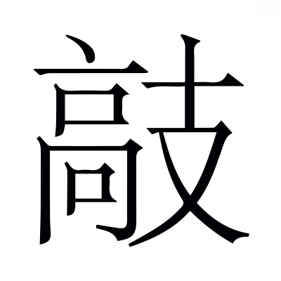
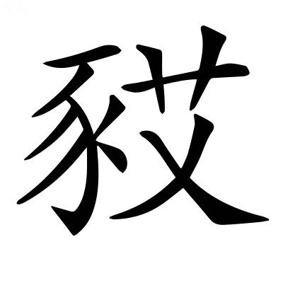
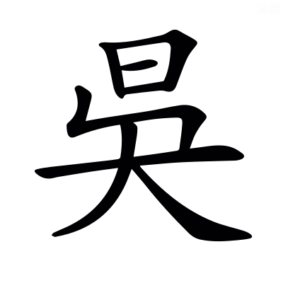

# 定公第十一

*〈定公·名宋襄公之子昭公之弟謚法安民大慮曰定〉*

## 定元年

> **元年春王** *公之始年而不書正月公即位在六月故*
> 
> **三月晉人執宋仲幾于京師** *〈仲幾·音機〉晉執人于天子之側而不以歸京師故但書其執不書所歸*
> 
> **夏六月癸亥公之喪至自乾侯** *告於廟故書至*
> 
> **戊辰公即位** *定公不得以正月即位失其時故詳而日之記事之宜無義例*
> 
> **秋七月癸巳葬我君昭公** *公在外薨故八月乃葬*
> 
> **九月大雩** *〈大雩·音于〉無傳過也*
> 
> **立煬宮** *〈煬宫·羊讓反〉煬公伯禽子也其廟已毀季氏禱之而立其宮書以譏之〈禱之·丁老反〉*
> 
> **冬十月隕霜殺菽** *〈隕霜·于敏反◎殺叔·本或作菽音同〉無傳周十月今八月隕霜殺菽非常之災*

**元年春王正月辛巳晉魏舒合諸侯之大夫于狄泉將以城成周魏子涖政** *〈涖政·音利又音類〉涖臨也代天子大夫為政* **衞彪傒** *衞大夫* **曰將建天子** *立天子之居* **而易位以令非義也大事奸義 *〈奸義·音干〉* 必有大咎 *〈大咎·其九反〉* 晉不失諸侯魏子其不免乎是行也魏獻子屬役於韓簡子及原壽過** *〈屬役·之欲反◎原壽過·古禾反〉簡子韓起孫不信也原壽過周大夫* **而田於大陸焚焉** *禹貢大陸在鉅鹿北嫌絕遠疑此田在汲郡吳澤荒蕪之地火田并見燒也爾雅廣平曰陸〈荒蕪·音無〉* **還卒於甯** *甯今脩武縣近吳澤〈近吳·附近之近〉* **范獻子去其柏椁 *〈去其·起吕反注同◎柏椁·音郭〉* 以其未復命而田也** *范獻子代魏子為政去其柏椁示貶之* **孟懿子會城成周** *不書公未即位* **庚寅栽** *〈庚寅栽·才代反又音再注同〉栽設板築* **宋仲幾不受功曰滕薛郳吾役也** *〈薛郳·五兮反小邾國〉欲使三國代宋受功役也郳小邾* **薛宰曰宋為無道絕我小國於周以我適楚故我常從宋晉文公為踐土之盟** *在僖二十八年* **曰凡我同盟各復舊職若從踐土若從宋亦唯命仲幾曰踐土固然** *固曰從舊薛舊為宋役* **薛宰曰薛之皇祖奚仲居薛以為夏車正** *〈為夏·戶雅反注同〉皇大也奚仲為夏禹掌車服大夫* **奚仲遷于邳** *〈于邳·皮悲反〉邳下邳縣* **仲虺居薛以為湯左相** *〈仲虺·許鬼反◎左相·息亮反〉仲虺奚仲之後* **若復舊職將承王官何故以役諸侯** *承奉也* **仲幾曰三代各異物薛焉得有舊** *〈薛焉·於虔反〉言居周世不得以夏殷為舊* **為宋役亦其職也士彌牟曰晉之從政者新** *言范獻子新為政未習故事* **子姑受功歸吾視諸故府** *求故事* **仲幾曰縱子忘之山川鬼神其忘諸乎** *山川鬼神盟所告* **士伯怒謂韓簡子曰薛徵於人** *典籍故事人所知也* **宋徵於鬼** *取證於鬼神* **宋罪大矣且己無辭而抑我以神誣我也啟寵納侮 *〈納侮·亡甫反〉* 其此之謂矣** *開寵過分則納受侵侮〈過分·扶問反〉* **必以仲幾為戮乃執仲幾以歸三月歸諸京師** *知以歸不可故復歸之京師〈故復·扶又反〉* **城三旬而畢乃歸諸侯之戍齊高張後不從諸侯** *後期不及諸侯之役* **晉女叔寬曰周萇弘齊高張皆將不免** *〈萇弘·直良反〉叔寬女寬也* **萇叔違天高子違人** *天既厭周德萇弘欲遷都以延其祚故曰違天諸侯相帥以崇天子而高子後期故曰違人〈旣厭·於豔反◎其祚·才故反〉* **天之所壞不可支也衆之所為不可奸也** *為哀三年周人殺萇弘六年高張來奔起*

**夏叔孫成子逆公之喪于乾侯** *成子叔孫婼之子* **季孫曰子家子亟言於我 *〈亟言·起冀反〉* 未嘗不中吾志也 *〈不中·丁仲反〉* 吾欲與之從政子必止之且聽命焉** *衆事皆諮問子家子* **子家子不見叔孫易幾而哭** *幾哭會也不欲見叔孫故朝夕哭不同會〈故朝夕·如字〉* **叔孫請見子家子子家子辭曰羈未得見而從君以出** *〈羈未·居冝反子家子名◎得見·賢遍反下同◎而從君·才用反注義從同又如字下從君從公放此〉出時成子未為卿* **君不命而薨羈不敢見** *言未受昭公之命託辭以距叔孫* **叔孫使告之曰公衍公為實使羣臣不得事君** *二子始謀逐季氏* **若公子宋主社稷則羣臣之願也** *宋昭公弟定公* **凡從君出而可以入者將唯子是聽子家氏未有後季孫願與子從政此皆季孫之願也使不敢以告** *不敢叔孫成子名* **對曰若立君則有卿士大夫與守龜在 *〈守龜·手又反〉* 羈弗敢知若從君者則貌而出者入可也** *貌出謂以義從公與季氏無實怨* **寇而出者行可也** *與季氏為寇讎者自可去* **若羈也則君知其出也** *君昭公* **而未知其入也羈將逃也喪及壞隤 *〈壞隤·徐音懷又戶怪反下徒回反〉* 公子宋先入從公者皆自壞隤反** *出奔* **六月癸亥公之喪至自乾侯戊辰公即位** *諸侯薨五日而殯殯則嗣子即位癸亥昭公喪至五日殯於宮定公乃即位* **季孫使役如闞公氏 *〈如闞·口暫反〉* 將溝焉** *闞魯羣公墓所在也季孫惡昭公欲溝絕其兆域不使與先君同〈惡昭·烏路反又如字〉* **榮鴐鵞曰 *〈鴐鵞·音加下五何反〉* 生不能事死又離之以自旌也** *〈自旌·音精〉鴐鵞魯大夫榮成伯也旌章也* **縱子忍之後必或恥之乃止季孫問於榮鴐鵞曰吾欲為君謚使子孫知之** *為惡謚* **對曰生弗能事死又惡之 *〈惡之·如字又烏路反〉* 以自信也將焉用之 *〈將焉·於虔反〉* 乃止秋七月癸巳葬昭公於墓道南孔子之為司寇也溝而合諸墓** *明臣無貶君之義*

**昭公出故季平子禱于煬公九月立煬宮** *平子逐君懼而請禱於煬公昭公死於外自以為獲福故立其宮*

**周鞏簡公弃其子弟 *〈鞏簡·九勇反〉* 而好用遠人** *〈而好·呼報反〉簡公周卿士遠人異族也為明年鞏氏賊簡公張本*

## 定二年

> **二年春王正月**
> 
> **夏五月壬辰雉門及兩觀災** *〈兩觀·古亂反注及下同〉無傳雉門公宮之南門兩觀闕也天火曰災*
> 
> **秋楚人伐吳** *囊瓦稱人見誘以敗軍〈囊瓦·乃郎反〉*
> 
> **冬十月新作雉門及兩觀** *無傳*

**二年夏四月辛酉鞏氏之羣子弟賊簡公** *傳言弃親用疏所以敗也*

**桐叛楚** *桐小國廬江舒縣西南有桐鄉* **吳子使舒鳩氏誘楚人** *舒鳩楚屬國* **曰以師臨我** *教舒鳩誘楚使以師臨吳* **我伐桐為我使之無忌** *〈為我·于偽反注及下同〉吳伐桐也偽若畏楚師之臨己而為伐其叛國以取媚者也欲使楚不忌吳所謂多方以誤之* **秋楚囊瓦伐吳師于豫章** *從舒鳩言* **吳人見舟于豫章** *〈見舟·賢遍反〉偽將為楚伐桐* **而潛師于巢** *實欲以擊楚* **冬十月吳軍楚師于豫章敗之** *楚不忌故* **遂圍巢克之獲楚公子繁** *繁守巢大夫*

**邾莊公與夷射姑飲酒私出** *〈夷射姑·音亦一音夜〉射姑邾大夫出辟酒* **閽乞肉焉 *〈閽·音昬守門人也〉* 奪之杖以敲之** *〈以敲·苦孝反又苦學反說文作云擊頭也字林同又一曰擊聲也口交反又口卓反訓此云橫撾也又或作茅或作刜口交反〉奪閽杖以敲閽頭也為明年邾子卒傳*

## 定三年

> **三年春王正月公如晉至河乃復** *無傳*
> 
> **二月辛卯邾子穿卒** *〈子穿·音川〉再同盟*
> 
> **夏四月**
> 
> **秋葬邾莊公** *六月乃葬緩*
> 
> **冬仲孫何忌及邾子盟于拔** *〈于拔·皮八反〉拔地闞*

**三年春二月辛卯邾子在門臺** *門上有臺* **臨廷 *〈臨廷·音庭下同〉* 閽以缾水沃廷 *〈缾水·步丁反本又作瓶〉* 邾子望見之怒閽曰夷射姑旋焉** *旋小便* **命執之** *見其不潔執射姑* **弗得滋怒自投于牀廢于鑪炭 *〈鑪·力吳反◎炭·他且反〉* 爛遂卒** *廢隋也〈隋也·徒火反〉* **先葬以車五乘殉五人** *〈先葬·息薦反又如字◎五乘·繩證反◎殉五人·辭俊反〉欲藏中之潔故先內車及殉別為便房蓋其遺命〈藏中·才浪反〉* **莊公卞急而好潔故及是** *〈卞急·皮彦反◎而好·呼報反下文及注同〉卞躁疾也〈躁疾·早報反〉*

**秋九月鮮虞人敗晉師于平中** *平中晉地* **獲晉觀虎恃其勇也** *為五年士鞅圍鮮虞張本*

**冬盟于郯** *〈于郯·音談〉郯即拔也* **脩邾好也** *公即位故脩好*

**蔡昭侯為兩佩與兩裘** *佩佩玉也* **以如楚獻一佩一裘於昭王昭王服之以享蔡侯蔡侯亦服其一子常欲之弗與三年止之唐成公如楚有兩肅爽馬 *〈肅爽·上如字又所六反下音霜肅爽駿馬名〉* 子常欲之** *成公唐惠侯之後肅爽駿馬名〈駿馬·音俊〉* **弗與亦三年止之唐人或相與謀請代先從者 *〈先從·才用反下同〉* 許之飲先從者酒 *〈飲先·於鴆反〉* 醉之竊馬而獻之子常子常歸唐侯自拘於司敗** *〈自拘·九于反〉竊馬者自拘* **曰君以弄馬之故 *〈弄馬·魯貢反〉* 隱君身** *隱憂約也* **弃國家羣臣請相夫人以償馬 *〈請相·息亮反注同◎夫人·音扶注同◎以償·市亮反〉* 必如之** *相助也夫人謂養馬者* **唐侯曰寡人之過也二三子無辱皆賞之蔡人聞之固請而獻佩于子常子常朝見蔡侯之徒命有司曰蔡君之久也官不共也** *〈不共·音恭注同〉言楚所以禮遣蔡侯之物不共備故* **明日禮不畢將死** *遣蔡侯之禮* **蔡侯歸及漢執玉而沈 *〈而沈·音鴆〉* 曰余所有濟漢而南者有若大川** *自誓言若復渡漢當受禍明如大川〈若復·扶又反〉* **蔡侯如晉以其子元與其大夫之子為質焉 *〈為質·音致〉* 而請伐楚** *為明年會召陵張本*

## 定四年

> **四年春王二月癸巳陳侯吳卒** *無傳未同盟而赴以名癸巳正月七日書二月從赴*
> 
> **三月公會劉子晉侯宋公蔡侯衞侯陳子鄭伯許男曹伯莒子邾子頓子胡子滕子薛伯杞伯小邾子齊國夏于召陵侵楚** *〈國夏·戶雅反◎召陵·上照反〉於召陵先行會禮入楚竟故書侵〈楚竟·音境〉*
> 
> **夏四月庚辰蔡公孫姓帥師滅沈以沈子嘉歸殺之** *〈公孫生·本又作姓音生〉*
> 
> **五月公及諸侯盟于皐鼬** *〈皐鼬·由又反〉召陵會劉子諸侯揔言之也繁昌縣東南有城皐亭復稱公者會盟異處故〈復稱·扶又反◎異處·昌慮反〉*
> 
> **杞伯成卒于會** *〈伯成·音城〉無傳*
> 
> **六月葬陳惠公** *無傳*
> 
> **許遷于容城** *無傳*
> 
> **秋七月公至自會** *無傳*
> 
> **劉卷卒** *〈劉卷·音權一音眷勉反〉無傳即劉蚠也劉子奉命出盟召陵死則天王為告同盟故不具爵〈劉蚠·扶粉反◎為告·于偽反下吳為蔡同〉*
> 
> **葬杞悼公** *無傳*
> 
> **楚人圍蔡** *不服故也*
> 
> **晉士鞅衞孔圉帥師伐鮮虞** *〈孔圉·魚吕反〉無傳孔圉孔羈孫士鞅即范鞅*
> 
> **葬劉文公** *無傳*
> 
> **冬十有一月庚午蔡侯以吳子及楚人戰于柏舉楚師敗績** *師能左右之曰以皆陳曰戰大崩曰敗績吳為蔡討楚從蔡計謀故書蔡侯以吳子言能左右之也囊瓦稱人貪以致敗不能死難罪賤之柏舉楚地昭三十一年傳曰六年十二月庚辰吳其入郢今以十一月者并數閏〈皆陳·直覲反◎死難·乃旦反◎并數·所主反〉* **楚囊瓦出奔鄭** *書名惡之〈惡之·烏路反〉* **庚辰吳入郢** *弗地曰入吳不稱子史略文*

**四年春三月劉文公合諸侯于召陵謀伐楚也** *文公王官伯也晉人假王命以討楚之久留蔡侯故曰文公合諸侯* **晉荀寅求貨於蔡侯弗得言於范獻子曰國家方危諸侯方貳將以襲敵不亦難乎水潦方降 *〈水潦·音老〉* 疾瘧方起 *〈疾瘧·魚略反〉* 中山不服** *中山鮮虞* **弃盟取怨無損於楚** *晉楚同盟伐之為取怨* **而失中山不如辭蔡侯吾自方城以來楚未可以得志** *晉敗楚侵方城在襄十六年* **祗取勤焉 *〈祗取·音支〉* 乃辭蔡侯晉人假羽旄於鄭 *〈羽旄·音毛〉* 鄭人與之** *析羽為旌王者遊車之所建鄭私有之因謂之羽旄借觀之〈析羽·星歷反下放此〉* **明日或旆以會** *〈或旆·步貝反〉或賤者也繼旐曰旆令賤人施其旆執以從會示卑鄭〈旐·音兆◎令賤·力呈反下欲令蔡同〉* **晉於是乎失諸侯** *傳言晉無禮所以遂弱* **將會衞子行敬子言於靈公** *子行敬子衞大夫* **曰會同難** *難得宜* **嘖有煩言 *〈嘖有·仕責反至也一音責〉* 莫之治也** *嘖至也煩言忿爭〈忿爭·爭鬭之爭〉* **其使祝佗從** *〈祝佗·徒河反◎從·才用反下師從旅從同〉祝佗大祝子魚〈大祝·音泰下大祝大卜大史大原同〉* **公曰善乃使子魚子魚辭曰臣展四體以率舊職猶懼不給而煩刑書若又共二** *〈共二·音恭注同〉共二職* **儌大罪也 *〈徼大·古堯反〉* 且夫祝社稷之常隸也** *〈且夫祝·音扶〉隸賤臣也* **社稷不動祝不出竟 *〈出竟·音境下同〉* 官之制也** *社稷動謂國遷* **君以軍行祓社釁鼓** *〈祓社·音弗徐音廢◎釁鼓·許靳反〉師出先有事祓禱於社謂之宜社於是殺牲以血塗鼓鼙為釁鼓〈鼓鞞·步西反本又作鼙〉* **祝奉以從** *〈以從·如字又才用反〉奉社主也* **於是乎出竟若嘉好之事** *〈嘉好·呼報反〉謂朝會* **君行師從** *二千五百人* **卿行旅從** *五百人* **臣無事焉公曰行也及皐鼬** *將盟* **將長蔡於衞** *〈將長·丁丈反〉欲令蔡先衞歃〈欲令·力呈反◎先衞·悉薦反下文先衞同◎歃也·所洽反又所甲反〉* **衞侯使祝佗私於萇弘曰聞諸道路不知信否若聞蔡將先衞信乎萇弘曰信蔡叔康叔之兄也** *蔡叔周公兄康叔周公弟* **先衞不亦可乎子魚曰以先王觀之則尚德也昔武王克商成王定之選建明德以蕃屏周 *〈以蕃·方元反〉* 故周公相王室 *〈相王·悉亮反〉* 以尹天下** *尹正也* **於周為睦** *睦親厚也以盛德見親厚* **分魯公以大路大旂** *〈分魯公·扶問反下並同◎大輅·音路本亦作路大輅金路也下皆同◎大旂·其依反交龍為旂諸侯所建〉魯公伯禽也此大路金路錫同姓諸侯車也交龍為旂周禮同姓以封〈錫·星歷反錫同姓也〉* **夏后氏之璜** *〈夏后·户雅反下音同◎之璜·音黄美玉名〉璜美玉名* **封父之繁弱** *〈封父·音甫下武父同封父國名◎繁弱·扶元反繁弱弓名〉封父古諸侯也繁弱大弓名* **殷民六族條氏徐氏蕭氏索氏長勺氏尾勺氏 *〈索·素洛反下同◎長勺·市灼反下同〉* 使帥其宗氏輯其分族 *〈輯其·音集又七入反〉* 將其類醜** *醜衆也* **以法則周公用即命于周** *即就也使六族就周受周公之法制* **是使之職事于魯** *共魯公之職事〈共魯·音恭下文以共王職同〉* **以昭周公之明德** *昭顯也* **分之土田陪敦** *〈倍敦·本亦作陪同步回反〉陪增也敦厚也* **祝宗卜史** *大祝宗人大卜大史凡四官* **備物典策** *〈典莢·本又作𠕋亦作策或作笧皆初革反〉典策春秋之制* **官司彝器** *〈彞器·羊之反〉官司百官也彝器常用器* **因商奄之民** *商奄國名也與四國流言或迸散在魯皆令即屬魯懷柔之〈迸散·彼諍反◎皆令·徐力呈反〉* **命以伯禽** *伯禽周公世子時周公唯遣伯禽之國故皆以付伯禽* **而封於少暭之虛** *〈少皡·詩照反注及下同下胡老反◎之虚·起居反注及下皆同〉少暭虛曲阜也在魯城內* **分康叔** *康叔衞之祖* **以大路少帛綪茷旃旌** *〈綪·七見反◎茷·步貝反又音吠◎旃旌·章然反〉少帛雜帛也綪茷大赤取染草名也通帛為旃析羽為旌* **大呂** *鐘名* **殷民七族陶氏施氏繁氏錡氏樊氏饑氏終葵氏 *〈陶氏·徒刀反◎繁氏·步河反◎錡氏·魚綺反〉* 封畛土略 *〈封畛·之忍反一音眞〉* 自武父以南及圃田之北竟** *〈甫田·布五反本亦作圃同〉畛塗所徑也略界也武父衞北界圃田鄭藪名〈塗所徑·音徒下音經◎鄭藪·素口反〉* **取於有閻之土以共王職** *有閻衞所受朝宿邑蓋近京畿〈蓋近·附近之近下近戎同〉* **取於相土之東都 *〈相土·息亮反〉* 以會王之東蒐** *〈東蒐·所求反〉為湯沐邑王東巡狩以助祭泰山〈巡守·手又反〉* **聃季授土** *〈聃季·乃甘反〉聃季周公弟司空* **陶叔授民** *陶叔司徒* **命以康誥而封於殷虛** *康誥周書殷虛朝歌也* **皆啟以商政疆以周索** *〈疆以·居良反注及下同〉皆魯衞也啟開也居殷故地因其風俗開用其政疆理土地以周法索法也* **分唐叔** *唐叔晉之祖* **以大路密須之鼓** *密須國名* **闕鞏** *〈闕鞏·九勇反甲名〉甲名* **沽洗** *〈沽洗·鍾名上音孤下音息典反〉鐘名* **懷姓九宗職官五正** *懷姓唐之餘民九宗一姓為九族職官五正五官之長〈之長·丁丈反下文乃長䘙同〉* **命以唐誥而封於夏虛** *唐誥誥命篇名也夏虛大夏今大原晉陽也* **啟以夏政** *亦因夏風俗開用其政* **疆以戎索** *大原近戎而寒不與中國同故自以戎法* **三者皆叔也而有令德故昭之以分物不然文武成康之伯猶多而不獲是分也唯不尚年也管蔡啟商惎間王室** *〈惎·音忌毒也◎閒王·閒厠之閒〉惎毒也周公攝政管叔蔡叔開道紂子祿父以毒亂王室〈道紂·音導〉* **王於是乎殺管叔而蔡蔡叔** *〈蔡蔡叔·上素達反放也注同下蔡叔如字〉周公稱王命以討二叔蔡放也* **以車七乘徒七十人** *〈七乘·繩證反〉與蔡叔車徒而放之* **其子蔡仲改行帥德 *〈改行·下孟反〉* 周公舉之以為己卿士** *為周公臣* **見諸王 *〈見諸·賢遍反〉* 而命之以蔡** *命為蔡侯* **其命書云王曰胡無若爾考之違王命也** *胡蔡仲名* **若之何其使蔡先衞也武王之母弟八人周公為大宰康叔為司寇聃季為司空五叔無官豈尚年哉** *五叔管叔鮮蔡叔度成叔武霍叔處毛叔聃也* **曹文之昭也** *〈之昭·上饒反說文作紹〉文王子與周公異母* **晉武之穆也** *武王子* **曹為伯甸非尚年也** *〈伯甸·徒練反〉以伯爵居甸服言小* **今將尚之是反先王也晉文公為踐土之盟衞成公不在夷叔其母弟也猶先蔡** *踐土召陵二會經書蔡在衞上霸主以國大小之序也子魚所言盟歃之次* **其載書云王若曰晉重** *〈晉重·直龍反〉文公* **魯申** *僖公* **衞武** *叔武* **蔡甲午** *莊侯* **鄭捷** *〈鄭捷·在接反〉文公* **齊潘** *〈齊潘·普安反〉昭公* **宋王臣** *〈宋王臣·如字本或作壬如林反〉成公* **莒期** *茲丕公也齊序鄭下周之宗盟異姓為後〈玆丕·普悲反〉* **藏在周府可覆視也 *〈可覆·芳服反〉* 吾子欲復文武之略** *略道也* **而不正其德將如之何萇弘說 *〈弘說·音悅〉* 告劉子與范獻子謀之乃長衞侯於盟**

**反自召陵鄭子大叔未至而卒晉趙簡子為之臨 *〈為之·于偽反下楚為沈同◎臨·力鴆反〉* 甚哀曰黃父之會** *〈黃父·音甫〉在昭二十五年* **夫子語我九言 *〈語我·魚據反〉* 曰無始亂無怙富 *〈無怙·音户〉* 無恃寵無違同無敖禮 *〈無敖·五報反〉* 無驕能** *以能驕人* **無復怒** *〈無復怒·扶又反重也注同〉復重也* **無謀非德** *非所謀也* **無犯非義** *傳言簡子能用善言所以遂興*

**沈人不會于召陵晉人使蔡伐之夏蔡滅沈**

**秋楚為沈故圍蔡伍員為吳行人以謀楚 *〈伍員·音云〉* 楚之殺郤宛也** *在昭二十七年* **伯氏之族出** *郤宛黨* **伯州犂之孫嚭為吳大宰以謀楚 *〈州犂·力兮反◎嚭·普鄙反〉* 楚自昭王即位無歲不有吳師蔡侯因之以其子乾 *〈子乾·其連反〉* 與其大夫之子為質於吳 *〈為質·音致〉* 冬蔡侯吳子唐侯伐楚** *唐侯不書兵屬於吳蔡* **舍舟于淮汭** *〈舍舟·音赦置也又音捨弃也注同◎淮汭·人銳反〉吳乘舟從淮來過蔡而舍之* **自豫章與楚夾漢** *〈夾漢·古洽反〉豫章漢東江北地名* **左司馬戌謂子常曰子沿漢而與之上下** *〈㳂漢·悅全反◎上下·時掌反注同〉沿緣也緣漢上下遮使勿度〈遮使·正奢反〉* **我悉方城外以毀其舟** *以方城外人毀吳所舍舟* **還塞大隧 *〈大隧·音遂〉* 直轅冥阨** *〈冥·亡丁反本或作寘之豉反◎阨·於懈反本或作隘音同〉三者漢東之隘道* **子濟漢而伐之我自後擊之必大敗之既謀而行武城黑謂子常** *黑楚武城大夫* **曰吳用木也我用革也** *用軍器* **不可久也不如速戰史皇謂子常楚人惡子而好司馬** *〈惡子·烏路反◎而好·呼報反〉史皇楚大夫司馬沈尹戌* **若司馬毀吳舟于淮塞城口而入** *城口三隘道之揔名* **是獨克吳也子必速戰不然不免乃濟漢而陳 *〈而陳·直覲反下文及注同〉* 自小別至于大別** *禹貢漢水至大別南入江然則此二別在江夏界〈江夏·戶雅反〉* **三戰子常知不可欲奔** *知吳不可勝* **史皇曰安求其事** *求知政事* **難而逃之 *〈難而·乃旦反〉* 將何所入子必死之初罪必盡說** *言致死以克吳可以免貪賄致寇之罪* **十一月庚午二師陳于柏舉** *經所以書戰二師吳楚師* **闔廬之弟夫槩王晨請於闔廬曰楚瓦不仁** *瓦子常名* **其臣莫有死志先伐之其卒必奔 *〈其卒·子忽反下同〉* 而後大師繼之必克弗許夫槩王曰所謂臣義而行不待命者其此之謂也今日我死楚可入也以其屬五千先擊子常之卒子常之卒奔楚師亂吳師大敗之子常奔鄭史皇以其乘廣死** *〈其乘·繩證反◎廣死·古曠反〉以戰死* **吳從楚師及清發** *清發水名* **將擊之夫槩王曰困獸猶鬭況人乎若知不免而致死必敗我若使先濟者知免後者慕之蔑有鬭心矣半濟而後可擊也從之又敗之楚人為食吳人及之奔食而從之敗諸雍澨 *〈雍澨·市制反〉* 五戰及郢** *奔食食者走不陳故不在戰數* **己卯楚子取其妹季芈畀我以出 *〈季芈·面彌反楚姓◎畀我·必利反世族譜季芈畀我皆平王女也服云畀我季芈之字〉* 涉雎** *〈涉睢·七餘反下同〉雎水出新城昌魏縣東南至枝江縣入江是楚王西走* **鍼尹固與王同舟 *〈鍼尹·之林反〉* 王使執燧象以奔吳師** *〈燧象·音遂火燧以繫象尾〉燒火燧繫象尾使赴吳師驚却之* **庚辰吳入郢以班處宮** *以尊卑班次處楚王宮室* **子山處令尹之宮** *子山吳王子* **夫槩王欲攻之懼而去之夫槩王入之** *入令尹宮也言吳無禮所以不能遂克* **左司馬戌及息而還** *息汝南新息也聞楚敗故還* **敗吳師于雍澨傷** *司馬先敗吳師而身被創〈被創·初良反〉* **初司馬臣闔廬故恥為禽焉** *司馬嘗在吳為闔廬臣是以今恥於見禽* **謂其臣曰誰能免吾首吳句卑曰 *〈吳句·古侯反〉* 臣賤可乎司馬曰我實失子可哉** *失不知子賢* **三戰皆傷曰吾不可用也已句卑布裳剄而裹之** *〈剄而·古頂反◎裹之·音果〉司馬已死剄取其首* **藏其身而以其首免** *傳言司馬之忠壯* **楚子涉雎濟江入于雲中** *入雲夢澤中所謂江南之夢〈雲夢·如字又音蒙〉* **王寢盜攻之以戈擊王王孫由于以背受之中肩 *〈中肩·丁仲反〉* 王奔鄖 *〈奔鄖·音云〉* 鍾建負季芈以從** *〈以從·才用反下同一音如字〉鍾建楚大夫* **由于徐蘇而從** *以背受戈故當時悶絕* **鄖公辛之弟懷將弒王 *〈將殺·如字又申志反下我殺同〉* 曰平王殺吾父我殺其子不亦可乎** *辛蔓成然之子鬭辛也昭十四年楚平王殺成然〈蔓成·音萬〉* **辛曰君討臣誰敢讎之君命天也若死天命將誰讎詩曰柔亦不茹 *〈不茹·音汝〉* 剛亦不吐不侮矜寡 *〈矜寡·古頑反〉* 不畏彊禦唯仁者能之** *詩大雅言仲山甫不辟彊陵弱* **違彊陵弱非勇也乘人之約非仁也滅宗廢祀非孝也** *弒君罪應滅宗* **動無令名非知也 *〈非知·音智〉* 必犯是余將殺女 *〈殺女·音汝〉* 鬭辛與其弟巢以王奔隨吳人從之謂隨人曰周之子孫在漢川者楚實盡之天誘其衷 *〈其衷·音忠〉* 致罰於楚而君又竄之** *〈又竄·七亂反〉竄匿也〈竄匿·女力反〉* **周室何罪君若顧報周室施及寡人 *〈施及·以豉反〉* 以獎天衷** *獎成也* **君之惠也漢陽之田君實有之楚子在公宮之北** *隨公宮也* **吳人在其南子期似王** *子期昭王兄公子結也* **逃王而己為王曰以我與之王必免隨人卜與之不吉乃辭吳曰以隨之辟小 *〈之辟·匹亦反〉* 而密邇於楚楚實存之世有盟誓至于今未改若難而弃之 *〈若難·乃旦反〉* 何以事君執事之患不唯一人** *一人楚王* **若鳩楚竟 *〈楚竟·音境〉* 敢不聽命吳人乃退** *鳩安集也* **鑢金初宦於子期氏 *〈鑢金·音慮氏也金名本又作鑪〉* 實與隨人要言** *要言無以楚王與吳并欲脫子期* **王使見** *〈使見·賢遍反下注敢見同〉王喜其意欲引見之以比王臣且欲使盟隨人* **辭曰不敢以約為利** *〈以約·如字又於妙反〉此約謂要言也此一時之事非為德舉故辭不敢見亦不肯為盟主* **王割子期之心以與隨人盟** *當心前割取血以盟示其至心* **初伍員與申包胥友** *〈申包·必交反〉包胥楚大夫* **其亡也謂申包胥曰我必復楚國** *復報也* **申包胥曰勉之子能復之我必能興之及昭王在隨申包胥如秦乞師曰吳為封豕長蛇以荐食上國** *〈以荐·在薦反〉荐數也言吳貪害如蛇豕〈荐數也·所角反〉* **虐始於楚寡君失守社稷越在草莽 *〈草茅·舊作茅亡交反今本多作莽莫蕩反下同〉* 使下臣告急曰夷德無厭 *〈無厭·於鹽反〉* 若鄰於君疆埸之患也** *〈疆·居良反◎埸·音亦〉吳有楚則與秦鄰* **逮吳之未定 *〈逮吳·音代〉* 君其取分焉** *〈取分·扶問反〉與吳共分楚地* **若楚之遂亡君之土也若以君靈撫之世以事君** *撫存恤也* **秦伯使辭焉曰寡人聞命矣子姑就館將圖而告對曰寡君越在草莽未獲所伏** *伏猶處也* **下臣何敢即安立依於庭牆而哭日夜不絕聲勺飲不入口七日 *〈勺飲·市灼反又音灼〉* 秦哀公為之賦無衣** *〈為之·于偽反〉詩秦風取其王于興師脩我戈矛與子同仇與子偕作與子偕行〈同仇·音求〉* **九頓首而坐** *無衣三章章三頓首* **秦師乃出** *為明年包胥以秦師至張本*

## 定五年

> **五年春王三月辛亥朔日有食之** *無傳*
> 
> **夏歸粟于蔡** *蔡為楚所圍飢乏故魯歸之粟*
> 
> **於越入吳** *於發聲也*
> 
> **六月丙申季孫意如卒**
> 
> **秋七月壬子叔孫不敢卒** *無傳*
> 
> **冬晉士鞅帥師圍鮮虞**

**五年春王人殺子朝于楚** *因楚亂也終閔馬父之言*

**夏歸粟于蔡以周亟矜無資** *〈周亟·紀力反注同〉亟急也*

**越入吳吳在楚也**

**六月季平子行東野** *〈行東野·下孟反下桓子行同〉東野季氏邑* **還未至丙申卒于房陽虎將以璵璠斂** *〈璵·本又作與音餘◎璠·音煩又方煩反◎斂·力驗反〉璵璠美玉君所佩* **仲梁懷弗與** *懷亦季氏家臣* **曰改步改玉** *昭公之出季孫行君事佩璵璠祭宗廟今定公立復臣位改君步則亦當去璵璠〈當去·起吕反〉* **陽虎欲逐之告公山不狃 *〈不狃·女九反〉* 不狃曰彼為君也 *〈彼為·于偽反注同〉* 子何怨焉** *不狃季氏臣費宰子洩也為君不欲使僭〈子洩·息列反◎使僭·子念反〉* **既葬桓子行東野** *桓子意如子季孫斯* **及費子洩為費宰逆勞於郊 *〈逆勞·力報反下同〉* 桓子敬之勞仲梁懷仲梁懷弗敬** *懷時從桓子行輕慢子洩〈時從·才用反下從父昆弟皆從王並同〉* **子洩怒謂陽虎子行之乎** *行逐懷也為下陽虎囚桓子起*

**申包胥以秦師至秦子蒲子虎帥車五百乘以救楚** *〈百乘·繩證反注同〉五百乘三萬七千五百人* **子蒲曰吾未知吳道** *道猶法術* **使楚人先與吳人戰而自稷會之大敗夫槩王于沂** *〈于沂·魚依反〉稷沂皆楚地* **吳人獲薳射於柏舉** *〈薳射·食亦反又食夜反〉薳射楚大夫* **其子帥奔徒** *奔徒楚散卒〈散卒·子忽反〉* **以從子西敗吳師於軍祥** *楚地* **秋七月子期子蒲滅唐** *從吳伐楚故* **九月夫槩王歸自立也以與王戰而敗** *自立為吳王號夫槩* **奔楚為堂谿氏** *〈堂谿·芳兮反下同〉傳終言之* **吳師敗楚師于雍澨秦師又敗吳師吳師居麇** *〈居麇·九倫反下同〉麇地名* **子期將焚之子西曰父兄親暴骨焉 *〈暴骨·步卜反〉* 不能收又焚之不可** *前年楚人與吳戰多死麇中言不可并焚* **子期曰國亡矣死者若有知也可以歆舊祀** *〈以歆·許金反〉言焚吳復楚則祭祀不廢* **豈憚焚之焚之而又戰吳師敗又戰于公壻之谿** *楚地名* **吳師大敗吳子乃歸囚闉輿罷 *〈闉·音因◎輿·音餘本又作與羊汝反◎輿罷·音皮〉* 闉輿罷請先遂逃歸** *輿罷楚大夫請先至吳而逃歸言吳唯得楚一大夫復失之所以不克〈復失·扶又反〉* **葉公諸梁之弟后臧從其母於吳 *〈葉公·舒涉反◎從其母·如字又才用反〉* 不待而歸** *諸梁司馬沈尹戌之子葉公子高也吳入楚獲后臧之母楚定臧弃母而歸* **葉公終不正視** *不義之*

**乙亥陽虎囚季桓子及公父文伯** *〈公父·音甫〉文伯季桓子從父昆弟也陽虎欲為亂恐二子不從故囚之* **而逐仲梁懷冬十月丁亥殺公何藐** *〈公何藐·亡角反一音彌小反〉藐季氏族* **己丑盟桓子于稷門之內** *魯南城門* **庚寅大詛 *〈大詛·莊慮反〉* 逐公父歜及秦遄 *〈父歜·昌欲反◎秦遄·市專反〉* 皆奔齊** *歜即文伯也秦遄平子姑壻也傳言季氏之亂*

**楚子入于郢** *吳師已歸* **初鬭辛聞吳人之爭宮也曰吾聞之不讓則不和不和不可以遠征吳爭於楚必有亂有亂則必歸焉能定楚 *〈焉能·於虔反〉* 王之奔隨也將涉於成臼** *〈成臼·其九反〉江夏竟陵縣西有臼水出聊屈山西南入漢〈聊屈·其勿反又君勿反〉* **藍尹亹涉其帑** *〈藍尹·力甘反◎亹·亡匪反◎其帑·音奴〉亹楚大夫* **不與王舟及寧王欲殺之** *寧安定也* **子西曰子常唯思舊怨以敗君何效焉王曰善使復其所吾以志前惡** *惡過也* **王賞鬭辛王孫由于王孫圉鍾建鬭巢申包胥王孫賈宋木鬭懷** *九子皆從王有大功者* **子西曰請舍懷也** *〈舍·音捨又音赦〉以初謀弒王也〈謀殺·申志反〉* **王曰大德滅小怨道也** *終從其兄免王大難是大德〈大難·乃旦反〉* **申包胥曰吾為君也 *〈為君·于偽反下為身同〉* 非為身也君既定矣又何求且吾尤子旗其又為諸** *子旗蔓成然也以有德於平王求欲無厭平王殺之在昭十四年〈無厭·於鹽反〉* **遂逃賞王將嫁季芈季芈辭曰所以為女子遠丈夫也 *〈遠丈·于萬反〉* 鍾建負我矣以妻鍾建 *〈以妻·七細反〉* 以為樂尹** *司樂大夫* **王之在隨也子西為王輿服以保路國于脾洩** *〈脾洩·婢支反下息列反脾洩地名〉脾洩楚邑也失王恐國人潰散故偽為王車服立國脾洩以保安道路人* **聞王所在而後從王王使由于城麇** *於麇築城* **復命子西問高厚焉弗知子西曰不能如辭** *言自知不能當辭勿行* **城不知高厚小大何知對曰固辭不能子使余也人各有能有不能王遇盜於雲中余受其戈其所猶在袒而示之背 *〈袒而·音但〉* 曰此余所能也脾洩之事余亦弗能也** *傳言昭王所以復國有賢臣也*

**晉士鞅圍鮮虞報觀虎之敗也** *三年鮮虞獲晉觀虎*

## 定六年

> **六年春王正月癸亥鄭游速帥師滅許以許男斯歸** *游速大叔子*
> 
> **二月公侵鄭**
> 
> **公至自侵鄭** *無傳*
> 
> **夏季孫斯仲孫何忌如晉**
> 
> **秋晉人執宋行人樂祁犂** *〈祁犂·力兮反又力之反〉稱行人言非其罪*
> 
> **冬城中城** *無傳公為晉侵鄭故懼而城之〈公為·于偽反〉*
> 
> **季孫斯仲孫忌帥師圍鄆** *〈圍鄆·音運〉無傳何忌不言何闕文鄆貳於齊故圍之*

**六年春鄭滅許因楚敗也**

**二月公侵鄭取匡為晉討鄭之伐胥靡也** *〈為晉·于偽反注同〉胥靡周地也周儋翩因鄭人以作亂鄭為之伐胥靡故晉使魯討之匡鄭地取匡不書歸之晉〈儋翩·丁甘反下音篇〉* **往不假道於衞及還陽虎使季孟自南門入出自東門** *陽虎將逐三桓欲使得罪於鄰國* **舍於豚澤 *〈豚澤·杜孫反〉* 衞侯怒使彌子瑕追之** *彌子瑕衞嬖大夫〈嬖大夫·必計反〉* **公叔文子老矣** *文子公叔發* **輦而如公曰尤人而效之非禮也昭公之難 *〈之難·乃旦反〉* 君將以文之舒鼎** *衞文公之鼎* **成之昭兆** *寶龜* **定之鞶鑑** *〈盤鑑·盤又作鞶步丹反又蒲官反下古暫反〉鞶帶而以鏡為飾也今西方羌胡猶然古之遺服* **苟可以納之擇用一焉公子與二三臣之子諸侯苟憂之將以為之質** *為質求納魯昭公〈為質·音致注同〉* **此羣臣之所聞也今將以小忿蒙舊德** *蒙覆也* **無乃不可乎大姒之子** *〈大姒·音泰下音似〉大姒文王妃* **唯周公康叔為相睦也而效小人以弃之不亦誣乎天將多陽虎之罪以斃之君姑待之若何乃止** *止不伐魯師*

**夏季桓子如晉獻鄭俘也** *〈鄭俘·芳夫反〉獻此春取匡之俘* **陽虎強使孟懿子往報夫人之幣** *〈強使·其丈反注同下放此〉虎欲困辱三桓并求媚於晉故強使正卿報晉夫人之聘* **晉人兼享之** *賤魯故不復兩設禮明經所以不備書〈不復·扶又反〉* **孟孫立于房外謂范獻子曰陽虎若不能居魯而息肩於晉所不以為中軍司馬者有如先君** *稱先君以徵其言若欲使晉必厚待之* **獻子曰寡君有官將使其人** *擇得其人* **鞅何知焉獻子謂簡子曰魯人患陽虎矣孟孫知其釁 *〈其釁·許靳反〉* 以為必適晉故強為之請 *〈為之·于偽反〉* 以取入焉** *欲令晉人聞虎當逃走故強設請託之辭因此言以入晉令晉素知之〈欲令·力呈反〉*

**四月己丑吳大子終纍敗楚舟師** *〈終纍·力追反又力軌反〉終纍闔廬子夫差兄舟師水戰〈夫差·音扶下初佳反〉* **獲潘子臣小惟子** *〈小惟子·位悲反本又作帷亦如字〉二子楚舟師之帥〈之帥·所類反〉* **及大夫七人楚國大惕 *〈大惕·他歷反〉* 懼亡子期又以陵師敗于繁揚** *陵師陸軍* **令尹子西喜曰乃今可為矣** *言知懼而後可治* **於是乎遷郢於鄀 *〈於鄀·音若〉* 而改紀其政以定楚國** *傳言楚賴子西以安*

**周儋翩率王子朝之徒因鄭人將以作亂于周** *儋翩子朝餘黨* **鄭於是乎伐馮滑胥靡負黍狐人闕外** *鄭伐周六邑在魯伐鄭取匡前於此見者為戍周起也陽城縣西南有負黍亭〈此見·賢遍反下文見溷并注同◎為戍·于偽反下同〉*

**六月晉閻沒戍周且城胥靡** *為下天王出居姑蕕起*

**秋八月宋樂祁言於景公曰諸侯唯我事晉今使不往 *〈今使·所吏反〉* 晉其憾矣 *〈其憾·戶暗反〉* 樂祁告其宰陳寅** *以與公言告之* **陳寅曰必使子往他日公謂樂祁曰唯寡人說子之言 *〈說子·音悅〉* 子必往陳寅曰子立後而行吾室亦不亡** *寅知晉政多門往必有難故使樂祁立後而行〈有難·乃旦反下文同〉* **唯君亦以我為知難而行也見溷而行** *〈見溷·侯温反又侯困反〉溷樂祁子也見於君立以為後* **趙簡子逆而飲之酒於緜上 *〈飲之·於鴆反〉* 獻楊楯六十於簡子** *〈楊楯·食允反又音允〉楊木名* **陳寅曰昔吾主范氏今子主趙氏又有納焉以楊楯賈禍 *〈賈禍·音古〉* 弗可為也已** *知范氏必怨將得禍* **然子死晉國子孫必得志於宋** *以其為國死〈為國·于偽反下同〉* **范獻子言於晉侯曰以君命越疆而使 *〈越疆·居良反◎而使·所吏反下同〉* 未致使而私飲酒不敬二君不可不討也乃執樂祁** *獻子怒祁比趙氏經所以稱行人〈比趙·毗志反〉*

**陽虎又盟公及三桓於周社盟國人于亳社 *〈亳社·步各反〉* 詛于五父之衢** *〈詛于·側慮反◎五父·音甫◎之衢·其俱反〉傳言三桓微陪臣專政為八年陽虎作亂起*

**冬十二月天王處于姑蕕** *〈姑蕕·音由又作猶一音由舊反〉姑蕕周地* **辟儋翩之亂也** *為明年單劉逆王起〈單劉·音善〉*

## 定七年

> **七年春王正月**
> 
> **夏四月秋齊侯鄭伯盟于鹹** *〈于鹹·音咸〉衞地*
> 
> **齊人執衞行人北宮結以侵衞** *稱行人非使人之罪〈非使·所吏反〉*
> 
> **齊侯衞侯盟于沙** *〈于沙·如字又星和反〉結叛晉也陽平元城縣東南有沙亭*
> 
> **大雩** *無傳過也*
> 
> **齊國夏帥師伐我西鄙** *夏國佐孫*
> 
> **九月大雩** *無傳過也*
> 
> **冬十月**

**七年春二月周儋翩入于儀栗以叛** *儀栗周邑*

**齊人歸鄆陽關陽虎居之以為政** *鄆陽關皆魯邑中貳於齊齊今歸之不書虎專之〈中貳·丁仲反〉*

**夏四月單武公** *穆公子* **劉桓公** *文公子* **敗尹氏于窮谷** *尹氏復黨儋翩共為亂也〈復黨·扶又反〉*

**秋齊侯鄭伯盟于鹹徵會于衞** *徵召也* **衞侯欲叛晉** *屬齊鄭也* **諸大夫不可使北宮結如齊而私於齊侯曰執結以侵我** *欲以齊師懼諸大夫* **齊侯從之乃盟于瑣** *〈瑣·素果反〉瑣即沙也為明年涉佗捘衞侯手起〈涉佗·徒何反◎捘·子對反〉*

**齊國夏伐我** *齊叛晉故* **陽虎御季桓子公斂處父御孟懿子** *〈公斂·力檢反又音廉或音慮㸃反〉處父孟氏家臣成宰公斂陽* **將宵軍齊師齊師聞之墮伏而待之** *〈墮伏·許規反〉墮毀其軍以誘敵而設伏兵* **處父曰虎不圖禍而必死** *而女也〈而女·音汝下文同〉* **苫夷曰 *〈苫荑·始占反〉* 虎陷二子於難** *〈於難·乃旦反〉苫夷季氏家臣二子季孟* **不待有司余必殺女虎懼乃還不敗** *傳言陪臣強能自相制季孟不敢有心*

**冬十一月戊午單子劉子逆王于慶氏** *慶氏守姑蕕大夫* **晉籍秦送王己巳王入于王城** *己巳十二月五日有日無月* **館于公族黨氏** *〈黨氏·音掌〉黨氏周大夫* **而後朝于莊宮** *莊王廟也*

## 定八年

> **八年春王正月公侵齊** *報前年伐我西鄙*
> 
> **公至自侵齊** *無傳*
> 
> **二月公侵齊** *未得志故*
> 
> **三月公至自侵齊** *無傳*
> 
> **曹伯露卒** *無傳四年盟皐鼬〈皐鼬·由又反〉*
> 
> **夏齊國夏帥師伐我西鄙** *〈國夏·户雅反年末注同〉*
> 
> **公會晉師于瓦** *〈于瓦·顔寡反〉瓦衞地將來救魯公逆會之東郡燕縣東北有瓦亭〈燕縣·音煙〉*
> 
> **公至自瓦** *無傳*
> 
> **秋七月戊辰陳侯柳卒** *〈侯柳·力九反本或作抑〉無傳四年盟皐鼬*
> 
> **晉士鞅帥師侵鄭遂侵衞** *兩事故曰遂*
> 
> **葬曹靖公** *無傳*
> 
> **九月葬陳懷公** *無傳三月而葬速*
> 
> **季孫斯仲孫何忌帥師侵衞**
> 
> **冬衞侯鄭伯盟于曲濮** *〈曲濮·音卜〉無傳結叛晉曲濮衞地*
> 
> **從祀先公** *從順也先公閔公僖公也將正二公之位次所順非一親盡故通言先公*
> 
> **盜竊寶玉大弓** *盜謂陽虎也家臣賤名氏不見故曰盜寶玉夏后氏之璜大弓封父之繁弱〈不見·賢遍反◎之璜·音黃◎封父·音甫〉*

**八年春王正月公侵齊門于陽州** *攻其門* **士皆坐列** *言無鬭志* **曰顏高之弓六鈞** *〈六鈞·音均三十斤為鈞〉顏高魯人三十斤為鈞六鈞百八十斤古稱重故以為異彊〈古稱·尺證反◎異強·其丈反〉* **皆取而傳觀之 *〈而傳·直專反〉* 陽州人出顏高奪人弱弓籍丘子鉏擊之 *〈子鉏·仕居反〉* 與一人俱斃** *〈與一人俱斃·婢世反仆也顔髙與一人俱為子鉏所擊而仆〉子鉏齊人斃仆也〈仆也·音赴又蒲北反孫炎云前覆曰仆〉* **偃且射子鉏中頰殪** *〈偃且·如字◎射·食亦反下同◎子鉏中·丁仲反下同◎頰·古協反◎殪·於計反死也言顔髙雖為子鉏所擊偃仆且射子鉏中頰而死言其善射也一讀且音子餘反云偃且人姓名也檢世族譜無此人一讀者非也〉子鉏死* **顏息射人中眉** *顏息魯人* **退曰我無勇吾志其目也** *以自矜* **師退冉猛偽傷足而先** *猛魯人欲先歸* **其兄會乃呼曰 *〈乃呼·火故反注同〉* 猛也殿** *〈也殿·丁電反注同〉會見師退而猛不在列乃大呼詐言猛在後為殿傳言魯無軍政*

**二月己丑單子伐穀城 *〈單子·音善〉* 劉子伐儀栗** *討儋翩之黨穀城在河南縣西〈儋翩·丁甘反下音篇〉* **辛卯單子伐簡城劉子伐盂 *〈伐盂·音于〉* 以定王室** *傳終王室之亂*

**趙鞅言於晉侯曰諸侯唯宋事晉好逆其使 *〈好逆·呼報反◎其使·所吏反〉* 猶懼不至今又執之是絕諸侯也將歸樂祁士鞅曰三年止之無故而歸之宋必叛晉** *執樂祁在六年* **獻子私謂子梁** *獻子范鞅子梁樂祁* **曰寡君懼不得事宋君是以止子子姑使溷代子** *〈使溷·侯温反又侯困反〉溷樂祁子* **子梁以告陳寅陳寅曰宋將叛晉是弃溷也不如待之** *留待勿以子自代* **樂祁歸卒于大行** *〈大行·音太下戶郎反一音衡〉大行晉東南山* **士鞅曰宋必叛不如止其尸以求成焉乃止諸州** *州晉地為明年宋公使樂大心如晉張本*

**公侵齊攻廩丘之郛** *〈廩丘·力甚反◎之郛·芳夫反〉郛郭也* **主人焚衝** *〈焚衝·昌容反戰車也說文作䡴云陷陣車也〉衝戰車* **或濡馬褐以救之** *〈或濡·人于反◎馬褐·戶葛反褐馬衣也〉馬褐馬衣* **遂毀之** *毀郛* **主人出師奔** *攻郛人少故遣後師走往助之* **陽虎偽不見冉猛者曰猛在此必敗** *陽州之役猛先歸言若在此必復敗〈必復·扶又反〉* **猛逐之顧而無繼偽顛** *逐廩丘人* **虎曰盡客氣也** *〈盡客·苦百反〉言皆客氣非勇* **苫越生子將待事而名之** *〈苫越·式占反〉苫越苫夷* **陽州之役獲焉名之曰陽州** *欲自比僑如〈僑如·其驕反〉*

**夏齊國夏高張伐我西鄙** *報上二侵* **晉士鞅趙鞅荀寅救我** *救不書齊師已去未入竟〈入竟·音境〉* **公會晉師于瓦范獻子執羔趙簡子中行文子皆執鴈魯於是始尚羔** *獻子士鞅也簡子趙鞅也中行文子荀寅也禮卿執羔大夫執鴈魯則同之今始知執羔之尊也卿不書禮不敵公史略之〈中行·戶郎反〉*

**晉師將盟衞侯于鄟澤** *〈鄟澤·音專又市轉反本亦作䧠音同〉自瓦還就衞地盟* **趙簡子曰羣臣誰敢盟衞君者** *前年衞叛晉屬齊簡子意欲摧辱之* **涉佗成何曰 *〈涉佗·徒河反〉* 我能盟之** *二子晉大夫* **衞人請執牛耳** *盟禮尊者涖牛耳主次盟者衞侯與晉大夫盟自以當涖牛耳故請之* **成何曰衞吾溫原也焉得視諸侯** *〈焉得·於虔反〉言衞小可比晉縣不得從諸侯禮* **將歃 *〈將歃·所洽反〉* 涉佗捘衞侯之手及捥** *〈捘衞·子對反擠也◎及捥·烏喚反〉捘擠也血至捥〈捘擠也·子計反一音子禮反說文云排也〉* **衞侯怒王孫賈趨進** *賈衞大夫* **曰盟以信禮也** *信猶明也* **有如衞君其敢不唯禮是事而受此盟也** *言晉無禮不欲受其盟* **衞侯欲叛晉而患諸大夫王孫賈使次于郊大夫問故** *問不入故* **公以晉詬語之** *〈晉詬·呼豆反恥也◎語之·魚據反〉詬恥也* **且曰寡人辱社稷其改卜嗣寡人從焉** *使改卜他公子以嗣先君我從大夫所立* **大夫曰是衞之禍豈君之過也公曰又有患焉謂寡人必以而子與大夫之子為質** *〈為質·音致注及下同〉為質於晉* **大夫曰苟有益也公子則往羣臣之子敢不皆負羈絏以從 *〈羈絏·息列反◎以從·才用反下注從弟下從者同〉* 將行王孫賈曰苟衞國有難 *〈有難·乃旦反〉* 工商未嘗不為患使皆行而後可** *欲以激怒國人〈以激·古狄反〉* **公以告大夫乃皆將行之行有日** *有期日* **公朝國人使賈問焉曰若衞叛晉晉五伐我病何如矣皆曰五伐我猶可以能戰賈曰然則如叛之病而後質焉何遲之有乃叛晉晉人請改盟弗許**

**秋晉士鞅會成桓公侵鄭圍蟲牢報伊闕也** *桓公周卿士不書監帥不親侵也六年鄭伐周闕外晉為周報之〈監帥·古銜反◎為周報·于偽反下同〉* **遂侵衞** *討叛*

**九月師侵衞晉故也** *魯為晉討衞*

**季寤** *〈季寤·五故反〉季桓子之弟* **公鉏極** *公彌曾孫桓子族子* **公山不狃** *〈不狃·女九反〉費宰* **皆不得志於季氏叔孫輒無寵於叔孫氏** *輒叔孫氏之庶子* **叔仲志不得志於魯** *志叔孫帶之孫皆為國人所薄* **故五人因陽虎陽虎欲去三桓 *〈欲去·起吕反〉* 以季寤更季氏** *〈更季氏·音庚代也舊古孟反下音同〉代桓子* **以叔孫輒更叔孫氏** *代武叔* **己更孟氏** *陽虎自代懿子* **冬十月順祀先公而祈焉** *將作大事欲以順祀取媚* **辛卯禘于僖公** *〈禘于·大計反〉辛卯十月二日不於大廟者順祀之義當退僖公懼於僖神故於僖廟行順祀* **壬辰將享季氏于蒲圃而殺之 *〈蒲圃·布五反〉* 戒都車曰癸巳至** *都邑之兵車也陽虎欲以壬辰夜殺季孫明日癸巳以都車攻二家* **成宰公斂處父告孟孫曰季氏戒都車何故孟孫曰吾弗聞處父曰然則亂也必及於子先備諸與孟孫以壬辰為期** *處父期以兵救孟氏壬辰先癸巳一日〈先癸巳·悉薦反〉* **陽虎前驅林楚御桓子虞人以鈹盾夾之 *〈以鈹·普皮反◎盾·食允反又音允◎夾之·五洽反〉* 陽越殿** *〈陽越殿·丁見反〉越陽虎從弟* **將如蒲圃桓子咋謂林楚** *〈咋謂·仕詐反暫也〉咋暫也* **曰而先皆季氏之良也爾以是繼之** *欲使林楚免己於難以繼其先人之良〈於難·乃旦反〉* **對曰臣聞命後** *後猶晚也* **陽虎為政魯國服焉違之徵死死無益於主桓子曰何後之有而能以我適孟氏乎對曰不敢愛死懼不免主桓子曰往也** *言必往* **孟氏選圉人之壯者三百人 *〈圉人·魚吕反〉* 以為公期築室於門外** *〈以為·于偽反〉實欲以備難不欲使人知故偽築室於門外因得聚衆公期孟氏支子* **林楚怒馬及衢而騁** *〈而騁·勑領反〉騁馳也* **陽越射之不中 *〈射之·食亦反下同◎不中·丁仲反〉* 築者闔門** *〈闔門·戶臘反〉季孫既得入乃閉門* **有自門間射陽越殺之陽虎劫公與武叔** *〈劫公·居業反〉武叔叔孫不敢之子州仇也〈州仇·音求〉* **以伐孟氏公斂處父帥成人自上東門入** *魯東城之北門* **與陽氏戰于南門之內弗勝又戰于棘下** *城內地名* **陽氏敗陽虎說甲如公宮 *〈說甲·本又作稅同他活反〉* 取寶玉大弓以出舍于五父之衢寢而為食其徒曰追其將至虎曰魯人聞余出喜於徵死何暇追余** *徵召也陽虎召季氏於蒲圃將欲殺之今得脫必喜故言喜於召死〈得脫·徒活反或他活反〉* **從者曰嘻速駕公斂陽在** *〈曰嘻·許其反懼聲〉嘻懼聲* **公斂陽請追之孟孫弗許** *畏陽虎* **陽欲殺桓子** *欲因亂討季氏以強孟氏* **孟孫懼而歸之** *不敢殺* **子言辨舍爵於季氏之廟而出** *〈辨舍·上音遍注徧同下如字〉子言季寤辨猶周徧也徧告廟飲酒示無懼* **陽虎入于讙陽關以叛** *〈于讙·音歡〉叛不書略家臣*

**鄭駟歂嗣子大叔為政** *〈駟歂·市專反〉歂駟乞子子然也為明年殺鄧析張本〈鄧析·星歷反〉*

## 定九年

> **九年春王正月**
> 
> **夏四月戊申鄭伯蠆卒** *〈伯蠆·勑邁反〉無傳四年盟皐鼬*
> 
> **得寶玉大弓** *弓玉國之分器得之足以為榮失之足以為辱故重而書之〈分器·扶問反〉*
> 
> **六月葬鄭獻公** *無傳三月而葬速*
> 
> **秋齊侯衞侯次于五氏** *五氏晉地不書伐者諱伐盟主以次告*
> 
> **秦伯卒** *無傳不書名未同盟*
> 
> **冬葬秦哀公** *無傳*

**九年春宋公使樂大心盟于晉且逆樂祁之尸辭偽有疾乃使向巢如晉盟 *〈向巢·舒亮反〉* 且逆子梁之尸** *巢向戌曾孫* **子明謂桐門右師出** *子明樂祁之子溷也右師樂大心子明族父也右師往到子明舍子明逐使出門去* **曰吾猶衰絰 *〈衰絰·七雷反下田結反下同〉* 而子擊鐘何也** *忿其不逆父喪因責其無同族之恩* **右師曰喪不在此故也既而告人曰己衰絰而生子余何故舍鐘** *〈舍鍾·音捨〉己子明也* **子明聞之怒言於公曰右師將不利戴氏** *樂氏戴公族* **不肯適晉將作亂也不然無疾乃逐桐門右師** *逐之在明年終叔孫昭子之言*

**鄭駟歂殺鄧析而用其竹刑** *鄧析鄭大夫欲改鄭所鑄舊制不受君命而私造刑法書之於竹簡故言竹刑* **君子謂子然於是不忠苟有可以加於國家者弃其邪可也** *〈其邪·似嗟反注同〉加猶益也弃不責其邪惡也* **靜女之三章取彤管焉** *〈彤管·徒冬反〉詩邶風也言靜女三章之詩雖說美女義在彤管彤管赤管筆女史記事規誨之所執〈邶風·音佩◎雖說·音悅〉* **竿旄何以告之取其忠也** *〈竿旄·音干下音毛〉詩鄘風也錄竿旄詩者取其中心願告人以善道也言此二詩皆以一善見采而鄧析不以一善存身〈鄘風·音容〉* **故用其道不弃其人詩云蔽芾甘棠 *〈蔽芾·芳味反蔽芾小貌〉* 勿翦勿伐召伯所茇** *〈召伯·音邵注同◎所茇·畔末反草舍也〉詩召南也召伯決訟於蔽芾小棠之下詩人思之不伐其樹茇草舍也* **思其人猶愛其樹況用其道而不恤其人乎子然無以勸能矣** *傳言子然嗣大叔為政鄭所以衰弱*

**夏陽虎歸寶玉大弓** *無益近用而祗為名故歸之〈而祗·音支〉* **書曰得器用也凡獲器用曰得** *器用者謂物之成器可為人用者也* **得用焉曰獲** *謂用器物以有獲若麟為田獲俘為戰獲〈若麟·本又作驎吕辛反◎俘為·芳夫反〉* **六月伐陽關** *討陽虎也* **陽虎使焚萊門** *〈萊門·音來〉陽關邑門* **師驚犯之而出奔齊請師以伐魯曰三加必取之** *三加兵於魯* **齊侯將許之鮑文子諫曰臣嘗為隷於施氏矣** *施氏魯大夫文子鮑國也成十七年齊人召而立之至今七十四歲於是文子蓋九十餘矣* **魯未可取也上下猶和衆庶猶睦能事大國** *大國晉也* **而無天菑 *〈天菑·音災〉* 若之何取之陽虎欲勤齊師也齊師罷 *〈師罷·音皮〉* 大臣必多死亡己於是乎奮其詐謀夫陽虎有寵於季氏而將殺季孫以不利魯國而求容焉** *求自容* **親富不親仁君焉用之 *〈焉·於虔反〉* 君富於季氏而大於魯國茲陽虎所欲傾覆也 *〈頃覆·音傾本又作傾下芳服反〉* 魯免其疾而君又收之無乃害乎齊侯執陽虎將東之陽虎願東** *陽虎欲西奔晉知齊必反己故詐以東為願* **乃囚諸西鄙盡借邑人之車鍥其軸 *〈鍥·苦結反刻也◎其軸·音逐〉* 麻約而歸之** *鍥刻也欲絕追者* **載葱靈 *〈葱靈·初江反或音忽〉* 寢於其中而逃** *葱靈輜車名〈輜車·側其反說文云衣車也〉* **追而得之囚於齊又以葱靈逃奔宋遂奔晉適趙氏仲尼曰趙氏其世有亂乎** *受亂人故*

**秋齊侯伐晉夷儀** *為衞討也〈為衞·子偽反下同〉* **敝無存之父將室之辭以與其弟** *無存齊人也室之為取婦* **曰此役也不死反必娶於高國** *〈必娶·七住反〉高氏國氏齊貴族也無存欲必有功還取卿相之女〈卿相·息亮反〉* **先登求自門出死於霤下** *〈於霤·力又反〉既入城夷儀人不服故鬭死於門屋霤下也* **東郭書讓登** *登城非人所樂故讓衆使後而己先登〈所樂·如字又五孝反〉* **犂彌從之 *〈犂彌·力兮反〉* 曰子讓而左我讓而右使登者絕而後下** *恐書先下故又譎以讓之下入城也〈又譎·古穴反〉* **書左彌先下** *書從彌言左行彌遂自先下亦讓也* **書與王猛息** *戰訖共止息* **猛曰我先登書斂甲曰曩者之難 *〈曩者·乃黨反嚮也◎之難·乃旦反〉* 今又難焉** *斂甲起欲擊猛* **猛笑曰吾從子如驂之靳** *〈如驂·七南反騑馬也◎之靳·居覲反車中馬也本或作如驂之有靳非也〉靳車中馬也猛不敢與書爭言己從書如驂馬之隨靳也傳言齊師和所以能克〈與書爭·爭鬭之爭又如字〉*

**晉車千乘在中牟** *〈千乘·繩證反〉救夷儀也今熒陽有中牟縣迴遠疑非也* **衞侯將如五氏** *齊侯在五氏將往助之* **卜過之龜焦** *衞至五氏道過中牟畏晉故卜龜焦兆不成不可以行事也* **衞侯曰可也衞車當其半寡人當其半敵矣** *衞侯怒晉甚不復顧卜欲以身當五百乘〈不復·扶又反〉* **乃過中牟中牟人欲伐之衞褚師圃亡在中牟 *〈褚師·中吕反〉* 曰衞雖小其君在焉未可勝也齊師克城而驕其帥又賤** *〈其帥·所類反注同〉城謂夷儀也帥謂東郭書* **遇必敗之不如從齊乃伐齊師敗之** *獲齊車五百乘事見哀十五年〈事見·賢遍反〉*

**齊侯致禚媚杏於衞** *〈致禚·諸志反◎媚·武冀反◎杏·戶猛反〉三邑皆齊西界以答謝衞意* **齊侯賞犂彌犂彌辭曰有先登者臣從之皙幘而衣貍製** *〈皙·星歷反◎幘·音策又音責齒上下相值也說文作䶦音義同◎而衣·於旣反◎貍·力之反◎製·音制裘也〉皙白也幘齒上下相值製裘也* **公使視東郭書曰乃夫子也吾貺子** *〈吾貺·音況賜也〉貺賜也* **公賞東郭書辭曰彼賓旅也** *言彼與我若賓主相讓旅俱進退* **乃賞犂彌齊師之在夷儀也齊侯謂夷儀人曰得敝無存者以五家免** *給其五家令常不共役事〈令常·力呈反◎不共·音恭〉* **乃得其尸公三襚之** *〈三襚·音遂〉襚衣也比殯三加襚深禮厚之〈比殯·必利反〉* **與之犀軒與直蓋** *犀軒卿車直蓋高蓋* **而先歸之坐引者以師哭之** *停喪車以盡哀也君方為位而哭故挽喪者不敢立〈故挽·音晚〉* **親推之三** *〈親推·如字又他回反〉齊侯自推喪車輪三轉*

## 定十年

> **十年春王三月及齊平** *平前八年再侵齊之怨*
> 
> **夏公會齊侯于夾谷** *〈夾谷·古洽反又古協反二傳作頰谷音古木反〉平故*
> 
> **公至自夾谷** *無傳*
> 
> **晉趙鞅帥師圍衞**
> 
> **齊人來歸鄆讙龜陰田** *〈鄆·音運◎讙·火官反〉三邑皆汶陽田也泰山博縣北有龜山陰田在其北也會夾谷孔子相齊人服義而歸魯田〈汶陽·音問◎孔子相·息亮反〉*
> 
> **叔孫州仇仲孫何忌帥師圍郈** *〈圍郈·音后字林下遘反〉郈叔孫氏邑*
> 
> **秋叔孫州仇仲孫何忌帥師圍郈**
> 
> **宋樂大心出奔曹** *傳在前年春書名罪其稱疾不適晉* **宋公子地出奔陳** *貪弄馬以距君命書名罪之也〈弄馬·魯貢反〉*
> 
> **冬齊侯衞侯鄭游速會于安甫** *無傳安甫地闕*
> 
> **叔孫州仇如齊**
> 
> **宋公之弟辰暨仲佗石彄出奔陳** *〈曁·其器反與也◎仲佗·徒河反◎石彄·苦侯反〉暨與也宋公寵向魋不聽辰請辰忿而將大臣出奔虛請自忿稱弟示首惡也仲佗石彄皆為國卿不能匡君靜難而為辰所牽帥出奔稱名亦罪之也〈向魋·大回反◎靜難·乃旦反〉*

**十年春及齊平夏公會齊侯于祝其實夾谷** *夾谷即祝其也* **孔丘相** *〈丘相·息亮反注同〉相會儀也* **犂彌言於齊侯曰孔丘知禮而無勇若使萊人以兵劫魯侯 *〈兵劫·居業反〉* 必得志焉** *萊人齊所滅萊夷也* **齊侯從之孔丘以公退曰士兵之** *以兵擊萊人* **兩君合好 *〈合好·呼報反下同〉* 而裔夷之俘以兵亂之** *〈裔·以制反遠也◎之俘·芳夫反〉裔遠也* **非齊君所以命諸侯也裔不謀夏 *〈謀夏·戶雅反〉* 夷不亂華俘不干盟兵不偪好 *〈不偪·彼力反〉* 於神為不祥** *盟將告神犯之為不善* **於德為愆義 *〈為愆·去連反〉* 於人為失禮君必不然齊侯聞之遽辟之** *〈遽·其據反◎辟之·婢亦反又音避注同〉辟去萊兵也〈去萊·起吕反〉* **將盟齊人加於載書曰齊師出竟 *〈出竟·音境〉* 而不以甲車三百乘從我者 *〈三百乘·繩證反〉* 有如此盟** *如此盟詛之禍〈盟詛·側據反〉* **孔丘使茲無還揖對** *〈玆無還·音旋〉無還魯大夫* **曰而不反我汶陽之田吾以共命者亦如之** *〈以共·音恭注同〉須齊歸汶陽田乃當共齊命於是孔子以公退賤者終其事要盟不絜故略不書〈要盟·一遥反〉* **齊侯將享公孔丘謂梁丘據曰齊魯之故吾子何不聞焉** *故舊典* **事既成矣** *會事成* **而又享之是勤執事也且犧象不出門 *〈犧象·許冝反又息河反注同犧象皆尊名〉* 嘉樂不野合** *犧象酒器犧尊象尊也嘉樂鐘磬也* **饗而既具是弃禮也若其不具用秕稗也** *〈秕·音鄙榖不成者也字林音匕又作粃又必履反◎稗·皮賣反草似穀者〉秕穀不成者稗草之似穀者言享不具禮穢薄若秕稗* **用秕稗君辱弃禮名惡子盍圖之 *〈子盍·户臘反下同〉* 夫享所以昭德也不昭不如其已也乃不果享** *孔子知齊侯懷詐故以禮距之*

**齊人來歸鄆讙龜陰之田** *陽虎九年以此奔齊經文倒者次魯事*

**晉趙鞅圍衞報夷儀也** *前年齊為衞伐晉夷儀故伐衞以為報〈齊為衞·于偽反〉* **初衞侯伐邯鄲午於寒氏** *〈邯·音寒◎鄲午·音丹〉邯鄲廣平縣也午晉邯鄲大夫寒氏即五氏也前年衞人助齊伐五氏* **城其西北而守之 *〈城其西北而守之·一本或作城其西北隅〉* 宵熸** *〈宵熸·子濳反〉午衆宵散* **及晉圍衞午以徒七十人門於衞西門殺人於門中曰請報寒氏之役** *衞開門與午鬭* **涉佗曰 *〈涉沱·徒河反〉* 夫子則勇矣然我往必不敢啟門亦以徒七十人旦門焉步左右皆至而立如植** *〈如植·市力反立也一音直〉至其門下步行門左右然後立待如立木不動以示整* **日中不啟門乃退反役晉人討衞之叛故曰由涉佗成何** *捘衞侯手故* **於是執涉佗以求成於衞衞人不許晉人遂殺涉佗成何奔燕君子曰此之謂弃禮必不鈞** *言必見殺不得與人等* **詩曰人而無禮胡不遄死 *〈不遄·市專反〉* 涉佗亦遄矣哉** *詩鄘風遄速也*

**初叔孫成子欲立武叔公若藐固諫 *〈若藐·音邈又口小反〉* 曰不可** *藐叔孫氏之族* **成子立之而卒公南使賊射之 *〈射之·食亦反下并注同〉* 不能殺** *公南叔孫家臣武叔之黨* **公南為馬正使公若為郈宰武叔既定使郈馬正侯犯殺公若弗能其圉人曰** *武叔之圉人* **吾以劒過朝公若必曰誰之劒也吾稱子以告必觀之吾偽固而授之末則可殺也** *偽為固陋不知禮者以劒鋒末授之〈劒鋒·芳逢反〉* **使如之公若曰爾欲吳王我乎** *見劒向己逆呵之鱄諸殺吳王亦用劒刺之〈向己·許亮反亦作嚮◎逆呵·呼多反◎刺之·七亦反〉* **遂殺公若侯犯以郈叛** *犯以不能副武叔之命故叛叛而以圍告廟故書圍* **武叔懿子圍郈弗克秋二子及齊師復圍郈 *〈復圍·扶又反〉* 弗克叔孫謂郈工師駟赤** *工師掌工匠之官* **曰郈非唯叔孫氏之憂社稷之患也將若之何對曰臣之業在揚水卒章之四言矣** *〈在揚水卒章·本或作揚之水卒章〉揚水詩唐風卒章四言曰我聞有命* **叔孫稽首** *謝其受己命* **駟赤謂侯犯曰居齊魯之際而無事必不可矣** *無所服事* **子盍求事於齊以臨民不然將叛侯犯從之齊使至 *〈齊使·所吏反注同〉* 駟赤與郈人為之宣言於郈中** *〈為之·于偽反下注為齊同〉詐為齊使言也* **曰侯犯將以郈易于齊齊人將遷郈民** *謂易其民人* **衆兇懼** *〈衆兇·音凶一音凶勇反〉不欲遷* **駟赤謂侯犯曰衆言異矣** *不與始同* **子不如易於齊與其死也猶是郈也而得紓焉 *〈得紓·音舒〉* 何必此** *言以郈民易取齊人與郈無異勝於守郈為叛人所殺* **齊人欲以此偪魯 *〈偪魯·彼力反〉* 必倍與子地** *〈必倍·步罪反〉言非徒得民又將得齊地* **且盍多舍甲於子之門以備不虞侯犯曰諾乃多舍甲焉侯犯請易於齊齊有司觀郈將至駟赤使周走呼曰 *〈走呼·火故反〉* 齊師至矣郈人大駭介侯犯之門甲 *〈介侯犯·音界〉* 以圍侯犯駟赤將射之** *偽為侯犯射郈人* **侯犯止之曰謀免我侯犯請行許之** *郈人許之* **駟赤先如宿** *宿東平無鹽縣故宿國* **侯犯殿 *〈犯殿·丁見反〉* 每出一門郈人閉之** *閉其後門* **及郭門止之曰子以叔孫氏之甲出有司若誅之** *誅責也* **羣臣懼死駟赤曰叔孫氏之甲有物吾未敢以出** *物識也赤還救侯犯也〈物識·申志反又如字〉* **犯謂駟赤曰子止而與之數** *〈與之數·色主反注同〉數甲以相付* **駟赤止而納魯人侯犯奔齊齊人乃致郈** *致其名簿也為下武叔如齊傳〈名簿·步古反〉*

**宋公子地嬖蘧富獵** *〈嬖·必計反◎蘧·其居反◎富獵·力輒反〉地宋景公弟辰之兄也* **十一分其室而以其五與之** *與富獵也* **公子地有白馬四公嬖向魋魋欲之** *向魋司馬桓魋也* **公取而朱其尾鬣以與之** *〈尾鬣·力輒反爾雅舍人注云馬𩯣也𩯣音子工反〉與魋也* **地怒使其徒抶魋而奪之 *〈抶魋·勑乙反〉* 魋懼將走公閉門而泣之目盡腫 *〈盡腫·章勇反〉* 母弟辰曰子分室以與獵也而獨卑魋亦有頗焉 *〈有頗·普多反〉* 子為君禮** *禮辟君也* **不過出竟 *〈出竟·音境〉* 君必止子公子地出奔陳公弗止辰為之請 *〈辰為·于偽反注猶為同〉* 弗聽辰曰是我迋吾兄也** *〈迋吾·求往反又古況反欺也〉迋欺也* **吾以國人出君誰與處冬母弟辰暨仲佗石彄出奔陳** *佗仲幾子彄褚師段子皆宋卿衆之所望故言國人*

**武叔聘于齊** *謝致郈也經書辰奔在聘後者從告* **齊侯享之曰子叔孫若使郈在君之他竟寡人何知焉屬與敝邑際故 *〈屬與·音燭〉* 敢助君憂之** *以致郈德叔孫* **對曰非寡君之望也所以事君封疆社稷是以** *〈封疆·居良反〉以猶為也* **敢以家隸勤君之執事夫不令之臣天下之所惡也 *〈所惡·烏路反十一年傳注同一音如字〉* 君豈以為寡君賜** *言義在討惡非所以賜寡君*

## 定十一年

> **十有一年春宋公之弟辰及仲佗石彄公子地自陳入于蕭以叛** *蕭宋邑稱弟例在前年*
> 
> **夏四月**
> 
> **秋宋樂大心自曹入于蕭** *入蕭從叛人叛可知故不書叛*
> 
> **冬及鄭平** *平六年侵鄭取匡之怨* **叔還如鄭涖盟** *〈叔還·音旋〉還叔詣曾孫〈叔詣曾孫也·案世族譜叔還是叔弓曾孫此云叔詣誤也〉*

**十一年春宋公母弟辰暨仲佗石彄公子地入于蕭以叛秋樂大心從之大為宋患寵向魋故也** *惡宋公寵不義以致國患*

**冬及鄭平始叛晉也** *魯自僖公以來世服於晉至今而叛故曰始*

## 定十二年

> **十有二年春薛伯定卒** *無傳四年盟皐鼬*
> 
> **夏葬薛襄公** *無傳*
> 
> **叔孫州仇帥師墮郈** *〈墮郈·許規反毁也注及下傳同〉墮毀也患其險固故毀壞其城〈毁壞·音怪又戶怪反〉*
> 
> **衞公孟彄帥師伐曹** *〈公孟彄·苦侯反〉彄孟縶子〈孟縶·陟立反〉*
> 
> **季孫斯仲孫何忌帥師墮費** *〈墮費·音祕〉*
> 
> **秋大雩** *〈大雩·音于〉無傳書過*
> 
> **冬十月癸亥公會齊侯盟于黃** *無傳結叛晉*
> 
> **十有一月丙寅朔日有食之** *無傳*
> 
> **公至自黃** *無傳*
> 
> **十有二月公圍成**
> 
> **公至自圍成** *無傳國內而書至者成彊若列國興動大衆故出入皆告廟*

**十二年夏衞公孟彄伐曹克郊** *郊曹邑* **還滑羅殿** *〈滑·于八反◎羅殿·丁見反下同〉羅衞大夫* **未出不退於列** *未出曹竟羅不退在行列之後〈曹竟·音境下同◎在行·戶郎反〉* **其御曰殿而在列其為無勇乎羅曰與其素厲寧為無勇** *素空也厲猛也言伐小國當如畏者以誘致之*

**仲由為季氏宰** *仲由子路* **將墮三都** *三都費郈成也彊盛將為國害故仲由欲毀之* **於是叔孫氏墮郈季氏將墮費公山不狃叔孫輒帥費人以襲魯** *不狃費宰也輒不得志於叔孫氏* **公與三子入于季氏之宮登武子之臺費人攻之弗克入及公側** *至臺下* **仲尼命申句須樂頎下伐之** *〈申句須·音劬◎樂頎·音祈〉二子魯大夫仲尼時為司寇* **費人北國人追之敗諸姑蔑二子奔齊** *二子不狃叔孫輒* **遂墮費將墮成公斂處父謂孟孫墮成齊人必至于北門** *成在魯北竟故* **且成孟氏之保障也 *〈保障·之尚反又音章〉* 無成是無孟氏也子偽不知** *〈子為不知·並如字一本為作偽〉佯不知〈陽不知也·陽本亦作佯音同〉* **我將不墮冬十二月公圍成弗克**

## 定十三年

> **十有三年春齊侯衞侯次于垂葭** *〈垂葭·音加〉二君將使師伐晉次垂葭以為之援*
> 
> **夏築蛇淵囿** *〈囿·音又〉無傳書不時也*
> 
> **大蒐于比蒲** *〈大蒐·所求反◎比蒲·音毗〉無傳夏蒐非時*
> 
> **衞公孟彄帥師伐曹** *無傳*
> 
> **秋晉趙鞅入于晉陽以叛** *書叛惡可知*
> 
> **冬晉荀寅士吉射入于朝歌以叛** *〈士吉射·食亦反又食夜反◎朝歌·如字〉吉射士鞅子*
> 
> **晉趙鞅歸于晉** *韓魏請而復之故曰歸言韓魏之彊猶列國*
> 
> **薛弒其君比** *無傳稱君君無道*

**十三年春齊侯衞侯次于垂葭實郹氏** *〈郹氏·古闃反〉垂葭改名郹氏高平鉅野縣西南有郹亭* **使師伐晉將濟河諸大夫皆曰不可邴意茲曰可** *〈邴意玆·彼命反又音丙〉意茲齊大夫* **銳師伐河內** *今河內汲郡* **傳必數日而後及絳** *〈傳必·張戀反又直專反注同◎數日·所主反〉傳告晉* **絳不三月不能出河則我既濟水矣乃伐河內齊侯皆斂諸大夫之軒唯邴意茲乘軒** *以其言當〈言當·丁浪反〉* **齊侯欲與衞侯乘** *〈衞侯乘·繩證反下同〉共載* **與之宴而駕乘廣 *〈乘廣·古曠反〉* 載甲焉使告曰晉師至矣齊侯曰比君之駕也 *〈比君·必利反〉* 寡人請攝** *以己車攝代衞車* **乃介而與之乘 *〈乃介·音界〉* 驅之或告曰無晉師乃止** *傳言齊侯輕所以不能成功〈侯輕·遣政反〉*

**晉趙鞅謂邯鄲午曰歸我衞貢五百家吾舍諸晉陽午許諾** *十年趙鞅圍衞衞人懼貢五百家鞅置之邯鄲今欲徙著晉陽晉陽趙鞅邑〈著·丁略反〉* **歸告其父兄父兄皆曰不可衞是以為邯鄲** *〈是以為·于偽反注同一音如字〉言衞以五百家在邯鄲常為是故與邯鄲親* **而寘諸晉陽 *〈而寘·之豉反〉* 絕衞之道也不如侵齊而謀之** *侵齊則齊當來報欲因懼齊而徙則衞與邯鄲好不絕〈好不·呼報反〉* **乃如之而歸之于晉陽** *欲如是謀而後歸衞貢* **趙孟怒召午而囚諸晉陽** *趙鞅不察其謀謂午不用命故囚之* **使其從者說劒而入 *〈其從·才用反◎說劒·他活反注同〉* 涉賓不可** *涉賓午家臣不肯說劒入欲謀叛* **乃使告邯鄲人曰吾私有討於午也二三子唯所欲立** *午趙鞅同族別封邯鄲故使邯鄲人更立午宗親* **遂殺午趙稷涉賓以邯鄲叛** *稷趙午子* **夏六月上軍司馬籍秦圍邯鄲邯鄲午荀寅之甥也荀寅范吉射之姻也** *壻父曰姻荀寅子娶吉射女* **而相與睦故不與圍邯鄲 *〈不與·音預又如字〉* 將作亂** *作亂攻趙鞅* **董安于聞之** *安于趙氏臣* **告趙孟曰先備諸趙孟曰晉國有命始禍者死為後可也安于曰與其害於民寧我獨死** *懼見攻必傷害民* **請以我說趙孟不可** *晉國若討可殺我以自解說* **秋七月范氏中行氏伐趙氏之宮 *〈中行·戶郎反〉* 趙鞅奔晉陽晉人圍之范皐夷無寵於范吉射而欲為亂於范氏** *皐夷范氏側室子* **梁嬰父嬖於知文子** *〈知文子·音智〉文子荀躒* **文子欲以為卿韓簡子與中行文子相惡** *〈相惡·如字又烏路反下同〉簡子韓起孫不信也中行文子荀寅也* **魏襄子亦與范昭子相惡** *襄子魏舒孫曼多也昭子士吉射〈曼多·音萬〉* **故五子謀** *五子范皐夷梁嬰父知文子韓簡子魏襄子* **將逐荀寅而以梁嬰父代之逐范吉射而以范皐夷代之荀躒言於晉侯曰 *〈荀躒·力狄反〉* 君命大臣始禍者死載書在河** *為盟書沈之河〈沈之·如字又音鴆〉* **今三臣始禍而獨逐鞅刑已不鈞矣請皆逐之冬十一月荀躒韓不信魏曼多奉公以伐范氏中行氏弗克二子將伐公齊高彊曰三折肱知為良醫** *〈三·如字又息暫反◎折·之設反◎肱·古弘反〉高彊齊子尾之子昭十年奔魯遂適晉* **唯伐君為不可民弗與也我以伐君在此矣三家未睦** *三家知韓魏* **可盡克也克之君將誰與若先伐君是使睦也弗聽遂伐公國人助公二子敗從而伐之丁未荀寅士吉射奔朝歌韓魏以趙氏為請** *經所以書趙鞅歸* **十二月辛未趙鞅入于絳盟于公宮** *傳錄晉衰亂*

**初衞公叔文子朝而請享靈公** *欲令公臨其家〈欲令·力呈反〉* **退見史鰌而告之** *〈史鰌·音秋〉史鰌史魚* **史鰌曰子必禍矣子富而君貪罪其及子乎文子曰然吾不先告子是吾罪也君既許我矣其若之何史鰌曰無害子臣可以免** *言能執臣禮* **富而能臣必免於難 *〈於難·乃旦反下注同〉* 上下同之** *言尊卑皆然* **戌也驕其亡乎** *戌文子之子* **富而不驕者鮮 *〈者鮮·息淺反〉* 吾唯子之見驕而不亡者未之有也戌必與焉** *〈必與·音預注同〉與禍難* **及文子卒衞侯始惡於公叔戌 *〈始惡·烏路反〉* 以其富也公叔戌又將去夫人之黨** *〈將去·起吕反〉靈公夫人南子黨宋朝之徒〈宋朝·如字〉* **夫人愬之曰戌將為亂** *〈愬·音素〉為明年戌來奔傳*

## 定十四年

> **十有四年春衞公叔戌來奔衞趙陽出奔宋** *陽趙黶孫書名者親富不親仁〈趙黶·於減反〉*
> 
> **二月辛巳楚公子結陳公孫佗人帥師滅頓以頓子牂歸** *〈佗人·吐何反又徒何反◎子牂·子郎反〉*
> 
> **夏衞北宮結來奔** *亦黨公叔戌皆惡之〈皆惡·烏路反〉*
> 
> **五月於越敗吳于檇李** *〈檇李·音醉依說文從木〉於越越國也使罪人詐吳亂陳故從未陳之例書敗也檇李吳郡嘉興縣南醉李城〈亂陳·直覲反下同〉* **吳子光卒** *未同盟而赴以名*
> 
> **公會齊侯衞侯于牽** *魏郡黎陽縣東北有牽城〈黎陽·力兮反〉*
> 
> **公至自會** *無傳*
> 
> **秋齊侯宋公會于洮** *〈于洮·吐刀反〉洮曹地*
> 
> **天王使石尚來歸脤** *〈歸脤·市軫反〉無傳石尚天子之士石氏尚名脤祭社之肉盛以脤器以賜同姓諸侯親兄弟之國與之共福〈盛以·音成〉*
> 
> **衞世子蒯聵出奔宋衞公孟彄出奔鄭** *〈蒯·苦怪反◎聵·五怪反〉彄書名與蒯聵黨罪之*
> 
> **宋公之弟辰自蕭來奔** *無傳稱宋公之弟例在十年*
> 
> **大蒐于比蒲邾子來會公** *〈比蒲·音毗〉無傳會公于比蒲來而不用朝禮故曰會*
> 
> **城莒父及霄** *〈莒父·音甫〉無傳公叛晉助范氏故懼而城二邑也此年無冬史闕文*

**十四年春衞侯逐公叔戌與其黨故趙陽奔宋戌來奔** *終史魚之言*

**梁嬰父惡董安于 *〈惡董·烏路反〉* 謂知文子曰 *〈知文·音智〉* 不殺安于使終為政於趙氏趙氏必得晉國盍以其先發難也 *〈盍以·戶臘反◎發難·乃旦反〉* 討於趙氏文子使告於趙孟曰范中行氏雖信為亂安于則發之是安于與謀亂也 *〈與謀·音預〉* 晉國有命始禍者死二子既伏其罪矣敢以告** *告使討安于* **趙孟患之安于曰我死而晉國寧趙氏定將焉用生 *〈將焉·於虔反〉* 人誰不死吾死莫矣 *〈莫矣·音暮〉* 乃縊而死 *〈乃縊·一四反〉* 趙孟尸諸市而告於知氏曰主命戮罪人安于既伏其罪矣敢以告知伯從趙孟盟** *知伯荀躒* **而後趙氏定祀安于於廟** *趙氏廟*

**頓子牂欲事晉背楚而絕陳好 *〈背楚·音佩◎陳好·呼報反〉* 二月楚滅頓** *傳言小不事大所以亡*

**夏衞北宮結來奔公叔戌之故也**

**吳伐越** *報五年越入吳* **越子句踐禦之 *〈句踐·古侯反〉* 陳于檇李** *〈陳于·直覲反〉句踐越王允常子* **句踐患吳之整也使死士再禽焉不動** *使敢死之士往輒為吳所禽欲使吳師亂取之而吳不動* **使罪人三行屬劒於頸** *〈三行·戶郎反下同◎屬劒·之欲反下同又之住反〉以劒注頸* **而辭曰二君有治** *治軍旅* **臣奸旗鼓** *犯軍令* **不敏於君之行前不敢逃刑敢歸死遂自剄也 *〈自剄·古頂反本又作刎〉* 師屬之目越子因而伐之大敗之靈姑浮以戈擊闔廬** *〈闔廬·戶臘反〉姑浮越大夫* **闔廬傷將指取其一屨** *〈將指·子匠反◎一屨·九具反〉其足大指見斬遂失屨姑浮取之* **還卒於陘 *〈於陘·音刑〉* 去檇李七里** *釋經所以不書滅* **夫差使人立於庭** *〈夫差·音扶◎於廷·音庭本又作庭〉夫差闔廬嗣子* **苟出入必謂己曰夫差而忘越王之殺而父乎則對曰唯不敢忘 *〈曰唯·唯癸反舊以水反〉* 三年乃報越** *後三年哀元年*

**晉人圍朝歌公會齊侯衞侯于脾上梁之間** *〈于脾·婢支反〉脾上梁間即牽* **謀救范中行氏** *齊魯叛晉故助范中行也* **析成鮒小王桃甲率狄師以襲晉** *〈析·星歷反◎成鮒·音附◎桃甲·如字本又作姚〉二子晉大夫范中行氏之黨* **戰于絳中不克而還士鮒奔周小王桃甲入于朝歌秋齊侯宋公會于洮范氏故也** *謀救范氏*

**衞侯為夫人南子召宋朝** *〈為夫人·于偽反〉南子宋女也朝宋公子舊通于南子在宋呼之* **會于洮大子蒯聵獻盂于齊 *〈獻盂·音于〉* 過宋野** *蒯聵衞靈公大子盂邑名也就會獻之故自衞行而過宋野* **野人歌之曰既定爾婁豬 *〈婁豬·力侯反字林作力付反云求子豕也下張魚反〉* 盍歸吾艾豭** *〈盍歸·户臘反◎艾·五蓋反老也字林作音艾三毛聚居者◎豭·音加牡豕也〉婁豬求子豬以喻南子艾豭喻宋朝艾老也* **大子羞之謂戲陽速 *〈戲陽速·許冝反〉* 曰從我而朝少君** *〈少君·詩照反本亦作小君〉速大子家臣* **少君見我我顧乃殺之速曰諾乃朝夫人夫人見大子大子三顧速不進夫人見其色啼而走** *見大子色變知其欲殺己* **曰蒯聵將殺余公執其手以登臺大子奔宋盡逐其黨故公孟彄出奔鄭自鄭奔齊大子告人曰戲陽速禍余戲陽速告人曰大子則禍余大子無道使余殺其母余不許將戕於余** *〈將戕·在良反残殺也〉戕殘殺也* **若殺夫人將以余說余是故許而弗為以紓余死 *〈以紓·音舒〉* 諺曰民保於信 *〈諺曰·音彦〉* 吾以信義也** *使義可信不必信言*

**冬十二月晉人敗范中行氏之師於潞 *〈於潞·音路〉* 獲籍秦高彊** *二子黨范氏者終景王言籍父無後〈籍父·音甫〉* **又敗鄭師及范氏之師于百泉** *鄭助范氏故并敗*

## 定十五年

> **十有五年春王正月邾子來朝**
> 
> **鼷鼠食郊牛牛死改卜牛** *〈鼷鼠·音兮〉無傳不言所食處舉死重也改卜禮也〈食處·昌慮反〉*
> 
> **二月辛丑楚子滅胡以胡子豹歸**
> 
> **夏五月辛亥郊** *無傳書過*
> 
> **壬申公薨于高寢** *高寢宮名不於路寢失其所*
> 
> **鄭罕達帥師伐宋**
> 
> **齊侯衞侯次于渠蒢** *〈渠蒢·直居反〉不果救故書次*
> 
> **邾子來奔喪** *無傳諸侯奔喪非禮*
> 
> **秋七月壬申姒氏卒** *定公夫人*
> 
> **八月庚辰朔日有食之** *無傳*
> 
> **九月滕子來會葬** *無傳諸侯會葬非禮也*
> 
> **丁巳葬我君定公雨不克葬戊午日下昃乃克葬** *〈下·音側〉*
> 
> **辛巳葬定姒** *辛巳十月三日有日無月*
> 
> **冬城漆** *〈城漆·音七〉邾庶其邑*

**十五年春邾隱公來朝** *邾子益* **子貢觀焉邾子執玉高其容仰公受玉卑其容俯** *玉朝者之贄〈之贄·音至〉* **子貢曰以禮觀之二君者皆有死亡焉夫禮死生存亡之體也將左右周旋進退俯仰於是乎取之朝祀喪戎於是乎觀之今正月相朝而皆不度** *不合法度* **心已亡矣嘉事不體何以能久** *嘉事朝禮* **高仰驕也卑俯替也 *〈替也·他計反〉* 驕近亂 *〈近亂·附近之近下皆同〉* 替近疾君為主其先亡乎** *為此年公薨哀七年以邾子益歸傳*

**吳之入楚也** *在四年* **胡子盡俘楚邑之近胡者** *俘取也* **楚既定胡子豹又不事楚曰存亡有命事楚何為多取費焉 *〈取費·芳味反〉* 二月楚滅胡** *傳言小不事大所以亡*

**夏五月壬申公薨仲尼曰賜不幸言而中 *〈而中·丁仲反〉* 是使賜多言者也** *以微知著知之難者子貢言語之士今言而中仲尼懼其易言故抑之〈微知著知之難·並如字又音智◎其易·以豉反〉*

**鄭罕達敗宋師于老丘** *罕達子齹之子老丘宋地宋公子地奔鄭鄭人為之伐宋欲取地以處之事見哀十二年〈子齹·才何反◎為之·于偽反◎事見·賢遍反〉*

**齊侯衞侯次于蘧挐 *〈蘧·音渠◎挐·女居反又女加反〉* 謀救宋也**

**秋七月壬申姒氏卒不稱夫人不赴且不祔也** *〈不祔·音附〉赴同祔姑夫人之禮二者皆闕故不曰夫人*

**葬定公雨不克襄事禮也** *〈不克襄·息羊反成也〉襄成也雨而成事若汲汲於欲葬*

**葬定姒不稱小君不成喪也** *公未葬而夫人薨煩於喪禮不赴不祔故不稱小君臣子怠慢也反哭於寢故書葬*

**冬城漆書不時告也** *實以秋城冬乃告廟魯知其不時故緩告從而書之以示譏*
