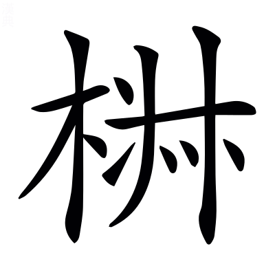
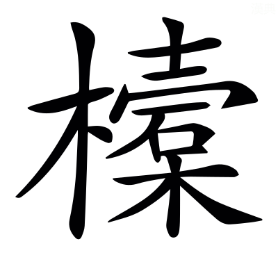
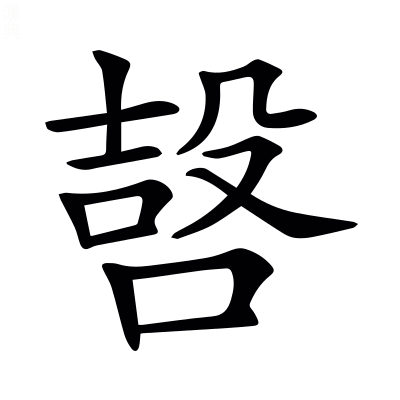

# 哀公第十二

*〈哀公·名蔣定公之子蓋夫人定姒所生敬王二十八年即位謚法恭仁短折曰哀〉*

## 哀元年

> **元年春王正月公即位** *無傳*
> 
> **楚子陳侯隨侯許男圍蔡** *隨世服於楚不通中國吳之入楚昭王奔隨隨人免之卒復楚國楚人德之使列於諸侯故得見經定六年鄭滅許此復見者蓋楚封之〈得見·賢遍反下同◎此復·扶又反〉*
> 
> **鼷鼠食郊牛改卜牛夏四月辛巳郊** *無傳書過也不言所食所食非一處〈一處·昌慮反〉*
> 
> **秋齊侯衞侯伐晉**
> 
> **冬仲孫何忌帥師伐邾** *無傳*

**元年春楚子圍蔡報柏舉也** *在定四年* **里而栽** *〈而栽·才代反又音再注同說文云築牆長版〉栽設版築為圍壘周帀去蔡城一里〈圍壘·力軌反◎周帀·子合反〉* **廣丈高倍** *〈廣丈·古曠反◎髙陪·並如字髙又古報反注同〉壘厚一丈高二丈〈厚一·戶豆反〉* **夫屯晝夜九日** *〈夫屯·徒門反夫兵也屯守也〉夫猶兵也壘未成故令人在壘裏屯守蔡〈故令·力呈反〉* **如子西之素** *子西本計為壘當用九日而成* **蔡人男女以辨** *〈以辨·扶免反又方免反別也〉辨別也男女各別係纍而出降〈別也·彼列反下同◎係纍·力維反◎出降·戶江反〉* **使疆于江汝之間而還** *〈使疆·居良反〉楚欲使蔡徙國在江水之北汝水之南求田以自安也蔡權聽命故楚師還* **蔡於是乎請遷于吳** *楚既還蔡人更叛楚就吳為明年蔡遷州來傳*

**吳王夫差敗越于夫椒報檇李也** *〈夫椒·音扶椒又作子消反◎檇李·音醉〉檇李在定十四年夫椒吳郡吳縣西南大湖中椒山〈大湖·音泰〉* **遂入越越子以甲楯五千保于會稽** *〈甲楯·食允反又音允◎會稽·古外反下古兮反㑹稽山名〉上會稽山也在會稽山陰縣南〈上會稽·時掌反〉* **使大夫種因吳大宰嚭以行成 *〈大夫種·章勇反◎大宰·音泰◎嚭·普鄙反〉* 吳子將許之伍員曰 *〈伍員·音雲〉* 不可臣聞之樹德莫如滋去疾莫如盡 *〈去疾·起吕反本又作去惡〉* 昔有過澆殺斟灌以伐斟鄩** *〈有過·古禾反國名注及下同◎澆·五呌反一音五報反下同◎殺斟·之林反◎灌·古亂反◎斟鄩·音尋〉澆寒浞子封於過者二斟夏同姓諸侯襄四年傳曰澆用師滅斟灌〈寒促·仕捉反◎夏同姓·戶雅反下注皆同〉* **滅夏后相** *〈夏后相·息亮反注及下注同〉夏后相啟孫也后相失國依於二斟復為澆所滅〈復為·扶又反〉* **后緡方娠 *〈后緡·亡巾反◎昬忘？·亡亮反◎方娠·音震又音身懷妊也〉* 逃出自竇** *〈自竇·音豆〉后緡相妻娠懷身也* **歸于有仍** *后緡有仍氏女* **生少康焉 *〈少康·詩照反〉* 為仍牧正** *牧官之長〈之長·丁丈反〉* **惎澆能戒之** *〈惎澆·音忌毒也〉惎毒也戒備也* **澆使椒求之** *椒澆臣* **逃奔有虞為之庖正 *〈庖正·步交反〉* 以除其害** *虞舜後諸侯也梁國有虞縣庖正掌膳羞之官賴此以得除己害* **虞思於是妻之以二姚** *〈妻之·七計反注同◎二姚·羊昭反虞姓也〉思有虞君也虞思自以二女妻少康姚虞姓* **而邑諸綸** *〈諸綸·音倫〉綸虞邑* **有田一成有衆一旅** *方十里為成五百人為旅* **能布其德而兆其謀** *兆始* **以收夏衆撫其官職** *襄四年傳曰靡自有鬲氏收二國之燼以滅浞而立少康〈有鬲·音革◎之燼·徐刃反又秦刃反〉* **使女艾諜澆** *〈女艾·上如字又音汝下五蓋反◎諜澆·音牒〉女艾少康臣諜候也* **使季杼誘豷** *〈季杼·直吕反◎誘豷·許器反〉豷澆弟也季杼少康子后杼也* **遂滅過戈復禹之績** *〈過戈·並古禾反◎之績·一本作迹〉過澆國戈豷國* **祀夏配天不失舊物** *物事也* **今吳不如過而越大於少康或將豐之不亦難乎** *言與越成是使越豐大必為吳難〈吳難·乃旦反〉* **句踐能親而務施施不失人** *〈務施·始豉反下同〉所加惠賜皆得其人* **親不弃勞** *推親愛之誠則不遺小勞* **與我同壤而世為仇讎於是乎克而弗取將又存之違天而長寇讎** *〈而長·丁丈反下同〉猶言天與不取* **後雖悔之不可食已** *食消也已止也* **姬之衰也日可俟也** *〈可竢·本又作俟音仕待也〉姬吳姓言可計日而待* **介在蠻夷而長寇讎 *〈介在·音界〉* 以是求伯必不行矣 *〈求伯·如字又音霸〉* 弗聽退而告人曰越十年生聚 *〈生聚·才喻反又如字〉* 而十年教訓** *生民聚財富而後教之* **二十年之外吳其為沼乎** *〈為沼·之兆反池也〉謂吳宮室廢壞當為汙池為二十二年越入吳起本〈汙池·音烏〉* **三月越及吳平吳入越不書吳不告慶越不告敗也** *嫌夷狄不與華同故復發傳〈故復·扶又反〉*

**夏四月齊侯衞侯救邯鄲圍五鹿** *〈邯鄲·音寒下音丹〉趙稷以邯鄲叛范中行氏之黨也五鹿晉邑*

**吳之入楚也** *在定四年* **使召陳懷公懷公朝國人而問焉曰欲與楚者右欲與吳者左陳人從田無田從黨** *都邑之人無田者隨黨而立不知所與故直從所居田在西者居右在東者居左* **逢滑當公而進** *〈逢滑·于八反〉當公不左不右* **曰臣聞國之興也以福其亡也以禍今吳未有福楚未有禍楚未可弃吳未可從而晉盟主也若以晉辭吳若何公曰國勝君亡非禍而何** *楚為吳所勝* **對曰國之有是多矣何必不復小國猶復況大國乎臣聞國之興也視民如傷是其福也** *如傷恐驚動* **其亡也以民為土芥 *〈土芥·古邁反草也〉* 是其禍也** *芥草也* **楚雖無德亦不艾殺其民 *〈不艾·魚廢反〉* 吳日敝於兵暴骨如莽** *〈暴骨·步卜反◎如莽·亡黨反〉草之生於廣野莽莽然故曰草莽* **而未見德焉天其或者正訓楚也** *使懼而改過* **禍之適吳其何日之有** *言今至* **陳侯從之及夫差克越乃脩先君之怨秋八月吳侵陳脩舊怨也** *傳言吳不脩德而脩怨所以亡*

**齊侯衞侯會于乾侯救范氏也師及齊師衞孔圉鮮虞人伐晉 *〈孔圉·魚吕反〉* 取棘蒲** *魯師不書非公命也孔圉孔烝鉏曾孫鮮虞狄帥賤故不書〈烝鉏·之承反下仕居反〉*

**吳師在陳楚大夫皆懼曰闔廬惟能用其民以敗我於柏舉今聞其嗣又甚焉將若之何子西曰二三子恤不相睦無患吳矣昔闔廬食不二味居不重席 *〈不重·直龍反〉* 室不崇壇** *〈崇壇·徒丹反〉平地作室不起壇也* **器不彤鏤** *〈不彤·徒冬反丹漆也◎鏤·魯豆反刻也〉彤丹也鏤刻也* **宮室不觀** *〈不觀·古亂反注同〉觀臺榭〈臺榭·音謝〉* **舟車不飾衣服財用擇不取費** *〈取費·芳味反〉選取堅厚不尚細靡* **在國天有菑癘** *〈天有菑·音災◎癘·本或作天無菑癘非〉癘疾疫也〈疾疫·音役〉* **親巡孤寡而共其乏困 *〈而共·音恭〉* 在軍熟食者分 *〈熟食者分·如字一讀以分字連下句〉* 而後敢食** *必須軍士皆分熟食不敢先食分猶徧也〈猶徧·音遍〉* **其所嘗者卒乘與焉** *〈卒·子忽反◎乘·繩證反◎與焉·音預〉所嘗甘珍非常食* **勤恤其民而與之勞逸是以民不罷勞 *〈不罷·音皮〉* 死知不曠** *知身死不見曠弃* **吾先大夫子常易之所以敗我也** *易猶反也* **今聞夫差次有臺榭陂池焉** *〈陂池·彼冝反〉積土為高曰臺有木曰榭過再宿曰次* **宿有妃嬙嬪御焉** *〈妃嬙·本又作廧或作牆在羊反◎嬪御·毗人反〉妃嬙貴者嬪御賤者皆內官* **一日之行所欲必成玩好必從 *〈玩好·呼報反〉* 珍異是聚觀樂是務視民如讎而用之日新夫先自敗也已 *〈夫先自敗也已·夫音扶本或作夫差先自敗者非〉* 安能敗我** *為二十二年越滅吳起*

**冬十月晉趙鞅伐朝歌** *討范中行氏*

## 哀二年

> **二年春王二月季孫斯叔孫州仇仲孫何忌帥師伐邾取漷東田及沂西田** *〈取漷·火虢反又音郭◎及沂·魚依反〉邾人以賂取之易也〈易也·以豉反〉* **癸巳叔孫州仇仲孫何忌及邾子盟于句繹** *〈句繹·古侯反下音亦〉句繹邾地取邑盟以要之〈以要·一遥反〉*
> 
> **夏四月丙子衞侯元卒** *定四年盟皐鼬*
> 
> **滕子來朝** *無傳*
> 
> **晉趙鞅帥師納衞世子蒯聵于戚秋八月甲戌晉趙鞅帥師及鄭罕達帥師戰于鐵鄭師敗績** *〈于鐵·尺結反〉皆陳曰戰大崩曰敗績鐵在戚城南罕達子皮孫〈皆陳·直覲反〉*
> 
> **冬十月葬衞靈公** *無傳七月而葬緩*
> 
> **十有一月蔡遷于州來** *畏楚而請遷故以自遷為文*
> 
> **蔡殺其大夫公子駟** *懷土而欺大國故罪而書名*

**二年春伐邾將伐絞** *〈伐絞·古卯反〉絞邾邑* **邾人愛其土故賂以漷沂之田而受盟**

**初衞侯遊于郊子南僕** *子南靈公子郢也僕御也〈郢也·以井反〉* **公曰余無子將立女** *〈立女·音汝〉蒯聵奔無大子* **不對他日又謂之對曰郢不足以辱社稷君其改圖君夫人在堂三揖在下** *〈三揖·一入反三揖卿大夫士也〉三揖卿大夫士* **君命祗辱** *〈祇辱·音支〉言立適當以禮與外內同之今君私命事必不從適為辱〈立適·丁歷反下適孫同〉* **夏衞靈公卒夫人曰命公子郢為大子君命也對曰郢異於他子** *言用意不同* **且君沒於吾手若有之郢必聞之** *言當以臨沒為正* **且亡人之子輒在** *輒蒯聵之子出公也靈公適孫* **乃立輒六月乙酉晉趙鞅納衞大子于戚宵迷陽虎曰右河而南必至焉** *是時河北流過元城界戚在河外晉軍已渡河故欲出河右而南* **使大子絻** *〈大子絻·音問喪冠也〉絻者始發喪之服* **八人衰絰偽自衞逆者** *〈衰絰·七雷反下田結反〉欲為衞人逆故衰絰成服* **告於門哭而入遂居之**

**秋八月齊人輸范氏粟鄭子姚子般送之** *〈子般·音班〉子姚罕達子般駟弘* **士吉射逆之趙鞅禦之遇於戚陽虎曰吾車少以兵車之旆與罕駟兵車先陳** *〈先陳·直覲反下注同〉旆先驅車也以先驅車益以兵車以示衆* **罕駟自後隨而從之彼見吾貌必有懼心** *晉人先陳鄭人隨之不知其虛實見車多必懼* **於是乎會之** *會合戰* **必大敗之從之卜戰龜焦** *兆不成* **樂丁曰詩曰爰始爰謀爰契我龜** *〈爰契·苦計反又苦結反〉樂丁晉大夫詩大雅言先人事後卜筮* **謀協以故兆 *〈謀協以故兆·絶句〉* 詢可也** *〈詢可也·思遵反〉詢諮詢也故兆始納衞大子卜得吉兆言今既謀同可不須更卜* **簡子誓曰范氏中行氏反易天明** *不事君也* **斬艾百姓 *〈斬艾·魚廢反〉* 欲擅晉國而滅其君 *〈欲擅·市戰反◎而滅其君·滅或作戕音殘〉* 寡君恃鄭而保焉今鄭為不道弃君助臣二三子順天明從君命經德義除詬恥在此行也 *〈除詬·呼豆反又音苟〉* 克敵者上大夫受縣下大夫受郡** *周書作雒篇千里百縣縣有四郡〈作雒·音洛◎千里百縣·縣方百里◎縣有四郡·郡方五十里〉* **士田十萬** *十萬畒也* **庶人工商遂** *得遂進仕* **人臣隷圉免** *去廝役〈斯役·如字字又作厮音同何休注公羊云艾草為防者曰厮汲水漿者曰役蘇林注漢書云厮取薪者韋昭云析薪曰厮〉* **志父無罪 *〈志父·音甫杜云志父趙簡子之改名也服云趙鞅入晉陽以畔後得歸改名志父春秋仍舊猶書趙鞅〉* 君實圖之** *志父趙簡子之一名也言已事濟君當圖其賞* **若其有罪絞縊以戮** *〈絞縊·一賜反◎以戮·音六〉絞所以縊人物* **桐棺三寸不設屬辟** *〈桐棺三寸·禮記云夫子制於中都四寸之棺五寸之椁以斯知不欲速朽也鄭康成注云此庶人之制也案禮上大夫棺八寸屬六寸下大夫棺六寸屬四寸無三寸棺制也棺用難朽之木桐木易壞不堪為棺故以為罰墨子尚儉有桐棺三寸◎不設屬·音燭注同次大棺也◎辟·步歷反注同親身棺也禮大夫無辟〉屬辟棺之重數王棺四重君再重大夫一重〈王棺四重·禮記云水兕革棺被之其厚三寸杝棺一梓棺二杝棺辟也梓棺二屬與大棺也被水牛及兕之革為一重辟為二重屬為三重大棺為四重◎君再重·君謂侯伯子男侯伯巳下無革棺屬與辟為一重大棺為再重上公則唯無水革耳兕革與辟為一重屬為再重大棺為三重◎大夫一重·大夫唯屬與大棺為一重今云不設辟者時僭耳非正禮也〉* **素車樸馬** *〈樸馬·普卜反〉以載柩〈載柩·其又反〉* **無入于兆** *兆葬域* **下卿之罰也** *為衆設賞自設罰所以能克敵〈為衆·于偽反〉* **甲戌將戰郵無恤御簡子衞大子為右** *〈郵無恤·音尤〉郵無恤王良也* **登鐵上** *鐵丘名* **望見鄭師衆大子懼自投于車下子良授大子綏而乘之曰婦人也** *言其怯〈其怯·去業反〉* **簡子巡列曰畢萬匹夫也七戰皆獲有馬百乘 *〈百乘·繩證反〉* 死於牖下** *〈牖下·羊九反〉畢萬晉獻公卿也皆獲有功死於牖下言得壽終* **羣子勉之死不在寇** *言有命* **繁羽御趙羅宋勇為右** *三子晉大夫* **羅無勇麇之** *〈麇之·丘隕反麇束縛也注同〉麇束縛也* **吏詰之 *〈吏詰·起吉反〉* 御對曰痁作而伏** *〈痁作·詩占反瘧疾也〉痁瘧疾也〈瘧疾·魚略反〉* **衞大子禱曰 *〈禱曰·丁老反一音丁報反〉* 曾孫蒯聵敢昭告皇祖文王** *周文王皇大也* **烈祖康叔** *烈顯也* **文祖襄公** *繼業守文故曰文祖蒯聵襄公之孫* **鄭勝亂從** *勝鄭聲公名釋君助臣為從於亂* **晉午在難** *〈在難·乃旦反下注為難同〉午晉定公名* **不能治亂使鞅討之** *鞅簡子名* **蒯聵不敢自佚 *〈自佚·音逸〉* 備持矛焉** *〈持矛·亡侯反〉戎右持矛* **敢告無絕筋 *〈絶筋·居銀反〉* 無折骨無面傷以集大事無作三祖羞** *集成也* **大命不敢請佩玉不敢愛** *不敢愛故以祈禱* **鄭人擊簡子中肩 *〈中肩·丁仲反〉* 斃于車中** *〈斃于·婢世反本亦作弊〉斃踣也〈踣·蒲北反〉* **獲其蠭旗** *〈蠭旗·芳恭反旗名〉蠭旗旗名* **大子救之以戈鄭師北獲溫大夫趙羅** *羅無勇故鄭師雖北猶獲羅* **大子復伐之 *〈復伐·扶又反〉* 鄭師大敗獲齊粟千車趙孟喜曰可矣** *趙孟簡子也喜大子前怯今更勇* **傅傁曰 *〈傅傁·素口反又作叟〉* 雖克鄭猶有知在 *〈有知·音智〉* 憂未艾也** *〈未艾·魚廢反又五蓋反〉傅傁簡子屬也言知氏將為難後竟有晉陽之患* **初周人與范氏田公孫尨稅焉** *〈公孫尨·武江反◎稅焉·始銳反〉尨范氏臣為范氏收周人所與田之稅〈為范·于偽反下文為其主同〉* **趙氏得而獻之** *得尨以獻簡子* **吏請殺之趙孟曰為其主也何罪止而與之田** *還其所稅* **及鐵之戰以徒五百人宵攻鄭師取蠭旗於子姚之幕下 *〈幕下·音莫〉* 獻曰請報主德追鄭師姚般公孫林殿而射前列多死** *〈姚般·子姚子般◎林殿·丁見反◎而射·食亦反〉晉前列* **趙孟曰國無小** *言雖小國猶有善射者* **既戰簡子曰吾伏弢嘔血** *〈伏弢·吐刀反弓衣也◎嘔血·本又作𠴰烏口反吐也〉弢弓衣嘔吐也〈吐也·他露反〉* **鼓音不衰今日我上也** *功為上* **大子曰吾救主於車退敵於下我右之上也郵良曰我兩靷將絕 *〈兩靷·以刃反〉* 吾能止之** *止使不絕* **我御之上也駕而乘材兩靷皆絕** *材橫木明細小也傳言簡子不讓下自伐*

**吳洩庸如蔡納聘 *〈洩庸·息列反一音作息引反未詳〉* 而稍納師師畢入衆知之** *元年蔡請遷于吳中悔故因聘襲之〈中悔·丁仲反〉* **蔡侯告大夫殺公子駟以說** *殺駟以說吳言不時遷駟之為* **哭而遷墓** *將遷與先君辭故哭* **冬蔡遷于州來**

## 哀三年

> **三年春齊國夏衞石曼姑帥師圍戚** *〈曼姑·音萬〉曼姑為子圍父知其不義故推齊使為兵首戚不稱衞非叛人〈為子·于偽反〉*
> 
> **夏四月甲午地震** *無傳*
> 
> **五月辛卯桓宮僖宮災** *天火曰災*
> 
> **季孫斯叔孫州仇帥師城啟陽** *無傳魯黨范氏故懼晉比年四城啟陽今琅邪開陽縣*
> 
> **宋樂髡帥師伐曹** *〈樂髠·苦孫反〉無傳*
> 
> **秋七月丙子季孫斯卒**
> 
> **蔡人放其大夫公孫獵于吳** *無傳公子駟之黨*
> 
> **冬十月癸卯秦伯卒** *無傳不書名未同盟*
> 
> **叔孫州仇仲孫何忌帥師圍邾** *無傳*

**三年春齊衞圍戚求援于中山** *中山鮮虞*

**夏五月辛卯司鐸火** *〈司鐸·待洛反〉司鐸宮名* **火踰公宮桓僖災** *桓公僖公廟* **救火者皆曰顧府** *言常人愛財* **南宮敬叔至命周人出御書俟於宮** *敬叔孔子弟子南宮閱周人司周書典籍之官御書進於君者也使待命於宮* **曰庀女而不在死** *〈曰庀·匹婢反具也◎女·音汝〉庀具也* **子服景伯至命宰人出禮書** *景伯子服何也宰人冢宰之屬* **以待命命不共有常刑** *〈命不共·音恭〉待求之命* **校人乘馬 *〈校人·戶敎反注及下同◎乘馬·繩證反注及下皆同〉* 巾車脂轄** *〈脂轄·戶瞎反本又作鎋同〉校人掌馬巾車掌車乘馬使四四相從為駕之易〈為駕·于偽反◎之易·以豉反〉* **百官官備府庫愼守官人肅給** *國有火災恐有變難故愼為備〈變難·乃旦反〉* **濟濡帷幕鬱攸從之** *〈濟濡·子細反又子禮反注同◎帷幕·位悲反下音莫◎鬱攸·音由鬱攸火氣也〉鬱攸火氣也濡物於水出用為濟* **蒙葺公屋** *〈蒙葺·七入反一音丁入反〉以濡物冒覆公屋* **自大廟始外內以悛** *〈以悛·七全反次也〉悛次也先尊後卑以次救之* **助所不給有不用命則有常刑無赦公父文伯至命校人駕乘車** *乘車公車* **季桓子至御公立于象魏之外** *象魏門闕* **命救火者傷人則止財可為也命藏象魏** *周禮正月縣教令之法于象魏使萬民觀之故謂其書為象魏〈縣敎·音玄〉* **曰舊章不可亡也富父槐至 *〈富父·音甫◎槐·音懷〉* 曰無備而官辦者 *〈官辦·辦具之辨注同〉* 猶拾瀋也** *〈猶拾·音十◎瀋也·尺審反汁也北土呼汁為瀋〉槐富父終生之後瀋汁也言不備而責辦不可得* **於是乎去表之稾** *〈去表·起吕反注同◎之稾·古老反注同〉表表火道風所向者去其稾積〈所鄉·許亮反◎稾積·子賜反〉* **道還公宮** *〈道還·本又作環尸關反又音患注同〉開除道周帀公宮使火無相連* **孔子在陳聞火曰其桓僖乎** *言桓僖親盡而廟不毀宜為天所災*

**劉氏范氏世為昏姻** *劉氏周卿士范氏晉大夫* **萇弘事劉文公** *為之屬大夫* **故周與范氏趙鞅以為討** *責周與范氏* **六月癸卯周人殺萇弘** *終違天之禍*

**秋季孫有疾命正常曰無死** *正常桓子之寵臣欲付以後事故勑令勿從己死〈勑令·力呈反〉* **南孺子之子 *〈南孺子·如住反〉* 男也則以告而立之** *南孺子季桓子之妻言若生男告公而立之* **女也則肥也可** *肥康子也* **季孫卒康子即位既葬康子在朝** *在公朝也* **南氏生男正常載以如朝告曰夫子有遺言命其圉臣曰南氏生男則以告於君與大夫而立之今生矣男也敢告遂奔衞康子請退** *退辟位也* **公使共劉視之** *〈共劉·音恭〉共劉魯大夫* **則或殺之矣乃討之** *討殺者* **召正常正常不反** *畏康子也傳備言季氏家事*

**冬十月晉趙鞅圍朝歌師于其南** *范中行所在* **荀寅伐其郛** *〈其郛·芳夫反〉伐其北郭圍* **使其徒自北門入己犯師而出** *荀寅使在外救己之徒擊趙氏圍之北門因外內攻得出* **癸丑奔邯鄲十一月趙鞅殺士皐夷惡范氏也** *〈惡范氏·烏路反注同〉惡范氏而殺其族言遷怒*

## 哀四年

> **四年春王二月庚戌盜殺蔡侯申** *〈盜殺·申志反◎蔡侯申·今本皆如此案宣十七年蔡侯申卒是文侯也今昭侯是其玄孫不容與髙祖同名未詳何者誤〉賤者故稱盜不言弒其君賤盜也* **蔡公孫辰出奔吳** *弒君賊之黨故書名*
> 
> **葬秦惠公** *無傳*
> 
> **宋人執小邾子** *無傳邾子無道於其民故稱人以執*
> 
> **夏蔡殺其大夫公孫姓公孫霍** *〈公孫姓·音生本又作生或一音性〉皆弒君黨*
> 
> **晉人執戎蠻子赤歸于楚** *晉恥為楚執諸侯故稱人以告若蠻子不道於其民也赤本屬楚故言歸〈恥為·于偽反〉*
> 
> **城西郛** *無傳魯西郭備晉也*
> 
> **六月辛丑亳社災** *〈亳社·步洛反〉無傳天火也亳社殷社諸侯有之所以戒亡國*
> 
> **秋八月甲寅滕子結卒** *無傳同盟於皐鼬*
> 
> **冬十有二月葬蔡昭公** *無傳亂故是以緩*
> 
> **葬滕頃公** *〈頃公·音傾〉無傳*

**四年春蔡昭侯將如吳諸大夫恐其又遷也承** *〈也承·音懲直升反〉承音懲蓋楚言* **公孫翩逐而射之 *〈公孫翩·音篇◎而射·食亦反下同〉* 入於家人而卒** *翩蔡大夫* **以兩矢門之衆莫敢進** *翩以矢自守其門* **文之鍇後至** *〈文之鍇·音楷又音皆又客駭反〉鍇蔡大夫* **曰如牆而進多而殺二人** *併行如牆俱進〈併行·步頂反〉* **鍇執弓而先翩射之中肘 *〈中肘·丁仲反下竹九反〉* 鍇遂殺之故逐公孫辰而殺公孫姓公孫盱** *〈公孫盱·況于反〉盱即霍也*

**夏楚人既克夷虎** *夷虎蠻夷叛楚者* **乃謀北方左司馬眅 *〈眅·普版反字林匹姦反〉* 申公壽餘葉公諸梁 *〈葉公·始涉反〉* 致蔡於負函** *〈負函·音咸〉三子楚大夫也此蔡之故地人民楚因以為邑致之者會其衆也* **致方城之外於繒關** *〈繒關·才陵反〉負函繒關皆楚地* **曰吳將泝江入郢** *〈泝江·音素◎入郢·以井反又以政反〉逆流曰泝* **將奔命焉為一昔之期襲梁及霍** *偽辭當備吳夜結期明日便襲梁霍使不知之梁河南梁縣西南故城也梁南有霍陽山皆蠻子之邑也* **單浮餘圍蠻氏 *〈單浮餘·音善〉* 蠻氏潰** *〈氏潰·戶內反〉浮餘楚大夫* **蠻子赤奔晉陰地** *陰地河南山北自上雒以東至陸渾〈陸渾·戶門反〉* **司馬起豐析與狄戎** *〈豐析·星歷反注同〉楚司馬眅也析縣屬南鄉郡析南有豐鄉皆楚邑發此二邑人及戎狄* **以臨上雒左師軍于菟和** *〈菟和·音徒〉菟和山在上雒東也* **右師軍于倉野** *倉野在上雒縣* **使謂陰地之命大夫士蔑** *命大夫別縣監尹〈監尹·古銜反〉* **曰晉楚有盟好惡同之若將不廢寡君之願也不然將通於少習以聽命** *〈少習·詩照反又如字少習即武關也〉少習商縣武關也將大開武關道以伐晉* **士蔑請諸趙孟趙孟曰晉國未寧安能惡於楚必速與之** *未寧時有范中行之難〈之難·乃旦反〉* **士蔑乃致九州之戎** *九州戎在晉陰地陸渾者* **將裂田以與蠻子而城之** *以詐蠻子* **且將為之卜** *〈將為·于偽反下注同〉卜城* **蠻子聽卜遂執之與其五大夫以畀楚師于三戶** *〈以畀·必利反與也〉今丹水縣北三戶亭* **司馬致邑立宗焉以誘其遺民** *楚復詐為蠻子作邑立其宗主〈楚復·扶又反〉* **而盡俘以歸**

**秋七月齊陳乞弦施衞甯跪救范氏** *〈甯跪·其委反〉陳乞僖子弦施弦多* **庚午圍五鹿** *五鹿晉邑* **九月趙鞅圍邯鄲冬十一月邯鄲降 *〈邯鄲降·戶江反〉* 荀寅奔鮮虞趙稷奔臨** *臨晉邑* **十二月弦施逆之遂墮臨 *〈遂墮·許規反〉* 國夏伐晉取邢任欒鄗逆畤陰人盂壺口** *〈取邢·音刑◎任·音壬◎欒·力官反◎鄗·呼洛反郭璞三蒼解詁音𦞦字林火沃反韋昭呼告反闞駰云讀磽确同◎逆畤·音止◎盂·音于〉八邑晉地欒在趙國平棘縣西北鄗即高邑縣也路縣東有壺口關* **會鮮虞納荀寅于柏人** *晉邑也今趙國柏人縣也弦施與鮮虞會也*

## 哀五年

> **五年春城毗** *〈城毗·頻夷反〉無傳備晉也*
> 
> **夏齊侯伐宋** *無傳*
> 
> **晉趙鞅帥師伐衞**
> 
> **秋九月癸酉齊侯杵臼卒** *〈杵臼·昌吕反下求又反〉再同盟也*
> 
> **冬叔還如齊**
> 
> **閏月葬齊景公** *無傳*

**五年春晉圍柏人荀寅士吉射奔齊初范氏之臣王生惡張柳朔 *〈惡張·烏路反下同◎柳朔·良久反〉* 言諸昭子使為柏人** *為柏人宰也昭子范吉射也* **昭子曰夫非而讎乎 *〈夫非·音扶〉* 對曰私讎不及公** *公家之事也* **好不廢過 *〈好不·呼報反〉* 惡不去善 *〈不去·起吕反〉* 義之經也臣敢違之及范氏出** *出柏人奔齊* **張柳朔謂其子爾從主勉之我將止死王生授我矣** *授我死節* **吾不可以僭之 *〈以僭·子念反後同〉* 遂死於柏人** *為吉射距晉戰死〈為吉射·于偽反〉*

**夏趙鞅伐衞范氏之故也遂圍中牟** *衞助范氏故也*

**齊燕姬生子不成而死** *〈燕姬·於賢反〉燕姬景公夫人不成未冠也〈未冠·古喚反〉* **諸子鬻姒之子荼嬖** *〈鬻姒·音育下音似◎子荼·音舒又音徒又丈加反◎嬖·必計反〉諸子庶公子也鬻姒景公妾荼安孺子* **諸大夫恐其為大子也言於公曰君之齒長矣 *〈齒長·丁丈反〉* 未有大子若之何公曰二三子間於憂虞則有疾疢 *〈閒於·音閑又音閒廁之閒又如字◎疾疢·勑覲反本或作疹乃結反〉* 亦姑謀樂何憂於無君** *〈謀樂·音洛〉景公意欲立荼而未發故以此言塞大夫請* **公疾使國惠子高昭子立荼** *惠子國夏昭子高張* **寘羣公子於萊** *〈寘羣·之豉反羣或作諸◎於萊·音來〉萊齊東鄙邑* **秋齊景公卒冬十月公子嘉公子駒公子黔奔衞 *〈公子黔·巨廉反又音琴〉* 公子鉏公子陽生來奔** *〈公子鉏·仕居反〉皆景公子在萊者* **萊人歌之曰景公死乎不與埋 *〈不與·音預下同◎埋·亡皆反〉* 三軍之事乎不與謀師乎師乎何黨之乎** *師衆也黨所也之往也稱謚蓋葬後而為此歌哀羣公子失所*

**鄭駟秦富而侈 *〈而侈·昌氏反又尸氏反〉* 嬖大夫也而常陳卿之車服於其庭鄭人惡而殺之 *〈惡而·烏路反〉* 子思曰詩曰不解于位民之攸塈** *〈不解·佳賣反◎攸曁·許器反息也〉子思子產子國參也詩大雅攸所也塈息也* **不守其位而能久者鮮矣 *〈鮮矣·息淺反〉* 商頌曰不僭不濫 *〈不濫·力暫反〉* 不敢怠皇命以多福** *僭差也濫溢也皇暇也言駟秦違詩商頌故受禍〈濫溢·音逸〉*

## 哀六年

> **六年春城邾瑕** *〈邾瑕·音遐〉無傳備晉也任城亢父縣北有邾婁城〈任城·音壬◎亢父·苦浪反又音剛下音甫〉*
> 
> **晉趙鞅帥師伐鮮虞**
> 
> **吳伐陳**
> 
> **夏齊國夏及高張來奔** *二子阿君廢長立少既受命又不能全書名罪之也〈廢長·丁丈反◎立少·詩照反〉*
> 
> **叔還會吳于柤** *〈于柤·莊加反〉無傳*
> 
> **秋七月庚寅楚子軫卒** *〈楚子軫·之忍反史記作珍〉未同盟而赴以名*
> 
> **齊陽生入于齊** *為陳乞所逆故書入* **齊陳乞弒其君荼** *〈殺荼·音試下皆同〉弒荼者朱毛與陽生也而書陳乞所以明乞立陽生而荼見弒則禍由乞始也楚比劫立陳乞流涕子家憚老皆疑於免罪故春秋明而書之以為弒主*
> 
> **冬仲孫何忌帥師伐邾** *無傳*
> 
> **宋向巢帥師伐曹** *無傳*

**六年春晉伐鮮虞治范氏之亂也** *四年鮮虞納荀寅于柏人*

**吳伐陳復脩舊怨也** *〈復脩·扶又反〉元年未得志故也* **楚子曰吾先君與陳有盟不可以不救乃救陳師于城父** *〈城父·音甫〉陳盟在昭十三年*

**齊陳乞偽事高國者** *高張國夏受命立荼陳乞欲害之故先偽事焉* **每朝必驂乘焉 *〈驂乘·繩證反〉* 所從必言諸大夫** *言其罪過* **曰彼皆偃蹇將弃子之命** *〈偃蹇·約免反下紀晚反〉偃蹇驕敖〈驕敖·五報反〉* **皆曰高國得君** *得君寵也* **必偪我 *〈必偪·音逼〉* 盍去諸 *〈盍·戶臘反下同◎去諸·起吕反下同〉* 固將謀子子早圖之圖之莫如盡滅之需事之下也** *〈需·音須疑也一音懦懦弱持疑也〉需疑也* **及朝則曰彼虎狼也見我在子之側殺我無日矣請就之位** *欲與諸大夫謀高國故求就之* **又謂諸大夫曰二子者禍矣恃得君而欲謀二三子曰國之多難 *〈多難·乃旦反〉* 貴寵之由盡去之而後君定既成謀矣盍及其未作也先諸作而後悔亦無及也大夫從之夏六月戊辰陳乞鮑牧** *〈鮑牧·州牧之牧〉牧鮑圉孫* **及諸大夫以甲入于公宮昭子聞之與惠子乘如公 *〈乘如·繩證反〉* 戰于莊敗** *高國敗也莊六軌之道* **國人追之國夏奔莒遂及高張晏圉弦施來奔** *〈晏圉·魚吕反〉圉晏嬰之子圉施不書非卿*

**秋七月楚子在城父將救陳卜戰不吉卜退不吉王曰然則死也再敗楚師不如死** *前已敗於柏舉今若退還亦是敗* **弃盟逃讎亦不如死死一也其死讎乎命公子申為王不可則命公子結亦不可則命公子啟** *申子西結子期啟子閭皆昭王兄* **五辭而後許 *〈五辭·本又作辤說文辭不受也受辛冝辭也辝籀文〉* 將戰王有疾庚寅昭王攻大冥 *〈大冥·亡丁反〉* 卒于城父** *大冥陳地吳師所在* **子閭退曰君王舍其子而讓 *〈舍其·音捨〉* 羣臣敢忘君乎從君之命順也** *從命許立* **立君之子亦順也二順不可失也與子西子期謀潛師閉塗逆越女之子章立之而後還** *潛師密發也閉塗不通外使也越女昭王妾章惠王* **是歲也有雲如衆赤鳥夾日以飛三日 *〈夾日·古洽反〉* 楚子使問諸周大史 *〈大史·音泰下同〉* 周大史曰其當王身乎** *日為人君妖氣守之故以為當王身雲在楚上唯楚見之故禍不及他國* **若禜之 *〈若禜·音詠〉* 可移於令尹司馬** *禜禳祭〈禳祭·如羊反〉* **王曰除腹心之疾而寘諸股肱 *〈而寘·之豉反〉* 何益不穀不有大過天其夭諸 *〈其夭·於表反〉* 有罪受罰又焉移之 *〈又焉·於虔反〉* 遂弗禜初昭王有疾卜曰河為祟 *〈為祟·息遂反〉* 王弗祭大夫請祭諸郊王曰三代命祀祭不越望** *諸侯望祀竟內山川星辰〈竟內·音境〉* **江漢雎漳 *〈睢·七餘反◎漳·音章〉* 楚之望也** *四水在楚界* **禍福之至不是過也不穀雖不德河非所獲罪也遂弗祭孔子曰楚昭王知大道矣 *〈楚昭王知大道矣·本或作天道非〉* 其不失國也宜哉夏書曰 *〈夏書·戶雅反下注同此語在尚書五子之歌書無帥彼天常一句下亦微異〉* 惟彼陶唐帥彼天常** *逸書言堯循天之常道* **有此冀方今失其行 *〈其行·如字又下孟反尚書作厥道〉* 亂其紀綱乃滅而亡** *〈乃滅而亡·尚書作乃厎滅亡〉滅亡謂夏桀也唐虞及夏同都冀州不易地而亡由於不知大道故* **又曰允出茲在茲由己率常可矣** *又逸書言信出己則福亦在己*

**八月齊邴意茲來奔** *高國黨* **陳僖子使召公子陽生** *召在七月今在八月下記事之次* **陽生駕而見南郭且于** *〈且于·子餘反〉且于齊公子鉏在魯南郭* **曰嘗獻馬於季孫不入於上乘 *〈上乘·繩證反〉* 故又獻此請與子乘之** *畏在家人聞其言故欲二人共載以試馬為辭* **出萊門而告之故** *魯郭門也* **闞止知之先待諸外** *〈闞止·苦暫反〉闞止陽生家臣子我也待外欲俱去* **公子曰事未可知反與壬也處** *〈壬也·而林反〉壬陽生子簡公* **戒之遂行** *戒使無洩言〈洩言·息列反又以製反〉* **逮夜至於齊國人知之** *故以昏至不欲令人知也國人知而不言言陳氏得衆〈欲令·力呈反下同〉* **僖子使子士之母養之** *隱於僖子家內子士母僖子妾* **與饋者皆入** *〈與饋·其位反〉陳僖子又令陽生隨饋食之人入處公宮* **冬十月丁卯立之將盟** *盟諸大夫* **鮑子醉而往其臣差車鮑點** *〈差車·所冝反◎鮑點·之廉反又如字〉點鮑牧臣也差車主車之官* **曰此誰之命也陳子曰受命于鮑子遂誣鮑子曰子之命也** *見其醉故誣之* **鮑子曰女忘君之為孺子牛而折其齒乎 *〈女忘·音汝◎而折·之舌反又市列反注同〉* 而背之也** *〈而背·音佩後年皆同〉孺子荼也景公嘗銜繩為牛使荼牽之荼頓地故折其齒* **悼公稽首** *悼公陽生* **曰吾子奉義而行者也若我可不必亡一大夫** *言己可為君必不怨鮑子* **若我不可不必亡一公子** *公子自謂也恐鮑子殺己故要之〈故要·一遥反〉* **義則進否則退敢不唯子是從廢興無以亂則所願也鮑子曰誰非君之子乃受盟** *言陽生亦君之子固可立* **使胡姬以安孺子如賴** *胡姬景公妾也賴齊邑安號也* **去鬻姒** *〈去鬻·起吕反〉荼之母* **殺王甲拘江說 *〈拘·音俱◎江說·音悅〉* 囚王豹于句竇之丘** *〈句竇·音鉤下音豆〉三子景公嬖臣荼之黨也* **公使朱毛告於陳子** *朱毛齊大夫* **曰微子則不及此然君異於器不可以二器二不匱 *〈不匱·其位反〉* 君二多難 *〈多難·乃旦反〉* 敢布諸大夫僖子不對而泣曰君舉不信羣臣乎** *舉皆也* **以齊國之困困又有憂** *內有飢荒之困又有兵革之憂* **少君不可以訪 *〈少君·詩照反〉* 是以求長君 *〈長君·丁丈反〉* 庶有能容羣臣乎不然夫孺子何罪 *〈夫子·音扶或作孺同〉* 毛復命公悔之** *悔失言* **毛曰君大訪於陳子而圖其小可也** *大謂國政小謂殺荼* **使毛遷孺子於駘 *〈於駘·他才反又徒來反〉* 不至殺諸野幕之下 *〈野幕·音莫〉* 葬諸殳冒淳** *〈殳·音殊◎冒·亡報反◎淳·音純〉恐駘人不從故毛駐於野張帳而殺之駘齊邑殳冒淳地名實以冬殺經書秋者史書秋記始事遂連其死通以冬告魯〈駐於·中住反〉*

## 哀七年

> **七年春宋皇瑗帥師侵鄭** *〈皇瑗·于眷反〉*
> 
> **晉魏曼多帥師侵衞**
> 
> **夏公會吳于鄫** *〈于繒·才陵反一本作鄫〉鄫今琅邪鄫縣*
> 
> **秋公伐邾**
> 
> **八月己酉入邾以邾子益來** *他國言歸於魯言來內外之辭*
> 
> **宋人圍曹**
> 
> **冬鄭駟弘帥師救曹**

**七年春宋師侵鄭鄭叛晉故也** *定八年鄭始叛*

**晉師侵衞衞不服也** *五年晉伐衞至今未服*

**夏公會吳于鄫** *吳欲霸中國* **吳來徵百牢 *〈百牢·力刀反〉* 子服景伯對曰先王未之有也吳人曰宋百牢我** *是時吳過宋得百牢〈吳過宋·古禾反〉* **魯不可以後宋 *〈以後·如字又戶豆反〉* 且魯牢晉大夫過十** *晉大夫范鞅也在昭二十一年* **吳王百牢不亦可乎景伯曰晉范鞅貪而弃禮以大國懼敝邑故敝邑十一牢之君若以禮命於諸侯則有數矣** *有常數* **若亦弃禮則有淫者矣** *淫過也* **周之王也制禮上物不過十二** *〈上物·如字一音時掌反注同〉上物天子之牢* **以為天之大數也** *天有十二次故制禮象之* **今弃周禮而曰必百牢亦唯執事吳人弗聽景伯曰吳將亡矣弃天而背本** *違周為背本* **不與必弃疾於我** *放弃凶疾來伐擊我* **乃與之大宰嚭召季康子** *嚭吳大夫* **康子使子貢辭大宰嚭曰國君道長** *〈道長·丁丈反注及下注同〉言君長大於道路* **而大夫不出門此何禮也對曰豈以為禮畏大國也** *畏大國不敢虛國盡行* **大國不以禮命於諸侯苟不以禮豈可量也寡君既共命焉 *〈旣共·音恭〉* 其老豈敢弃其國大伯端委以治周禮 *〈大伯·音泰注同〉* 仲雍嗣之斷髮文身臝以為飾 *〈斷髮·丁管反◎臝以·本又作倮力果反〉* 豈禮也哉有由然也** *大伯周大王之長子仲雍大伯弟也大伯仲雍讓其弟季歷俱適荊蠻遂有民衆大伯卒無子仲雍嗣立不能行禮致化故效吳俗言其權時制宜以辟災害非以為禮也端委禮衣也〈故效·戶孝反〉* **反自鄫以吳為無能為也** *弃禮知其不能霸也* **季康子欲伐邾乃饗大夫以謀之子服景伯曰小所以事大信也大所以保小仁也背大國不信** *大國吳也* **伐小國不仁民保於城城保於德失二德者危將焉保** *〈將焉·於虔反〉二德信與仁也* **孟孫曰二三子以為何如** *怪諸大夫不言故指問之* **惡賢而逆之** *〈惡賢·音烏安也注同〉孟孫賢景伯欲使大夫不逆其言惡猶安也* **對曰禹合諸侯於塗山執玉帛者萬國** *諸大夫對也諸侯執玉附庸執帛塗山在壽春東北* **今其存者無數十焉 *〈無數·所主反〉* 唯大不字小小不事大也** *言諸侯相伐古來以然* **知必危何故不言** *知伐邾必危自當言今不言者不危故也大夫以答孟孫所怪且阿附季孫* **魯德如邾而以衆加之可乎** *孟孫忿答大夫今魯德無以勝邾但欲恃衆可乎言不可* **不樂而出** *〈不樂·音岳一音洛〉季孟意異佞直不同故罷饗* **秋伐邾及范門** *邾郭門也* **猶聞鐘聲** *邾不禦寇〈不禦·魚吕反〉* **大夫諫不聽茅成子請告於吳** *成子邾大夫茅夷鴻* **不許曰魯擊柝聞於邾** *〈擊柝·音託以兩木相擊以行夜也字又作同◎聞於·音問又如字〉言以近* **吳二千里不三月不至何及於我且國內豈不足** *言足以距魯* **成子以茅叛** *高平西南有茅鄉亭* **師遂入邾處其公宮衆師晝掠** *〈晝掠·中救反下音亮〉虜掠取財物也* **邾衆保于繹** *〈于繹·音亦〉繹邾山也在鄒縣北〈鄒縣·側留反〉* **師宵掠以邾子益來** *益邾隱公也晝夜掠傳言康子無法* **獻于亳社** *以其亡國與殷同* **囚諸負瑕負瑕故有繹** *負瑕魯邑高平南平陽縣西北有瑕丘城前者魯得邾之繹民使在負瑕故使相就以辱之* **邾茅夷鴻以束帛乘韋自請救於吳** *〈乘韋·繩證反下及注同〉無君命故言自* **曰魯弱晉而遠吳馮恃其衆** *〈馮恃·皮冰反注同〉馮依* **而背君之盟辟君之執事** *〈辟·匹亦反注同〉辟陋* **以陵我小國邾非敢自愛也懼君威之不立君威之不立小國之憂也若夏盟於鄫衍** *鄫衍即鄫也鄫盟不書吳行夷禮禮儀不典非所以結信義故不錄* **秋而背之成求而不違** *言魯成其所求無違逆也* **四方諸侯其何以事君且魯賦八百乘君之貳也** *貳敵也魯以八百乘之賦貢於吳言其國大* **邾賦六百乘君之私也** *為私屬* **以私奉貳唯君圖之吳子從之** *為明年吳伐我傳*

**宋人圍曹鄭桓子思曰宋人有曹鄭之患也不可以不救** *桓謚* **冬鄭師救曹侵宋初曹人或夢衆君子立于社宮** *社宮社也* **而謀亡曹曹叔振鐸請待公孫彊許之** *〈振鐸·待洛反注同◎公孫彊·其良反〉振鐸曹始祖* **旦而求之曹無之戒其子曰我死爾聞公孫彊為政必去之及曹伯陽即位好田弋 *〈好田·呼報反下同◎弋·以職反繳射也〉* 曹鄙人公孫彊好弋獲白鴈獻之且言田弋之說 *〈田弋之說·如字〉* 說之 *〈說之·音悅下大說同〉* 因訪政事大說之有寵使為司城以聽政夢者之子乃行彊言霸說於曹伯 *〈彊言霸說·如字一音始銳反〉* 曹伯從之乃背晉而奸宋 *〈而奸·音干〉* 宋人伐之晉人不救築五邑於其郊曰黍丘揖丘大城鐘邘** *〈揖丘·音集一音於入反◎鍾邘·音于〉為明年入曹傳也梁國下邑縣西南有黍丘亭*

## 哀八年

> **八年春王正月宋公入曹以曹伯陽歸** *曹人背晉而奸宋是以致討宋公既還而不忍褚師之詬怒而反兵一舉滅曹滅非本志故以入告〈褚師·中吕反◎之詬·呼豆反〉*
> 
> **吳伐我**
> 
> **夏齊人取讙及闡** *〈取讙·音歡◎及闡·尺善反〉不書伐兵未加而魯與之邑闡在東平剛縣北*
> 
> **歸邾子益于邾**
> 
> **秋七月**
> 
> **冬十有二月癸亥杞伯過卒** *〈伯過·古禾反〉無傳未同盟而赴以名*
> 
> **齊人歸讙及闡** *不言來命歸之無旨使也〈官使·所吏反〉*

**八年春宋公伐曹將還褚師子肥殿** *〈肥殿·丁練反下注同〉子肥宋大夫* **曹人詬之 *〈詬之·本又作訽呼豆反詈辱也〉* 不行** *詬詈辱也不行殿兵止也〈詈辱·力智反〉* **師待之公聞之怒命反之遂滅曹執曹伯及司城彊以歸殺之** *終曹人之夢*

**吳為邾故 *〈吳為·于偽反下注則為之隱惡同〉* 將伐魯問於叔孫輒** *問可伐不輒故魯人* **叔孫輒對曰魯有名而無情** *有大國名無情實* **伐之必得志焉退而告公山不狃** *〈不狃·女九反〉不狃亦故魯人* **公山不狃曰非禮也君子違不適讎國** *違奔亡也* **未臣而有伐之奔命焉死之可也** *未臣所適之國若有伐本國者則可還奔命死其難〈死其難·乃旦反〉* **所託也則隱** *曾所因託則為之隱惡〈曾所·在増反〉* **且夫人之行也 *〈且夫·音扶◎之行·下孟反又如字〉* 不以所惡廢鄉** *〈所惡·烏路反又如字注同〉不以其私怨惡廢弃其鄉黨之好〈之好·呼報反下文好焉同〉* **今子以小惡而欲覆宗國不亦難乎** *〈欲覆·芳服反〉輒魯公族故謂之宗國* **若使子率子必辭王將使我子張病之** *子張輒也* **王問於子洩** *〈子泄·息列反又作洩〉子洩不狃* **對曰魯雖無與立** *緩時若無能自立* **必有與斃** *〈與斃·婢世反〉急則人人知懼皆將同死戰* **諸侯將救之未可以得志焉晉與齊楚輔之是四讎也** *與魯而四* **夫魯齊晉之脣脣亡齒寒君所知也不救何為三月吳伐我子洩率 *〈子洩率·絶句〉* 故道險 *〈故道險·絶句〉* 從武城** *故由險道欲使魯成備* **初武城人或有因於吳竟田焉** *〈吳竟·音境〉僑田吳界〈僑田·其驕反〉* **拘鄫人之漚菅者 *〈拘鄫·音俱下同◎之漚·烏豆反◎菅·古顔反〉* 曰何故使吾水滋** *〈水滋·音玄本亦作兹子絲反濁也字林云黑也〉鄫人亦僑田吳滋濁也* **及吳師至拘者道之以伐武城 *〈道之·音導〉* 克之** *鄫人教吳必可克* **王犯嘗為之宰澹臺子羽之父好焉 *〈澹臺·待甘反〉* 國人懼** *王犯吳大夫故嘗奔魯為武城宰澹臺子羽武城人孔子弟子也其父與王犯相善國人懼其為內應〈內應·應對之應〉* **懿子謂景伯若之何對曰吳師來斯與之戰何患焉且召之而至又何求焉** *言犯盟伐邾所以召吳* **吳師克東陽而進舍於五梧明日舍於蠶室** *三邑魯地* **公賓庚公甲叔子與戰于夷獲叔子與析朱鉏** *〈析朱鉏·星歷反注及下同〉公賓庚公甲叔子并析朱鉏為三人皆同車傳互言之* **獻於王王曰此同車必使能國未可望也** *同車能俱死是國能使人故不可望得* **明日舍于庚宗遂次於泗上 *〈泗上·音四〉* 微虎欲宵攻王舍** *微虎魯大夫* **私屬徒七百人 *〈私屬·音燭〉* 三踊於幕庭** *〈於幕庭·亡博反〉於帳前設格令士試躍之〈設格·更百反◎令士·力呈反◎試躍·羊灼反〉* **卒三百人有若與焉** *〈與焉·音預注同〉卒終也終得三百人任行有若孔子弟子與在三百人中〈任行·音壬〉* **及稷門之內** *三百人行至稷門* **或謂季孫曰不足以害吳而多殺國士不如已也乃止之吳子聞之一夕三遷** *〈三遷·息暫反〉畏微虎* **吳人行成** *求與魯成* **將盟景伯曰楚人圍宋易子而食析骸而爨** *〈析骸·戶皆反本又作骨◎而爨·七亂反〉在宣十五年* **猶無城下之盟我未及虧 *〈及虧·去危反〉* 而有城下之盟是弃國也吳輕而遠 *〈吳輕·遣政反〉* 不能久將歸矣請少待之弗從景伯負載 *〈負載·如字謂載書或音戴〉* 造於萊門** *〈造於·七報反◎萊門·音來〉以言不見從故負載書將欲出盟* **乃請釋子服何於吳吳人許之以王子姑曹當之而後止** *釋舍也魯人不以盟為了欲因留景伯為質於吳既得吳之許復求吳王之子以交質吳人不欲留王子故遂兩止〈為質·音致下同◎復求·扶又反〉* **吳人盟而還** *不書盟恥吳夷*

**齊悼公之來也** *在五年* **季康子以其妹妻之 *〈妻之·七計反〉* 即位而逆之季魴侯通焉** *〈魴侯·音房〉魴侯康子叔父* **女言其情弗敢與也齊侯怒夏五月齊鮑牧帥師伐我取讙及闡或譖胡姬於齊侯** *胡姬景公妾* **曰安孺子之黨也六月齊侯殺胡姬** *傳言齊侯無道所以不終* **齊侯使如吳請師將以伐我乃歸邾子** *齊未得季姬故請師也吳前為邾討魯懼二國同心故歸邾子〈前為·于偽反〉*

**邾子又無道吳子使大宰子餘討之** *子餘大宰嚭* **囚請樓臺栫之以棘** *〈荐之·本又作栫在薦反〉栫雍也〈荐雍也·於勇反〉* **使諸大夫奉大子革以為政** *革邾大子桓公也為十年邾子來奔傳*

**秋及齊平九月臧賓如如齊涖盟** *賓如臧會子* **齊閭丘明來涖盟** *明閭丘嬰之子也盟不書諱略之* **且逆季姬以歸嬖** *季姬魴侯所通者* **鮑牧又謂羣公子曰使女有馬千乘乎** *〈使女·音汝◎千乘·繩證反注及下同〉有馬千乘使為君也鮑牧本不欲立陽生故諷動羣公子〈故諷·方鳳反〉* **公子愬之 *〈愬之·音素〉* 公謂鮑子或譖子子姑居於潞以察之** *〈於潞·音路〉潞齊邑* **若有之則分室以行若無之則反子之所出門使以三分之一行半道使以二乘及潞麇之以入遂殺之** *〈麇之·丘隕反束縛也〉麇亦束縳* **冬十二月齊人歸讙及闡季姬嬖故也**

## 哀九年

> **九年春王二月葬杞僖公** *無傳三月而葬速*
> 
> **宋皇瑗帥師取鄭師于雍丘** *〈雍丘·於勇反〉書取覆而敗之雍丘縣屬陳留*
> 
> **夏楚人伐陳**
> 
> **秋宋公伐鄭**
> 
> **冬十月**

**九年春齊侯使公孟綽辭師于吳** *〈公孟綽·昌灼反本又作卓同〉齊與魯平故辭吳師* **吳子曰昔歲寡人聞命今又革之不知所從將進受命於君** *為十年吳伐齊傳*

**鄭武子賸之嬖 *〈武子䞉·以證反〉* 許瑕求邑無以與之** *賸罕達也瑕武子之屬* **請外取許之** *瑕請取於他國* **故圍宋雍丘宋皇瑗圍鄭師** *許瑕師* **每日遷舍** *作壘塹成輒徙舍合其圍〈作壘·力軌反◎塹成·七豔反〉* **壘合鄭師哭子姚救之大敗** *子姚武子賸也* **二月甲戌宋取鄭師于雍丘使有能者無死** *惜其能也* **以郟張與鄭羅歸** *〈郟張·古洽反又音甲〉鄭之有能者*

**夏楚人伐陳陳即吳故也**

**宋公伐鄭** *報雍丘*

**秋吳城邗 *〈城邗·音寒〉* 溝通江淮** *於邗江築城穿溝東北通射陽湖西北至末口入淮通糧道也今廣陵韓江是〈射陽·食亦反又音亦〉*

**晉趙鞅卜救鄭遇水適火** *水火之兆* **占諸史趙史墨史龜** *皆晉史* **史龜曰是謂沈陽** *火陽得水故沈* **可以興兵** *兵陰類也故可以興兵* **利以伐姜不利子商** *姜齊姓子商謂宋* **伐齊則可敵宋不吉史墨曰盈水名也子水位也** *趙鞅姓盈宋姓子水盈坎乃行子姓又得北方水位* **名位敵不可干也** *二水俱盛故言不可干* **炎帝為火師** *神農有火瑞以火名官* **姜姓其後也水勝火伐姜則可史趙曰是謂如川之滿不可游也** *〈可游·音由〉既盈而得水位故為如川之滿不可馮游言其波流盛〈可馮·皮冰反〉* **鄭方有罪不可救也** *鄭以嬖寵伐人故以為有罪* **救鄭則不吉不知其他** *救鄭則當伐宋故不吉也* **陽虎以周易筮之遇泰** *乾下坤上泰* **之需** *〈之需·音須〉乾下坎上需泰六五變* **曰宋方吉不可與也** *不可與戰泰六五曰帝乙歸妹以祉元吉帝乙紂父五為天子故稱帝乙陰而得中有似王者嫁妹得如其願受福祿而大吉〈以祉·音恥〉* **微子啟帝乙之元子也宋鄭甥舅也** *宋鄭為昏姻甥舅之國宋為微子之後今卜得帝乙之卦故以為宋吉* **祉祿也若帝乙之元子歸妹而有吉祿我安得吉焉乃止** *吉在彼則我伐之為不吉*

**冬吳子使來儆師伐齊** *〈儆·音景〉前年齊與吳謀伐魯齊既與魯成而止故吳恨之反與魯謀伐齊*

## 哀十年

> **十年春王二月邾子益來奔**
> 
> **公會吳伐齊** *書會從不與謀〈不與·音預〉*
> 
> **三月戊戌齊侯陽生卒** *以疾赴故不書弒〈書殺·申志反〉*
> 
> **夏宋人伐鄭** *無傳*
> 
> **晉趙鞅帥師侵齊**
> 
> **五月公至自伐齊** *無傳*
> 
> **葬齊悼公** *無傳*
> 
> **衞公孟彄自齊歸于衞** *〈孟彄·苦侯反〉無傳書歸齊納之*
> 
> **薛伯夷卒** *無傳赴以名故書*
> 
> **秋葬薛惠公** *無傳*
> 
> **冬楚公子結帥師伐陳吳救陳** *季子不書陳人來告不以名*

**十年春邾隱公來奔齊甥也故遂奔齊** *終子貢之言*

**公會吳子邾子郯子伐齊南鄙 *〈剡子·音談〉* 師于鄎** *〈于鄎·音息〉鄎齊地邾郯不書兵并屬吳不列於諸侯〈兵并·必政反〉* **齊人弒悼公 *〈人殺·申志反〉* 赴于師** *以說吳* **吳子三日哭于軍門之外徐承帥舟師將自海入齊齊人敗之吳師乃還** *承吳大夫*

**夏趙鞅帥師伐齊** *經書侵以侵告* **大夫請卜之趙孟曰吾卜於此起兵** *謂往歲卜伐宋不吉利以伐姜故今興兵* **事不再令** *再令瀆也* **卜不襲吉** *襲重也〈襲重·直龍反又直用反〉* **行也於是乎取犂及轅** *〈取犂·力兮反又力之反◎及轅·音袁一音于眷反〉犂一名隰濟南有隰陰縣祝阿縣西有轅城〈名隰·音習本或作濕音同〉* **毀高唐之郭侵及賴而還**

**秋吳子使來復儆師** *〈來復·扶又反〉伐齊未得志故為明年吳伐齊傳*

**冬楚子期伐陳** *陳即吳故* **吳延州來季子救陳謂子期曰二君不務德** *二君吳楚* **而力爭諸侯民何罪焉我請退以為子名務德而安民乃還** *季子吳王壽夢少子也壽夢以襄十二年卒至今七十七歲壽夢卒季子已能讓國年當十五六至今蓋九十餘〈壽夢·音蒙◎少子·詩照反〉*

## 哀十一年

> **十有一年春齊國書帥師伐我**
> 
> **夏陳轅頗出奔鄭** *〈轅頗·破可反又普多反〉書名貪也*
> 
> **五月公會吳伐齊甲戌齊國書帥師及吳戰于艾陵齊師敗績獲齊國書** *〈艾陵·五蓋反〉公與伐而不與戰艾陵齊地〈公與伐·音預下同〉*
> 
> **秋七月辛酉滕子虞毋卒** *無傳赴以名故書之*
> 
> **冬十有一月葬滕隱公** *無傳*
> 
> **衞世叔齊出奔宋** *書名淫也*

**十一年春齊為鄎故** *〈齊為·于偽反〉鄎在前年* **國書高無丕帥師伐我 *〈無丕·普悲反〉* 及清** *清齊地濟北盧縣東有清亭* **季孫謂其宰冉求** *冉求魯人孔子弟子* **曰齊師在清必魯故也若之何求曰一子守二子從公禦諸竟 *〈一子守·手又反◎從公·如字又才用反◎御諸·魚吕反本又作禦◎竟·音境注同〉* 季孫曰不能** *自度力不能使二子禦諸竟〈自度·待洛反〉* **求曰居封疆之間** *〈封疆·居良反注同〉封疆竟內近郊之地* **季孫告二子** *二子叔孫孟孫也* **二子不可求曰若不可則君無出一子帥師背城而戰不屬者非魯人也** *屬臣屬也言不戰為不臣* **魯之羣室衆於齊之兵車** *羣室都邑居家* **一室敵車優矣子何患焉二子之不欲戰也宜 *〈二子之不欲戰也冝·絶句〉* 政在季氏** *言二子恨季氏專政故不盡力* **當子之身齊人伐魯而不能戰子之恥也大不列於諸侯矣季孫使從於朝** *使冉求隨己之公朝* **俟於黨氏之溝** *〈黨氏·音掌〉黨氏溝朝中地名* **武叔呼而問戰焉** *問冉求* **對曰君子有遠慮小人何知懿子強問之 *〈強問·其丈反〉* 對曰小人慮材而言量力而共者也** *〈而共·音恭〉言子所問非己材力所及故不能言* **武叔曰是謂我不成丈夫也** *〈不成丈夫也·本或作大夫非〉知冉求非己不欲戰故不對* **退而蒐乘** *〈蒐乘·所求反下繩證反〉蒐閱〈閱·音悅〉* **孟孺子洩帥右師** *〈孟孺子·而住反〉孺子孟懿子之子武伯彘〈彘·直利反〉* **顏羽御邴洩為右** *〈邴洩·音丙又彼命反〉二子孟氏臣* **冉求帥左師管周父御樊遲為右** *〈管周父·音甫〉樊遲魯人孔子弟子樊須* **季孫曰須也弱有子曰就用命焉** *雖年少能用命有子冉求也〈年少·詩照反〉* **季氏之甲七千冉有以武城人三百為己徒卒** *〈徒卒·子忽反注同〉步卒精兵* **老幼守宮次于雩門之外** *〈雩門·音于〉南城門也* **五日右師從之** *五日乃從言不欲戰* **公叔務人** *務人公為昭公子* **見保者而泣** *保守城者* **曰事充** *繇役煩〈繇役·本或作徭同音遥〉* **政重** *賦稅多* **上不能謀士不能死何以治民吾既言之矣敢不勉乎** *既言人不能死己不敢不死* **師及齊師戰于郊齊師自稷曲** *稷曲郊地名* **師不踰溝樊遲曰非不能也不信子也請三刻而踰之** *與衆三刻約信* **如之衆從之** *如樊遲言乃踰溝* **師入齊軍** *冉求之師* **右師奔齊人從之** *逐右師* **陳瓘陳莊涉泗** *〈陳瓘·古喚反◎涉泗·音四〉二陳齊大夫* **孟之側後入以為殿** *〈為殿·丁練反〉之側孟氏族也字反* **抽矢策其馬 *〈抽矢·勑留反◎策其·初革反本或作筴〉* 曰馬不進也** *不欲伐善* **林不狃之伍曰走乎** *不狃魯士五人為伍敗而欲走* **不狃曰誰不如** *〈誰不如·如字一音而庶反注同〉我不如誰而欲走* **曰然則止乎不狃曰惡賢** *〈惡賢·音烏注同〉言止戰惡足為賢皆無戰志* **徐步而死** *徐行而死言魯非無壯士但季孫不能使* **師獲甲首八十** *冉求所得* **齊人不能師** *不能整其師* **宵諜曰齊人遁** *〈宵諜·音牒◎齊人遁·徒困反〉諜間也〈諜閒·閒廁之閒〉* **冉有請從之三季孫弗許孟孺子語人曰 *〈語人·魚據反〉* 我不如顏羽而賢於邴洩** *二子與孟孺子同車* **子羽銳敏** *子羽顏羽銳精也敏疾也言欲戰* **我不欲戰而能默** *〈能默·本亦作嘿亡北反〉心雖不欲口不言奔* **洩曰驅之** *言驅馬欲奔* **公為與其嬖僮汪錡乘 *〈其嬖·必計反◎童·本亦作僮音同◎汪·烏黃反◎錡·魚綺反◎乘·繩證反〉* 皆死皆殯** *皆俱也* **孔子曰能執干戈以衞社稷可無殤也** *〈無殤·音商八歳至十九為殤〉時人疑童子當殤* **冉有用矛於齊師 *〈用矛·亡侯反〉* 故能入其軍孔子曰義也** *言能以義勇不書戰不皆陳也不書敗勝負不殊〈皆陳·直覲反〉*

**夏陳轅頗出奔鄭初轅頗為司徒賦封田以嫁公女** *封內之田悉賦稅之* **有餘以為己大器** *大器鐘鼎之屬* **國人逐之故出道渴其族轅咺 *〈轅咺·況阮反〉* 進稻醴粱糗腶脯焉** *〈稻醴·音禮以稻米為醴酒◎粱糗·起九反糗乾飯也以粱米為之一音昌紹反◎腶脯·丁亂反字亦作鍜加薑桂曰脯也〉糗乾飯也* **喜曰何其給也對曰器成而具** *具此醴糗* **曰何不吾諫對曰懼先行** *恐言不從先見逐*

**為郊戰故 *〈為郊·于偽反〉* 公會吳子伐齊** *欲以報也* **五月克博壬申至于嬴** *〈于嬴·音盈〉博嬴齊邑也二縣皆屬泰山* **中軍從王** *吳中軍* **胥門巢將上軍王子姑曹將下軍展如將右軍** *三將吳大夫* **齊國書將中軍高無丕將上軍宗樓將下軍陳僖子謂其弟書爾死我必得志** *書子占也欲獲死事之功* **宗子陽與閭丘明相厲也** *相勸厲致死子陽宗樓也* **桑掩胥御國子** *國子國書* **公孫夏曰二子必死** *〈公孫夏·户雅反〉亦勸勉之* **將戰公孫夏命其徒歌虞殯** *〈虞殯·必刃反〉虞殯送葬歌曲示必死* **陳子行命其徒具含玉** *〈陳子行·如字又戶郎反◎具含玉·户暗反本又作唅〉子行陳逆也具含玉亦示必死* **公孫揮命其徒 *〈公孫揮·許韋反〉* 曰人尋約吳髮短** *約繩也八尺為尋吳髮短欲以繩貫其首* **東郭書曰三戰必死於此三矣** *三戰夷儀五氏與今* **使問弦多以琴** *弦多齊人也六年奔魯問遺也〈問遺·唯季反〉* **曰吾不復見子矣** *言將死戰* **陳書曰此行也吾聞鼓而已不聞金矣** *鼓以進軍金以退軍不聞金言將死也傳言吳師彊齊人皆自知將敗* **甲戌戰于艾陵展如敗高子** *齊上軍敗* **國子敗胥門巢** *吳上軍亦敗* **王卒助之 *〈王卒·子忽反〉* 大敗齊師獲國書公孫夏閭丘明陳書東郭書革車八百乘甲首三千 *〈八百乘·繩證反〉* 以獻于公** *公以兵從故以勞公〈兵從·才用反又如字◎勞公·力報反〉* **將戰吳子呼叔孫** *叔孫武叔州仇* **曰而事何也** *問何職* **對曰從司馬** *從吳司馬所命* **王賜之甲劒鈹 *〈甲劒鈹·普悲反〉* 曰奉爾君事敬無廢命叔孫未能對衞賜進** *賜子貢孔子弟子* **曰州仇奉甲從君而拜** *拜受之* **公使大史固歸國子之元** *歸於齊也元首也吳以獻魯* **寘之新篋 *〈寘之·之豉反◎新篋·苦協反〉* 褽之以玄纁** *〈褽以·音尉薦也一本作褽之以玄纁◎玄纁·許云反本亦作勲〉褽薦也* **加組帶焉 *〈加組·音祖〉* 寘書于其上曰天若不識不衷 *〈不衷·音忠善也〉* 何以使下國** *言天識不善故殺國子* **吳將伐齊越子率其衆以朝焉王及列士皆有饋賂 *〈饋賂·其位反或作餽下音路〉* 吳人皆喜唯子胥懼曰是豢吳也夫** *〈是豢·音患養也◎也夫·音扶〉豢養也若人養犧牲非愛之將殺之* **諫曰越在我心腹之疾也壤地同而有欲於我** *欲得吳* **夫其柔服求濟其欲也不如早從事焉** *從事擊之* **得志於齊猶獲石田也無所用之** *石田不可耕* **越不為沼吳其泯矣 *〈為沼·之兆反◎其泯·亡軫反〉* 使醫除疾而曰必遺類焉者未之有也盤庚之誥曰 *〈盤庚·步干反◎之誥·古報反〉* 其有顛越不共 *〈不共·音恭注同〉* 則劓殄無遺育 *〈則劓·魚器反◎殄·大典反〉* 無俾易種于茲邑** *〈無俾·必爾反◎易種·章勇反注同〉盤庚商書也顛越不共從橫不承命者也劓割也殄絕也育長也俾使也易種轉生種類〈從橫·子容反◎育長·丁丈反〉* **是商所以興也今君易之將以求大不亦難乎弗聽使於齊 *〈使於·所吏反〉* 屬其子於鮑氏為王孫氏** *〈屬其·音燭注及下同〉私使人至齊屬其子改姓為王孫欲以辟吳禍* **反役王聞之使賜之屬鏤以死** *〈屬鏤·力俱反又力侯反屬鏤劒名〉艾陵役也屬鏤劒名* **將死曰樹吾墓檟 *〈墓檟·古雅反木名〉* 檟可材也吳其亡乎三年其始弱矣盈必毀天之道也** *越人朝之伐齊勝之盈之極也為十三年越伐吳起*

**秋季孫命脩守備 *〈脩守·手又反〉* 曰小勝大禍也齊至無日矣** *善有備*

**冬衞大叔疾出奔宋** *疾即齊也* **初疾娶于宋子朝** *〈子朝·如字〉子朝宋人仕衞為大夫* **其娣嬖** *娣所娶女之娣* **子朝出** *出奔* **孔文子使疾出其妻而妻之 *〈妻之·七計反〉* 疾使侍人誘其初妻之娣寘於犂** *〈於犂·力兮反〉犂衞邑* **而為之一宮如二妻文子怒欲攻之仲尼止之遂奪其妻或淫于外州外州人奪之軒以獻** *外州衞邑軒車也以獻於君* **恥是二者故出衞人立遺使室孔姞** *〈孔姞·其乙反又其吉反〉遺疾之弟孔姞孔文子之女疾之妻* **疾臣向魋** *〈向魋·徒回反〉為宋向魋臣* **納美珠焉與之城鉏** *城鉏宋邑* **宋公求珠魋不與由是得罪及桓氏出** *出在十四年* **城鉏人攻大叔疾衞莊公復之** *聽使還* **使處巢死焉殯於鄖 *〈於鄖·音云〉* 葬於少禘** *〈少禘·詩照反下大計反〉終言疾之失所也巢鄖少禘皆衞地* **初晉悼公子憖亡在衞 *〈子憖·魚覲反一作整征領反〉* 使其女僕而田** *僕御田獵* **大叔懿子止而飲之酒** *〈而飲·於鴆反〉懿子大叔儀之孫* **遂聘之生悼子** *〈遂聘·匹政反〉悼子大叔疾* **悼子即位故夏戊為大夫** *〈夏戊·戶雅反下同戊音茂〉夏戊悼子之甥* **悼子亡衞人翦夏戊** *翦削其爵邑* **孔文子之將攻大叔也訪於仲尼仲尼曰胡簋之事則嘗學之矣** *〈胡簋·音軌〉胡簋禮器名夏曰胡周曰簋* **甲兵之事未之聞也退命駕而行曰鳥則擇木木豈能擇鳥** *以鳥自喻* **文子遽止之 *〈遽止·其據反〉* 曰圉豈敢度其私 *〈度其·待洛反注及下同〉* 訪衞國之難也** *〈之難·乃旦反〉圉文子名度謀也* **將止** *仲尼止* **魯人以幣召之乃歸** *於是自衞反魯樂正雅頌各得其所*

**季孫欲以田賦** *丘賦之法因其田財通出馬一疋牛三頭今欲別其田及家財各為一賦故言田賦〈別其田·如字一音彼列反〉* **使冉有訪諸仲尼仲尼曰丘不識也三發** *三發問* **卒曰** *卒終也* **子為國老待子而行若之何子之不言也仲尼不對** *不公答* **而私於冉有曰君子之行也** *行政事* **度於禮施取其厚 *〈施取·尸豉反〉* 事舉其中斂從其薄 *〈斂從·力豔反〉* 如是則以丘亦足矣** *丘十六井出戎馬一疋牛三頭是賦之常法* **若不度於禮而貪冒無厭 *〈貪冒·亡北反一音莫報反◎無厭·於鹽反〉* 則雖以田賦將又不足且子季孫若欲行而法則周公之典在若欲苟而行又何訪焉弗聽** *為明年用田賦傳*

## 哀十二年

> **十有二年春用田賦** *直書之者以示改法重賦*
> 
> **夏五月甲辰孟子卒** *魯人諱娶同姓謂之孟子春秋不改所以順時〈諱取·七喻反又如字本或作娶〉*
> 
> **公會吳于橐皐** *〈槖皐·章夜反或一音託〉橐皐在淮南逡遒縣東南〈逡·音峻又七倫反◎遒·音囚又音巡〉*
> 
> **秋公會衞侯宋皇瑗于鄖** *鄖發陽也廣陵海陵縣東南有發繇口〈繇·音遥〉*
> 
> **宋向巢帥師伐鄭**
> 
> **冬十有二月螽** *〈螽·音終〉周十二月今十月是歲應置閏而失不置雖書十二月實今之九月司歷誤一月九月之初尚溫故得有螽*

**十二年春王正月用田賦** *終前年事*

**夏五月昭夫人孟子卒昭公娶于吳 *〈取于·七喻反本亦作娶〉* 故不書姓** *諱娶同姓故謂之孟子若宋女* **死不赴故不稱夫人** *不稱夫人故不言薨* **不反哭故不言葬小君** *反哭者夫人禮也以同姓故不成其夫人喪* **孔子與弔 *〈與弔·音預注同〉* 適季氏季氏不絻 *〈不絻·音問〉* 放絰而拜** *〈放絰·大結反〉孔子始老故與弔也絻喪冠也孔子以小君禮往弔季孫不服喪故去絰從主節制〈故去·起吕反〉*

**公會吳于橐皐吳子使大宰嚭請尋盟** *尋鄫盟* **公不欲使子貢對曰盟所以周信也** *周固* **故心以制之** *制其義* **玉帛以奉之** *奉贄明神〈奉贄·音至〉* **言以結之** *結其信* **明神以要之** *〈以要·一遥反注同〉要以禍福* **寡君以為苟有盟焉弗可改也已若猶可改日盟何益今吾子曰必尋盟若可尋也亦可寒也** *尋重也寒歇也〈尋重·直龍反◎寒歇·許謁反〉* **乃不尋盟吳徵會于衞初衞人殺吳行人且姚而懼 *〈且姚·子餘反〉* 謀於行人子羽** *子羽衞大夫* **子羽曰吳方無道無乃辱吾君不如止也子木曰吳方無道** *子木衞大夫* **國無道必弃疾於人吳雖無道猶足以患衞** *為衞患也* **往也長木之斃無不摽也** *〈之斃·婢世反◎不摽·敷蕭反又普交反擊也〉摽擊* **國狗之瘈無不噬也** *〈國狗·音苟◎之瘈·吉世反狂也◎噬也·市制反〉瘈狂也噬齧也〈齧·五結反本或作嚙〉* **而況大國乎秋衞侯會吳于鄖公及衞侯宋皇瑗盟** *盟不書畏吳竊盟* **而卒辭吳盟吳人藩衞侯之舍** *〈藩衞·方元反注及下同〉藩籬〈籬也·力知反〉* **子服景伯謂子貢曰夫諸侯之會事既畢矣侯伯致禮地主歸餼** *〈歸餼·許氣反〉侯伯致禮以禮賓也地主所會主人也餼生物* **以相辭也** *各以禮相辭讓* **今吳不行禮於衞而藩其君舍以難之** *〈以難·乃旦反注同〉難苦困也* **子盍見大宰 *〈子盍·户臘反〉* 乃請束錦以行** *以賂吳* **語及衞故** *若本不為衞請者〈不為·于偽反〉* **大宰嚭曰寡君願事衞君衞君之來也緩寡君懼故將止之** *止執* **子貢曰衞君之來必謀於其衆其衆或欲或否是以緩來其欲來者子之黨也其不欲來者子之讎也若執衞君是墮黨而崇讎也** *〈是墮·許規反注及下皆同〉墮毀也* **夫墮子者得其志矣且合諸侯而執衞君誰敢不懼墮黨崇讎而懼諸侯或者難以霸乎大宰嚭說 *〈嚭說·音悅下同〉* 乃舍衞侯 *〈乃舍·音捨釋也又音赦〉* 衞侯歸效夷言 *〈效夷·戶敎反〉* 子之尚幼** *子之公孫彌牟* **曰君必不免其死於夷乎執焉而又說其言從之固矣** *出公輒後卒死於越*

**冬十二月螽季孫問諸仲尼仲尼曰丘聞之火伏而後蟄者畢** *〈蟄者·直立反〉火心星也火伏在今十月* **今火猶西流司歷過也** *猶西流言未盡沒知是九月歷官失一閏釋例論之備*

**宋鄭之間有隙地焉** *〈隙地·去逆反〉隙地間田〈閒田·音閑一本作閒地一音如字〉* **曰彌作頃丘玉暢喦戈鍚** *〈彌作·亡支反又亡爾反◎頃丘·苦潁反又音傾◎玉暢·勑亮反一本作士暢◎嵒·五咸反◎戈·古禾反◎錫·音羊一音星歷反〉凡六邑* **子產與宋人為成曰勿有是** *俱弃之* **及宋平元之族自蕭奔鄭** *在定十五年* **鄭人為之城喦戈鍚** *〈為之·于偽反〉城以處平元之族* **九月宋向巢伐鄭取鍚殺元公之孫遂圍喦十二月鄭罕達救喦丙申圍宋師** *此事經在十二月螽上今倒在下更具列其月以為別者丘明本不以為義例故不皆齊同〈今倒·丁老反◎為別·如字又彼列反〉*

## 哀十三年

> **十有三年春鄭罕達帥師取宋師于喦** *書取覆而敗之*
> 
> **夏許男成卒** *〈男成·音城本或作成〉無傳*
> 
> **公會晉侯及吳子于黃池** *陳留封丘縣南有黃亭近濟水夫差欲霸中國尊天子自去其僭號而稱子以告令諸侯故史承而書之〈近濟·附近之近◎自去·起吕反◎其僭·子念反〉*
> 
> **楚公子申帥師伐陳** *無傳*
> 
> **於越入吳**
> 
> **秋公至自會** *無傳*
> 
> **晉魏曼多帥師侵衞** *無傳*
> 
> **葬許元公** *無傳*
> 
> **九月螽** *無傳書災*
> 
> **冬十有一月有星孛于東方** *〈星孛·步內反〉無傳平旦衆星皆沒而孛乃見故不言所在之次〈乃見·賢遍反〉*
> 
> **盜殺陳夏區夫** *無傳稱盜非大夫〈陳夏·戶雅反◎區夫·烏侯反〉*
> 
> **十有二月螽** *無傳前年季孫雖聞仲尼之言而不正歷失閏至此年故復十二月螽實十一月〈故復·扶又反〉*

**十三年春宋向魋救其師** *救前年圍喦師* **鄭子賸使徇曰 *〈使徇·似俊反〉* 得桓魋者有賞魋也逃歸遂取宋師于喦獲成讙郜延** *〈成讙·火官反◎郜延·古報反或古毒反〉二子宋大夫* **以六邑為虛** *〈為虚·並如字或音墟非〉空虛之各不有*

**夏公會單平公晉定公吳夫差于黃池** *〈單平公·音善〉平公周卿士也不書尊之不與會〈不與·音預〉* **六月丙子越子伐吳為二隧** *〈二隧·音遂注同道也〉隧道也* **疇無餘謳陽自南方** *〈謳陽·烏侯反〉二子越大夫* **先及郊吳大子友王子地王孫彌庸壽於姚自泓上觀之** *〈自泓·烏宏反〉觀越師泓水名* **彌庸見姑蔑之旗** *〈姑蔑·亡結反◎之旗·音其〉姑蔑越地今東陽大末縣〈大末·音泰孟康云大音闥〉* **曰吾父之旗也** *彌庸父為越所獲故姑蔑人得其旌旗* **不可以見讎而弗殺也大子曰戰而不克將亡國請待之彌庸不可屬徒五千** *〈屬徒·音燭注同〉屬會也* **王子地助之乙酉戰彌庸獲疇無餘地獲謳陽越子至王子地守 *〈地守·手又反下注同〉* 丙戌復戰 *〈復戰·扶又反〉* 大敗吳師獲大子友王孫彌庸壽於姚** *地守故不獲* **丁亥入吳吳人告敗于王王惡其聞也** *〈王惡·烏路反注同〉惡諸侯聞之* **自剄七人於幕下** *〈自剄·古頂反〉以絕口* **秋七月辛丑盟吳晉爭先** *爭歃血先後〈爭歃·所洽反又所甲反〉* **吳人曰於周室我為長** *〈為長·丁丈反注下同〉吳為大伯後故為長〈大伯·音泰〉* **晉人曰於姬姓我為伯** *為侯伯* **趙鞅呼司馬寅** *寅晉大夫* **曰日旰矣** *〈日旰·古旦反〉旰晚也* **大事未成二臣之罪也** *大事盟也二臣鞅與寅* **建鼓整列二臣死之長幼必可知也對曰請姑視之反曰肉食者無墨** *墨氣色下* **今吳王有墨國勝乎** *國為敵所勝* **大子死乎且夷德輕 *〈德輕·遣政反〉* 不忍久請少待之** *少待無與爭* **乃先晉人** *盟不書諸侯恥之故不錄* **吳人將以公見晉侯 *〈見晉侯·如字又賢遍反〉* 子服景伯對使者曰 *〈對使·所吏反〉* 王合諸侯則伯帥侯牧以見於王** *〈以見·賢遍反〉伯王官伯侯牧方伯* **伯合諸侯則侯帥子男以見於伯** *伯諸侯長* **自王以下朝聘玉帛不同故敝邑之職貢於吳有豐 *〈於吳有豐·芳中反〉* 於晉無不及焉以為伯也今諸侯會而君將以寡君見晉君則晉成為伯矣敝邑將改職貢魯賦於吳八百乘 *〈八百乘·繩證反下及注同〉* 若為子男則將半邾以屬於吳** *半邾三百乘* **而如邾以事晉** *如邾六百乘* **且執事以伯召諸侯而以侯終之何利之有焉吳人乃止既而悔之** *謂景伯欺之* **將囚景伯景伯曰何也立後於魯矣** *何景伯名* **將以二乘與六人從 *〈六人從·才用反〉* 遲速唯命遂囚以還及戶牖** *〈戶牖·音酉〉戶牖陳留外黃縣西北東昏城是* **謂大宰曰魯將以十月上辛有事於上帝先王季辛而畢何世有職焉** *有職於祭事* **自襄以來未之改也** *魯襄公* **若不會祝宗將曰吳實然** *言魯祝宗將告神云景伯不會坐為吳所囚吳人信鬼故以是恐之〈坐為·才臥反◎恐之·丘勇反〉* **且謂魯不共 *〈不共·音恭〉* 而執其賤者七人何損焉大宰嚭言於王曰無損於魯而祗為名** *〈而祇·音支〉適為惡名* **不如歸之乃歸景伯吳申叔儀乞糧於公孫有山氏** *申叔儀吳大夫公孫有山魯大夫舊相識* **曰佩玉繠兮余無所繫之** *〈繠兮·而捶反又而水反〉繠然服飾備也己獨無以繫佩言吳王不恤下* **旨酒一盛兮余與褐之父睨之** *〈一盛·音成又市政反注同◎與褐·户葛反◎之父·如字又音甫◎睨之·五計反視也〉一盛一器也睨視也褐寒賤之人言但得視不得飲* **對曰粱則無矣麤則有之 *〈麤則·本或作麄七奴反〉* 若登首山以呼 *〈以呼·火故反〉* 曰庚癸乎則諾** *軍中不得出糧故為私隱庚西方主穀癸北方主水傳言吳子不與士共飢渴所以亡* **王欲伐宋殺其丈夫而囚其婦人** *〈殺其丈夫·直兩反本或作大夫誤〉以宋不會黃池故言吳子悖惑〈悖惑·補內反〉* **大宰嚭曰可勝也而弗能居也乃歸冬吳及越平** *終伍員之言*

## 哀十四年

> **十有四年春西狩獲麟** *〈西狩·手又反冬獵也◎獲麟·吕辛反又力珍反瑞獸也解見詩音〉麟者仁獸聖王之嘉瑞也時無明王出而遇獲仲尼傷周道之不興感嘉瑞之無應故因魯春秋而脩中興之教絕筆於獲麟之一句所感而作固所以為終也冬獵曰狩蓋虞人脩常職故不書狩者大野在魯西故言西狩得用曰獲〈嘉瑞·常恚反◎無應·應對之應◎中興·丁仲反〉* **小邾射以句繹來奔** *〈小邾射·音亦◎句繹·古侯反下音亦〉射小邾大夫句繹地名春秋止於獲麟故射不在三叛人之數自此以下至十六年皆魯史記之文弟子欲存孔子卒故并錄以續孔子所脩之經* **夏四月齊陳恒執其君寘于舒州 *〈寘于·之豉反〉* 庚戌叔還卒** *無傳* **五月庚申朔日有食之** *無傳* **陳宗豎出奔楚** *〈宗豎·上主反〉無傳* **宋向魋入于曹以叛** *〈宋向·舒亮反◎魋·徒回反〉曹宋邑* **莒子狅卒** *〈子狅·其廷反〉無傳* **六月宋向魋自曹出奔衞宋向巢來奔**
> 
> **齊人弒其君壬于舒州**
> 
> **秋晉趙鞅帥師伐衞** *〈趙鞅·於丈反〉無傳* **八月辛丑仲孫何忌卒**
> 
> **冬陳宗豎自楚復入于陳陳人殺之** *〈復入·扶又反〉無傳* **陳轅買出奔楚** *無傳* **有星孛** *〈星孛·步內反〉無傳不言所在史失之* **饑** *無傳*

**十四年春西狩於大野叔孫氏之車子鉏商獲麟** *〈鉏商·仕居反〉大野在高平鉅野縣東北大澤是也車子微者鉏商名* **以為不祥以賜虞人** *時所未嘗見故怪之虞人掌山澤之官* **仲尼觀之曰麟也然後取之** *言魯史所以得書獲麟*

**小邾射以句繹來奔曰使季路要我吾無盟矣** *〈要我·於妙反又一遥反注同〉子路信誠故欲得與相要誓而不須盟孔子弟子既續書魯策以繫於經丘明亦隨而傳之終於哀公以卒前事其異事則皆略而不傳故此經無傳者多* **使子路子路辭季康子使冉有謂之曰千乘之國不信其盟而信子之言 *〈千乘·繩證反年內同〉* 子何辱焉對曰魯有事于小邾不敢問故死其城下可也彼不臣而濟其言是義之也由弗能** *濟成也*

**齊簡公之在魯也闞止有寵焉** *〈闞止·苦暫反〉簡公悼公陽生子壬也闞止子我也事在六年* **及即位使為政陳成子憚之 *〈憚之·大旦反〉* 驟顧諸朝** *〈驟顧·仕救反數也〉成子陳常心不安故數顧之〈數顧·所角反〉* **諸御鞅言於公** *鞅齊大夫* **曰陳闞不可並也君其擇焉** *擇用一人* **弗聽子我夕** *夕視事* **陳逆殺人逢之** *陳逆子行陳氏宗也子我逢之* **遂執以入** *執逆至朝* **陳氏方睦** *欲謀齊國故宗族和* **使疾而遺之潘沐 *〈而遺·唯季反◎之潘·芳袁反注皆同米汁也◎沐·音木〉* 備酒肉焉** *使詐病因內潘沐并得內酒肉潘米汁可以沐頭〈米汁·之十反〉* **饗守囚者醉而殺之而逃子我盟諸陳於陳宗** *失陳逆懼其反為患故盟之* **初陳豹欲為子我臣** *豹亦陳氏族* **使公孫言己** *言己介達之〈介達·音界媒介也亦因也〉* **已有喪而止既而言之** *既終喪也* **曰有陳豹者長而上僂** *〈長而·如字又丁丈反◎上僂·力主反〉肩背僂* **望視** *目望陽* **事君子必得志** *得君子意* **欲為子臣吾憚其為人也** *恐多詐* **故緩以告子我曰何害是其在我也使為臣他日與之言政說 *〈與之言政說·音悅〉* 遂有寵謂之曰我盡逐陳氏而立女若何 *〈立女·音汝〉* 對曰我遠於陳氏矣** *〈我遠·如字又于萬反〉言己疏遠* **且其違者不過數人** *〈數人·所主反〉違不從也* **何盡逐焉遂告陳氏子行曰彼得君弗先必禍子子行舍於公宮** *子行逃而隱於陳氏今又隱於公宮* **夏五月壬申成子兄弟四乘如公** *成子之兄弟昭子莊簡子齒宣子夷穆子安廩丘子意茲芒子盈惠子得凡八人二人共一乘〈廩丘·力甚反◎子芒盈·音亡〉* **子我在幄** *〈在幄·於角反帳也〉幄帳也聽政之處〈之處·昌慮反〉* **出逆之遂入閉門** *成子入反閉門不納子我* **侍人禦之** *〈御之·魚吕反本亦作禦〉子我侍人* **子行殺侍人** *素在內故得殺人* **公與婦人飲酒于檀臺 *〈檀臺·大丹反〉* 成子遷諸寢** *徙公使居正寢* **公執戈將擊之** *疑其欲作亂* **大史子餘曰 *〈大史·音泰〉* 非不利也將除害也** *言將為公除害〈將為·于偽反下文逆為余請下注為公同〉* **成子出舍于庫** *以公怒故* **聞公猶怒將出曰何所無君子行抽劒曰需事之賊也** *〈需·音須疑也〉言需疑則害事* **誰非陳宗** *言陳氏宗族衆多* **所不殺子者有如陳宗** *言子若欲出我必殺子明如陳宗* **乃止子我歸屬徒攻闈與大門** *〈屬徒·之欲反◎攻闈·音韋〉闈宮中小門大門公門也* **皆不勝乃出陳氏追之失道於弇中 *〈弇中·於檢反又音淹〉* 適豐丘** *弇中狹路豐丘陳氏邑〈狹路·音洽〉* **豐丘人執之以告殺諸郭關** *齊關名* **成子將殺大陸子方** *子方子我臣* **陳逆請而免之以公命取車於道** *子方取道中行人車* **及耏 *〈及耏·音而〉* 衆知而東之** *知其矯命奪車逐使東〈橋命·本又作矯居表反〉* **出雍門** *〈出雍·於用反〉齊城門也* **陳豹與之車弗受曰逆為余請豹與余車余有私焉事子我而有私於其讎何以見魯衞之士** *傳言陳氏務施〈務施·式豉反〉* **東郭賈奔衞** *賈即子方* **庚辰陳恒執公于舒州公曰吾早從鞅之言不及此** *悔不誅陳氏*

**宋桓魋之寵害於公** *恃寵驕盈* **公使夫人驟請享焉而將討之** *夫人景公母也數請享飲欲因請討之〈數請·所角反〉* **未及魋先謀公請以鞌易薄** *〈以鞌·音安〉鞌向魋邑薄公邑欲因易邑為公享宴而作亂* **公曰不可薄宗邑也** *宗廟所在* **乃益鞌七邑而請享公焉** *偽喜於受賜* **以日中為期家備盡往** *甲兵之備* **公知之告皇野曰余長魋也** *〈余長·丁丈反注同〉少長育之皇野司馬子仲〈少長·詩照反〉* **今將禍余請即救司馬子仲曰有臣不順神之所惡也 *〈所惡·烏路反〉* 而況人乎敢不承命不得左師不可** *左師向魋兄向巢也* **請以君命召之左師每食擊鐘聞鐘聲公曰夫子將食既食又奏** *奏樂* **公曰可矣以乘車往曰迹人來告** *〈迹人·子亦反〉主迹禽獸者* **曰逢澤有介麋焉** *〈有介·音界大也◎麇·九倫反獐也本又作䴢亡悲反〉地理志言逢澤在熒陽開封縣東北遠疑非介大也* **公曰雖魋未來得左師吾與之田若何** *皇野稱公命* **君憚告子** *難以遊戲煩大臣〈難以·乃旦反下文及注同〉* **野曰嘗私焉** *嘗試也* **君欲速故以乘車逆子與之乘至公告之故拜不能起司馬曰君與之言** *使公與要誓* **公曰所難子者上有天下有先君** *言雖誅魋要不負言使禍難及子* **對曰魋之不共宋之禍也敢不唯命是聽司馬請瑞焉** *瑞符節以發兵* **以命其徒攻桓氏** *桓氏向魋* **其父兄故臣曰不可** *司馬故臣與桓魋無怨者* **其新臣曰從吾君之命遂攻之子頎騁而告桓司馬** *〈子頎·音祈◎騁而·勑領反〉子頎桓魋弟桓司馬即魋也* **司馬欲入** *入攻君* **子車止之** *車亦魋弟* **曰不能事君而又伐國民不與也祗取死焉 *〈祗取·音支〉* 向魋遂入于曹以叛** *哀八年宋滅曹以為邑* **六月使左師巢伐之欲質大夫以入焉** *〈欲質·音致注及下同〉巢不能克魋恐公怒欲得國內大夫為質還入國* **不能亦入于曹取質** *不能得大夫故入曹劫曹人子弟而質之欲以自固* **魋曰不可既不能事君又得罪于民將若之何乃舍之** *〈乃舍·音赦又音捨注同〉舍曹子弟* **民遂叛之向魋奔衞向巢來奔宋公使止之曰寡人與子有言矣不可以絕向氏之祀辭曰臣之罪大盡滅桓氏可也若以先臣之故而使有後君之惠也若臣則不可以入矣司馬牛致其邑與珪焉而適齊** *牛桓魋弟也珪守邑符信* **向魋出於衞地公文氏攻之** *公文氏衞大夫* **求夏后氏之璜焉 *〈夏后·戶雅反◎之璜·音黃〉* 與之他玉而奔齊陳成子使為次卿司馬牛又致其邑焉而適吳** *示不與魋同* **吳人惡之 *〈惡之·烏路反〉* 而反趙簡子召之陳成子亦召之卒於魯郭門之外阬氏葬諸丘輿** *〈阬氏·苦庚反或音剛◎丘輿·音餘〉阬氏魯人也泰山南城縣西北有輿城錄其卒葬所在愍賢者失所*

**甲午齊陳恒弒其君壬于舒州** *壬簡公也* **孔丘三日齊 *〈三日齊·側皆反本又作齋〉* 而請伐齊三 *〈伐齊三·如字又息暫反〉* 公曰魯為齊弱久矣子之伐之將若之何對曰陳恒弒其君民之不與者半以魯之衆加齊之半可克也公曰子告季孫孔子辭** *辭不告* **退而告人曰吾以從大夫之後也故不敢不言** *嘗為大夫而去故言後*

**初孟孺子洩將圉馬於成** *〈子洩·息列反◎將圉·魚吕反〉洩孟懿子之子孟武伯也圉畜養也成孟氏邑* **成宰公孫宿不受曰孟孫為成之病不圉馬焉** *〈為成·于偽反〉病謂民貧困* **孺子怒襲成從者不得入 *〈從者不得入·才用反〉* 乃反成有司使孺子鞭之** *〈有司使·所吏反注同〉恨恚故鞭成有司之使人〈恨恚·一瑞反〉* **秋八月辛丑孟懿子卒成人奔喪弗內 *〈弗內·如字又音納〉* 袒免 *〈袒·音但◎免·音問〉* 哭于衢 *〈于衢·其俱反〉* 聽共弗許** *〈聽共·音恭注同〉請聽命共使* **懼不歸** *不敢歸成為明年成叛傳*

## 哀十五年

> **十有五年春王正月成叛**
> 
> **夏五月齊高無丕出奔北燕** *〈髙無㔻·普悲反〉無傳*
> 
> **鄭伯伐宋** *無傳*
> 
> **秋八月大雩** *〈大雩·音于〉無傳*
> 
> **晉趙鞅帥師伐衞** *無傳*
> 
> **冬晉侯伐鄭** *無傳*
> 
> **及齊平** *魯與齊平*
> 
> **衞公孟彄出奔齊** *〈公孟彄·苦侯反〉無傳*

**十五年春成叛于齊武伯伐成不克遂城輸** *以偪成*

**夏楚子西子期伐吳及桐汭** *〈桐汭·如銳反〉宣城廣德縣西南有桐水出白石山西北入丹陽湖* **陳侯使公孫貞子弔焉** *弔為楚所伐* **及良而卒** *良吳地* **將以尸入** *聘禮若賓死未將命則既斂於棺造於朝介將命〈旣斂·力驗反下同◎造于·七報反下文同◎介將命·音界下文注皆放此〉* **吳子使大宰嚭勞且辭 *〈嚭勞·力報反〉* 曰以水潦之不時 *〈水潦·音老〉* 無乃廩然隕大夫之尸** *〈廩然·力甚反傾動貌◎隕大夫·于敏反下同〉廩然傾動貌* **以重寡君之憂 *〈以重·直用反下注同〉* 寡君敢辭上介 *〈寡君敢辭上介·絶句〉* 芋尹蓋對** *〈芋尹·于付反〉蓋陳大夫貞子上介* **曰寡君聞楚為不道荐伐吳國** *〈荐伐·在徧反〉荐重也* **滅厥民人寡君使蓋備使 *〈備使·所吏反盡芋尹蓋辭同〉* 弔君之下吏** *備猶副也* **無祿使人逢天之慼大命隕隊絕世于良** *絕世猶言弃世* **廢日共積** *〈共·音恭注同◎積·子賜反又如字注同〉廢行道之日以共具殯斂所積聚之用〈具殯·必刃反◎積聚·才喻反又如字〉* **一日遷次** *一日便遷次不敢留君命* **今君命逆使人曰無以尸造于門是我寡君之命委于草莽也 *〈草莽·亡黨反〉* 且臣聞之曰事死如生禮也於是乎有朝聘而終以尸將事之禮** *朝聘道死以尸行事* **又有朝聘而遭喪之禮** *遭所聘之喪* **若不以尸將命是遭喪而還也無乃不可乎以禮防民猶或踰之今大夫曰死而弃之是弃禮也其何以為諸侯主** *謂主盟也* **先民有言曰無穢虐士** *虐士死者* **備使奉尸將命苟我寡君之命達于君所雖隕于深淵則天命也非君與涉人之過也吳人內之** *〈內之·如字又音納〉傳言芋尹蓋知禮*

**秋齊陳瓘如楚** *〈陳瓘·古喚反〉瓘陳恒之兄子玉也* **過衞 *〈過衞·古禾反〉* 仲由見之** *仲由子路* **曰天或者以陳氏為斧斤既斵喪公室 *〈旣斲·陟角反◎喪公室·息浪反下并注皆同〉* 而他人有之不可知也其使終饗之亦不可知也** *饗受也* **若善魯以待時不亦可乎何必惡焉** *仲由事孔子故為魯言〈故為·于偽反下文齊為衞故為請於伯姬并注同〉* **子玉曰然吾受命矣子使告我弟** *弟成子也*

**冬及齊平子服景伯如齊子贛為介見公孫成** *公孫成成宰公孫宿也* **曰人皆臣人而有背人之心 *〈有背·音佩〉* 況齊人雖為子役其有不貳乎** *言子叛魯齊人亦將叛子* **子周公之孫也多饗大利猶思不義利不可得而喪宗國將焉用之** *〈將焉·於虔反〉喪宗國謂以邑入齊使魯有危亡之禍* **成曰善哉吾不早聞命** *傳言仲尼之徒皆忠於魯國* **陳成子館客** *使景伯子贛就館* **曰寡君使恒告曰寡君願事君如事衞君** *言衞與齊同好而魯未肯〈同好·呼報反〉* **景伯揖子贛而進之對曰寡君之願也昔晉人伐衞** *在定八年* **齊為衞故伐晉冠氏 *〈冠氏·如字又古喚反〉* 喪車五百** *在定九年冠氏陽平館陶縣* **因與衞地自濟以西 *〈自濟·子禮反〉* 禚媚杏以南 *〈禚媚·諸若反〉* 書社五百** *二十五家為一社籍書而致之* **吳人加敝邑以亂** *在八年* **齊因其病取讙與闡** *亦在八年* **寡君是以寒心若得視衞君之事君也則固所願也成子病之乃歸成** *病其言也* **公孫宿以其兵甲入于嬴** *〈于嬴·音盈〉嬴齊邑*

**衞孔圉取大子蒯聵之姊 *〈孔圉·魚吕反◎蒯·苦怪反◎聵·魚怪反〉* 生悝** *〈生悝·苦回反〉孔圉孔文子也蒯聵姊孔伯姬* **孔氏之豎渾良夫長而美 *〈渾良夫·戶門反◎長而美·舊丁丈反又如字〉* 孔文子卒通於內** *通伯姬* **大子在戚孔姬使之焉** *〈使之·所吏反又如字〉使良夫詣大子所* **大子與之言曰苟使我入獲國服冕乘軒三死無與** *〈無與·音預〉冕大夫服軒大夫車三死死罪三* **與之盟為請於伯姬** *良夫為大子請* **閏月良夫與大子入舍於孔氏之外圃** *〈外圃·布五反〉圃園* **昏二人蒙衣而乘** *〈而乘·繩證反下及注同〉二人大子與良夫蒙衣為婦人服也* **寺人羅御如孔氏孔氏之老欒寧問之 *〈欒寧·力丸反〉* 稱姻妾以告** *〈姻妾·音因〉自稱昏姻家妾* **遂入適伯姬氏既食孔伯姬杖戈而先 *〈杖戈·直亮反又音丈〉* 大子與五人介輿豭從之** *〈輿豭·音加〉介被甲輿豭豚欲以盟〈被甲·皮寄反〉* **迫孔悝於廁 *〈迫孔悝·本又作叔悝◎於廁·初吏反〉* 強盟之** *〈強盟·其丈反〉孔氏專政故劫孔悝欲令逐輒〈故劫·居業反◎欲令·力呈反〉* **遂劫以登臺欒寧將飲酒灸未熟 *〈炙未·章夜反下同〉* 聞亂使告季子** *季子子路也為孔氏邑宰* **召獲駕乘車** *〈召獲·上照反注同〉召獲衞大夫駕乘車言不欲戰* **行爵食灸奉衞侯輒來奔季子將入遇子羔將出** *子羔衞大夫高柴孔子弟子將出奔* **曰門已閉矣季子曰吾姑至焉** *且欲至門* **子羔曰弗及不踐其難** *〈其難·万旦反注反下皆同〉言政不及己可不須踐其難* **季子曰食焉不辟其難** *謂食孔氏祿* **子羔遂出子路入及門公孫敢門焉** *守門* **曰無入為也** *言輒已出無為復入〈復入·扶又反〉* **季子曰是公孫也求利焉而逃其難由不然利其祿必救其患有使者出乃入** *〈有使·所吏反〉因門開而入* **曰大子焉用孔悝 *〈焉用·於虔反〉* 雖殺之必或繼之** *言己必繼孔悝為難攻大子* **且曰大子無勇若燔臺 *〈若燔·音煩〉* 半必舍孔叔 *〈必舍·音捨又如字〉* 大子聞之懼下石乞盂黶敵子路** *〈盂黶·音于下於減反〉二子蒯聵黨敵當也* **以戈擊之斷纓 *〈斷纓·下管反〉* 子路曰君子死冠不免** *不使冠在地* **結纓而死孔子聞衞亂曰柴也其來由也死矣孔悝立莊公** *莊公蒯聵也* **莊公害故政欲盡去之** *〈去之·起吕反〉故政輒之臣* **先謂司徒瞞成 *〈瞞成·莫干反〉* 曰寡人離病於外久矣子請亦嘗之歸告褚師比 *〈褚師·中吕反〉* 欲與之伐公不果** *比褚師聲子為明年瞞成奔起*

## 哀十六年

> **十有六年春王正月己卯衞世子蒯聵自戚入于衞衞侯輒來奔** *書此春皆從告*
> 
> **二月衞子還成出奔宋** *〈子還成·音旋〉即瞞成*
> 
> **夏四月己丑孔丘卒** *〈夏四月己丑孔丘卒·孔子作春秋終於獲麟之一句公羊榖梁經是也弟子欲記聖師之卒故採魯史記以續夫子之經而終於此丘明因隨而作傳終於哀公從此巳下無復經矣〉仲尼既告老去位猶書卒者魯之君臣宗其聖德殊而異之魯襄二十二年生至今七十三也四月十八日乙丑無己丑己丑五月十二日日月必有誤〈魯襄二十二年生至今七十三也·本或作魯襄二十三年生至今七十二則與史記孔子世家異此本非也〉*

**十六年春瞞成褚師比出奔宋** *欲伐莊公不果而奔* **衞侯使鄢武子告于周** *〈鄢武子·於晚反〉武子衞大夫肸也〈肸也·許乙反〉* **曰蒯聵得罪于君父君母逋竄于晉 *〈逋·布吳反◎竄·七亂反〉* 晉以王室之故不弃兄弟寘諸河上** *〈寘諸·之豉反〉河上戚也* **天誘其衷 *〈其衷·音忠〉* 獲嗣守封焉使下臣肸敢告執事王使單平公對曰 *〈單平公·音善〉* 肸以嘉命來告余一人往謂叔父余嘉乃成世 *〈余嘉乃成世·絶句〉* 復爾祿次敬之哉** *繼父之世還居君之祿次* **方天之休** *〈之休·許虯反注及下同美也〉言天方授爾以休* **弗敬弗休悔其可追** *傳終蒯聵之事*

**夏四月己丑孔丘卒公誄之曰 *〈公誄·力軌反說文云諡也〉* 旻天不弔 *〈旻天·亡巾反◎不弔·如字又音的至也〉* 不憖遺一老俾屏余一人以在位** *〈不憖·魚覲反且也◎俾屏·必爾反下必領反〉仁覆閔下故稱旻天弔至也憖且也俾使也屏蔽也* **煢煢余在疚烏呼哀哉尼父無自律** *〈煢煢·求營反◎在疚·久又反病也◎尼父·音甫〉疚病也律法也言喪尼父無以自為法〈言喪·息浪反〉* **子贛曰君其不沒於魯乎夫子之言曰禮失則昏名失則愆 *〈則愆·起虔反〉* 失志為昏失所為愆生不能用死而誄之非禮也稱一人非名也** *天子稱一人非諸侯之名* **君兩失之**

**六月衞侯飲孔悝酒於平陽** *〈飲孔悝·於鴆反〉東郡燕縣東北有平陽亭* **重酬之大夫皆有納焉** *納財賄也* **醉而送之夜半而遣之** *夜遣者慙負孔悝不欲令人見〈令人·力呈反〉* **載伯姬於平陽而行** *載其母俱去* **及西門** *平陽門* **使貳車反祏於西圃** *〈反祏·音石藏主石函〉使副車還取廟主西圃孔氏廟所在祏藏主石函〈西圃·布五反◎石函·音咸〉* **子伯季子初為孔氏臣新登于公** *升為大夫* **請追之遇載祏者殺而乘其車** *子伯殺載祏者* **許公為反祏** *〈許公為·如字人姓名◎返祏·音反本亦作反〉孔悝怪載祏者久不來使公為反逆之* **遇之曰與不仁人爭明無不勝** *〈人爭·爭鬭之爭〉不仁人謂子伯季子也明無不勝言必勝* **必使先射 *〈先射·食亦反下同〉* 射三發 *〈三發·如字一音廢〉* 皆遠許為 *〈皆遠·于萬反〉* 許為射之殪** *〈之殪·於計反〉傳言子伯不仁所以死也* **或以其車從** *〈車從·才用反又如字注同〉從公為* **得祏於橐中 *〈於橐·音託〉* 孔悝出奔宋**

**楚大子建之遇讒也自城父奔宋** *〈城父·音甫〉在昭十九年* **又辟華氏之亂於鄭** *〈華氏·戶化反〉在昭二十年* **鄭人甚善之又適晉與晉人謀襲鄭乃求復焉鄭人復之如初晉人使諜於子木 *〈使諜·徒協反〉* 請行而期焉** *請行襲鄭之期子木即建也* **子木暴虐於其私邑邑人訴之鄭人省之得晉諜焉遂殺子木其子曰勝在吳子西欲召之葉公曰 *〈葉公·始涉反〉* 吾聞勝也詐而亂無乃害乎** *葉公子高沈諸梁也* **子西曰吾聞勝也信而勇不為不利舍諸邊竟 *〈邊竟·音境下同〉* 使衞藩焉** *〈衞藩·方元反注同〉使為藩屏之衞* **葉公曰周仁之謂信** *周親也* **率義之謂勇** *率行也* **吾聞勝也好復言** *〈好復言·呼報反〉言之所許必欲復行之不顧道理* **而求死士殆有私乎** *私謀復讎* **復言非信也期死非勇也** *期必也* **子必悔之弗從召之使處吳竟為白公** *白楚邑也汝陰褒信縣西南有白亭* **請伐鄭子西曰楚未節也** *言楚國新復政令猶未得節制* **不然吾不忘也他日又請許之未起師晉人伐鄭楚救之與之盟勝怒曰鄭人在此讎不遠矣** *比子西於鄭人* **勝自厲劒子期之子平見之曰王孫何自厲也曰勝以直聞不告女 *〈告女·音汝〉* 庸為直乎將以殺爾父平以告子西子西曰勝如卵 *〈如卵·來管反〉* 余翼而長之** *〈而長·丁丈反〉以鳥為喻* **楚國第** *〈楚國第·大細反次第也〉用士之次第* **我死令尹司馬非勝而誰勝聞之曰令尹之狂也得死乃非我** *言我必殺之若得自死我乃不復成人〈乃不復·扶乂反〉* **子西不悛 *〈不悛·七全反〉* 勝謂石乞** *石乞勝之徒* **曰王與二卿士** *二卿士子西子期* **皆五百人當之則可矣乞曰不可得也** *五百人不可得* **曰市南有熊宜僚者 *〈有熊·音雄◎冝僚者·本或作熊相冝僚相音息亮反〉* 若得之可以當五百人矣乃從白公而見之與之言說 *〈與之言說·音悅〉* 告之故辭** *告欲作亂宜僚辭距之* **承之以劒不動** *拔劒指其喉〈其喉·音侯〉* **勝曰不為利諂 *〈不為利·于偽反下同◎諂·勑檢反〉* 不為威惕 *〈威惕·佗歷反〉* 不洩人言 *〈不泄·息列反又以制反〉* 以求媚者去之吳人伐愼白公敗之** *汝陰愼縣也* **請以戰備獻** *與吳戰之所得鎧杖兵器皆備而獻之欲因以為亂〈鎧·苦代反◎杖·直亮反〉* **許之遂作亂秋七月殺子西子期于朝而劫惠王 *〈而劫·居業反〉* 子西以袂掩面而死** *〈以袂·彌世反〉慙於葉公* **子期曰昔者吾以力事君不可以弗終抉豫章以殺人 *〈抉豫章·烏穴反〉* 而後死** *以效其多力豫章大木* **石乞曰焚庫弒王不然不濟白公曰不可弒王不祥焚庫無聚 *〈無聚·才住反下同〉* 將何以守矣乞曰有楚國而治其民以敬事神可以得祥且有聚矣何患弗從葉公在蔡** *蔡遷州來楚并其地* **方城之外皆曰可以入矣子高曰吾聞之以險儌幸者 *〈徼幸·古堯反〉* 其求無饜 *〈無饜·於豔反〉* 偏重必離** *險猶惡也所求無饜則不安譬如物偏重則離敗欲須其斃而討之* **聞其殺齊管脩也而後入** *管脩楚賢大夫故齊管仲之後聞其殺賢知其可討* **白公欲以子閭為王** *子閭平王子啟五辭王者* **子閭不可遂劫以兵子閭曰王孫若安靖楚國匡正王室而後庇焉 *〈後庇·必利反又音祕〉* 啟之願也敢不聽從若將專利以傾王室不顧楚國有死不能** *不能從* **遂殺之而以王如高府** *高府楚別府* **石乞尹門** *為門尹* **圉公陽穴宮 *〈圉公陽·魚吕反〉* 負王以如昭夫人之宮** *公陽楚大夫昭夫人王母越女* **葉公亦至及北門或遇之曰君胡不冑 *〈不胄·直又反〉* 國人望君如望慈父母焉盜賊之矢若傷君是絕民望也若之何不冑乃冑而進又遇一人曰君胡冑國人望君如望歲焉** *歲年穀也* **日日以幾** *〈以幾·音冀本或作冀〉冀君來* **若見君面是得艾也** *〈得艾·魚廢反一音五蓋反注同〉艾安也* **民知不死其亦夫有奮心 *〈夫有·方于反或音扶◎奮心·方問反〉* 猶將旌君以徇於國** *〈將旌·音精◎以徇·似俊反〉旌表也* **而又掩面以絕民望不亦甚乎乃免冑而進** *言葉公得民心* **遇箴尹固 *〈箴尹·之林反〉* 帥其屬將與白公** *欲與白公并* **子高曰微二子者楚不國矣** *二子子西子期也柏舉之敗二子功多* **弃德從賊其可保乎乃從葉公使與國人 *〈使興國人·如字興謂興發也一本作與羊汝反〉* 以攻白公白公奔山而縊 *〈而縊·一賜反〉* 其徒微之** *〈微之·如字匿也爾雅云匿微也〉微匿也〈微匿·女力反〉* **生拘石乞 *〈生拘·音俱〉* 而問白公之死焉對曰余知其死所而長者使余勿言** *〈而長·丁丈反注同〉長者謂白公也* **曰不言將烹 *〈將烹·普庚反〉* 乞曰此事克則為卿不克則烹固其所也何害乃烹石乞王孫燕奔頯黃氏** *〈王孫燕·烏賢反又烏練反◎頯黃·求龜反舊求悲反〉燕勝弟頯黃吳地* **沈諸梁兼二事** *二事令尹司馬* **國寧** *寧安也* **乃使寧為令尹** *子西之子子國也* **使寬為司馬** *子期之子* **而老於葉** *〈於葉·始涉反〉傳終言之*

**衞侯占夢嬖人** *〈嬖人·必計反〉以能占夢見愛* **求酒於大叔僖子** *〈大叔·音泰〉僖子大叔遺* **不得與卜人比而告公 *〈人比·毗志反〉* 曰君有大臣在西南隅弗去懼害** *〈弗去·起吕反〉託占卜夢而言* **乃逐大叔遺遺奔晉衞侯謂渾良夫曰吾繼先君而不得其器若之何** *國之寶器輒皆將去* **良夫代執火者而言** *將密謀屏左右* **曰疾與亡君皆君之子也召之而擇材焉可也** *召輒* **若不材器可得也** *輒若不材可廢其身因得其器* **豎告大子** *大子疾* **大子使五人輿豭 *〈輿豭·音加〉* 從己劫公而強盟之** *〈而強·其丈反〉盟求必立己* **且請殺良夫公曰其盟免三死** *盟在十五年* **曰請三之後有罪殺之公曰諾哉**

## 哀十七年

**十七年春衞侯為虎幄於藉圃** *〈虎幄·於角反〉於藉田之圃新造幄幕皆以虎獸為飾〈幄幕·武博反〉* **成 *〈成·絶句〉* 求令名者 *〈求令名者·絶句〉* 而與之始食焉大子請使良夫** *以良夫應為令名〈應為·應對之應〉* **良夫乘衷甸兩牡** *〈乘衷甸·時證反說文作佃云中也春秋乘中佃一轅車也◎兩牡·茂后反〉衷甸一轅卿車* **紫衣狐裘** *紫衣君服* **至袒裘不釋劒而食** *〈袒裘·音但〉食而熱故偏袒亦不敬* **大子使牽以退數之以三罪而殺之** *三罪紫衣袒裘帶劒*

**三月越子伐吳吳子禦之笠澤 *〈御之·魚吕反下同◎笠澤·音立〉* 夾水而陳 *〈夾水·居洽反◎而陳·直覲反〉* 越子為左右句卒** *〈左右句·古侯反注同◎卒·子忽反注及下注同〉句卒鉤伍相著別為左右屯〈相著·直略反〉* **使夜或左或右鼓譟而進 *〈鼓譟·素報反〉* 吳師分以御之越子以三軍潛涉當吳中軍而鼓之吳師大亂遂敗之** *左右句卒為聲勢以分吳軍而三軍精卒并力擊其中軍故得勝也〈并力·如字又必政反〉*

**晉趙鞅使告于衞曰君之在晉也志父為主請君若大子來以免志父不然寡君其曰志父之為也** *恐晉君謂志父教使不來* **衞侯辭以難 *〈以難·乃旦反〉* 大子又使椓之** *〈使椓·中角反訴也〉椓訴父欲速得其處〈其處·昌慮反〉* **夏六月趙鞅圍衞齊國觀陳瓘救衞** *〈國觀·工喚反◎陳瓘·工喚反〉國觀國書之子* **得晉人之致師者子玉使服而見之** *釋囚服服其本服* **曰國子實執齊柄 *〈齊柄·彼命反〉* 而命瓘曰無辟晉師豈敢廢命** *欲必敵晉* **子又何辱** *言不須來致師自將往戰* **簡子曰我卜伐衞未卜與齊戰乃還** *畏子玉*

**楚白公之亂陳人恃其聚而侵楚** *〈其聚·才住反注及下注邑聚同〉聚積聚也〈積聚·子賜反〉* **楚既寧將取陳麥楚子問帥於大師子穀與葉公諸梁 *〈問帥·所類反〉* 子穀曰右領差車與左史老皆相令尹司馬以伐陳 *〈皆相·息亮反注及下而相國并注同〉* 其可使也** *言此二人皆嘗輔相子西子期伐陳今復可使〈今復·扶又反〉* **子高曰率賤 *〈率賤·所類反本又作帥下同〉* 民慢之懼不用命焉** *右領左史皆是賤官* **子穀曰觀丁父鄀俘也 *〈鄀俘·音若下芳夫反〉* 武王以為軍率** *楚武王* **是以克州蓼 *〈州蓼·本又作鄝音了〉* 服隨唐大啟羣蠻彭仲爽申俘也文王以為令尹實縣申息** *楚文王滅申息以為縣* **朝陳蔡封畛於汝** *〈封畛·之忍反一音眞〉開封畛北至汝水* **唯其任也何賤之有子高曰天命不謟** *〈不謟·本又作滔佗刀反疑也〉謟疑也* **令尹有憾於陳** *〈有憾·本又作感戶暗反〉十五年子西伐吳陳使貞子弔吳以此為恨* **天若亡之其必令尹之子是與君盍舍焉** *〈君盍·戶臘反◎舍焉·音捨又音赦注同〉舍右領與左史* **臣懼右領與左史有二俘之賤而無其令德也王卜之武城尹吉** *武城尹子西子公孫朝〈公孫朝·如字〉* **使帥師取陳麥陳人御之敗遂圍陳秋七月己卯楚公孫朝帥師滅陳** *終鄭裨竈言五及鶉火陳卒亡〈鶉火·音純〉* **王與葉公枚卜子良以為令尹** *〈枚卜·亡柸反〉枚卜不斥言所卜以令龜子良惠王弟* **沈尹朱曰吉過於其志** *志望也* **葉公曰王子而相國過將何為** *過相將為王也* **他日改卜子國而使為令尹** *子國寧也*

**衞侯夢于北宮見人登昆吾之觀** *〈之觀·工喚反注同〉衞有觀在古昆吾氏之虛今濮陽城中〈之虚·去魚反下文同◎濮陽·音卜〉* **被髮北面而譟曰 *〈被髮·皮義反〉* 登此昆吾之虛緜緜生之瓜** *〈之瓜·古華反〉緜緜瓜初生也良夫言己有以小成大之功若瓜之生謂使衞侯得國* **余為渾良夫叫天無辜** *本盟當免三死而并數一時之事為三罪殺之故自謂無辜〈并數·必政反下所主反〉* **公親筮之胥彌赦占之** *赦衞筮史* **曰不害與之邑寘之而逃奔宋** *言衞侯無道卜人不敢以實對懼難而逃〈懼難·乃且反下文而難作同〉* **衞侯貞卜** *正卜夢之吉凶* **其繇曰 *〈其繇·直又反〉* 如魚竀尾** *〈竀尾·勑呈反赤也〉竀赤也魚勞則尾赤* **衡流而方羊裔焉** *〈衡流·華盲反又如字◎方羊·蒲郎反注同◎裔焉·以制反〉橫流方羊不能自安裔水邊言衞侯將若此魚* **大國滅之將亡闔門塞竇乃自後踰** *〈闔門·戶臘反◎塞竇·音豆〉此皆繇辭*

**冬十月晉復伐衞** *〈復伐·扶又反〉春伐未得志故* **入其郛將入城簡子曰止叔向有言曰 *〈叔向·許丈反〉* 怙亂滅國者無後** *〈怙亂·音戶〉不欲乘人之衰* **衞人出莊公而與晉平晉立襄公之孫般師而還 *〈般師·音班下同〉* 十一月衞侯自鄄入 *〈自鄄·音絹〉* 般師出** *辟蒯聵也* **初公登城以望見戎州** *戎州戎邑* **問之以告公曰我姬姓也何戎之有焉** *言姬姓國何故有戎邑* **翦之** *削壞其邑聚* **公使匠久** *久不休息* **公欲逐石圃** *石圃衞卿石惡從子〈從子·才用反〉* **未及而難作辛巳石圃因匠氏攻公公閉門而請弗許踰于北方而隊 *〈而隊·直類反〉* 折股** *〈折·之設反◎股·音古〉終如卜言乃自後踰* **戎州人攻之大子疾公子青踰從公** *青疾弟* **戎州人殺之公入于戎州己氏** *〈己氏·晉紀又音杞〉己氏戎人姓* **初公自城上見己氏之妻髮美使髡之以為呂姜髢** *〈髠之·苦存反◎吕姜髢·大計反又庭計反髲也〉呂姜莊公夫人髢髲也〈髲也·皮義反〉* **既入焉而示之璧曰活我吾與女璧 *〈與女·音汝下同〉* 己氏曰殺女璧其焉往 *〈其焉·於虔反〉* 遂殺之而取其璧衞人復公孫般師而立之十二月齊人伐衞衞人請平立公子起** *起靈公子* **執般師以歸舍諸潞** *〈諸潞·音路〉潞齊邑*

**公會齊侯盟于蒙** *齊侯簡公弟平公敬也蒙在東莞蒙陰縣西故蒙陰城也〈平公敬·如字一本作驁五報反又五刀反◎東莞·音官〉* **孟武伯相 *〈武伯相·息亮反〉* 齊侯稽首公拜齊人怒武伯曰非天子寡君無所稽首武伯問於高柴曰諸侯盟誰執牛耳** *執牛耳尸盟者* **季羔曰鄫衍之役吳公子姑曹** *〈鄫衍·以善反〉季羔高柴也鄫衍在七年* **發陽之役衞石魋** *〈石魋·徒回反〉發陽鄖也在十二年石魋石曼姑之子〈鄖也·音云◎曼姑·音萬〉* **武伯曰然則彘也** *〈彘也·直例反〉彘武伯名也鄫衍則大國執發陽則小國執據時執者無常故武伯自以為可執*

**宋皇瑗之子麇** *〈皇瑗·于眷反◎子麇·九倫反〉瑗宋右師* **有友曰田丙而奪其兄劖般邑以與之 *〈酁般·仕咸反〉* 劖般慍而行 *〈愠而·紆問反怒也〉* 告桓司馬之臣子儀克** *克在下邑不與魋之亂故在〈不與·音預〉* **子儀克適宋告夫人曰麇將納桓氏公問諸子仲** *子仲皇野* **初子仲將以杞姒之子非我為子** *〈杞姒·首似〉為適子杞姒子仲妻〈適子·丁歷反〉* **麇曰必立伯也** *伯非我兄* **是良材子仲怒弗從故對曰右師則老矣不識麇也** *言右師老不能為亂麇則不可知* **公執之** *執麇* **皇瑗奔晉召之** *召令還〈召令·力呈反〉*

## 哀十八年

**十八年春宋殺皇瑗公聞其情復皇氏之族使皇緩為右師** *〈皇緩·户管反〉言宋景公無常也緩瑗從子〈從子·才用反〉*

**巴人伐楚圍鄾** *〈圍鄾·音憂〉鄾楚邑* **初右司馬子國之卜也觀瞻曰如志** *子國未為令尹時卜為右司馬得吉兆如其志觀瞻楚開卜大夫觀從之後* **故命之** *命以為右司馬* **及巴師至將卜帥 *〈將卜帥·所類反〉* 王曰寧如志何卜焉** *寧子國也* **使帥師而行請承** *承佐* **王曰寢尹工尹勤先君者也** *柏舉之役寢尹吳由于以背受戈工尹固執燧象奔吳師皆為先君勤勞〈燧象·音遂◎皆為·于偽反〉* **三月楚公孫寧吳由于薳固敗巴師于鄾 *〈薳固·于委反〉* 故封子國於析 *〈於析·星歷反〉* 君子曰惠王知志** *知用其意* **夏書曰官占唯能蔽志昆命于元龜** *〈能蔽志·必世反注同斷也尚書能作克克亦能也◎昆命于龜·本或依尚書作昆命于元龜〉逸書也官占卜筮之官蔽斷也昆後也言當先斷意後用龜也〈蔽斷·丁亂反下同〉* **其是之謂乎志曰聖人不煩卜筮惠王其有焉** *不疑故不卜也*

**夏衞石圃逐其君起起奔齊** *齊所立故* **衞侯輒自齊復歸逐石圃而復石魋與大叔遺** *皆蒯聵所逐*

## 哀十九年

**十九年春越人侵楚以誤吳也** *誤吳使不為備* **夏楚公子慶公孫寬追越師至冥不及乃還** *〈至冥·亡丁反〉冥越地* **秋楚沈諸梁伐東夷** *報越* **三夷男女及楚師盟于敖** *〈于敖·五刀反〉從越之夷三種敖東夷地〈三種·章勇反〉*

**冬叔青如京師敬王崩故也** *〈敬王崩故也·案傳敬王崩在此年世本亦爾世族譜云敬王四十二年崩敬王子元王十年春秋之傳終矣據此則敬王崩當在哀公十七年史記周本紀及十二諸侯年表敬王四十二年崩子元王仁立則敬王是魯哀十八年崩也六國年表起自元王及本紀皆云元王八年崩子定王介立定王元年是魯哀之二十七年則與杜預世族譜為異又世本云魯哀公二十年是定王介崩子元王赤立則定王之崩年是魯哀二十七年也衆說不同未詳其正也〉言敬王能終其世終萇弘言東王必大克叔青叔還子*

## 哀二十年

**二十年春齊人來徵會夏會于廩丘 *〈廩丘·力甚反〉* 為鄭故謀伐晉** *〈為鄭·于偽反下為降同〉十五年晉伐鄭* **鄭人辭諸侯秋師還** *終叔向言晉公室卑*

**吳公子慶忌驟諫吳子曰不改必亡弗聽** *吳子弗聽* **出居于艾** *〈于艾·五蓋反〉艾吳邑豫章有艾縣* **遂適楚聞越將伐吳冬請歸平越遂歸欲除不忠者以說于越 *〈以說·如字又音悅〉* 吳人殺之** *言其不量力*

**十一月越圍吳趙孟降於喪食** *趙孟襄子無恤時有父簡子之喪* **楚隆曰三年之喪親暱之極也 *〈親昵·女乙反〉* 主又降之無乃有故乎** *楚隆襄子家臣* **趙孟曰黃池之役先主與吳王有質** *〈有質·如字信也〉黃池在十三年先主簡子質盟信也* **曰好惡同之今越圍吳嗣子不廢舊業而敵之** *嗣子襄子自謂欲敵越救吳* **非晉之所能及也吾是以為降楚隆曰若使吳王知之若何趙孟曰可乎隆曰請嘗之** *嘗試也* **乃往先造于越軍 *〈先造·七報反〉* 曰吳犯間上國多矣 *〈犯閒·閒廁之閒〉* 聞君親討焉諸夏之人莫不欣喜 *〈諸夏·户雅反〉* 唯恐君志之不從請入視之許之告于吳王曰寡君之老無恤使陪臣隆敢展謝其不共** *〈不共·音恭〉展陳也* **黃池之役君之先臣志父得承齊盟曰好惡同之今君在難 *〈在難·乃旦反〉* 無恤不敢憚勞非晉國之所能及也使陪臣敢展布之王拜稽首曰寡人不佞不能事越以為大夫憂拜命之辱與之一簞珠** *〈簞·音丹笥也〉簞小笥〈笥·絲嗣反〉* **使問趙孟** *問遺也〈問遺·唯季反〉* **曰句踐將生憂寡人 *〈句踐·古侯反〉* 寡人死之不得矣王曰溺人必笑 *〈溺人·乃歷反〉* 吾將有問也** *以自喻所問不急猶溺人不知所為而反笑* **史黯何以得為君子** *〈史黯·於減反〉晉史黯云不及四十年吳當亡吳王感問此也* **對曰黯也進不見惡** *時行則行* **退無謗言** *〈謗言·博浪反〉時止則止* **王曰宜哉**

## 哀二十一年

**二十一年夏五月越人始來** *越既勝吳欲霸中國始遣使適魯〈遣使·所吏反〉*

**秋八月公及齊侯邾子盟于顧齊人責稽首** *責十七年齊侯為公稽首不見答顧齊地〈為公·于偽反年末文注同〉* **因歌之曰魯人之皐 *〈之皐·古刀反緩也〉* 數年不覺 *〈數年·所主反注同◎不覺·音角又古孝反〉* 使我高蹈** *〈髙蹈·徒報反〉皐緩也高蹈猶遠行也言魯人皐緩數年不知答齊稽首故使我高蹈來為此會* **唯其儒書以為二國憂** *二國齊邾也言魯據周禮不肯答稽首令齊邾遠至〈令齊·力呈反〉* **是行也公先至于陽穀** *先期至也〈先期·悉薦反〉* **齊閭丘息曰君辱舉玉趾以在寡君之軍** *息閭丘明之後* **羣臣將傳遽以告寡君 *〈將傳·中戀反◎遽·其據反〉* 比其復也 *〈比其·必利反〉* 君無乃勤為僕人之未次** *次舍也* **請除館於舟道** *舟道齊地* **辭曰敢勤僕人** *不敢勤齊僕為魯除館*

## 哀二十二年

**二十二年夏四月邾隱公自齊奔越曰吳為無道執父立子越人歸之大子革奔越** *邾隱公八年為吳所囚十年奔齊*

**冬十一月丁卯越滅吳請使吳王居甬東** *〈甬東·音勇〉甬東越地會稽句章縣東海中洲也〈會稽·古外反下古兮反◎句章·九具反如淳音拘韋昭亦音拘◎洲也·音州水中可居曰洲〉* **辭曰孤老矣焉能事君 *〈焉能·於虔反〉* 乃縊 *〈乃縊·一賜反〉* 越人以歸** *以其尸歸終史墨子胥之言*

## 哀二十三年

**二十三年春宋景曹卒** *景曹宋元公夫人小邾女季桓子外祖母* **季康子使冉有弔且送葬曰敝邑有社稷之事使肥與有職競焉** *〈與有·音預〉肥康子名競遽也* **是以不得助執紼 *〈執紼·音弗〉* 使求從輿人** *〈輿人·音餘衆也〉求冉有名輿衆也* **曰以肥之得備彌甥也** *彌遠也康子父之舅氏故稱彌甥* **有不腆先人之產馬 *〈不腆·他典反〉* 使求薦諸夫人之宰** *薦進也* **其可以稱旌繁乎** *〈旌繁·步干反注同〉稱舉也繁馬飾繁纓也終樂祁之言政在季氏*

**夏六月晉荀瑤伐齊** *荀瑤荀躒之孫知伯襄子〈知伯·音智〉* **高無丕帥師御之 *〈御之·魚吕反〉* 知伯視齊師馬駭遂驅之曰齊人知余旗其謂余畏而反也及壘而還 *〈及壘·力𮜿反〉* 將戰長武子請卜** *武子晉大夫* **知伯曰君告于天子而卜之以守龜於宗祧 *〈以守·手又反◎宗祧·他彫反〉* 吉矣吾又何卜焉且齊人取我英丘君命瑤非敢燿武也治英丘也** *治齊取英丘* **以辭伐罪足矣何必卜壬辰戰于犂丘** *〈犂丘·力兮反〉犂丘隰也〈濕也·音習本又作隰〉* **齊師敗績知伯親禽顏庚** *顏庚齊大夫顏涿聚〈涿聚·丁角反〉*

**秋八月叔青如越始使越也 *〈始使·所吏反〉* 越諸鞅來聘報叔青也**

## 哀二十四年

**二十四年夏四月晉侯將伐齊使來乞師曰昔臧文仲以楚師伐齊取穀** *在僖二十六年* **宣叔以晉師伐齊取汶陽** *〈汶陽·音問〉在成二年* **寡君欲儌福於周公 *〈欲徼·古堯反〉* 願乞靈於臧氏** *以臧氏世勝齊故欲乞其威靈* **臧石帥師會之取廩丘** *石臧賓如之子* **軍吏令繕將進** *〈令繕·市戰反〉晉軍吏也繕治戰備* **萊章曰君卑政暴** *〈萊章·音來〉萊章齊大夫* **往歲克敵** *禽顏庚* **今又勝都** *取廩丘* **天奉多矣 *〈天奉·扶用反〉* 又焉能進 *〈又焉·於虔反〉* 是躛言也** *〈躛言·戶快反過也謂過謬之言服云偽不信言也字林作㦣云夢言意不慧也于例反〉躛過也* **役將班矣晉師乃還餼臧石牛** *〈餼臧·許器反〉生曰餼* **大史謝之** *〈大史·音泰注同〉晉大史* **曰以寡君之在行** *在軍行* **牢禮不度** *不如禮度* **敢展謝之** *終臧氏有後於魯*

**邾子又無道越人執之以歸** *終子贛之言* **而立公子何何亦無道** *何大子革弟*

**公子荊之母嬖** *〈母嬖·必計反〉荊哀公庶子* **將以為夫人使宗人釁夏獻其禮** *〈釁夏·許覲反下戶雅反〉宗人禮官也* **對曰無之公怒曰女為宗司 *〈女為·音汝〉* 立夫人國之大禮也何故無之對曰周公及武公娶於薛** *〈娶於·七住反下同〉武公敖也* **孝惠娶於商** *〈孝惠娶於商·商宋也定公名宋是哀公之父故釁夏為諱而稱商也〉孝公稱惠公弗皇商宋也〈孝公稱·尺證反又如字〉* **自桓以下娶於齊** *桓公始娶文姜* **此禮也則有若以妾為夫人則固無其禮也公卒立之而以荊為大子國人始惡之** *〈始惡·烏路反注同〉惡公*

**閏月公如越得大子適郢** *〈適郢·以井反適郢越王句踐之太子名〉適郢越王大子得相親說也〈親說·音悅〉* **將妻公 *〈將妻·七計反〉* 而多與之地公孫有山使告于季孫季孫懼使因大宰嚭而納賂焉 *〈大宰嚭·普美反◎納賂·音路〉* 乃止** *嚭故吳臣也季孫恐公因越討己故懼*

## 哀二十五年

**二十五年夏五月庚辰衞侯出奔宋** *衞侯輒也* **衞侯為靈臺于藉圃 *〈藉圃·布五反〉* 與諸大夫飲酒焉褚師聲子韤而登席** *〈褚師·張吕反◎韤·亡伐反足衣也〉古者見君解韤〈見君·賢遍反〉* **公怒辭曰臣有疾異於人** *足有創疾〈有創·初羊反〉* **若見之君將嗀之** *〈之·許角反又許各反嘔吐也〉嗀嘔吐也〈嘔吐·於口反下他故反〉* **是以不敢** *不敢解韤* **公愈怒大夫辭之不可** *共辭謝公公不可解* **褚師出公戟其手** *抵徒手屈肘如戟形〈抵徒·音紙◎屈肘·斤九反〉* **曰必斷而足 *〈必斷·丁管反〉* 聞之褚師與司寇亥乘 *〈亥乘·時證反〉* 曰今日幸而後亡** *恐死以得亡為幸* **公之入也奪南氏邑** *南氏子南之子公孫彌牟* **而奪司寇亥政公使侍人納公文懿子之車于池** *懿子公文要公有忿使人投其車于池水中〈公文要·一遥反〉* **初衞人翦夏丁氏** *〈夏丁·戶雅反〉在十一年* **以其帑賜彭封彌子** *〈其帑·音奴〉彭封彌子彌子瑕* **彌子飲公酒 *〈飲公·於鴆反〉* 納夏戊之女嬖以為夫人其弟期大叔疾之從孫甥也** *〈大叔·音泰◎從孫甥·如字又才用反注同〉期夏戊之子姊妹之孫為從孫甥與孫同列* **少畜於公 *〈少畜·詩照反〉* 以為司徒夫人寵衰期得罪公使三匠久公使優狡盟拳彌** *〈優狡·音憂下古卯反◎拳彌·音權〉優狡俳優也拳彌衞大夫使俳優盟之欲恥辱也〈俳優·皮皆反〉* **而甚近信之 *〈甚近·附近之近下注皆同〉* 故褚師比** *韤登席者* **公孫彌牟** *喪邑者〈喪邑·息浪反〉* **公文要** *失車者* **司寇亥** *奪政者* **司徒期因三匠與拳彌以作亂皆執利兵無者執斤** *斤工匠所執* **使拳彌入于公宮** *信近之故得入* **而自大子疾之宮譟以攻公 *〈譟以·素報反〉* 鄄子士請禦之** *〈鄄子士·音絹◎禦之·魚吕反後放此〉鄄子士衞大夫* **彌援其手曰 *〈彌援·音袁〉* 子則勇矣將若君何** *言不可救* **不見先君乎君何所不逞欲** *先君蒯聵也亂不速奔故為戎州所殺欲令早去〈欲令·力呈反〉* **且君嘗在外矣豈必不反當今不可衆怒難犯休而易間也 *〈而易·以豉反◎閒也·閒厠之閒下注內閒為君閒皆同〉* 乃出將適蒲** *蒲近晉邑* **彌曰晉無信不可將適鄄** *鄄齊晉界上邑彌詐不知謀故公信之* **彌曰齊晉爭我不可將適泠** *〈適泠·力丁反〉泠近魯邑* **彌曰魯不足與請適城鉏** *〈城鉏·仕居反〉城鉏近宋邑* **以鉤越 *〈以鉤·古侯反本或作拘同注同〉* 越有君** *宋南近越轉相鉤牽* **乃適城鉏彌曰衞盜不可知也請速自我始乃載寶以歸** *欺衞君言君以寶自隨將致衞盜請速行己為先發而因載寶歸衞也* **公為支離之卒** *〈之卒·子忽反〉支離陳名〈陳名·直覲反〉* **因祝史揮以侵衞** *〈揮·音暉〉揮衞祝史* **衞人病之懿子知之** *知揮為內間* **見子之** *子之公孫彌牟文子也* **請逐揮文子曰無罪懿子曰彼好專利而妄** *〈彼好·呼報反〉妄不法* **夫見君之入也將先道焉** *〈先道·音導注同〉若見君有入勢必道助之* **若逐之必出於南門而適君所** *雖知其為君間不審察私共評之〈共評·音平又音病〉* **夫越新得諸侯將必請師焉揮在朝使吏遣諸其室** *難面逐之先逐其家〈難面·乃旦反〉* **揮出信弗內** *〈弗內·如字又音納〉再宿為信* **五日乃館諸外里** *外里公所在* **遂有寵使如越請師** *請師伐衞求入*

**六月公至自越** *前年行今還* **季康子孟武伯逆於五梧** *〈五梧·音吾〉魯南鄙也* **郭重僕** *〈郭重·直龍反又直用反〉為公僕* **見二子曰惡言多矣君請盡之** *二子不臣之言甚多欲使公盡極以觀之* **公宴於五梧武伯為祝** *〈為祝·之六反又之又反注同〉祝上壽酒〈上壽·時掌反下音授又音受〉* **惡郭重 *〈惡郭·烏路反〉* 曰何肥也** *訾毀其貌〈訾毁·音紫〉* **季孫曰請飲彘也** *〈請飲·於鴆反注同〉飲罰之* **以魯國之密邇仇讎臣是以不獲從君 *〈獲從·才用反又如字〉* 克免於大行又謂重也肥** *言重隨君遠行劬勞不宜稱肥〈劬勞·其居反〉* **公曰是食言多矣能無肥乎** *以激三桓之數食言〈以激·古曆反◎之數·所角反〉* **飲酒不樂 *〈不樂·音洛〉* 公與大夫始有惡** *為二十七年公孫邾起〈公孫·音遜本又作遜〉*

## 哀二十六年

**二十六年夏五月叔孫舒帥師會越皐如后庸宋樂茷納衞侯** *〈樂茷·扶廢反〉舒武叔之子文子也皐如后庸越大夫樂茷宋司城子潞衞侯輒也* **文子欲納之懿子曰君愎而虐 *〈君愎·皮逼反〉* 少待之必毒於民** *愎很也〈很也·胡懇反〉* **乃睦於子矣** *民睦* **師侵外州大獲** *越納輒之師* **出禦之大敗** *衞師敗* **掘褚師定子之墓 *〈掘褚·其勿反又其月反本或作搰胡忽反〉* 焚之于平莊之上** *定子褚師比之父也平莊陵名也* **文子使王孫齊私於皐如** *齊衞大夫王孫賈之子昭子也* **曰子將大滅衞乎抑納君而已乎皐如曰寡君之命無他納衞君而已文子致衆而問焉曰君以蠻夷伐國國幾亡矣 *〈國幾·音祈又音機〉* 請納之衆曰勿納曰彌牟亡而有益請自北門出** *欲以觀衆心* **衆曰勿出重賂越人申開守陴而納公** *〈守陴·毗支反〉申重也開重門而嚴設守備欲以恐公使不敢入〈申重·直龍反下同◎設守·手又反◎恐公·丘勇反〉* **公不敢入師還立悼公** *悼公蒯聵庶弟公子黚也〈公子黚·起廉反〉* **南氏相之 *〈相之·息亮反〉* 以城鉏與越人公曰期則為此** *司徒期也* **令苟有怨於夫人者報之** *〈令苟·力呈反注同〉夫人期姊也怒期而不得加戮故勑宮女令苦困期姊* **司徒期聘於越** *為悼公聘〈為悼公·于偽反〉* **公攻而奪之幣期告王** *越王也* **王命取之期以衆取之公怒殺期之甥之為大子者** *忿期而及其姊為夫人者遂復及夫人之子〈遂復·扶又反〉* **遂卒于越** *終言之也終效夷言死于夷*

**宋景公無子取公孫周之子得與啟畜諸公宮** *周元公孫子高也得昭公也啟得弟畜養也* **未有立焉於是皇緩為右師皇非我為大司馬皇懷為司徒** *皇懷非我從昆弟〈從昆·才用反〉* **靈不緩為左師** *不緩子靈圍龜之後* **樂茷為司城** *茷樂溷之子〈樂溷·户門反又戶困反〉* **樂朱鉏為大司寇** *〈朱鉏·仕居反〉朱鉏樂輓之子〈樂輓·音晚〉* **六卿三族降聽政** *三族皇靈樂也降和同也* **因大尹以達** *大尹近官有寵者六卿因之以自通達於君* **大尹常不告而以其欲稱君命以令** *不告君也* **國人惡之 *〈惡之·烏路反下注惡其同〉* 司城欲去大尹 *〈欲去·起吕反〉* 左師曰縱之使盈其罪** *盈滿也* **重而無基能無敝乎** *言勢重而無德以為基必敗也* **冬十月公游于空澤** *空澤宋邑* **辛巳卒于連中** *〈連中·如字一音輦〉連中館名* **大尹興空澤之士千甲** *〈興空澤·如字興發也或作輿非〉甲士千人* **奉公自空桐入如沃宮** *〈沃宫·烏毒反〉奉公尸也梁國虞縣東南有地名空桐沃宮宋都內宮名* **使召六子曰聞下有師君請六子畫** *〈六子畫·音獲〉畫計策* **六子至以甲劫之 *〈劫之·居業反〉* 曰君有疾病請二三子盟乃盟于少寢之庭 *〈少寢·詩照反下注同〉* 曰無為公室不利大尹立啟奉喪殯于大宮 *〈大宫·音泰〉* 三日而後國人知之司城茷使宣言于國曰大尹惑蠱其君 *〈惑蠱·音古〉* 而專其利今君無疾而死死又匿之 *〈又匿·女力反〉* 是無他矣大尹之罪也** *言大尹所弒〈所弑·申志反〉* **得夢啟北首而寢於盧門之外** *〈北首·手又反注同〉盧門宋東門北首死象在門外失國也* **己為烏而集於其上咮加於南門 *〈咮加·張又反鳥口〉* 尾加於桐門曰余夢美必立** *桐門北門* **大尹謀曰我不在盟** *少寢庭但以君命盟六卿大尹不盟* **無乃逐我復盟之乎 *〈復盟·扶又反〉* 使祝為載書六子在唐盂** *〈唐盂·晉于〉地名* **將盟之祝襄以載書告皇非我** *襄祝名* **皇非我因子潞** *〈子潞·音路〉子潞樂茷* **門尹得** *樂得* **左師謀曰民與我逐之乎皆歸授甲使徇於國 *〈使徇·似俊反〉* 曰大尹惑蠱其君以陵虐公室與我者救君者也衆曰與之大尹徇曰戴氏皇氏將不利公室** *戴氏即樂氏* **與我者無憂不富衆曰無別** *〈無別·彼列反注同〉惡其號令與君無別* **戴氏皇氏欲伐公** *公謂啟* **樂得曰不可彼以陵公有罪我伐公則甚焉使國人施於大尹** *施罪於大尹* **大尹奉啟以奔楚乃立得司城為上卿盟曰三族共政無相害也**

**衞出公自城鉏使以弓問子贛且曰吾其入乎子贛稽首受弓對曰臣不識也私於使者曰 *〈於使·所吏反〉* 昔成公孫於陳** *〈孫於陳·音遜本亦作遜下及注除孫莊子皆同〉僖二十八年衞成公奔楚遂適陳* **甯武子孫莊子為宛濮之盟而君入** *〈甯武·乃定反◎宛濮·於阮反下音卜〉盟在僖二十八年* **獻公孫於齊** *在襄十四年* **子鮮子展為夷儀之盟而君入** *在襄二十六年* **今君再在孫矣** *謂十五年孫魯今又孫宋* **內不聞獻之親外不聞成之卿則賜不識所由入也詩曰無競惟人四方其順之** *詩周頌言無強惟得人也* **若得其人四方以為主** *為主主四方* **而國於何有**

## 哀二十七年

**二十七年春越子使后庸來聘且言邾田封于駘上** *〈駘上·他來反又音臺〉欲使魯還邾田封竟至駘上〈封竟·音境〉* **二月盟于平陽** *西平陽* **三子皆從** *〈三子皆從·如字注同或才用反非也〉季康子叔孫文子孟武伯皆從后庸盟* **康子病之** *恥從蠻夷盟* **言及子贛** *思子贛* **曰若在此吾不及此夫** *〈此夫·音扶〉不及與越盟* **武伯曰然何不召曰固將召之文子曰他日請念** *言季孫不能用子贛臨難而思之〈臨難·乃旦反〉*

**夏四月己亥季康子卒公弔焉降禮** *禮不備也言公之多妄〈多忘·亡亮反本又作妄下文放此〉*

**晉荀瑤帥師伐鄭次于桐丘鄭駟弘請救于齊** *弘駟歂子〈駟歂·市專反〉* **齊師將興陳成子屬孤子三日朝** *〈屬孤子·音燭注同〉屬會死事者之子使朝三日以禮之* **設乘車兩馬 *〈乘車·繩證反注及下皆同〉* 繫五邑焉** *乘車兩馬大夫服又加之五邑* **召顏涿聚之子晉 *〈涿聚·中角反〉* 曰隰之役而父死焉** *〈隰之役·音習〉隰役在二十三年* **以國之多難未女恤也 *〈多難·乃旦反◎未女·音汝下同〉* 今君命女以是邑也服車而朝毋廢前勞 *〈毋廢·音無〉* 乃救鄭及留舒違穀七里穀人不知** *言其整也留舒齊地違去也* **及濮雨不涉** *濮水自陳留酸棗縣傍河東北經濟陰至高平入濟〈傍河·蒲浪反◎徑·音經◎濟隂·子禮反下同〉* **子思曰大國在敝邑之宇下是以告急今師不行恐無及也** *子思國參〈國參·七南反〉* **成子衣製杖戈** *〈成子衣·於旣反◎製·音制雨衣也◎杖戈·直亮反又音丈〉製雨衣也* **立於阪上 *〈於阪·音反一音扶版反〉* 馬不出者助之鞭之知伯聞之乃還** *畏其得衆心* **曰我卜伐鄭不卜敵齊使謂成子曰大夫陳子陳之自出陳之不祀鄭之罪也** *十七年楚獨滅陳非鄭之罪蓋知伯誣陳子故陳子怒謂其多陵人* **故寡君使瑤察陳衷焉** *〈衷焉·音忠善也〉衷善也* **謂大夫其恤陳乎若利本之顛瑤何有焉** *言陳滅於己無傷* **成子怒曰多陵人者皆不在知伯其能久乎中行文子告成子** *〈中行·戶郎反〉文子荀寅此時奔在齊* **曰有自晉師告寅者將為輕車千乘 *〈輕車·遣政反〉* 以厭齊師之門 *〈以厭·於甲反又於輒反〉* 則可盡也成子曰寡君命恒曰無及寡無畏衆雖過千乘敢辟之乎將以子之命告寡君** *成子疑其有為晉之心也〈有為·于偽反下為鄭同〉* **文子曰吾乃今知所以亡** *自恨己無知* **君子之謀也始衷終皆舉之而後入焉** *謀一事則當慮此三變然後入而行之所謂君子三思〈三思·息暫反又如字〉* **今我三不知而入之不亦難乎** *悔其言不可復*

**公患三桓之侈也 *〈之侈·昌氏反又尺氏反〉* 欲以諸侯去之** *〈去之·起吕反下而去同〉欲求諸侯師以逐三桓* **三桓亦患公之妄也故君臣多間** *間隙也* **公游于陵阪遇孟武伯於孟氏之衢 *〈之衢·其俱反〉* 曰請有問於子余及死乎** *問己可得以壽死不* **對曰臣無由知之三問卒辭不對公欲以越伐魯而去三桓秋八月甲戌公如公孫有陘氏** *〈有陘·音刑〉有陘氏即有山氏* **因孫于邾 *〈因孫·音遜下同〉* 乃遂如越國人施公孫有山氏** *以公從其家出故也終子贛之言君不沒於魯*

**悼之四年晉荀瑤帥師圍鄭** *悼公哀公之子寧也哀公出孫魯人立悼公* **未至鄭駟弘曰知伯愎而好勝 *〈而好·呼報反〉* 早下之則可行也** *〈卑下之·戶嫁反一本卑作早〉行去也* **乃先保南里以待之** *保守也南里在城外* **知伯入南里門于桔柣之門 *〈桔·戶結反◎柣·大結反〉* 鄭人俘酅魁壘** *〈俘·芳夫反◎酅·戶圭反◎魁·苦回反◎壘·力軌反〉酅魁壘晉士* **賂之以知政** *欲使反為鄭* **閉其口而死將門** *攻鄭門* **知伯謂趙孟入之對曰主在此** *主謂知伯也言主在此何不自入* **知伯曰惡而無勇何以為子** *惡貌醜也簡子廢嫡子伯魯而立襄子故知伯言其醜且無勇何故立以為子〈適子·丁歷反〉* **對曰以能忍恥庶無害趙宗乎知伯不悛 *〈不悛·七全反〉* 趙襄子由是惎知伯** *〈惎知伯·其冀反毒也〉惎毒也* **遂喪之 *〈遂喪·息浪反下同〉* 知伯貪而愎故韓魏反而喪之** *史記晉懿公之四年魯悼公之十四年知伯帥韓魏圍趙襄子於晉陽韓魏反與趙氏謀殺知伯於晉陽之下在春秋後二十七年*
